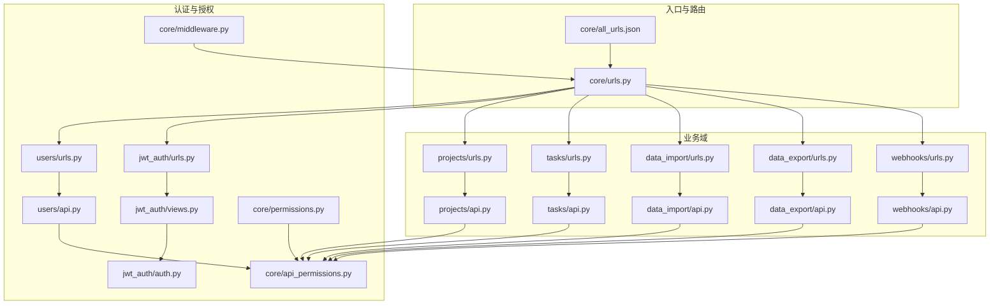
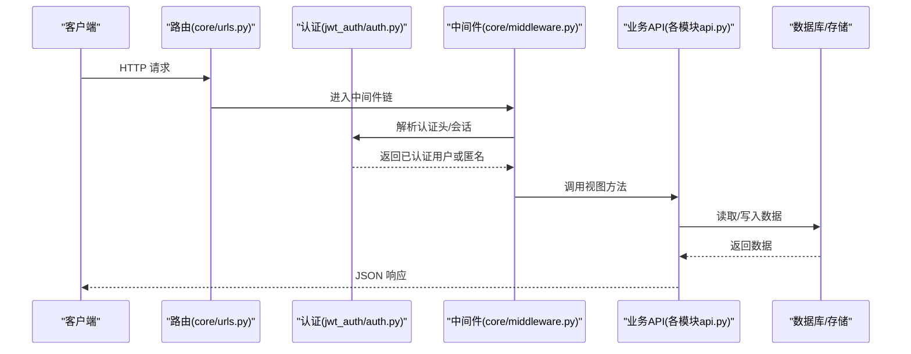
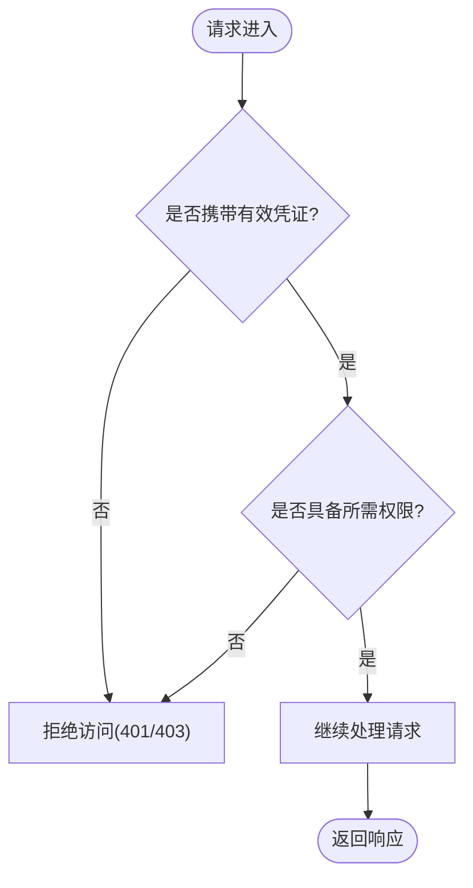
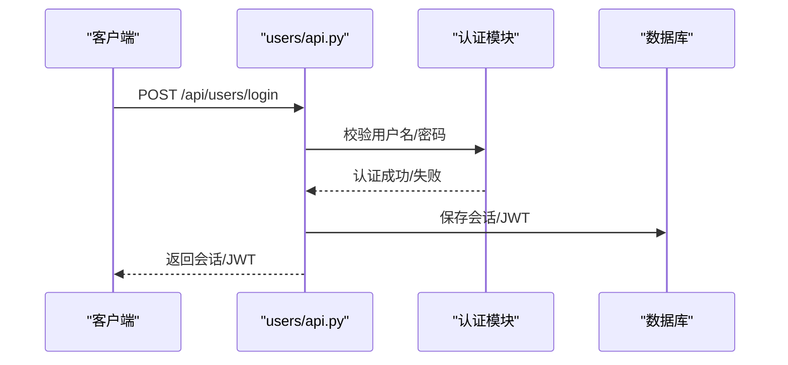
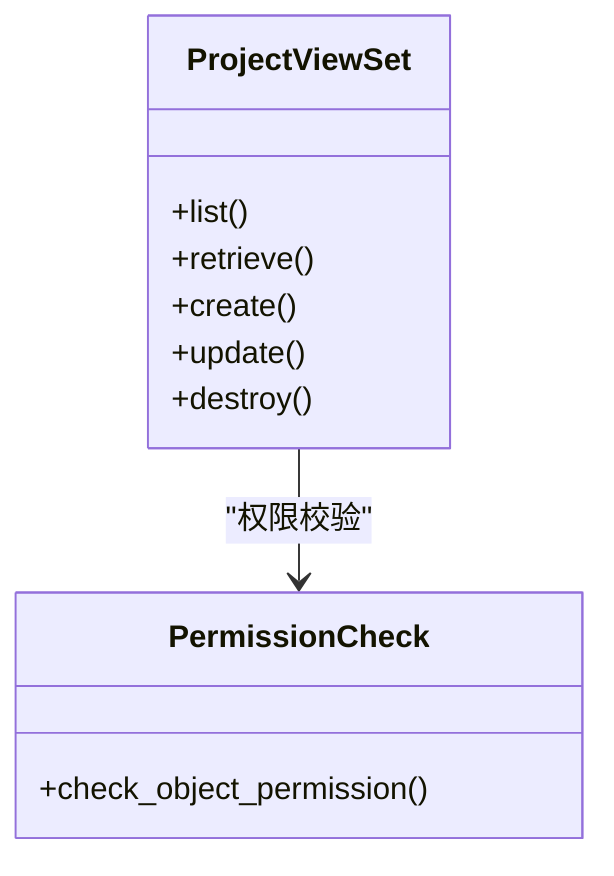
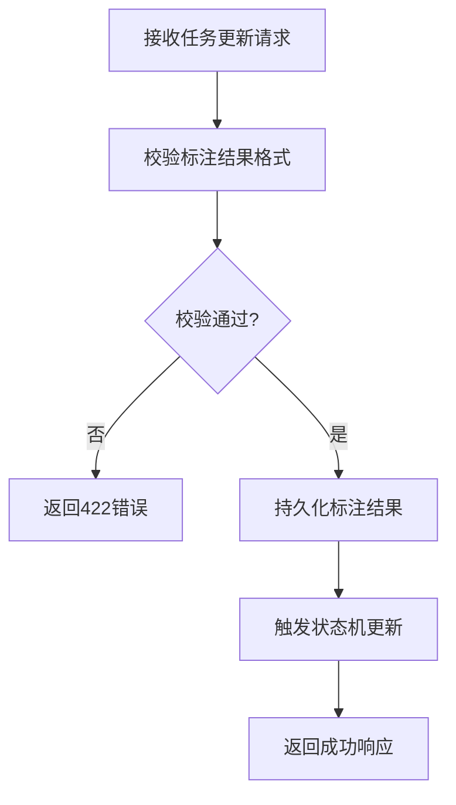
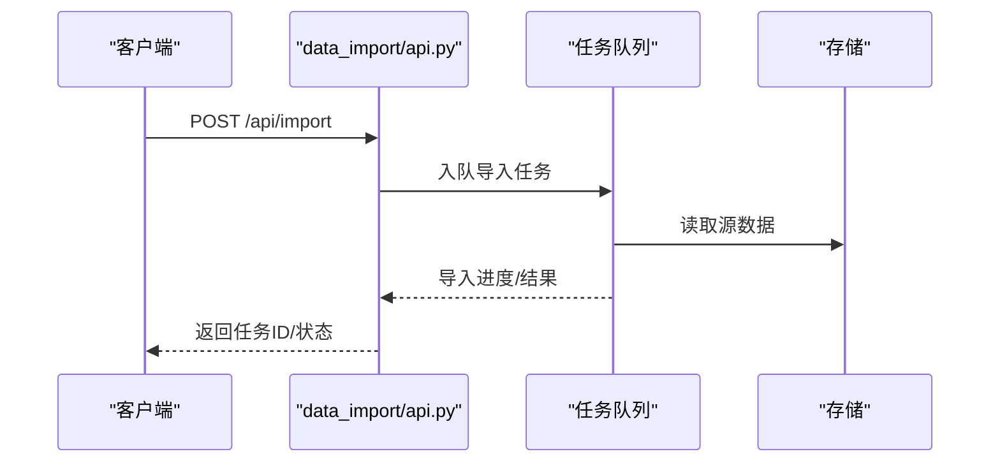
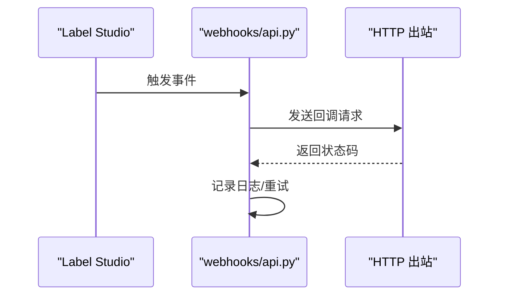
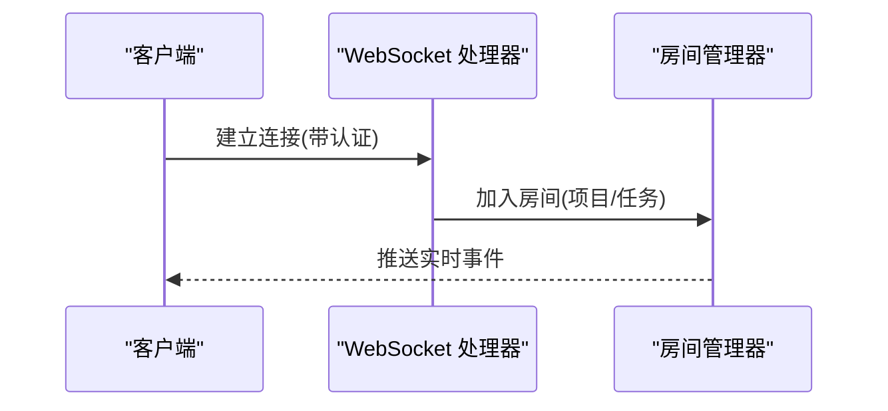
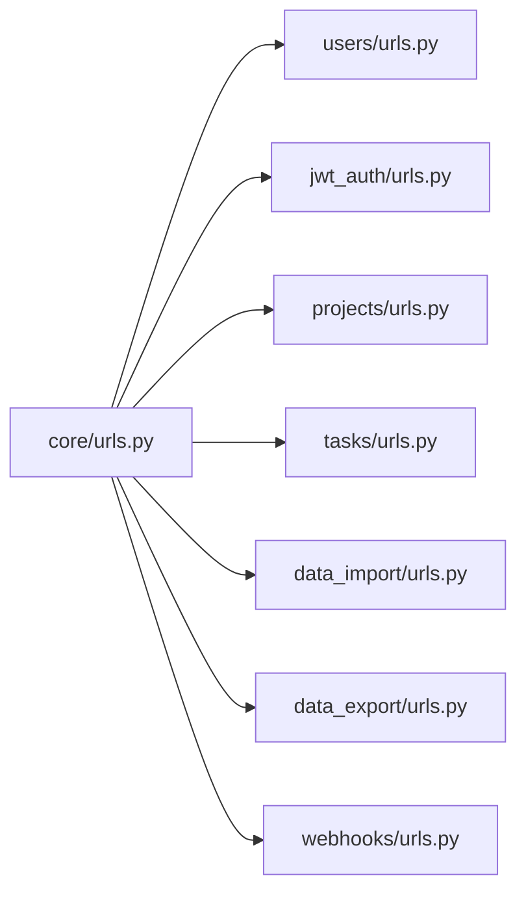

# API参考

<cite>
**本文引用的文件**   
- [label_studio/core/urls.py](file://label_studio/core/urls.py)
- [label_studio/users/api.py](file://label_studio/users/api.py)
- [label_studio/users/urls.py](file://label_studio/users/urls.py)
- [label_studio/projects/api.py](file://label_studio/projects/api.py)
- [label_studio/projects/urls.py](file://label_studio/projects/urls.py)
- [label_studio/tasks/api.py](file://label_studio/tasks/api.py)
- [label_studio/tasks/urls.py](file://label_studio/tasks/urls.py)
- [label_studio/data_import/api.py](file://label_studio/data_import/api.py)
- [label_studio/data_import/urls.py](file://label_studio/data_import/urls.py)
- [label_studio/data_export/api.py](file://label_studio/data_export/api.py)
- [label_studio/data_export/urls.py](file://label_studio/data_export/urls.py)
- [label_studio/webhooks/api.py](file://label_studio/webhooks/api.py)
- [label_studio/webhooks/urls.py](file://label_studio/webhooks/urls.py)
- [label_studio/jwt_auth/views.py](file://label_studio/jwt_auth/views.py)
- [label_studio/jwt_auth/urls.py](file://label_studio/jwt_auth/urls.py)
- [label_studio/jwt_auth/auth.py](file://label_studio/jwt_auth/auth.py)
- [label_studio/core/middleware.py](file://label_studio/core/middleware.py)
- [label_studio/core/api_permissions.py](file://label_studio/core/api_permissions.py)
- [label_studio/core/permissions.py](file://label_studio/core/permissions.py)
- [label_studio/core/version.py](file://label_studio/core/version.py)
- [label_studio/core/all_urls.json](file://label_studio/core/all_urls.json)
</cite>

## 目录
1. [简介](#简介)
2. [项目结构](#项目结构)
3. [核心组件](#核心组件)
4. [架构总览](#架构总览)
5. [详细组件分析](#详细组件分析)
6. [依赖关系分析](#依赖关系分析)
7. [性能与速率限制](#性能与速率限制)
8. [故障排查指南](#故障排查指南)
9. [结论](#结论)
10. [附录](#附录)

## 简介
本文件为 Label Studio REST API 的完整参考文档，覆盖认证授权、RESTful 端点、WebSocket 实时通信、Webhook 事件通知、API 版本管理、速率限制、错误码定义以及多客户端集成示例与最佳实践。文档面向不同技术背景的读者，提供从高层架构到代码级实现的系统性说明，并附带可视化图表帮助理解数据流与调用链。

## 项目结构
Label Studio 后端基于 Django + Django REST Framework（DRF）构建，API 路由按功能模块划分，主要包含：
- 用户与会话认证
- JWT 认证扩展
- 项目管理
- 任务与标注结果
- 数据导入/导出
- Webhook 事件
- 全局中间件、权限控制与版本信息

**图示来源**
- [label_studio/core/urls.py](file://label_studio/core/urls.py)
- [label_studio/core/all_urls.json](file://label_studio/core/all_urls.json)
- [label_studio/users/urls.py](file://label_studio/users/urls.py)
- [label_studio/jwt_auth/urls.py](file://label_studio/jwt_auth/urls.py)
- [label_studio/projects/urls.py](file://label_studio/projects/urls.py)
- [label_studio/tasks/urls.py](file://label_studio/tasks/urls.py)
- [label_studio/data_import/urls.py](file://label_studio/data_import/urls.py)
- [label_studio/data_export/urls.py](file://label_studio/data_export/urls.py)
- [label_studio/webhooks/urls.py](file://label_studio/webhooks/urls.py)

**章节来源**
- [label_studio/core/urls.py](file://label_studio/core/urls.py)
- [label_studio/core/all_urls.json](file://label_studio/core/all_urls.json)

## 核心组件
- 认证与授权
  - Session 认证：通过 DRF 默认会话机制实现，适用于浏览器端与同域请求。
  - JWT 认证：通过 jwt_auth 应用提供 Token 签发、校验与中间件注入，支持无状态访问。
  - 权限控制：基于角色与对象级权限，结合 api_permissions 与 permissions 模块进行细粒度控制。
- 业务模块
  - 用户与会话：用户注册、登录、个人信息、密码重置等。
  - 项目：项目 CRUD、配置、成员与权限。
  - 任务与标注：任务导入、查询、批量更新、标注结果读写、状态机流转。
  - 数据导入/导出：批量导入数据、导出标注结果。
  - Webhook：事件订阅与回调通知。
- 基础设施
  - 中间件：统一鉴权、跨域、日志、限流等。
  - 版本信息：API 版本管理与兼容性策略。

**章节来源**
- [label_studio/jwt_auth/auth.py](file://label_studio/jwt_auth/auth.py)
- [label_studio/core/middleware.py](file://label_studio/core/middleware.py)
- [label_studio/core/api_permissions.py](file://label_studio/core/api_permissions.py)
- [label_studio/core/permissions.py](file://label_studio/core/permissions.py)
- [label_studio/core/version.py](file://label_studio/core/version.py)

## 架构总览
Label Studio 的 API 采用分层架构：
- 路由层：core/urls.py 聚合各子模块 urls.py，all_urls.json 作为全量 URL 清单。
- 视图层：各模块 api.py 暴露 RESTful 接口，使用 DRF ViewSet/APIView。
- 服务层：模型与函数封装领域逻辑（如 tasks/functions.py、projects/functions.py）。
- 数据层：Django ORM 与外部存储（S3/GCS/Azure/本地）。
- 安全层：JWT 中间件、Session 认证、权限检查、CSRF/CORS 处理。

**图示来源**
- [label_studio/core/urls.py](file://label_studio/core/urls.py)
- [label_studio/jwt_auth/auth.py](file://label_studio/jwt_auth/auth.py)
- [label_studio/core/middleware.py](file://label_studio/core/middleware.py)

## 详细组件分析

### 认证与授权
- 认证方式
  - Session：适用于浏览器环境，依赖 CSRF 保护；适合交互式标注界面。
  - JWT：适用于服务端-to-服务端调用、移动端与第三方集成；通过 Authorization: Bearer <token> 传递。
- 授权模型
  - 组织/项目级角色与权限，结合对象级权限控制（如仅允许查看/编辑自己创建的任务）。
  - 管理员与普通用户权限分离，部分端点需管理员权限。

**图示来源**
- [label_studio/jwt_auth/auth.py](file://label_studio/jwt_auth/auth.py)
- [label_studio/core/api_permissions.py](file://label_studio/core/api_permissions.py)
- [label_studio/core/permissions.py](file://label_studio/core/permissions.py)

**章节来源**
- [label_studio/jwt_auth/auth.py](file://label_studio/jwt_auth/auth.py)
- [label_studio/core/api_permissions.py](file://label_studio/core/api_permissions.py)
- [label_studio/core/permissions.py](file://label_studio/core/permissions.py)

### 用户与会话 API
- 典型端点
  - 用户注册/登录/登出
  - 获取当前用户信息
  - 修改密码、邮箱验证
- 认证
  - Session：表单提交，CSRF Token 必须正确。
  - JWT：登录后获取 token，后续请求携带 Authorization 头。

**图示来源**
- [label_studio/users/api.py](file://label_studio/users/api.py)
- [label_studio/jwt_auth/views.py](file://label_studio/jwt_auth/views.py)

**章节来源**
- [label_studio/users/api.py](file://label_studio/users/api.py)
- [label_studio/users/urls.py](file://label_studio/users/urls.py)
- [label_studio/jwt_auth/views.py](file://label_studio/jwt_auth/views.py)
- [label_studio/jwt_auth/urls.py](file://label_studio/jwt_auth/urls.py)

### 项目管理 API
- 典型端点
  - 项目列表/详情
  - 创建/更新/删除项目
  - 项目配置、成员管理、权限设置
- 权限
  - 仅项目成员可操作；管理员可跨项目管理。

**图示来源**
- [label_studio/projects/api.py](file://label_studio/projects/api.py)
- [label_studio/core/api_permissions.py](file://label_studio/core/api_permissions.py)

**章节来源**
- [label_studio/projects/api.py](file://label_studio/projects/api.py)
- [label_studio/projects/urls.py](file://label_studio/projects/urls.py)

### 任务与标注 API
- 典型端点
  - 任务列表/筛选/分页
  - 任务创建/批量导入
  - 标注结果读取/更新/批量更新
  - 任务状态流转（草稿、完成、审核等）
- 复杂逻辑
  - 状态机驱动的状态变更
  - 并发更新与冲突检测
  - 结果校验与规范化

**图示来源**
- [label_studio/tasks/api.py](file://label_studio/tasks/api.py)

**章节来源**
- [label_studio/tasks/api.py](file://label_studio/tasks/api.py)
- [label_studio/tasks/urls.py](file://label_studio/tasks/urls.py)

### 数据导入/导出 API
- 导入
  - 批量上传任务数据（JSON/CSV/其他格式）
  - 异步任务队列处理大文件
- 导出
  - 导出标注结果为多种格式（JSON/CSV/XML）
  - 支持增量导出与过滤条件

**图示来源**
- [label_studio/data_import/api.py](file://label_studio/data_import/api.py)
- [label_studio/data_export/api.py](file://label_studio/data_export/api.py)

**章节来源**
- [label_studio/data_import/api.py](file://label_studio/data_import/api.py)
- [label_studio/data_import/urls.py](file://label_studio/data_import/urls.py)
- [label_studio/data_export/api.py](file://label_studio/data_export/api.py)
- [label_studio/data_export/urls.py](file://label_studio/data_export/urls.py)

### Webhook 事件通知
- 事件类型
  - 任务创建/更新/删除
  - 标注结果变更
  - 项目配置变更
- 回调机制
  - 异步发送，重试策略与失败告警
  - 支持签名校验与超时控制

**图示来源**
- [label_studio/webhooks/api.py](file://label_studio/webhooks/api.py)

**章节来源**
- [label_studio/webhooks/api.py](file://label_studio/webhooks/api.py)
- [label_studio/webhooks/urls.py](file://label_studio/webhooks/urls.py)

### WebSocket 实时通信
- 用途
  - 实时协作标注、在线预览、状态同步
- 连接流程
  - 客户端建立 WS 连接，携带认证信息（Session/JWT）
  - 服务端广播房间消息，按项目/任务维度隔离

[本节为概念性描述，未直接映射具体源码文件]

## 依赖关系分析
- 路由依赖
  - core/urls.py 聚合所有子模块 urls.py，形成统一入口。
  - all_urls.json 提供全量 URL 清单，便于自动化测试与文档生成。
- 模块耦合
  - 认证模块被所有业务模块依赖，确保统一鉴权。
  - 权限模块与业务模块解耦，便于扩展与复用。
- 外部依赖
  - 存储后端（S3/GCS/Azure/本地）通过抽象接口接入。
  - 任务队列用于异步导入/导出与 Webhook 发送。

**图示来源**
- [label_studio/core/urls.py](file://label_studio/core/urls.py)
- [label_studio/core/all_urls.json](file://label_studio/core/all_urls.json)

**章节来源**
- [label_studio/core/urls.py](file://label_studio/core/urls.py)
- [label_studio/core/all_urls.json](file://label_studio/core/all_urls.json)

## 性能与速率限制
- 速率限制
  - 建议对认证端点实施更严格的限速，防止暴力破解。
  - 对批量导入/导出端点启用队列与分页，避免阻塞主线程。
- 缓存策略
  - 对只读列表接口启用 Redis 缓存，提升高并发场景下的响应速度。
- 数据库优化
  - 对高频查询字段建立索引，减少 N+1 查询问题。
- 监控与告警
  - 结合 Prometheus/Grafana 监控 QPS、延迟与错误率。

[本节为通用指导，不直接分析具体源码文件]

## 故障排查指南
- 常见问题
  - 401 未认证：检查 Session Cookie 或 JWT Token 是否正确携带。
  - 403 权限不足：确认用户角色与对象级权限配置。
  - 422 参数校验失败：检查请求体结构与字段类型。
  - 500 服务器错误：查看后端日志与异常堆栈。
- 调试工具
  - 使用 curl 或 Postman 构造请求，开启详细日志。
  - 在开发环境启用 DRF 的 browsable API 查看请求/响应。
  - 使用浏览器开发者工具检查网络与 WebSocket 连接。

**章节来源**
- [label_studio/core/middleware.py](file://label_studio/core/middleware.py)
- [label_studio/core/api_permissions.py](file://label_studio/core/api_permissions.py)

## 结论
Label Studio 的 REST API 提供了完整的标注数据管理能力，支持多种认证方式与灵活的权限控制。通过模块化设计与清晰的职责划分，系统具备良好的可扩展性与可维护性。建议在集成时遵循本文档的最佳实践，并结合实际业务场景进行优化与定制。

[本节为总结性内容，不直接分析具体源码文件]

## 附录

### API 端点总览（按模块）
- 用户与会话
  - 注册/登录/登出
  - 获取当前用户信息
  - 修改密码/邮箱验证
- 项目管理
  - 项目 CRUD
  - 项目配置与成员管理
- 任务与标注
  - 任务列表/筛选/分页
  - 任务创建/批量导入
  - 标注结果读取/更新/批量更新
- 数据导入/导出
  - 批量导入任务数据
  - 导出标注结果
- Webhook
  - 事件订阅与回调

[本节为概览性内容，不直接分析具体源码文件]

### 认证与授权示例
- Python SDK
  - 使用 Session：登录后保持 Cookie，后续请求自动携带。
  - 使用 JWT：登录后获取 token，在请求头中设置 Authorization: Bearer <token>。
- curl 命令
  - 登录获取 Session/JWT
  - 携带凭证调用受保护端点
- JavaScript 客户端
  - 使用 fetch 或 axios 发起请求，注意跨域与 Cookie 设置。

[本节为示例性内容，不直接分析具体源码文件]

### WebSocket 集成示例
- 建立连接
  - 在浏览器中使用 WebSocket API，传入认证信息。
- 订阅房间
  - 按项目/任务维度加入房间，接收实时事件。
- 断开与重连
  - 实现断线重连与心跳检测。

[本节为示例性内容，不直接分析具体源码文件]

### API 版本管理与兼容性
- 版本策略
  - 通过 URL 路径或请求头指定 API 版本。
  - 向后兼容旧版本，逐步弃用废弃端点。
- 迁移指南
  - 提供版本升级说明与迁移脚本。

**章节来源**
- [label_studio/core/version.py](file://label_studio/core/version.py)