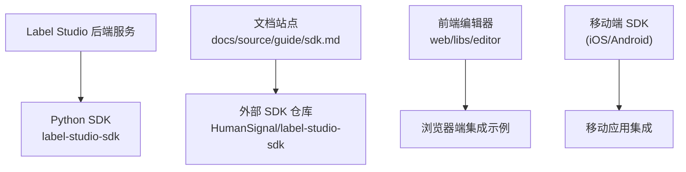
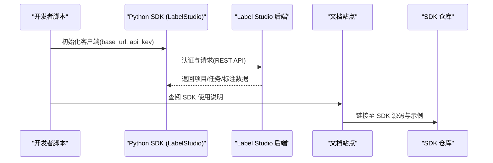
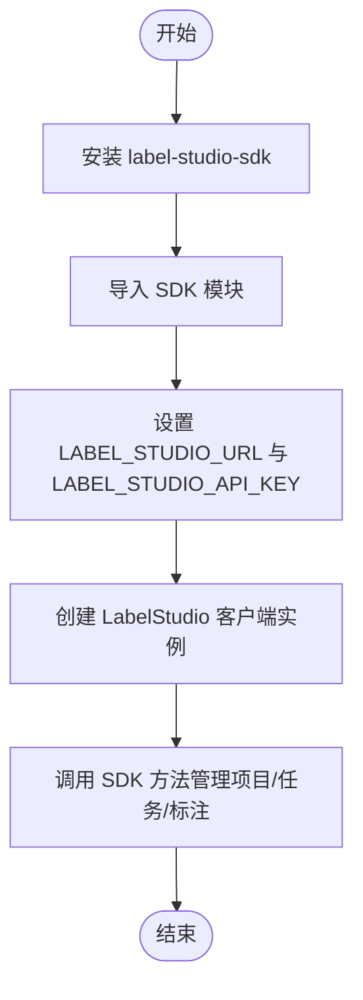
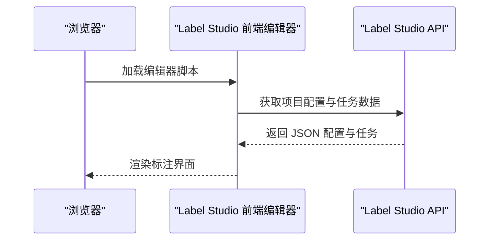
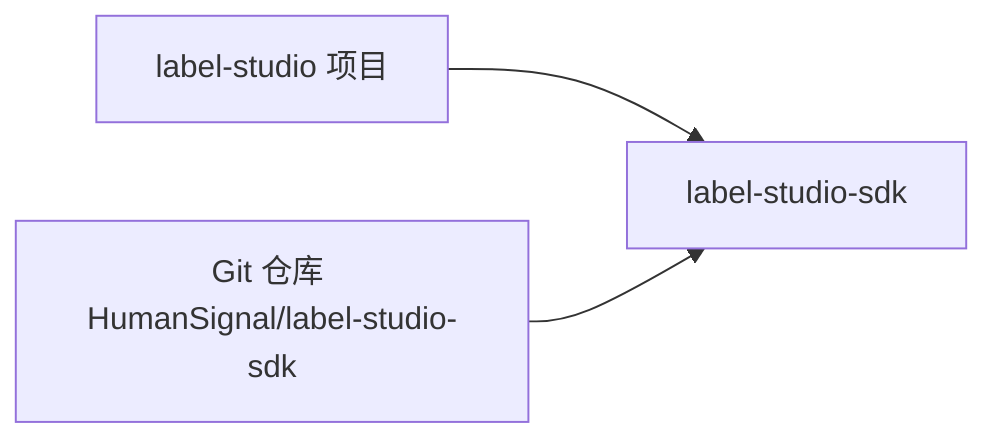

# SDK与集成

<cite>
**本文引用的文件**   
- [sdk.md](file://docs/source/guide/sdk.md)
- [pyproject.toml](file://pyproject.toml)
</cite>

## 目录
1. [简介](#简介)
2. [项目结构](#项目结构)
3. [核心组件](#核心组件)
4. [架构总览](#架构总览)
5. [详细组件分析](#详细组件分析)
6. [依赖关系分析](#依赖关系分析)
7. [性能考虑](#性能考虑)
8. [故障排查指南](#故障排查指南)
9. [结论](#结论)
10. [附录](#附录)

## 简介
本指南面向希望在数据科学与机器学习流水线中集成 Label Studio 的开发者，提供 Python SDK、JavaScript/TypeScript 客户端库以及移动端（iOS、Android）SDK 的安装、配置与使用要点。文档同时覆盖常见框架（Django、Flask、React、Vue）的集成思路、批量操作与异步处理、错误重试等高级用法，并给出性能优化建议、常见问题解决方案以及版本管理与向后兼容性说明。

## 项目结构
Label Studio 仓库将 Python SDK 作为外部依赖引入，并通过文档站点提供 SDK 的使用说明与链接。前端编辑器位于 web/libs/editor，但 JavaScript/TypeScript 客户端库与移动端 SDK 的具体实现不在当前仓库内，需参考官方 SDK 仓库与文档站点。

**图示来源** 
- [sdk.md:14-54](file://docs/source/guide/sdk.md#L14-L54)
- [pyproject.toml:71-75](file://pyproject.toml#L71-L75)

**章节来源**
- [sdk.md:14-54](file://docs/source/guide/sdk.md#L14-L54)
- [pyproject.toml:71-75](file://pyproject.toml#L71-L75)

## 核心组件
- Python SDK：通过 pip 安装，提供 LabelStudio 客户端类，用于连接 Label Studio 实例并管理项目、任务与标注结果。
- 文档与资源：文档页提供快速开始、API 参考链接与 README 链接，便于进一步查阅完整 API 与方法列表。
- 依赖管理：项目通过 pyproject.toml 声明对 label-studio-sdk 的依赖，并以 git 方式固定到特定提交，确保构建可重现。

**章节来源**
- [sdk.md:14-54](file://docs/source/guide/sdk.md#L14-L54)
- [pyproject.toml:71-75](file://pyproject.toml#L71-L75)

## 架构总览
下图展示 Python SDK 与 Label Studio 后端的交互流程，以及文档与外部 SDK 仓库的关系。

**图示来源**
- [sdk.md:28-54](file://docs/source/guide/sdk.md#L28-L54)

## 详细组件分析

### Python SDK 安装与基本使用
- 安装：通过 pip 安装 label-studio-sdk。
- 初始化：导入 SDK 并提供 base_url 与 api_key（支持个人访问令牌或旧版访问令牌）。
- 连接：创建 LabelStudio 客户端实例后即可调用其方法管理项目、任务和标注。

**图示来源**
- [sdk.md:28-47](file://docs/source/guide/sdk.md#L28-L47)

**章节来源**
- [sdk.md:28-47](file://docs/source/guide/sdk.md#L28-L47)

### JavaScript/TypeScript 客户端库集成
- 文档站点提供了 SDK 的 API 参考与 README 链接，可在其中查找 JS/TS 客户端库的使用方法与示例。
- 在 Web 应用中，通常通过 CDN 或包管理器引入客户端库，并在页面加载时初始化，随后与后端进行数据同步与预览。

[本节为概念性说明，不直接分析具体源文件]

### 移动端 SDK（iOS、Android）集成
- 移动端 SDK 通常提供原生封装以调用 Label Studio API，包括认证、任务拉取、标注结果上传等。
- 最佳实践：在网络层实现重试与退避策略；本地缓存任务与标注草稿；在 UI 上提供离线编辑与同步状态提示。

[本节为概念性说明，不直接分析具体源文件]

### 不同框架的集成示例
- Django：后端服务本身基于 Django，可直接复用项目的认证与权限机制，结合 Python SDK 自动化项目管理与数据导入导出。
- Flask：在轻量级服务中引入 Python SDK，封装 REST 接口供前端调用，实现任务分配、结果回传与统计。
- React/Vue：在前端集成 Label Studio 编辑器，通过 JS/TS 客户端库与后端 API 交互，完成实时保存与预览。

[本节为概念性说明，不直接分析具体源文件]

### 高级功能：批量操作、异步处理与错误重试
- 批量操作：利用 SDK 提供的批量接口或循环调用，结合分页参数高效导入/导出大量任务。
- 异步处理：结合任务队列（如 RQ/Django-RQ）执行耗时任务（数据清洗、批量导入），避免阻塞主线程。
- 错误重试：在网络层实现指数退避重试，针对临时网络异常与限流进行自动恢复。

[本节为概念性说明，不直接分析具体源文件]

## 依赖关系分析
Label Studio 项目在 pyproject.toml 中声明了对 label-studio-sdk 的依赖，并使用 uv 的 sources 字段将其固定到指定 Git 提交，以确保构建的可重复性与稳定性。

**图示来源**
- [pyproject.toml:71-75](file://pyproject.toml#L71-L75)

**章节来源**
- [pyproject.toml:71-75](file://pyproject.toml#L71-L75)

## 性能考虑
- 批量导入/导出：优先使用批量接口，减少往返次数；合理设置分页大小。
- 异步任务：将耗时操作放入后台任务队列，提升响应速度。
- 缓存与预取：对频繁读取的项目配置与标签元数据进行缓存。
- 网络优化：启用连接复用与压缩，必要时使用 CDN 托管静态资源。
- 监控与告警：接入日志与指标采集，及时发现慢查询与异常。

[本节为通用指导，不直接分析具体源文件]

## 故障排查指南
- 认证失败：检查 base_url 与 api_key 是否正确；确认访问令牌有效且具备所需权限。
- 连接超时：检查网络连通性与代理设置；适当增加超时与重试次数。
- 数据格式错误：核对任务与标注数据的 JSON 结构与必填字段。
- 版本不兼容：确保 SDK 版本与后端 API 版本匹配；关注向后兼容性说明。

[本节为通用指导，不直接分析具体源文件]

## 结论
通过 Python SDK 与 JS/TS 客户端库，开发者可以在数据科学与机器学习流水线中无缝集成 Label Studio，实现项目与任务的自动化管理、批量数据处理与高效的标注协作。结合移动端 SDK，可扩展至移动场景下的标注工作流。建议在项目中采用异步与重试机制以提升鲁棒性，并通过监控与缓存优化整体性能。

[本节为总结性内容，不直接分析具体源文件]

## 附录
- 文档与资源
  - API 参考：文档站点提供完整的 API 参考链接，便于查阅所有可用请求与参数。
  - SDK README：包含入门信息与更多代码示例。
  - 博客文章：提供 API 与 SDK 的使用技巧与案例。

**章节来源**
- [sdk.md:50-54](file://docs/source/guide/sdk.md#L50-L54)