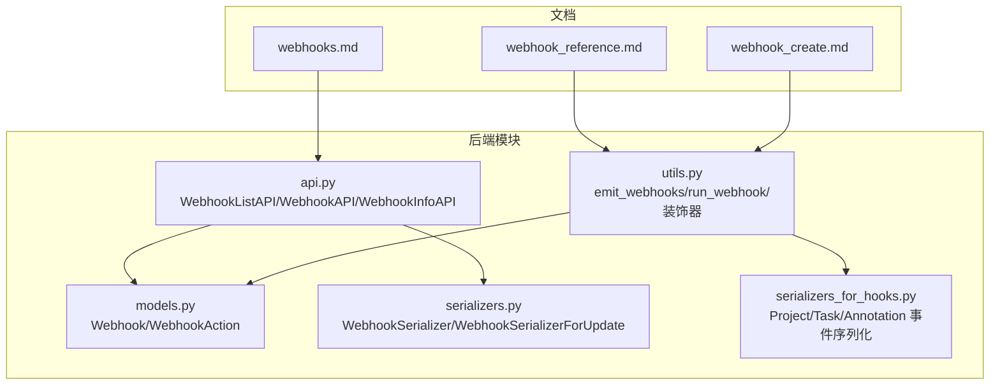
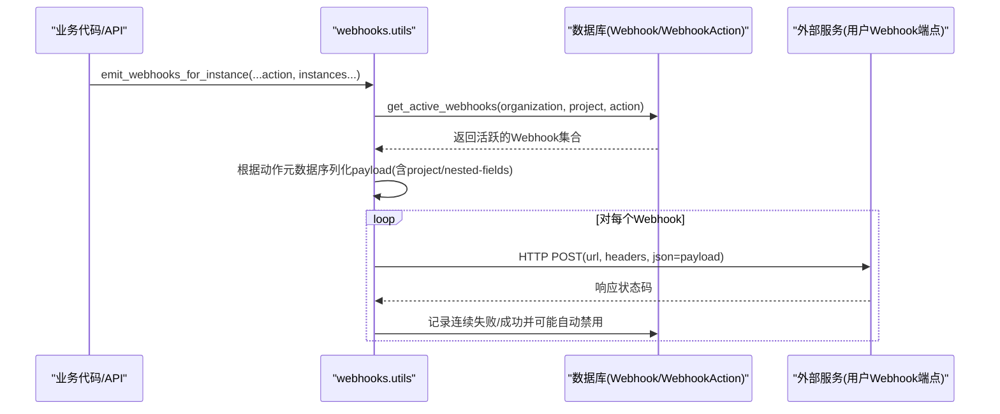
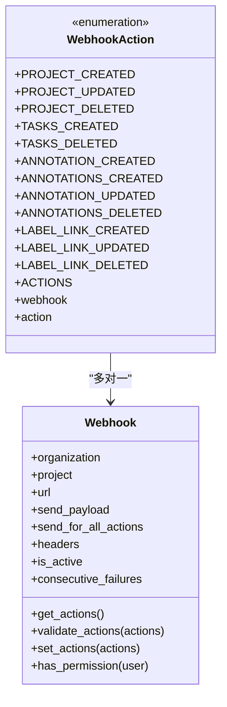
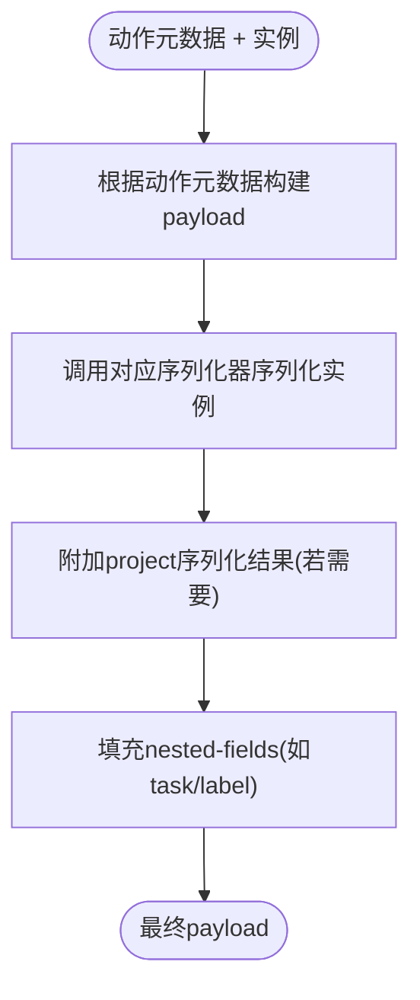
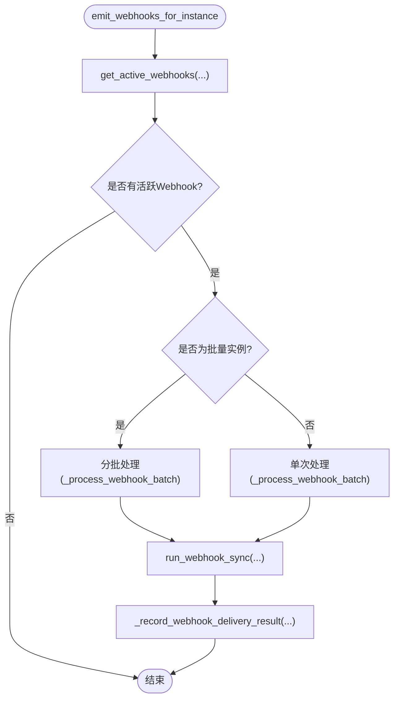
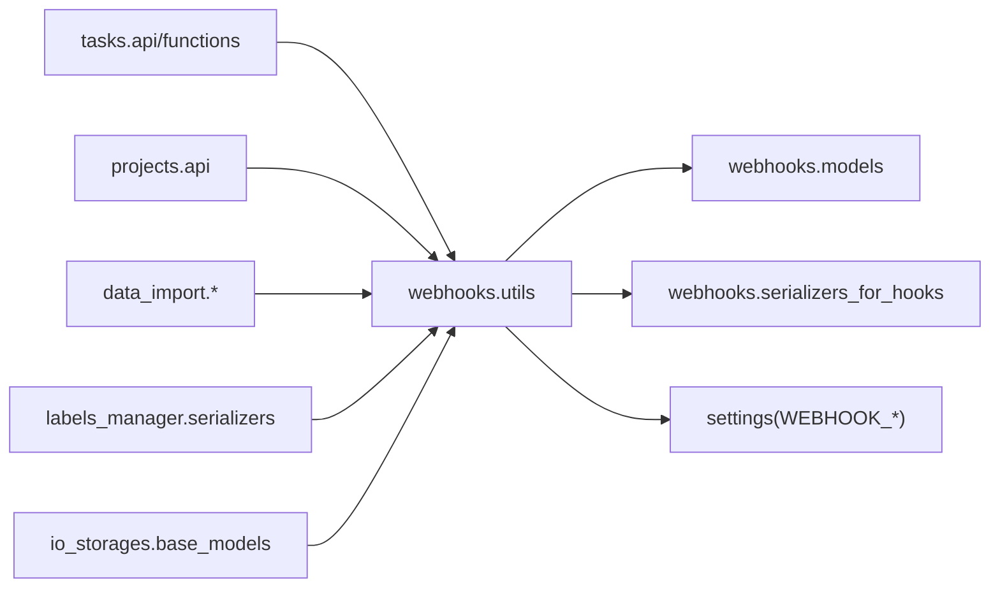

# Webhook与事件

<cite>
**本文引用的文件**   
- [webhooks.md](file://docs/source/guide/webhooks.md)
- [webhook_reference.md](file://docs/source/guide/webhook_reference.md)
- [webhook_create.md](file://docs/source/guide/webhook_create.md)
- [models.py](file://label_studio/webhooks/models.py)
- [api.py](file://label_studio/webhooks/api.py)
- [serializers.py](file://label_studio/webhooks/serializers.py)
- [utils.py](file://label_studio/webhooks/utils.py)
- [serializers_for_hooks.py](file://label_studio/webhooks/serializers_for_hooks.py)
</cite>

## 目录
1. [简介](#简介)
2. [项目结构](#项目结构)
3. [核心组件](#核心组件)
4. [架构总览](#架构总览)
5. [详细组件分析](#详细组件分析)
6. [依赖关系分析](#依赖关系分析)
7. [性能与可靠性](#性能与可靠性)
8. [故障排查指南](#故障排查指南)
9. [结论](#结论)
10. [附录：事件参考与最佳实践](#附录事件参考与最佳实践)

## 简介
本文件系统性说明 Label Studio 的 Webhook 与事件通知机制，覆盖配置、管理、测试接口，事件触发时机与数据结构定义（任务完成、用户变更、项目更新等），消息格式、签名验证、重试机制等安全特性，以及过滤、路由、批量处理等高级能力。同时提供监控、日志记录、故障排查相关接口说明，并给出不同编程语言的接收器实现思路与事件驱动架构的设计模式与最佳实践。

## 项目结构
Webhook 功能由以下模块组成：
- 文档层：用户指南与事件参考
- 模型层：Webhook、WebhookAction 数据模型与动作元数据
- API 层：Webhook 的 CRUD 与动作信息接口
- 序列化层：Webhook 请求/响应序列化与事件载荷序列化
- 工具层：事件发射、异步执行、批量处理、自动禁用与失败计数



**图表来源**
- [webhooks.md:1-148](file://docs/source/guide/webhooks.md#L1-L148)
- [webhook_reference.md:1-729](file://docs/source/guide/webhook_reference.md#L1-L729)
- [webhook_create.md:1-78](file://docs/source/guide/webhook_create.md#L1-L78)
- [models.py:26-279](file://label_studio/webhooks/models.py#L26-L279)
- [api.py:18-215](file://label_studio/webhooks/api.py#L18-L215)
- [serializers.py:8-79](file://label_studio/webhooks/serializers.py#L8-L79)
- [utils.py:18-326](file://label_studio/webhooks/utils.py#L18-L326)
- [serializers_for_hooks.py:7-51](file://label_studio/webhooks/serializers_for_hooks.py#L7-L51)

**章节来源**
- [webhooks.md:1-148](file://docs/source/guide/webhooks.md#L1-L148)
- [webhook_reference.md:1-729](file://docs/source/guide/webhook_reference.md#L1-L729)
- [webhook_create.md:1-78](file://docs/source/guide/webhook_create.md#L1-L78)

## 核心组件
- Webhook 模型：保存组织级或项目级 Webhook 配置（URL、Headers、是否发送负载、是否对所有动作生效、是否启用、连续失败次数等）。
- WebhookAction 模型：定义系统内置动作（项目、任务、标注、标签链接等）及其元数据（键名、是否多实例、所属模型、序列化器、嵌套字段、是否仅组织级等）。
- API 接口：列出/创建/获取/更新/删除 Webhook；查询可用动作描述。
- 序列化器：校验 URL（SSRF 防护）、封装 actions 列表、在更新时重置失败计数等。
- 工具函数：按组织/项目/动作筛选活跃 Webhook，同步/异步发送 HTTP POST，批量处理实例，装饰器简化 API 集成，自动禁用与失败计数。

**章节来源**
- [models.py:26-279](file://label_studio/webhooks/models.py#L26-L279)
- [api.py:18-215](file://label_studio/webhooks/api.py#L18-L215)
- [serializers.py:8-79](file://label_studio/webhooks/serializers.py#L8-L79)
- [utils.py:18-326](file://label_studio/webhooks/utils.py#L18-L326)

## 架构总览
Label Studio 通过“事件发射器 + Webhook 分发器”的模式将业务变更转化为 HTTP POST 事件，投递到用户配置的回调地址。关键流程如下：



**图表来源**
- [utils.py:18-179](file://label_studio/webhooks/utils.py#L18-L179)
- [models.py:110-264](file://label_studio/webhooks/models.py#L110-L264)

## 详细组件分析

### 模型与动作元数据
- Webhook：包含组织/项目关联、URL、Headers、send_payload、send_for_all_actions、is_active、consecutive_failures 等字段，并提供权限校验、动作集合操作。
- WebhookAction：集中声明所有内置动作常量与 ACTIONS 映射，定义 key、many、model、serializer、project-field、nested-fields、organization-only 等元数据，用于统一构建事件载荷与路由策略。



**图表来源**
- [models.py:26-108](file://label_studio/webhooks/models.py#L26-L108)
- [models.py:110-279](file://label_studio/webhooks/models.py#L110-L279)

**章节来源**
- [models.py:26-279](file://label_studio/webhooks/models.py#L26-L279)

### API 接口
- WebhookListAPI：列出/创建组织下的 Webhook，支持按 project 过滤。
- WebhookAPI：获取/更新/删除单个 Webhook，更新时使用专用序列化器禁止修改 project。
- WebhookInfoAPI：返回所有可用动作的描述，支持按 organization-only 过滤。

```mermaid
flowchart TD
Start(["HTTP 请求"]) --> CheckAuth["认证与权限检查"]
CheckAuth --> Route{"路由"}
Route --> |GET /webhooks/| List["WebhookListAPI.list"]
Route --> |POST /webhooks/| Create["WebhookListAPI.create"]
Route --> |GET /webhooks/{id}/| Get["WebhookAPI.get"]
Route --> |PUT/PATCH /webhooks/{id}/| Update["WebhookAPI.update"]
Route --> |DELETE /webhooks/{id}/| Delete["WebhookAPI.delete"]
Route --> |GET /webhooks/info/| Info["WebhookInfoAPI.get"]
List --> End(["JSON 响应"])
Create --> End
Get --> End
Update --> End
Delete --> End
Info --> End
```

**图表来源**
- [api.py:18-215](file://label_studio/webhooks/api.py#L18-L215)

**章节来源**
- [api.py:18-215](file://label_studio/webhooks/api.py#L18-L215)

### 序列化与载荷构造
- WebhookSerializer/WebhookSerializerForUpdate：封装 actions 列表、校验 URL（SSRF 保护）、在更新时重置连续失败计数。
- serializers_for_hooks：提供 ProjectWebhookSerializer（附带统计字段）、TaskWebhookSerializer（解析 $undefined$ 占位符）、AnnotationWebhookSerializer，以及 OnlyIDWebhookSerializer（仅 id）。



**图表来源**
- [utils.py:111-136](file://label_studio/webhooks/utils.py#L111-L136)
- [serializers_for_hooks.py:7-51](file://label_studio/webhooks/serializers_for_hooks.py#L7-L51)

**章节来源**
- [serializers.py:8-79](file://label_studio/webhooks/serializers.py#L8-L79)
- [serializers_for_hooks.py:7-51](file://label_studio/webhooks/serializers_for_hooks.py#L7-L51)

### 事件发射与异步执行
- get_active_webhooks：按组织/项目/动作筛选活跃 Webhook，支持 send_for_all_actions 与具体动作匹配。
- run_webhook_sync：向目标 URL 发起 HTTP POST，携带 headers 与 payload，捕获异常并记录结果。
- _record_webhook_delivery_result：基于 WEBHOOK_MAX_CONSECUTIVE_FAILURES 阈值自动禁用连续失败的 Webhook，使用原子更新避免并发问题。
- emit_webhooks/emit_webhooks_for_instance：批量/单实例发射，支持队列化异步执行（RQ）。
- 装饰器 api_webhook/api_webhook_for_delete：在 API 方法中自动提取实例并触发事件。



**图表来源**
- [utils.py:18-179](file://label_studio/webhooks/utils.py#L18-L179)
- [utils.py:181-228](file://label_studio/webhooks/utils.py#L181-L228)

**章节来源**
- [utils.py:18-326](file://label_studio/webhooks/utils.py#L18-L326)

## 依赖关系分析
- 业务模块（tasks、projects、data_import、labels_manager、io_storages 等）通过 utils.emit_webhooks_for_instance 触发事件。
- WebhookAction.ACTIONS 决定事件载荷结构与路由策略。
- settings.WEBHOOK_SERIALIZERS 动态加载各实体序列化器。
- SSRF 防护与超时、失败阈值等通过 settings 控制。



**图表来源**
- [utils.py:18-326](file://label_studio/webhooks/utils.py#L18-L326)
- [models.py:110-264](file://label_studio/webhooks/models.py#L110-L264)

**章节来源**
- [utils.py:18-326](file://label_studio/webhooks/utils.py#L18-L326)
- [models.py:110-264](file://label_studio/webhooks/models.py#L110-L264)

## 性能与可靠性
- 异步执行：通过 RQ 队列（high/low）异步派发 Webhook，降低主流程延迟。
- 批量处理：对大量实例进行分片处理，减少单次负载大小与序列化开销。
- 自动禁用：连续失败达到阈值后自动禁用 Webhook，防止雪崩。
- 原子更新：使用 F() 表达式与 Coalesce 保证并发下失败计数正确。
- 可配置超时：WEBHOOK_TIMEOUT 控制网络请求超时时间。

**章节来源**
- [utils.py:71-98](file://label_studio/webhooks/utils.py#L71-L98)
- [utils.py:111-179](file://label_studio/webhooks/utils.py#L111-L179)
- [utils.py:181-228](file://label_studio/webhooks/utils.py#L181-L228)

## 故障排查指南
- 连接不可达：查看日志中的 traceback，确认 URL 可达性与防火墙规则。
- 超时：调整 WEBHOOK_TIMEOUT 环境变量。
- 无重试：默认不重试失败投递；可通过外部队列或消费者侧重试机制补偿。
- 自动禁用：检查 consecutive_failures 与 WEBHOOK_MAX_CONSECUTIVE_FAILURES；重新激活或修正 endpoint/headers 后计数器会重置。
- 调试模式：DEBUG 模式下可查看成功投递日志。

**章节来源**
- [webhooks.md:130-143](file://docs/source/guide/webhooks.md#L130-L143)
- [utils.py:71-98](file://label_studio/webhooks/utils.py#L71-L98)

## 结论
Label Studio 的 Webhook 机制以“动作元数据 + 序列化器 + 异步分发”为核心，提供了稳定、可扩展的事件通知能力。通过组织级/项目级作用域、动作过滤、批量处理与自动禁用等特性，既能满足常见集成场景，也便于扩展自定义事件与复杂数据处理逻辑。

## 附录：事件参考与最佳实践

### 事件类型与触发时机
- 任务类：TASKS_CREATED、TASKS_DELETED
- 标注类：ANNOTATION_CREATED、ANNOTATIONS_CREATED、ANNOTATION_UPDATED、ANNOTATIONS_DELETED
- 项目类：PROJECT_CREATED、PROJECT_UPDATED、PROJECT_DELETED（需启用组织级 Webhook）
- 标签链接类：LABEL_LINK_CREATED、LABEL_LINK_UPDATED、LABEL_LINK_DELETED

上述事件的触发时机与载荷字段详见官方事件参考文档。

**章节来源**
- [webhook_reference.md:37-729](file://docs/source/guide/webhook_reference.md#L37-L729)
- [webhooks.md:39-90](file://docs/source/guide/webhooks.md#L39-L90)

### 消息格式与通用字段
- action：事件动作名称
- project：项目详情（部分事件包含）
- tasks/annotations/label_link：实体列表或对象（取决于动作）
- 其他统计字段（如 task_number、finished_task_number 等）在项目序列化器中提供

**章节来源**
- [webhook_reference.md:18-35](file://docs/source/guide/webhook_reference.md#L18-L35)
- [serializers_for_hooks.py:14-30](file://label_studio/webhooks/serializers_for_hooks.py#L14-L30)

### 安全特性
- SSRF 防护：创建/更新 Webhook 时对 URL 进行校验，阻止本地与内网访问（受 settings.SSRF_PROTECTION_ENABLED 控制）。
- Headers 白名单：HEADERS_SCHEMA 限制 Header 键名与数量。
- 超时与失败阈值：通过 WEBHOOK_TIMEOUT 与 WEBHOOK_MAX_CONSECUTIVE_FAILURES 控制。

**章节来源**
- [serializers.py:35-38](file://label_studio/webhooks/serializers.py#L35-L38)
- [models.py:16-23](file://label_studio/webhooks/models.py#L16-L23)
- [utils.py:58-63](file://label_studio/webhooks/utils.py#L58-L63)
- [utils.py:71-98](file://label_studio/webhooks/utils.py#L71-L98)

### 重试机制
- 默认不重试失败投递；可在消费者侧实现幂等重试与退避策略。
- 连续失败达到阈值后自动禁用，需人工干预恢复。

**章节来源**
- [webhooks.md:130-143](file://docs/source/guide/webhooks.md#L130-L143)
- [utils.py:71-98](file://label_studio/webhooks/utils.py#L71-L98)

### 事件过滤与路由
- 组织级 vs 项目级：组织级 Webhook 作用于整个组织；项目级 Webhook 仅作用于指定项目。
- send_for_all_actions：若为真，则所有动作均触发；否则仅触发已绑定的动作。
- organization-only：某些动作仅限组织级 Webhook。

**章节来源**
- [models.py:46-50](file://label_studio/webhooks/models.py#L46-L50)
- [models.py:127-264](file://label_studio/webhooks/models.py#L127-L264)
- [utils.py:18-41](file://label_studio/webhooks/utils.py#L18-L41)

### 批量处理
- 对大量实例（如批量导入任务、批量删除标注）采用分片处理，提升吞吐与稳定性。

**章节来源**
- [utils.py:111-179](file://label_studio/webhooks/utils.py#L111-L179)

### 监控与日志
- 成功投递：DEBUG 模式下可见日志。
- 失败追踪：连续失败计数与自动禁用日志。
- 建议：在消费者侧记录接收时间、处理耗时与错误堆栈，配合外部监控系统告警。

**章节来源**
- [webhooks.md:130-143](file://docs/source/guide/webhooks.md#L130-L143)
- [utils.py:57-67](file://label_studio/webhooks/utils.py#L57-L67)
- [utils.py:91-97](file://label_studio/webhooks/utils.py#L91-L97)

### 自定义事件扩展
- 扩展 WebhookAction.ACTIONS 添加新动作与序列化器。
- 在业务代码中调用 emit_webhooks/emit_webhooks_for_instance 触发事件。
- 可使用装饰器 @api_webhook/@api_webhook_for_delete 简化 API 集成。

**章节来源**
- [webhook_create.md:19-78](file://docs/source/guide/webhook_create.md#L19-L78)
- [utils.py:231-307](file://label_studio/webhooks/utils.py#L231-L307)

### 不同语言接收器实现示例（思路）
- Python（FastAPI/Flask/Django）：监听 POST，校验 headers（如 Authorization），解析 JSON body，根据 action 分支处理，返回 2xx 表示成功。
- Node.js（Express/Koa）：读取 req.body，校验签名（如需），根据 action 路由到处理器，返回 200。
- Go（Gin/Echo）：绑定 JSON 结构体，校验 headers，根据 action 分发，返回 200 OK。
- Java（Spring Boot）：@PostMapping 接收 JSON，使用 Jackson 反序列化，按 action 分支处理，返回 ResponseEntity.ok()。

注意：
- 确保 Webhook 端点对外可达且能接受 HTTPS。
- 建议在消费者侧实现幂等性（基于 action+id 去重）与重试退避。
- 如需签名验证，可在服务端生成共享密钥并在 headers 中传递签名，接收端校验。

[本节为概念性指导，不涉及具体源码]

### 事件驱动架构设计模式与最佳实践
- 发布-订阅：业务模块作为发布者，Webhook 作为订阅者，解耦核心流程与下游集成。
- 异步优先：使用队列异步派发，提高主流程性能与容错。
- 幂等与重试：消费者侧实现幂等与重试，保证最终一致性。
- 可观测性：记录关键指标（投递成功率、延迟、失败率）与链路追踪。
- 安全加固：SSRF 防护、Header 白名单、HTTPS、可选签名校验。
- 容量规划：合理设置批量大小、队列优先级与超时阈值。

[本节为概念性指导，不涉及具体源码]