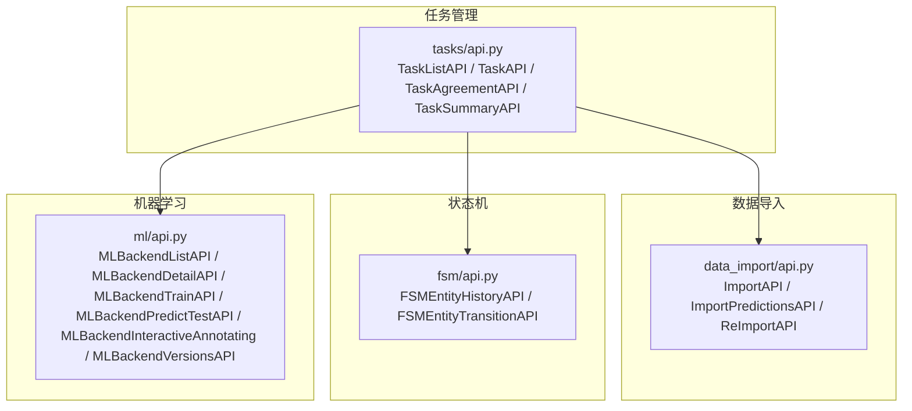
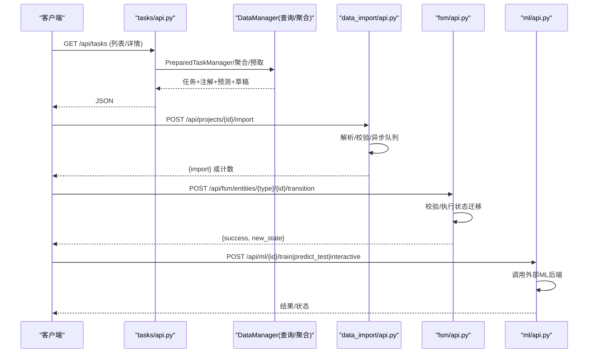
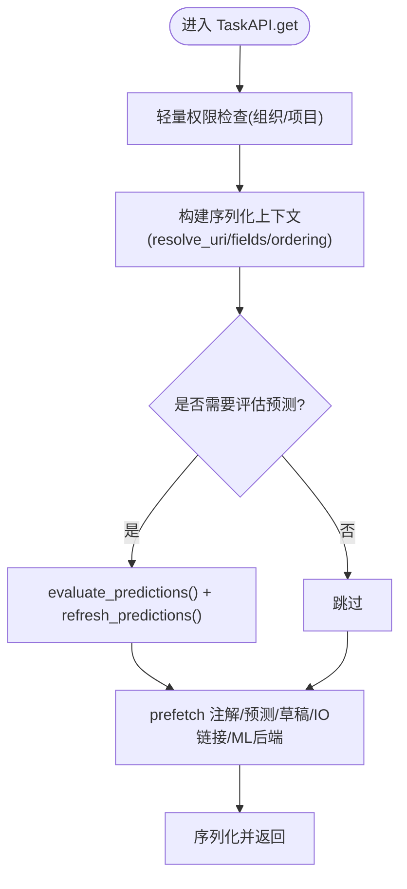
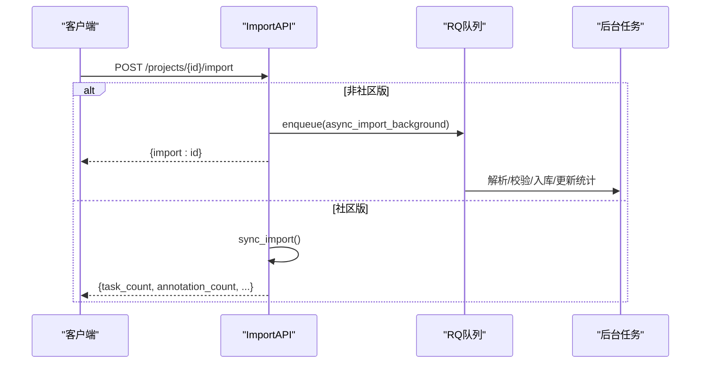
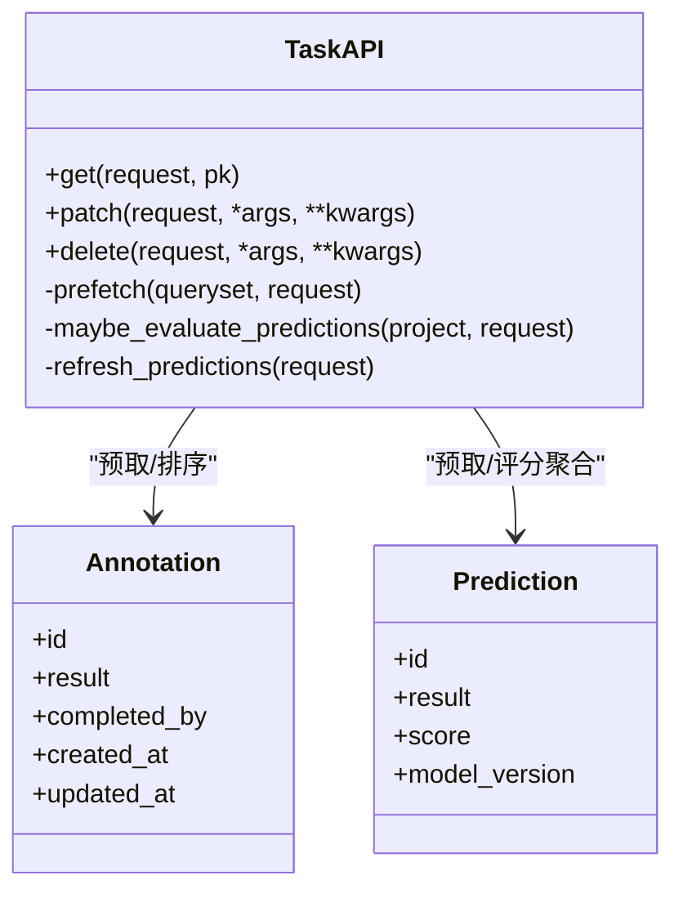
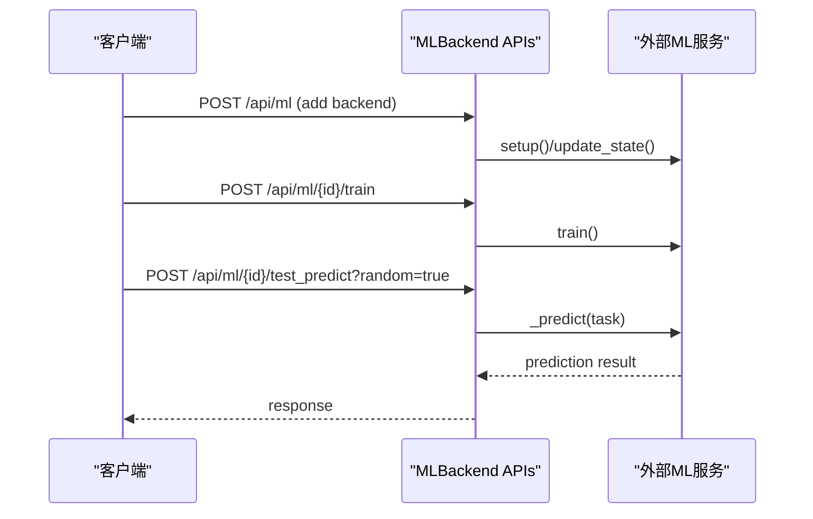
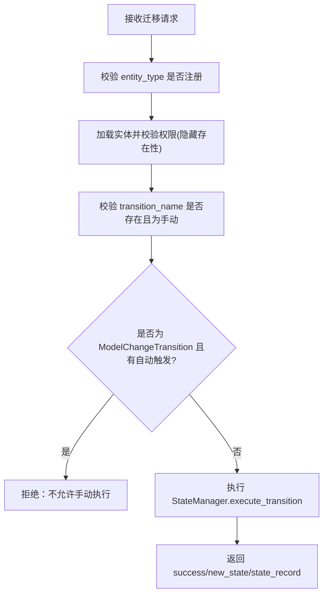
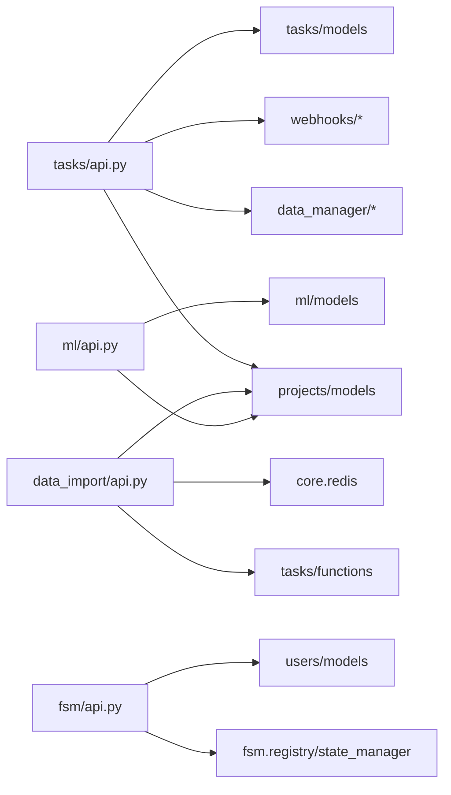

# 任务管理API

<cite>
**本文引用的文件**   
- [label_studio/tasks/api.py](file://label_studio/tasks/api.py)
- [label_studio/data_import/api.py](file://label_studio/data_import/api.py)
- [label_studio/fsm/api.py](file://label_studio/fsm/api.py)
- [label_studio/ml/api.py](file://label_studio/ml/api.py)
- [docs/source/guide/api.md](file://docs/source/guide/api.md)
</cite>

## 目录
1. [简介](#简介)
2. [项目结构](#项目结构)
3. [核心组件](#核心组件)
4. [架构总览](#架构总览)
5. [详细组件分析](#详细组件分析)
6. [依赖关系分析](#依赖关系分析)
7. [性能考虑](#性能考虑)
8. [故障排查指南](#故障排查指南)
9. [结论](#结论)
10. [附录](#附录)

## 简介
本文件为 Label Studio 任务管理的 RESTful API 完整文档，覆盖任务的创建、更新、删除、查询等基础操作；批量导入与数据预处理；预测结果导入与查询；标注结果管理与版本控制；工作流与状态机（FSM）相关接口；以及搜索、过滤、排序等查询能力。同时提供错误处理机制说明与最佳实践建议。

认证方式参考：
- 个人访问令牌（PAT）使用 Authorization: Bearer <token>
- 旧版令牌使用 Authorization: Token <token>

**章节来源**
- [docs/source/guide/api.md:22-75](file://docs/source/guide/api.md#L22-L75)

## 项目结构
围绕任务管理的后端实现主要分布在以下模块：
- tasks：任务实体、列表/详情、统计摘要、标签分布等
- data_import：批量任务导入、预测导入、异步/同步导入流程
- fsm：通用状态机与实体状态历史、手动触发状态迁移
- ml：机器学习后端集成（添加/更新/删除、训练、测试预测、交互式预标注、模型版本）

**图表来源**
- [label_studio/tasks/api.py:76-520](file://label_studio/tasks/api.py#L76-L520)
- [label_studio/data_import/api.py:148-510](file://label_studio/data_import/api.py#L148-L510)
- [label_studio/fsm/api.py:74-211](file://label_studio/fsm/api.py#L74-L211)
- [label_studio/ml/api.py:28-433](file://label_studio/ml/api.py#L28-L433)

**章节来源**
- [label_studio/tasks/api.py:76-520](file://label_studio/tasks/api.py#L76-L520)
- [label_studio/data_import/api.py:148-510](file://label_studio/data_import/api.py#L148-L510)
- [label_studio/fsm/api.py:74-211](file://label_studio/fsm/api.py#L74-L211)
- [label_studio/ml/api.py:28-433](file://label_studio/ml/api.py#L28-L433)

## 核心组件
- 任务列表与详情
  - 列表：支持分页、视图/项目筛选、字段展开、复杂查询（filters/selectedItems/ordering）、预览模式（annotations_stub）
  - 详情：支持注解/预测/草稿的预取与排序、可选自动评估预测、代理存储URL解析
- 批量导入
  - 任务导入：JSON/CSV/TSV/TXT 或 URL；支持预标注字段映射；社区版同步返回计数，非社区版异步返回 import_id
  - 预测导入：内存高效批处理或兼容模式；支持自定义校验器与 label_config 校验
- 状态机与工作流
  - 实体状态历史查询（task/annotation/project）
  - 手动执行已注册的状态迁移（含权限与自动触发保护）
- 机器学习集成
  - ML 后端增删改查、训练、测试预测、交互式预标注、模型版本获取

**章节来源**
- [label_studio/tasks/api.py:76-520](file://label_studio/tasks/api.py#L76-L520)
- [label_studio/data_import/api.py:148-510](file://label_studio/data_import/api.py#L148-L510)
- [label_studio/fsm/api.py:74-211](file://label_studio/fsm/api.py#L74-L211)
- [label_studio/ml/api.py:28-433](file://label_studio/ml/api.py#L28-L433)

## 架构总览
任务管理 API 通过 DRF ViewSet/APIView 暴露端点，结合 Django ORM 与数据管理器（DataManager）完成复杂查询与聚合；导入模块负责多格式解析与异步任务调度；FSM 模块提供统一的状态迁移与审计；ML 模块对接外部模型服务。

**图表来源**
- [label_studio/tasks/api.py:76-520](file://label_studio/tasks/api.py#L76-L520)
- [label_studio/data_import/api.py:148-510](file://label_studio/data_import/api.py#L148-L510)
- [label_studio/fsm/api.py:74-211](file://label_studio/fsm/api.py#L74-L211)
- [label_studio/ml/api.py:28-433](file://label_studio/ml/api.py#L28-L433)

## 详细组件分析

### 任务基础操作（CRUD）
- 列表任务
  - 方法：GET /api/tasks
  - 关键参数
    - view：视图ID
    - project：项目ID
    - resolve_uri：是否将存储URI转换为代理URL
    - fields：all/task_only（是否包含注解/预测）
    - review：仅获取待审任务
    - include：指定返回字段
    - query：复杂查询（filters/selectedItems/ordering），需JSON字符串
  - 响应：分页对象，包含 tasks、total、total_annotations、total_predictions
- 获取任务
  - 方法：GET /api/tasks/{id}
  - 关键参数
    - annotations_ordering：注解/预测排序（-id/id）
    - annotations_stub：轻量注解模式
    - resolve_uri：代理URL开关
  - 行为：若项目开启自动评估预测且无预测，则触发一次评估并刷新预测缓存
- 更新任务
  - 方法：PATCH /api/tasks/{id}
  - 请求体：简化任务字段（如元数据、分配等）
- 删除任务
  - 方法：DELETE /api/tasks/{id}
  - 行为：不可逆删除，触发 Webhook

**图表来源**
- [label_studio/tasks/api.py:376-450](file://label_studio/tasks/api.py#L376-L450)
- [label_studio/tasks/api.py:438-510](file://label_studio/tasks/api.py#L438-L510)

**章节来源**
- [label_studio/tasks/api.py:76-316](file://label_studio/tasks/api.py#L76-L316)
- [label_studio/tasks/api.py:316-520](file://label_studio/tasks/api.py#L316-L520)

### 批量任务导入与数据预处理
- 导入任务
  - 方法：POST /api/projects/{id}/import
  - 支持数据源
    - JSON 数组
    - CSV/TSV/TXT 文件
    - URL（远程文件）
  - 关键参数
    - commit_to_project：是否立即提交到项目
    - return_task_ids：是否返回任务ID列表
    - preannotated_from_fields：从任务字段映射生成初始预测
  - 行为差异
    - 非社区版：异步处理，返回 {import: id}，后续轮询状态
    - 社区版：同步处理，返回任务/注解/预测计数与耗时
- 导入预测
  - 方法：POST /api/projects/{id}/predictions
  - 行为
    - 内存高效批处理（默认启用特性标志）或兼容模式
    - 校验 task ID 存在性、label_config 预测格式、自定义校验器
    - 批量写入 Prediction 并异步更新任务计数器

**图表来源**
- [label_studio/data_import/api.py:148-466](file://label_studio/data_import/api.py#L148-L466)

**章节来源**
- [label_studio/data_import/api.py:148-466](file://label_studio/data_import/api.py#L148-L466)
- [label_studio/data_import/api.py:468-701](file://label_studio/data_import/api.py#L468-L701)

### 标注结果管理与审核流程
- 标注结果
  - 通过任务详情接口返回注解列表（可展开 completed_by）
  - 支持注解/预测排序、轻量模式（annotations_stub）
- 审核流程
  - 列表接口支持 review=true 获取待审任务
  - 通过 FSM 接口查看状态历史与执行手动迁移（如“开始审核”、“通过/拒绝”）

**图表来源**
- [label_studio/tasks/api.py:329-450](file://label_studio/tasks/api.py#L329-L450)

**章节来源**
- [label_studio/tasks/api.py:316-520](file://label_studio/tasks/api.py#L316-L520)
- [label_studio/fsm/api.py:74-211](file://label_studio/fsm/api.py#L74-L211)

### 预测结果的提交与查询（ML 集成）
- 添加/更新/删除 ML 后端
  - 列表：GET /api/ml?project={id}
  - 新增：POST /api/ml
  - 详情/更新/删除：GET/PATCH/DELETE /api/ml/{id}
- 训练与测试
  - 训练：POST /api/ml/{id}/train
  - 测试预测：POST /api/ml/{id}/test_predict?random=true
- 交互式预标注
  - POST /api/ml/{id}/interactive_annotating
- 模型版本
  - GET /api/ml/{id}/versions

**图表来源**
- [label_studio/ml/api.py:28-433](file://label_studio/ml/api.py#L28-L433)

**章节来源**
- [label_studio/ml/api.py:28-433](file://label_studio/ml/api.py#L28-L433)

### 任务状态管理与工作流控制（FSM）
- 查询实体状态历史
  - GET /api/fsm/entities/{entity_type}/{entity_id}/history
  - 过滤：created_at_from/to、state、previous_state、transition_name、triggered_by
  - 分页：page/page_size
- 手动执行状态迁移
  - POST /api/fsm/entities/{entity_type}/{entity_id}/transition
  - 请求体：{ transition_name, transition_data }
  - 限制：自动触发的迁移不可手动执行

**图表来源**
- [label_studio/fsm/api.py:74-211](file://label_studio/fsm/api.py#L74-L211)

**章节来源**
- [label_studio/fsm/api.py:74-211](file://label_studio/fsm/api.py#L74-L211)

### 任务搜索、过滤、排序
- 列表接口支持
  - 基础过滤：project
  - 高级查询：query 参数（JSON 字符串）
    - filters：conjunction + items（filter/operator/type/value）
    - selectedItems：all/included/excluded
    - ordering：按字段排序（当前单字段）
- 注解/预测排序：annotations_ordering=-id/id
- 预览模式：annotations_stub=false/true

**章节来源**
- [label_studio/tasks/api.py:99-205](file://label_studio/tasks/api.py#L99-L205)
- [label_studio/tasks/api.py:237-316](file://label_studio/tasks/api.py#L237-L316)

## 依赖关系分析
- tasks/api.py 依赖
  - data_manager：PrepareParams、DataManagerTaskSerializer、evaluate_predictions
  - projects/models：Project
  - webhooks：WebhookAction、emit_webhooks_for_instance
  - tasks.models：Task/Annotation/Prediction/AnnotationDraft
- data_import/api.py 依赖
  - projects/models：Project/ProjectImport/ProjectReimport
  - tasks.functions：update_tasks_counters
  - core.redis：start_job_async_or_sync
- fsm/api.py 依赖
  - fsm.registry/state_manager/transition_registry：状态模型与迁移注册
  - users/models：用户信息用于审计
- ml/api.py 依赖
  - projects/models：Project/Task
  - ml.models：MLBackend

**图表来源**
- [label_studio/tasks/api.py:1-53](file://label_studio/tasks/api.py#L1-L53)
- [label_studio/data_import/api.py:1-56](file://label_studio/data_import/api.py#L1-L56)
- [label_studio/fsm/api.py:1-26](file://label_studio/fsm/api.py#L1-L26)
- [label_studio/ml/api.py:1-24](file://label_studio/ml/api.py#L1-L24)

**章节来源**
- [label_studio/tasks/api.py:1-53](file://label_studio/tasks/api.py#L1-L53)
- [label_studio/data_import/api.py:1-56](file://label_studio/data_import/api.py#L1-L56)
- [label_studio/fsm/api.py:1-26](file://label_studio/fsm/api.py#L1-L26)
- [label_studio/ml/api.py:1-24](file://label_studio/ml/api.py#L1-L24)

## 性能考虑
- 任务详情
  - 使用 prefetch_related 预取注解/预测/草稿/IO链接/ML后端，避免 N+1
  - annotations_stub 模式减少负载
  - maybe_evaluate_predictions 仅在必要时触发一次评估，并刷新预测缓存
- 批量导入
  - 非社区版采用异步队列，避免长事务阻塞
  - 预测导入采用内存高效批处理（默认特性标志），降低峰值内存占用
- 统计与聚合
  - TaskAgreementAPI/TaskSummaryAPI 在数据库层聚合，避免全量拉取注解结果

[本节为通用指导，不直接分析具体文件]

## 故障排查指南
- 常见错误
  - 无效主键：返回“对象不存在”提示（不泄露存在性）
  - 权限不足：对任务/项目/ML后端进行权限校验失败时返回 404/403
  - 预测校验失败：label_config 或自定义校验器报错，返回详细错误列表
  - 异步导入入队失败：标记导入任务为 FAILED，附带错误堆栈
- 调试建议
  - 使用 annotations_stub=false 查看完整注解/预测
  - 使用 resolve_uri=false 查看原始存储路径
  - 通过 FSM 历史接口追踪状态变更轨迹
  - 检查 ML 后端日志与 test_predict 返回值

**章节来源**
- [label_studio/tasks/api.py:56-73](file://label_studio/tasks/api.py#L56-L73)
- [label_studio/data_import/api.py:305-333](file://label_studio/data_import/api.py#L305-L333)
- [label_studio/data_import/api.py:423-452](file://label_studio/data_import/api.py#L423-L452)
- [label_studio/fsm/api.py:148-211](file://label_studio/fsm/api.py#L148-L211)

## 结论
本 API 体系围绕任务生命周期展开，提供从数据导入、标注、预测、审核到工作流控制的完整闭环。通过异步导入、内存高效批处理、数据库级聚合等手段保障性能与可扩展性；FSM 提供灵活的工作流扩展点；ML 模块无缝对接外部模型服务，满足自动化与智能化标注需求。

[本节为总结性内容，不直接分析具体文件]

## 附录
- 认证与示例
  - 使用 PAT 或旧版令牌进行 HTTP 请求认证
  - 参考官方 API 文档获取交互示例与 SDK 用法

**章节来源**
- [docs/source/guide/api.md:22-75](file://docs/source/guide/api.md#L22-L75)