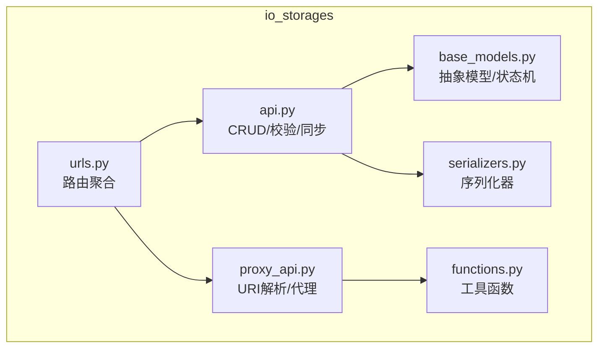
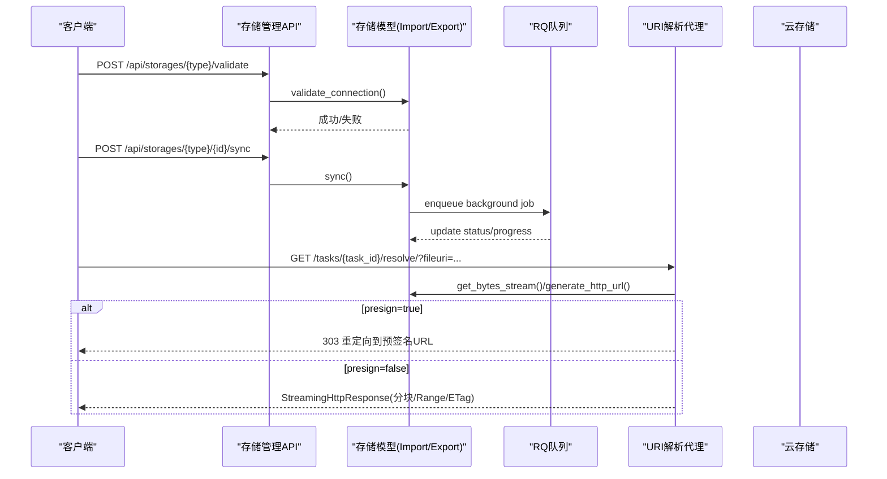
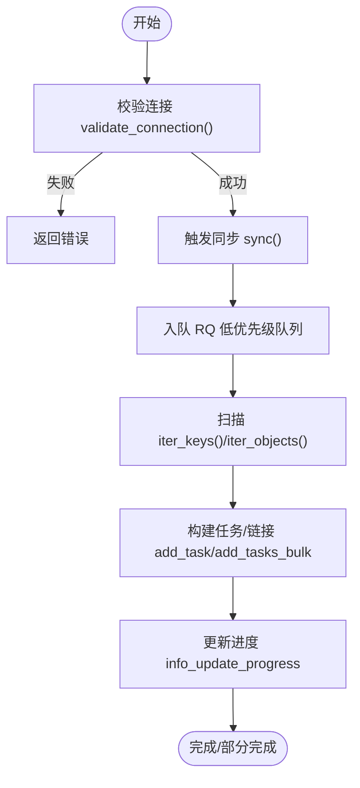
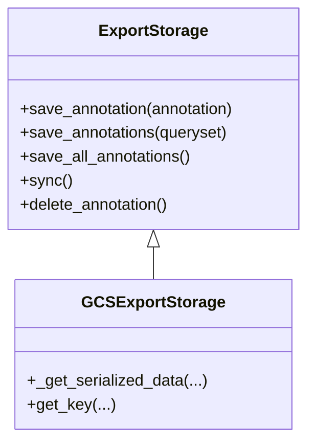
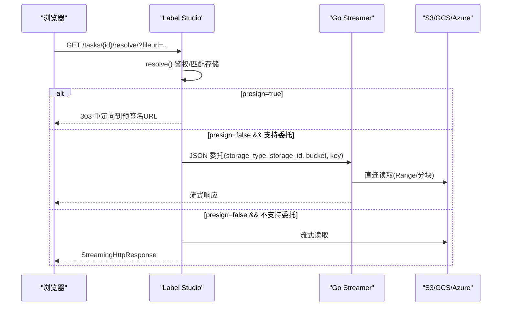
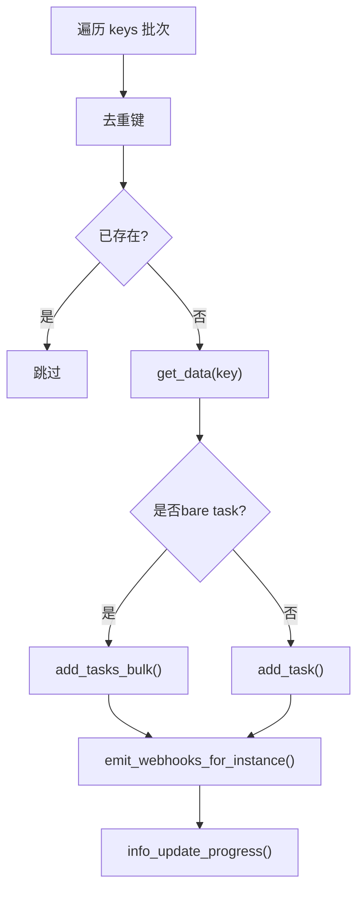
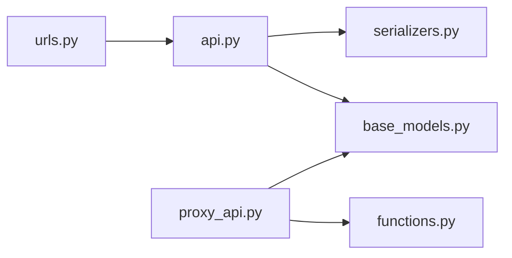

# 存储系统API

<cite>
**本文引用的文件**   
- [README.md](file://label_studio/io_storages/README.md)
- [api.py](file://label_studio/io_storages/api.py)
- [urls.py](file://label_studio/io_storages/urls.py)
- [base_models.py](file://label_studio/io_storages/base_models.py)
- [proxy_api.py](file://label_studio/io_storages/proxy_api.py)
- [serializers.py](file://label_studio/io_storages/serializers.py)
- [functions.py](file://label_studio/io_storages/functions.py)
- [storage.md](file://docs/source/guide/storage.md)
- [storage_s3.md](file://docs/source/guide/storage_s3.md)
- [storage_azure.md](file://docs/source/guide/storage_azure.md)
- [storage_gcp.md](file://docs/source/guide/storage_gcp.md)
</cite>

## 目录
1. [简介](#简介)
2. [项目结构](#项目结构)
3. [核心组件](#核心组件)
4. [架构总览](#架构总览)
5. [详细组件分析](#详细组件分析)
6. [依赖关系分析](#依赖关系分析)
7. [性能与优化](#性能与优化)
8. [故障排查指南](#故障排查指南)
9. [结论](#结论)
10. [附录：接口清单与配置示例](#附录接口清单与配置示例)

## 简介
本文件为 Label Studio 存储系统的 RESTful API 完整文档，覆盖导入/导出存储（S3、Azure Blob、GCS、Redis、本地文件）的创建、校验、同步、列表与详情接口；任务与项目的资源代理（预签名URL或流式代理）；以及批量导入、异步任务状态监控、权限校验、路径解析等高级能力。同时提供各云存储的配置要点与安全建议，帮助快速集成并稳定运行。

## 项目结构
存储子系统位于 label_studio/io_storages，采用“通用抽象 + 后端实现 + 统一路由”的分层组织方式：
- 抽象与模型：base_models.py 定义 StorageInfo、Storage、ImportStorage、ExportStorage 等基类与生命周期状态机
- API 控制器：api.py 暴露统一的导入/导出存储 CRUD、校验、同步、表单布局等接口
- URL 路由：urls.py 聚合所有后端类型（S3/Azure/GCS/Redis/Localfiles）的导入/导出端点，以及 URI 解析代理
- 代理与流式传输：proxy_api.py 负责任务/项目级 URI 解析、预签名重定向或流式代理
- 序列化器：serializers.py 提供读写/校验专用序列化器与字段封装
- 工具函数：functions.py 提供实例校验、存储注册表、URL→存储匹配等工具

图表来源
- [urls.py:81-193](file://label_studio/io_storages/urls.py#L81-L193)
- [api.py:23-197](file://label_studio/io_storages/api.py#L23-L197)
- [proxy_api.py:72-133](file://label_studio/io_storages/proxy_api.py#L72-L133)
- [base_models.py:52-350](file://label_studio/io_storages/base_models.py#L52-L350)

章节来源
- [urls.py:81-193](file://label_studio/io_storages/urls.py#L81-L193)
- [api.py:23-197](file://label_studio/io_storages/api.py#L23-L197)

## 核心组件
- 存储抽象与状态机
  - StorageInfo：记录 last_sync、last_sync_count、last_sync_job、status、traceback、meta 等，提供 queued/in_progress/completed/failed 等状态转换与心跳检测
  - Storage：基础能力如 validate_connection、can_resolve_scheme/url
  - ImportStorage：iter_objects/iter_keys/get_unified_metadata/get_data/generate_http_url/get_bytes_stream/resolve_uri(s)
  - ExportStorage：save_annotation/save_annotations/sync 等导出编排
- API 控制器
  - ImportStorageListAPI/DetailAPI：导入存储列表/详情（含 ensure_storage_statuses）
  - ExportStorageListAPI/DetailAPI：导出存储列表/详情（创建时额外 validate_connection）
  - ImportStorageSyncAPI/ExportStorageSyncAPI：触发同步（支持守卫函数、连接校验、RQ 后台任务）
  - StorageValidateAPI/ImportStorageValidateAPI/ExportStorageValidateAPI：在线校验连接
  - ImportStorageListFilesAPI：列出远程对象（带超时与限制）
  - StorageFormLayoutAPI/ImportStorageFormLayoutAPI/ExportStorageFormLayoutAPI：动态表单布局
- 代理与流式传输
  - TaskResolveStorageUri/ProjectResolveStorageUri：任务/项目级 URI 解析，支持预签名重定向或流式代理
  - delegate_to_streamer：将部分存储类型委托给 Go streamer 直连云存储
- 序列化器
  - ImportStorageSerializer/ExportStorageSerializer：标准读写
  - build_storage_write_serializer/build_storage_validate_serializer：OpenAPI 专用的写/校验请求模型
  - StorageTaskSerializer/StorageAnnotationSerializer：导入/导出数据中的任务与标注序列化

章节来源
- [base_models.py:52-350](file://label_studio/io_storages/base_models.py#L52-L350)
- [api.py:23-197](file://label_studio/io_storages/api.py#L23-L197)
- [proxy_api.py:72-133](file://label_studio/io_storages/proxy_api.py#L72-L133)
- [serializers.py:37-170](file://label_studio/io_storages/serializers.py#L37-L170)

## 架构总览
存储系统通过两类入口协同工作：
- 管理面：REST API 用于创建/更新/删除存储连接、校验连接、触发同步、获取表单布局
- 数据面：URI 解析代理在用户访问任务媒体时，根据存储配置选择预签名重定向或流式代理

图表来源
- [api.py:138-186](file://label_studio/io_storages/api.py#L138-L186)
- [proxy_api.py:72-133](file://label_studio/io_storages/proxy_api.py#L72-L133)
- [base_models.py:52-350](file://label_studio/io_storages/base_models.py#L52-L350)

## 详细组件分析

### 导入存储（Import Storage）
- 能力
  - 列举对象：iter_objects/iter_keys
  - 统一元数据：get_unified_metadata
  - 数据加载：get_data（JSON/JSONL/Parquet）
  - HTTP URL 生成：generate_http_url（预签名或直接）
  - URI 解析：resolve_uri/resolve_uris（替换为代理URL）
- 典型流程
  - 创建连接 → 校验连接 → 触发同步 → 后台扫描对象 → 构建任务/链接 → 更新进度/状态

图表来源
- [api.py:138-163](file://label_studio/io_storages/api.py#L138-L163)
- [base_models.py:692-800](file://label_studio/io_storages/base_models.py#L692-L800)

章节来源
- [base_models.py:353-483](file://label_studio/io_storages/base_models.py#L353-L483)
- [base_models.py:692-800](file://label_studio/io_storages/base_models.py#L692-L800)
- [api.py:34-78](file://label_studio/io_storages/api.py#L34-L78)

### 导出存储（Export Storage）
- 能力
  - 保存单条/批量/全部标注：save_annotation/save_annotations/save_all_annotations
  - 自动导出开关：基于 Django 信号或手动 sync
  - 可选删除：delete_annotation（受 can_delete_objects 控制）
- 并发与进度
  - 内置线程池并行写入，可配置 max_workers
  - 进度持久化与失败恢复（ensure_storage_statuses）

图表来源
- [README.md:58-84](file://label_studio/io_storages/README.md#L58-L84)

章节来源
- [README.md:58-84](file://label_studio/io_storages/README.md#L58-L84)
- [base_models.py:52-350](file://label_studio/io_storages/base_models.py#L52-L350)

### URI 解析代理（预签名 vs 流式代理）
- 两种模式
  - 预签名URL：返回 303 重定向至云存储临时链接（需 CORS/presign 权限）
  - 流式代理：Django 直接流式转发，支持 Range、ETag、缓存控制、时间限制
- 委托 Go streamer
  - 对 s3/s3s/gcs/gcswif/azure/azure_spi 等类型，在代理模式下返回 JSON 委托负载，由 streamer 直连云存储读取

图表来源
- [proxy_api.py:72-133](file://label_studio/io_storages/proxy_api.py#L72-L133)
- [proxy_api.py:134-169](file://label_studio/io_storages/proxy_api.py#L134-L169)
- [proxy_api.py:195-386](file://label_studio/io_storages/proxy_api.py#L195-L386)

章节来源
- [proxy_api.py:72-133](file://label_studio/io_storages/proxy_api.py#L72-L133)
- [proxy_api.py:195-386](file://label_studio/io_storages/proxy_api.py#L195-L386)

### 批量导入与任务构建
- 批量插入 bare tasks（无标注/预测）以提升吞吐
- 去重键、分批提交、Webhook 批处理
- 兼容标注/预测导入时的 completed_by 归一化与校验

图表来源
- [base_models.py:484-561](file://label_studio/io_storages/base_models.py#L484-L561)
- [base_models.py:692-800](file://label_studio/io_storages/base_models.py#L692-L800)

章节来源
- [base_models.py:484-561](file://label_studio/io_storages/base_models.py#L484-L561)
- [base_models.py:692-800](file://label_studio/io_storages/base_models.py#L692-L800)

## 依赖关系分析
- 模块耦合
  - urls.py 聚合各后端 API 视图，降低调用方复杂度
  - api.py 依赖 serializers.py 进行参数校验与序列化
  - base_models.py 被 api.py 与 proxy_api.py 共同使用
  - functions.py 提供存储注册表与 URL→存储匹配逻辑
- 外部依赖
  - RQ/Django-RQ 用于后台任务调度与状态追踪
  - Redis 用于心跳与任务健康检查
  - 云 SDK（Boto3/google-cloud-storage/azure-storage-blob）由各后端实现调用

图表来源
- [urls.py:81-193](file://label_studio/io_storages/urls.py#L81-L193)
- [api.py:23-197](file://label_studio/io_storages/api.py#L23-L197)
- [proxy_api.py:72-133](file://label_studio/io_storages/proxy_api.py#L72-L133)
- [functions.py:69-146](file://label_studio/io_storages/functions.py#L69-L146)

章节来源
- [urls.py:81-193](file://label_studio/io_storages/urls.py#L81-L193)
- [functions.py:69-146](file://label_studio/io_storages/functions.py#L69-L146)

## 性能与优化
- 流式代理优化
  - Range 头重写：限制单次范围大小，避免长连接占用 worker
  - 时间限制分块：RESOLVER_PROXY_TIMEOUT 内停止输出，防止阻塞
  - 响应头管理：Content-Length/Range/Last-Modified/ETag/Cache-Control
  - 环境变量：RESOLVER_PROXY_BUFFER_SIZE、RESOLVER_PROXY_MAX_RANGE_SIZE、RESOLVER_PROXY_CACHE_TIMEOUT
- 导出并发
  - 线程池并行写入，默认 max_workers=min(8, cpu_count*4)
- 任务导入
  - 批量插入 bare tasks，减少 ORM 钩子开销
  - 进度更新节流（STORAGE_IN_PROGRESS_TIMER）

章节来源
- [proxy_api.py:195-386](file://label_studio/io_storages/proxy_api.py#L195-L386)
- [README.md:115-129](file://label_studio/io_storages/README.md#L115-L129)
- [base_models.py:215-227](file://label_studio/io_storages/base_models.py#L215-L227)

## 故障排查指南
- 同步状态异常
  - 检查 ensure_storage_statuses 与 health_check/job_health_check 是否将 IN_PROGRESS 标记为 FAILED（心跳超时/作业丢失）
  - 查看 traceback/meta 中 time_last_ping、time_in_progress、duration 等字段
- 连接校验失败
  - 使用 /validate 接口验证凭据与网络连通性
  - 确认目标桶/容器前缀是否存在（导入存储需包含文件）
- 代理下载失败
  - 检查 presign 配置与云存储 CORS/预签名权限
  - 若启用代理模式，确认 streamer 服务可用且 provider 映射一致

章节来源
- [base_models.py:228-308](file://label_studio/io_storages/base_models.py#L228-L308)
- [api.py:189-197](file://label_studio/io_storages/api.py#L189-L197)
- [proxy_api.py:72-133](file://label_studio/io_storages/proxy_api.py#L72-L133)

## 结论
存储系统通过清晰的抽象与统一的 API 暴露了多后端能力，结合后台任务与代理机制，既保证了大规模导入/导出的可扩展性，也提供了安全的媒体访问通道。合理配置预签名与代理模式、利用批量与并发优化，可在不同部署场景下取得最佳性能与安全性平衡。

## 附录：接口清单与配置示例

### 通用接口（按路由聚合）
- 导入存储
  - 列表：GET /api/storages/{type}/ （type=s3|azure|gcs|redis|localfiles）
  - 详情：GET/PATCH/PUT/DELETE /api/storages/{type}/{id}
  - 同步：POST /api/storages/{type}/{id}/sync
  - 校验：POST /api/storages/{type}/validate
  - 表单布局：GET /api/storages/{type}/form
  - 列出对象：POST /api/storages/{type}/files
- 导出存储
  - 列表：GET /api/storages/export/{type}
  - 详情：GET/PATCH/PUT/DELETE /api/storages/export/{type}/{id}
  - 同步：POST /api/storages/export/{type}/{id}/sync
  - 校验：POST /api/storages/export/{type}/validate
  - 表单布局：GET /api/storages/export/{type}/form
- URI 解析代理
  - 任务级：GET /api/tasks/{task_id}/resolve/?fileuri=...
  - 项目级：GET /api/projects/{project_id}/resolve/?fileuri=...
  - 兼容旧路径：/presign/ 同 resolve/

章节来源
- [urls.py:81-193](file://label_studio/io_storages/urls.py#L81-L193)
- [urls.py:195-221](file://label_studio/io_storages/urls.py#L195-L221)

### 各后端配置要点（摘要）
- Amazon S3
  - 源/目标存储均支持；需 ListBucket/GetObject（源），PutObject/DeleteObject（目标）
  - 预签名模式需 CORS；代理模式无需 CORS
  - 支持 IAM Role（企业版）
- Google Cloud Storage
  - 需要 Service Account Token Creator/Storage Object Viewer 等权限
  - 预签名模式需 CORS；代理模式无需 CORS
  - 支持 WIF 与服务账号委派（企业版）
- Microsoft Azure Blob
  - 需要容器读/写权限；预签名模式需 CORS
  - 支持 Service Principal（企业版）
- Redis
  - 作为键值存储用于导入/导出（以 path 作为命名空间）
- 本地文件
  - 通过 settings.ENABLE_LOCAL_FILES_STORAGE 启用

章节来源
- [storage_s3.md:24-95](file://docs/source/guide/storage_s3.md#L24-L95)
- [storage_gcp.md:17-62](file://docs/source/guide/storage_gcp.md#L17-L62)
- [storage_azure.md:17-35](file://docs/source/guide/storage_azure.md#L17-L35)
- [storage.md:16-32](file://docs/source/guide/storage.md#L16-L32)

### 关键环境变量（代理与流式）
- RESOLVER_PROXY_BUFFER_SIZE：流式分块大小（字节）
- RESOLVER_PROXY_TIMEOUT：单次流式请求最大时长（秒）
- RESOLVER_PROXY_MAX_RANGE_SIZE：单次 Range 请求最大字节数
- RESOLVER_PROXY_CACHE_TIMEOUT：代理响应缓存 TTL（秒）
- STORAGE_BUFFER_SIZE：streamer 从云存储读取的缓冲大小
- STORAGE_STREAM_TIMEOUT：streamer→云存储单次流的最大时长
- DJANGO_INTERNAL_DEADLINE：streamer→Django 委托总截止时间
- DJANGO_INTERNAL_RETRY_MAX：瞬时 5xx/超时重试次数
- DJANGO_INTERNAL_INITIAL_TIMEOUT：首次委托超时（指数退避）
- AWS_EXTERNAL_STORAGE_ROLE_ARN：跨账户假设 LSE s3s 角色的桥接角色 ARN

章节来源
- [README.md:242-258](file://label_studio/io_storages/README.md#L242-L258)