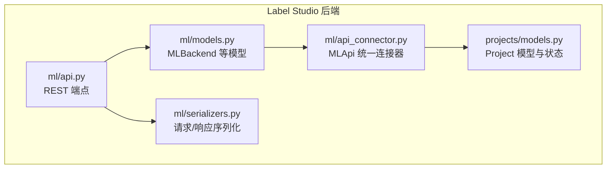
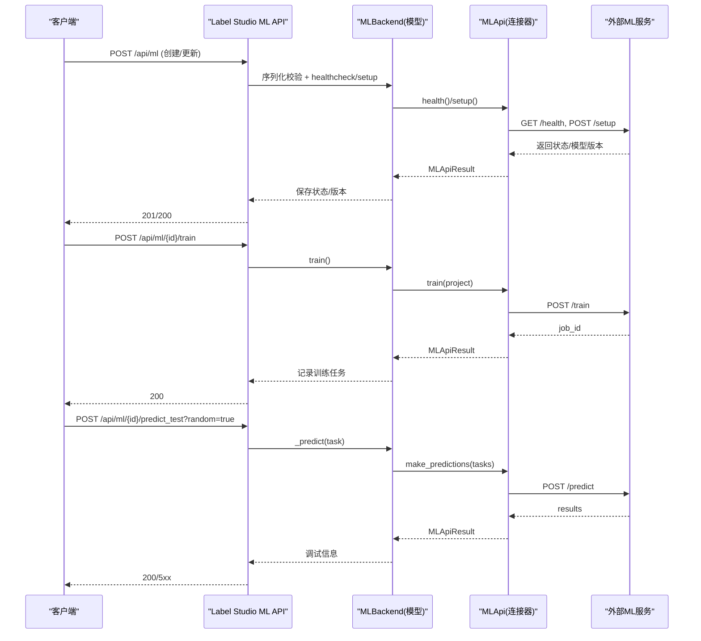
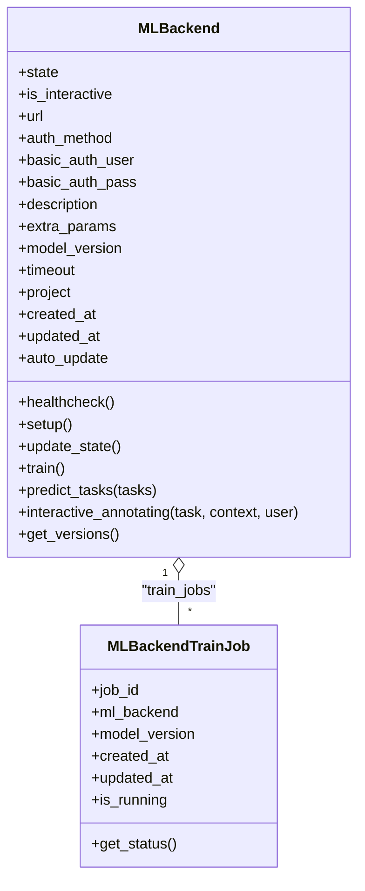
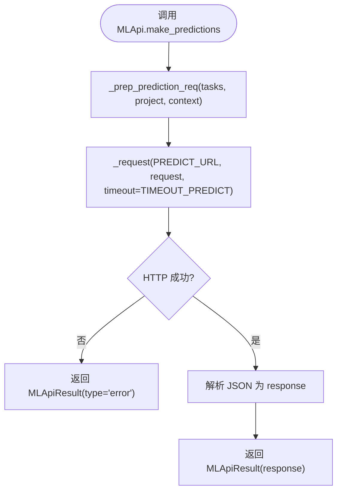
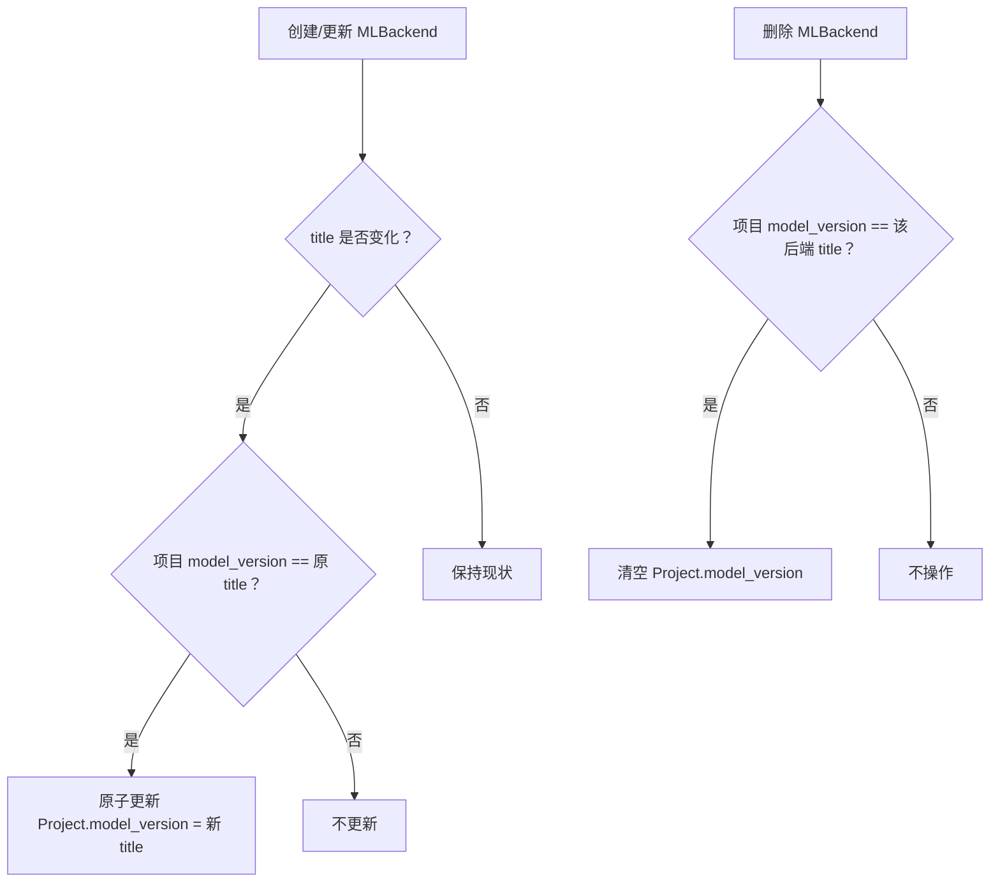
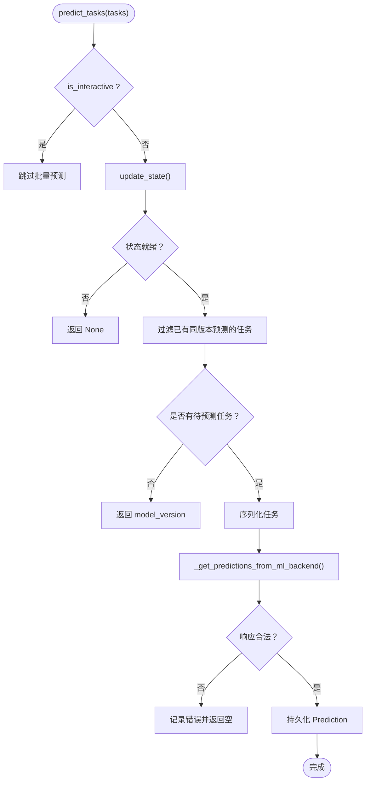
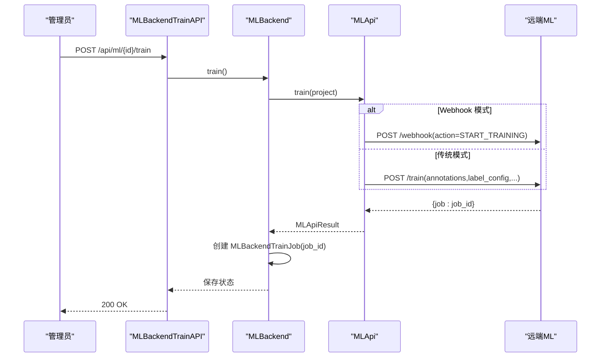
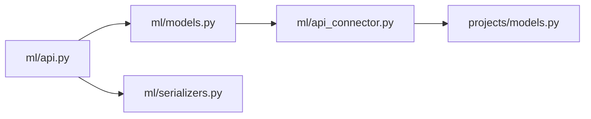

# 机器学习API

<cite>
**本文引用的文件**   
- [label_studio/ml/api.py](file://label_studio/ml/api.py)
- [label_studio/ml/models.py](file://label_studio/ml/models.py)
- [label_studio/ml/serializers.py](file://label_studio/ml/serializers.py)
- [label_studio/ml/api_connector.py](file://label_studio/ml/api_connector.py)
- [label_studio/projects/models.py](file://label_studio/projects/models.py)
</cite>

## 目录
1. [简介](#简介)
2. [项目结构](#项目结构)
3. [核心组件](#核心组件)
4. [架构总览](#架构总览)
5. [详细组件分析](#详细组件分析)
6. [依赖关系分析](#依赖关系分析)
7. [性能与扩展性](#性能与扩展性)
8. [故障排查指南](#故障排查指南)
9. [结论](#结论)
10. [附录：集成与安全建议](#附录集成与安全建议)

## 简介
本文件面向“机器学习集成的RESTful API”的完整文档，聚焦于 Label Studio 中 ML 后端的配置、管理与监控接口，涵盖预标注（批量预测）、实时推理（交互式预标注）、模型版本管理、训练任务管理、以及与外部 ML 服务对接的统一协议。同时给出错误处理机制、安全注意事项与性能优化建议，帮助开发者快速集成并稳定运行 ML 后端。

## 项目结构
ML 相关代码主要位于 label_studio/ml 目录下，包含 API 视图、数据模型、序列化器以及对外部 ML 服务的统一连接器。

**图示来源**
- [label_studio/ml/api.py:69-189](file://label_studio/ml/api.py#L69-L189)
- [label_studio/ml/models.py:38-129](file://label_studio/ml/models.py#L38-L129)
- [label_studio/ml/serializers.py:22-125](file://label_studio/ml/serializers.py#L22-L125)
- [label_studio/ml/api_connector.py:137-274](file://label_studio/ml/api_connector.py#L137-L274)
- [label_studio/projects/models.py:164-200](file://label_studio/projects/models.py#L164-L200)

**章节来源**
- [label_studio/ml/api.py:1-433](file://label_studio/ml/api.py#L1-L433)
- [label_studio/ml/models.py:1-525](file://label_studio/ml/models.py#L1-L525)
- [label_studio/ml/serializers.py:1-151](file://label_studio/ml/serializers.py#L1-L151)
- [label_studio/ml/api_connector.py:1-286](file://label_studio/ml/api_connector.py#L1-L286)
- [label_studio/projects/models.py:164-200](file://label_studio/projects/models.py#L164-L200)

## 核心组件
- ML 后端连接与生命周期管理：通过 MLBackend 模型统一管理 URL、认证、超时、自动更新模型版本等。
- REST 端点：提供 ML 后端增删改查、训练、测试预测、交互式预标注、模型版本查询等能力。
- 统一连接器 MLApi：封装对远端 ML 服务的健康检查、setup、train、predict、job_status、versions 等调用。
- 序列化器：校验 URL、认证参数、健康检查与 setup 结果，屏蔽服务端字段，暴露 OpenAPI/SDK 所需结构。
- 项目关联：Project 持有 model_version 与 active connection，用于默认模型选择与预测过滤。

**章节来源**
- [label_studio/ml/models.py:38-129](file://label_studio/ml/models.py#L38-L129)
- [label_studio/ml/api.py:69-189](file://label_studio/ml/api.py#L69-L189)
- [label_studio/ml/api_connector.py:137-274](file://label_studio/ml/api_connector.py#L137-L274)
- [label_studio/ml/serializers.py:22-125](file://label_studio/ml/serializers.py#L22-L125)

## 架构总览
下图展示了从客户端到 Label Studio 后端再到外部 ML 服务的整体交互流程。

**图示来源**
- [label_studio/ml/api.py:92-115](file://label_studio/ml/api.py#L92-L115)
- [label_studio/ml/api.py:229-237](file://label_studio/ml/api.py#L229-L237)
- [label_studio/ml/api.py:274-307](file://label_studio/ml/api.py#L274-L307)
- [label_studio/ml/models.py:173-186](file://label_studio/ml/models.py#L173-L186)
- [label_studio/ml/models.py:223-233](file://label_studio/ml/models.py#L223-L233)
- [label_studio/ml/models.py:235-259](file://label_studio/ml/models.py#L235-L259)
- [label_studio/ml/api_connector.py:189-231](file://label_studio/ml/api_connector.py#L189-L231)

## 详细组件分析

### ML 后端 REST 端点
- 列表/创建：GET/POST /api/ml
  - 支持按 project 过滤；创建时校验 URL、认证、健康检查与 setup，成功后自动设置项目默认 model_version（若启用协作预测且未设置）。
- 详情/更新/删除：GET/PATCH/DELETE /api/ml/{id}
  - 获取详情时会刷新后端状态；更新后同样刷新状态。
- 训练：POST /api/ml/{id}/train
  - 触发远程训练，记录训练任务 ID。
- 测试预测：POST /api/ml/{id}/predict_test?random=true
  - 随机选取一个任务进行预测，返回调试信息（URL、请求、响应）。
- 交互式预标注：POST /api/ml/{id}/interactive_annotating
  - 根据标注者输入，向 ML 后端请求一次交互式预测区域。
- 模型版本：GET /api/ml/{id}/versions
  - 查询远端支持的模型版本列表，兼容旧版后端返回当前版本提示。

权限控制
- 列表/创建：需要项目查看/变更权限。
- 详情/更新/删除：需要项目变更权限。
- 训练/测试预测：需要项目变更权限。
- 交互式预标注：需要任务查看权限。

**章节来源**
- [label_studio/ml/api.py:28-115](file://label_studio/ml/api.py#L28-L115)
- [label_studio/ml/api.py:117-189](file://label_studio/ml/api.py#L117-L189)
- [label_studio/ml/api.py:191-237](file://label_studio/ml/api.py#L191-L237)
- [label_studio/ml/api.py:240-307](file://label_studio/ml/api.py#L240-L307)
- [label_studio/ml/api.py:310-380](file://label_studio/ml/api.py#L310-L380)
- [label_studio/ml/api.py:383-433](file://label_studio/ml/api.py#L383-L433)

### MLBackend 模型与状态机
- 状态枚举：已连接、断开、错误、训练中、预测中。
- 关键字段：url、auth_method、basic_auth_user/pass、timeout、auto_update、model_version、is_interactive、extra_params。
- 生命周期方法：
  - healthcheck：探测远端健康。
  - setup：初始化配置，返回模型版本。
  - update_state：综合 healthcheck 与 setup 结果更新本地状态与错误信息。
  - train：发起训练，记录训练任务。
  - predict_tasks：批量预测（跳过交互式后端），去重已有版本预测，持久化 Prediction。
  - interactive_annotating：交互式预标注，要求 is_interactive=true。
  - get_versions：查询远端模型版本。

**图示来源**
- [label_studio/ml/models.py:25-129](file://label_studio/ml/models.py#L25-L129)
- [label_studio/ml/models.py:223-233](file://label_studio/ml/models.py#L223-L233)
- [label_studio/ml/models.py:341-373](file://label_studio/ml/models.py#L341-L373)
- [label_studio/ml/models.py:375-417](file://label_studio/ml/models.py#L375-L417)
- [label_studio/ml/models.py:450-485](file://label_studio/ml/models.py#L450-L485)

**章节来源**
- [label_studio/ml/models.py:25-129](file://label_studio/ml/models.py#L25-L129)
- [label_studio/ml/models.py:173-221](file://label_studio/ml/models.py#L173-L221)
- [label_studio/ml/models.py:223-233](file://label_studio/ml/models.py#L223-L233)
- [label_studio/ml/models.py:235-339](file://label_studio/ml/models.py#L235-L339)
- [label_studio/ml/models.py:341-417](file://label_studio/ml/models.py#L341-L417)
- [label_studio/ml/models.py:450-485](file://label_studio/ml/models.py#L450-L485)

### 统一连接器 MLApi
- 职责：封装对远端 ML 服务的 HTTP 调用，包括 health、setup、validate、train、predict、duplicate_model、delete、job_status、versions。
- 特性：
  - 可配置超时（连接/请求）与重试次数。
  - Basic Auth 支持。
  - SSRF 防护（可选禁用）。
  - 统一返回 MLApiResult，便于上层判断 is_error 与 error_message。
- 关键常量：PREDICT_URL、HEALTH_URL、SETUP_URL、JOB_STATUS_URL、VERSIONS_URL 等。

**图示来源**
- [label_studio/ml/api_connector.py:137-183](file://label_studio/ml/api_connector.py#L137-L183)
- [label_studio/ml/api_connector.py:214-231](file://label_studio/ml/api_connector.py#L214-L231)

**章节来源**
- [label_studio/ml/api_connector.py:25-45](file://label_studio/ml/api_connector.py#L25-L45)
- [label_studio/ml/api_connector.py:48-112](file://label_studio/ml/api_connector.py#L48-L112)
- [label_studio/ml/api_connector.py:115-183](file://label_studio/ml/api_connector.py#L115-L183)
- [label_studio/ml/api_connector.py:189-274](file://label_studio/ml/api_connector.py#L189-L274)

### 序列化器与校验
- MLBackendSerializer：
  - 输出可读状态 readable_state。
  - 写保护 basic_auth_pass，并提供 basic_auth_pass_is_set。
  - 校验 URL（阻止内网地址，可配置）。
  - 校验认证参数（Basic Auth 必填）。
  - 执行 healthcheck 与 setup 校验，失败抛出 ValidationError。
- MLBackendRequestSerializer：OpenAPI/SDK 请求体，排除服务端字段。
- MLInteractiveAnnotatingRequest：交互式预标注请求体（task、context）。
- MLBackendTrainRequestSerializer：训练请求体（use_ground_truth）。

**章节来源**
- [label_studio/ml/serializers.py:22-125](file://label_studio/ml/serializers.py#L22-L125)
- [label_studio/ml/serializers.py:128-151](file://label_studio/ml/serializers.py#L128-L151)

### 模型版本管理与项目联动
- Project.model_version：项目级当前模型版本。
- MLBackend.save：当 title 变化且项目当前 model_version 等于原 title 时，原子更新项目 model_version。
- 删除 MLBackend：若其 title 被项目引用，则清空项目 model_version。
- 创建 MLBackend：若项目启用协作预测且未设置 model_version，则将新后端 title 设为默认版本。

**图示来源**
- [label_studio/ml/models.py:138-156](file://label_studio/ml/models.py#L138-L156)
- [label_studio/ml/models.py:500-506](file://label_studio/ml/models.py#L500-L506)
- [label_studio/ml/api.py:103-115](file://label_studio/ml/api.py#L103-L115)

**章节来源**
- [label_studio/ml/models.py:138-156](file://label_studio/ml/models.py#L138-L156)
- [label_studio/ml/models.py:500-506](file://label_studio/ml/models.py#L500-L506)
- [label_studio/ml/api.py:103-115](file://label_studio/ml/api.py#L103-L115)

### 批量预测与实时推理
- 批量预测：MLBackend.predict_tasks
  - 跳过 is_interactive=true 的后端（避免空结果）。
  - 基于 model_version 去重，避免重复预测。
  - 支持批量或单条回退逻辑（当后端不支持批量时逐条请求）。
  - 将结果持久化为 Prediction，携带 task、result、score、model_version、project。
- 实时推理：MLBackend.interactive_annotating
  - 仅适用于 is_interactive=true 的后端。
  - 使用 InteractiveAnnotatingDataSerializer 序列化任务上下文，调用 make_predictions 并取首个结果作为交互式预标注区域。

**图示来源**
- [label_studio/ml/models.py:341-373](file://label_studio/ml/models.py#L341-L373)
- [label_studio/ml/models.py:292-339](file://label_studio/ml/models.py#L292-L339)

**章节来源**
- [label_studio/ml/models.py:292-339](file://label_studio/ml/models.py#L292-L339)
- [label_studio/ml/models.py:341-373](file://label_studio/ml/models.py#L341-L373)
- [label_studio/ml/models.py:375-417](file://label_studio/ml/models.py#L375-L417)

### 训练任务管理
- 触发训练：POST /api/ml/{id}/train
  - 调用 MLBackend.train -> MLApi.train(project)。
  - 支持两种模式：
    - Webhook 模式（通过 feature flag 开启）：发送 START_TRAINING 事件至 webhook。
    - 传统模式：导出带标注的任务数据，发送至 /train。
  - 返回 job_id，并在本地创建 MLBackendTrainJob 记录。
- 训练状态：MLBackendTrainJob.get_status
  - 通过 MLApi.get_train_job_status 查询远端状态。
  - 支持 410 表示任务已移除的特殊语义。

**图示来源**
- [label_studio/ml/api.py:229-237](file://label_studio/ml/api.py#L229-L237)
- [label_studio/ml/models.py:223-233](file://label_studio/ml/models.py#L223-L233)
- [label_studio/ml/api_connector.py:189-212](file://label_studio/ml/api_connector.py#L189-L212)
- [label_studio/ml/models.py:462-479](file://label_studio/ml/models.py#L462-L479)

**章节来源**
- [label_studio/ml/api.py:229-237](file://label_studio/ml/api.py#L229-L237)
- [label_studio/ml/models.py:223-233](file://label_studio/ml/models.py#L223-L233)
- [label_studio/ml/api_connector.py:189-212](file://label_studio/ml/api_connector.py#L189-L212)
- [label_studio/ml/models.py:450-485](file://label_studio/ml/models.py#L450-L485)

### 与外部 ML 服务的集成协议
- 统一路径约定：
  - /health：健康检查
  - /setup：初始化配置（schema=label_config，hostname，extra_params）
  - /validate：验证标签配置
  - /train：训练（annotations、label_config、project、hostname、params）
  - /predict：预测（tasks、project、label_config、params）
  - /job_status：查询训练任务状态
  - /versions：查询模型版本列表
  - /duplicate_model、/delete：模型复制与清理
- 认证方式：
  - Basic Auth（用户名/密码）由 MLBackend 配置并通过 MLApi 传递。
- 超时与重试：
  - 连接超时、请求超时、各端点超时均可通过环境变量配置。
  - 支持最大重试次数。

注意：仓库中未发现直接针对 Hugging Face 或 OpenAI 的内置集成实现。如需对接这些第三方服务，应遵循上述统一协议在其服务侧实现对应端点，或通过自定义 ML 后端桥接。

**章节来源**
- [label_studio/ml/api_connector.py:36-45](file://label_studio/ml/api_connector.py#L36-L45)
- [label_studio/ml/api_connector.py:189-274](file://label_studio/ml/api_connector.py#L189-L274)

## 依赖关系分析
- ML API 视图依赖 MLBackend 模型与序列化器。
- MLBackend 依赖 MLApi 连接器访问远端服务。
- MLApi 依赖 Django Settings、环境变量与 requests 库。
- Project 模型与 MLBackend 存在双向业务关联（model_version、active connection）。

**图示来源**
- [label_studio/ml/api.py:1-433](file://label_studio/ml/api.py#L1-L433)
- [label_studio/ml/models.py:1-525](file://label_studio/ml/models.py#L1-L525)
- [label_studio/ml/serializers.py:1-151](file://label_studio/ml/serializers.py#L1-L151)
- [label_studio/ml/api_connector.py:1-286](file://label_studio/ml/api_connector.py#L1-L286)
- [label_studio/projects/models.py:164-200](file://label_studio/projects/models.py#L164-L200)

**章节来源**
- [label_studio/ml/api.py:1-433](file://label_studio/ml/api.py#L1-L433)
- [label_studio/ml/models.py:1-525](file://label_studio/ml/models.py#L1-L525)
- [label_studio/ml/serializers.py:1-151](file://label_studio/ml/serializers.py#L1-L151)
- [label_studio/ml/api_connector.py:1-286](file://label_studio/ml/api_connector.py#L1-L286)
- [label_studio/projects/models.py:164-200](file://label_studio/projects/models.py#L164-L200)

## 性能与扩展性
- 批量预测优化：
  - 优先批量请求远端 /predict，如后端不支持批量则自动回退为逐条请求。
  - 基于 model_version 的去重避免重复计算。
- 超时与重试：
  - 通过环境变量调整连接/请求超时与各端点超时，平衡稳定性与吞吐。
  - 合理设置最大重试次数，避免雪崩。
- 数据库写入：
  - 使用 conditional_atomic 与非 SQLite 场景下的批量写入，降低锁竞争。
- 可扩展点：
  - 在 MLApi 层增加缓存（如最近任务的预测结果）以减少重复请求。
  - 引入异步队列（RQ/Celery）处理大规模预测与训练任务的状态轮询。

[本节为通用指导，不涉及具体文件分析]

## 故障排查指南
- 无法连接 ML 后端：
  - 检查 URL 与防火墙策略，确认 health 端点可达。
  - 若启用 Basic Auth，核对用户名/密码是否正确。
- 配置无效：
  - setup 返回错误时，检查 label_config 是否与后端期望一致。
- 预测结果为空：
  - 确认后端是否支持批量预测；若不支持，观察是否触发逐条回退。
  - 检查 is_interactive 标志，交互式后端不应走批量预测。
- 训练任务无进展：
  - 通过 MLBackendTrainJob.get_status 查询远端状态。
  - 若返回 410，表示任务已被移除。
- 模型版本不一致：
  - 检查 auto_update 开关；若关闭，需手动维护 model_version。
  - 确认 Project.model_version 与预期后端 title 一致。

**章节来源**
- [label_studio/ml/serializers.py:62-92](file://label_studio/ml/serializers.py#L62-L92)
- [label_studio/ml/models.py:202-221](file://label_studio/ml/models.py#L202-L221)
- [label_studio/ml/models.py:292-339](file://label_studio/ml/models.py#L292-L339)
- [label_studio/ml/models.py:462-479](file://label_studio/ml/models.py#L462-L479)

## 结论
Label Studio 的 ML 模块提供了统一的 REST 接口与连接器，实现对任意外部 ML 服务的标准化接入。通过 MLBackend 的生命周期管理、批量与交互式预测、训练任务跟踪与模型版本联动，能够满足大多数预标注与在线推理场景。建议在部署时合理配置超时与重试，结合项目 model_version 与 active connection 进行灰度与 A/B 实验，并通过日志与状态接口持续监控后端健康与性能。

[本节为总结性内容，不涉及具体文件分析]

## 附录：集成与安全建议
- 安全考虑：
  - 使用 Basic Auth 保护 ML 后端，避免明文传输敏感数据。
  - 启用 SSRF 防护（默认启用），防止恶意 URL 指向内网。
  - 限制 ML_BLOCK_LOCAL_IP，避免本地地址被利用。
- 性能优化：
  - 根据负载调优 ML_TIMEOUT_* 系列环境变量。
  - 对高频预测任务实施缓存与批量化。
  - 使用非 SQLite 数据库以获得更好的并发写入性能。
- 高级功能：
  - 主动学习/在线学习：可在 ML 后端侧实现增量训练与反馈收集，通过 /train 与 /predict 接口协同工作。
  - 反馈循环：将标注结果与预测差异上报至 ML 后端，驱动模型迭代。
  - A/B 测试：通过切换 Project.model_version 或使用多个 MLBackend 并动态选择 active connection 实现分流。

[本节为通用指导，不涉及具体文件分析]