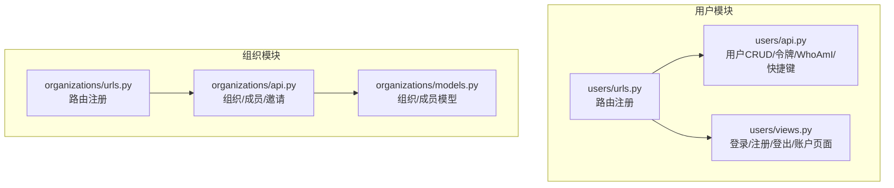
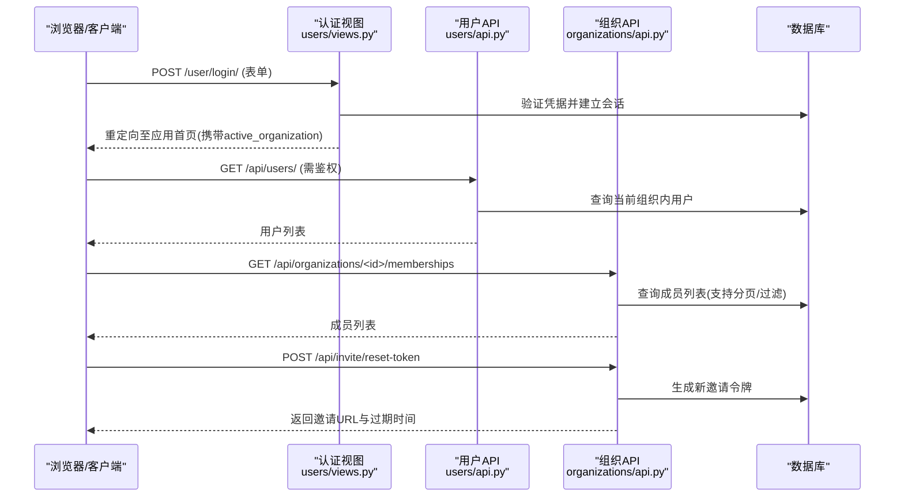
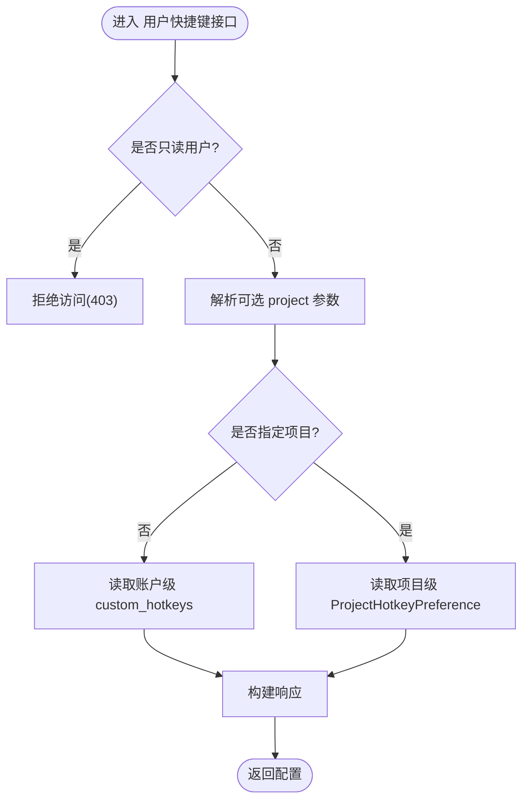
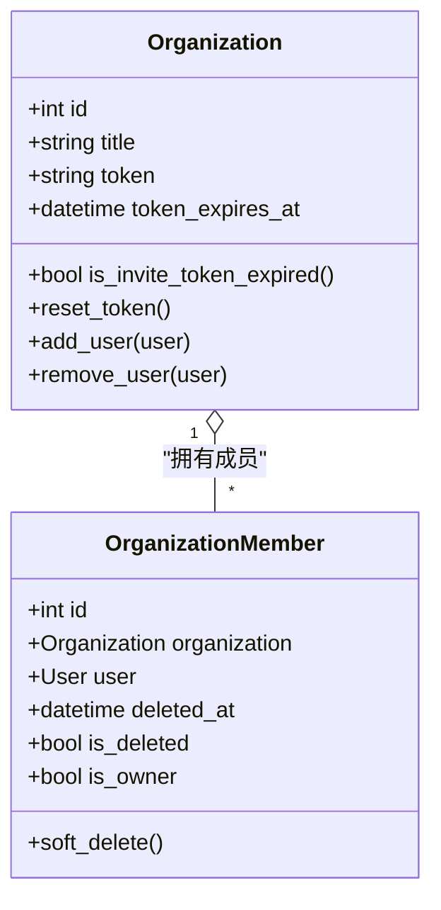
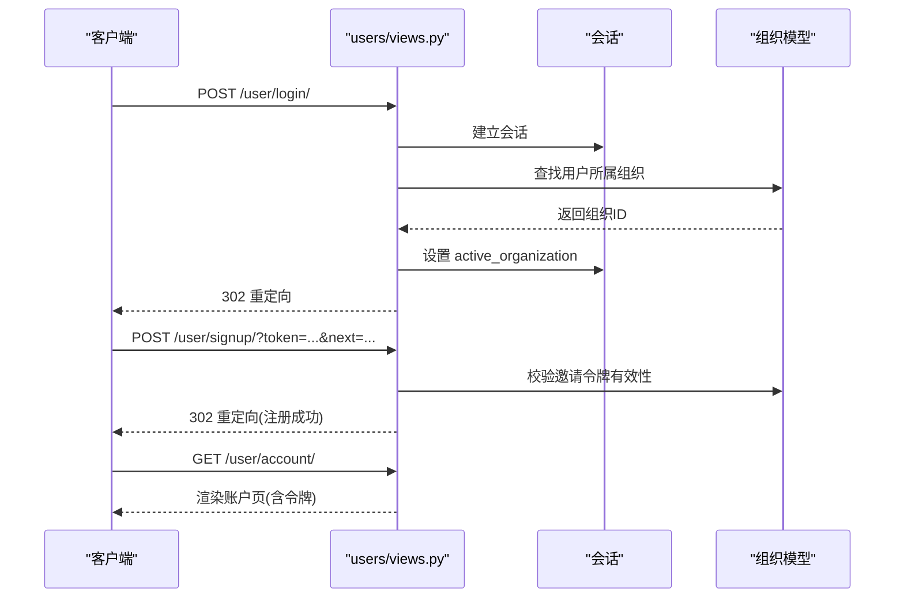
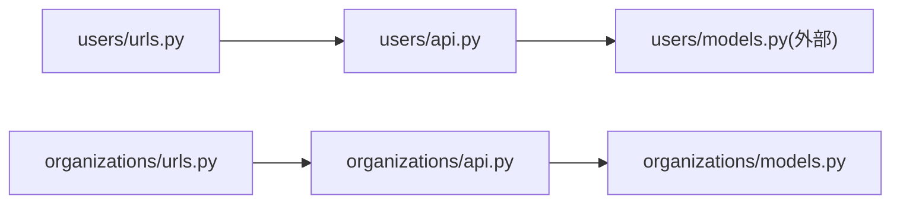

# 用户与组织API

<cite>
**本文引用的文件**   
- [label_studio/users/api.py](file://label_studio/users/api.py)
- [label_studio/users/urls.py](file://label_studio/users/urls.py)
- [label_studio/users/views.py](file://label_studio/users/views.py)
- [label_studio/organizations/api.py](file://label_studio/organizations/api.py)
- [label_studio/organizations/urls.py](file://label_studio/organizations/urls.py)
- [label_studio/organizations/models.py](file://label_studio/organizations/models.py)
</cite>

## 目录
1. [简介](#简介)
2. [项目结构](#项目结构)
3. [核心组件](#核心组件)
4. [架构总览](#架构总览)
5. [详细组件分析](#详细组件分析)
6. [依赖关系分析](#依赖关系分析)
7. [性能考虑](#性能考虑)
8. [故障排查指南](#故障排查指南)
9. [结论](#结论)
10. [附录](#附录)

## 简介
本文件面向企业级多租户场景，系统化梳理 Label Studio 的用户与组织管理 RESTful API，覆盖：
- 用户账户注册、登录、信息管理、头像、令牌、个人偏好（快捷键）等
- 组织创建、成员管理、邀请链接与令牌重置
- 多租户数据隔离与访问控制机制
- 与企业级能力相关的权限审批、审计日志、配额与统计的接入点说明
- 完整的调用示例与错误处理建议，以及隐私合规注意事项

## 项目结构
用户与组织相关代码主要分布在以下模块：
- users: 用户认证、账户信息、令牌、个人偏好（快捷键）、产品导览等
- organizations: 组织、成员、邀请链接与令牌、成员列表分页与过滤等
- urls: 将视图函数和 APIView/ViewSet 暴露为 HTTP 路由

图表来源
- [label_studio/users/api.py:127-447](file://label_studio/users/api.py#L127-L447)
- [label_studio/users/urls.py:13-31](file://label_studio/users/urls.py#L13-L31)
- [label_studio/users/views.py:24-184](file://label_studio/users/views.py#L24-L184)
- [label_studio/organizations/api.py:59-440](file://label_studio/organizations/api.py#L59-L440)
- [label_studio/organizations/urls.py:16-40](file://label_studio/organizations/urls.py#L16-L40)
- [label_studio/organizations/models.py:34-262](file://label_studio/organizations/models.py#L34-L262)

章节来源
- [label_studio/users/api.py:127-447](file://label_studio/users/api.py#L127-L447)
- [label_studio/users/urls.py:13-31](file://label_studio/users/urls.py#L13-L31)
- [label_studio/users/views.py:24-184](file://label_studio/users/views.py#L24-L184)
- [label_studio/organizations/api.py:59-440](file://label_studio/organizations/api.py#L59-L440)
- [label_studio/organizations/urls.py:16-40](file://label_studio/organizations/urls.py#L16-L40)
- [label_studio/organizations/models.py:34-262](file://label_studio/organizations/models.py#L34-L262)

## 核心组件
- 用户接口
  - 用户资源 CRUD（列表、获取、创建、更新、删除）
  - 当前用户令牌获取与重置
  - WhoAmI 获取当前登录用户信息
  - 头像上传/删除
  - 用户快捷键配置（账户级与项目级）
- 组织接口
  - 组织列表与详情（设置）
  - 组织成员列表与详情（软删除）
  - 组织邀请链接获取与令牌重置
- 认证与页面
  - 登录、注册、登出、账户页面（表单与重定向）

章节来源
- [label_studio/users/api.py:127-447](file://label_studio/users/api.py#L127-L447)
- [label_studio/organizations/api.py:59-440](file://label_studio/organizations/api.py#L59-L440)
- [label_studio/users/views.py:24-184](file://label_studio/users/views.py#L24-L184)

## 架构总览
下图展示从浏览器到后端 API 的关键交互路径，包括用户认证、组织上下文切换、成员管理与邀请流程。

图表来源
- [label_studio/users/views.py:103-138](file://label_studio/users/views.py#L103-L138)
- [label_studio/users/api.py:127-176](file://label_studio/users/api.py#L127-L176)
- [label_studio/organizations/api.py:125-214](file://label_studio/organizations/api.py#L125-L214)
- [label_studio/organizations/api.py:422-440](file://label_studio/organizations/api.py#L422-L440)

## 详细组件分析

### 用户接口（RESTful）
- 基础用户资源
  - 方法：GET/POST/PUT/PATCH/DELETE
  - 路径：/api/users/{id}
  - 权限：基于组织的查看/变更权限
  - 行为要点：
    - 列表仅返回当前 active_organization 下的用户
    - 创建用户时自动加入当前组织
    - PATCH 对只读字段进行更新会拒绝
    - 删除组织所有者或无权限删除成员时会拒绝
- 头像
  - 方法：POST/DELETE
  - 路径：/api/users/{id}/avatar
  - 权限：头像任意操作权限
  - 行为要点：POST 上传校验失败返回 400；DELETE 返回 204
- 令牌
  - 获取令牌：GET /api/current-user/token
  - 重置令牌：POST /api/current-user/reset-token
  - 权限：令牌任意操作权限
- WhoAmI
  - 方法：GET
  - 路径：/api/current-user/whoami
  - 权限：已认证
- 快捷键（个人偏好）
  - 方法：GET/PATCH
  - 路径：/api/current-user/hotkeys/?project={project_id}
  - 权限：已认证；只读用户禁止访问
  - 行为要点：
    - 不传 project 参数表示账户级默认配置
    - 传入 project 表示项目级覆盖配置
    - 存储无效数据时返回空配置并记录警告

图表来源
- [label_studio/users/api.py:374-447](file://label_studio/users/api.py#L374-L447)

章节来源
- [label_studio/users/api.py:127-215](file://label_studio/users/api.py#L127-L215)
- [label_studio/users/api.py:240-310](file://label_studio/users/api.py#L240-L310)
- [label_studio/users/api.py:374-447](file://label_studio/users/api.py#L374-L447)

### 组织接口（RESTful）
- 组织列表
  - 方法：GET/POST
  - 路径：/api/organizations/
  - 行为要点：
    - GET 返回当前用户有权限的组织集合
    - POST 受配置开关控制，未启用则拒绝
- 组织详情（设置）
  - 方法：GET/PATCH/PUT
  - 路径：/api/organizations/{id}
  - 权限：组织变更权限
- 组织成员列表
  - 方法：GET
  - 路径：/api/organizations/{id}/memberships
  - 特性：
    - 分页（page_size=-1 可“无限”拉取）
    - 可选包含成员创建/贡献的项目映射
    - 支持按活跃状态过滤（通过功能开关）
- 组织成员详情
  - 方法：GET/DELETE
  - 路径：/api/organizations/{id}/memberships/{user_pk}
  - 行为要点：
    - DELETE 为软删除，不允许自我删除
    - 删除后清理任务锁等关联资源
- 邀请链接与令牌
  - 获取邀请链接：GET /api/invite
  - 重置邀请令牌：POST /api/invite/reset-token
  - 返回内容包含邀请 URL、token、过期时间与是否过期

图表来源
- [label_studio/organizations/models.py:34-95](file://label_studio/organizations/models.py#L34-L95)
- [label_studio/organizations/models.py:107-262](file://label_studio/organizations/models.py#L107-L262)

章节来源
- [label_studio/organizations/api.py:59-84](file://label_studio/organizations/api.py#L59-L84)
- [label_studio/organizations/api.py:125-214](file://label_studio/organizations/api.py#L125-L214)
- [label_studio/organizations/api.py:272-324](file://label_studio/organizations/api.py#L272-L324)
- [label_studio/organizations/api.py:352-370](file://label_studio/organizations/api.py#L352-L370)
- [label_studio/organizations/api.py:386-440](file://label_studio/organizations/api.py#L386-L440)
- [label_studio/organizations/models.py:34-262](file://label_studio/organizations/models.py#L34-L262)

### 认证与页面（登录/注册/登出/账户）
- 登录
  - 路径：/user/login/
  - 行为：表单提交后建立会话，设置 active_organization 并重定向
- 注册
  - 路径：/user/signup/?token={org_token}&next={redirect}
  - 行为：支持邀请链接注册；根据配置允许/限制公开注册
- 登出
  - 路径：/logout
  - 行为：清除会话并按配置重定向
- 账户页面
  - 路径：/user/account/
  - 行为：展示并编辑用户资料，显示当前令牌

图表来源
- [label_studio/users/views.py:24-37](file://label_studio/users/views.py#L24-L37)
- [label_studio/users/views.py:40-100](file://label_studio/users/views.py#L40-L100)
- [label_studio/users/views.py:103-138](file://label_studio/users/views.py#L103-L138)
- [label_studio/users/views.py:141-184](file://label_studio/users/views.py#L141-L184)

章节来源
- [label_studio/users/views.py:24-184](file://label_studio/users/views.py#L24-L184)

## 依赖关系分析
- 路由层
  - users/urls.py 注册用户相关路由（CRUD、令牌、WhoAmI、快捷键、产品导览）
  - organizations/urls.py 注册组织相关路由（组织列表/详情、成员列表/详情、邀请）
- 视图层
  - users/api.py 提供用户资源与个人偏好的 DRF ViewSet/APIView
  - organizations/api.py 提供组织与成员的 DRF API
- 模型层
  - organizations/models.py 定义组织与成员实体及邀请令牌逻辑
- 权限与多租户
  - 用户列表按 active_organization 过滤
  - 成员软删除与组织上下文联动
  - 邀请链接与令牌有效期控制

图表来源
- [label_studio/users/urls.py:13-31](file://label_studio/users/urls.py#L13-L31)
- [label_studio/organizations/urls.py:16-40](file://label_studio/organizations/urls.py#L16-L40)
- [label_studio/organizations/api.py:59-440](file://label_studio/organizations/api.py#L59-L440)
- [label_studio/organizations/models.py:34-262](file://label_studio/organizations/models.py#L34-L262)

章节来源
- [label_studio/users/urls.py:13-31](file://label_studio/users/urls.py#L13-L31)
- [label_studio/organizations/urls.py:16-40](file://label_studio/organizations/urls.py#L16-L40)
- [label_studio/organizations/api.py:59-440](file://label_studio/organizations/api.py#L59-L440)
- [label_studio/organizations/models.py:34-262](file://label_studio/organizations/models.py#L34-L262)

## 性能考虑
- 成员列表分页
  - 自定义分页器支持 page_size=-1 以“无限”拉取，适用于批量导出场景，但需谨慎使用以避免大结果集
- 预取与缓存
  - 成员列表在构造序列化上下文时预取项目映射，减少 N+1 查询
  - 使用 cached_property 缓存分页结果，避免重复计算
- 软删除优化
  - 成员软删除时清理任务锁，避免脏数据影响后续查询

章节来源
- [label_studio/organizations/api.py:86-98](file://label_studio/organizations/api.py#L86-L98)
- [label_studio/organizations/api.py:136-193](file://label_studio/organizations/api.py#L136-L193)
- [label_studio/organizations/models.py:78-95](file://label_studio/organizations/models.py#L78-L95)

## 故障排查指南
- 常见错误与定位
  - 401/403：认证失败或权限不足
    - 检查是否携带有效会话或令牌
    - 确认当前 active_organization 是否正确
  - 404：对象不存在
    - 组织/成员 ID 是否正确
    - 成员是否已被软删除
  - 405：方法不被允许
    - 例如尝试自我软删除成员
  - 400：请求体校验失败
    - 头像上传格式/大小不符合要求
    - 快捷键配置数据非法
- 排查步骤
  - 核对路由与权限装饰器
  - 检查组织邀请令牌是否过期
  - 查看日志中关于快捷键配置无效的警告
  - 确认配置项（如 ALLOW_ORGANIZATION_CREATION、DISABLE_SIGNUP_WITHOUT_LINK）是否符合预期

章节来源
- [label_studio/users/api.py:142-156](file://label_studio/users/api.py#L142-L156)
- [label_studio/users/api.py:374-447](file://label_studio/users/api.py#L374-L447)
- [label_studio/organizations/api.py:80-83](file://label_studio/organizations/api.py#L80-L83)
- [label_studio/organizations/api.py:305-324](file://label_studio/organizations/api.py#L305-L324)
- [label_studio/organizations/api.py:422-440](file://label_studio/organizations/api.py#L422-L440)

## 结论
Label Studio 的用户与组织 API 提供了完善的企业级多租户管理能力：
- 用户侧：账户管理、令牌、头像、个人偏好（快捷键）
- 组织侧：组织与成员管理、邀请链接与令牌、成员软删除
- 安全与合规：基于角色的权限控制、邀请令牌有效期、软删除保护
- 扩展性：通过功能开关与配置项灵活控制注册、组织创建等行为

## 附录

### API 参考（用户）
- 用户资源
  - GET /api/users/
  - GET /api/users/{id}
  - POST /api/users/
  - PUT /api/users/{id}
  - PATCH /api/users/{id}
  - DELETE /api/users/{id}
- 头像
  - POST /api/users/{id}/avatar
  - DELETE /api/users/{id}/avatar
- 令牌
  - GET /api/current-user/token
  - POST /api/current-user/reset-token
- WhoAmI
  - GET /api/current-user/whoami
- 快捷键
  - GET /api/current-user/hotkeys/?project={project_id}
  - PATCH /api/current-user/hotkeys/?project={project_id}

章节来源
- [label_studio/users/urls.py:13-31](file://label_studio/users/urls.py#L13-L31)
- [label_studio/users/api.py:127-447](file://label_studio/users/api.py#L127-L447)

### API 参考（组织）
- 组织
  - GET /api/organizations/
  - POST /api/organizations/
  - GET /api/organizations/{id}
  - PATCH /api/organizations/{id}
  - PUT /api/organizations/{id}
- 成员
  - GET /api/organizations/{id}/memberships
  - GET /api/organizations/{id}/memberships/{user_pk}
  - DELETE /api/organizations/{id}/memberships/{user_pk}
- 邀请
  - GET /api/invite
  - POST /api/invite/reset-token

章节来源
- [label_studio/organizations/urls.py:16-40](file://label_studio/organizations/urls.py#L16-L40)
- [label_studio/organizations/api.py:59-440](file://label_studio/organizations/api.py#L59-L440)

### 认证与页面
- 登录：POST /user/login/
- 注册：POST /user/signup/?token={org_token}&next={redirect}
- 登出：GET /logout
- 账户：GET /user/account/

章节来源
- [label_studio/users/views.py:24-184](file://label_studio/users/views.py#L24-L184)

### 多租户数据隔离与访问控制
- 数据隔离
  - 用户列表按 active_organization 过滤
  - 成员列表与详情限定在当前组织上下文中
- 访问控制
  - 基于角色/对象的权限校验（如组织成员删除需要对象级权限）
  - 只读用户禁止访问快捷键等敏感配置
- 邀请与令牌
  - 邀请链接带 token，支持过期控制
  - 重置令牌后重新生成邀请链接

章节来源
- [label_studio/users/api.py:138-140](file://label_studio/users/api.py#L138-L140)
- [label_studio/organizations/api.py:71-74](file://label_studio/organizations/api.py#L71-L74)
- [label_studio/organizations/api.py:386-440](file://label_studio/organizations/api.py#L386-L440)
- [label_studio/organizations/models.py:107-224](file://label_studio/organizations/models.py#L107-L224)

### 企业级能力对接点
- 权限审批
  - 通过成员对象权限类（HasObjectPermission）实现细粒度审批
- 审计日志
  - 建议在关键写操作（成员软删除、令牌重置、组织设置变更）处集成审计日志中间件或信号
- 资源配额与统计
  - 组织模型预留 check_max_projects 钩子，可扩展配额校验
  - 组织模型提供 projects_sorted_by_created_at 聚合统计（任务数、标注任务数）

章节来源
- [label_studio/organizations/api.py:282-286](file://label_studio/organizations/api.py#L282-L286)
- [label_studio/organizations/models.py:225-235](file://label_studio/organizations/models.py#L225-L235)

### 隐私与合规注意事项
- 最小化数据收集：仅在必要时收集邮箱、姓名等个人信息
- 数据保留与删除：成员软删除后应同步清理关联数据（如任务锁），避免残留
- 访问控制：严格遵循 RBAC/OBAC，确保跨组织数据不可见
- 审计追踪：记录关键操作的主体、时间、IP 与结果
- 传输安全：强制 HTTPS，敏感字段加密存储
- 同意与撤回：尊重用户撤回营销邮件同意的权利（allow_newsletters）

[本节为通用指导，不直接分析具体文件]