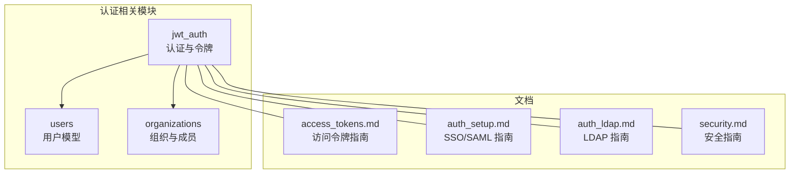
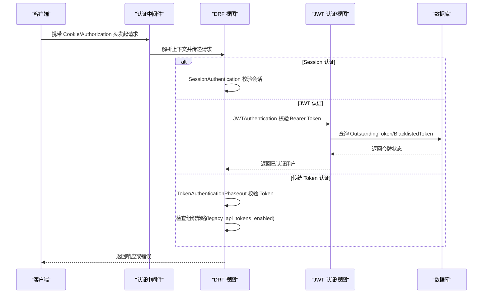
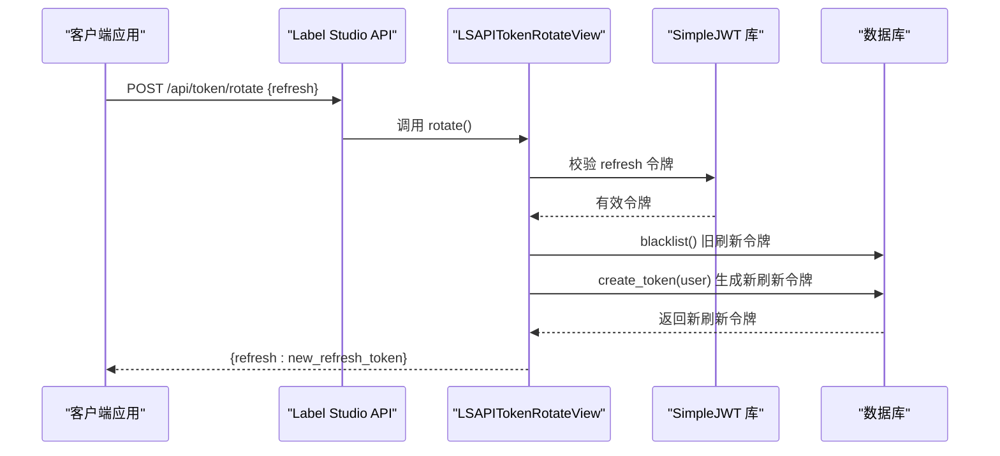
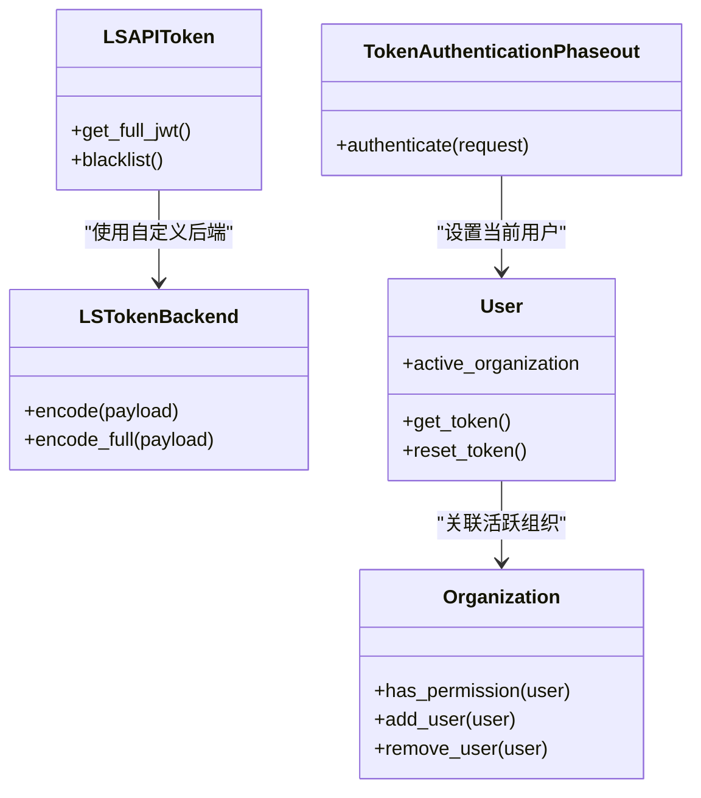

# 认证与授权

<cite>
**本文引用的文件**   
- [auth.py](file://label_studio/jwt_auth/auth.py)
- [views.py](file://label_studio/jwt_auth/views.py)
- [models.py](file://label_studio/jwt_auth/models.py)
- [urls.py](file://label_studio/jwt_auth/urls.py)
- [middleware.py](file://label_studio/jwt_auth/middleware.py)
- [serializers.py](file://label_studio/jwt_auth/serializers.py)
- [models.py](file://label_studio/users/models.py)
- [models.py](file://label_studio/organizations/models.py)
- [access_tokens.md](file://docs/source/guide/access_tokens.md)
- [auth_setup.md](file://docs/source/guide/auth_setup.md)
- [auth_ldap.md](file://docs/source/guide/auth_ldap.md)
- [admin_auth.md](file://docs/source/guide/admin_auth.md)
- [security.md](file://docs/source/guide/security.md)
</cite>

## 目录
1. [引言](#引言)
2. [项目结构](#项目结构)
3. [核心组件](#核心组件)
4. [架构总览](#架构总览)
5. [详细组件分析](#详细组件分析)
6. [依赖关系分析](#依赖关系分析)
7. [性能考虑](#性能考虑)
8. [故障排查指南](#故障排查指南)
9. [结论](#结论)
10. [附录](#附录)

## 引言
本文件系统性说明 Label Studio 的认证与授权机制，覆盖以下主题：
- JWT 令牌认证（个人访问令牌 PAT、刷新令牌轮换、黑名单）
- Session 认证（浏览器会话）
- API Token 认证（传统 Token，逐步淘汰）
- 用户权限模型、角色管理与组织级访问控制
- 企业级认证集成：OAuth2/SAML SSO、LDAP
- 客户端集成指南：Web 应用、移动应用、第三方系统集成
- 安全最佳实践与常见问题解决方案

## 项目结构
与认证授权相关的后端代码主要位于以下模块：
- jwt_auth：JWT 设置、令牌生命周期管理、API Token 视图与序列化器、认证扩展
- users：用户模型、默认 Token 创建逻辑
- organizations：组织与成员关系、组织级权限判断
- docs/source/guide：官方文档（访问令牌、SSO/LDAP/SCIM、安全）

图表来源
- [auth.py:10-43](file://label_studio/jwt_auth/auth.py#L10-L43)
- [views.py:87-269](file://label_studio/jwt_auth/views.py#L87-L269)
- [models.py:14-131](file://label_studio/jwt_auth/models.py#L14-L131)
- [models.py:103-243](file://label_studio/users/models.py#L103-L243)
- [models.py:34-262](file://label_studio/organizations/models.py#L34-L262)

章节来源
- [auth.py:10-43](file://label_studio/jwt_auth/auth.py#L10-L43)
- [views.py:87-269](file://label_studio/jwt_auth/views.py#L87-L269)
- [models.py:14-131](file://label_studio/jwt_auth/models.py#L14-L131)
- [models.py:103-243](file://label_studio/users/models.py#L103-L243)
- [models.py:34-262](file://label_studio/organizations/models.py#L34-L262)

## 核心组件
- JWT 设置与策略
  - 组织级 JWT 设置：是否启用 API Token、TTL、是否允许遗留 Token
  - 自定义 Token 后端：支持截断 Token（仅 header+payload），前端更安全
- 令牌生命周期
  - 刷新令牌轮换：旧刷新令牌加入黑名单，生成新刷新令牌
  - 刷新令牌黑名单：防止已泄露刷新令牌被重用
- 认证扩展
  - 传统 Token 认证增强：记录使用日志，按组织策略决定是否拒绝
  - OpenAPI 安全定义：声明 Authorization 头格式
- 用户与组织
  - 用户模型：默认创建传统 Token；维护活跃组织
  - 组织模型：成员关系、权限判断、邀请链接等

章节来源
- [models.py:14-131](file://label_studio/jwt_auth/models.py#L14-L131)
- [auth.py:10-43](file://label_studio/jwt_auth/auth.py#L10-L43)
- [views.py:87-269](file://label_studio/jwt_auth/views.py#L87-L269)
- [models.py:103-243](file://label_studio/users/models.py#L103-L243)
- [models.py:34-262](file://label_studio/organizations/models.py#L34-L262)

## 架构总览
Label Studio 在后端提供多种认证方式，并通过中间件和 DRF 认证类统一处理请求。

图表来源
- [auth.py:10-43](file://label_studio/jwt_auth/auth.py#L10-L43)
- [views.py:87-269](file://label_studio/jwt_auth/views.py#L87-L269)
- [models.py:14-131](file://label_studio/jwt_auth/models.py#L14-L131)

## 详细组件分析

### JWT 令牌认证（个人访问令牌 PAT）
- 功能要点
  - 通过 /api/token/refresh 使用刷新令牌获取短期访问令牌
  - 刷新令牌可轮换：将旧刷新令牌加入黑名单，生成新的刷新令牌
  - 刷新令牌列表接口仅列出当前用户的非过期且未拉黑的刷新令牌
  - 组织级 TTL 控制：可在组织设置中配置令牌有效期
- 关键流程
  - 刷新令牌轮换：POST /api/token/rotate
  - 刷新令牌黑名单：POST /api/token/blacklist
  - 刷新令牌列表：GET /api/tokens
  - 刷新令牌创建：POST /api/tokens
  - 获取/更新组织 JWT 设置：GET/POST /api/jwt/settings

图表来源
- [views.py:226-269](file://label_studio/jwt_auth/views.py#L226-L269)
- [models.py:74-131](file://label_studio/jwt_auth/models.py#L74-L131)

章节来源
- [views.py:87-269](file://label_studio/jwt_auth/views.py#L87-L269)
- [models.py:74-131](file://label_studio/jwt_auth/models.py#L74-L131)
- [access_tokens.md:90-137](file://docs/source/guide/access_tokens.md#L90-L137)

### Session 认证
- 适用场景
  - Web 浏览器登录 UI，基于 Django Session
- 行为特点
  - 在需要认证的视图中，SessionAuthentication 会校验会话 Cookie
  - 与 JWT 认证并存，适用于不同客户端类型

章节来源
- [views.py:226-233](file://label_studio/jwt_auth/views.py#L226-L233)

### API Token 认证（传统 Token，逐步淘汰）
- 功能要点
  - 使用 Authorization: Token <token> 进行认证
  - 若组织禁用 legacy_api_tokens_enabled，则返回 401
  - 记录使用日志，便于审计与迁移
- 建议
  - 尽快迁移到 JWT 个人访问令牌（PAT）

章节来源
- [auth.py:10-43](file://label_studio/jwt_auth/auth.py#L10-L43)
- [access_tokens.md:152-170](file://docs/source/guide/access_tokens.md#L152-L170)

### 用户权限模型与组织级访问控制
- 用户模型
  - 默认创建传统 Token（兼容旧系统）
  - active_organization 指向当前组织
- 组织模型
  - OrganizationMember 表示成员关系
  - has_permission(user) 判断用户是否为组织成员（未软删除）
- 项目与工作区
  - 企业版支持基于角色的访问控制（RBAC），可通过 SSO/LDAP 映射组到角色与工作区

章节来源
- [models.py:103-243](file://label_studio/users/models.py#L103-L243)
- [models.py:34-262](file://label_studio/organizations/models.py#L34-L262)
- [admin_auth.md:14-53](file://docs/source/guide/admin_auth.md#L14-L53)

### 企业级认证集成（OAuth2/SAML、LDAP）
- SSO/SAML
  - 支持主流 IdP（Okta、Google SAML、Azure AD、PingOne、Auth0 等）
  - 支持属性映射与组映射到组织角色与工作区
- LDAP
  - 适用于本地部署，支持 TLS、递归组搜索
  - 支持将 LDAP 组映射到组织角色与工作区
- SCIM
  - 自动化用户与组的供应/去激活，支持工作区/项目成员同步

章节来源
- [auth_setup.md:23-122](file://docs/source/guide/auth_setup.md#L23-L122)
- [auth_ldap.md:24-121](file://docs/source/guide/auth_ldap.md#L24-L121)
- [admin_auth.md:23-53](file://docs/source/guide/admin_auth.md#L23-L53)

### 客户端集成指南
- Web 应用
  - 使用 Session 认证登录 UI
  - 使用 JWT 刷新令牌获取短期访问令牌，用于 API 调用
- 移动应用
  - 推荐使用 PAT + 刷新令牌轮换，避免长期持有敏感令牌
- 第三方系统集成
  - 使用 PAT 作为 LABEL_STUDIO_API_KEY 环境变量或直接传入 SDK
  - HTTP API 使用 Authorization: Bearer <access_token>

章节来源
- [access_tokens.md:90-137](file://docs/source/guide/access_tokens.md#L90-L137)

## 依赖关系分析
- 模块耦合
  - jwt_auth.views 依赖 rest_framework_simplejwt 与自定义 LSAPIToken
  - jwt_auth.auth 依赖 feature flags 与 CurrentContext
  - users.models 与 organizations.models 为身份与权限基础
- 外部依赖
  - SimpleJWT：令牌签发、校验、黑名单
  - DRF Spectacular：OpenAPI 安全定义

图表来源
- [auth.py:10-43](file://label_studio/jwt_auth/auth.py#L10-L43)
- [models.py:74-131](file://label_studio/jwt_auth/models.py#L74-L131)
- [models.py:103-243](file://label_studio/users/models.py#L103-L243)
- [models.py:34-262](file://label_studio/organizations/models.py#L34-L262)

章节来源
- [auth.py:10-43](file://label_studio/jwt_auth/auth.py#L10-L43)
- [models.py:74-131](file://label_studio/jwt_auth/models.py#L74-L131)
- [models.py:103-243](file://label_studio/users/models.py#L103-L243)
- [models.py:34-262](file://label_studio/organizations/models.py#L34-L262)

## 性能考虑
- 刷新令牌列表过滤
  - 需排除已拉黑且未过期的令牌，可能带来额外查询开销
  - 建议定期清理黑名单以提升性能
- 组织级 TTL
  - 合理设置 TTL，平衡安全性与刷新频率
- Redis 缓存
  - 用户最后活动时间使用 Redis 缓存，减少数据库压力

章节来源
- [views.py:141-176](file://label_studio/jwt_auth/views.py#L141-L176)
- [models.py:65-95](file://label_studio/users/models.py#L65-L95)

## 故障排查指南
- 401 认证失败（传统 Token 被禁用）
  - 原因：组织禁用 legacy_api_tokens_enabled
  - 解决：迁移到 PAT 并使用 Bearer 认证
- 刷新令牌无效或已被拉黑
  - 原因：令牌已过期或被加入黑名单
  - 解决：重新轮换刷新令牌或重新登录
- 无法列出刷新令牌
  - 原因：过滤器排除已拉黑令牌导致查询复杂
  - 解决：清理黑名单或优化数据库索引

章节来源
- [auth.py:27-43](file://label_studio/jwt_auth/auth.py#L27-L43)
- [views.py:193-223](file://label_studio/jwt_auth/views.py#L193-L223)
- [views.py:226-269](file://label_studio/jwt_auth/views.py#L226-L269)

## 结论
Label Studio 提供了完善的认证与授权体系：
- 支持 JWT（PAT）、Session、传统 Token 三种认证方式
- 提供刷新令牌轮换与黑名单机制，提升安全性
- 组织级权限控制与企业级 SSO/LDAP/SCIM 集成满足多租户与合规需求
- 建议优先采用 PAT + 刷新令牌轮换，并逐步淘汰传统 Token

## 附录
- 安全最佳实践
  - 强制 HTTPS 与安全 Cookie
  - 生产环境启用 SSRF 保护
  - 数据库与 Redis 启用 TLS/SSL
  - 限制云存储访问（IP/VPC）
  - 审计日志（企业版）

章节来源
- [security.md:24-93](file://docs/source/guide/security.md#L24-L93)
- [security.md:149-159](file://docs/source/guide/security.md#L149-L159)