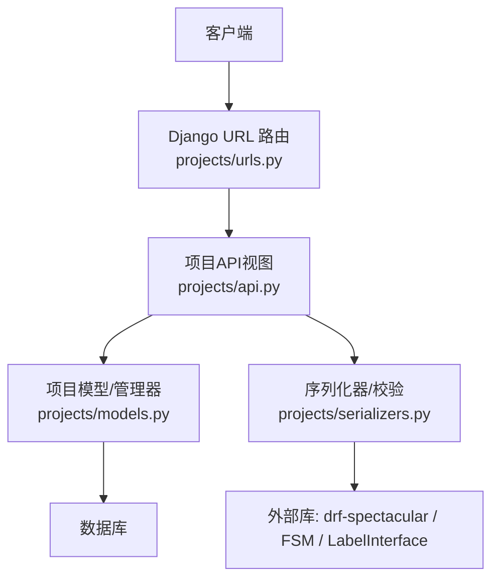
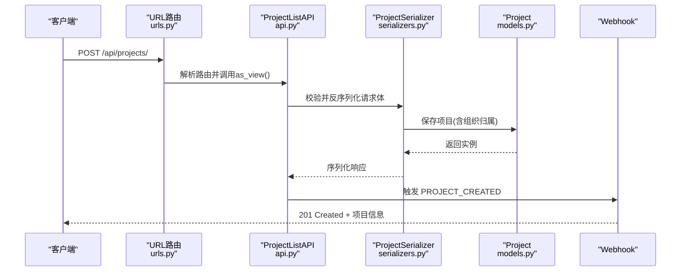
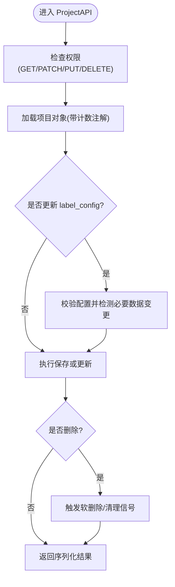
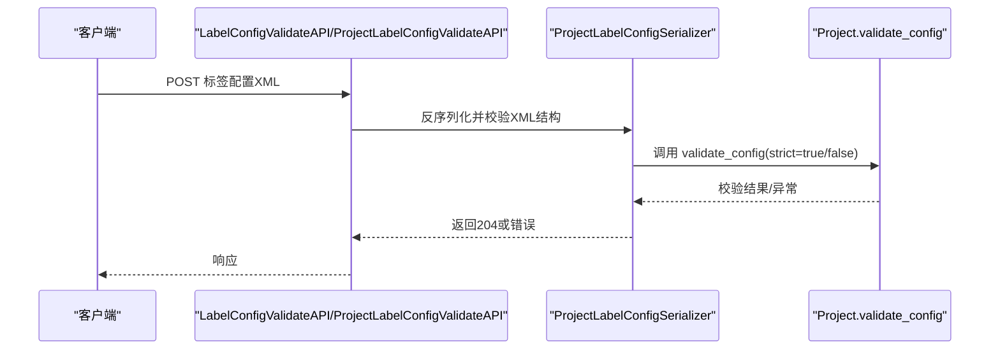
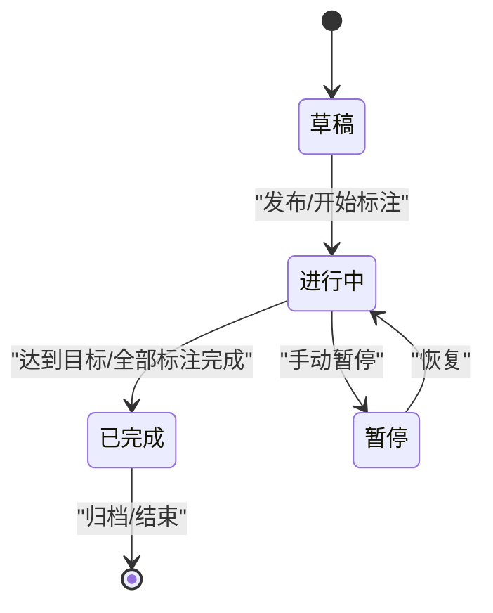
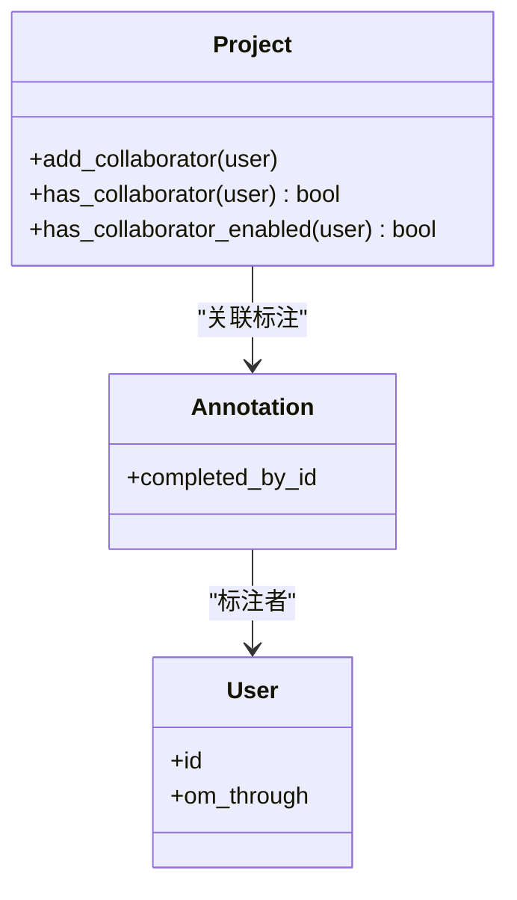
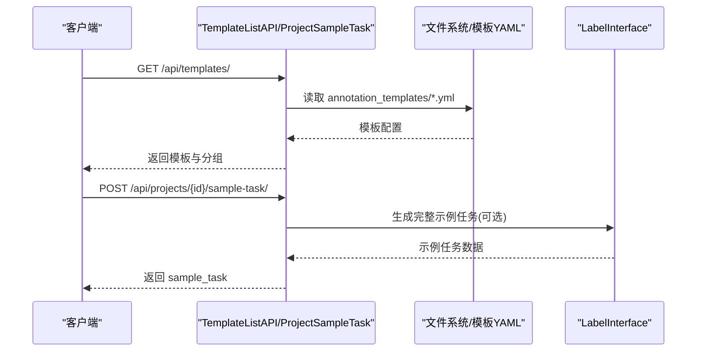
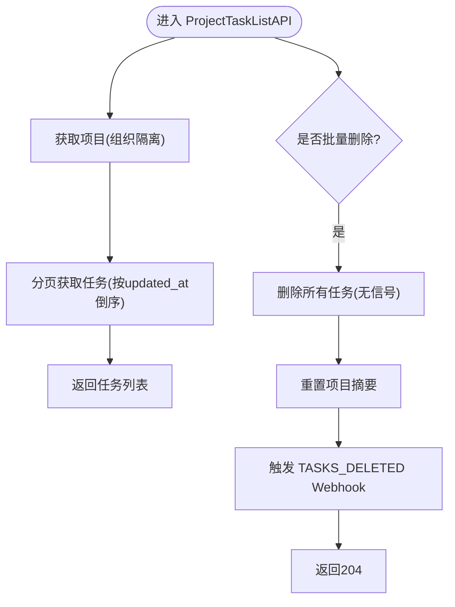
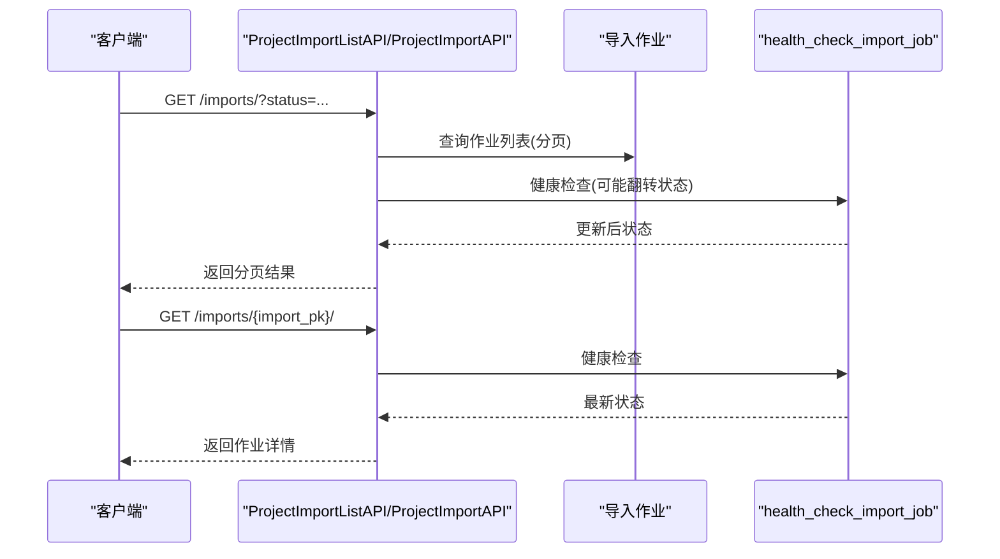
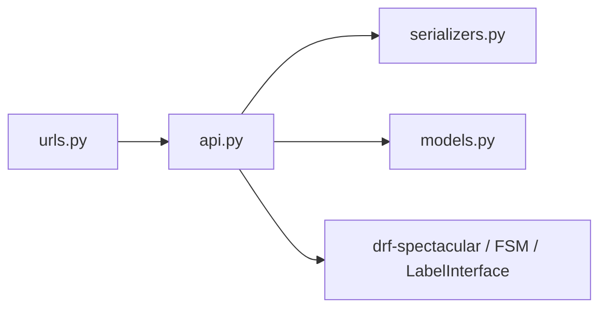

# 项目管理API

<cite>
**本文引用的文件**   
- [label_studio/projects/api.py](file://label_studio/projects/api.py)
- [label_studio/projects/urls.py](file://label_studio/projects/urls.py)
- [label_studio/projects/models.py](file://label_studio/projects/models.py)
- [label_studio/projects/serializers.py](file://label_studio/projects/serializers.py)
</cite>

## 目录
1. [简介](#简介)
2. [项目结构](#项目结构)
3. [核心组件](#核心组件)
4. [架构总览](#架构总览)
5. [详细组件分析](#详细组件分析)
6. [依赖关系分析](#依赖关系分析)
7. [性能考虑](#性能考虑)
8. [故障排查指南](#故障排查指南)
9. [结论](#结论)
10. [附录](#附录)

## 简介
本文件为 Label Studio 的“项目管理”RESTful API 完整文档，覆盖项目的创建、查询、更新、删除等CRUD能力；标签配置XML的校验与验证；项目状态管理（FSM）；任务列表与批量操作；模板与示例数据；模型版本管理；以及导入/重导入异步任务的状态查询。同时提供请求/响应字段说明、分页与过滤参数、错误处理要点，并给出Python SDK与curl调用示例路径。

## 项目结构
本项目模块位于 label_studio/projects 下，关键文件职责如下：
- api.py：所有项目相关API视图类与路由逻辑
- urls.py：URL路由注册，将HTTP路径映射到视图类
- models.py：Project模型定义、统计注解、状态机集成、成员协作方法
- serializers.py：序列化器，负责输入校验、输出字段控制、计数字段计算

**图表来源**
- [label_studio/projects/urls.py:17-52](file://label_studio/projects/urls.py#L17-L52)
- [label_studio/projects/api.py:145-438](file://label_studio/projects/api.py#L145-L438)
- [label_studio/projects/models.py:76-143](file://label_studio/projects/models.py#L76-L143)
- [label_studio/projects/serializers.py:94-357](file://label_studio/projects/serializers.py#L94-L357)

**章节来源**
- [label_studio/projects/urls.py:1-64](file://label_studio/projects/urls.py#L1-L64)

## 核心组件
- 项目列表与创建：GET/POST /api/projects/
- 项目详情与更新/删除：GET/PATCH/PUT/DELETE /api/projects/{id}/
- 项目计数聚合：GET /api/projects/counts/
- 标签配置校验：POST /api/projects/validate/ 与 POST /api/projects/{id}/validate/
- 项目摘要与重置：GET /api/projects/{id}/summary/ 与 POST /api/projects/{id}/summary/reset/
- 任务列表与批量删除：GET/POST/DELETE /api/projects/{id}/tasks/
- 模板列表：GET /api/templates/
- 示例任务生成：POST /api/projects/{id}/sample-task/
- 模型版本管理：GET/DELETE /api/projects/{id}/model-versions/
- 唯一标注者列表：GET /api/projects/{id}/annotators/
- 导入/重导入状态：GET /api/projects/{id}/imports/ 与 GET /api/projects/{id}/reimports/

权限控制基于 ViewClassPermission 与 all_permissions.* 常量，组织隔离通过 active_organization 实现。

**章节来源**
- [label_studio/projects/api.py:145-438](file://label_studio/projects/api.py#L145-L438)
- [label_studio/projects/api.py:907-1172](file://label_studio/projects/api.py#L907-L1172)
- [label_studio/projects/urls.py:17-52](file://label_studio/projects/urls.py#L17-L52)

## 架构总览
以下序列图展示“创建项目”的核心流程：客户端发起POST请求，路由分发至 ProjectListAPI，序列化器校验标签配置与业务字段，保存项目并触发Webhook。

**图表来源**
- [label_studio/projects/urls.py:17-20](file://label_studio/projects/urls.py#L17-L20)
- [label_studio/projects/api.py:145-235](file://label_studio/projects/api.py#L145-L235)
- [label_studio/projects/serializers.py:94-357](file://label_studio/projects/serializers.py#L94-L357)
- [label_studio/projects/models.py:164-303](file://label_studio/projects/models.py#L164-L303)

## 详细组件分析

### 项目CRUD接口
- 列表与创建
  - 端点：GET/POST /api/projects/
  - 功能：列出当前组织下的项目；支持分页、排序、过滤（ids、title）、搜索（search）、钉选过滤（filter=pinned_only|exclude_pinned），可选include计数字段优化性能。
  - 权限：GET需 projects_view，POST需 projects_create
  - 分页：page/page_size，默认30，最大100
  - 重要字段：title, description, label_config, expert_instruction, show_instruction, show_skip_button, enable_empty_annotation, show_annotation_history, organization, color, maximum_annotations, is_published, model_version, is_draft, created_by, created_at, sampling, skip_queue, control_weights, parsed_label_config, config_has_control_tags, state等
  - 错误：重复标题时抛出 ProjectExistException

- 详情与更新/删除
  - 端点：GET/PATCH/PUT/DELETE /api/projects/{id}/
  - 功能：获取项目详情；更新项目设置；删除项目（软删除生命周期由模型侧处理）
  - 权限：GET需 projects_view，PATCH/PUT需 projects_change，DELETE需 projects_delete
  - 更新时若修改 label_config，会进行必要数据变更检测与配置校验

**图表来源**
- [label_studio/projects/api.py:380-438](file://label_studio/projects/api.py#L380-L438)
- [label_studio/projects/serializers.py:94-357](file://label_studio/projects/serializers.py#L94-L357)
- [label_studio/projects/models.py:164-303](file://label_studio/projects/models.py#L164-L303)

**章节来源**
- [label_studio/projects/api.py:145-438](file://label_studio/projects/api.py#L145-L438)
- [label_studio/projects/serializers.py:94-357](file://label_studio/projects/serializers.py#L94-L357)
- [label_studio/projects/models.py:164-303](file://label_studio/projects/models.py#L164-L303)

### 标签配置XML校验与管理
- 通用校验
  - 端点：POST /api/projects/validate/
  - 功能：校验任意标签配置XML，成功返回204，失败返回400及错误信息
  - 权限：AllowAny（内部用途）

- 项目级校验
  - 端点：POST /api/projects/{id}/validate/
  - 功能：校验指定项目的标签配置，返回是否发生“必要数据变更”标志
  - 权限：projects_change

**图表来源**
- [label_studio/projects/api.py:494-579](file://label_studio/projects/api.py#L494-L579)
- [label_studio/projects/serializers.py:426-431](file://label_studio/projects/serializers.py#L426-L431)
- [label_studio/projects/models.py:644-800](file://label_studio/projects/models.py#L644-L800)

**章节来源**
- [label_studio/projects/api.py:494-579](file://label_studio/projects/api.py#L494-L579)
- [label_studio/projects/serializers.py:426-431](file://label_studio/projects/serializers.py#L426-L431)
- [label_studio/projects/models.py:644-800](file://label_studio/projects/models.py#L644-L800)

### 项目状态管理（FSM）
- 项目状态字段 state 在启用FSM时自动注入到响应中，便于前端显示项目所处阶段。
- 当任务数量变化或导入完成时，系统会重新计算项目状态。

[此图为概念性状态图，不直接映射具体代码文件]

**章节来源**
- [label_studio/projects/models.py:76-143](file://label_studio/projects/models.py#L76-L143)
- [label_studio/projects/serializers.py:157-157](file://label_studio/projects/serializers.py#L157-L157)

### 项目成员管理与团队协作
- 成员协作方法
  - add_collaborator(user)：添加协作者
  - has_collaborator(user)/has_collaborator_enabled(user)：判断是否存在/启用
- 唯一标注者列表
  - 端点：GET /api/projects/{id}/annotators/
  - 功能：返回在该项目中提交过标注的唯一用户列表

**图表来源**
- [label_studio/projects/models.py:478-496](file://label_studio/projects/models.py#L478-L496)
- [label_studio/projects/api.py:1149-1172](file://label_studio/projects/api.py#L1149-L1172)

**章节来源**
- [label_studio/projects/models.py:478-496](file://label_studio/projects/models.py#L478-L496)
- [label_studio/projects/api.py:1149-1172](file://label_studio/projects/api.py#L1149-L1172)

### 项目模板与自定义
- 模板列表
  - 端点：GET /api/templates/
  - 功能：返回内置模板清单与分组信息（按版本区分社区贡献组）
  - 权限：projects_view

- 示例任务生成
  - 端点：POST /api/projects/{id}/sample-task/
  - 功能：根据提供的 label_config 生成示例任务，可选择包含标注与预测

**图表来源**
- [label_studio/projects/api.py:1012-1087](file://label_studio/projects/api.py#L1012-L1087)

**章节来源**
- [label_studio/projects/api.py:1012-1087](file://label_studio/projects/api.py#L1012-L1087)

### 项目任务列表与批量操作
- 任务列表
  - 端点：GET /api/projects/{id}/tasks/
  - 功能：分页获取项目任务列表（简化序列化）
  - 权限：tasks_view

- 批量删除
  - 端点：DELETE /api/projects/{id}/tasks/
  - 功能：删除项目下所有任务，重置项目摘要，触发 Webhook

**图表来源**
- [label_studio/projects/api.py:907-1010](file://label_studio/projects/api.py#L907-L1010)

**章节来源**
- [label_studio/projects/api.py:907-1010](file://label_studio/projects/api.py#L907-L1010)

### 项目导入/重导入（异步）
- 导入列表与状态
  - 端点：GET /api/projects/{id}/imports/ 与 GET /api/projects/{id}/imports/{import_pk}/
  - 功能：分页列出导入任务，支持 status 过滤；轮询单个导入任务状态
  - 权限：projects_change + ProjectImportPermission

- 重导入列表与状态
  - 端点：GET /api/projects/{id}/reimports/ 与 GET /api/projects/{id}/reimports/{reimport_pk}/
  - 功能：同上，针对重导入任务

**图表来源**
- [label_studio/projects/api.py:619-797](file://label_studio/projects/api.py#L619-L797)
- [label_studio/projects/api.py:800-905](file://label_studio/projects/api.py#L800-L905)

**章节来源**
- [label_studio/projects/api.py:619-797](file://label_studio/projects/api.py#L619-L797)
- [label_studio/projects/api.py:800-905](file://label_studio/projects/api.py#L800-L905)

### 模型版本管理
- 端点：GET/DELETE /api/projects/{id}/model-versions/
- 功能：
  - GET：列出静态模型版本（可扩展extended、包含live_models、limit）
  - DELETE：删除指定 model_version 的预测

**章节来源**
- [label_studio/projects/api.py:1089-1128](file://label_studio/projects/api.py#L1089-L1128)

## 依赖关系分析
- URL路由到视图类的映射集中在 urls.py，确保API命名空间清晰
- 视图类依赖序列化器进行输入校验与输出格式化
- 模型层提供统计注解、FSM状态注入、成员协作方法
- 外部依赖：drf-spectacular用于OpenAPI文档，FSM用于状态机，LabelInterface用于标签配置解析

**图表来源**
- [label_studio/projects/urls.py:17-52](file://label_studio/projects/urls.py#L17-L52)
- [label_studio/projects/api.py:145-438](file://label_studio/projects/api.py#L145-L438)
- [label_studio/projects/serializers.py:94-357](file://label_studio/projects/serializers.py#L94-L357)
- [label_studio/projects/models.py:76-143](file://label_studio/projects/models.py#L76-L143)

**章节来源**
- [label_studio/projects/urls.py:17-52](file://label_studio/projects/urls.py#L17-L52)
- [label_studio/projects/api.py:145-438](file://label_studio/projects/api.py#L145-L438)

## 性能考虑
- 计数字段按需包含：使用 include 参数仅请求需要的统计字段，减少N+1与聚合开销
- 分页限制：page_size最大100，避免大页导致性能问题
- 预取关联：members、created_by 在必要时prefetch_related
- 状态字段仅在启用FSM且需要时注入，避免不必要的计算
- 导入/重导入采用异步作业与健康检查，保证列表分页稳定

**章节来源**
- [label_studio/projects/api.py:174-206](file://label_studio/projects/api.py#L174-L206)
- [label_studio/projects/serializers.py:549-579](file://label_studio/projects/serializers.py#L549-L579)
- [label_studio/projects/api.py:619-688](file://label_studio/projects/api.py#L619-L688)

## 故障排查指南
- 标签配置校验失败
  - 现象：POST /validate/ 返回400
  - 排查：确认XML结构正确、control/to_name匹配、标签类型存在
  - 参考：ProjectLabelConfigSerializer.validate_label_config 与 Project.validate_config

- 重复项目名称
  - 现象：POST /api/projects/ 返回 ProjectExistException
  - 排查：更换title或检查已存在项目

- 导入/重导入状态不一致
  - 现象：列表页状态与详情不一致
  - 排查：健康检查可能翻转状态，重试轮询；检查status过滤值是否合法

- 批量删除任务后摘要未更新
  - 现象：项目统计异常
  - 排查：确认DELETE /tasks/ 触发了 summary.reset() 与 Webhook

**章节来源**
- [label_studio/projects/api.py:518-528](file://label_studio/projects/api.py#L518-L528)
- [label_studio/projects/api.py:220-228](file://label_studio/projects/api.py#L220-L228)
- [label_studio/projects/api.py:648-688](file://label_studio/projects/api.py#L648-L688)
- [label_studio/projects/api.py:982-989](file://label_studio/projects/api.py#L982-L989)

## 结论
本项目API围绕“项目”这一核心实体，提供了完整的CRUD、标签配置校验、任务管理、模板与示例、模型版本、导入/重导入状态查询等功能，并通过序列化器与模型管理器实现高性能的计数与状态计算。结合FSM与Webhook机制，系统具备良好的可扩展性与可观测性。

## 附录

### API端点一览与权限
- GET/POST /api/projects/
  - 权限：GET projects_view, POST projects_create
- GET/PATCH/PUT/DELETE /api/projects/{id}/
  - 权限：GET projects_view, PATCH/PUT projects_change, DELETE projects_delete
- GET /api/projects/counts/
  - 权限：projects_view
- POST /api/projects/validate/
  - 权限：AllowAny
- POST /api/projects/{id}/validate/
  - 权限：projects_change
- GET /api/projects/{id}/summary/
  - 权限：projects_view
- POST /api/projects/{id}/summary/reset/
  - 权限：projects_reset_cache
- GET/POST/DELETE /api/projects/{id}/tasks/
  - 权限：GET tasks_view, POST tasks_change, DELETE tasks_delete
- GET /api/templates/
  - 权限：projects_view
- POST /api/projects/{id}/sample-task/
  - 权限：projects_view
- GET/DELETE /api/projects/{id}/model-versions/
  - 权限：projects_view
- GET /api/projects/{id}/annotators/
  - 权限：projects_view
- GET /api/projects/{id}/imports/ 与 GET /api/projects/{id}/imports/{import_pk}/
  - 权限：projects_change + ProjectImportPermission
- GET /api/projects/{id}/reimports/ 与 GET /api/projects/{id}/reimports/{reimport_pk}/
  - 权限：projects_change + ProjectImportPermission

**章节来源**
- [label_studio/projects/urls.py:17-52](file://label_studio/projects/urls.py#L17-L52)
- [label_studio/projects/api.py:145-438](file://label_studio/projects/api.py#L145-L438)
- [label_studio/projects/api.py:907-1172](file://label_studio/projects/api.py#L907-L1172)

### 请求/响应字段说明（节选）
- 项目对象关键字段
  - id, title, description, label_config, expert_instruction, show_instruction, show_skip_button, enable_empty_annotation, show_annotation_history, organization, color, maximum_annotations, is_published, model_version, is_draft, created_by, created_at, sampling, skip_queue, control_weights, parsed_label_config, config_has_control_tags, state, task_number, total_annotations_number, total_predictions_number, useful_annotation_number, ground_truth_number, skipped_annotations_number, num_tasks_with_annotations, finished_task_number, queue_total, queue_done
- 导入/重导入作业关键字段
  - id, project, status, error, created_at, updated_at, finished_at, task_count, annotation_count, prediction_count, duration, file_upload_ids, could_be_tasks_list, found_formats, data_columns, task_ids(仅详情)

**章节来源**
- [label_studio/projects/serializers.py:94-357](file://label_studio/projects/serializers.py#L94-L357)
- [label_studio/projects/serializers.py:440-534](file://label_studio/projects/serializers.py#L440-L534)

### Python SDK与curl调用示例
- curl示例（创建项目）
  - 参考注释中的示例命令路径：[label_studio/projects/api.py:125-143](file://label_studio/projects/api.py#L125-L143)
- curl示例（列出项目）
  - 参考注释中的示例命令路径：[label_studio/projects/api.py:94-123](file://label_studio/projects/api.py#L94-L123)
- Python SDK
  - 可通过SDK的 projects.create/get/update/delete 等方法调用对应端点（SDK方法名见extend_schema extensions中的x-fern-sdk-method-name）

**章节来源**
- [label_studio/projects/api.py:94-143](file://label_studio/projects/api.py#L94-L143)