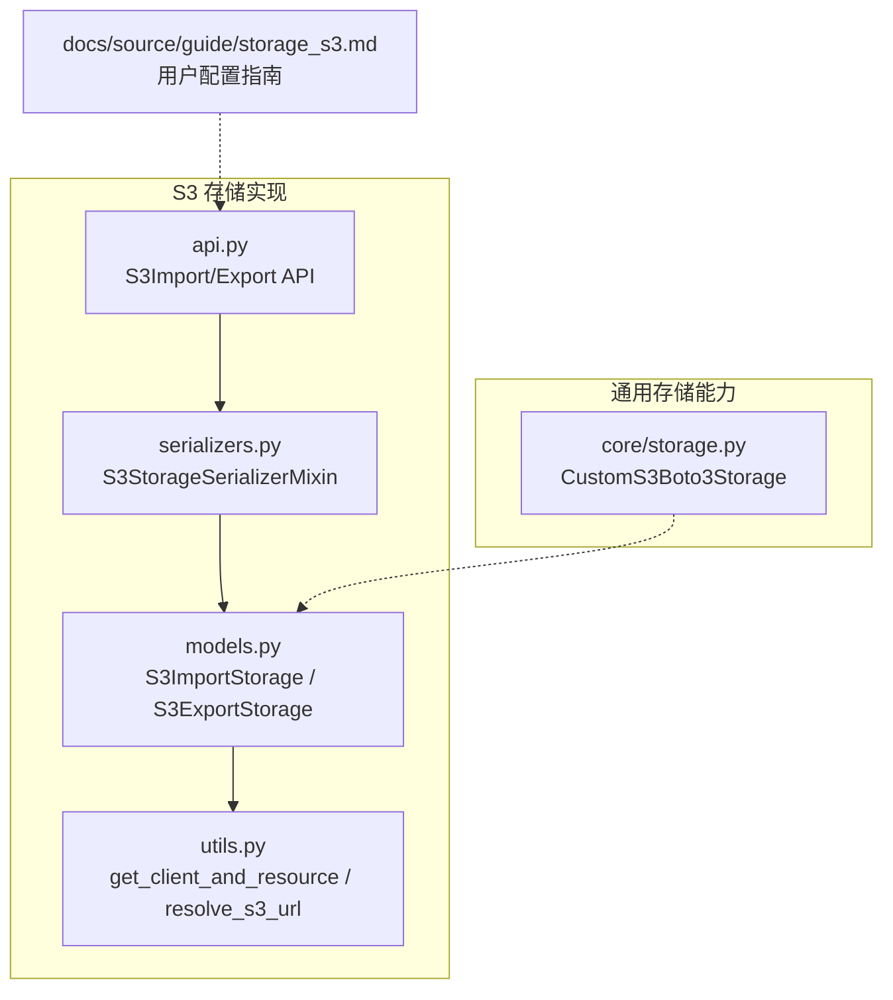
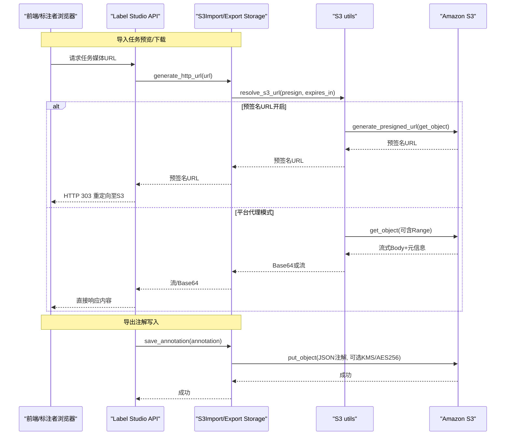
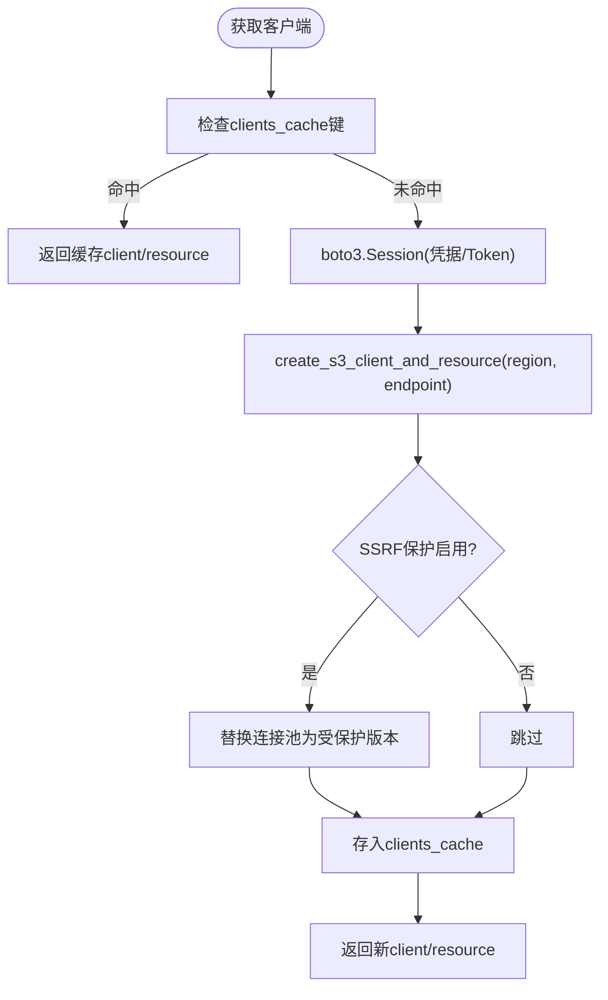
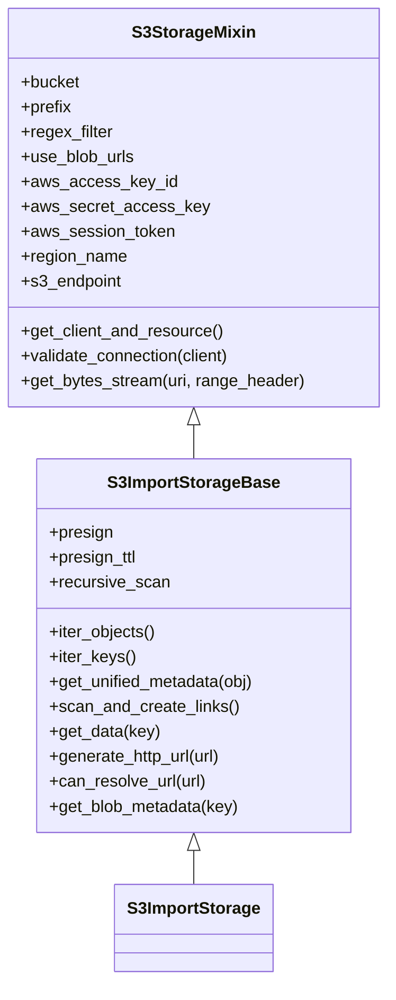
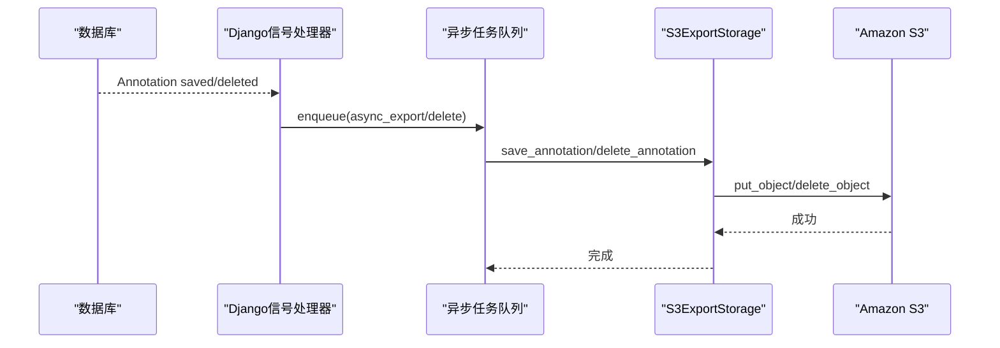
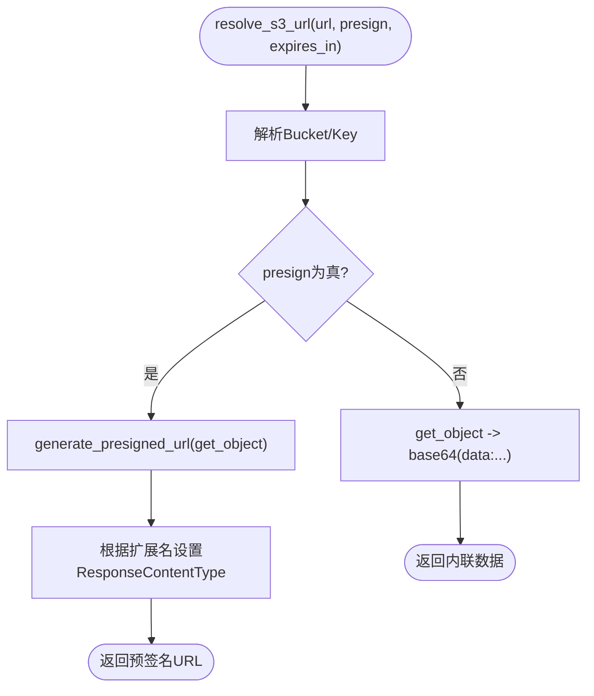
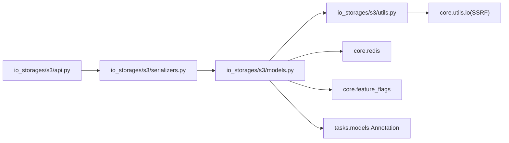

# AWS S3存储

<cite>
**本文引用的文件**   
- [storage_s3.md](file://docs/source/guide/storage_s3.md)
- [models.py](file://label_studio/io_storages/s3/models.py)
- [utils.py](file://label_studio/io_storages/s3/utils.py)
- [serializers.py](file://label_studio/io_storages/s3/serializers.py)
- [api.py](file://label_studio/io_storages/s3/api.py)
- [storage.py](file://label_studio/core/storage.py)
</cite>

## 目录
1. [简介](#简介)
2. [项目结构](#项目结构)
3. [核心组件](#核心组件)
4. [架构总览](#架构总览)
5. [详细组件分析](#详细组件分析)
6. [依赖关系分析](#依赖关系分析)
7. [性能与优化建议](#性能与优化建议)
8. [故障排查指南](#故障排查指南)
9. [结论](#结论)
10. [附录：配置项速查](#附录配置项速查)

## 简介
本文件面向在 Label Studio 中集成 Amazon S3 的读者，系统性说明 S3 存储的配置、客户端初始化、连接管理、错误处理、API 封装、高级特性与安全实践。文档同时覆盖导入（Source）与导出（Target）两种使用场景，并提供可操作的配置示例与常见问题解决方案。

## 项目结构
Label Studio 对 S3 的支持主要位于 io_storages/s3 模块，配合 core.storage 中的通用存储基类扩展，以及文档 guide/storage_s3.md 提供用户侧配置说明。

图表来源
- [models.py:46-396](file://label_studio/io_storages/s3/models.py#L46-L396)
- [utils.py:26-130](file://label_studio/io_storages/s3/utils.py#L26-L130)
- [serializers.py:18-82](file://label_studio/io_storages/s3/serializers.py#L18-L82)
- [api.py:64-292](file://label_studio/io_storages/s3/api.py#L64-L292)
- [storage.py:61-69](file://label_studio/core/storage.py#L61-L69)
- [storage_s3.md:24-301](file://docs/source/guide/storage_s3.md#L24-L301)

章节来源
- [storage_s3.md:24-301](file://docs/source/guide/storage_s3.md#L24-L301)

## 核心组件
- S3 存储模型与行为
  - S3StorageMixin：封装 S3 客户端与资源创建、连接校验、流式读取等通用能力。
  - S3ImportStorageBase/S3ImportStorage：导入存储，支持对象枚举、正则过滤、预签名 URL 生成、数据读取。
  - S3ExportStorage：导出存储，支持注解保存、删除、预签名 URL 生成、可选服务端加密。
- S3 工具函数
  - get_client_and_resource：基于 boto3.Session 创建 client/resource，支持区域、端点、会话令牌与环境变量回退。
  - create_s3_client_and_resource：构造带 s3v4 签名的客户端，并在启用 SSRF 保护时注入受保护的连接池。
  - resolve_s3_url：根据 presign 开关返回直链或 base64 内联数据。
- 序列化与校验
  - S3StorageSerializerMixin：统一脱敏敏感字段、校验桶名、SSRF 防护、连接测试并抛出友好错误。
- API 层
  - S3ImportStorageListAPI/DetailAPI/SyncAPI/ValidateAPI
  - S3ExportStorageListAPI/DetailAPI/SyncAPI/ValidateAPI
- 通用存储扩展
  - CustomS3Boto3Storage：继承 storages.backends.s3boto3.S3Boto3Storage，用于静态资源代理访问。

章节来源
- [models.py:46-396](file://label_studio/io_storages/s3/models.py#L46-L396)
- [utils.py:26-130](file://label_studio/io_storages/s3/utils.py#L26-L130)
- [serializers.py:18-82](file://label_studio/io_storages/s3/serializers.py#L18-L82)
- [api.py:64-292](file://label_studio/io_storages/s3/api.py#L64-L292)
- [storage.py:61-69](file://label_studio/core/storage.py#L61-L69)

## 架构总览
下图展示从前端到后端再到 S3 的整体交互流程，包括导入与导出路径、预签名 URL 与代理模式差异。

图表来源
- [models.py:233-341](file://label_studio/io_storages/s3/models.py#L233-L341)
- [utils.py:100-130](file://label_studio/io_storages/s3/utils.py#L100-L130)
- [storage_s3.md:175-191](file://docs/source/guide/storage_s3.md#L175-L191)

## 详细组件分析

### S3 客户端初始化与连接管理
- 客户端创建
  - 通过 get_client_and_resource 构建 boto3.Session，再调用 create_s3_client_and_resource 生成 client 与 resource。
  - 支持 region_name、s3_endpoint、aws_session_token；若未显式传入，会从环境变量回退（如 AWS_ACCESS_KEY_ID、AWS_SECRET_ACCESS_KEY、AWS_SESSION_TOKEN、S3_ENDPOINT、S3_region）。
- 连接池与 SSRF 防护
  - 当启用 SSRF_PROTECTION_ENABLED 且存在自定义 s3_endpoint 时，会替换底层连接池为受保护的 _SsrfGuardedAWSHTTP(S)ConnectionPool，避免 SSRF 风险。
- 客户端缓存
  - S3StorageMixin.get_client_and_resource 使用进程级字典 clients_cache 按凭据与端点键缓存 client/resource，显著降低重复初始化开销。

图表来源
- [utils.py:26-97](file://label_studio/io_storages/s3/utils.py#L26-L97)
- [models.py:74-89](file://label_studio/io_storages/s3/models.py#L74-L89)

章节来源
- [utils.py:26-97](file://label_studio/io_storages/s3/utils.py#L26-L97)
- [models.py:74-89](file://label_studio/io_storages/s3/models.py#L74-L89)

### 导入存储（S3ImportStorage）
- 对象枚举与过滤
  - iter_objects 支持 prefix、delimiter（非递归）、regex_filter 过滤，跳过目录与保留键。
  - iter_keys 仅返回 key 列表。
- 数据读取
  - get_data：若 use_blob_urls 为真，返回包含原始 S3 URI 的任务；否则读取 JSON/JSONL/Parquet 并解析为任务对象。
- URL 生成
  - generate_http_url：根据 presign/presign_ttl 调用 resolve_s3_url 生成预签名 URL 或 base64 内联数据。
- 连接校验
  - validate_connection：若有 prefix，使用 list_objects_v2 校验至少一个匹配对象；否则 head_bucket 校验桶存在。

图表来源
- [models.py:46-272](file://label_studio/io_storages/s3/models.py#L46-L272)

章节来源
- [models.py:184-272](file://label_studio/io_storages/s3/models.py#L184-L272)

### 导出存储（S3ExportStorage）
- 注解保存
  - save_annotation：序列化注解为 JSON，写入 S3；若启用服务端加密特性标志且配置了 KMS Key ID，则使用 aws:kms，否则使用 AES256。
- 注解删除
  - delete_annotation：根据关联键删除对象，并清理链接记录。
- URL 生成
  - generate_http_url：遵循全局 EXPORT_STORAGE_PRESIGN 与 TTL 设置。
- 异步导出
  - 监听 Annotation 的 post_save/pre_delete 信号，触发异步导出/删除任务。

图表来源
- [models.py:300-374](file://label_studio/io_storages/s3/models.py#L300-L374)

章节来源
- [models.py:280-374](file://label_studio/io_storages/s3/models.py#L280-L374)

### URL 解析与预签名
- resolve_s3_url
  - 当 presign=false：直接 get_object 并将 Body 转为 data:<content-type>;base64,... 返回。
  - 当 presign=true：调用 generate_presigned_url，并根据文件扩展名设置 ResponseContentType，使浏览器正确渲染媒体。
- 代理模式
  - 当关闭预签名时，系统以平台代理方式拉取并返回内容，适合需要严格网络边界控制的部署。

图表来源
- [utils.py:100-130](file://label_studio/io_storages/s3/utils.py#L100-L130)

章节来源
- [utils.py:100-130](file://label_studio/io_storages/s3/utils.py#L100-L130)

### API 与表单布局
- 导入存储 API
  - 列表/详情/更新/删除/同步/校验
- 导出存储 API
  - 列表/详情/更新/删除/同步/校验
- 这些 API 复用通用基类，并通过 S3 专属序列化器进行参数校验与连接测试。

章节来源
- [api.py:64-292](file://label_studio/io_storages/s3/api.py#L64-L292)

### 通用存储扩展
- CustomS3Boto3Storage：用于静态资源托管时的 URL 代理，将上传路径映射到平台内部代理地址。

章节来源
- [storage.py:61-69](file://label_studio/core/storage.py#L61-L69)

## 依赖关系分析
- 外部依赖
  - boto3/botocore：S3 客户端与资源、签名、异常类型。
  - Django/DRF：模型、信号、序列化、API 路由。
  - tldextract：用于未知域名的安全策略判断。
- 内部依赖
  - core.utils.io：SSRF 防护、IO 工具。
  - core.redis：异步任务调度。
  - core.feature_flags：功能开关控制（如 SSE-KMS）。
  - tasks.models.Annotation：导出目标实体。

图表来源
- [models.py:1-38](file://label_studio/io_storages/s3/models.py#L1-L38)
- [utils.py:1-22](file://label_studio/io_storages/s3/utils.py#L1-L22)
- [serializers.py:1-15](file://label_studio/io_storages/s3/serializers.py#L1-L15)
- [api.py:1-25](file://label_studio/io_storages/s3/api.py#L1-L25)

章节来源
- [models.py:1-38](file://label_studio/io_storages/s3/models.py#L1-L38)
- [utils.py:1-22](file://label_studio/io_storages/s3/utils.py#L1-L22)
- [serializers.py:1-15](file://label_studio/io_storages/s3/serializers.py#L1-L15)
- [api.py:1-25](file://label_studio/io_storages/s3/api.py#L1-L25)

## 性能与优化建议
- 客户端缓存
  - 利用 clients_cache 减少 boto3 Session/client/resource 初始化开销，提升高并发下的吞吐。
- 预签名 URL vs 代理模式
  - 预签名 URL：浏览器直连 S3，减轻后端压力，适合大规模媒体分发；需正确配置 CORS 与权限。
  - 代理模式：所有流量经 Label Studio，便于审计与访问控制，但会增加后端带宽与 CPU 消耗。
- 分块上传
  - 当前代码未显式封装分块上传逻辑；对于超大对象，建议在应用层使用 boto3 的分块上传 API 并结合断点续传策略。
- 生命周期与版本控制
  - 可在 S3 桶上配置生命周期规则与版本控制，结合 Label Studio 的导出删除行为，实现归档与合规要求。
- 缓存与 CDN
  - 对频繁访问的媒体，建议在前置 CDN 缓存预签名 URL 指向的对象，注意缓存失效策略与隐私边界。
- 并发请求
  - 合理调整 RQ 工作进程数与任务队列大小，避免导出任务堆积；必要时拆分大任务集。

[本节为通用指导，不直接分析具体文件]

## 故障排查指南
- 认证与权限
  - 常见错误：SignatureDoesNotMatch、403、NoSuchBucket、404。序列化器会将这些异常转换为友好的 ValidationError。
  - 建议：确认 IAM 策略包含 s3:ListBucket、s3:GetObject、s3:PutObject、s3:DeleteObject（按需），并确保桶名与区域正确。
- 预签名 URL 失败
  - 现象：无法生成预签名 URL，返回原 URL。
  - 原因：权限不足或网络不可达。检查 IAM 与网络连通性。
- SSRF 防护
  - 现象：自定义 s3_endpoint 被拒绝或报错。
  - 原因：SSRF_PROTECTION_ENABLED 开启且 endpoint 不在信任域名白名单。请调整 S3_TRUSTED_STORAGE_DOMAINS 或使用可信域名。
- 连接校验失败
  - 现象：validate_connection 抛错。
  - 原因：prefix 下无匹配对象或桶不存在。请检查 bucket/prefix 与权限。
- 代理模式性能问题
  - 现象：媒体加载慢、后端负载高。
  - 建议：切换为预签名 URL 模式，或在 CDN 后缓存。

章节来源
- [serializers.py:43-82](file://label_studio/io_storages/s3/serializers.py#L43-L82)
- [utils.py:100-130](file://label_studio/io_storages/s3/utils.py#L100-L130)
- [utils.py:214-235](file://label_studio/io_storages/s3/utils.py#L214-L235)
- [models.py:101-122](file://label_studio/io_storages/s3/models.py#L101-L122)

## 结论
Label Studio 的 S3 存储实现提供了完整的导入/导出能力，涵盖客户端初始化、连接缓存、预签名 URL 与代理模式、URL 解析、对象枚举与过滤、注解保存/删除、信号驱动的异步导出、以及 SSRF 防护与错误处理。结合文档中的 IAM/CORS 配置与最佳实践，可在生产环境中稳定高效地运行。

[本节为总结，不直接分析具体文件]

## 附录：配置项速查
- 访问密钥与区域
  - Access Key ID / Secret Access Key / Session Token
  - Region Name
  - S3 Endpoint（可选，用于覆盖默认端点）
- 桶与路径
  - Bucket Name
  - Bucket Prefix（可选）
- 行为选项
  - Use pre-signed URLs（On）/ Proxy through the platform（Off）
  - Expire pre-signed URLs（minutes）
  - Can delete objects from storage（导出存储）
- 导入扫描
  - File Name Filter（正则）
  - Scan all sub-folders（递归扫描）
- 安全与加密
  - IAM Role ARN（企业版）
  - SSE KMS Key ID（导出存储，条件启用）
- 参考文档
  - 用户配置与 IAM/CORS 示例见 [storage_s3.md:24-301](file://docs/source/guide/storage_s3.md#L24-L301)

章节来源
- [storage_s3.md:111-295](file://docs/source/guide/storage_s3.md#L111-L295)