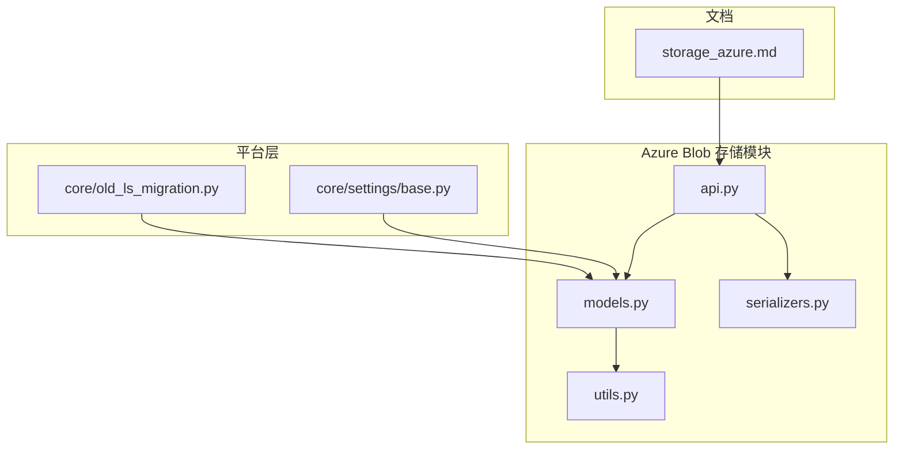
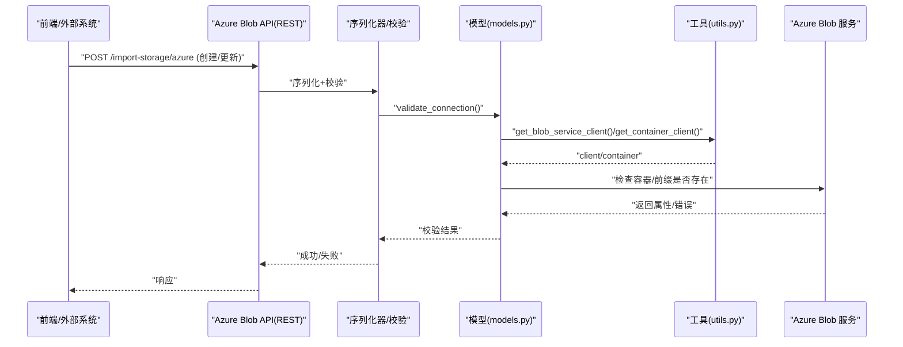
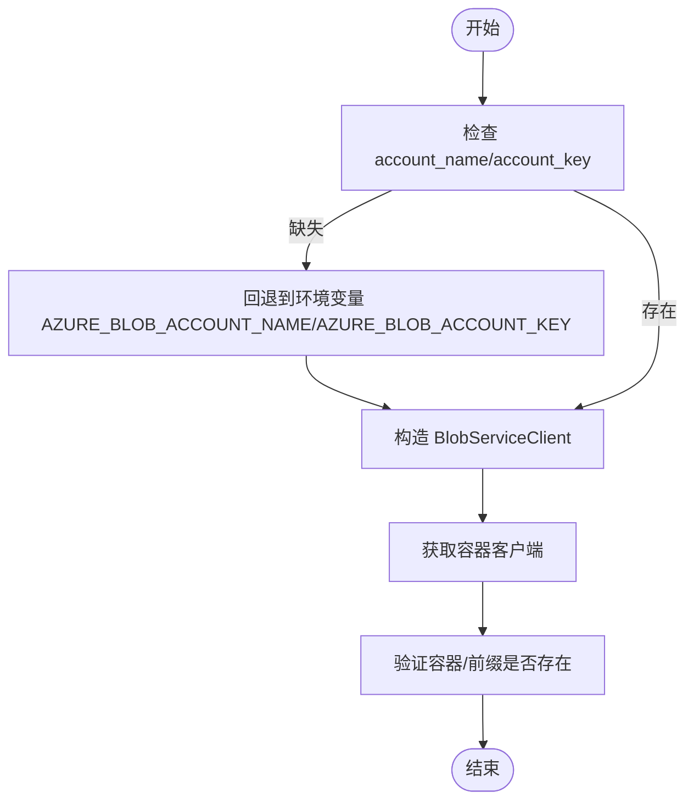
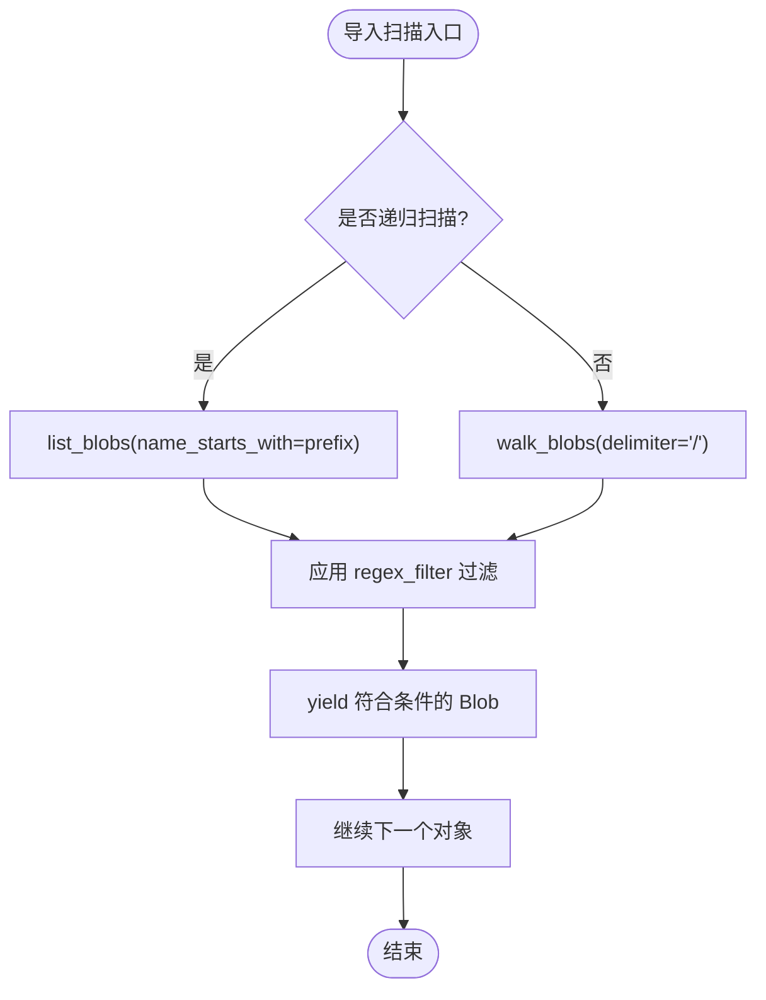
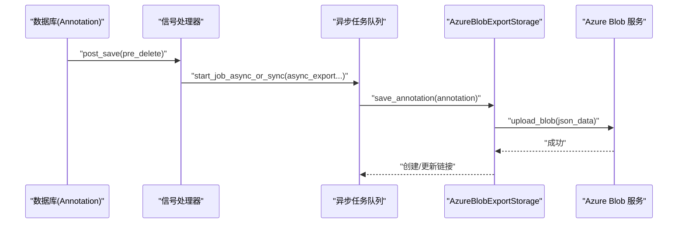
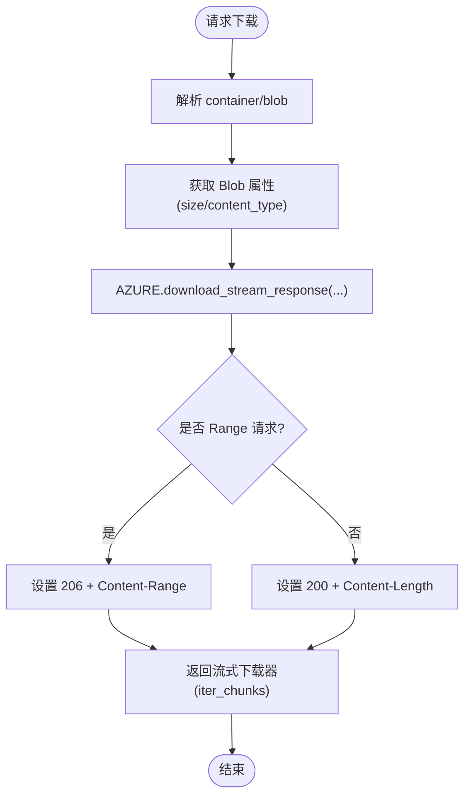
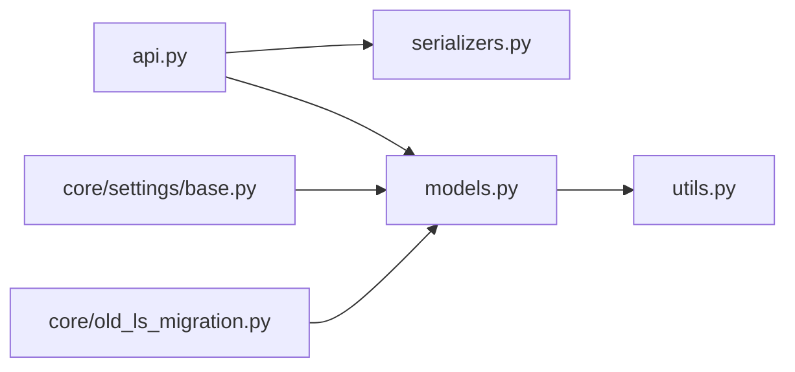

# Azure Blob存储

<cite>
**本文引用的文件**   
- [storage_azure.md](file://docs/source/guide/storage_azure.md)
- [models.py](file://label_studio/io_storages/azure_blob/models.py)
- [api.py](file://label_studio/io_storages/azure_blob/api.py)
- [serializers.py](file://label_studio/io_storages/azure_blob/serializers.py)
- [utils.py](file://label_studio/io_storages/azure_blob/utils.py)
- [base.py](file://label_studio/core/settings/base.py)
- [old_ls_migration.py](file://label_studio/core/old_ls_migration.py)
</cite>

## 目录
1. [简介](#简介)
2. [项目结构](#项目结构)
3. [核心组件](#核心组件)
4. [架构总览](#架构总览)
5. [详细组件分析](#详细组件分析)
6. [依赖关系分析](#依赖关系分析)
7. [性能与优化建议](#性能与优化建议)
8. [安全配置指南](#安全配置指南)
9. [故障诊断](#故障诊断)
10. [结论](#结论)
11. [附录：配置示例与API参考](#附录配置示例与api参考)

## 简介
本文件面向在 Label Studio 中集成 Microsoft Azure Blob 存储的读者，系统说明如何完成存储账户配置、容器管理、对象生命周期操作、认证方式（连接字符串/访问密钥/SAS/企业版服务主体）、高级特性使用、安全加固与性能优化。文档同时结合代码仓库中的实现细节，给出可追溯的源码路径与流程图示，帮助快速落地并排障。

## 项目结构
Azure Blob 存储相关能力集中在以下模块：
- 文档与用户指南：docs/source/guide/storage_azure.md
- 后端模型与业务逻辑：label_studio/io_storages/azure_blob/models.py
- API 路由与序列化：label_studio/io_storages/azure_blob/api.py, serializers.py
- 工具与客户端封装：label_studio/io_storages/azure_blob/utils.py
- 全局设置与环境变量：label_studio/core/settings/base.py
- 历史迁移兼容：label_studio/core/old_ls_migration.py

图表来源
- [storage_azure.md:1-367](file://docs/source/guide/storage_azure.md#L1-L367)
- [models.py:1-326](file://label_studio/io_storages/azure_blob/models.py#L1-L326)
- [api.py:1-293](file://label_studio/io_storages/azure_blob/api.py#L1-L293)
- [serializers.py:1-56](file://label_studio/io_storages/azure_blob/serializers.py#L1-L56)
- [utils.py:1-207](file://label_studio/io_storages/azure_blob/utils.py#L1-L207)
- [base.py:978-985](file://label_studio/core/settings/base.py#L978-L985)
- [old_ls_migration.py:13-14](file://label_studio/core/old_ls_migration.py#L13-L14)

章节来源
- [storage_azure.md:1-367](file://docs/source/guide/storage_azure.md#L1-L367)
- [models.py:1-326](file://label_studio/io_storages/azure_blob/models.py#L1-L326)
- [api.py:1-293](file://label_studio/io_storages/azure_blob/api.py#L1-L293)
- [serializers.py:1-56](file://label_studio/io_storages/azure_blob/serializers.py#L1-L56)
- [utils.py:1-207](file://label_studio/io_storages/azure_blob/utils.py#L1-L207)
- [base.py:978-985](file://label_studio/core/settings/base.py#L978-L985)
- [old_ls_migration.py:13-14](file://label_studio/core/old_ls_migration.py#L13-L14)

## 核心组件
- AzureBlobStorageMixin：提供通用账号、容器、前缀、正则过滤、SAS URL 生成、流式下载等能力。
- AzureBlobImportStorageBase/AzureBlobImportStorage：导入侧，支持递归/非递归扫描、按正则过滤、生成预签名URL、读取任务JSON。
- AzureBlobExportStorage：导出侧，将标注结果写入 Blob，并在删除标注时同步清理（可选）。
- AZURE 工具类：统一构建 BlobServiceClient、处理 Range 请求、获取元数据、模式校验等。
- API/Serializer：对外暴露导入/导出存储的 CRUD、校验、同步接口，并对敏感字段进行脱敏。

章节来源
- [models.py:40-326](file://label_studio/io_storages/azure_blob/models.py#L40-L326)
- [utils.py:33-207](file://label_studio/io_storages/azure_blob/utils.py#L33-L207)
- [api.py:1-293](file://label_studio/io_storages/azure_blob/api.py#L1-L293)
- [serializers.py:1-56](file://label_studio/io_storages/azure_blob/serializers.py#L1-L56)

## 架构总览
Label Studio 通过 Django REST Framework 暴露 Azure Blob 导入/导出存储的 API，前端或外部系统调用这些 API 创建连接、测试连通性、执行同步。底层使用 Azure SDK 的 BlobServiceClient 与 SAS 令牌完成鉴权与数据传输；同时支持“代理模式”和“预签名URL模式”两种数据加载策略。

图表来源
- [api.py:28-64](file://label_studio/io_storages/azure_blob/api.py#L28-L64)
- [serializers.py:25-41](file://label_studio/io_storages/azure_blob/serializers.py#L25-L41)
- [models.py:75-96](file://label_studio/io_storages/azure_blob/models.py#L75-L96)
- [utils.py:33-41](file://label_studio/io_storages/azure_blob/utils.py#L33-L41)

## 详细组件分析

### 认证与连接
- 账号与密钥来源优先级：实例字段 account_name/account_key > 环境变量 AZURE_BLOB_ACCOUNT_NAME/AZURE_BLOB_ACCOUNT_KEY。
- 客户端构造：utils.get_blob_service_client 使用公共云端点模板与共享密钥凭据构造 BlobServiceClient。
- 连接校验：models.validate_connection 会尝试获取容器属性，若不存在则抛出异常；导入存储还会校验 prefix 下是否存在对象。

图表来源
- [models.py:52-69](file://label_studio/io_storages/azure_blob/models.py#L52-L69)
- [utils.py:33-41](file://label_studio/io_storages/azure_blob/utils.py#L33-L41)
- [models.py:75-96](file://label_studio/io_storages/azure_blob/models.py#L75-L96)

章节来源
- [models.py:52-96](file://label_studio/io_storages/azure_blob/models.py#L52-L96)
- [utils.py:33-41](file://label_studio/io_storages/azure_blob/utils.py#L33-L41)

### 导入存储（从 Azure 拉取任务）
- 对象遍历：支持递归与非递归两种模式；非递归模式下跳过 BlobPrefix（目录占位符），仅枚举 Blob。
- 正则过滤：regex_filter 为 Python 正则表达式，用于筛选对象键名。
- 预签名URL：generate_http_url 基于 generate_blob_sas 生成只读 SAS URL，有效期由 presign_ttl 控制。
- 任务数据读取：use_blob_urls=True 时直接返回 Blob URL；否则下载 JSON/JSONL/Parquet 内容并解析为任务列表。

图表来源
- [models.py:156-195](file://label_studio/io_storages/azure_blob/models.py#L156-L195)

章节来源
- [models.py:141-249](file://label_studio/io_storages/azure_blob/models.py#L141-L249)

### 导出存储（将标注写入 Azure）
- 保存标注：序列化标注后以 key 命名上传至指定容器/前缀路径。
- 删除标注：根据关联链接删除对应 Blob，并清理链接记录（需开启 can_delete_objects）。
- 异步导出：Annotation 保存/删除信号触发异步任务，批量推送至所有已配置的 Azure 导出存储。

图表来源
- [models.py:259-318](file://label_studio/io_storages/azure_blob/models.py#L259-L318)

章节来源
- [models.py:259-318](file://label_studio/io_storages/azure_blob/models.py#L259-L318)

### 流式下载与 Range 支持
- get_bytes_stream：解析 URI，获取 Blob 属性，调用 AZURE.download_stream_response 实现分块流式下载，支持 HTTP Range 头。
- AZURE.download_stream_response：统一处理 Range 解析、长度计算、状态码（200/206）、Content-Range/ETag/Last-Modified 等元数据，适配大文件高效传输。

图表来源
- [models.py:97-138](file://label_studio/io_storages/azure_blob/models.py#L97-L138)
- [utils.py:44-140](file://label_studio/io_storages/azure_blob/utils.py#L44-L140)

章节来源
- [models.py:97-138](file://label_studio/io_storages/azure_blob/models.py#L97-L138)
- [utils.py:44-140](file://label_studio/io_storages/azure_blob/utils.py#L44-L140)

### API 与序列化
- API 提供导入/导出存储的 list/create/get/update/delete/validate/sync 等标准接口，并通过 OpenAPI 注解暴露给 SDK。
- Serializer 对 account_name/account_key 等敏感字段进行脱敏输出，并在 validate 阶段调用 storage.validate_connection() 做连通性校验。

章节来源
- [api.py:1-293](file://label_studio/io_storages/azure_blob/api.py#L1-L293)
- [serializers.py:1-56](file://label_studio/io_storages/azure_blob/serializers.py#L1-L56)

## 依赖关系分析
- models.py 依赖 utils.py 提供的客户端构造与流式下载工具。
- api.py 依赖 serializers.py 与 models.py 完成请求处理与数据持久化。
- base.py 提供全局设置项（如 URL 过期时间、位置前缀等），供上层逻辑使用。
- old_ls_migration.py 兼容旧版本 azure-blob 类型存储的迁移。

图表来源
- [api.py:1-293](file://label_studio/io_storages/azure_blob/api.py#L1-L293)
- [serializers.py:1-56](file://label_studio/io_storages/azure_blob/serializers.py#L1-L56)
- [models.py:1-326](file://label_studio/io_storages/azure_blob/models.py#L1-L326)
- [utils.py:1-207](file://label_studio/io_storages/azure_blob/utils.py#L1-L207)
- [base.py:978-985](file://label_studio/core/settings/base.py#L978-L985)
- [old_ls_migration.py:13-14](file://label_studio/core/old_ls_migration.py#L13-L14)

章节来源
- [api.py:1-293](file://label_studio/io_storages/azure_blob/api.py#L1-L293)
- [serializers.py:1-56](file://label_studio/io_storages/azure_blob/serializers.py#L1-L56)
- [models.py:1-326](file://label_studio/io_storages/azure_blob/models.py#L1-L326)
- [utils.py:1-207](file://label_studio/io_storages/azure_blob/utils.py#L1-L207)
- [base.py:978-985](file://label_studio/core/settings/base.py#L978-L985)
- [old_ls_migration.py:13-14](file://label_studio/core/old_ls_migration.py#L13-L14)

## 性能与优化建议
- 优先使用预签名URL模式：浏览器直连 Azure，减轻 Label Studio 服务器带宽压力；需正确配置 CORS。
- 合理设置 presign_ttl：平衡安全性与用户体验，避免频繁刷新。
- 启用递归扫描需谨慎：大规模容器下递归扫描会增加 API 调用与延迟，建议配合文件名过滤减少开销。
- 利用 Range 下载：大媒体文件建议使用流式下载与 Range 支持，提升播放与预览体验。
- 导出批量写入：Annotation 保存/删除通过信号触发异步任务，避免阻塞主流程。

[本节为通用建议，不直接分析具体文件]

## 安全配置指南
- 使用最小权限原则：为 Service Principal 分配 Storage Blob Data Contributor 角色，或在细粒度策略下仅授予必要读写权限。
- 网络隔离：在 Azure 存储账户层面配置防火墙与虚拟网络规则，限制仅允许 Label Studio 所在网络访问。
- 身份认证：
  - 开源版：推荐使用访问密钥（Account Key）或 SAS 令牌。
  - 企业版：推荐 Service Principal（Entra ID）认证，避免长期密钥泄露风险。
- CORS 配置：若使用预签名URL模式，需在 Blob 服务中配置允许的 Origin、方法与头部。
- 日志与审计：开启 Azure 存储审计日志，结合 Entra ID 审计事件追踪访问行为。

章节来源
- [storage_azure.md:17-37](file://docs/source/guide/storage_azure.md#L17-L37)
- [storage_azure.md:204-362](file://docs/source/guide/storage_azure.md#L204-L362)

## 故障诊断
- 连接失败
  - 检查 account_name/account_key 是否正确，或环境变量是否设置。
  - 确认容器名称与前缀大小写一致且存在。
  - 若使用 Service Principal，检查 Tenant/Client/Secret 与角色分配。
- 无法列出对象
  - 检查正则过滤是否过严导致无匹配对象。
  - 递归/非递归模式是否符合预期。
- 预签名URL无效
  - 检查 presign_ttl 是否过期。
  - 确认 CORS 配置正确（Origin/Method/Header）。
- 下载卡顿或中断
  - 确认服务端启用了 Range 支持，客户端支持断点续传。
  - 调整 RESOLVER_PROXY_MAX_RANGE_SIZE 与 chunk 大小。

章节来源
- [models.py:75-96](file://label_studio/io_storages/azure_blob/models.py#L75-L96)
- [models.py:156-195](file://label_studio/io_storages/azure_blob/models.py#L156-L195)
- [models.py:223-240](file://label_studio/io_storages/azure_blob/models.py#L223-L240)
- [utils.py:44-140](file://label_studio/io_storages/azure_blob/utils.py#L44-L140)
- [storage_azure.md:354-362](file://docs/source/guide/storage_azure.md#L354-L362)

## 结论
Label Studio 对 Azure Blob 存储提供了完整的导入/导出能力，涵盖认证、容器与对象管理、流式下载、预签名URL、异步导出等关键功能。通过合理的认证与安全配置、CORS 与网络规则设置，以及性能调优策略，可在生产环境中稳定高效地运行。企业用户可进一步采用 Service Principal 强化身份与权限治理。

[本节为总结性内容，不直接分析具体文件]

## 附录：配置示例与API参考

### 环境与服务端配置要点
- 环境变量（开源版常用）：
  - AZURE_BLOB_ACCOUNT_NAME
  - AZURE_BLOB_ACCOUNT_KEY
- 全局设置（部分场景）：
  - STORAGE_TYPE=azure
  - STORAGE_AZURE_ACCOUNT_NAME / STORAGE_AZURE_ACCOUNT_KEY / STORAGE_AZURE_CONTAINER_NAME / STORAGE_AZURE_URL_EXPIRATION_SECS / STORAGE_AZURE_FOLDER

章节来源
- [base.py:978-985](file://label_studio/core/settings/base.py#L978-L985)
- [models.py:52-69](file://label_studio/io_storages/azure_blob/models.py#L52-L69)
- [utils.py:142-155](file://label_studio/io_storages/azure_blob/utils.py#L142-L155)

### 前端/控制台配置步骤
- 源存储（导入）：
  - 填写存储标题、容器名、账号名、账号密钥。
  - 选择“使用预签名URL”或“通过平台代理”。
  - 设置预签名URL过期时间（分钟）。
  - 可选：Bucket Prefix、导入方法、文件名过滤、递归扫描。
- 目标存储（导出）：
  - 填写存储标题、容器名、容器前缀、账号名、账号密钥。
  - 可选择“可从存储删除对象”。

章节来源
- [storage_azure.md:56-143](file://docs/source/guide/storage_azure.md#L56-L143)
- [storage_azure.md:145-201](file://docs/source/guide/storage_azure.md#L145-L201)

### 企业版 Service Principal 配置要点
- 在 Entra ID 注册应用，获取 Tenant ID、Client ID、Client Secret。
- 为应用分配 Storage Blob Data Contributor 角色。
- 在 Label Studio 中选择“Azure Blob Storage with Service Principal”，填入上述信息。
- 如需预签名URL，仍需配置 CORS。

章节来源
- [storage_azure.md:204-362](file://docs/source/guide/storage_azure.md#L204-L362)

### API 概览（导入/导出）
- 导入存储
  - 列表：GET /import-storage/azure?project={id}
  - 创建：POST /import-storage/azure
  - 详情：GET /import-storage/azure/{id}
  - 更新：PATCH /import-storage/azure/{id}
  - 删除：DELETE /import-storage/azure/{id}
  - 校验：POST /import-storage/azure/validate
  - 同步：POST /import-storage/azure/{id}/sync
- 导出存储
  - 列表：GET /export-storage/azure?project={id}
  - 创建：POST /export-storage/azure
  - 详情：GET /export-storage/azure/{id}
  - 更新：PATCH /export-storage/azure/{id}
  - 删除：DELETE /export-storage/azure/{id}
  - 校验：POST /export-storage/azure/validate
  - 同步：POST /export-storage/azure/{id}/sync

章节来源
- [api.py:28-293](file://label_studio/io_storages/azure_blob/api.py#L28-L293)

### 高级特性说明
- 分层 Blob（层级目录）：通过容器内“前缀”模拟目录结构；导入时可递归或非递归扫描。
- 快照：当前实现未直接暴露快照 API；如需快照，请在 Azure 侧单独管理。
- 复制：当前实现未直接暴露复制 API；如需跨区域复制，请在 Azure 侧配置存储账户级复制策略。

[本节为概念性说明，不直接分析具体文件]