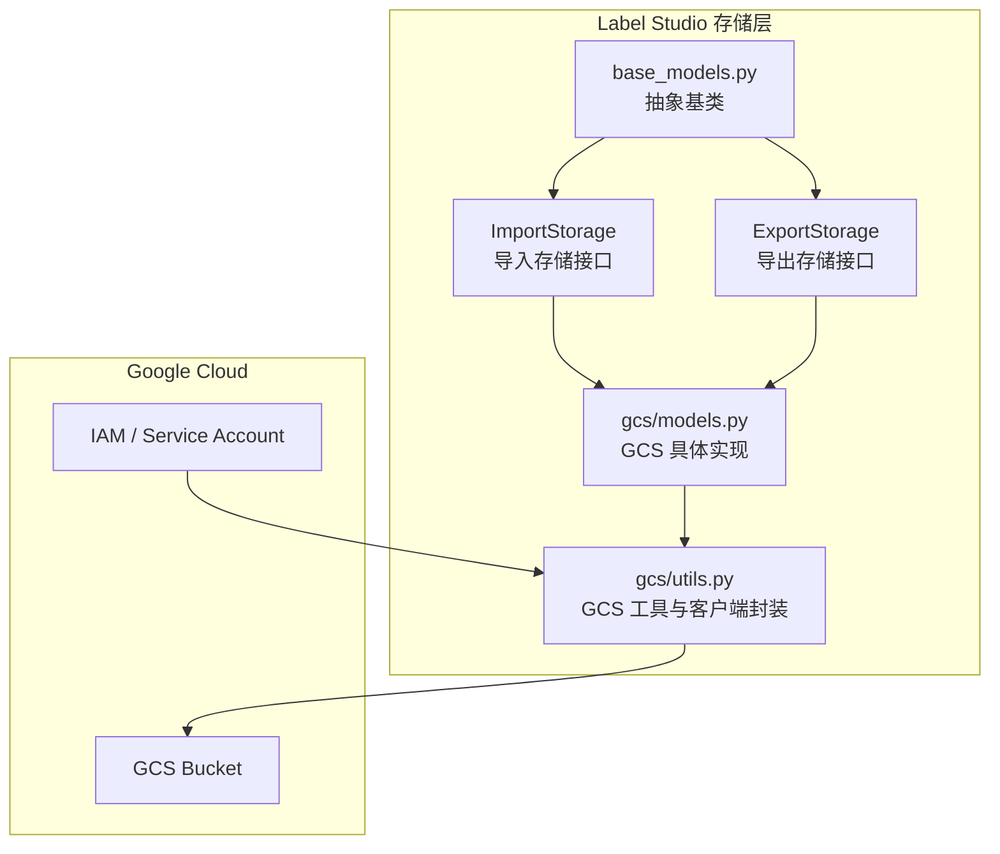
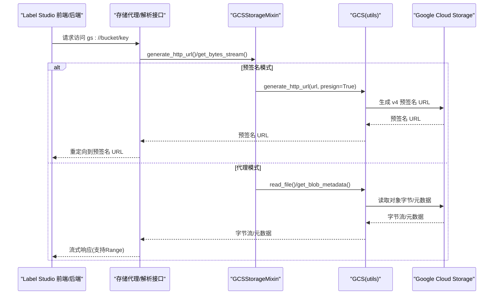
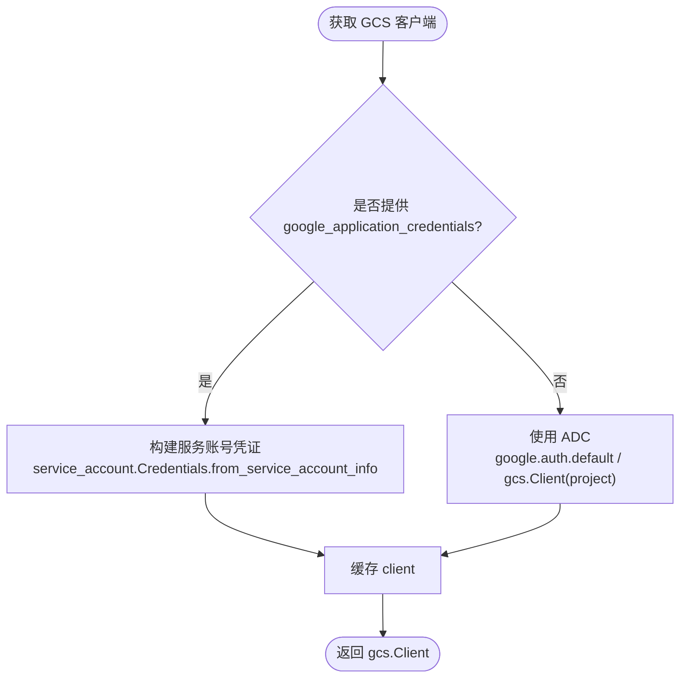
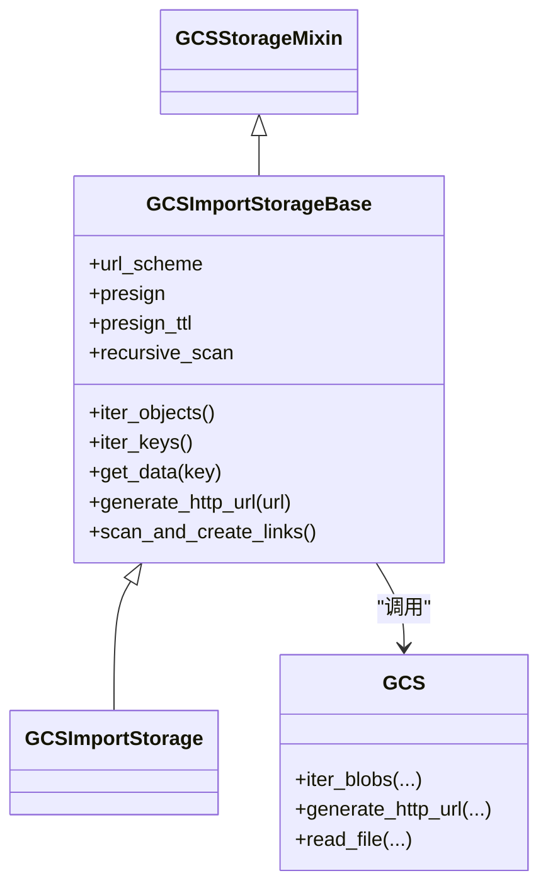
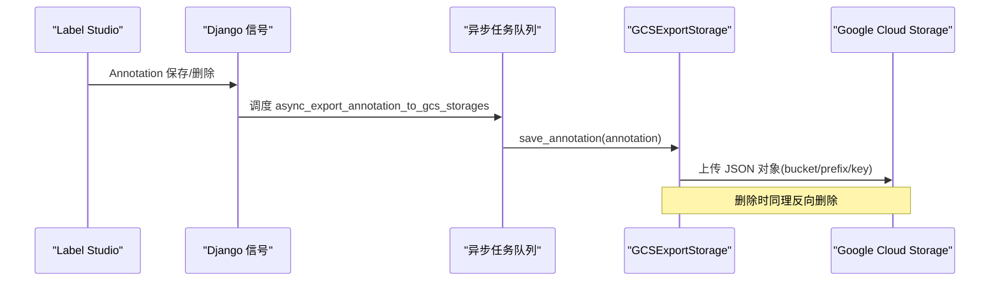
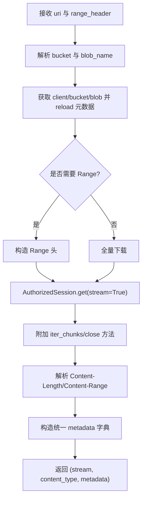
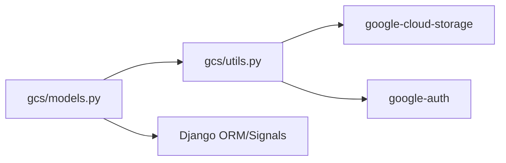

# Google Cloud Storage

<cite>
**本文引用的文件**   
- [storage_gcp.md](file://docs/source/guide/storage_gcp.md)
- [models.py](file://label_studio/io_storages/gcs/models.py)
- [utils.py](file://label_studio/io_storages/gcs/utils.py)
- [README.md](file://label_studio/io_storages/README.md)
</cite>

## 目录
1. [简介](#简介)
2. [项目结构](#项目结构)
3. [核心组件](#核心组件)
4. [架构总览](#架构总览)
5. [详细组件分析](#详细组件分析)
6. [依赖关系分析](#依赖关系分析)
7. [性能与优化](#性能与优化)
8. [安全配置指南](#安全配置指南)
9. [故障排查](#故障排查)
10. [结论](#结论)
11. [附录：配置示例与监控告警](#附录配置示例与监控告警)

## 简介
本文件面向在 Label Studio 中集成 Google Cloud Storage（GCS）的工程师与运维人员，系统性说明认证方式、Bucket 创建与权限、对象操作接口、Google Cloud Storage Client Library 集成实现、高级特性配置、安全最佳实践、性能优化建议以及监控告警设置。文档同时结合仓库中的 GCS 存储实现，给出可落地的架构图、流程图与关键路径定位。

## 项目结构
Label Studio 对 GCS 的支持位于 io_storages 子系统中，采用“导入存储”和“导出存储”两类抽象，并通过 GCS 专用实现接入 Google Cloud Storage Client Library。

图表来源
- [README.md:12-84](file://label_studio/io_storages/README.md#L12-L84)
- [models.py:36-316](file://label_studio/io_storages/gcs/models.py#L36-L316)
- [utils.py:28-341](file://label_studio/io_storages/gcs/utils.py#L28-L341)

章节来源
- [README.md:1-84](file://label_studio/io_storages/README.md#L1-L84)

## 核心组件
- GCS 客户端封装与认证
  - 通过 google.cloud.storage.Client 管理连接；支持服务账号密钥与应用默认凭据（ADC）。
  - 提供 get_client、get_bucket、validate_connection、iter_blobs、generate_http_url、read_file、get_blob_metadata 等能力。
- 导入存储（Source）
  - GCSImportStorageBase/GCSImportStorage：枚举对象、读取任务数据、生成预签名 URL、扫描与链接创建。
- 导出存储（Target）
  - GCSExportStorage：序列化标注并上传至 GCS，支持删除同步。
- 流式下载与 Range 支持
  - GCSStorageMixin.get_bytes_stream：基于 AuthorizedSession 的单次 HTTP 流式下载，支持 Range 头与元数据返回。

章节来源
- [utils.py:28-341](file://label_studio/io_storages/gcs/utils.py#L28-L341)
- [models.py:36-316](file://label_studio/io_storages/gcs/models.py#L36-L316)

## 架构总览
下图展示从 Label Studio 到 GCS 的关键交互：认证、对象列举、URL 生成、流式下载与导出写入。

图表来源
- [models.py:78-167](file://label_studio/io_storages/gcs/models.py#L78-L167)
- [utils.py:191-252](file://label_studio/io_storages/gcs/utils.py#L191-L252)

## 详细组件分析

### 认证与客户端初始化
- 支持两种认证方式：
  - 服务账号密钥：通过 JSON 内容注入（google_application_credentials），内部使用 service_account.Credentials.from_service_account_info 构造凭证。
  - 应用默认凭据（ADC）：当未提供密钥时，直接以 gcs.Client(project=...) 使用 ADC。
- 客户端缓存：按 credentials 键缓存 client，避免重复初始化。
- 可选强制使用 ADC 开关：通过 settings.GCS_CLOUD_STORAGE_FORCE_DEFAULT_CREDENTIALS 控制是否优先走 ADC。

图表来源
- [utils.py:54-89](file://label_studio/io_storages/gcs/utils.py#L54-L89)
- [utils.py:191-252](file://label_studio/io_storages/gcs/utils.py#L191-L252)

章节来源
- [utils.py:54-89](file://label_studio/io_storages/gcs/utils.py#L54-L89)
- [utils.py:191-252](file://label_studio/io_storages/gcs/utils.py#L191-L252)

### 导入存储（Source）
- 枚举对象：iter_objects/iter_keys 委托给 GCS.iter_blobs，支持前缀、正则过滤、递归/非递归扫描。
- 读取任务数据：get_data 支持 use_blob_urls 模式（直接返回 gs:// URI）或读取 JSON/JSONL/Parquet 并转换为 StorageObject。
- URL 生成：generate_http_url 根据 presign 开关决定返回预签名 URL 或 base64 data URL。
- 链接创建：scan_and_create_links 将任务与外部对象 key 关联。

图表来源
- [models.py:170-240](file://label_studio/io_storages/gcs/models.py#L170-L240)
- [utils.py:117-163](file://label_studio/io_storages/gcs/utils.py#L117-L163)
- [utils.py:191-252](file://label_studio/io_storages/gcs/utils.py#L191-L252)

章节来源
- [models.py:170-240](file://label_studio/io_storages/gcs/models.py#L170-L240)
- [utils.py:117-163](file://label_studio/io_storages/gcs/utils.py#L117-L163)

### 导出存储（Target）
- 保存标注：save_annotation 将标注序列化为 JSON 后上传到指定 bucket/prefix。
- 删除标注：delete_annotation 根据 link key 删除对应对象。
- 自动导出：通过 Django 信号 post_save/pre_delete 触发异步导出/清理。

图表来源
- [models.py:248-308](file://label_studio/io_storages/gcs/models.py#L248-L308)

章节来源
- [models.py:248-308](file://label_studio/io_storages/gcs/models.py#L248-L308)

### 流式下载与 Range 支持
- get_bytes_stream 通过 AuthorizedSession 发起单次带 stream=True 的请求，支持 Range 头，返回流、Content-Type 与统一元数据字典。
- 该实现用于代理模式下的高效分块传输，减少多次请求开销。

图表来源
- [models.py:78-167](file://label_studio/io_storages/gcs/models.py#L78-L167)

章节来源
- [models.py:78-167](file://label_studio/io_storages/gcs/models.py#L78-L167)

## 依赖关系分析
- 模块耦合
  - models.py 依赖 utils.py 提供的 GCS 工具类进行认证、列举、读写与 URL 生成。
  - README.md 定义了导入/导出存储的通用契约，GCS 实现遵循这些契约。
- 外部依赖
  - google-cloud-storage：对象存储客户端。
  - google-auth：服务账号与 ADC 认证。
  - django.db.models/signals：模型字段与事件驱动导出。
- 可能的循环依赖
  - 当前实现为单向依赖（models -> utils），未见循环引用。

图表来源
- [models.py:1-316](file://label_studio/io_storages/gcs/models.py#L1-L316)
- [utils.py:1-341](file://label_studio/io_storages/gcs/utils.py#L1-L341)

章节来源
- [README.md:12-84](file://label_studio/io_storages/README.md#L12-L84)
- [models.py:1-316](file://label_studio/io_storages/gcs/models.py#L1-L316)
- [utils.py:1-341](file://label_studio/io_storages/gcs/utils.py#L1-L341)

## 性能与优化
- 预签名 URL vs 平台代理
  - 预签名模式：浏览器直连 GCS，带宽不经过 Label Studio，适合大规模并发与高吞吐场景；需正确配置 CORS 与预签名权限。
  - 代理模式：流量经 Label Studio 转发，便于统一鉴权与审计，但占用更多后端资源。
- Range 与流式传输
  - 代理模式支持 Range 头，配合分块迭代器降低内存占用，提升大文件体验。
- 客户端与连接复用
  - GCS.get_client 对 client 做缓存，减少认证与连接建立开销。
- 批量导出并行化
  - 导出存储继承的批量保存具备线程池并行处理与进度跟踪能力（参考存储层通用设计）。

章节来源
- [storage_gcp.md:133-149](file://docs/source/guide/storage_gcp.md#L133-L149)
- [models.py:78-167](file://label_studio/io_storages/gcs/models.py#L78-L167)
- [utils.py:54-89](file://label_studio/io_storages/gcs/utils.py#L54-L89)
- [README.md:115-118](file://label_studio/io_storages/README.md#L115-L118)

## 安全配置指南
- 最小权限原则
  - 服务账号至少需要：Storage Object Viewer、Service Account Token Creator、storage.buckets.get 等必要权限。
  - 如需删除导出对象，需额外授予删除权限。
- 预签名 URL 与 CORS
  - 若启用预签名 URL，需在 Bucket 上配置 CORS，允许 GET 来自 Label Studio 部署域名的跨域访问。
- 应用默认凭据（ADC）
  - 推荐在生产环境使用 ADC，避免在服务端硬编码密钥；可通过环境变量 GOOGLE_APPLICATION_CREDENTIALS 指向服务账号 JSON。
- WIF（工作负载身份联合）
  - 企业版支持 Workload Identity Federation，动态申请临时凭证，无需长期密钥。
- GKE 服务账号委派
  - 企业版支持在 GKE 上使用服务账号委派，避免长生命周期密钥泄露风险。

章节来源
- [storage_gcp.md:23-43](file://docs/source/guide/storage_gcp.md#L23-L43)
- [storage_gcp.md:71-87](file://docs/source/guide/storage_gcp.md#L71-L87)
- [storage_gcp.md:235-255](file://docs/source/guide/storage_gcp.md#L235-L255)
- [storage_gcp.md:245-744](file://docs/source/guide/storage_gcp.md#L245-L744)
- [storage_gcp.md:748-800](file://docs/source/guide/storage_gcp.md#L748-L800)

## 故障排查
- 连接校验失败
  - validate_connection 会尝试获取 bucket，并在导入模式下检查 prefix 下是否存在对象；若无对象则抛出错误。
- 预签名 URL 无法访问
  - 检查 Bucket CORS 策略是否正确；确认服务账号具有生成预签名 URL 的权限。
- 代理模式卡顿或超时
  - 调整代理相关环境变量（缓冲大小、超时、最大 Range 大小、缓存 TTL）以提升稳定性与性能。
- 默认凭据加载失败
  - 检查 ADC 配置或服务账号是否已激活；必要时显式设置 GOOGLE_APPLICATION_CREDENTIALS。

章节来源
- [utils.py:92-116](file://label_studio/io_storages/gcs/utils.py#L92-L116)
- [storage_gcp.md:38-62](file://docs/source/guide/storage_gcp.md#L38-L62)
- [storage_gcp.md:235-243](file://docs/source/guide/storage_gcp.md#L235-L243)

## 结论
Label Studio 对 GCS 的集成以清晰的导入/导出抽象为基础，借助 google-cloud-storage 与 google-auth 完成认证与对象操作。通过预签名 URL 与代理模式的双通道，兼顾了性能与安全；结合 ADC/WIF/GKE 委派等机制，满足生产环境的合规与运维需求。建议在大规模场景中优先使用预签名 URL，并结合 Range 与流式传输优化用户体验；在企业环境中优先采用 ADC/WIF 以降低密钥泄露风险。

## 附录：配置示例与监控告警
- 基础配置步骤（控制台）
  - 启用程序化访问、配置服务账号与角色、设置 CORS（仅预签名模式需要）、创建源/目标存储连接并测试连通性。
- 环境变量
  - GOOGLE_APPLICATION_CREDENTIALS：指向服务账号 JSON 文件路径。
- 监控与告警
  - 关注存储同步状态（Initialized/Queued/InProgress/Failed/Completed）与 last_sync/time_last_ping 指标。
  - 针对 Failed 状态与长时间无心跳的情况设置告警，及时恢复 RQ worker 或修复权限/CORS 问题。

章节来源
- [storage_gcp.md:17-176](file://docs/source/guide/storage_gcp.md#L17-L176)
- [storage_gcp.md:177-234](file://docs/source/guide/storage_gcp.md#L177-L234)
- [README.md:132-172](file://label_studio/io_storages/README.md#L132-L172)