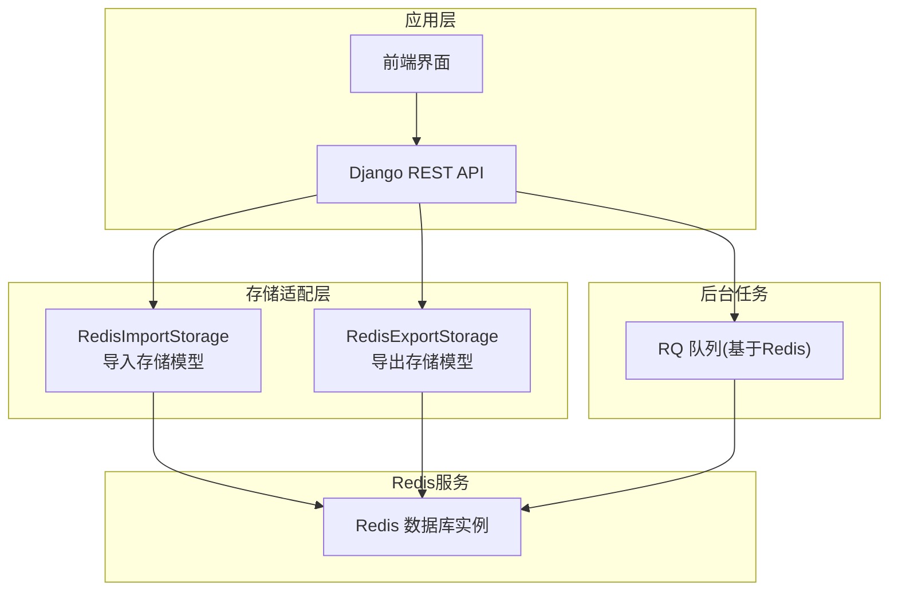
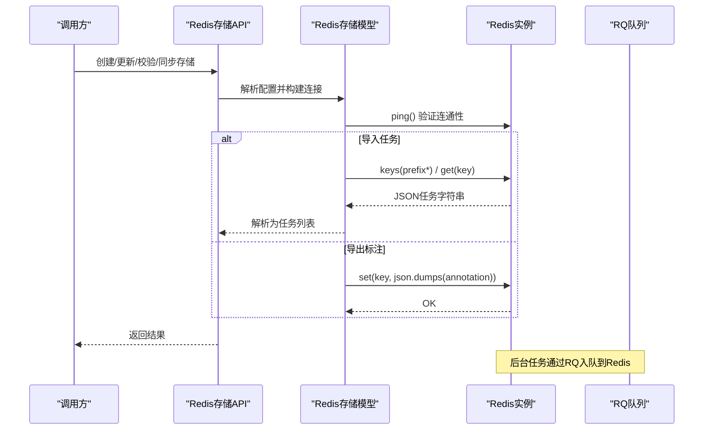
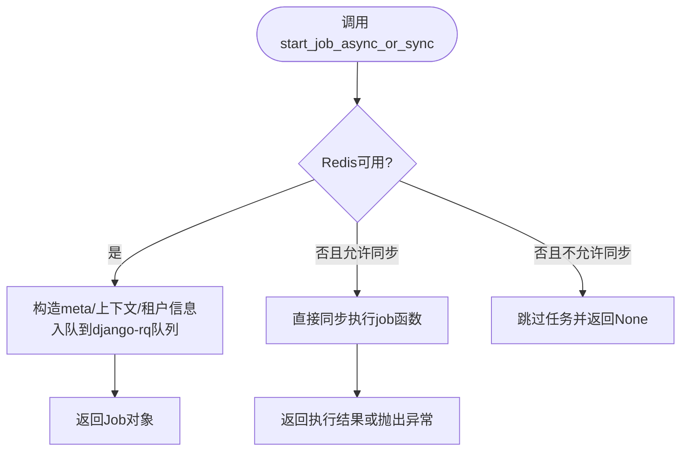
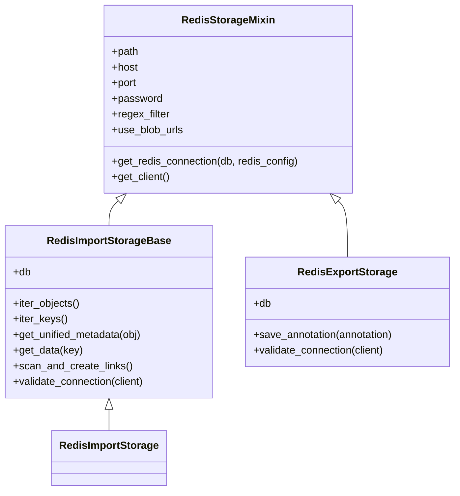
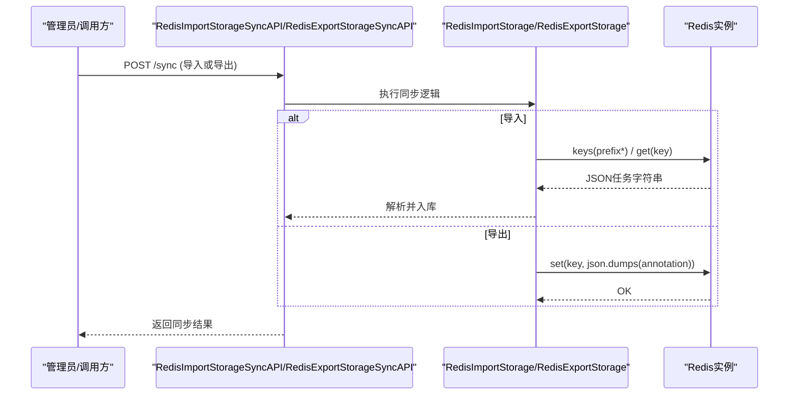
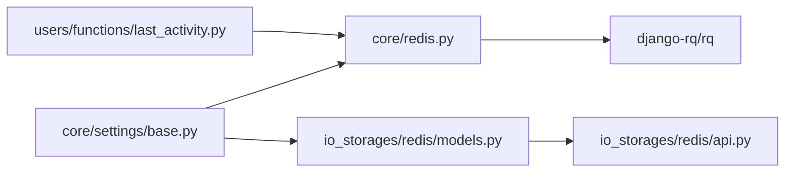

# Redis存储

<cite>
**本文引用的文件**   
- [label_studio/core/redis.py](file://label_studio/core/redis.py)
- [label_studio/io_storages/redis/models.py](file://label_studio/io_storages/redis/models.py)
- [label_studio/io_storages/redis/api.py](file://label_studio/io_storages/redis/api.py)
- [docs/source/guide/storage_redis.md](file://docs/source/guide/storage_redis.md)
- [label_studio/core/settings/base.py](file://label_studio/core/settings/base.py)
</cite>

## 目录
1. [简介](#简介)
2. [项目结构](#项目结构)
3. [核心组件](#核心组件)
4. [架构总览](#架构总览)
5. [详细组件分析](#详细组件分析)
6. [依赖关系分析](#依赖关系分析)
7. [性能与高可用建议](#性能与高可用建议)
8. [故障排查指南](#故障排查指南)
9. [结论](#结论)
10. [附录：配置项与API清单](#附录配置项与api清单)

## 简介
本文件系统性说明 Label Studio 中 Redis 的用途、配置方式、数据结构选择、读写 API、键空间管理以及在高可用与性能方面的实践建议。Redis 在项目中承担两类职责：
- 任务与标注数据的临时存储（导入/导出）
- 异步任务队列与缓存支撑（RQ 队列、用户活动统计等）

## 项目结构
围绕 Redis 的核心代码分布在以下位置：
- 通用 Redis 客户端与 RQ 任务调度封装：core/redis.py
- Redis 作为“云存储”的模型与序列化：io_storages/redis/models.py
- Redis 存储的 REST API：io_storages/redis/api.py
- 官方文档说明：docs/source/guide/storage_redis.md
- 全局设置与默认值：core/settings/base.py

图表来源
- [label_studio/io_storages/redis/api.py:1-292](file://label_studio/io_storages/redis/api.py#L1-L292)
- [label_studio/io_storages/redis/models.py:26-172](file://label_studio/io_storages/redis/models.py#L26-L172)
- [label_studio/core/redis.py:80-111](file://label_studio/core/redis.py#L80-L111)

章节来源
- [docs/source/guide/storage_redis.md:15-19](file://docs/source/guide/storage_redis.md#L15-L19)

## 核心组件
- Redis 基础能力封装：提供健康检查、连接判断、简单 KV/HASH 操作，以及与 RQ 的任务调度集成。
- Redis 导入/导出存储模型：将 Redis 作为“云存储”，支持按前缀扫描键、读取 JSON 任务字符串、写入标注结果。
- Redis 存储 API：暴露导入/导出存储的增删改查、校验与同步接口。
- 全局设置：包含 RQ 队列默认配置、SSL 参数、用户活动缓存 TTL 等。

章节来源
- [label_studio/core/redis.py:80-111](file://label_studio/core/redis.py#L80-L111)
- [label_studio/io_storages/redis/models.py:26-172](file://label_studio/io_storages/redis/models.py#L26-L172)
- [label_studio/io_storages/redis/api.py:1-292](file://label_studio/io_storages/redis/api.py#L1-L292)
- [label_studio/core/settings/base.py:389-430](file://label_studio/core/settings/base.py#L389-L430)

## 架构总览
Label Studio 通过 Django REST API 暴露 Redis 存储管理能力；业务侧使用 Redis 作为任务与标注的临时存储，同时使用 RQ 将耗时任务放入 Redis 队列执行。

图表来源
- [label_studio/io_storages/redis/api.py:116-157](file://label_studio/io_storages/redis/api.py#L116-L157)
- [label_studio/io_storages/redis/models.py:90-115](file://label_studio/io_storages/redis/models.py#L90-L115)
- [label_studio/io_storages/redis/models.py:137-149](file://label_studio/io_storages/redis/models.py#L137-L149)
- [label_studio/core/redis.py:264-358](file://label_studio/core/redis.py#L264-L358)

## 详细组件分析

### 1) Redis 基础能力与连接
- 健康检查与连接判断：提供 redis_healthcheck、redis_connected 等方法，统一处理连接异常与超时。
- 简易KV/HASH操作：封装 redis_get、redis_set、redis_hget、redis_hset、redis_delete，便于其他模块复用。
- RQ 任务调度：start_job_async_or_sync 根据 Redis 可用性自动切换异步/同步执行，支持延迟入队、重试、失败回调、上下文捕获与租户元数据注入。

图表来源
- [label_studio/core/redis.py:264-370](file://label_studio/core/redis.py#L264-L370)

章节来源
- [label_studio/core/redis.py:80-111](file://label_studio/core/redis.py#L80-L111)
- [label_studio/core/redis.py:234-261](file://label_studio/core/redis.py#L234-L261)
- [label_studio/core/redis.py:264-370](file://label_studio/core/redis.py#L264-L370)

### 2) Redis 导入/导出存储模型
- 连接构建：RedisStorageMixin.get_client 组装 host/port/password，并在启用 SSRF 保护时进行主机解析；StrictRedis 以 UTF-8 解码响应。
- 导入流程：按 path 前缀扫描 keys，逐个 get 获取 JSON 字符串，再交由 load_tasks_json 解析为任务列表。
- 导出流程：Annotation 保存后触发信号，将标注序列化为 JSON 字符串并以 key 写入 Redis，随后建立关联 Link。

图表来源
- [label_studio/io_storages/redis/models.py:26-81](file://label_studio/io_storages/redis/models.py#L26-L81)
- [label_studio/io_storages/redis/models.py:84-127](file://label_studio/io_storages/redis/models.py#L84-L127)
- [label_studio/io_storages/redis/models.py:134-154](file://label_studio/io_storages/redis/models.py#L134-L154)

章节来源
- [label_studio/io_storages/redis/models.py:26-172](file://label_studio/io_storages/redis/models.py#L26-L172)

### 3) Redis 存储 API
- 导入存储 API：列表、详情、创建、更新、删除、校验、同步。
- 导出存储 API：列表、详情、创建、更新、删除、校验、同步。
- 表单布局 API：用于前端渲染配置表单。

图表来源
- [label_studio/io_storages/redis/api.py:116-157](file://label_studio/io_storages/redis/api.py#L116-L157)
- [label_studio/io_storages/redis/models.py:90-115](file://label_studio/io_storages/redis/models.py#L90-L115)
- [label_studio/io_storages/redis/models.py:137-149](file://label_studio/io_storages/redis/models.py#L137-L149)

章节来源
- [label_studio/io_storages/redis/api.py:1-292](file://label_studio/io_storages/redis/api.py#L1-L292)

### 4) 数据结构选择与键空间管理
- 数据类型：仅使用 String 类型存储任务与标注的 JSON 字符串。
- 键空间组织：
  - 导入：通过 path 前缀扫描 keys，适合按业务维度划分命名空间。
  - 导出：以 annotation 标识生成唯一 key，避免覆盖。
- 过期策略：
  - 导入/导出存储未设置 TTL。
  - 用户活动缓存等场景通过 USER_ACTIVITY_REDIS_TTL 控制 TTL。
  - RQ 失败任务保留时长由 RQ_FAILED_JOB_TTL 控制。

章节来源
- [docs/source/guide/storage_redis.md:21-41](file://docs/source/guide/storage_redis.md#L21-L41)
- [label_studio/io_storages/redis/models.py:90-115](file://label_studio/io_storages/redis/models.py#L90-L115)
- [label_studio/core/settings/base.py:1137-1141](file://label_studio/core/settings/base.py#L1137-L1141)
- [label_studio/core/settings/base.py:429-430](file://label_studio/core/settings/base.py#L429-L430)

## 依赖关系分析
- 外部依赖：redis-py、django-rq、rq。
- 内部依赖：
  - io_storages/redis 依赖 core.settings 中的全局配置。
  - core.redis 依赖 django_rq 与 rq 提供的队列与命令。
  - users.functions.last_activity 使用 Redis 缓存用户活动。

图表来源
- [label_studio/core/settings/base.py:389-430](file://label_studio/core/settings/base.py#L389-L430)
- [label_studio/core/redis.py:9-18](file://label_studio/core/redis.py#L9-L18)
- [label_studio/io_storages/redis/models.py:6-20](file://label_studio/io_storages/redis/models.py#L6-L20)
- [label_studio/io_storages/redis/api.py:6-19](file://label_studio/io_storages/redis/api.py#L6-L19)

章节来源
- [label_studio/core/redis.py:9-18](file://label_studio/core/redis.py#L9-L18)
- [label_studio/io_storages/redis/models.py:6-20](file://label_studio/io_storages/redis/models.py#L6-L20)
- [label_studio/io_storages/redis/api.py:6-19](file://label_studio/io_storages/redis/api.py#L6-L19)

## 性能与高可用建议

### 连接池与连接管理
- 导入/导出存储每次操作通过 get_client 新建 StrictRedis 连接，建议在高频场景下引入连接池以减少握手开销。
- 对于 RQ 队列，建议使用独立 DB 与专用队列名，避免与业务 KV 混用。

### 内存管理与持久化
- Redis 为内存数据库，务必开启 AOF/RDB 持久化，或使用托管 Redis 服务保障数据不丢失。
- 对导入/导出键合理设置 TTL（例如短期中间态），避免键空间膨胀。

### 网络与安全
- 启用 SSL/TLS：通过 REDIS_SSL_SETTINGS 配置证书与校验策略。
- 启用 SSRF 保护：在 get_client 中会调用 resolve_host_for_ssrf 限制内网访问风险。

### 高可用架构
- 主从复制：提升读扩展性与容灾能力。
- 哨兵模式：实现自动故障转移。
- 集群部署：水平扩展容量与吞吐。
- 注意：当前文档说明仅支持默认 IP 模式的 Redis 实例，生产环境请结合托管方案与网络策略评估兼容性。

章节来源
- [label_studio/core/settings/base.py:1100-1106](file://label_studio/core/settings/base.py#L1100-L1106)
- [label_studio/io_storages/redis/models.py:70-81](file://label_studio/io_storages/redis/models.py#L70-L81)
- [docs/source/guide/storage_redis.md:15-19](file://docs/source/guide/storage_redis.md#L15-L19)

## 故障排查指南
- 连接失败/超时：
  - 检查 host/port/password/db 是否正确。
  - 确认防火墙与网络安全组放行 Redis 端口。
  - 查看 redis_healthcheck 日志定位 ConnectionError/TimeoutError。
- 导入为空：
  - 确认 path 前缀与键命名一致。
  - 确认键值为 JSON 字符串且可被 load_tasks_json 解析。
- 导出无数据：
  - 确认 Annotation 保存信号已触发。
  - 检查 RedisExportStorageLink 是否创建成功。
- 任务未执行：
  - 检查 RQ worker 是否启动。
  - 核对队列名称与 RQ_QUEUES 配置。
  - 查看 RQ_FAILED_JOB_TTL 是否过短导致失败任务被清理。

章节来源
- [label_studio/core/redis.py:89-111](file://label_studio/core/redis.py#L89-L111)
- [label_studio/io_storages/redis/models.py:120-124](file://label_studio/io_storages/redis/models.py#L120-L124)
- [label_studio/io_storages/redis/models.py:151-154](file://label_studio/io_storages/redis/models.py#L151-L154)
- [label_studio/core/settings/base.py:429-430](file://label_studio/core/settings/base.py#L429-L430)

## 结论
本项目将 Redis 同时用作任务/标注的临时存储与后台任务队列的承载介质。通过统一的连接封装、清晰的键空间组织与完善的 API，开发者可以快速接入 Redis 作为高性能的临时存储与缓存层。在生产环境中，应重点关注持久化、安全、连接池与高可用架构，确保稳定性与可扩展性。

## 附录：配置项与API清单

### 关键配置项
- RQ 队列与默认超时：RQ_QUEUES、DEFAULT_TIMEOUT
- 失败任务保留时长：RQ_FAILED_JOB_TTL
- Redis SSL 参数：REDIS_SSL_SETTINGS（ssl_cert_reqs、ssl_ca_certs、ssl_keyfile、ssl_certfile）
- 用户活动缓存：USER_ACTIVITY_REDIS_KEY_PREFIX、USER_ACTIVITY_BATCH_SIZE、USER_ACTIVITY_SYNC_THRESHOLD、USER_ACTIVITY_REDIS_TTL

章节来源
- [label_studio/core/settings/base.py:389-430](file://label_studio/core/settings/base.py#L389-L430)
- [label_studio/core/settings/base.py:1100-1106](file://label_studio/core/settings/base.py#L1100-L1106)
- [label_studio/core/settings/base.py:1137-1141](file://label_studio/core/settings/base.py#L1137-L1141)

### Redis 存储 API 概览
- 导入存储
  - 列表：GET /import_storage/redis/?project=...
  - 详情：GET /import_storage/redis/{id}/
  - 创建：POST /import_storage/redis/
  - 更新：PATCH /import_storage/redis/{id}/
  - 删除：DELETE /import_storage/redis/{id}/
  - 校验：POST /import_storage/redis/validate/
  - 同步：POST /import_storage/redis/{id}/sync/
- 导出存储
  - 列表：GET /export_storage/redis/?project=...
  - 详情：GET /export_storage/redis/{id}/
  - 创建：POST /export_storage/redis/
  - 更新：PATCH /export_storage/redis/{id}/
  - 删除：DELETE /export_storage/redis/{id}/
  - 校验：POST /export_storage/redis/validate/
  - 同步：POST /export_storage/redis/{id}/sync/

章节来源
- [label_studio/io_storages/redis/api.py:27-157](file://label_studio/io_storages/redis/api.py#L27-L157)
- [label_studio/io_storages/redis/api.py:198-283](file://label_studio/io_storages/redis/api.py#L198-L283)