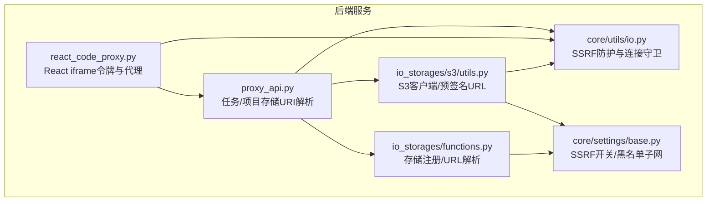
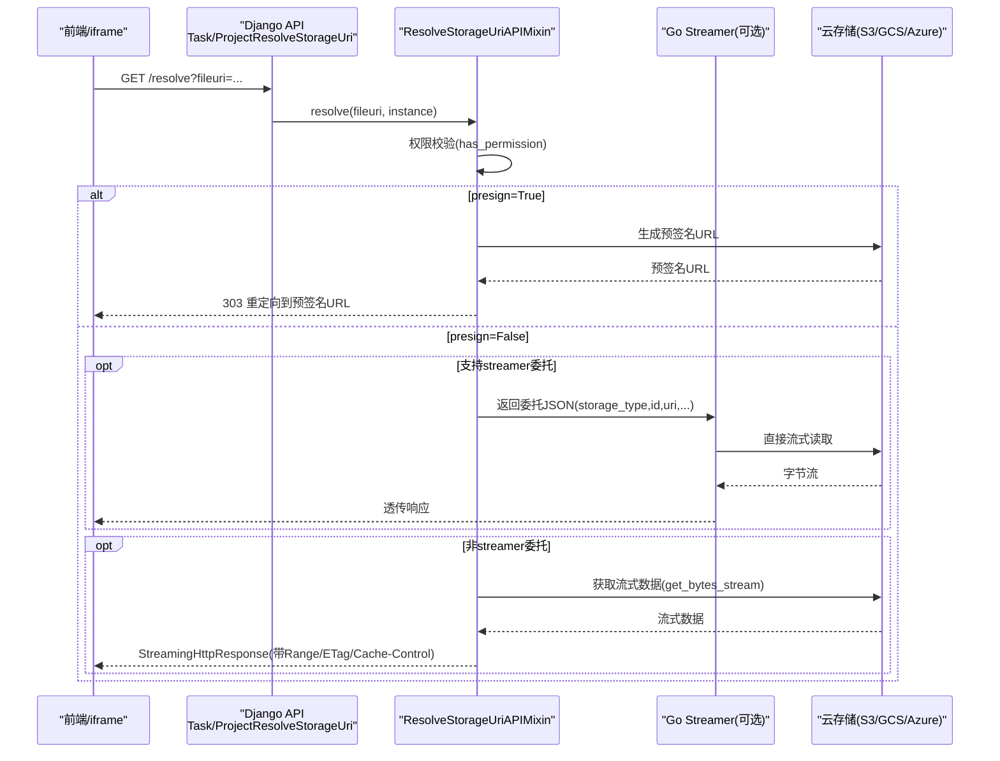
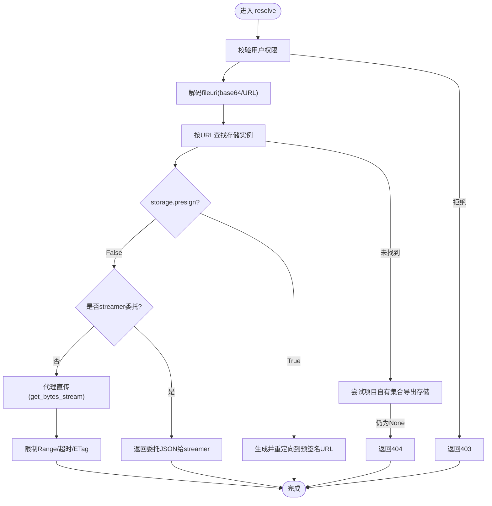
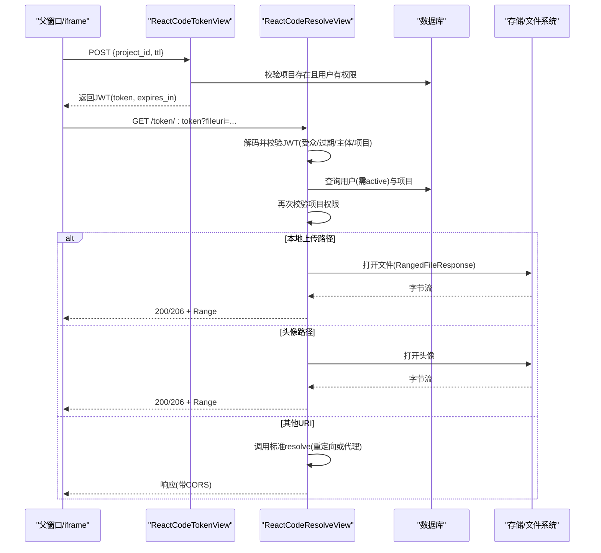
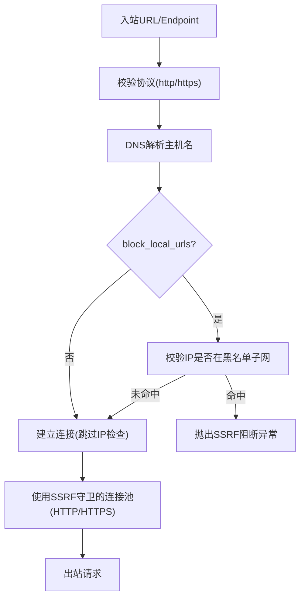
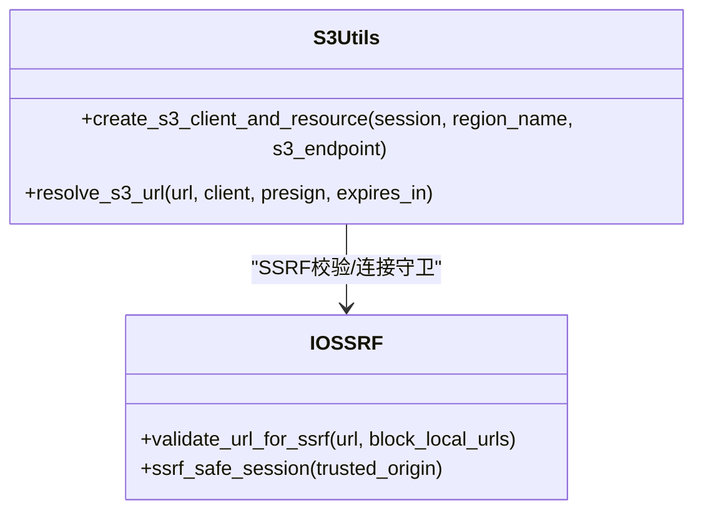
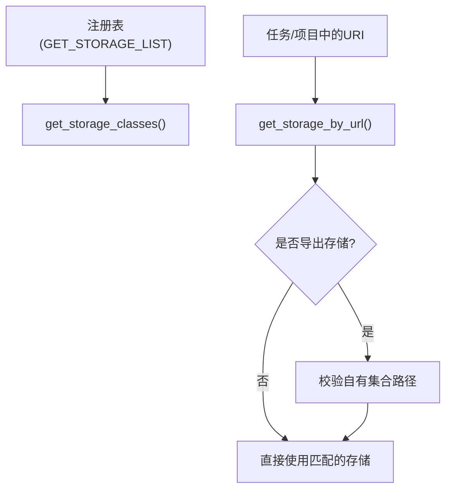
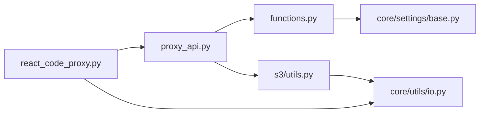

# 存储安全

<cite>
**本文引用的文件**   
- [proxy_api.py](file://label_studio/io_storages/proxy_api.py)
- [react_code_proxy.py](file://label_studio/io_storages/react_code_proxy.py)
- [io.py](file://label_studio/core/utils/io.py)
- [base.py](file://label_studio/core/settings/base.py)
- [exceptions.py](file://label_studio/core/utils/exceptions.py)
- [s3_utils.py](file://label_studio/io_storages/s3/utils.py)
- [functions.py](file://label_studio/io_storages/functions.py)
- [models.py](file://label_studio/io_storages/models.py)
</cite>

## 目录
1. [简介](#简介)
2. [项目结构](#项目结构)
3. [核心组件](#核心组件)
4. [架构总览](#架构总览)
5. [详细组件分析](#详细组件分析)
6. [依赖关系分析](#依赖关系分析)
7. [性能与资源控制](#性能与资源控制)
8. [故障排查指南](#故障排查指南)
9. [结论](#结论)
10. [附录：安全配置最佳实践](#附录安全配置最佳实践)

## 简介
本文件系统性梳理 Label Studio 存储访问的安全机制，覆盖以下关键主题：
- URL 签名生成与重定向、代理模式下的数据流控
- 访问令牌验证（React iframe 场景）与权限检查
- SSRF（服务器端请求伪造）防护策略与实现
- 敏感信息保护（密钥管理、环境变量、加密存储）
- 代理 API 的安全实现（请求转发、响应头处理、日志记录）
- React 代码代理的安全执行环境
- 安全审计与监控建议
- 安全配置最佳实践与漏洞防护指南

## 项目结构
围绕“存储安全”的核心代码主要分布在以下模块：
- io_storages.proxy_api：任务/项目级存储 URI 解析与代理/重定向入口
- io_storages.react_code_proxy：React iframe 的 JWT 令牌签发与鉴权代理
- core.utils.io：SSRF 防护工具、连接池守卫、受限网络段校验
- core.settings.base：SSRF 开关、默认黑名单子网等全局安全配置
- io_storages.s3.utils：S3 客户端创建、SSRF 守卫、预签名 URL 生成
- io_storages.functions：存储类型注册、按 URL 解析存储实例、导出存储范围限制
- io_storages.models：存储类聚合与注册表加载

**图表来源**
- [proxy_api.py:72-193](file://label_studio/io_storages/proxy_api.py#L72-L193)
- [react_code_proxy.py:41-66](file://label_studio/io_storages/react_code_proxy.py#L41-L66)
- [io.py:185-237](file://label_studio/core/utils/io.py#L185-L237)
- [s3_utils.py:68-97](file://label_studio/io_storages/s3/utils.py#L68-L97)
- [functions.py:69-135](file://label_studio/io_storages/functions.py#L69-L135)
- [base.py:650-652](file://label_studio/core/settings/base.py#L650-L652)

**章节来源**
- [proxy_api.py:72-193](file://label_studio/io_storages/proxy_api.py#L72-L193)
- [react_code_proxy.py:41-66](file://label_studio/io_storages/react_code_proxy.py#L41-L66)
- [io.py:185-237](file://label_studio/core/utils/io.py#L185-L237)
- [s3_utils.py:68-97](file://label_studio/io_storages/s3/utils.py#L68-L97)
- [functions.py:69-135](file://label_studio/io_storages/functions.py#L69-L135)
- [base.py:650-652](file://label_studio/core/settings/base.py#L650-L652)

## 核心组件
- 存储 URI 解析与代理入口
  - 支持基于 presign 的重定向或经 LS 代理直传流式传输
  - 支持 Go streamer 委托模式（仅对特定存储类型）
  - 统一权限校验、ETag 缓存、Range 分片、超时限流
- React iframe 安全代理
  - 签发作用域 JWT（用户+项目+组织），用于沙箱 iframe 无 Cookie 访问
  - 严格校验 token 有效期、受众、用户状态、项目权限
  - 本地上传与头像路径白名单校验，防止路径穿越
- SSRF 防护
  - 协议白名单（http/https）、DNS 解析、IP 段黑名单校验
  - requests/botocore 连接池守卫，阻止回环/私有/链路本地等地址
  - 可配置默认黑名单与用户自定义黑名单
- S3 安全增强
  - 可选 s3_endpoint 的 SSRF 校验与连接守卫
  - 预签名 URL 生成与内容类型推断
- 存储发现与范围限制
  - 通过注册表按 URL 匹配存储实例
  - 导出存储仅允许“自有集合”路径，避免跨项目越权读取

**章节来源**
- [proxy_api.py:72-193](file://label_studio/io_storages/proxy_api.py#L72-L193)
- [react_code_proxy.py:41-66](file://label_studio/io_storages/react_code_proxy.py#L41-L66)
- [io.py:185-237](file://label_studio/core/utils/io.py#L185-L237)
- [s3_utils.py:68-97](file://label_studio/io_storages/s3/utils.py#L68-L97)
- [functions.py:98-135](file://label_studio/io_storages/functions.py#L98-L135)

## 架构总览
下图展示从前端到云存储的完整安全流程：浏览器/iframe → Django API → 存储代理/重定向 → 云存储。

**图表来源**
- [proxy_api.py:72-193](file://label_studio/io_storages/proxy_api.py#L72-L193)
- [proxy_api.py:195-386](file://label_studio/io_storages/proxy_api.py#L195-L386)

**章节来源**
- [proxy_api.py:72-193](file://label_studio/io_storages/proxy_api.py#L72-L193)
- [proxy_api.py:195-386](file://label_studio/io_storages/proxy_api.py#L195-L386)

## 详细组件分析

### 存储 URI 解析与代理（Task/Project）
- 功能要点
  - 先进行用户权限校验；失败则拒绝访问
  - 尝试 base64 解码 fileuri，否则回退 URL 解码
  - 根据 URL 匹配存储实例；若未命中，再尝试“项目自有集合”导出存储
  - 若存储不支持 presign，走代理直传；否则重定向到预签名 URL
  - 当来自 streamer 且 storage.presign=False 且类型受支持时，返回委托 JSON，由 streamer 直连云存储
  - 代理模式下：限制 Range、时间上限、ETag 缓存、Content-Type 推断、响应头过滤
- 安全要点
  - 所有分支均经过 has_permission 校验
  - 导出存储仅允许“自有集合”路径，避免跨项目越权
  - 移除 Sentry 传播头，避免 CORS 问题
  - 代理流式传输具备超时与分片限制，防止长连接耗尽资源

**图表来源**
- [proxy_api.py:72-193](file://label_studio/io_storages/proxy_api.py#L72-L193)
- [proxy_api.py:195-386](file://label_studio/io_storages/proxy_api.py#L195-L386)
- [functions.py:98-135](file://label_studio/io_storages/functions.py#L98-L135)

**章节来源**
- [proxy_api.py:72-193](file://label_studio/io_storages/proxy_api.py#L72-L193)
- [proxy_api.py:195-386](file://label_studio/io_storages/proxy_api.py#L195-L386)
- [functions.py:98-135](file://label_studio/io_storages/functions.py#L98-L135)

### React 代码代理（JWT 令牌与 iframe 安全）
- 功能要点
  - ReactCodeTokenView：已认证用户可为指定项目签发作用域 JWT（包含用户ID、项目ID、组织ID、过期时间、受众等）
  - ReactCodeResolveView：使用 URL 中的 JWT 鉴权，绕过 iframe 无法携带 Cookie 的限制
  - 针对本地上传与头像路径提供专用处理，支持 Range 播放
  - 对所有响应附加 CORS 头，便于跨源 iframe 调用
- 安全要点
  - JWT 使用 HS256 + SECRET_KEY 签名，设置最小/最大 TTL 与受众校验
  - 每次请求重新校验用户活跃状态与项目权限，防止令牌有效期内权限变化导致越权
  - 本地上传与头像路径严格规范化与白名单校验，禁止路径穿越
  - 仅允许 GET/OPTIONS，关闭默认认证/限流类，避免误用

**图表来源**
- [react_code_proxy.py:41-66](file://label_studio/io_storages/react_code_proxy.py#L41-L66)
- [react_code_proxy.py:87-114](file://label_studio/io_storages/react_code_proxy.py#L87-L114)
- [react_code_proxy.py:117-194](file://label_studio/io_storages/react_code_proxy.py#L117-L194)
- [react_code_proxy.py:196-285](file://label_studio/io_storages/react_code_proxy.py#L196-L285)

**章节来源**
- [react_code_proxy.py:41-66](file://label_studio/io_storages/react_code_proxy.py#L41-L66)
- [react_code_proxy.py:87-114](file://label_studio/io_storages/react_code_proxy.py#L87-L114)
- [react_code_proxy.py:117-194](file://label_studio/io_storages/react_code_proxy.py#L117-L194)
- [react_code_proxy.py:196-285](file://label_studio/io_storages/react_code_proxy.py#L196-L285)

### SSRF 防护机制
- 协议与主机校验
  - 仅允许 http/https 协议
  - DNS 解析失败抛出异常
  - 支持将 host 预先解析为 IP 并校验，避免 DNS Rebinding
- IP 段黑名单
  - 默认禁用回环、私有、链路本地、多播、保留地址等
  - 支持启用/禁用默认黑名单，并可追加用户自定义黑名单
- 连接层守卫
  - requests 适配器替换连接池类，在建立连接前校验目标 IP
  - botocore（S3）连接池同样注入守卫，防止任意 endpoint 绕过
- 配置开关
  - SSRF_PROTECTION_ENABLED：全局开关
  - USE_DEFAULT_BANNED_SUBNETS：是否启用默认黑名单
  - USER_ADDITIONAL_BANNED_SUBNETS：追加黑名单子网列表

**图表来源**
- [io.py:185-237](file://label_studio/core/utils/io.py#L185-L237)
- [io.py:298-379](file://label_studio/core/utils/io.py#L298-L379)
- [base.py:650-652](file://label_studio/core/settings/base.py#L650-L652)

**章节来源**
- [io.py:185-237](file://label_studio/core/utils/io.py#L185-L237)
- [io.py:298-379](file://label_studio/core/utils/io.py#L298-L379)
- [base.py:650-652](file://label_studio/core/settings/base.py#L650-L652)

### S3 安全增强与预签名 URL
- 客户端创建与守卫
  - 支持传入 s3_endpoint；当开启 SSRF 保护且显式传入 endpoint 时，进行 SSRF 校验并注入连接守卫
  - 环境变量 S3_ENDPOINT 作为可信内网回退，不受 endpoint 校验限制
- 预签名 URL 生成
  - 根据 key 推断 Content-Type，提升浏览器内联显示体验
  - 失败时回退原始 URL，避免中断业务流程
- 错误屏蔽
  - 对未知域名 S3 的错误信息进行收敛，减少调试信息泄露

**图表来源**
- [s3_utils.py:68-97](file://label_studio/io_storages/s3/utils.py#L68-L97)
- [s3_utils.py:100-130](file://label_studio/io_storages/s3/utils.py#L100-L130)
- [io.py:185-237](file://label_studio/core/utils/io.py#L185-L237)

**章节来源**
- [s3_utils.py:68-97](file://label_studio/io_storages/s3/utils.py#L68-L97)
- [s3_utils.py:100-130](file://label_studio/io_storages/s3/utils.py#L100-L130)
- [io.py:185-237](file://label_studio/core/utils/io.py#L185-L237)

### 存储发现与范围限制
- 存储注册表
  - 通过 settings.GET_STORAGE_LIST 动态加载存储声明（S3/GCS/Azure/Redis）
  - get_storage_classes 聚合模型类供上层使用
- URL 到存储实例解析
  - get_storage_by_url 遍历存储对象，优先匹配能解析该 URL 的存储
- 导出存储“自有集合”限制
  - resolve_own_collection_export_storage 仅允许 project.organization_id/project.id 限定路径，防止跨项目读取

**图表来源**
- [models.py:33-44](file://label_studio/io_storages/models.py#L33-L44)
- [functions.py:69-95](file://label_studio/io_storages/functions.py#L69-L95)
- [functions.py:98-135](file://label_studio/io_storages/functions.py#L98-L135)

**章节来源**
- [models.py:33-44](file://label_studio/io_storages/models.py#L33-L44)
- [functions.py:69-95](file://label_studio/io_storages/functions.py#L69-L95)
- [functions.py:98-135](file://label_studio/io_storages/functions.py#L98-L135)

## 依赖关系分析
- 组件耦合
  - proxy_api 依赖 functions 进行存储发现，依赖 s3 utils 进行预签名 URL 生成
  - react_code_proxy 复用 proxy_api 的 resolve 逻辑，扩展 JWT 鉴权与 CORS
  - 全部外部网络访问经由 core.utils.io 的 SSRF 守卫
- 外部依赖
  - boto3/botocore（S3）
  - requests/urllib3（HTTP 客户端与连接池）
  - PyJWT（React iframe 令牌）
- 潜在风险点
  - 若 SSRF 保护被关闭，可能允许访问内网/回环地址
  - 若导出存储路径校验被绕过，可能导致跨项目数据泄露
  - 若 React iframe 令牌校验不严格，可能被重用或越权访问

**图表来源**
- [proxy_api.py:72-193](file://label_studio/io_storages/proxy_api.py#L72-L193)
- [react_code_proxy.py:117-194](file://label_studio/io_storages/react_code_proxy.py#L117-L194)
- [s3_utils.py:68-97](file://label_studio/io_storages/s3/utils.py#L68-L97)
- [functions.py:69-135](file://label_studio/io_storages/functions.py#L69-L135)
- [base.py:650-652](file://label_studio/core/settings/base.py#L650-L652)

**章节来源**
- [proxy_api.py:72-193](file://label_studio/io_storages/proxy_api.py#L72-L193)
- [react_code_proxy.py:117-194](file://label_studio/io_storages/react_code_proxy.py#L117-L194)
- [s3_utils.py:68-97](file://label_studio/io_storages/s3/utils.py#L68-L97)
- [functions.py:69-135](file://label_studio/io_storages/functions.py#L69-L135)
- [base.py:650-652](file://label_studio/core/settings/base.py#L650-L652)

## 性能与资源控制
- 流式代理
  - 使用 StreamingHttpResponse 直接转发云存储流，避免中间缓冲
  - 支持 HTTP Range，满足视频/音频拖动播放
- 超时与分片
  - time_limited_chunker 限制单次流式传输时长，防止长连接占用
  - override_range_header 限制 Range 大小，避免超大块传输
- 缓存优化
  - 基于 ETag 的 304 Not Modified 响应，减少重复传输
  - Cache-Control 设置为 private，避免共享缓存污染
- 统计与日志
  - 记录流式传输的 chunk 数量与总字节数，便于定位慢连接

**章节来源**
- [proxy_api.py:195-386](file://label_studio/io_storages/proxy_api.py#L195-L386)

## 故障排查指南
- 常见错误与定位
  - 无法解析存储 URI：检查 fileuri 编码、存储是否存在、can_resolve_url 匹配逻辑
  - 预签名 URL 生成失败：检查 S3 权限、endpoint 配置、SSRF 保护是否拦截
  - React iframe 令牌无效：检查 JWT 受众、过期时间、用户是否 active、项目权限
  - 本地上传/头像 404/403：检查路径规范化、项目归属、组织成员关系
- 日志与告警
  - 关注代理流式传输的超时与异常日志
  - 关注 SSRF 阻断异常与 S3 未知域名错误收敛日志
- 快速自检清单
  - 确认 SSRF_PROTECTION_ENABLED 为 True（生产环境）
  - 确认 USE_DEFAULT_BANNED_SUBNETS 为 True
  - 确认 USER_ADDITIONAL_BANNED_SUBNETS 不包含误放行网段
  - 确认导出存储仅开放“自有集合”路径

**章节来源**
- [exceptions.py:32-39](file://label_studio/core/utils/exceptions.py#L32-L39)
- [proxy_api.py:171-193](file://label_studio/io_storages/proxy_api.py#L171-L193)
- [react_code_proxy.py:135-194](file://label_studio/io_storages/react_code_proxy.py#L135-L194)
- [s3_utils.py:214-236](file://label_studio/io_storages/s3/utils.py#L214-L236)

## 结论
Label Studio 的存储安全体系以“最小暴露面 + 强校验 + 可控代理”为核心原则：
- 通过 presign 重定向减少 LS 带宽压力，同时保留代理模式以满足 RBAC 控制
- 通过 SSRF 防护在协议、DNS、IP 三层阻断恶意访问
- 通过 React iframe 的 JWT 令牌与严格的权限二次校验，确保沙箱环境安全
- 通过导出存储“自有集合”限制与路径规范化，防止跨项目越权
- 通过流式代理、Range、ETag 与超时控制，兼顾安全与性能

## 附录：安全配置最佳实践
- 全局 SSRF 防护
  - 启用 SSRF_PROTECTION_ENABLED
  - 启用 USE_DEFAULT_BANNED_SUBNETS
  - 谨慎配置 USER_ADDITIONAL_BANNED_SUBNETS，避免放行内网/回环地址
- 密钥与环境变量
  - 使用环境变量注入 AWS_ACCESS_KEY_ID、AWS_SECRET_ACCESS_KEY、AWS_SESSION_TOKEN
  - 使用 SECRET_KEY 签发 React iframe JWT，确保密钥保密与轮换
- 存储配置
  - 仅在必要时设置 s3_endpoint；如指向内网，请评估信任边界
  - 合理设置 presign_ttl，缩短预签名 URL 有效期
  - 对导出存储仅开放“自有集合”路径
- 代理与流式传输
  - 调整 RESOLVER_PROXY_TIMEOUT、RESOLVER_PROXY_BUFFER_SIZE、RESOLVER_PROXY_MAX_RANGE_SIZE
  - 启用 RESOLVER_PROXY_ENABLE_ETAG_CACHE 以减少重复传输
- 监控与审计
  - 集中采集代理与 SSRF 相关日志
  - 对异常 403/404/424 与超时进行告警
  - 定期审查 React iframe 令牌签发与使用频率

**章节来源**
- [base.py:650-652](file://label_studio/core/settings/base.py#L650-L652)
- [s3_utils.py:26-43](file://label_studio/io_storages/s3/utils.py#L26-L43)
- [react_code_proxy.py:41-66](file://label_studio/io_storages/react_code_proxy.py#L41-L66)
- [proxy_api.py:195-386](file://label_studio/io_storages/proxy_api.py#L195-L386)