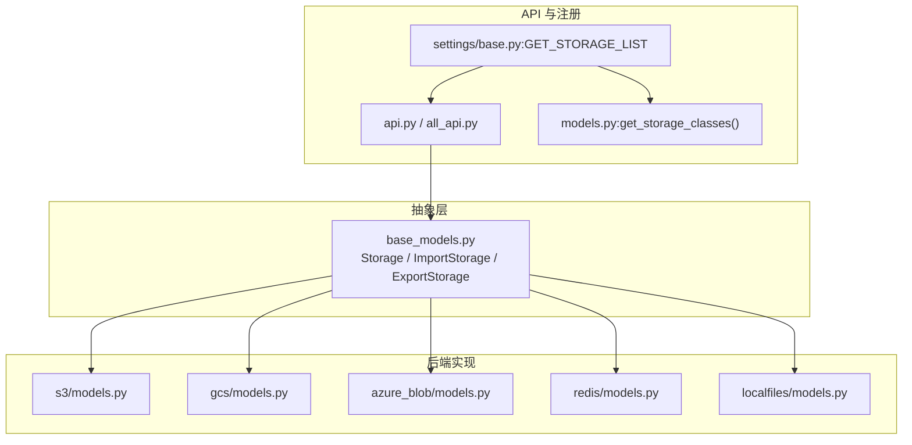
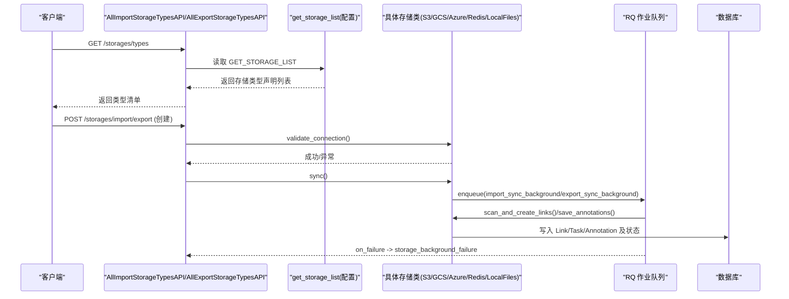
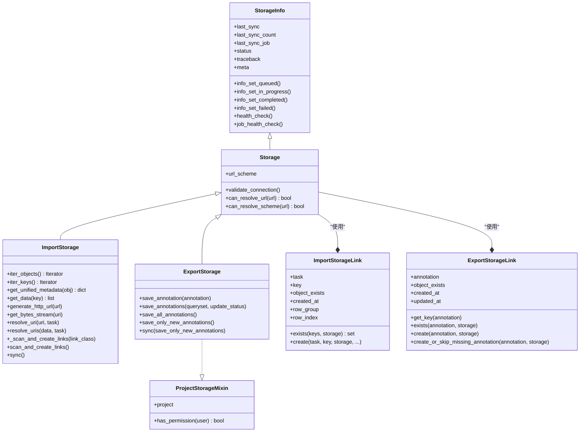
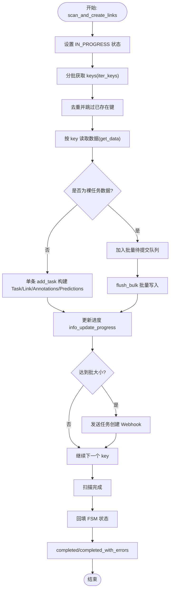
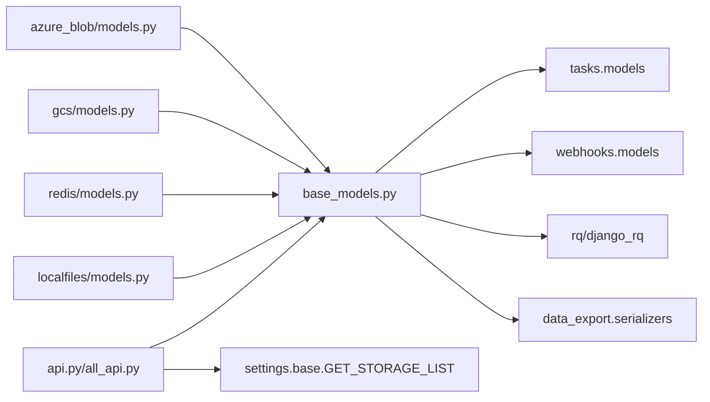

# 存储架构设计

<cite>
**本文引用的文件**   
- [base_models.py](file://label_studio/io_storages/base_models.py)
- [models.py](file://label_studio/io_storages/models.py)
- [api.py](file://label_studio/io_storages/api.py)
- [all_api.py](file://label_studio/io_storages/all_api.py)
- [azure_blob/models.py](file://label_studio/io_storages/azure_blob/models.py)
- [gcs/models.py](file://label_studio/io_storages/gcs/models.py)
- [localfiles/models.py](file://label_studio/io_storages/localfiles/models.py)
- [redis/models.py](file://label_studio/io_storages/redis/models.py)
- [core/storage.py](file://label_studio/core/storage.py)
- [settings/base.py](file://label_studio/core/settings/base.py)
</cite>

## 目录
1. [引言](#引言)
2. [项目结构](#项目结构)
3. [核心组件](#核心组件)
4. [架构总览](#架构总览)
5. [详细组件分析](#详细组件分析)
6. [依赖关系分析](#依赖关系分析)
7. [性能考量](#性能考量)
8. [故障排查指南](#故障排查指南)
9. [结论](#结论)
10. [附录：扩展开发指南](#附录扩展开发指南)

## 引言
本文件系统性阐述 Label Studio 的存储抽象层与多后端存储体系，覆盖基类模型、接口契约、统一访问模式、导入导出流程、策略设计与插件化注册机制。文档面向不同技术背景的读者，既提供高层架构图，也给出代码级类图、时序图与流程图，帮助快速理解并扩展新的存储后端。

## 项目结构
Label Studio 的存储子系统位于 label_studio/io_storages 包下，采用“基础抽象 + 具体后端”的分层组织方式：
- 抽象层：定义通用模型、状态机、导入/导出基类、链接模型等（base_models.py）
- 后端实现：S3、GCS、Azure Blob、Redis、Local Files 各自独立模块（s3、gcs、azure_blob、redis、localfiles）
- API 与路由：统一的导入/导出存储列表、校验、同步等 REST 接口（api.py、all_api.py）
- 配置与注册：通过 settings.GET_STORAGE_LIST 动态加载存储类型声明（models.py、all_api.py、settings/base.py）

**图表来源**
- [base_models.py:310-350](file://label_studio/io_storages/base_models.py#L310-L350)
- [models.py:33-44](file://label_studio/io_storages/models.py#L33-L44)
- [all_api.py:23-38](file://label_studio/io_storages/all_api.py#L23-L38)
- [settings/base.py:831](file://label_studio/core/settings/base.py#L831)

**章节来源**
- [base_models.py:310-350](file://label_studio/io_storages/base_models.py#L310-L350)
- [models.py:33-44](file://label_studio/io_storages/models.py#L33-L44)
- [all_api.py:23-38](file://label_studio/io_storages/all_api.py#L23-L38)
- [settings/base.py:831](file://label_studio/core/settings/base.py#L831)

## 核心组件
- StorageInfo：抽象的状态跟踪基类，维护 last_sync、status、meta、traceback 等字段，并提供 queued/in_progress/completed/failed 等状态转换方法，以及健康检查与作业失败回写逻辑。
- Storage：带 url_scheme 的统一存储基类，提供 can_resolve_url/can_resolve_scheme 能力判定，用于识别某 URL 是否可由该存储解析。
- ImportStorage：导入存储抽象，定义 iter_objects/iter_keys/get_unified_metadata/get_data/generate_http_url/get_bytes_stream/resolve_uri/resolve_uris 等统一接口；内置批量任务构建与扫描入库流程 _scan_and_create_links。
- ExportStorage：导出存储抽象，定义 save_annotation/save_annotations/sync 等，支持多线程并发导出与进度更新。
- ProjectStorageMixin：将存储与项目关联，提供 has_permission 权限判断。
- ImportStorageLink / ExportStorageLink：分别记录导入/导出对象与系统 Task/Annotation 的映射关系。

这些组件共同构成“统一抽象 + 后端实现”的适配器式架构，上层业务无需关心具体云厂商或本地文件系统差异。

**章节来源**
- [base_models.py:52-308](file://label_studio/io_storages/base_models.py#L52-L308)
- [base_models.py:310-350](file://label_studio/io_storages/base_models.py#L310-L350)
- [base_models.py:353-886](file://label_studio/io_storages/base_models.py#L353-L886)
- [base_models.py:963-1096](file://label_studio/io_storages/base_models.py#L963-L1096)
- [base_models.py:1099-1196](file://label_studio/io_storages/base_models.py#L1099-L1196)

## 架构总览
下图展示从 API 到存储后端的整体调用链，包括类型枚举、实例创建、连接校验、异步同步与状态回写。

**图表来源**
- [all_api.py:72-111](file://label_studio/io_storages/all_api.py#L72-L111)
- [api.py:23-119](file://label_studio/io_storages/api.py#L23-L119)
- [base_models.py:857-886](file://label_studio/io_storages/base_models.py#L857-L886)
- [base_models.py:907-950](file://label_studio/io_storages/base_models.py#L907-L950)

## 详细组件分析

### 抽象层类图

**图表来源**
- [base_models.py:52-308](file://label_studio/io_storages/base_models.py#L52-L308)
- [base_models.py:310-350](file://label_studio/io_storages/base_models.py#L310-L350)
- [base_models.py:353-886](file://label_studio/io_storages/base_models.py#L353-L886)
- [base_models.py:963-1096](file://label_studio/io_storages/base_models.py#L963-L1096)
- [base_models.py:1099-1196](file://label_studio/io_storages/base_models.py#L1099-L1196)

### 导入存储扫描与入库流程

**图表来源**
- [base_models.py:692-852](file://label_studio/io_storages/base_models.py#L692-L852)

### 各后端实现要点
- Azure Blob
  - 容器/前缀/正则过滤、use_blob_urls、presign SAS 签名、递归/非递归扫描、流式下载与 Range 支持。
  - 导入：AzureBlobImportStorageBase 继承 ImportStorage，实现 iter_objects/iter_keys/get_data/scan_and_create_links。
  - 导出：AzureBlobExportStorage 继承 ExportStorage，实现 save_annotation/delete_annotation，并通过信号触发异步导出。
- GCS
  - Bucket/前缀/正则过滤、use_blob_urls、presign、递归扫描、流式直连下载与 Range 头处理。
  - 导入：GCSImportStorageBase 继承 ImportStorage。
  - 导出：GCSExportStorage 继承 ExportStorage，配合 post_save/pre_delete 信号进行增量导出与清理。
- Local Files
  - 路径规范化与安全校验（必须为 LOCAL_FILES_DOCUMENT_ROOT 子目录，默认禁用直接服务）。
  - 导入：LocalFilesImportStorageBase 继承 ImportStorage，支持 use_blob_urls 生成托管 URL。
  - 导出：LocalFilesExportStorage 继承 ExportStorage，落盘 JSON 文件。
- Redis
  - host/port/password/db/path 配置，keys 遍历与 get/set 操作。
  - 导入：RedisImportStorageBase 继承 ImportStorage。
  - 导出：RedisExportStorage 继承 ExportStorage。

**章节来源**
- [azure_blob/models.py:40-251](file://label_studio/io_storages/azure_blob/models.py#L40-L251)
- [azure_blob/models.py:259-326](file://label_studio/io_storages/azure_blob/models.py#L259-L326)
- [gcs/models.py:36-240](file://label_studio/io_storages/gcs/models.py#L36-L240)
- [gcs/models.py:248-316](file://label_studio/io_storages/gcs/models.py#L248-L316)
- [localfiles/models.py:31-174](file://label_studio/io_storages/localfiles/models.py#L31-L174)
- [localfiles/models.py:182-238](file://label_studio/io_storages/localfiles/models.py#L182-L238)
- [redis/models.py:26-126](file://label_studio/io_storages/redis/models.py#L26-L126)
- [redis/models.py:134-172](file://label_studio/io_storages/redis/models.py#L134-L172)

### 存储策略与设计模式
- 插件化架构
  - 通过 settings.GET_STORAGE_LIST 暴露存储类型声明（name/title/import_list_api/export_list_api），运行时由 all_api.py 聚合，支持条件启用 localfiles。
- 适配器模式
  - 所有后端均实现 ImportStorage/ExportStorage 统一接口，屏蔽底层 SDK 差异。
- 工厂模式
  - models.get_storage_classes 与 all_api._common_storage_list 充当“类型工厂”，根据配置返回可用存储类型与对应 API 视图。
- 代理模式
  - core.storage.StorageProxyMixin 对静态资源/云存储 URL 生成进行统一代理，便于在部署侧替换为内部代理地址。

**章节来源**
- [models.py:33-44](file://label_studio/io_storages/models.py#L33-L44)
- [all_api.py:23-38](file://label_studio/io_storages/all_api.py#L23-L38)
- [core/storage.py:61-69](file://label_studio/core/storage.py#L61-L69)

## 依赖关系分析
- 抽象层依赖
  - base_models.py 依赖 Django ORM、RQ、webhooks、tasks、data_export 等模块，承担状态机、任务构建、并发导出等职责。
- 后端实现依赖
  - azure_blob/gcs/redis/localfiles 各自依赖对应 SDK 或 Python 标准库，实现具体 I/O 与鉴权。
- API 层依赖
  - api.py/all_api.py 依赖 settings 配置与权限控制，负责统一入口、校验、同步调度。

**图表来源**
- [base_models.py:1-48](file://label_studio/io_storages/base_models.py#L1-L48)
- [azure_blob/models.py:20-34](file://label_studio/io_storages/azure_blob/models.py#L20-L34)
- [gcs/models.py:17-31](file://label_studio/io_storages/gcs/models.py#L17-L31)
- [redis/models.py:13-21](file://label_studio/io_storages/redis/models.py#L13-L21)
- [localfiles/models.py:17-26](file://label_studio/io_storages/localfiles/models.py#L17-L26)
- [api.py:1-19](file://label_studio/io_storages/api.py#L1-L19)
- [all_api.py:1-18](file://label_studio/io_storages/all_api.py#L1-L18)
- [settings/base.py:831](file://label_studio/core/settings/base.py#L831)

**章节来源**
- [base_models.py:1-48](file://label_studio/io_storages/base_models.py#L1-L48)
- [api.py:1-19](file://label_studio/io_storages/api.py#L1-L19)
- [all_api.py:1-18](file://label_studio/io_storages/all_api.py#L1-L18)
- [settings/base.py:831](file://label_studio/core/settings/base.py#L831)

## 性能考量
- 导入阶段
  - 批量插入：add_tasks_bulk 使用 bulk_create 减少事务开销，结合 _batched 分块迭代，降低内存峰值。
  - 进度上报节流：info_update_progress 基于 STORAGE_IN_PROGRESS_TIMER 控制 DB 写入频率。
  - Webhook 批处理：按 WEBHOOK_BATCH_SIZE 累积任务 ID 后统一发送，避免频繁网络调用。
- 导出阶段
  - 线程池并发：ExportStorage.save_annotations 使用 ThreadPoolExecutor，worker 数受 max_workers 与 project_batch_size 影响。
  - 分片与重试：按 chunk_size 切分 Annotation 集合并逐个提交，捕获 worker 异常并累计失败计数。
- 流式读取
  - Azure/GCS/LocalFiles 均实现 get_bytes_stream，支持 Range 请求与流式传输，降低大文件带宽占用。

[本节为通用指导，不直接分析具体文件]

## 故障排查指南
- 状态与健康检查
  - StorageInfo.health_check 会检测 last_ping 超时与 Redis 连接，必要时将状态置为 FAILED。
  - job_health_check 根据 RQ 作业状态（failed/not found）修正存储状态，并写入 traceback。
- 常见错误
  - UnsupportedFileFormatError：当未开启 use_blob_urls 且尝试导入非 JSON/JSONL/Parquet 文件时抛出。
  - ValidationError：任务/标注/预测校验失败时记录错误信息，可选择中断或继续处理。
- 调试建议
  - 查看 Storage.meta.traceback 与 meta.duration/time_last_ping 等字段定位问题。
  - 确认 Redis/RQ 是否正常，必要时关闭异步走同步路径进行对比测试。

**章节来源**
- [base_models.py:228-308](file://label_studio/io_storages/base_models.py#L228-L308)
- [base_models.py:907-950](file://label_studio/io_storages/base_models.py#L907-L950)
- [base_models.py:753-775](file://label_studio/io_storages/base_models.py#L753-L775)

## 结论
Label Studio 的存储抽象层以 Storage/ImportStorage/ExportStorage 为核心，结合 StorageInfo 状态机与 Link 模型，形成稳定可扩展的导入/导出基础设施。通过 settings.GET_STORAGE_LIST 的插件化注册与适配器模式，新增后端仅需实现统一接口并在配置中声明即可接入。同时，批量与并发优化、流式读取与 Range 支持、健壮的错误与状态管理，确保系统在大规模数据场景下的稳定性与可观测性。

[本节为总结性内容，不直接分析具体文件]

## 附录：扩展开发指南
目标：添加一个新的存储后端（例如 NewCloud）。

步骤概览
1. 新建模块
   - 在 io_storages/newcloud/ 下创建 models.py、serializers.py、api.py、utils.py（可选）。
2. 实现导入存储
   - 定义 NewCloudImportStorageBase(NewCloudMixin, ImportStorage)，实现：
     - iter_objects/iter_keys/get_unified_metadata/get_data/scan_and_create_links
     - generate_http_url（如需预签名 URL）
     - get_bytes_stream（可选，支持 Range）
     - validate_connection（校验连接与路径）
3. 实现导出存储
   - 定义 NewCloudExportStorage(NewCloudMixin, ExportStorage)，实现：
     - save_annotation/delete_annotation
     - 可选：信号监听 Annotation.post_save/pre_delete 触发异步导出/删除
4. 定义 Link 模型
   - NewCloudImportStorageLink(ImportStorageLink) 与 NewCloudExportStorageLink(ExportStorageLink)
5. 注册存储类型
   - 在 settings.GET_STORAGE_LIST 指向的函数中，追加 newcloud 类型的声明（name/title/import_list_api/export_list_api）。
   - 若需默认启用 localfiles，参考 all_api.py 的条件拼接逻辑。
6. 提供表单布局（可选）
   - 在 newcloud/api.py 所在目录放置 form_layout.yml，供 StorageFormLayoutAPI 读取。
7. 测试
   - 编写单元测试验证 validate_connection、iter_objects、get_data、scan_and_create_links、save_annotation 等关键路径。
   - 使用 AllImportStorageListAPI/AllExportStorageListAPI 验证类型枚举与列表聚合。

注意事项
- 遵循 ImportStorage/ExportStorage 的接口契约，保持行为一致（如进度更新、错误处理、权限校验）。
- 对于云存储，注意鉴权与限流，合理设置 presign TTL 与并发度。
- 安全：Local Files 类似的安全约束（路径白名单、禁止根目录）应在新后端中体现。

[本节为概念性指导，不直接分析具体文件]