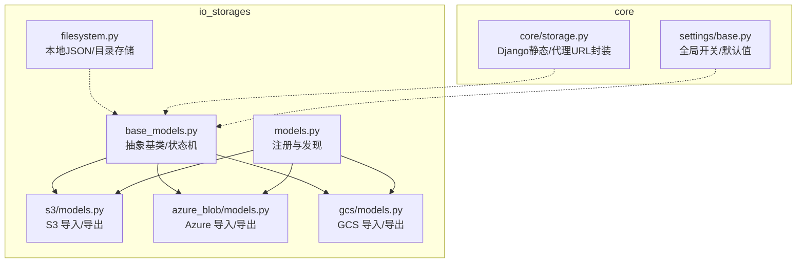
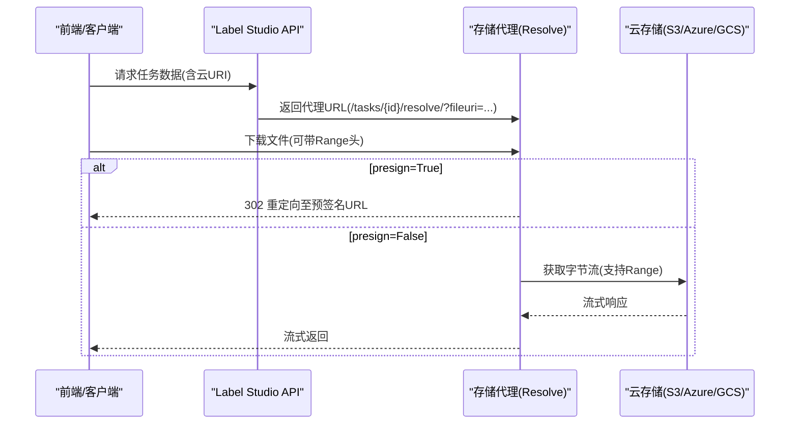
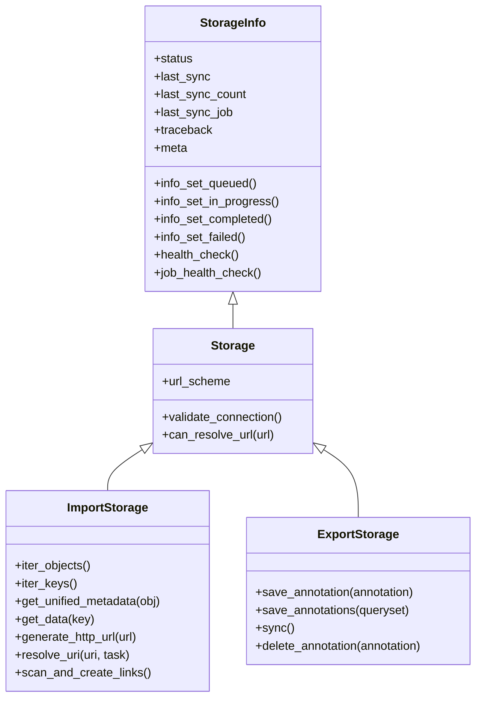
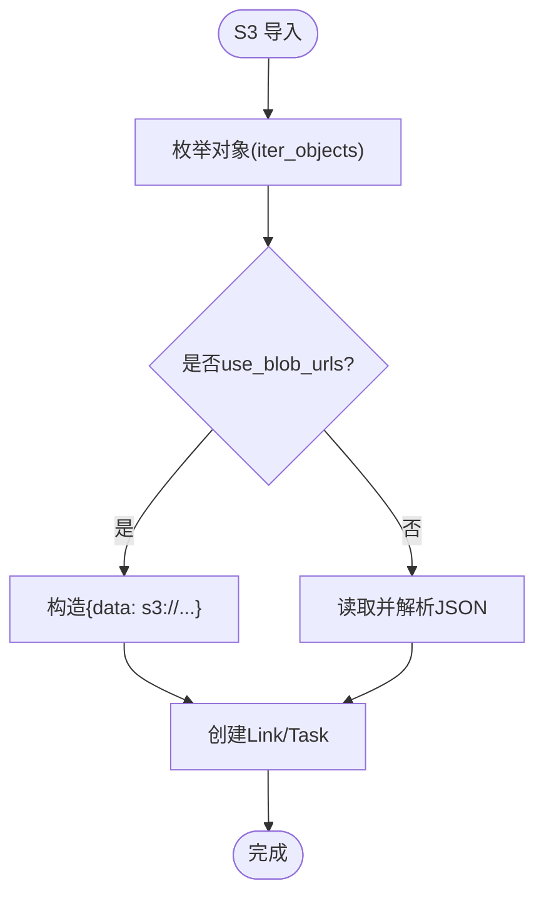
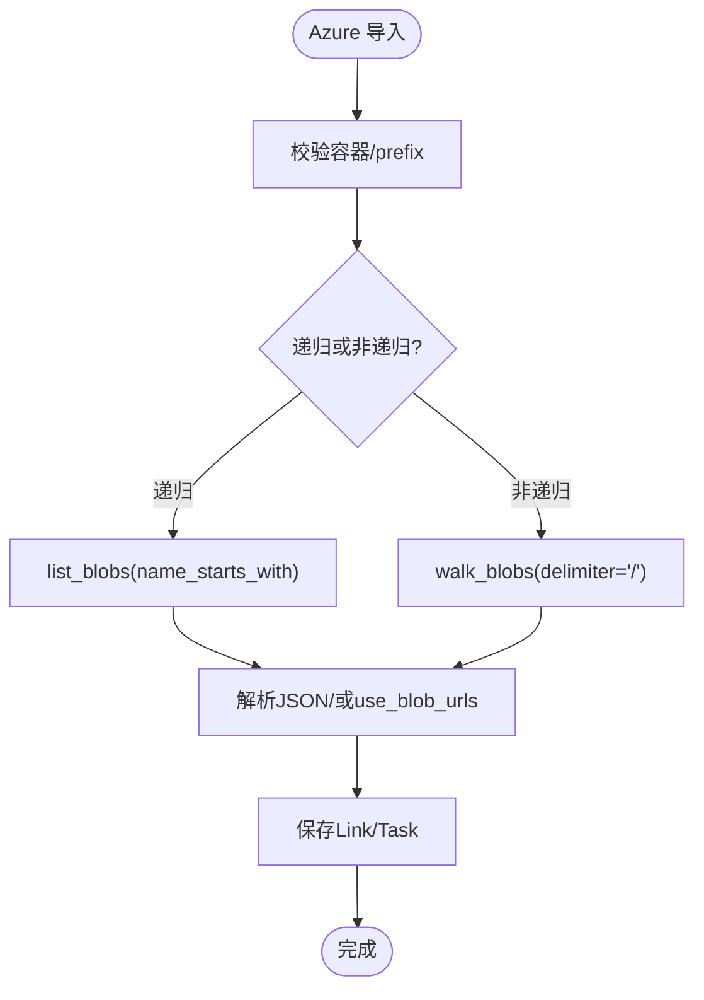
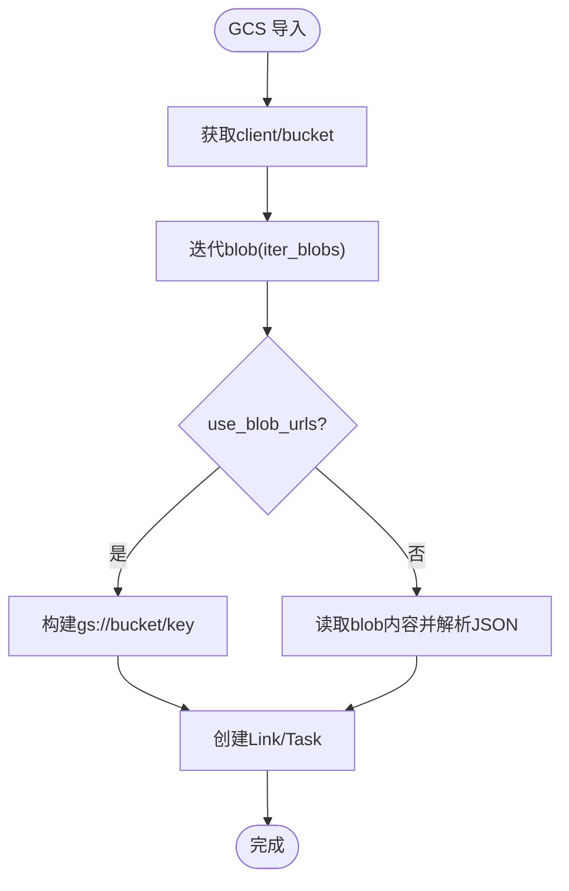
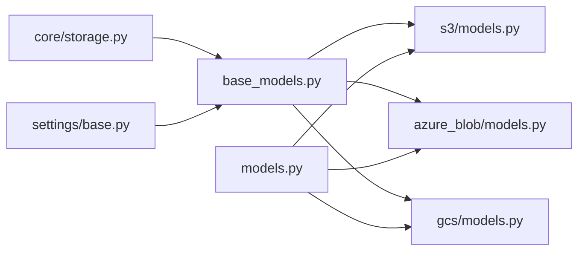

# 存储系统

<cite>
**本文引用的文件**   
- [README.md](file://label_studio/io_storages/README.md)
- [base_models.py](file://label_studio/io_storages/base_models.py)
- [models.py](file://label_studio/io_storages/models.py)
- [filesystem.py](file://label_studio/io_storages/filesystem.py)
- [s3/models.py](file://label_studio/io_storages/s3/models.py)
- [azure_blob/models.py](file://label_studio/io_storages/azure_blob/models.py)
- [gcs/models.py](file://label_studio/io_storages/gcs/models.py)
- [core/storage.py](file://label_studio/core/storage.py)
- [settings/base.py](file://label_studio/core/settings/base.py)
</cite>

## 目录
1. [简介](#简介)
2. [项目结构](#项目结构)
3. [核心组件](#核心组件)
4. [架构总览](#架构总览)
5. [详细组件分析](#详细组件分析)
6. [依赖关系分析](#依赖关系分析)
7. [性能与容量规划](#性能与容量规划)
8. [故障排查指南](#故障排查指南)
9. [结论](#结论)
10. [附录：配置示例与最佳实践](#附录配置示例与最佳实践)

## 简介
本文件系统性梳理 Label Studio 的存储抽象层与多云存储后端统一接口，覆盖本地、AWS S3、Azure Blob Storage、Google Cloud Storage（GCS）等类型；说明导入/导出存储模型、任务扫描与链接、代理下载与分块/断点续传、安全与访问控制、以及备份恢复与迁移策略。文档同时给出面向不同规模与合规需求的架构建议与调优要点。

## 项目结构
Label Studio 的“云存储”能力位于 `label_studio/io_storages`，提供统一的导入/导出存储抽象，并通过各云厂商的具体实现接入 S3/Azure/GCS。持久化存储（用户头像、UI 上传等）使用 Django storages，不在 io_storages 范围内。

图表来源
- [README.md:12-56](file://label_studio/io_storages/README.md#L12-L56)
- [base_models.py:52-350](file://label_studio/io_storages/base_models.py#L52-L350)
- [models.py:33-44](file://label_studio/io_storages/models.py#L33-L44)
- [filesystem.py:15-170](file://label_studio/io_storages/filesystem.py#L15-L170)
- [core/storage.py:61-139](file://label_studio/core/storage.py#L61-L139)
- [settings/base.py:831-940](file://label_studio/core/settings/base.py#L831-L940)

章节来源
- [README.md:1-11](file://label_studio/io_storages/README.md#L1-L11)
- [models.py:33-44](file://label_studio/io_storages/models.py#L33-L44)

## 核心组件
- 抽象基类与状态机
  - StorageInfo：同步状态机（已初始化/排队中/进行中/失败/完成/部分完成），心跳与作业健康检查。
  - Storage：通用字段与 URL 解析契约（url_scheme、can_resolve_url/can_resolve_scheme）。
  - ImportStorage：定义枚举对象、读取数据、生成 HTTP URL、URI 解析与批量创建任务的流程。
  - ExportStorage：导出注解到目标存储，支持异步批量与信号触发。
- 具体实现
  - S3ImportStorage/S3ExportStorage：S3 桶/前缀/正则过滤、预签名 URL、流式 Range 下载、可选 SSE-KMS 加密。
  - AzureBlobImportStorage/AzureBlobExportStorage：容器/前缀/正则过滤、SAS 预签名、Range 下载。
  - GCSImportStorage/GCSExportStorage：Bucket/前缀/正则过滤、IAM signBlob 或自定义端点、Range 下载。
- 本地存储
  - JSONStorage/DirJSONsStorage/TasksJSONStorage/AnnotationsDirStorage：用于本地 tasks.json 与 annotations 目录。
- Django 静态/代理 URL 封装
  - CustomS3Boto3Storage/CustomAzureStorage/AlternativeGoogleCloudStorage：重写 url() 以走内部代理路径或 IAM signBlob。

章节来源
- [base_models.py:52-350](file://label_studio/io_storages/base_models.py#L52-L350)
- [base_models.py:353-800](file://label_studio/io_storages/base_models.py#L353-L800)
- [s3/models.py:46-327](file://label_studio/io_storages/s3/models.py#L46-L327)
- [azure_blob/models.py:40-286](file://label_studio/io_storages/azure_blob/models.py#L40-L286)
- [gcs/models.py:36-276](file://label_studio/io_storages/gcs/models.py#L36-L276)
- [filesystem.py:15-170](file://label_studio/io_storages/filesystem.py#L15-L170)
- [core/storage.py:61-139](file://label_studio/core/storage.py#L61-L139)

## 架构总览
导入/导出存储通过统一抽象暴露 API，底层对接各云厂商 SDK；任务扫描将远端对象映射为 Task 与 Link；代理下载在 presign=False 时由 Django 或 Go streamer 服务转发 Range 请求。

图表来源
- [README.md:174-259](file://label_studio/io_storages/README.md#L174-L259)
- [s3/models.py:133-178](file://label_studio/io_storages/s3/models.py#L133-L178)
- [azure_blob/models.py:97-138](file://label_studio/io_storages/azure_blob/models.py#L97-L138)
- [gcs/models.py:78-167](file://label_studio/io_storages/gcs/models.py#L78-L167)

## 详细组件分析

### 抽象基类与状态机（StorageInfo / Storage / ImportStorage / ExportStorage）
- 状态机
  - 状态：Initialized → Queued → In Progress → Completed/Failed/Completed with Errors
  - 心跳：按 STORAGE_IN_PROGRESS_TIMER 周期更新 last_ping，超时自动置 Failed
  - 作业健康检查：基于 RQ job 状态判断异常终止（OOM/手动删除/重新部署）
- ImportStorage
  - iter_objects()/iter_keys()：枚举远端对象
  - get_unified_metadata()：标准化 key/last_modified/size
  - get_data(key)：返回 StorageObject 列表（支持 use_blob_urls 模式）
  - generate_http_url(url)：根据 presign 生成直链或预签名
  - resolve_uri()/resolve_uris()：将云 URI 替换为代理 URL
  - scan_and_create_links()：扫描并批量创建 Task + Link
- ExportStorage
  - save_annotation()/save_annotations()/sync()：导出注解，支持并发与进度跟踪
  - delete_annotation()：可选删除远端对象（受 can_delete_objects 控制）

图表来源
- [base_models.py:52-350](file://label_studio/io_storages/base_models.py#L52-L350)
- [base_models.py:353-800](file://label_studio/io_storages/base_models.py#L353-L800)

章节来源
- [base_models.py:52-350](file://label_studio/io_storages/base_models.py#L52-L350)
- [base_models.py:353-800](file://label_studio/io_storages/base_models.py#L353-L800)

### AWS S3 存储
- 连接与校验
  - 缓存 boto3 client/resource，避免重复初始化开销
  - validate_connection：有 prefix 时 ListObjectsV2 校验，否则 HeadBucket
- 导入
  - iter_objects/iter_keys：支持递归与非递归（Delimiter）
  - get_data：use_blob_urls 时直接构造任务 data；否则读取 JSON 并解析
  - generate_http_url：调用 resolve_s3_url 生成预签名直链
- 导出
  - save_annotation：序列化注解写入对象，可选 SSE-KMS 或 AES256 加密
  - 信号触发：Annotation post_save/pre_delete 自动导出/删除
- 大文件与 Range
  - get_bytes_stream：透传 Range 头，返回流式 Body 与元数据（ETag/ContentLength/ContentRange/LastModified/StatusCode）

图表来源
- [s3/models.py:197-254](file://label_studio/io_storages/s3/models.py#L197-L254)
- [s3/models.py:300-327](file://label_studio/io_storages/s3/models.py#L300-L327)
- [s3/models.py:133-178](file://label_studio/io_storages/s3/models.py#L133-L178)

章节来源
- [s3/models.py:46-178](file://label_studio/io_storages/s3/models.py#L46-L178)
- [s3/models.py:184-327](file://label_studio/io_storages/s3/models.py#L184-L327)

### Azure Blob Storage 存储
- 连接与校验
  - 从环境变量或字段获取 account_name/account_key
  - validate_connection：检查容器存在；导入模式需校验 prefix 下至少一个 blob
- 导入
  - iter_objects：支持 walk_blobs（非递归）与 list_blobs（递归）
  - get_data：use_blob_urls 或直接下载 blob 内容解析 JSON
  - generate_http_url：生成 SAS 预签名 URL
- 导出
  - save_annotation/delete_annotation：上传/删除序列化后的注解对象
- 大文件与 Range
  - get_bytes_stream：基于 download_blob(offset/length) 实现 Range 流式下载

图表来源
- [azure_blob/models.py:75-96](file://label_studio/io_storages/azure_blob/models.py#L75-L96)
- [azure_blob/models.py:156-218](file://label_studio/io_storages/azure_blob/models.py#L156-L218)
- [azure_blob/models.py:97-138](file://label_studio/io_storages/azure_blob/models.py#L97-L138)

章节来源
- [azure_blob/models.py:40-138](file://label_studio/io_storages/azure_blob/models.py#L40-L138)
- [azure_blob/models.py:141-286](file://label_studio/io_storages/azure_blob/models.py#L141-L286)

### Google Cloud Storage 存储
- 连接与校验
  - 使用 google_application_credentials/google_project_id
  - validate_connection：校验 bucket 与 prefix（导出模式不校验 prefix）
- 导入
  - iter_objects/iter_keys：委托 GCS.iter_blobs
  - get_data：use_blob_urls 或直接读取 blob 解析 JSON
  - generate_http_url：支持 IAM signBlob 或自定义端点
- 导出
  - save_annotation/delete_annotation：上传/删除序列化注解
- 大文件与 Range
  - get_bytes_stream：通过 AuthorizedSession 发起单次流式请求，附加 Range 头，并注入 iter_chunks/close 方法以兼容上层

图表来源
- [gcs/models.py:69-77](file://label_studio/io_storages/gcs/models.py#L69-L77)
- [gcs/models.py:185-215](file://label_studio/io_storages/gcs/models.py#L185-L215)
- [gcs/models.py:78-167](file://label_studio/io_storages/gcs/models.py#L78-L167)

章节来源
- [gcs/models.py:36-167](file://label_studio/io_storages/gcs/models.py#L36-L167)
- [gcs/models.py:170-276](file://label_studio/io_storages/gcs/models.py#L170-L276)

### 本地存储（文件系统）
- JSONStorage：单文件 tasks.json 读写
- DirJSONsStorage：目录内每个 ID 对应一个 JSON 文件
- TasksJSONStorage/AnnotationsDirStorage：约定路径 tasks.json 与 annotations 目录
- ExternalTasksJSONStorage：外部 JSON 任务源，作为本地缓存

章节来源
- [filesystem.py:15-170](file://label_studio/io_storages/filesystem.py#L15-L170)

### Django 静态/代理 URL 封装
- StorageProxyMixin：重写 url()，将资源访问路由到 /storage-data/uploaded/?filepath=...
- CustomS3Boto3Storage/CustomAzureStorage：继承第三方 storage 并应用代理
- AlternativeGoogleCloudStorageBase：强制使用 IAM signBlob 生成签名 URL，无需本地密钥文件

章节来源
- [core/storage.py:18-139](file://label_studio/core/storage.py#L18-L139)

## 依赖关系分析
- 模块耦合
  - base_models.py 被所有具体存储实现复用，形成稳定契约
  - models.py 通过 settings.GET_STORAGE_LIST 动态加载存储类，保持扩展性
  - core/storage.py 与 django-storages 集成，提供统一的 URL 代理行为
- 外部依赖
  - boto3（S3）、azure.storage.blob（Azure）、google-cloud-storage（GCS）
  - RQ（异步任务队列）
- 潜在循环依赖
  - 通过抽象基类与工厂函数解耦，未见直接循环 import

图表来源
- [base_models.py:52-350](file://label_studio/io_storages/base_models.py#L52-L350)
- [models.py:33-44](file://label_studio/io_storages/models.py#L33-L44)
- [core/storage.py:61-139](file://label_studio/core/storage.py#L61-L139)
- [settings/base.py:831-940](file://label_studio/core/settings/base.py#L831-L940)

章节来源
- [models.py:33-44](file://label_studio/io_storages/models.py#L33-L44)
- [settings/base.py:831-940](file://label_studio/core/settings/base.py#L831-L940)

## 性能与容量规划
- 导入扫描
  - 批量去重与分批处理：STORAGE_EXISTED_COUNT_BATCH_SIZE 控制批次大小
  - 批量插入：BATCH_SIZE 控制 bulk_create 批大小
  - 进度上报：STORAGE_IN_PROGRESS_TIMER 控制心跳频率
- 导出并发
  - 内置 ThreadPoolExecutor，max_workers=min(8, cpu_count*4)，可按需调整
- 代理下载优化
  - RESOLVER_PROXY_BUFFER_SIZE/RESOLVER_PROXY_TIMEOUT/RESOLVER_PROXY_MAX_RANGE_SIZE/RESOLVER_PROXY_CACHE_TIMEOUT
  - Streamer 侧：STORAGE_BUFFER_SIZE/STORAGE_STREAM_TIMEOUT/DJANGO_INTERNAL_*
- 大文件与 Range
  - 各后端均支持 Range 头，减少首屏延迟与内存占用
  - GCS 通过单次流式请求+iter_chunks 提升吞吐
- 缓存与连接
  - S3 client/resource 缓存键包含认证信息，避免重复初始化
  - GCS AuthorizedSession 复用凭据会话

章节来源
- [base_models.py:215-227](file://label_studio/io_storages/base_models.py#L215-L227)
- [base_models.py:542-560](file://label_studio/io_storages/base_models.py#L542-L560)
- [s3/models.py:74-89](file://label_studio/io_storages/s3/models.py#L74-L89)
- [gcs/models.py:78-167](file://label_studio/io_storages/gcs/models.py#L78-L167)
- [README.md:211-259](file://label_studio/io_storages/README.md#L211-L259)

## 故障排查指南
- 同步状态异常
  - 检查 StorageInfo.status 与 meta.time_last_ping，若长时间无心跳则标记 Failed
  - 检查 RQ job 是否存在且未失败（job_health_check）
- 连接校验失败
  - S3：HeadBucket/ListObjectsV2 失败通常因权限不足或 bucket/prefix 不存在
  - Azure：容器不存在或 prefix 下无对象
  - GCS：credentials/projectId 错误或 bucket 不可访问
- 代理下载问题
  - presign=False 时确认 Range 头被正确转发，且 RESOLVER_PROXY_* 参数合理
  - 使用 streamer 时核对 STREAMER_DELEGATED_STORAGE_TYPES 与 providers 映射一致
- 导出失败
  - 检查 Annotation 信号是否触发，查看异步任务日志
  - 目标存储是否允许删除（can_delete_objects）

章节来源
- [base_models.py:228-307](file://label_studio/io_storages/base_models.py#L228-L307)
- [s3/models.py:101-122](file://label_studio/io_storages/s3/models.py#L101-L122)
- [azure_blob/models.py:75-96](file://label_studio/io_storages/azure_blob/models.py#L75-L96)
- [gcs/models.py:69-77](file://label_studio/io_storages/gcs/models.py#L69-L77)
- [README.md:174-259](file://label_studio/io_storages/README.md#L174-L259)

## 结论
Label Studio 的存储抽象层以稳定的契约（Storage/ImportStorage/ExportStorage）屏蔽多云差异，提供一致的导入/导出、代理下载与 Range 支持。通过 RQ 异步任务、批量处理与心跳机制保障大规模数据同步的可靠性；结合预签名与代理两种模式兼顾性能与安全。针对不同场景可选择本地、S3、Azure、GCS 等后端，并按需开启加密、范围请求与流式传输。

## 附录：配置示例与最佳实践

### 支持的存储类型与关键配置项
- 本地存储（filesystem）
  - 适用场景：开发调试、小规模数据
  - 关键点：tasks.json 与 annotations 目录路径
- AWS S3
  - 关键字段：bucket、prefix、regex_filter、aws_access_key_id、aws_secret_access_key、aws_session_token、region_name、s3_endpoint、presign、presign_ttl、recursive_scan、use_blob_urls、aws_sse_kms_key_id
  - 安全：可选 SSE-KMS 或 AES256 服务端加密
- Azure Blob Storage
  - 关键字段：container、prefix、regex_filter、account_name、account_key、presign、presign_ttl、recursive_scan、use_blob_urls
  - 安全：SAS 预签名只读令牌
- Google Cloud Storage
  - 关键字段：bucket、prefix、regex_filter、google_application_credentials、google_project_id、presign、presign_ttl、recursive_scan、use_blob_urls
  - 安全：IAM signBlob 或自定义端点

章节来源
- [s3/models.py:46-73](file://label_studio/io_storages/s3/models.py#L46-L73)
- [azure_blob/models.py:40-56](file://label_studio/io_storages/azure_blob/models.py#L40-L56)
- [gcs/models.py:36-57](file://label_studio/io_storages/gcs/models.py#L36-L57)

### 导入/导出工作流与策略
- 导入
  - 设置 use_blob_urls=false 时，要求远端为 JSON/JSONL/Parquet；否则启用 use_blob_urls 将对象视为媒体资源
  - 支持正则过滤与递归/非递归扫描
- 导出
  - 支持注解级导出与全量导出；可配置 EXPORT_STORAGE_PRESIGN 与 TTL
  - 可通过信号自动导出新注解

章节来源
- [base_models.py:753-765](file://label_studio/io_storages/base_models.py#L753-L765)
- [s3/models.py:280-327](file://label_studio/io_storages/s3/models.py#L280-L327)
- [azure_blob/models.py:259-317](file://label_studio/io_storages/azure_blob/models.py#L259-L317)
- [gcs/models.py:248-307](file://label_studio/io_storages/gcs/models.py#L248-L307)

### 大文件处理、分块与断点续传
- 代理下载
  - presign=False 时，Django/streamer 转发 Range 请求，限制单次 Range 最大长度
  - 时间受限的分片器与缓冲大小可调
- 后端 Range 支持
  - S3/Azure/GCS 均支持 Range 头，降低带宽与内存压力

章节来源
- [README.md:211-259](file://label_studio/io_storages/README.md#L211-L259)
- [s3/models.py:133-178](file://label_studio/io_storages/s3/models.py#L133-L178)
- [azure_blob/models.py:97-138](file://label_studio/io_storages/azure_blob/models.py#L97-L138)
- [gcs/models.py:78-167](file://label_studio/io_storages/gcs/models.py#L78-L167)

### 安全与访问控制
- 预签名 URL（presign=True）：最小权限、短期有效
- 代理模式（presign=False）：集中鉴权，适合严格合规环境
- 服务端加密：S3 可选 SSE-KMS/AES256
- 多存储 URL 解析：按 scheme/bucket/container/path 匹配相应存储

章节来源
- [README.md:174-259](file://label_studio/io_storages/README.md#L174-L259)
- [s3/models.py:313-323](file://label_studio/io_storages/s3/models.py#L313-L323)
- [base_models.py:322-347](file://label_studio/io_storages/base_models.py#L322-L347)

### 数据迁移与备份恢复
- 迁移
  - 通过导入存储将数据从旧位置迁移到新桶/容器/前缀
  - 使用 regex_filter 与 recursive_scan 精确控制迁移范围
- 备份
  - 导出注解到目标存储（S3/Azure/GCS），配合对象版本控制与跨地域复制
- 恢复
  - 从目标存储重新导入 JSON/JSONL/Parquet 任务数据

章节来源
- [base_models.py:753-800](file://label_studio/io_storages/base_models.py#L753-L800)
- [s3/models.py:280-327](file://label_studio/io_storages/s3/models.py#L280-L327)
- [azure_blob/models.py:259-317](file://label_studio/io_storages/azure_blob/models.py#L259-L317)
- [gcs/models.py:248-307](file://label_studio/io_storages/gcs/models.py#L248-L307)

### 性能调优建议
- 导入
  - 增大 BATCH_SIZE 与 STORAGE_EXISTED_COUNT_BATCH_SIZE
  - 合理设置 STORAGE_IN_PROGRESS_TIMER 平衡实时性与 DB 压力
- 导出
  - 调整线程池并发度与导出分块大小
- 代理
  - 调整 RESOLVER_PROXY_* 与 streamer 侧参数，匹配网络与磁盘 IO
- 连接与缓存
  - 复用 S3 client/resource；GCS 使用 AuthorizedSession

章节来源
- [base_models.py:215-227](file://label_studio/io_storages/base_models.py#L215-L227)
- [base_models.py:542-560](file://label_studio/io_storages/base_models.py#L542-L560)
- [s3/models.py:74-89](file://label_studio/io_storages/s3/models.py#L74-L89)
- [README.md:211-259](file://label_studio/io_storages/README.md#L211-L259)

### 架构建议与最佳实践
- 小团队/本地开发：优先本地存储，快速验证
- 生产环境：
  - 使用云对象存储（S3/Azure/GCS），开启预签名与 Range 支持
  - 对敏感数据启用服务端加密（如 SSE-KMS）
  - 采用多存储方案分离任务 JSON 与媒体资源
  - 使用 streamer 代理模式满足严格合规与细粒度鉴权
- 高吞吐场景：
  - 合理配置批量与并发参数
  - 利用对象版本与跨区域复制做备份与容灾

[本节为概念性总结，不直接分析具体文件]