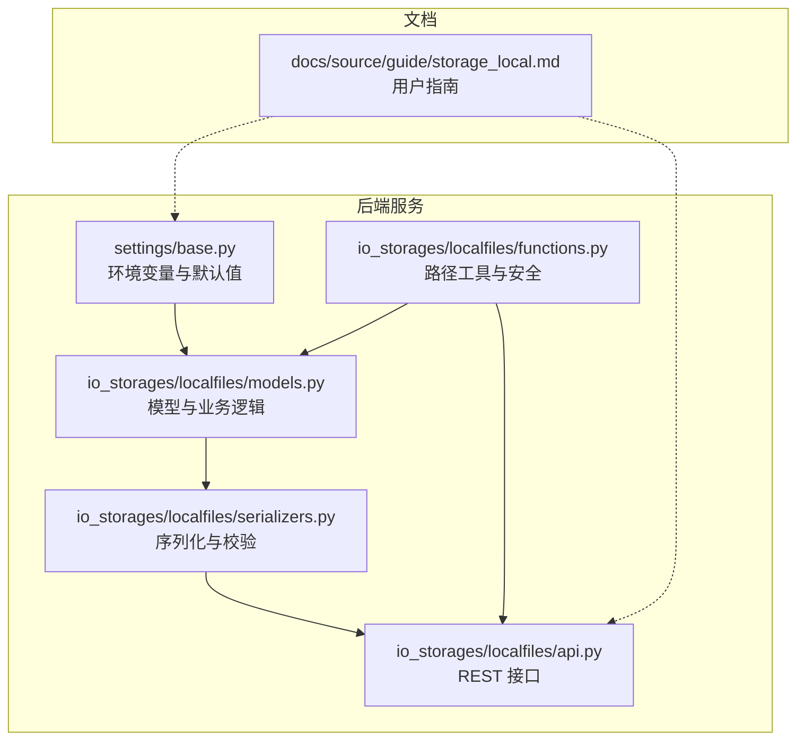
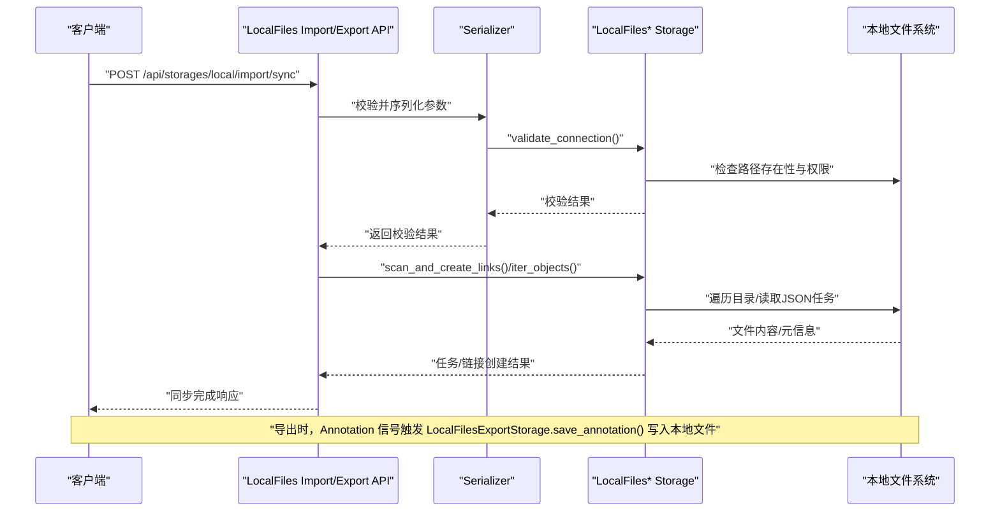
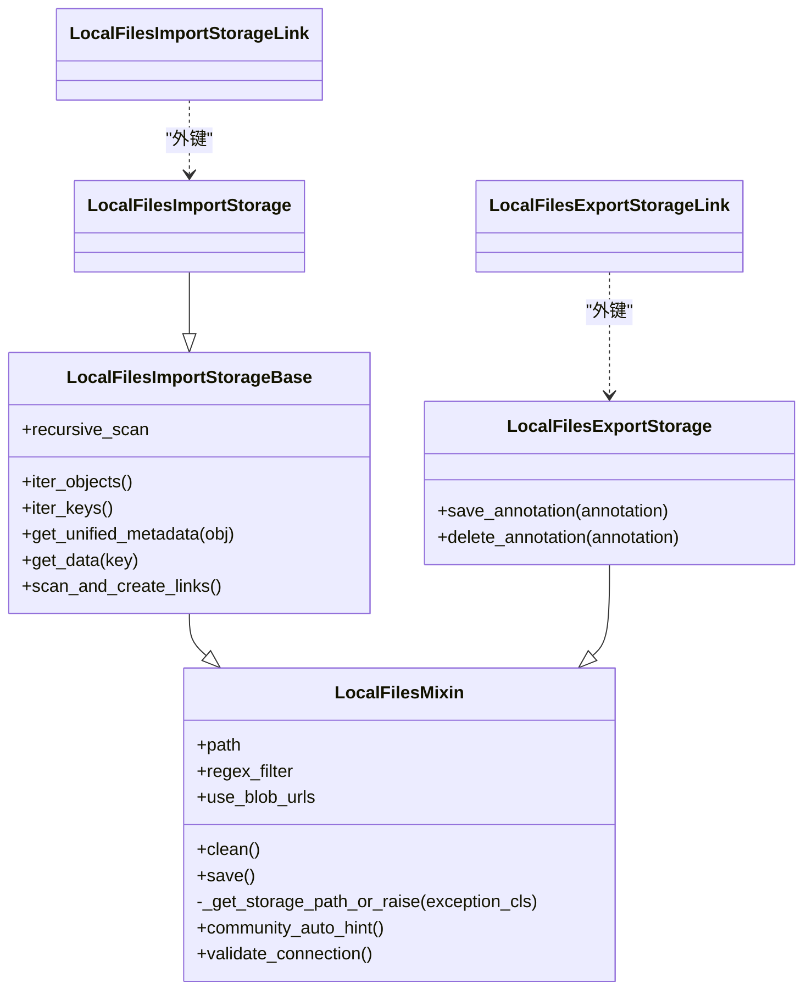
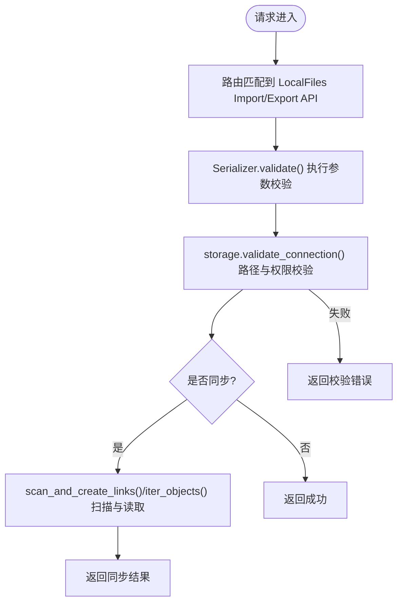
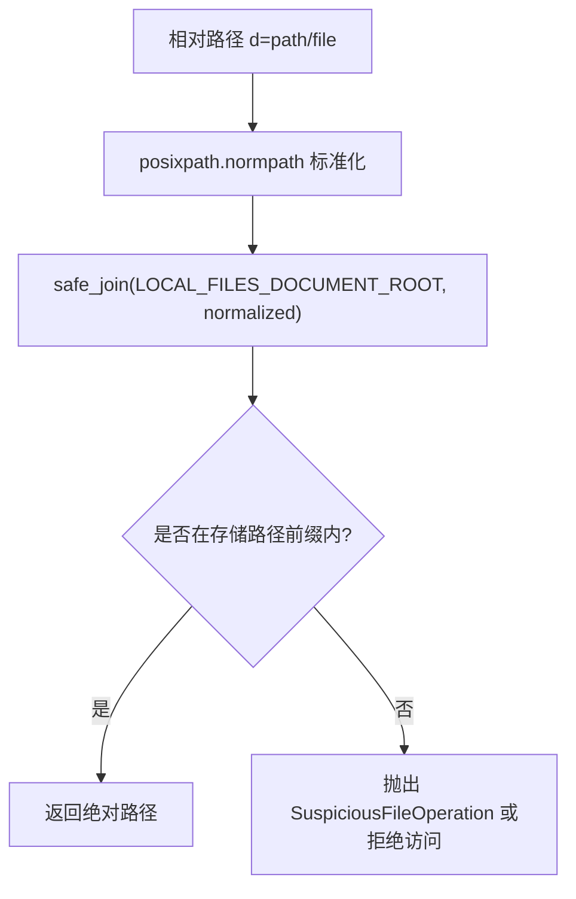
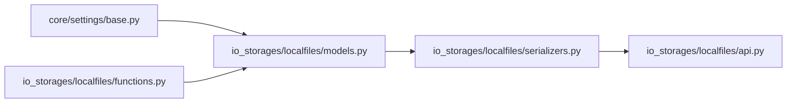

# 本地存储

<cite>
**本文引用的文件**   
- [label_studio/io_storages/localfiles/models.py](file://label_studio/io_storages/localfiles/models.py)
- [label_studio/io_storages/localfiles/api.py](file://label_studio/io_storages/localfiles/api.py)
- [label_studio/io_storages/localfiles/serializers.py](file://label_studio/io_storages/localfiles/serializers.py)
- [label_studio/io_storages/localfiles/functions.py](file://label_studio/io_storages/localfiles/functions.py)
- [label_studio/core/settings/base.py](file://label_studio/core/settings/base.py)
- [docs/source/guide/storage_local.md](file://docs/source/guide/storage_local.md)
</cite>

## 目录
1. [简介](#简介)
2. [项目结构](#项目结构)
3. [核心组件](#核心组件)
4. [架构总览](#架构总览)
5. [详细组件分析](#详细组件分析)
6. [依赖关系分析](#依赖关系分析)
7. [性能考虑](#性能考虑)
8. [故障排除指南](#故障排除指南)
9. [结论](#结论)
10. [附录](#附录)

## 简介
本文件系统性说明 Label Studio 的“本地存储”能力，重点围绕 LocalFilesImportStorage 的实现原理、配置与使用方式，涵盖：
- 本地文件路径配置、权限与安全校验
- 目录结构与组织方式
- 导入/导出 API 接口与调用流程
- 大文件处理、分块上传与断点续传的现状与建议
- 安全考量（路径遍历防护、类型白名单等）
- 性能优化建议（缓存、并发控制等）
- 实际配置示例与常见问题排查

## 项目结构
本地存储相关代码集中在 io_storages.localfiles 模块，配合全局设置 core.settings.base 提供环境变量与默认行为。文档侧在 docs/source/guide/storage_local.md 提供用户级操作说明。

图表来源
- [label_studio/core/settings/base.py:719-786](file://label_studio/core/settings/base.py#L719-L786)
- [label_studio/io_storages/localfiles/models.py:31-174](file://label_studio/io_storages/localfiles/models.py#L31-L174)
- [label_studio/io_storages/localfiles/serializers.py:25-69](file://label_studio/io_storages/localfiles/serializers.py#L25-L69)
- [label_studio/io_storages/localfiles/api.py:65-177](file://label_studio/io_storages/localfiles/api.py#L65-L177)
- [label_studio/io_storages/localfiles/functions.py:30-89](file://label_studio/io_storages/localfiles/functions.py#L30-L89)
- [docs/source/guide/storage_local.md:24-43](file://docs/source/guide/storage_local.md#L24-L43)

章节来源
- [label_studio/core/settings/base.py:719-786](file://label_studio/core/settings/base.py#L719-L786)
- [docs/source/guide/storage_local.md:24-43](file://docs/source/guide/storage_local.md#L24-L43)

## 核心组件
- LocalFilesMixin：封装本地路径规范化、连接校验、社区版自动提示等通用能力
- LocalFilesImportStorageBase / LocalFilesImportStorage：实现导入存储的核心逻辑（迭代对象、读取任务数据、生成统一元数据、扫描并创建链接）
- LocalFilesExportStorage：实现导出存储（保存/删除标注到本地文件系统）
- LocalFilesImportStorageLink / LocalFilesExportStorageLink：存储与实体的关联关系
- serializers：对导入/导出存储进行序列化与参数校验
- api：暴露导入/导出存储的 REST 接口（列表、详情、同步、校验、表单布局）
- functions：路径构建、安全校验、SDK 解析器

章节来源
- [label_studio/io_storages/localfiles/models.py:31-218](file://label_studio/io_storages/localfiles/models.py#L31-L218)
- [label_studio/io_storages/localfiles/serializers.py:25-69](file://label_studio/io_storages/localfiles/serializers.py#L25-L69)
- [label_studio/io_storages/localfiles/api.py:65-293](file://label_studio/io_storages/localfiles/api.py#L65-L293)
- [label_studio/io_storages/localfiles/functions.py:30-89](file://label_studio/io_storages/localfiles/functions.py#L30-L89)

## 架构总览
下图展示从请求到本地文件系统的端到端流程，包括导入存储的同步与导出存储的写入。

图表来源
- [label_studio/io_storages/localfiles/api.py:117-177](file://label_studio/io_storages/localfiles/api.py#L117-L177)
- [label_studio/io_storages/localfiles/serializers.py:32-45](file://label_studio/io_storages/localfiles/serializers.py#L32-L45)
- [label_studio/io_storages/localfiles/models.py:78-174](file://label_studio/io_storages/localfiles/models.py#L78-L174)

## 详细组件分析

### 类与继承关系

图表来源
- [label_studio/io_storages/localfiles/models.py:31-218](file://label_studio/io_storages/localfiles/models.py#L31-L218)

章节来源
- [label_studio/io_storages/localfiles/models.py:31-218](file://label_studio/io_storages/localfiles/models.py#L31-L218)

### 导入存储 LocalFilesImportStorage 实现要点
- 路径规范化与安全校验
  - 通过 normalize_storage_path 统一路径分隔符与尾随斜杠
  - validate_connection 强制要求 path 必须位于 LOCAL_FILES_DOCUMENT_ROOT 之下且不能等于根目录；同时要求开启 LOCAL_FILES_SERVING_ENABLED
- 目录扫描与任务读取
  - iter_objects 支持递归与非递归扫描，按文件名排序保证任务 ID 稳定
  - regex_filter 用于过滤文件名
  - get_data 支持两种模式：
    - use_blob_urls=True：生成 /data/local-files/?d=... 形式的自托管 URL
    - 否则直接读取 JSON/JSONL 任务文件并解析为任务列表
- 扫描并创建链接
  - scan_and_create_links 基于 LocalFilesImportStorageLink 建立存储与任务的关联

章节来源
- [label_studio/io_storages/localfiles/models.py:31-174](file://label_studio/io_storages/localfiles/models.py#L31-L174)
- [label_studio/io_storages/localfiles/functions.py:30-56](file://label_studio/io_storages/localfiles/functions.py#L30-L56)

### 导出存储 LocalFilesExportStorage 实现要点
- 保存标注：将序列化后的标注写入本地文件系统，并创建 LocalFilesExportStorageLink
- 删除标注：根据 Link 定位文件并删除，同时清理 Link 记录
- 信号集成：通过 Django 信号监听 Annotation 的 post_save 与 pre_delete，自动触发导出/删除

章节来源
- [label_studio/io_storages/localfiles/models.py:182-238](file://label_studio/io_storages/localfiles/models.py#L182-L238)

### API 接口与调用方式
- 导入存储
  - 列表：GET /api/storages/local/import?project={id}
  - 创建：POST /api/storages/local/import
  - 详情：GET/PATCH/DELETE /api/storages/local/import/{id}
  - 同步：POST /api/storages/local/import/{id}/sync
  - 校验：POST /api/storages/local/import/{id}/validate
- 导出存储
  - 列表：GET /api/storages/local/export?project={id}
  - 创建：POST /api/storages/local/export
  - 详情：GET/PATCH/DELETE /api/storages/local/export/{id}
  - 同步：POST /api/storages/local/export/{id}/sync
  - 校验：POST /api/storages/local/export/{id}/validate

图表来源
- [label_studio/io_storages/localfiles/api.py:65-177](file://label_studio/io_storages/localfiles/api.py#L65-L177)
- [label_studio/io_storages/localfiles/serializers.py:32-45](file://label_studio/io_storages/localfiles/serializers.py#L32-L45)
- [label_studio/io_storages/localfiles/models.py:78-174](file://label_studio/io_storages/localfiles/models.py#L78-L174)

章节来源
- [label_studio/io_storages/localfiles/api.py:65-293](file://label_studio/io_storages/localfiles/api.py#L65-L293)

### 路径构建与安全机制
- 路径规范化：normalize_storage_path 统一 Windows/Unix 路径格式
- 相对路径映射：build_local_files_path 将 /data/local-files/?d=... 映射到 LOCAL_FILES_DOCUMENT_ROOT 下的绝对路径，并使用 Django safe_join 防止路径穿越
- 访问控制：is_within_storage 确保请求路径严格位于某个存储 path 前缀下
- SDK 解析器：project_local_files_resolver 仅在 LOCAL_FILES_SERVING_ENABLED 开启时，允许访问属于该项目的 Local Files 存储路径

图表来源
- [label_studio/io_storages/localfiles/functions.py:30-89](file://label_studio/io_storages/localfiles/functions.py#L30-L89)

章节来源
- [label_studio/io_storages/localfiles/functions.py:30-89](file://label_studio/io_storages/localfiles/functions.py#L30-L89)

### 环境变量与默认行为
- 关键变量
  - LABEL_STUDIO_LOCAL_FILES_SERVING_ENABLED：是否允许本地文件服务
  - LABEL_STUDIO_LOCAL_FILES_DOCUMENT_ROOT：本地文件根目录
- 社区版自动检测
  - 若未显式设置上述两个变量，社区版会在当前工作目录下查找 mydata 或 label-studio-data 目录，自动启用本地文件服务并设置根目录

章节来源
- [label_studio/core/settings/base.py:719-786](file://label_studio/core/settings/base.py#L719-L786)
- [docs/source/guide/storage_local.md:30-43](file://docs/source/guide/storage_local.md#L30-L43)

## 依赖关系分析
- settings/base.py 提供 LOCAL_FILES_* 环境变量与默认值，并在社区版场景下自动探测本地数据目录
- models.py 中的 LocalFilesMixin 依赖 settings.LOCAL_FILES_DOCUMENT_ROOT 与 settings.LOCAL_FILES_SERVING_ENABLED 进行路径与权限校验
- functions.py 提供路径构建与安全校验工具，被 models.py 与 API 层间接使用
- serializers.py 在创建/更新存储时调用 storage.validate_connection() 进行强校验
- api.py 暴露标准 CRUD 与 sync/validate 接口，复用基类逻辑

图表来源
- [label_studio/core/settings/base.py:719-786](file://label_studio/core/settings/base.py#L719-L786)
- [label_studio/io_storages/localfiles/models.py:31-174](file://label_studio/io_storages/localfiles/models.py#L31-L174)
- [label_studio/io_storages/localfiles/functions.py:30-89](file://label_studio/io_storages/localfiles/functions.py#L30-L89)
- [label_studio/io_storages/localfiles/serializers.py:25-69](file://label_studio/io_storages/localfiles/serializers.py#L25-L69)
- [label_studio/io_storages/localfiles/api.py:65-293](file://label_studio/io_storages/localfiles/api.py#L65-L293)

章节来源
- [label_studio/core/settings/base.py:719-786](file://label_studio/core/settings/base.py#L719-L786)
- [label_studio/io_storages/localfiles/models.py:31-174](file://label_studio/io_storages/localfiles/models.py#L31-L174)
- [label_studio/io_storages/localfiles/functions.py:30-89](file://label_studio/io_storages/localfiles/functions.py#L30-L89)
- [label_studio/io_storages/localfiles/serializers.py:25-69](file://label_studio/io_storages/localfiles/serializers.py#L25-L69)
- [label_studio/io_storages/localfiles/api.py:65-293](file://label_studio/io_storages/localfiles/api.py#L65-L293)

## 性能考虑
- 目录扫描
  - 非递归 glob 适合小数据集；递归 rglob 适合多子目录但可能较慢
  - 按文件名排序可保证任务 ID 稳定，避免重复导入导致的不一致
- 大文件处理
  - get_data 在 use_blob_urls=False 时会一次性读取整个文件到内存，不适合超大 JSON/JSONL 文件
  - 建议拆分任务文件或采用流式解析（需自行扩展）
- 并发控制
  - 同步过程为同步调用，高并发场景建议在前端或上层队列化调用
- 缓存策略
  - 当前实现无内置缓存；可在外部引入缓存层（如 Redis）缓存已解析的任务元信息，减少重复 IO
- I/O 限制
  - DATA_UPLOAD_MAX_MEMORY_SIZE/TASKS_MAX_FILE_SIZE 影响任务文件大小上限，需结合部署环境调整

[本节为通用性能建议，不直接分析具体文件]

## 故障排除指南
- 无法启用本地文件服务
  - 现象：创建存储时报错提示 LOCAL_FILES_SERVING_ENABLED 未开启
  - 解决：设置环境变量 LABEL_STUDIO_LOCAL_FILES_SERVING_ENABLED=true 并重启服务
- 路径不在允许的根目录下
  - 现象：校验报错“必须是 LOCAL_FILES_DOCUMENT_ROOT 的子目录”
  - 解决：将 Absolute local path 设置为 LOCAL_FILES_DOCUMENT_ROOT 下的子目录
- 路径与根目录相同被拒绝
  - 现象：校验报错“Absolute local path 不能等于 LOCAL_FILES_DOCUMENT_ROOT”
  - 解决：追加子目录，例如 dataset1
- 文件读取失败
  - 现象：get_data 抛出读取异常
  - 解决：确认文件存在、可读，且路径正确；对于超大文件考虑拆分或使用 blob URL 模式
- Docker 环境下无法访问宿主机目录
  - 现象：容器内找不到挂载目录
  - 解决：确保启动容器时正确挂载卷，并设置 LABEL_STUDIO_LOCAL_FILES_DOCUMENT_ROOT 指向容器内路径

章节来源
- [label_studio/io_storages/localfiles/models.py:78-108](file://label_studio/io_storages/localfiles/models.py#L78-L108)
- [label_studio/core/settings/base.py:719-786](file://label_studio/core/settings/base.py#L719-L786)
- [docs/source/guide/storage_local.md:24-43](file://docs/source/guide/storage_local.md#L24-L43)

## 结论
Label Studio 的本地存储通过严格的根目录约束、路径规范化与安全校验，提供了安全的本地文件导入/导出能力。LocalFilesImportStorage 支持递归扫描、正则过滤与任务文件解析；LocalFilesExportStorage 通过信号机制自动落盘标注。生产环境中建议：
- 明确设置 LOCAL_FILES_DOCUMENT_ROOT 与 LOCAL_FILES_SERVING_ENABLED
- 仅开放必要的子目录
- 对大文件采用分片或外部存储方案
- 结合外部缓存与队列提升吞吐与稳定性

[本节为总结性内容，不直接分析具体文件]

## 附录

### 配置与环境变量
- 必需环境变量
  - LABEL_STUDIO_LOCAL_FILES_SERVING_ENABLED=true
  - LABEL_STUDIO_LOCAL_FILES_DOCUMENT_ROOT=/your/root
- 社区版自动检测
  - 在当前工作目录下存在 mydata 或 label-studio-data 时，自动启用并设置根目录

章节来源
- [docs/source/guide/storage_local.md:30-43](file://docs/source/guide/storage_local.md#L30-L43)
- [label_studio/core/settings/base.py:772-786](file://label_studio/core/settings/base.py#L772-L786)

### 目录组织建议
- 将不同数据集分目录存放，例如：
  - /data/dataset1/images
  - /data/dataset1/texts
- 在 UI 中配置 Absolute local path 指向具体数据集目录，避免直接指向根目录

章节来源
- [docs/source/guide/storage_local.md:44-107](file://docs/source/guide/storage_local.md#L44-L107)

### 任务文件中引用本地文件的格式
- 使用 /data/local-files/?d=relative/path/to/file 引用本地文件
- 适用于多模态任务（图像+文本、音频+文本等），需在任务定义中指定多个资源字段

章节来源
- [docs/source/guide/storage_local.md:166-270](file://docs/source/guide/storage_local.md#L166-L270)

### 高级功能现状与建议
- 分块上传与断点续传
  - 当前本地存储实现未内置分块上传与断点续传逻辑
  - 建议：在上层应用或服务端实现分片上传与合并，或将大文件迁移至对象存储（S3/GCS/Azure Blob）以获得更完善的分片与断点续传能力

[本节为概念性说明，不直接分析具体文件]