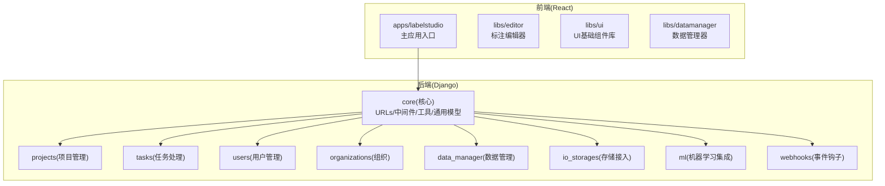
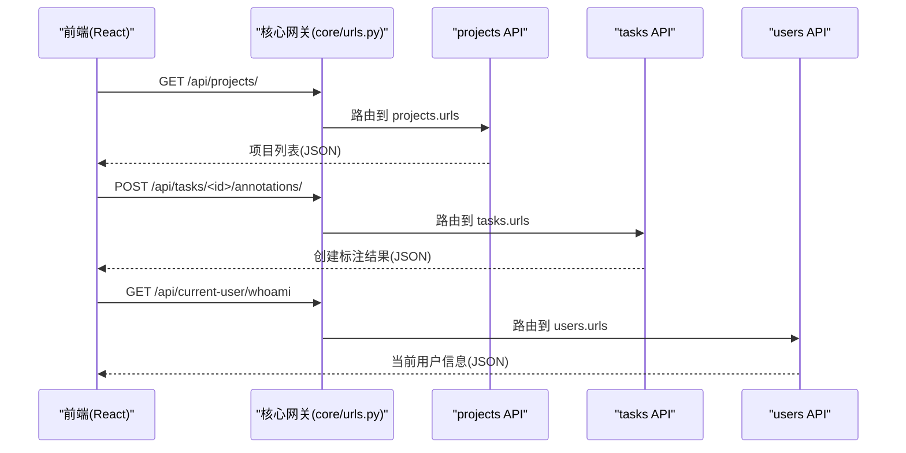
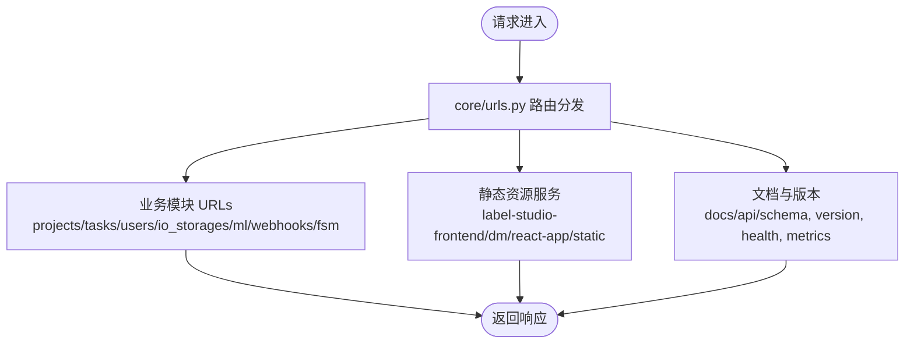
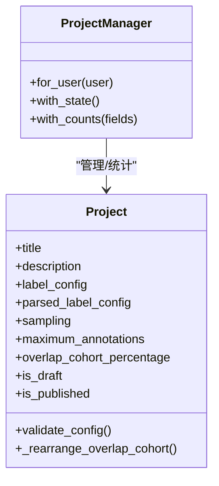
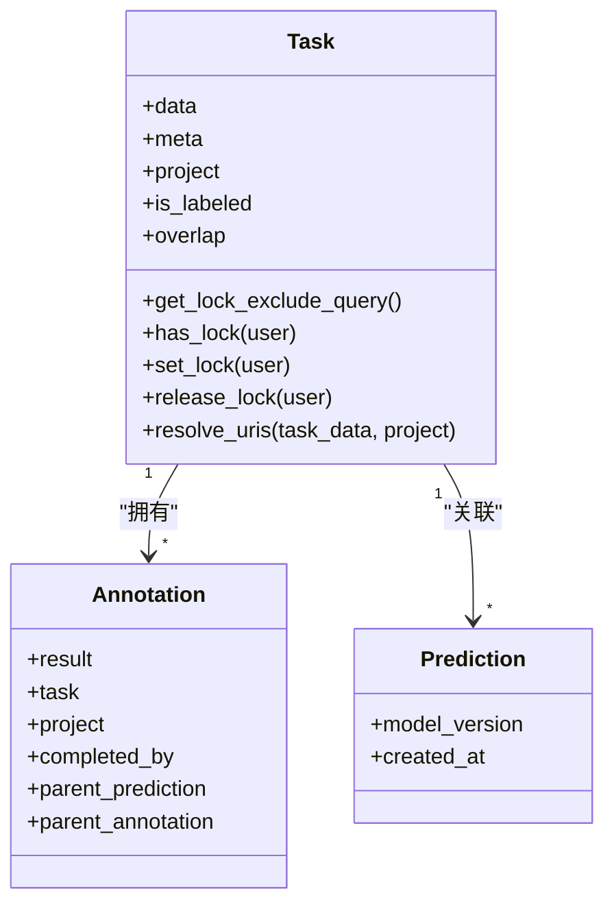
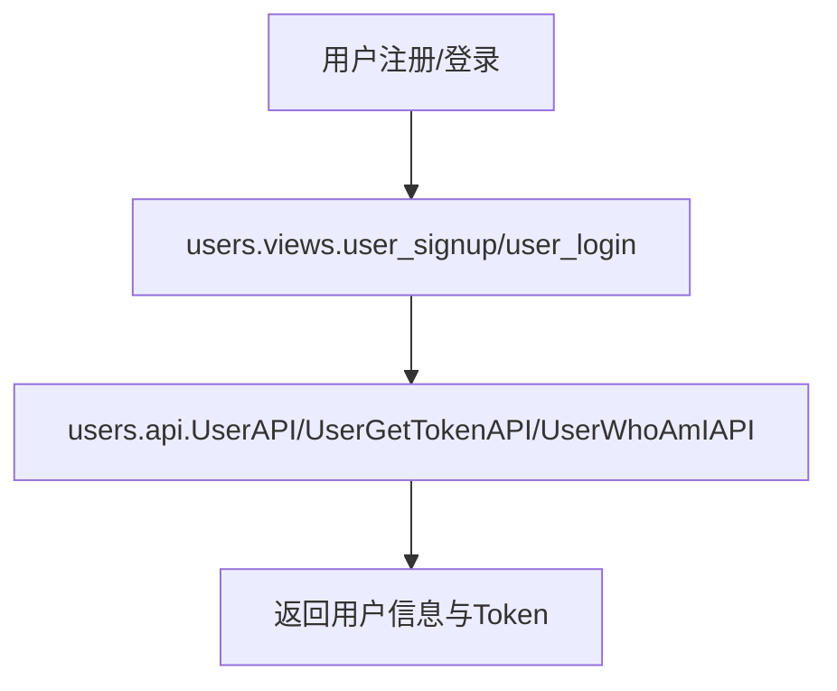
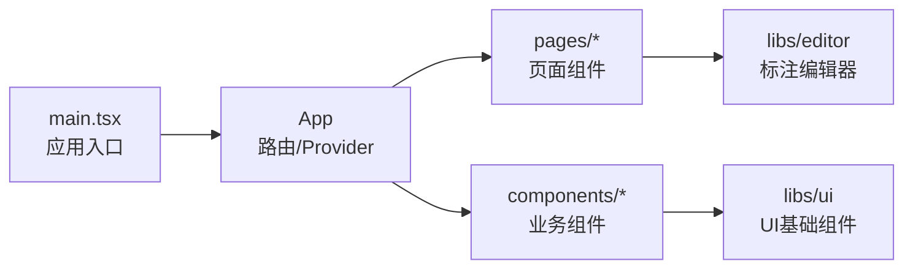
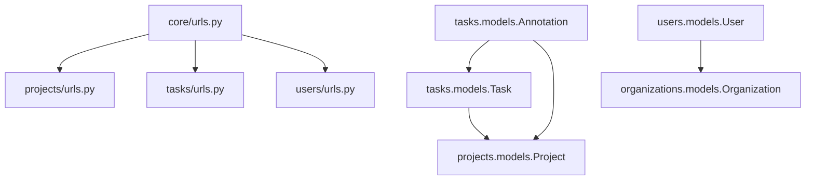

# 代码结构说明

<cite>
**本文引用的文件**   
- [README.md](file://README.md)
- [core/urls.py](file://label_studio/core/urls.py)
- [projects/urls.py](file://label_studio/projects/urls.py)
- [tasks/urls.py](file://label_studio/tasks/urls.py)
- [users/urls.py](file://label_studio/users/urls.py)
- [core/models.py](file://label_studio/core/models.py)
- [projects/models.py](file://label_studio/projects/models.py)
- [tasks/models.py](file://label_studio/tasks/models.py)
- [users/models.py](file://label_studio/users/models.py)
- [web/apps/labelstudio/src/main.tsx](file://web/apps/labelstudio/src/main.tsx)
</cite>

## 目录
1. [简介](#简介)
2. [项目结构](#项目结构)
3. [核心组件](#核心组件)
4. [架构总览](#架构总览)
5. [详细组件分析](#详细组件分析)
6. [依赖关系分析](#依赖关系分析)
7. [性能考虑](#性能考虑)
8. [故障排查指南](#故障排查指南)
9. [结论](#结论)
10. [附录：代码目录导航](#附录代码目录导航)

## 简介
Label Studio 是一个开源的数据标注平台，支持图像、文本、音频、视频、时序等多种数据类型的标注与导出。后端基于 Django + DRF，前端采用 React 构建的 Web 应用，并通过 REST API 进行前后端交互。本说明聚焦于后端 Django 应用的模块化设计（core、projects、tasks、users 等）、React 前端的组件分层、数据库模型组织、API 路由划分原则以及静态资源组织结构，帮助开发者快速定位和理解相关功能模块。

## 项目结构
整体仓库包含以下关键部分：
- 后端服务：label_studio 包下的多个 Django 应用（core、projects、tasks、users、organizations、data_manager、io_storages、ml、webhooks 等）
- 前端工程：web 目录下的多应用与库（apps/labelstudio、libs/editor、libs/ui、libs/datamanager 等）
- 部署与文档：deploy、docs、scripts 等

图表来源
- [core/urls.py:35-112](file://label_studio/core/urls.py#L35-L112)
- [README.md:227-235](file://README.md#L227-L235)

章节来源
- [README.md:8-22](file://README.md#L8-L22)
- [README.md:227-235](file://README.md#L227-L235)

## 核心组件
- core：提供全局 URL 挂载、静态资源服务、健康检查、版本信息、DRF Spectacular 文档、JWT/Session Policy 集成、跨应用路由聚合等；同时包含通用模型（如异步迁移状态、删除行备份）和工具集。
- projects：项目管理域，定义 Project 模型、统计计数、标签配置校验、采样策略、协作与预览等能力，并提供项目级 API。
- tasks：任务与标注域，定义 Task、Annotation、Prediction 等核心实体，实现任务锁定、重叠标注、预测加载、摘要统计等逻辑，并提供任务/标注/草稿/预测 API。
- users：用户域，自定义 User 模型、认证流程、Token 管理、产品导览、快捷键设置等，并提供用户与当前会话相关 API。

章节来源
- [core/urls.py:35-112](file://label_studio/core/urls.py#L35-L112)
- [core/models.py:12-84](file://label_studio/core/models.py#L12-L84)
- [projects/models.py:68-162](file://label_studio/projects/models.py#L68-L162)
- [tasks/models.py:66-205](file://label_studio/tasks/models.py#L66-L205)
- [users/models.py:103-164](file://label_studio/users/models.py#L103-L164)

## 架构总览
后端通过 core/urls.py 统一挂载各业务模块的 URL，形成“核心网关 + 领域应用”的分层结构。前端通过 web/apps/labelstudio 作为主应用入口，调用后端 REST API，并使用 libs/editor 渲染标注界面，libs/ui 提供基础 UI 组件。

图表来源
- [core/urls.py:59-70](file://label_studio/core/urls.py#L59-L70)
- [projects/urls.py:59-63](file://label_studio/projects/urls.py#L59-L63)
- [tasks/urls.py:42-48](file://label_studio/tasks/urls.py#L42-L48)
- [users/urls.py:16-31](file://label_studio/users/urls.py#L16-L31)

## 详细组件分析

### 后端核心模块(core)
职责与要点：
- URL 聚合：集中 include 各业务模块的 urls，统一暴露 /api/* 与页面路由。
- 静态资源：为 label-studio-frontend、dm、react-app 及通用 static 提供路径映射。
- 文档与监控：集成 drf-spectacular 生成 OpenAPI/Swagger/Redoc，暴露 health/metrics/version 等接口。
- 扩展点：挂载 JWT、Session Policy、Django-RQ 等第三方能力。

图表来源
- [core/urls.py:35-112](file://label_studio/core/urls.py#L35-L112)

章节来源
- [core/urls.py:35-112](file://label_studio/core/urls.py#L35-L112)

### 项目管理模块(projects)
职责与要点：
- 模型：Project 包含标题、描述、标签配置(label_config/parsed_label_config)、采样策略(sampling)、最大标注数(maximum_annotations)、协作与预览开关等字段；提供 Manager 统计注解、FSM 状态注入、可见性过滤等。
- 校验：对 label_config 与已有标注/草稿的一致性进行严格校验，确保配置变更不会破坏历史数据。
- 统计：通过 annotate_* 函数批量计算任务数、完成数、预测数、有用标注数等指标。
- API：提供项目 CRUD、汇总、导入/重导入状态、样本任务、模型版本、标注者列表等接口。

图表来源
- [projects/models.py:68-162](file://label_studio/projects/models.py#L68-L162)
- [projects/models.py:164-363](file://label_studio/projects/models.py#L164-L363)

章节来源
- [projects/models.py:68-162](file://label_studio/projects/models.py#L68-L162)
- [projects/models.py:164-363](file://label_studio/projects/models.py#L164-L363)
- [projects/urls.py:17-52](file://label_studio/projects/urls.py#L17-L52)

### 任务处理模块(tasks)
职责与要点：
- 模型：Task 承载任务数据(data/meta)、所属项目(project)、是否已标注(is_labeled)、重叠标注(overlap)、评论统计等；Annotation 保存标注结果(result)、关联任务/项目/用户、草稿/预测来源等；Prediction 用于预标注与模型对比。
- 并发控制：通过 TaskLock 与 overlap 阈值控制并发标注，避免重复标注导致的不一致。
- 存储解析：resolve_uris/resolve_storage_uri 将任务数据中的云存储 URI 解析为可访问链接，支持受保护数据的代理访问。
- API：提供任务/标注/草稿/预测的 CRUD 与摘要、一致性评估等接口。

图表来源
- [tasks/models.py:66-205](file://label_studio/tasks/models.py#L66-L205)
- [tasks/models.py:685-800](file://label_studio/tasks/models.py#L685-L800)

章节来源
- [tasks/models.py:66-205](file://label_studio/tasks/models.py#L66-L205)
- [tasks/models.py:685-800](file://label_studio/tasks/models.py#L685-L800)
- [tasks/urls.py:13-48](file://label_studio/tasks/urls.py#L13-L48)

### 用户管理模块(users)
职责与要点：
- 模型：User 继承 AbstractBaseUser 与 PermissionsMixin，扩展头像、热键、活动记录、组织关联等；提供 UserManager 与 Token 生命周期管理。
- 认证与会话：提供登录/注册/登出、当前用户信息、Token 获取与重置、产品导览与快捷键配置等接口。
- 静态资源：在禁用云存储时提供头像本地服务路由。

图表来源
- [users/urls.py:16-31](file://label_studio/users/urls.py#L16-L31)
- [users/models.py:103-164](file://label_studio/users/models.py#L103-L164)

章节来源
- [users/urls.py:16-31](file://label_studio/users/urls.py#L16-L31)
- [users/models.py:103-164](file://label_studio/users/models.py#L103-L164)

### 前端组件架构
- 应用入口：web/apps/labelstudio/src/main.tsx 初始化分析、热键引导、主 App 与服务工作线程等。
- 页面组件：位于 apps/labelstudio/src/pages，按业务域划分（CreateProject、DataManager、ExportPage、Home、Organization、Projects、Settings、WebhookPage）。
- 业务组件：位于 apps/labelstudio/src/components，封装页面内复用逻辑（Breadcrumbs、Card、Form、Modal、Pagination 等）。
- UI 基础组件：libs/ui 提供跨应用的基础 UI 元素与样式体系。
- 标注编辑器：libs/editor 提供标注界面的核心渲染与交互逻辑。

图表来源
- [web/apps/labelstudio/src/main.tsx:1-9](file://web/apps/labelstudio/src/main.tsx#L1-L9)

章节来源
- [web/apps/labelstudio/src/main.tsx:1-9](file://web/apps/labelstudio/src/main.tsx#L1-L9)

## 依赖关系分析
- URL 路由依赖：core/urls.py 聚合 projects、tasks、users、io_storages、ml、webhooks、fsm 等模块的 urls，形成统一的 API 命名空间。
- 模型依赖：
  - tasks.Task 依赖 projects.Project（外键），并引用 data_import.FileUpload。
  - tasks.Annotation 反向关联 tasks.Task 与 projects.Project，并可选关联 tasks.Prediction。
  - users.User 与 organizations.Organization 存在活跃组织关联。
- 前端依赖：main.tsx 引入 app-common 的分析与热键引导，随后加载主 App。

图表来源
- [core/urls.py:59-70](file://label_studio/core/urls.py#L59-L70)
- [tasks/models.py:92-98](file://label_studio/tasks/models.py#L92-L98)
- [tasks/models.py:697-711](file://label_studio/tasks/models.py#L697-L711)
- [users/models.py:140-142](file://label_studio/users/models.py#L140-L142)

章节来源
- [core/urls.py:59-70](file://label_studio/core/urls.py#L59-L70)
- [tasks/models.py:92-98](file://label_studio/tasks/models.py#L92-L98)
- [tasks/models.py:697-711](file://label_studio/tasks/models.py#L697-L711)
- [users/models.py:140-142](file://label_studio/users/models.py#L140-L142)

## 性能考虑
- 查询优化：ProjectManager 提供 with_state 与 with_counts，批量注解统计字段，减少 N+1 查询。
- 批量更新：使用 batch_update_with_retry 与 bulk_create/batch_delete 降低高并发场景下的锁竞争与内存占用。
- 索引设计：Task 与 Annotation 针对常用查询字段建立索引（如 project、is_labeled、inner_id、overlap 等）。
- 缓存与异步：用户最后活动时间优先写入 Redis，失败回退至数据库；异步迁移状态通过 AsyncMigrationStatus 跟踪。

章节来源
- [projects/models.py:76-143](file://label_studio/projects/models.py#L76-L143)
- [tasks/models.py:196-205](file://label_studio/tasks/models.py#L196-L205)
- [core/models.py:12-48](file://label_studio/core/models.py#L12-L48)
- [users/models.py:65-95](file://label_studio/users/models.py#L65-L95)

## 故障排查指南
- 任务并发冲突：当 num_locks + annotations > overlap 时可能触发 is_labeled 不一致修复逻辑；检查日志中关于 overlap 与 skip_queue 的记录。
- 配置校验失败：修改 label_config 后若与已有标注/草稿不兼容，会抛出 ValidationError；需先清理或调整历史数据。
- 静态资源不可用：确认 core/urls.py 中 serve 的路径与 settings 配置（EDITOR_ROOT、DM_ROOT、REACT_APP_ROOT、STATIC_ROOT）正确。
- 用户头像无法访问：在未启用云存储时，users/urls.py 提供本地头像服务路由；检查 MEDIA_ROOT 与 AVATAR_PATH 配置。

章节来源
- [tasks/models.py:316-357](file://label_studio/tasks/models.py#L316-L357)
- [projects/models.py:648-800](file://label_studio/projects/models.py#L648-L800)
- [core/urls.py:43-58](file://label_studio/core/urls.py#L43-L58)
- [users/urls.py:33-43](file://label_studio/users/urls.py#L33-L43)

## 结论
Label Studio 的后端以 core 为核心网关，按领域拆分 projects、tasks、users 等模块，职责清晰、耦合可控；前端以 React 为主，采用页面组件、业务组件与 UI 基础组件的分层架构，配合 libs/editor 提供强大的标注体验。通过统一的 URL 聚合、清晰的模型关系与完善的统计/并发机制，系统具备良好的可扩展性与可维护性。

## 附录：代码目录导航
- 后端
  - 核心与通用：label_studio/core（URLs、中间件、工具、通用模型）
  - 项目管理：label_studio/projects（Project 模型、统计、API）
  - 任务处理：label_studio/tasks（Task/Annotation/Prediction 模型、API）
  - 用户管理：label_studio/users（User 模型、认证、API）
  - 其他：organizations、data_manager、io_storages、ml、webhooks、fsm
- 前端
  - 主应用：web/apps/labelstudio/src（main.tsx、app、pages、components）
  - 标注编辑器：web/libs/editor
  - UI 基础库：web/libs/ui
  - 数据管理器：web/libs/datamanager