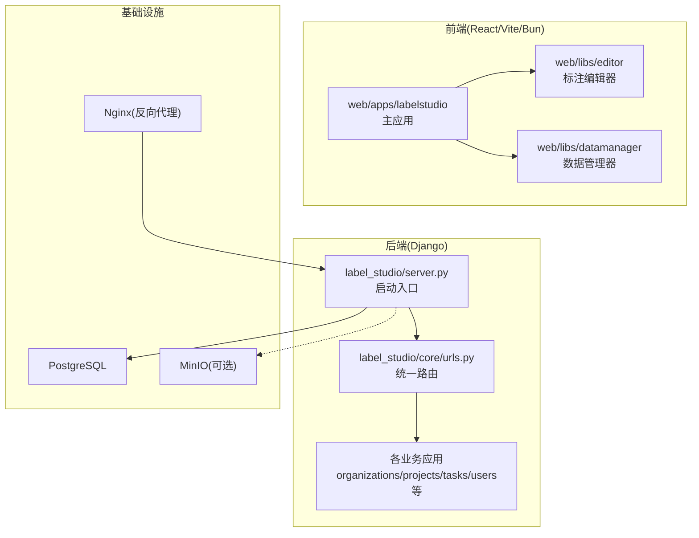
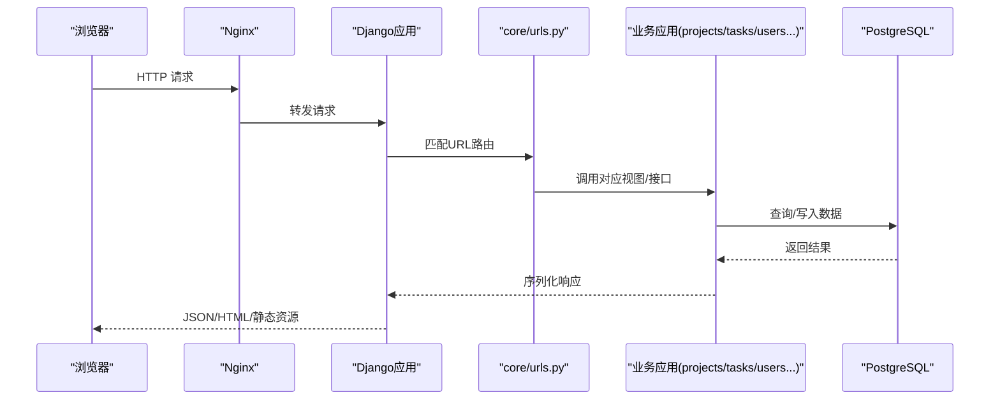
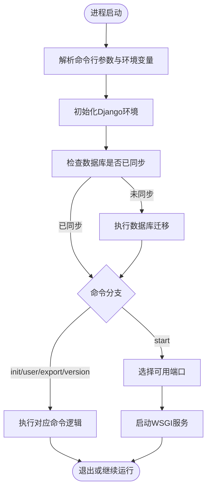
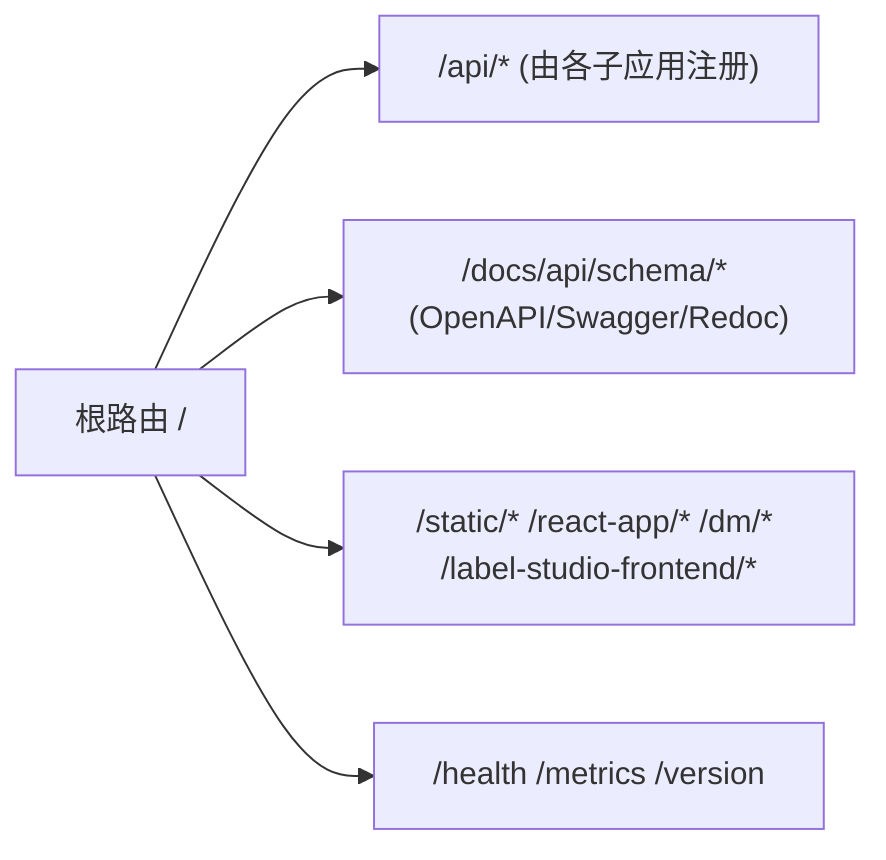
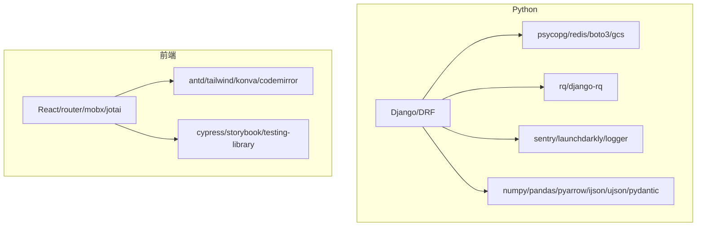

# 开发指南

<cite>
**本文引用的文件**   
- [README.md](file://README.md)
- [CONTRIBUTING.md](file://CONTRIBUTING.md)
- [pyproject.toml](file://pyproject.toml)
- [docker-compose.yml](file://docker-compose.yml)
- [.devcontainer/docker-compose.yml](file://.devcontainer/docker-compose.yml)
- [label_studio/server.py](file://label_studio/server.py)
- [label_studio/core/urls.py](file://label_studio/core/urls.py)
- [web/package.json](file://web/package.json)
</cite>

## 目录
1. [简介](#简介)
2. [项目结构](#项目结构)
3. [核心组件](#核心组件)
4. [架构总览](#架构总览)
5. [详细组件分析](#详细组件分析)
6. [依赖关系分析](#依赖关系分析)
7. [性能与可观测性](#性能与可观测性)
8. [故障排查指南](#故障排查指南)
9. [结论](#结论)
10. [附录：贡献与协作规范](#附录贡献与协作规范)

## 简介
本指南面向Label Studio的新贡献者，提供从本地环境搭建到代码提交的全流程说明。内容涵盖前后端开发环境安装、数据库初始化、Django后端与React前端模块划分、测试编写与执行、代码规范与PR流程，以及调试、性能分析与问题诊断的常用方法。

## 项目结构
仓库采用“后端Django + 前端React”的双仓式结构：
- 后端：基于Django与DRF，按功能拆分为多个应用（如organizations、projects、tasks、users等），通过统一的URL路由聚合。
- 前端：位于web目录，使用Vite+Bun构建，包含主应用apps/labelstudio、编辑器库libs/editor、数据管理库libs/datamanager等。
- 部署与容器化：根目录提供docker-compose编排，支持PostgreSQL与可选MinIO；.devcontainer提供VS Code远程开发容器配置。

图示来源
- [label_studio/server.py:276-443](file://label_studio/server.py#L276-L443)
- [label_studio/core/urls.py:35-112](file://label_studio/core/urls.py#L35-L112)
- [web/package.json:1-55](file://web/package.json#L1-L55)

章节来源
- [README.md:119-132](file://README.md#L119-L132)
- [README.md:143-145](file://README.md#L143-L145)
- [docker-compose.yml:1-72](file://docker-compose.yml#L1-L72)

## 核心组件
- 后端启动与初始化
  - 命令行入口解析参数、设置环境变量、加载Django配置并自动执行数据库迁移。
  - 支持创建默认用户、初始化项目、导出任务、重置密码等命令。
  - 在start模式下选择可用端口并启动WSGI服务。
- URL路由与静态资源
  - 统一聚合各子应用的API路由，提供版本、健康检查、指标、Swagger文档等通用接口。
  - 将前端产物（react-app、dm、editor）作为静态资源托管。
- 前端构建与脚本
  - 使用Bun作为包管理器，Vite进行开发与构建，Cypress进行端到端与集成测试。
  - 提供多种脚本：开发、构建、预览、单元测试、E2E、Storybook等。

章节来源
- [label_studio/server.py:32-63](file://label_studio/server.py#L32-L63)
- [label_studio/server.py:127-203](file://label_studio/server.py#L127-L203)
- [label_studio/server.py:276-443](file://label_studio/server.py#L276-L443)
- [label_studio/core/urls.py:35-112](file://label_studio/core/urls.py#L35-L112)
- [web/package.json:1-55](file://web/package.json#L1-L55)

## 架构总览
下图展示一次典型请求的生命周期：浏览器访问→Nginx反向代理→Django路由分发→业务视图处理→数据库读写→返回JSON或静态资源。

图示来源
- [docker-compose.yml:1-72](file://docker-compose.yml#L1-L72)
- [label_studio/core/urls.py:35-112](file://label_studio/core/urls.py#L35-L112)

## 详细组件分析

### 后端启动与初始化流程
- 关键职责
  - 解析命令行参数与环境变量，设置日志级别、数据库路径、数据目录等。
  - 初始化Django环境，检测并执行数据库迁移。
  - 根据命令分支执行：创建用户/项目、重置密码、导出、查看版本、启动服务等。
  - 在启动时自动选择空闲端口，必要时提示冲突并尝试其他端口。
- 错误与边界
  - 端口占用时循环探测可用端口，超过阈值抛出连接错误。
  - 旧项目目录迁移逻辑仅在特定命令下触发。

图示来源
- [label_studio/server.py:276-443](file://label_studio/server.py#L276-L443)
- [label_studio/server.py:50-63](file://label_studio/server.py#L50-L63)

章节来源
- [label_studio/server.py:276-443](file://label_studio/server.py#L276-L443)

### URL路由与静态资源托管
- 聚合路由
  - 将organizations、projects、data_import、data_manager、data_export、users、tasks、io_storages、ml、webhooks、labels_manager、fsm等子应用路由统一挂载。
- 公共接口
  - 提供health、metrics、version、feature-flags、heidi-tips、__lsa等运维与监控接口。
  - 集成drf-spectacular生成OpenAPI Schema与Swagger/Redoc文档。
- 静态资源
  - 将react-app、dm、editor等前端产物以静态文件方式提供服务。

图示来源
- [label_studio/core/urls.py:35-112](file://label_studio/core/urls.py#L35-L112)

章节来源
- [label_studio/core/urls.py:35-112](file://label_studio/core/urls.py#L35-L112)

### 前端构建与测试脚本
- 构建系统
  - 使用Bun作为包管理器，Vite进行开发与构建，TailwindCSS、Ant Design、CodeMirror等生态组件。
- 主要脚本
  - dev/watch/build：开发与构建主应用。
  - lsf:*：编辑器库的开发、构建、预览与集成测试。
  - test:*：单元与端到端测试（Bun内置测试、Jest、Cypress）。
  - storybook/playground：组件故事与示例页面。

章节来源
- [web/package.json:1-55](file://web/package.json#L1-L55)

## 依赖关系分析
- Python依赖
  - 核心框架：Django、DRF、django-environ、django-cors-headers等。
  - 数据存储：psycopg（PostgreSQL）、redis、boto3/google-cloud-storage（对象存储）。
  - 任务队列：rq、django-rq。
  - 安全与可观测性：sentry-sdk、launchdarkly-server-sdk、python-json-logger。
  - 工具库：numpy、pandas、pyarrow、ijson、ujson、pydantic等。
- 前端依赖
  - React生态：react、react-router、mobx-state-tree、jotai等。
  - UI与可视化：antd、tailwindcss、konva/react-konva、codemirror等。
  - 测试与文档：cypress、storybook、@testing-library等。

图示来源
- [pyproject.toml:14-72](file://pyproject.toml#L14-L72)
- [web/package.json:56-216](file://web/package.json#L56-L216)

章节来源
- [pyproject.toml:14-72](file://pyproject.toml#L14-L72)
- [web/package.json:56-216](file://web/package.json#L56-L216)

## 性能与可观测性
- 指标与健康检查
  - 暴露/metrics与/health接口，便于外部监控系统采集。
- 日志与追踪
  - 支持结构化日志（JSON_LOG）与Sentry集成，便于生产问题定位。
- 缓存与异步
  - 使用Redis与RQ进行缓存与任务队列，提升高并发场景下的吞吐能力。
- 前端性能
  - 使用Vite快速构建，按需加载；结合Konva进行高性能Canvas渲染。

章节来源
- [label_studio/core/urls.py:71-103](file://label_studio/core/urls.py#L71-L103)
- [pyproject.toml:58-60](file://pyproject.toml#L58-L60)

## 故障排查指南
- 常见问题与定位
  - 端口占用：启动时会探测可用端口，若连续失败会抛出连接错误。建议关闭占用进程或调整端口。
  - 数据库未同步：首次启动会自动执行migrate；若失败请检查数据库连接与权限。
  - 静态资源404：确认前端已构建且STATIC_ROOT/REACT_APP_ROOT等路径正确。
  - Swagger文档不可用：确保drf-spectacular依赖已安装且路由未被覆盖。
- 调试技巧
  - 启用Django Debug Toolbar（DEBUG模式）查看SQL与请求详情。
  - 使用pytest-django与tavern进行API级测试，快速验证变更影响。
  - 前端使用Storybook隔离组件问题，Cypress进行端到端回归。

章节来源
- [label_studio/server.py:244-267](file://label_studio/server.py#L244-L267)
- [label_studio/server.py:50-63](file://label_studio/server.py#L50-L63)
- [label_studio/core/urls.py:114-121](file://label_studio/core/urls.py#L114-L121)

## 结论
通过本指南，你可以完成Label Studio的前后端开发环境搭建、理解核心模块的职责与交互、掌握测试与调试方法，并遵循项目的协作规范进行高效贡献。建议在每次提交前运行相关测试与lint，确保代码质量与稳定性。

## 附录：贡献与协作规范
- 贡献类型
  - 文档更新、Bug修复、模板与ML示例、导出格式改进、功能需求与实现等。
- 代码规范
  - 保持PR小而精，遵循ruff/mypy等静态检查，优先松耦合与单一职责函数。
- 测试要求
  - 新功能与Bug修复需包含单元测试；API接口优先使用tavern进行测试；保证sqlite与postgresql兼容。
- PR流程
  - 使用约定式提交标题前缀（如feat:/fix:/docs:），并在PR描述中给出验收标准与关联Issue链接。

章节来源
- [CONTRIBUTING.md:5-78](file://CONTRIBUTING.md#L5-L78)
- [CONTRIBUTING.md:110-131](file://CONTRIBUTING.md#L110-L131)