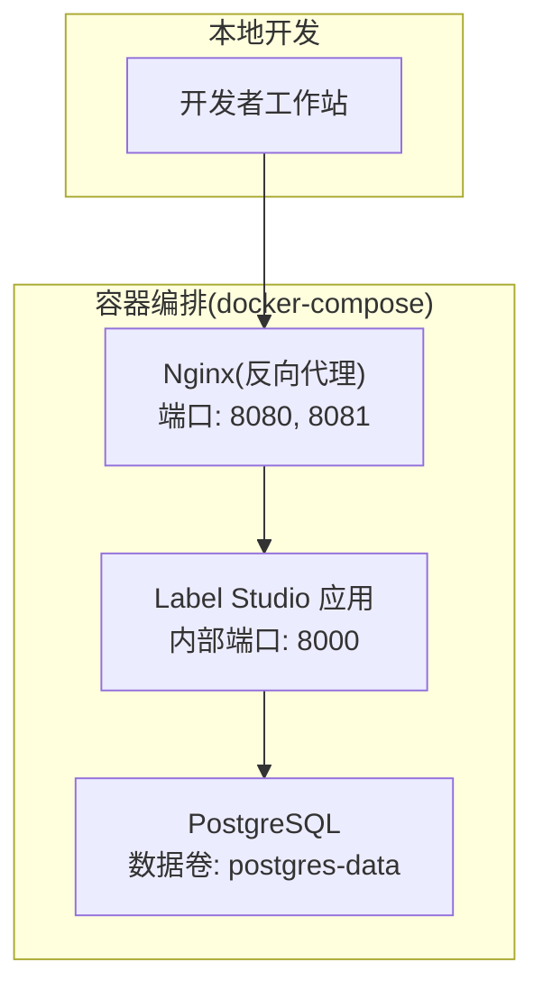
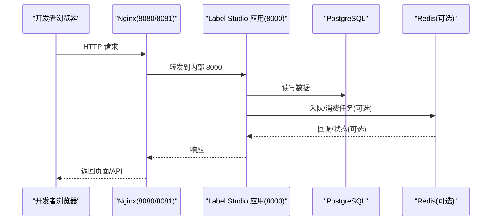
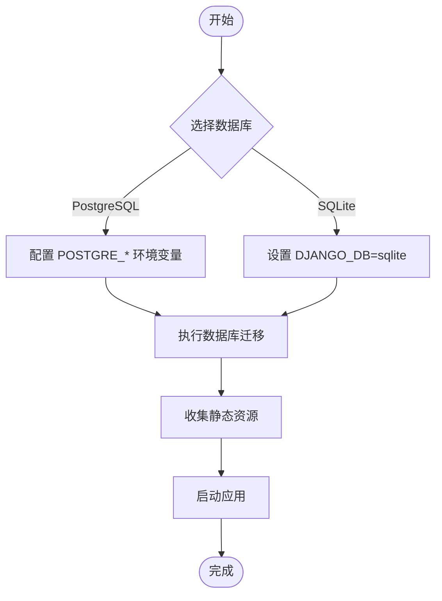
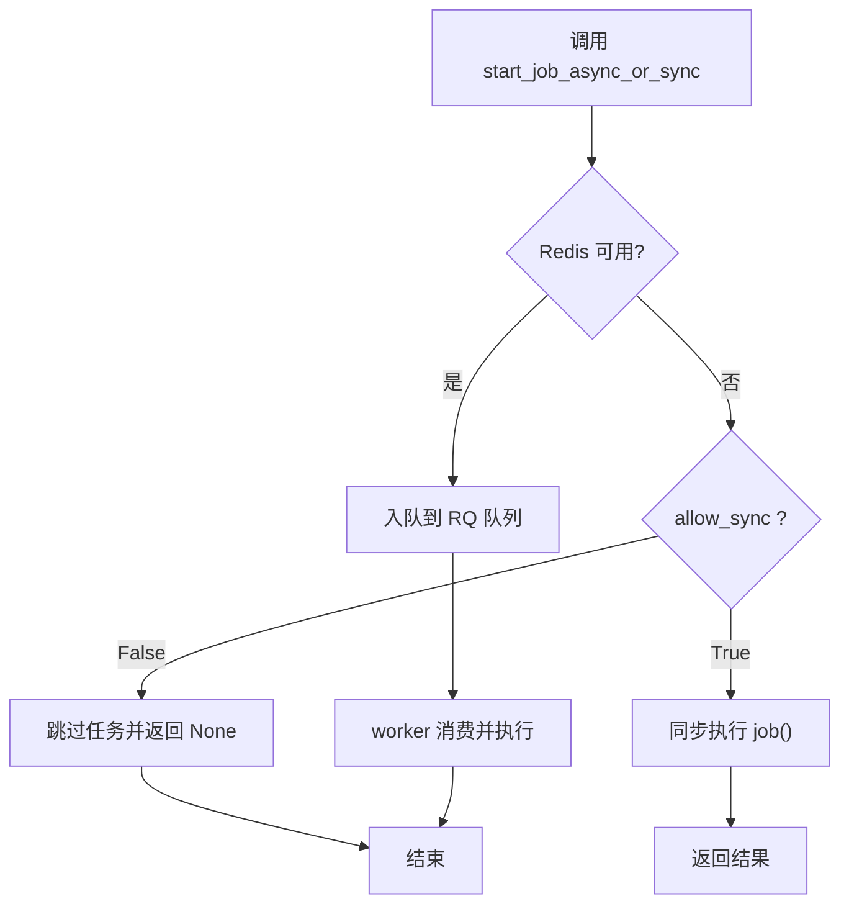
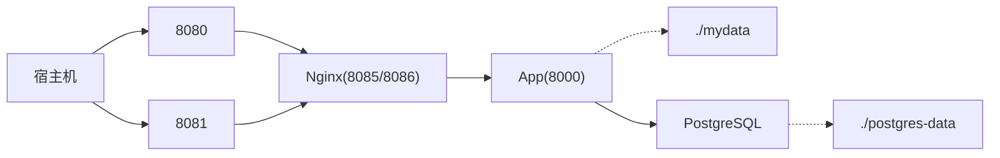
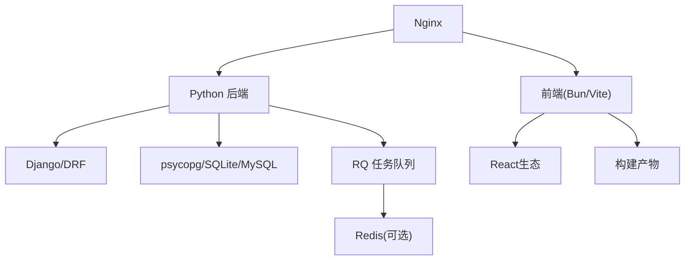

# 开发环境搭建

<cite>
**本文引用的文件**   
- [README.md](file://README.md)
- [pyproject.toml](file://pyproject.toml)
- [docker-compose.yml](file://docker-compose.yml)
- [.devcontainer/devcontainer.json](file://.devcontainer/devcontainer.json)
- [.devcontainer/docker-compose.yml](file://.devcontainer/docker-compose.yml)
- [web/package.json](file://web/package.json)
- [web/README.md](file://web/README.md)
- [label_studio/core/settings/base.py](file://label_studio/core/settings/base.py)
- [label_studio/core/settings/label_studio.py](file://label_studio/core/settings/label_studio.py)
- [label_studio/core/redis.py](file://label_studio/core/redis.py)
</cite>

## 目录
1. [简介](#简介)
2. [项目结构](#项目结构)
3. [核心组件](#核心组件)
4. [架构总览](#架构总览)
5. [详细组件分析](#详细组件分析)
6. [依赖关系分析](#依赖关系分析)
7. [性能考虑](#性能考虑)
8. [故障排查指南](#故障排查指南)
9. [结论](#结论)
10. [附录](#附录)

## 简介
本指南面向开发者，提供 Label Studio 本地开发环境的完整搭建说明，涵盖：
- Python 环境与依赖（版本要求、虚拟环境、包管理）
- Node.js/Bun 与前端依赖安装
- 数据库初始化（PostgreSQL/SQLite）
- Redis 缓存服务配置（可选）
- Docker 开发环境快速启动（容器编排、端口映射、数据持久化）
- 常见问题定位与解决方案

目标：帮助开发者在最短时间获得可运行的本地开发环境。

## 项目结构
Label Studio 由后端 Django 应用与前端 React 工程组成，并通过 Docker Compose 编排运行。关键目录与职责：
- label_studio：Django 后端代码、设置、迁移、API
- web：前端工程（React + Vite），使用 Bun 作为包管理器
- docker-compose.yml：生产/开发常用编排（Nginx、App、DB）
- .devcontainer：VS Code Dev Container 支持（复用 docker-compose）
- pyproject.toml：Python 依赖与构建配置
- web/package.json：前端依赖与脚本

图表来源
- [docker-compose.yml:1-72](file://docker-compose.yml#L1-L72)

章节来源
- [README.md:1-260](file://README.md#L1-L260)
- [docker-compose.yml:1-72](file://docker-compose.yml#L1-L72)

## 核心组件
- 后端（Django + DRF）
  - Python 版本要求：>=3.11（见 pyproject.toml）
  - 数据库：默认 PostgreSQL；也支持 SQLite/MySQL
  - 任务队列：RQ（基于 Redis）
  - 静态资源：collectstatic 收集
- 前端（React + Vite）
  - 包管理器：Bun（packageManager=bun@1.3.11）
  - 开发模式：HMR 支持（FRONTEND_HMR=true）
- 基础设施
  - Nginx：静态资源与反向代理
  - PostgreSQL：持久化存储
  - Redis（可选）：异步任务队列与缓存

章节来源
- [pyproject.toml:1-120](file://pyproject.toml#L1-L120)
- [web/package.json:1-60](file://web/package.json#L1-L60)
- [web/README.md:16-36](file://web/README.md#L16-L36)
- [docker-compose.yml:1-72](file://docker-compose.yml#L1-L72)

## 架构总览
下图展示开发环境中的主要服务与交互关系：

图表来源
- [docker-compose.yml:1-72](file://docker-compose.yml#L1-L72)
- [label_studio/core/redis.py:80-111](file://label_studio/core/redis.py#L80-L111)

## 详细组件分析

### Python 环境与依赖
- Python 版本
  - 要求：>=3.11（pyproject.toml 中 requires-python）
- 依赖管理
  - 推荐使用 uv 或 pip/poetry 进行依赖安装
  - 核心依赖包括 Django、DRF、psycopg、numpy、pandas、redis、rq 等
- 虚拟环境
  - 建议使用 venv 或 conda 隔离环境，避免系统级污染
- 数据库选择
  - 环境变量 DJANGO_DB 控制数据库类型：default(PostgreSQL)/sqlite/mysql
  - SQLite 默认路径为 BASE_DATA_DIR/label_studio.sqlite3
- 静态资源
  - 开发前需执行 collectstatic 收集静态文件

章节来源
- [pyproject.toml:1-72](file://pyproject.toml#L1-L72)
- [label_studio/core/settings/base.py:174-208](file://label_studio/core/settings/base.py#L174-L208)
- [label_studio/core/settings/label_studio.py:1-12](file://label_studio/core/settings/label_studio.py#L1-L12)

### Node.js/Bun 与前端依赖
- 包管理器
  - 项目声明使用 Bun（packageManager=bun@1.3.11）
- 安装依赖
  - 进入 web 目录执行 bun install --frozen-lockfile
- 开发服务器
  - 启用 HMR：在项目根目录创建 .env，设置 FRONTEND_HMR=true
  - 从 web 目录运行 bun run dev，或从根目录 make frontend-dev
- 常用命令
  - build、watch、lint、test 等均在 web/package.json scripts 中定义

章节来源
- [web/package.json:1-60](file://web/package.json#L1-L60)
- [web/README.md:16-36](file://web/README.md#L16-L36)

### 数据库初始化（PostgreSQL/SQLite）
- PostgreSQL（推荐用于开发与生产）
  - docker-compose.yml 已包含 db 服务，默认用户 postgres，无密码（POSTGRES_HOST_AUTH_METHOD=trust）
  - 数据持久化到 ./postgres-data
  - 应用侧通过 POSTGRE_* 环境变量连接
- SQLite（快速起步）
  - 设置 DJANGO_DB=sqlite，将使用内置 SQLite 文件
- 迁移
  - 首次运行需执行 migrate 生成表结构
  - 收集静态资源 collectstatic

图表来源
- [docker-compose.yml:55-72](file://docker-compose.yml#L55-L72)
- [label_studio/core/settings/base.py:174-208](file://label_studio/core/settings/base.py#L174-L208)
- [label_studio/core/settings/label_studio.py:11-12](file://label_studio/core/settings/label_studio.py#L11-L12)

章节来源
- [docker-compose.yml:55-72](file://docker-compose.yml#L55-L72)
- [label_studio/core/settings/base.py:174-208](file://label_studio/core/settings/base.py#L174-L208)
- [label_studio/core/settings/label_studio.py:11-12](file://label_studio/core/settings/label_studio.py#L11-L12)

### Redis 缓存与任务队列（可选）
- 功能说明
  - RQ 任务队列依赖 Redis；OSS 版本默认关闭 REDIS_ENABLED
  - 当 Redis 不可用时，start_job_async_or_sync 会回退为同步执行或跳过（allow_sync=False）
- 配置要点
  - 设置 REDIS_ENABLED=true 以启用 Redis
  - 配置 RQ_QUEUES（host/port/db）指向你的 Redis 实例
  - 可通过 redis_healthcheck 检查连通性
- 健康检查
  - 模块内尝试连接并 ping Redis，失败则记录日志并降级

图表来源
- [label_studio/core/redis.py:80-111](file://label_studio/core/redis.py#L80-L111)
- [label_studio/core/redis.py:264-370](file://label_studio/core/redis.py#L264-L370)
- [label_studio/core/settings/base.py:389-427](file://label_studio/core/settings/base.py#L389-L427)

章节来源
- [label_studio/core/redis.py:80-111](file://label_studio/core/redis.py#L80-L111)
- [label_studio/core/redis.py:264-370](file://label_studio/core/redis.py#L264-L370)
- [label_studio/core/settings/base.py:389-427](file://label_studio/core/settings/base.py#L389-L427)

### Docker 开发环境快速启动
- 服务组成
  - nginx：对外暴露 8080/8081，反向代理到 app
  - app：Label Studio 应用，内部监听 8000
  - db：PostgreSQL，数据持久化到 ./postgres-data
- 端口映射
  - 宿主机 8080 -> 容器 8085（nginx）
  - 宿主机 8081 -> 容器 8086（nginx）
- 数据持久化
  - ./mydata:/label-studio/data（应用数据与上传文件）
  - ./postgres-data:/var/lib/postgresql/data（数据库文件）
- 环境变量
  - DJANGO_DB=default（默认 PostgreSQL）
  - POSTGRE_* 系列变量用于连接 db 服务
  - LABEL_STUDIO_HOST 用于站点地址
- 启动方式
  - 直接 docker compose up
  - VS Code Dev Container：自动加载 .devcontainer/devcontainer.json 与 docker-compose.yml

图表来源
- [docker-compose.yml:1-72](file://docker-compose.yml#L1-L72)

章节来源
- [docker-compose.yml:1-72](file://docker-compose.yml#L1-L72)
- [.devcontainer/devcontainer.json:1-54](file://.devcontainer/devcontainer.json#L1-L54)
- [.devcontainer/docker-compose.yml:1-38](file://.devcontainer/docker-compose.yml#L1-L38)

## 依赖关系分析
- 后端依赖
  - Django、DRF、django-rq、psycopg、redis、sentry-sdk 等
  - 数据库驱动根据 DJANGO_DB 切换
- 前端依赖
  - React、Vite、TypeScript、Tailwind、Storybook 等
- 运行时依赖
  - Nginx、PostgreSQL、Redis（可选）

图表来源
- [pyproject.toml:14-72](file://pyproject.toml#L14-L72)
- [web/package.json:56-216](file://web/package.json#L56-L216)
- [docker-compose.yml:1-72](file://docker-compose.yml#L1-L72)

章节来源
- [pyproject.toml:14-72](file://pyproject.toml#L14-L72)
- [web/package.json:56-216](file://web/package.json#L56-L216)
- [docker-compose.yml:1-72](file://docker-compose.yml#L1-L72)

## 性能考虑
- 数据库
  - 开发阶段可使用 SQLite 快速验证；正式环境建议 PostgreSQL
  - 合理设置连接池与超时参数（视部署而定）
- 任务队列
  - 启用 Redis 后，后台任务可并行处理，提升吞吐
  - 调整 RQ_FAILED_JOB_TTL 控制失败任务保留时长
- 静态资源
  - 生产环境务必 collectstatic，减少动态渲染开销
- 前端
  - 使用 HMR 加速开发体验；构建产物按需懒加载

[本节为通用指导，不直接分析具体文件]

## 故障排查指南
- 依赖冲突
  - 现象：pip/uv 安装失败或导入报错
  - 排查：确认 Python 版本 >=3.11；清理虚拟环境后重装依赖；必要时锁定依赖版本
  - 参考：pyproject.toml 的 dependencies 与 tool.uv 配置
- 端口占用
  - 现象：8080/8081 无法访问
  - 排查：检查本机是否已有进程占用；修改 docker-compose.yml 端口映射或停止冲突服务
- 权限问题
  - 现象：写入 ./mydata 或 ./postgres-data 失败
  - 排查：确保当前用户对数据目录有写权限；Linux 下可能需要 sudo 或调整目录属主
- 数据库连接失败
  - PostgreSQL：检查 POSTGRE_* 环境变量与 db 服务是否启动；确认网络可达
  - SQLite：确认 DATABASE_NAME 路径存在且可写
- Redis 不可用
  - 现象：任务未执行或报错
  - 排查：设置 REDIS_ENABLED=false 临时禁用；或启动 Redis 并配置 RQ_QUEUES
- 前端 HMR 不生效
  - 现象：修改前端代码不热更新
  - 排查：确认 .env 中 FRONTEND_HMR=true；检查 FRONTEND_HOSTNAME/DJANGO_HOSTNAME 配置

章节来源
- [pyproject.toml:1-120](file://pyproject.toml#L1-L120)
- [docker-compose.yml:1-72](file://docker-compose.yml#L1-L72)
- [label_studio/core/settings/base.py:174-208](file://label_studio/core/settings/base.py#L174-L208)
- [label_studio/core/redis.py:80-111](file://label_studio/core/redis.py#L80-L111)

## 结论
通过本指南，你可以：
- 使用 Docker Compose 一键拉起 Nginx + App + PostgreSQL 的开发环境
- 根据需要启用 SQLite 或 PostgreSQL，并在本地快速迁移与收集静态资源
- 可选启用 Redis 以获得异步任务能力
- 使用 Bun 进行前端开发与构建，配合 HMR 提升效率
- 遇到常见问题时，依据排查清单快速定位与解决

[本节为总结性内容，不直接分析具体文件]

## 附录
- 快速启动命令（示例）
  - 使用 Docker Compose 启动：docker compose up
  - 首次运行后端：python label_studio/manage.py migrate && python label_studio/manage.py collectstatic
  - 前端开发：cd web && bun run dev（或在根目录 make frontend-dev）
- 环境变量速查
  - DJANGO_DB：default/sqlite/mysql
  - POSTGRE_USER/POSTGRE_PASSWORD/POSTGRE_NAME/POSTGRE_HOST/POSTGRE_PORT
  - LABEL_STUDIO_HOST：站点域名/地址
  - FRONTEND_HMR：true/false（前端 HMR）
  - REDIS_ENABLED：true/false（可选）

[本节为补充信息，不直接分析具体文件]