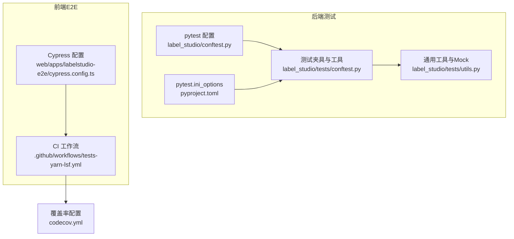
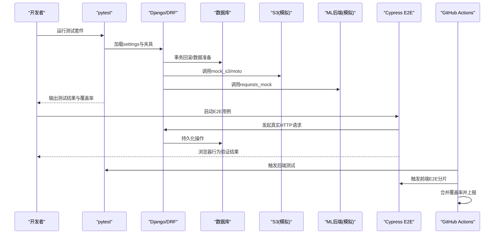
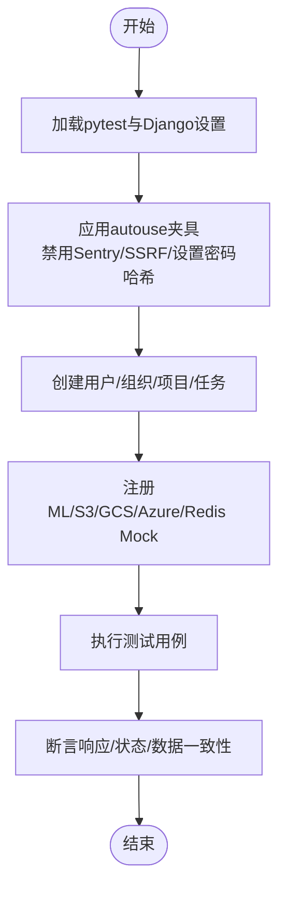
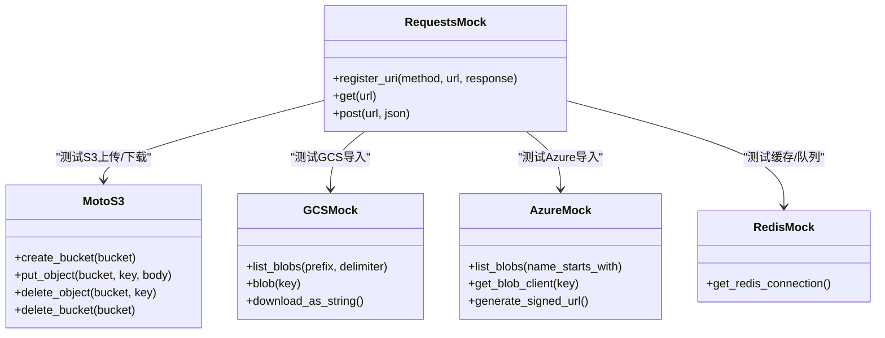
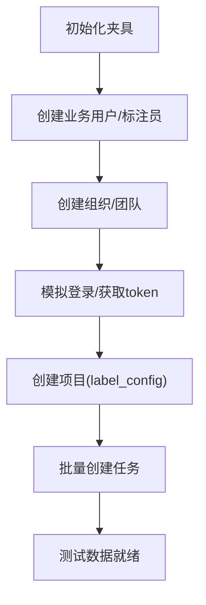
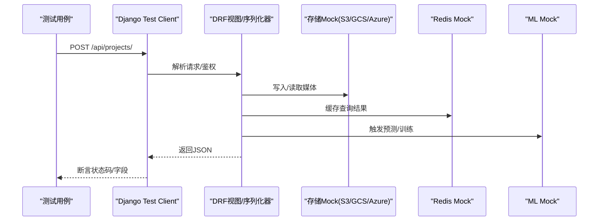
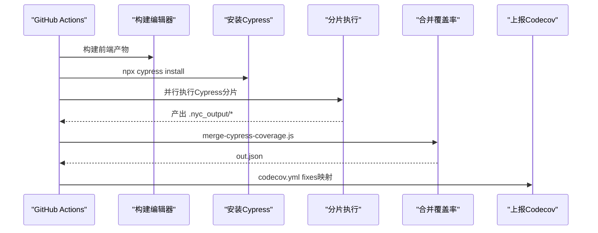
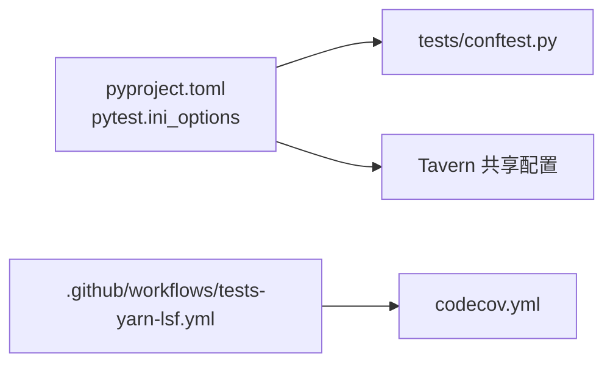

# 测试策略

<cite>
**本文引用的文件**   
- [label_studio/conftest.py](file://label_studio/conftest.py)
- [label_studio/tests/conftest.py](file://label_studio/tests/conftest.py)
- [label_studio/tests/utils.py](file://label_studio/tests/utils.py)
- [pyproject.toml](file://pyproject.toml)
- [codecov.yml](file://codecov.yml)
- [.github/workflows/tests-yarn-lsf.yml](file://.github/workflows/tests-yarn-lsf.yml)
- [web/apps/labelstudio-e2e/cypress.config.ts](file://web/apps/labelstudio-e2e/cypress.config.ts)
</cite>

## 目录
1. [简介](#简介)
2. [项目结构](#项目结构)
3. [核心组件](#核心组件)
4. [架构总览](#架构总览)
5. [详细组件分析](#详细组件分析)
6. [依赖关系分析](#依赖关系分析)
7. [性能与稳定性考量](#性能与稳定性考量)
8. [故障排查指南](#故障排查指南)
9. [结论](#结论)
10. [附录](#附录)

## 简介
本测试策略文档面向 Label Studio 后端（Django + DRF）与前端的端到端测试体系，覆盖单元测试、集成测试、端到端测试（Cypress E2E）、覆盖率统计与环境隔离策略，并给出持续集成中的自动化流程与常见调试技巧。目标是帮助开发者在保持高稳定性的同时，快速定位问题、提升回归质量。

## 项目结构
Label Studio 的测试体系主要分布在以下位置：
- 后端 pytest 配置与夹具：label_studio/conftest.py、label_studio/tests/conftest.py、label_studio/tests/utils.py
- 测试运行参数与 Tavern 集成：pyproject.toml
- 前端 E2E 配置：web/apps/labelstudio-e2e/cypress.config.ts
- CI 流水线（Cypress 分片执行与覆盖率合并）：.github/workflows/tests-yarn-lsf.yml
- 覆盖率上报配置：codecov.yml

**图示来源**
- [label_studio/conftest.py:1-27](file://label_studio/conftest.py#L1-L27)
- [label_studio/tests/conftest.py:1-120](file://label_studio/tests/conftest.py#L1-L120)
- [label_studio/tests/utils.py:36-60](file://label_studio/tests/utils.py#L36-L60)
- [pyproject.toml:196-208](file://pyproject.toml#L196-L208)
- [web/apps/labelstudio-e2e/cypress.config.ts:1](file://web/apps/labelstudio-e2e/cypress.config.ts#L1)
- [.github/workflows/tests-yarn-lsf.yml:1-20](file://.github/workflows/tests-yarn-lsf.yml#L1-L20)
- [codecov.yml:1-2](file://codecov.yml#L1-L2)

**章节来源**
- [label_studio/conftest.py:1-27](file://label_studio/conftest.py#L1-L27)
- [label_studio/tests/conftest.py:1-120](file://label_studio/tests/conftest.py#L1-L120)
- [label_studio/tests/utils.py:36-60](file://label_studio/tests/utils.py#L36-L60)
- [pyproject.toml:196-208](file://pyproject.toml#L196-L208)
- [web/apps/labelstudio-e2e/cypress.config.ts:1](file://web/apps/labelstudio-e2e/cypress.config.ts#L1)
- [.github/workflows/tests-yarn-lsf.yml:1-20](file://.github/workflows/tests-yarn-lsf.yml#L1-L20)
- [codecov.yml:1-2](file://codecov.yml#L1-L2)

## 核心组件
- 全局测试夹具与上下文清理：确保线程局部上下文在每个测试后清空，避免跨测试状态泄漏；默认禁用SSRF保护以适配本地/Mock URL。
- Django 测试环境初始化：设置密码哈希器为MD5以提升测试速度；关闭Sentry上报；启用CSRF开关供特定用例选择开启。
- 外部服务Mock：S3（moto）、GCS、Azure Blob、Redis、ML Backend、HTTP请求等全面Mock，保证测试可重复且无外部依赖。
- 用户与组织夹具：提供 business_client、annotator_client 等预置角色客户端，简化鉴权与权限相关测试。
- 项目与任务夹具：setup_project_* 系列夹具用于快速创建项目、导入数据、准备标注任务。
- 特性开关与时间控制：freeze_time、feature flag mock 支持时序敏感与功能开关场景。
- Tavern 集成：通过 pyproject.toml 的 tavern-global-cfg 将 YAML 风格API测试纳入统一执行。

**章节来源**
- [label_studio/conftest.py:14-27](file://label_studio/conftest.py#L14-L27)
- [label_studio/tests/conftest.py:52-120](file://label_studio/tests/conftest.py#L52-L120)
- [label_studio/tests/conftest.py:497-564](file://label_studio/tests/conftest.py#L497-L564)
- [label_studio/tests/conftest.py:580-677](file://label_studio/tests/conftest.py#L580-L677)
- [label_studio/tests/conftest.py:790-800](file://label_studio/tests/conftest.py#L790-L800)
- [pyproject.toml:196-208](file://pyproject.toml#L196-L208)

## 架构总览
后端测试采用 pytest + Django test client，结合大量夹具与Mock对象，对数据库、存储、缓存、ML后端进行隔离；前端E2E使用Cypress，CI中按分片并行执行并合并覆盖率。

**图示来源**
- [label_studio/tests/conftest.py:97-120](file://label_studio/tests/conftest.py#L97-L120)
- [label_studio/tests/utils.py:36-60](file://label_studio/tests/utils.py#L36-L60)
- [.github/workflows/tests-yarn-lsf.yml:52-77](file://.github/workflows/tests-yarn-lsf.yml#L52-L77)
- [.github/workflows/tests-yarn-lsf.yml:163-192](file://.github/workflows/tests-yarn-lsf.yml#L163-L192)

## 详细组件分析

### 单元测试编写规范（Django + pytest）
- 使用 pytest-django 提供的 Client 与 django_db 标记，配合 conftest 夹具完成鉴权与数据准备。
- 通过 autouse fixture 统一设置测试环境（如禁用Sentry、降低密码哈希成本、关闭SSRF保护）。
- 使用 requests_mock 与 moto 对HTTP与S3进行Mock，避免网络与云资源依赖。
- 使用 freezegun.freeze_time 固定时间，确保时序相关逻辑可预测。
- 使用 feature flag mock 控制功能开关，便于分支路径覆盖。

**图示来源**
- [label_studio/conftest.py:14-27](file://label_studio/conftest.py#L14-L27)
- [label_studio/tests/conftest.py:52-120](file://label_studio/tests/conftest.py#L52-L120)
- [label_studio/tests/conftest.py:497-564](file://label_studio/tests/conftest.py#L497-L564)
- [label_studio/tests/utils.py:36-60](file://label_studio/tests/utils.py#L36-L60)

**章节来源**
- [label_studio/conftest.py:14-27](file://label_studio/conftest.py#L14-L27)
- [label_studio/tests/conftest.py:52-120](file://label_studio/tests/conftest.py#L52-L120)
- [label_studio/tests/conftest.py:497-564](file://label_studio/tests/conftest.py#L497-L564)
- [label_studio/tests/utils.py:36-60](file://label_studio/tests/utils.py#L36-L60)

### Mock对象的使用模式
- HTTP层：requests_mock.Mocker 注册URL匹配规则，返回JSON或抛出异常（如ConnectTimeout），用于ML后端健康检查、训练、预测、Webhook等接口。
- 存储层：moto.mock_s3 提供S3桶与对象；gcs_client_mock 与 azure_client_mock 分别模拟Google Cloud Storage与Azure Blob的行为；redis_client_mock 使用 fakeredis 替代真实Redis。
- 系统层：mock.patch 替换 socket.gethostbyname 绕过IP校验；mock_feature_flag 装饰器切换功能开关。

**图示来源**
- [label_studio/tests/utils.py:36-60](file://label_studio/tests/utils.py#L36-L60)
- [label_studio/tests/conftest.py:97-120](file://label_studio/tests/conftest.py#L97-L120)
- [label_studio/tests/utils.py:86-246](file://label_studio/tests/utils.py#L86-L246)
- [label_studio/tests/utils.py:248-330](file://label_studio/tests/utils.py#L248-L330)
- [label_studio/tests/utils.py:332-342](file://label_studio/tests/utils.py#L332-L342)

**章节来源**
- [label_studio/tests/utils.py:36-60](file://label_studio/tests/utils.py#L36-L60)
- [label_studio/tests/conftest.py:97-120](file://label_studio/tests/conftest.py#L97-L120)
- [label_studio/tests/utils.py:86-246](file://label_studio/tests/utils.py#L86-L246)
- [label_studio/tests/utils.py:248-330](file://label_studio/tests/utils.py#L248-L330)
- [label_studio/tests/utils.py:332-342](file://label_studio/tests/utils.py#L332-L342)

### 测试数据的准备
- 用户与组织：business_client、annotator_client 夹具自动创建用户、组织并登录，附带JWT token与API Key。
- 项目与任务：setup_project_* 夹具根据传入的 label_config 创建项目，并通过 requests_mock 模拟ML校验与健康检查；make_project 与 make_task 直接创建模型对象。
- 导出与存储：s3_export_bucket、s3_export_bucket_sse、s3_export_bucket_kms 夹具提供不同加密策略的S3桶，用于导出测试。

**图示来源**
- [label_studio/tests/conftest.py:580-677](file://label_studio/tests/conftest.py#L580-L677)
- [label_studio/tests/conftest.py:497-564](file://label_studio/tests/conftest.py#L497-L564)
- [label_studio/tests/utils.py:350-358](file://label_studio/tests/utils.py#L350-L358)

**章节来源**
- [label_studio/tests/conftest.py:580-677](file://label_studio/tests/conftest.py#L580-L677)
- [label_studio/tests/conftest.py:497-564](file://label_studio/tests/conftest.py#L497-L564)
- [label_studio/tests/utils.py:350-358](file://label_studio/tests/utils.py#L350-L358)

### 集成测试设计模式
- API接口测试：基于 pytest-django Client 发送HTTP请求，断言状态码、响应体结构与业务语义；Tavern YAML 用例覆盖复杂API场景（如数据导入、导出、过滤等）。
- 数据库操作测试：使用 @pytest.mark.django_db 与事务回滚，确保测试间数据隔离；通过 fixtures 批量创建/更新对象，验证ORM行为与约束。
- 外部服务集成测试：通过Mock完全隔离S3/GCS/Azure/Redis/ML后端，仅验证调用契约与错误处理路径（如超时、权限拒绝、KMS加密策略）。

**图示来源**
- [label_studio/tests/conftest.py:497-564](file://label_studio/tests/conftest.py#L497-L564)
- [label_studio/tests/utils.py:36-60](file://label_studio/tests/utils.py#L36-L60)
- [label_studio/tests/utils.py:86-246](file://label_studio/tests/utils.py#L86-L246)
- [label_studio/tests/utils.py:248-330](file://label_studio/tests/utils.py#L248-L330)
- [label_studio/tests/utils.py:332-342](file://label_studio/tests/utils.py#L332-L342)

**章节来源**
- [label_studio/tests/conftest.py:497-564](file://label_studio/tests/conftest.py#L497-L564)
- [label_studio/tests/utils.py:36-60](file://label_studio/tests/utils.py#L36-L60)
- [label_studio/tests/utils.py:86-246](file://label_studio/tests/utils.py#L86-L246)
- [label_studio/tests/utils.py:248-330](file://label_studio/tests/utils.py#L248-L330)
- [label_studio/tests/utils.py:332-342](file://label_studio/tests/utils.py#L332-L342)

### 端到端测试（Cypress E2E）
- 配置入口：web/apps/labelstudio-e2e/cypress.config.ts 定义Cypress运行配置。
- CI执行：.github/workflows/tests-yarn-lsf.yml 负责构建编辑器、安装Cypress二进制、分片执行测试、收集与合并覆盖率。
- 覆盖率合并：scripts/merge-cypress-coverage.js 将各分片的 .nyc_output 合并为统一报告。

**图示来源**
- [web/apps/labelstudio-e2e/cypress.config.ts:1](file://web/apps/labelstudio-e2e/cypress.config.ts#L1)
- [.github/workflows/tests-yarn-lsf.yml:52-77](file://.github/workflows/tests-yarn-lsf.yml#L52-L77)
- [.github/workflows/tests-yarn-lsf.yml:163-192](file://.github/workflows/tests-yarn-lsf.yml#L163-L192)
- [.github/workflows/tests-yarn-lsf.yml:226-242](file://.github/workflows/tests-yarn-lsf.yml#L226-L242)
- [codecov.yml:1-2](file://codecov.yml#L1-L2)

**章节来源**
- [web/apps/labelstudio-e2e/cypress.config.ts:1](file://web/apps/labelstudio-e2e/cypress.config.ts#L1)
- [.github/workflows/tests-yarn-lsf.yml:52-77](file://.github/workflows/tests-yarn-lsf.yml#L52-L77)
- [.github/workflows/tests-yarn-lsf.yml:163-192](file://.github/workflows/tests-yarn-lsf.yml#L163-L192)
- [.github/workflows/tests-yarn-lsf.yml:226-242](file://.github/workflows/tests-yarn-lsf.yml#L226-L242)
- [codecov.yml:1-2](file://codecov.yml#L1-L2)

## 依赖关系分析
- pytest 与 Django：通过 pyproject.toml 的 [tool.pytest.ini_options] 指定 settings 模块与环境变量，确保测试环境与生产一致。
- Tavern：通过 tavern-global-cfg 指向共享阶段配置，统一YAML测试前置步骤。
- 覆盖率：codecov.yml 的 fixes 映射仓库路径，使CI上报时路径正确。

**图示来源**
- [pyproject.toml:196-208](file://pyproject.toml#L196-L208)
- [.github/workflows/tests-yarn-lsf.yml:1-20](file://.github/workflows/tests-yarn-lsf.yml#L1-L20)
- [codecov.yml:1-2](file://codecov.yml#L1-L2)

**章节来源**
- [pyproject.toml:196-208](file://pyproject.toml#L196-L208)
- [.github/workflows/tests-yarn-lsf.yml:1-20](file://.github/workflows/tests-yarn-lsf.yml#L1-L20)
- [codecov.yml:1-2](file://codecov.yml#L1-L2)

## 性能与稳定性考量
- 密码哈希器降级：测试中使用MD5PasswordHasher显著缩短认证开销。
- 异步队列同步化：pytest_configure中将RQ_QUEUES的ASY设为False，避免异步任务带来的不确定性。
- SSRF保护关闭：默认禁用SSRF保护，减少本地/Mock URL被拦截的概率。
- Sentry上报关闭：避免测试期间产生噪声日志与外部依赖。
- 时间冻结：freeze_time确保定时任务、过期判断等逻辑可重复。

**章节来源**
- [label_studio/tests/conftest.py:52-58](file://label_studio/tests/conftest.py#L52-L58)
- [label_studio/tests/conftest.py:421-434](file://label_studio/tests/conftest.py#L421-L434)
- [label_studio/conftest.py:24-27](file://label_studio/conftest.py#L24-L27)
- [label_studio/tests/conftest.py:70-74](file://label_studio/tests/conftest.py#L70-L74)
- [label_studio/tests/conftest.py:790-800](file://label_studio/tests/conftest.py#L790-L800)

## 故障排查指南
- 外键完整性错误（Postgres）：由于事务回滚会删除User行，但线程局部CurrentContext仍持有旧实例，导致FSM触发时引用失效。已在根conftest中在每个测试后清空CurrentContext。
- ML后端连接超时：通过requests_mock抛出ConnectTimeout，验证健康检查与重试逻辑。
- S3权限与加密策略：s3_export_bucket_sse/kms夹具设置严格Bucket Policy，测试服务端加密与传输安全要求。
- 特征开关未生效：使用mock_feature_flag装饰器或fixture patch flag_set，确保分支逻辑按预期执行。
- 时间相关断言失败：使用freeze_time固定时间，避免系统时钟变化影响。

**章节来源**
- [label_studio/conftest.py:14-20](file://label_studio/conftest.py#L14-L20)
- [label_studio/tests/utils.py:36-60](file://label_studio/tests/utils.py#L36-L60)
- [label_studio/tests/conftest.py:194-267](file://label_studio/tests/conftest.py#L194-L267)
- [label_studio/tests/utils.py:516-539](file://label_studio/tests/utils.py#L516-L539)
- [label_studio/tests/conftest.py:790-800](file://label_studio/tests/conftest.py#L790-L800)

## 结论
Label Studio 的测试体系以 pytest 为核心，结合丰富的夹具与Mock机制，实现了高内聚、低耦合的可重复测试环境；前端E2E通过Cypress与CI分片执行保障用户体验；覆盖率统计与路径映射确保质量度量准确。遵循本策略可有效提升回归质量、缩短排障时间，并为持续集成提供稳定支撑。

## 附录
- 常用夹具清单
  - 鉴权：business_client、annotator_client、any_client
  - 项目：setup_project_dialog、setup_project_ranker、setup_project_choices、configured_project
  - 存储：s3、s3_with_images、s3_export_bucket、s3_export_bucket_sse、s3_export_bucket_kms
  - 外部服务：ml_backend、import_from_url、gcs_client、azure_client、redis_client
  - 时间/特性：freeze_clock、fflag_* 系列fixture、mock_feature_flag
- 运行建议
  - 本地开发：优先运行单测与关键集成用例，必要时启用CSRF与Sentry以复现线上问题。
  - CI流水线：确保Cypress二进制缓存命中，合理设置分片数量以平衡速度与稳定性。
  - 覆盖率目标：结合项目基线逐步提升，关注新增代码与高风险模块的覆盖率增长。