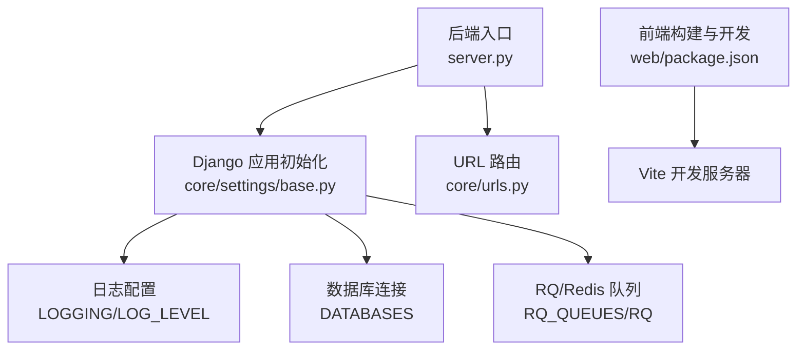
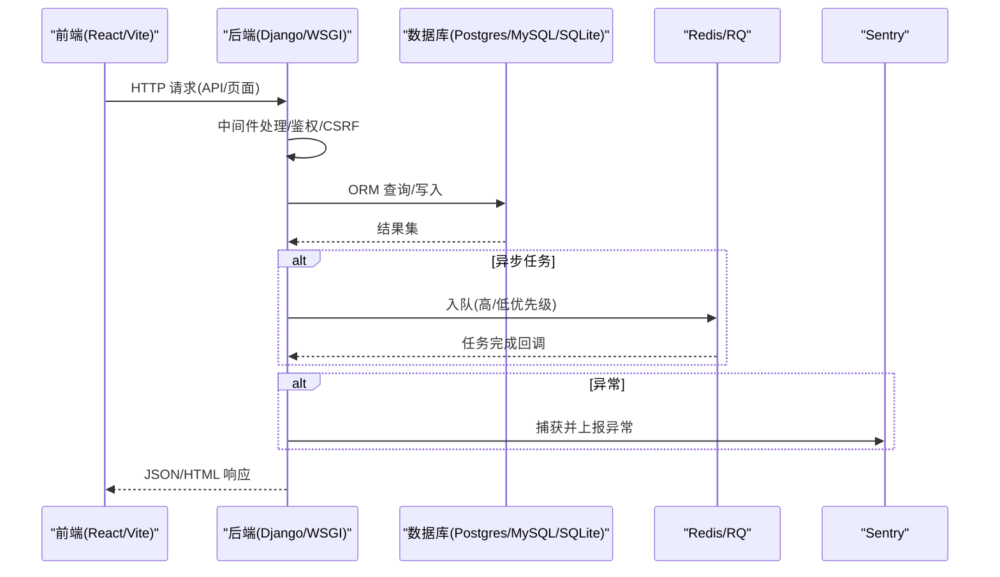
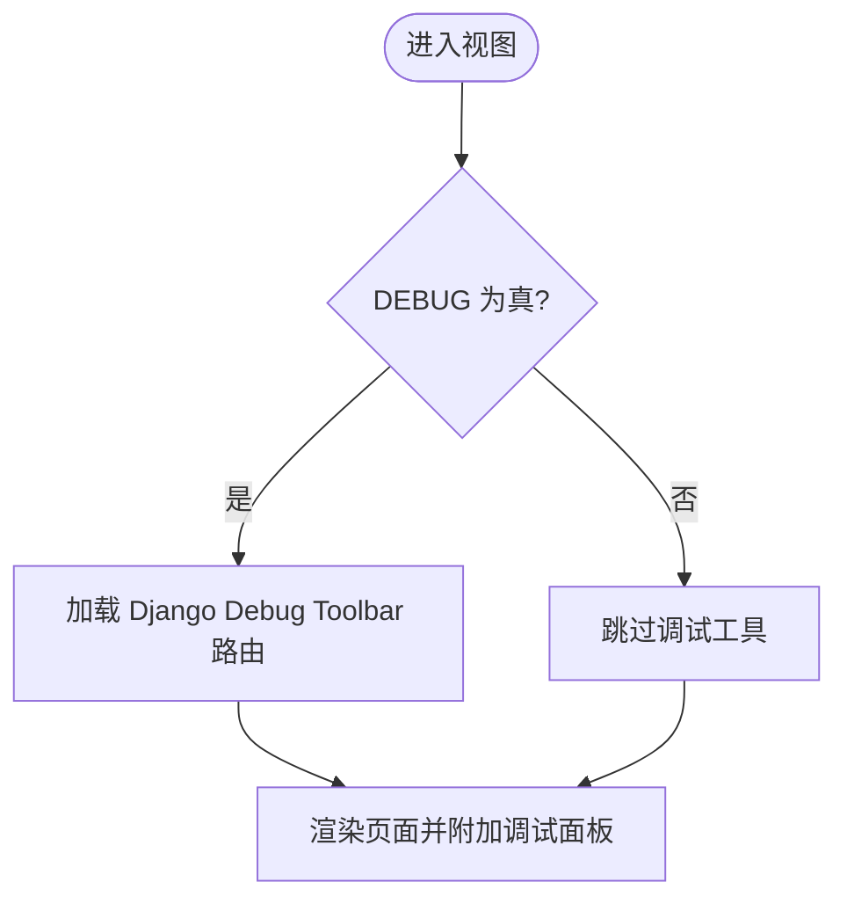
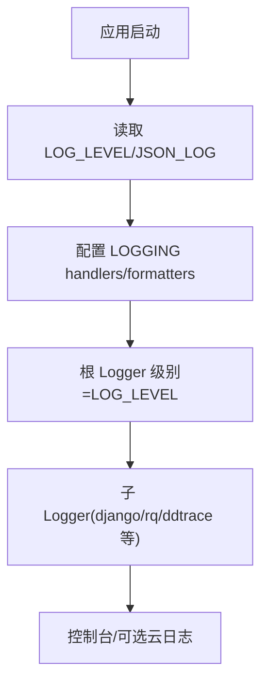
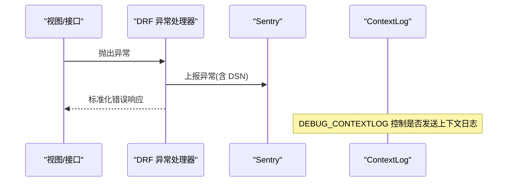
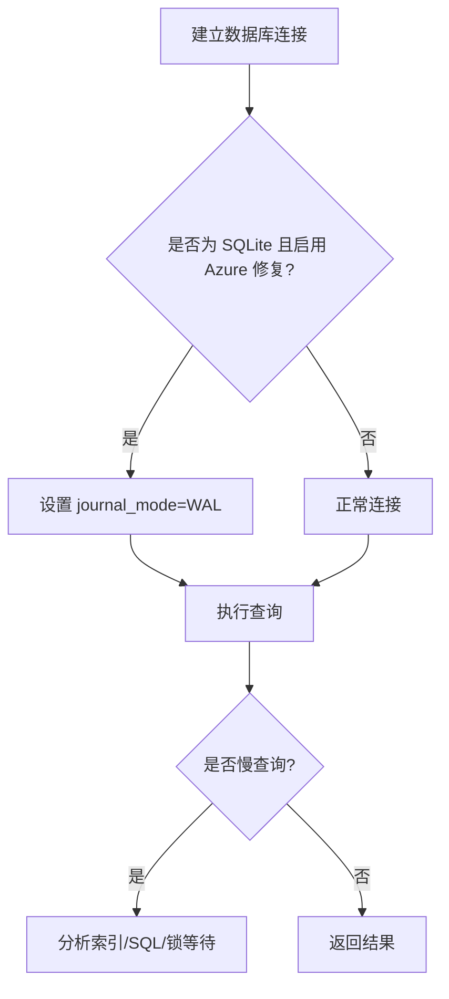
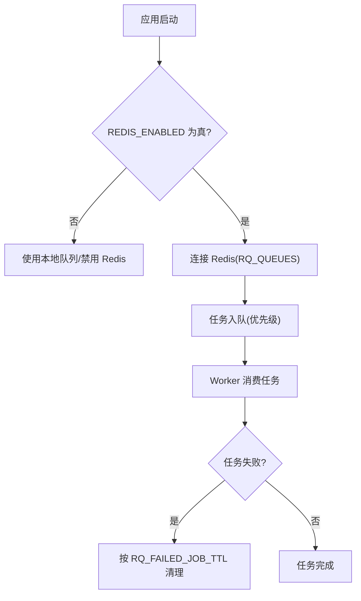
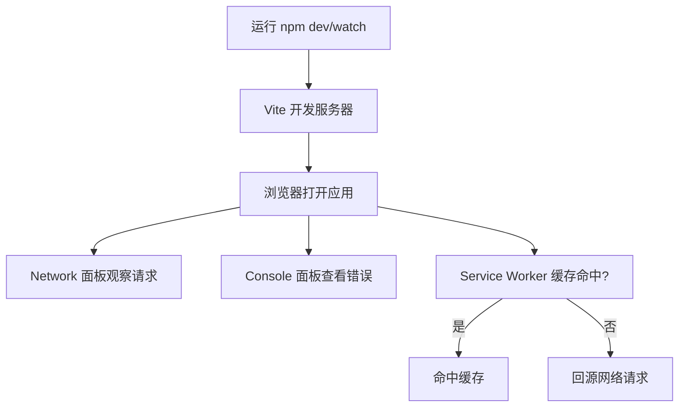
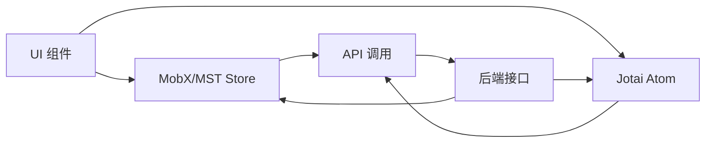
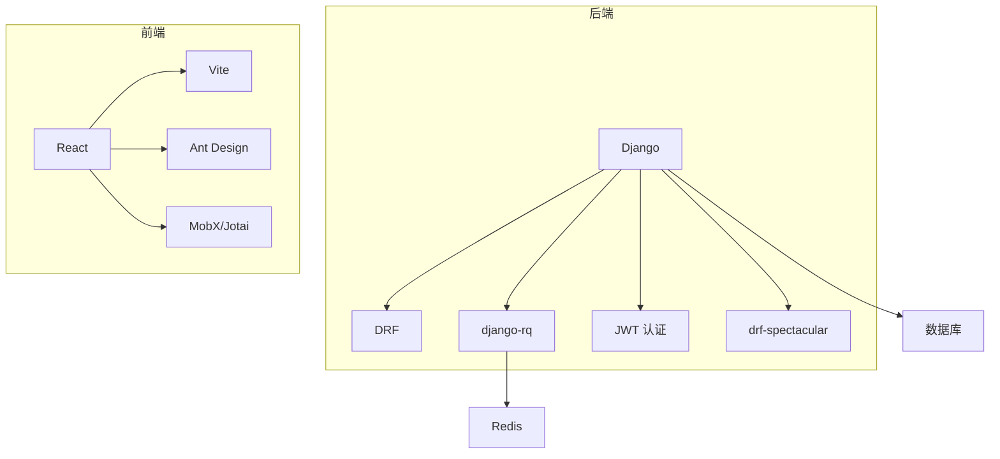

# 调试与诊断

<cite>
**本文引用的文件**   
- [server.py](file://label_studio/server.py)
- [base.py](file://label_studio/core/settings/base.py)
- [label_studio.py](file://label_studio/core/settings/label_studio.py)
- [urls.py](file://label_studio/core/urls.py)
- [common.py](file://label_studio/core/utils/common.py)
- [contextlog.py](file://label_studio/core/utils/contextlog.py)
- [sentry.py](file://label_studio/core/utils/sentry.py)
- [package.json](file://web/package.json)
</cite>

## 目录
1. [简介](#简介)
2. [项目结构](#项目结构)
3. [核心组件](#核心组件)
4. [架构总览](#架构总览)
5. [详细组件分析](#详细组件分析)
6. [依赖关系分析](#依赖关系分析)
7. [性能考虑](#性能考虑)
8. [故障排除指南](#故障排除指南)
9. [结论](#结论)
10. [附录](#附录)

## 简介
本指南面向 Label Studio 开发者与维护者，聚焦后端 Python（Django）与前端的调试和问题诊断方法。内容涵盖：
- 后端：Django Debug Toolbar、日志配置、性能分析与慢查询定位、数据库优化、Redis 缓存问题诊断
- 前端：浏览器开发者工具、网络请求调试、状态管理调试
- 生产环境：错误日志分析、性能监控、内存泄漏检测
- 常见问题与排障步骤

## 项目结构
Label Studio 采用 Django 后端 + React/Vite 前端的混合工程：
- 后端入口与启动流程集中在 server.py
- 全局设置与日志在 core/settings/base.py 中定义，并在 label_studio.py 中覆盖生产默认值
- 前端构建脚本与开发命令在 web/package.json 中提供

**图示来源**
- [server.py:276-443](file://label_studio/server.py#L276-L443)
- [base.py:27-77](file://label_studio/core/settings/base.py#L27-L77)
- [base.py:174-208](file://label_studio/core/settings/base.py#L174-L208)
- [base.py:389-427](file://label_studio/core/settings/base.py#L389-L427)
- [urls.py:114-120](file://label_studio/core/urls.py#L114-L120)
- [package.json:7-55](file://web/package.json#L7-L55)

**章节来源**
- [server.py:276-443](file://label_studio/server.py#L276-L443)
- [base.py:27-77](file://label_studio/core/settings/base.py#L27-L77)
- [base.py:174-208](file://label_studio/core/settings/base.py#L174-L208)
- [base.py:389-427](file://label_studio/core/settings/base.py#L389-L427)
- [urls.py:114-120](file://label_studio/core/urls.py#L114-L120)
- [package.json:7-55](file://web/package.json#L7-L55)

## 核心组件
- 后端启动与参数解析：server.py 负责解析命令行参数、设置环境变量、执行迁移、启动 WSGI 服务
- 日志系统：base.py 定义 LOGGING 与 handlers/formatters，支持 JSON 输出；通过 LOG_LEVEL 控制级别
- 数据库：base.py 定义多引擎 DATABASES（PostgreSQL/MySQL/SQLite），并暴露相关环境变量
- 任务队列与 Redis：base.py 定义 RQ_QUEUES 与 RQ 配置，用于异步任务
- 前端开发：package.json 提供 dev/watch/build 等脚本，便于本地开发与构建

**章节来源**
- [server.py:276-443](file://label_studio/server.py#L276-L443)
- [base.py:27-77](file://label_studio/core/settings/base.py#L27-L77)
- [base.py:174-208](file://label_studio/core/settings/base.py#L174-L208)
- [base.py:389-427](file://label_studio/core/settings/base.py#L389-L427)
- [package.json:7-55](file://web/package.json#L7-L55)

## 架构总览
下图展示从前端到后端的典型请求链路，以及关键可观测点（日志、异常上报、数据库、Redis）。

**图示来源**
- [base.py:268-286](file://label_studio/core/settings/base.py#L268-L286)
- [base.py:174-208](file://label_studio/core/settings/base.py#L174-L208)
- [base.py:389-427](file://label_studio/core/settings/base.py#L389-L427)
- [sentry.py:65-81](file://label_studio/core/utils/sentry.py#L65-L81)

## 详细组件分析

### 后端调试：Django Debug Toolbar
- 启用条件：当 DEBUG=True 时，Django 会加载调试工具栏 URL 路由
- 访问方式：在本地开发环境中打开页面，应出现调试面板
- 注意事项：生产环境务必关闭 DEBUG，避免泄露敏感信息

**图示来源**
- [urls.py:114-120](file://label_studio/core/urls.py#L114-L120)
- [base.py:145-147](file://label_studio/core/settings/base.py#L145-L147)

**章节来源**
- [urls.py:114-120](file://label_studio/core/urls.py#L114-L120)
- [base.py:145-147](file://label_studio/core/settings/base.py#L145-L147)

### 后端调试：日志配置与分级
- 日志格式：支持标准文本与 JSON 两种格式，JSON 由自定义格式化器输出结构化字段
- 日志级别：通过 LOG_LEVEL 环境变量控制根 logger 与各子 logger 的级别
- 控制台输出：默认 handler 为 console，便于本地开发查看
- Google Cloud Logging：可选集成，通过环境变量开启

**图示来源**
- [base.py:27-77](file://label_studio/core/settings/base.py#L27-L77)
- [base.py:212-228](file://label_studio/core/settings/base.py#L212-L228)

**章节来源**
- [base.py:27-77](file://label_studio/core/settings/base.py#L27-L77)
- [base.py:212-228](file://label_studio/core/settings/base.py#L212-L228)

### 后端调试：异常上报与上下文日志
- Sentry 集成：通过 SENTRY_DSN 启用，统一收集异常与堆栈
- 上下文日志：ContextLogMiddleware 记录请求上下文，DEBUG_CONTEXTLOG 控制是否发送
- 自定义异常处理器：DRF 使用 custom_exception_handler 统一返回格式

**图示来源**
- [base.py:294-310](file://label_studio/core/settings/base.py#L294-L310)
- [sentry.py:65-81](file://label_studio/core/utils/sentry.py#L65-L81)
- [contextlog.py:220-221](file://label_studio/core/utils/contextlog.py#L220-L221)

**章节来源**
- [base.py:294-310](file://label_studio/core/settings/base.py#L294-L310)
- [sentry.py:65-81](file://label_studio/core/utils/sentry.py#L65-L81)
- [contextlog.py:220-221](file://label_studio/core/utils/contextlog.py#L220-L221)

### 后端调试：数据库与慢查询
- 数据库引擎：支持 PostgreSQL、MySQL、SQLite，通过 DATABASES 配置
- SQLite 特殊修复：在 Azure 挂载场景下启用 WAL 模式以提升并发
- 慢查询定位：
  - 开发环境：开启 Django SQL 日志（配合 DEBUG 与 LOG_LEVEL）
  - 生产环境：使用数据库侧 slow query log（PG/MySQL）或 APM 工具
- 批量操作与分页：关注批量导入/导出、列表分页大小等参数对性能的影响

**图示来源**
- [server.py:43-48](file://label_studio/server.py#L43-L48)
- [base.py:174-208](file://label_studio/core/settings/base.py#L174-L208)

**章节来源**
- [server.py:43-48](file://label_studio/server.py#L43-L48)
- [base.py:174-208](file://label_studio/core/settings/base.py#L174-L208)

### 后端调试：Redis 与 RQ 队列
- Redis 开关：开源版本默认 REDIS_ENABLED=False
- RQ 队列：critical/high/default/low 四个队列，HOST/PORT/DB/DEFAULT_TIMEOUT 可配置
- 失败任务保留时间：RQ_FAILED_JOB_TTL 控制失败任务清理周期
- 诊断要点：
  - 确认 Redis 可达性与权限
  - 检查队列积压与失败任务
  - 调整 DEFAULT_TIMEOUT 与 COMMIT_MODE

**图示来源**
- [base.py:389-427](file://label_studio/core/settings/base.py#L389-L427)
- [base.py:429-430](file://label_studio/core/settings/base.py#L429-L430)

**章节来源**
- [base.py:389-427](file://label_studio/core/settings/base.py#L389-L427)
- [base.py:429-430](file://label_studio/core/settings/base.py#L429-L430)

### 前端调试：浏览器开发者工具与网络请求
- 开发模式：使用 package.json 中的 dev/watch 脚本启动 Vite 开发服务器
- 网络调试：
  - 使用浏览器 Network 面板查看 API 请求/响应
  - 检查 CORS、CSRF、认证头是否正确
- Service Worker：若启用，注意缓存策略对资源更新的影响

**图示来源**
- [package.json:7-55](file://web/package.json#L7-L55)

**章节来源**
- [package.json:7-55](file://web/package.json#L7-L55)

### 前端调试：状态管理与数据流
- 状态库：项目集成了 MobX/MobX-State-Tree、Jotai、React Query 等多种状态方案
- 调试建议：
  - 使用浏览器扩展（如 Redux DevTools 替代方案）观察状态树变化
  - 在关键 store 变更处添加断点或日志，追踪数据流向
  - 结合 Network 面板验证前后端数据一致性

[本图为概念性示意，不直接映射具体源码文件]

## 依赖关系分析
- 后端依赖：Django、DRF、django-rq、drf-spectacular、CORS、JWT 认证等
- 前端依赖：React、Ant Design、MobX、Jotai、Vite、Workbox 等
- 运行时依赖：数据库（PostgreSQL/MySQL/SQLite）、Redis（可选）、对象存储（S3/GCS/Azure/本地）

**图示来源**
- [base.py:230-266](file://label_studio/core/settings/base.py#L230-L266)
- [base.py:294-310](file://label_studio/core/settings/base.py#L294-L310)
- [base.py:389-427](file://label_studio/core/settings/base.py#L389-L427)
- [package.json:56-216](file://web/package.json#L56-L216)

**章节来源**
- [base.py:230-266](file://label_studio/core/settings/base.py#L230-L266)
- [base.py:294-310](file://label_studio/core/settings/base.py#L294-L310)
- [base.py:389-427](file://label_studio/core/settings/base.py#L389-L427)
- [package.json:56-216](file://web/package.json#L56-L216)

## 性能考虑
- 数据库
  - 合理使用索引与查询条件，避免全表扫描
  - 大对象与媒体文件走对象存储，减少数据库压力
  - 批量导入/导出使用分批处理，降低单次事务开销
- Redis/RQ
  - 合理设置队列超时与失败任务保留时间
  - 监控队列积压与失败率，必要时扩容 Worker
- 前端
  - 按需加载与代码分割，减少首屏体积
  - 合理使用缓存（SW/HTTP 缓存），减少重复请求
  - 大数据列表使用虚拟滚动与分页

[本节为通用指导，不直接分析具体文件]

## 故障排除指南
- 后端
  - 无法启动或端口冲突：检查 server.py 端口选择逻辑与环境变量
  - 日志缺失或级别不对：确认 LOG_LEVEL 与 JSON_LOG 配置
  - 数据库连接失败：核对 DATABASES 配置与凭据
  - Redis 不可用：检查 REDIS_ENABLED、RQ_QUEUES 与网络连通性
  - 异常未上报：确认 SENTRY_DSN 与异常处理器配置
- 前端
  - 开发服务器无法启动：检查 package.json scripts 与依赖安装
  - 接口 403/401：检查 CSRF、CORS、JWT 认证头
  - 缓存导致旧资源：检查 Service Worker 与浏览器缓存
  - 状态不一致：使用状态调试工具与 Network 面板交叉验证

**章节来源**
- [server.py:237-267](file://label_studio/server.py#L237-L267)
- [base.py:27-77](file://label_studio/core/settings/base.py#L27-L77)
- [base.py:174-208](file://label_studio/core/settings/base.py#L174-L208)
- [base.py:389-427](file://label_studio/core/settings/base.py#L389-L427)
- [sentry.py:65-81](file://label_studio/core/utils/sentry.py#L65-L81)
- [package.json:7-55](file://web/package.json#L7-L55)

## 结论
通过合理配置日志、异常上报、数据库与 Redis，并结合浏览器开发者工具与状态调试手段，可以高效定位 Label Studio 的开发与生产环境问题。建议在开发阶段充分使用 Django Debug Toolbar 与前端 Network/Console，在生产环境启用 Sentry 与数据库慢查询日志，持续监控队列与缓存健康度。

[本节为总结性内容，不直接分析具体文件]

## 附录
- 常用环境变量
  - LOG_LEVEL：日志级别（DEBUG/INFO/WARNING/ERROR）
  - JSON_LOG：是否输出 JSON 格式日志
  - DEBUG：是否启用调试模式
  - DATABASE_NAME/POSTGRE_* / MYSQL_*：数据库连接参数
  - REDIS_ENABLED/RQ_QUEUES/RQ_FAILED_JOB_TTL：Redis 与 RQ 队列配置
  - SENTRY_DSN/FRONTEND_SENTRY_DSN：异常上报 DSN
  - FRONTEND_HMR/FRONTEND_HOSTNAME：前端 HMR 与主机名

**章节来源**
- [base.py:27-77](file://label_studio/core/settings/base.py#L27-L77)
- [base.py:145-147](file://label_studio/core/settings/base.py#L145-L147)
- [base.py:174-208](file://label_studio/core/settings/base.py#L174-L208)
- [base.py:389-427](file://label_studio/core/settings/base.py#L389-L427)
- [base.py:570-576](file://label_studio/core/settings/base.py#L570-L576)