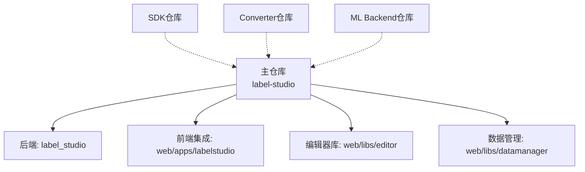
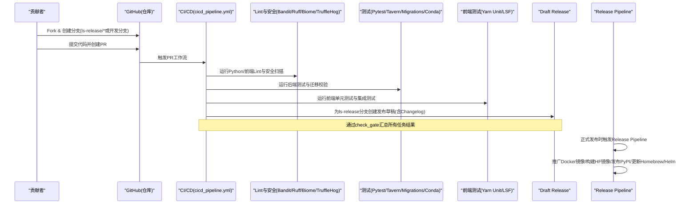
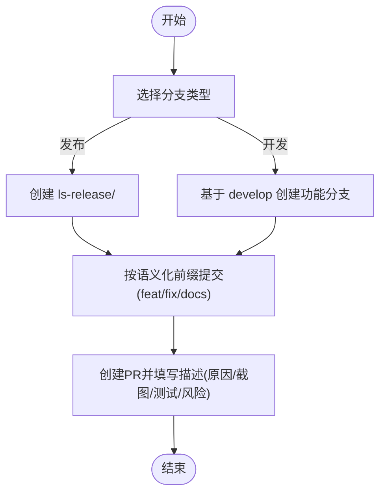
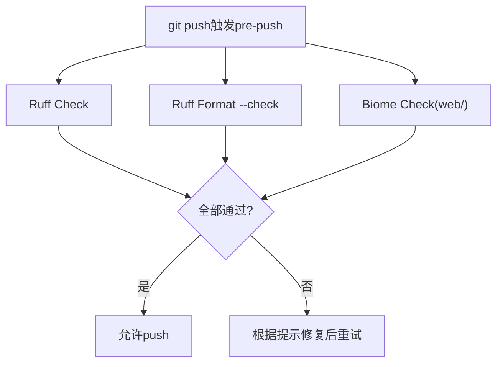
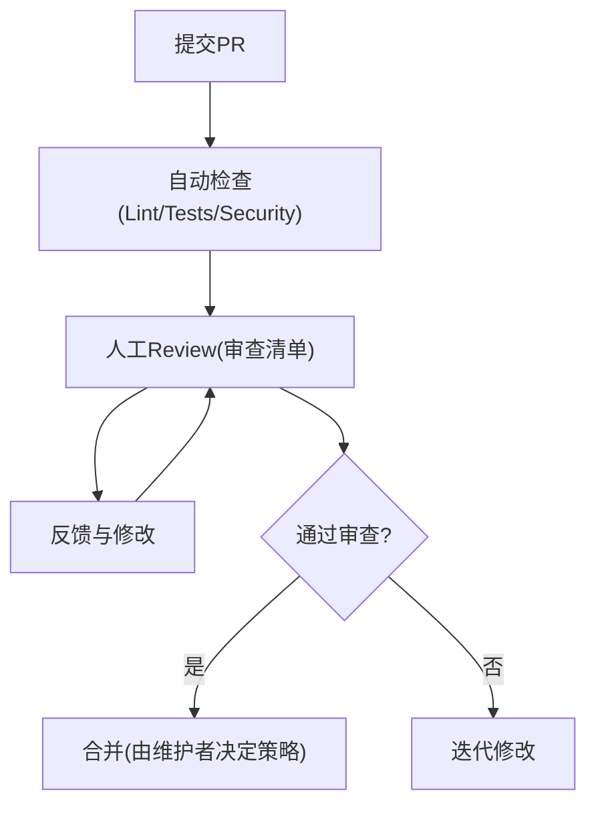
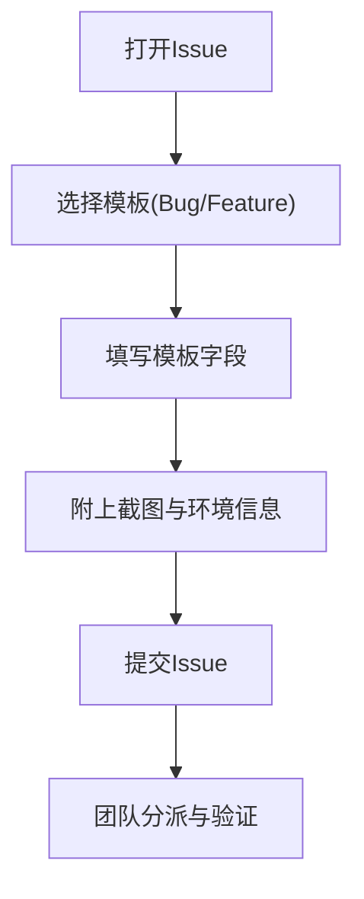
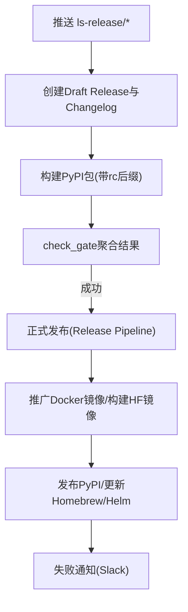
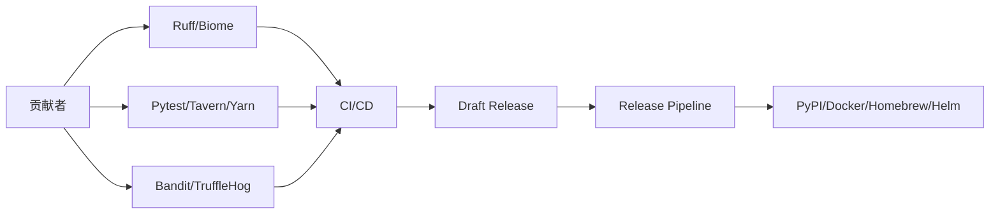

# 贡献流程

<cite>
**本文引用的文件**   
- [CONTRIBUTING.md](file://CONTRIBUTING.md)
- [pull_request_template.md](file://.github/pull_request_template.md)
- [bug_report.md](file://.github/ISSUE_TEMPLATE/bug_report.md)
- [feature_request.md](file://.github/ISSUE_TEMPLATE/feature_request.md)
- [.pre-commit-config.yaml](file://.pre-commit-config.yaml)
- [pyproject.toml](file://pyproject.toml)
- [cicd_pipeline.yml](file://.github/workflows/cicd_pipeline.yml)
- [release-pipeline.yml](file://.github/workflows/release-pipeline.yml)
</cite>

## 目录
1. [简介](#简介)
2. [项目结构](#项目结构)
3. [核心组件](#核心组件)
4. [架构总览](#架构总览)
5. [详细组件分析](#详细组件分析)
6. [依赖分析](#依赖分析)
7. [性能考虑](#性能考虑)
8. [故障排查指南](#故障排查指南)
9. [结论](#结论)
10. [附录](#附录)

## 简介
本文件面向Label Studio项目的贡献者，系统化说明从Fork到提交Pull Request的完整工作流，包括分支命名、提交信息规范、代码风格检查与自动化规则、Code Review要求、Issue模板与报告标准、以及合并策略与版本发布流程。目标是让新贡献者快速上手并高效协作。

## 项目结构
本项目采用多仓库协作模式：主仓库负责后端与前端集成，另有SDK、Converter、ML Backend等配套仓库。贡献主要涉及以下区域：
- label_studio：后端主应用
- web/apps/labelstudio：前端集成入口
- web/libs/editor：编辑器前端库（React + mobx-state-tree）
- web/libs/datamanager：数据管理前端界面

[无图表来源；该图为概念性结构示意]

**章节来源**
- [CONTRIBUTING.md:86-108](file://CONTRIBUTING.md#L86-L108)

## 核心组件
本节聚焦贡献流程中的关键要素：分支与PR命名、提交信息、代码风格与测试、自动化工具、审查清单、Issue模板、CI/CD流水线与发布流程。

- 分支与PR命名
  - PR标题前缀：docs:（文档）、fix:（缺陷修复）、feat:（功能实现）
  - 发布分支：ls-release/*（用于构建候选版本与发布草稿）
- 提交信息规范
  - 遵循Conventional Commits语义前缀（如feat、fix、docs），并在PR描述中提供变更原因、截图、回滚策略、测试方法、风险与审阅备注
- 代码风格与静态检查
  - Python：Ruff（lint+format）、Mypy（逐步引入类型提示）
  - 前端：Biome（web目录下）
  - 安全扫描：Bandit、TruffleHog
- 测试
  - 单元测试与API端点测试（tavern）
  - 数据库兼容性：SQLite与PostgreSQL
- Issue模板
  - Bug Report：包含复现步骤、预期行为、环境信息
  - Feature Request：问题描述、期望方案、备选方案
- CI/CD与发布
  - PR触发：develop与ls-release/**分支
  - 任务：changed_files检测、lint、test、migrations、conda-test、前端测试、Cursor Review、Draft Release、PyPI构建
  - 发布：Release Pipeline触发Docker镜像推广、HF镜像构建、PyPI发布、Homebrew Tap更新、Helm Chart更新

**章节来源**
- [CONTRIBUTING.md:15-78](file://CONTRIBUTING.md#L15-L78)
- [pull_request_template.md:1-20](file://.github/pull_request_template.md#L1-L20)
- [.pre-commit-config.yaml:1-20](file://.pre-commit-config.yaml#L1-L20)
- [pyproject.toml:127-195](file://pyproject.toml#L127-L195)
- [cicd_pipeline.yml:3-23](file://.github/workflows/cicd_pipeline.yml#L3-L23)
- [cicd_pipeline.yml:108-216](file://.github/workflows/cicd_pipeline.yml#L108-L216)
- [cicd_pipeline.yml:218-446](file://.github/workflows/cicd_pipeline.yml#L218-L446)
- [release-pipeline.yml:1-83](file://.github/workflows/release-pipeline.yml#L1-L83)

## 架构总览
下图展示从贡献者提交PR到CI/CD执行、发布草稿生成与最终发布的端到端流程。

**图表来源**
- [cicd_pipeline.yml:3-23](file://.github/workflows/cicd_pipeline.yml#L3-L23)
- [cicd_pipeline.yml:108-216](file://.github/workflows/cicd_pipeline.yml#L108-L216)
- [cicd_pipeline.yml:218-446](file://.github/workflows/cicd_pipeline.yml#L218-L446)
- [release-pipeline.yml:1-83](file://.github/workflows/release-pipeline.yml#L1-L83)

## 详细组件分析

### 分支命名约定与提交信息规范
- 分支命名
  - 发布分支：ls-release/<版本号>（例如 ls-release/1.24.0），用于构建候选版本与生成发布草稿
  - 开发分支：develop（默认PR目标）
- PR标题前缀
  - docs: 文档更新
  - fix: 缺陷修复
  - feat: 新功能或标注模板/导出格式改进
- 提交信息
  - 使用语义化前缀（feat/fix/docs等），在PR描述中补充变更原因、截图、回滚策略、测试方法与风险

**图表来源**
- [CONTRIBUTING.md:15-78](file://CONTRIBUTING.md#L15-L78)
- [cicd_pipeline.yml:3-23](file://.github/workflows/cicd_pipeline.yml#L3-L23)

**章节来源**
- [CONTRIBUTING.md:15-78](file://CONTRIBUTING.md#L15-L78)
- [pull_request_template.md:1-20](file://.github/pull_request_template.md#L1-L20)
- [cicd_pipeline.yml:3-23](file://.github/workflows/cicd_pipeline.yml#L3-L23)

### 代码风格检查工具与本地预提交钩子
- Python
  - Ruff：lint与格式化（单引号、行宽119、忽略部分规则）
  - Mypy：逐步引入类型提示（建议为新代码添加类型注解）
- 前端
  - Biome：web目录下的检查（错误级别）
- 安全
  - Bandit：Python安全扫描
  - TruffleHog：敏感信息检测
- 预提交钩子
  - pre-push阶段执行ruff-check/ruff-format与biome-check

**图表来源**
- [.pre-commit-config.yaml:1-20](file://.pre-commit-config.yaml#L1-L20)
- [pyproject.toml:127-195](file://pyproject.toml#L127-L195)

**章节来源**
- [.pre-commit-config.yaml:1-20](file://.pre-commit-config.yaml#L1-L20)
- [pyproject.toml:127-195](file://pyproject.toml#L127-L195)
- [CONTRIBUTING.md:110-131](file://CONTRIBUTING.md#L110-L131)

### Code Review流程与要求
- 审查清单
  - 变更原因与解决方案清晰
  - 可见变更附截图
  - 回滚策略（特性开关/环境变量/其他）
  - 测试覆盖（单元/集成/API端点）
  - 风险识别（安全/性能）
  - 审阅备注与通用说明
- 特性开关
  - 对大型或性能敏感变更，可能需以特性开关保护，便于安全灰度发布
- 自动化辅助
  - Cursor Review（针对迁移相关变更且成员状态为active时触发）

**图表来源**
- [pull_request_template.md:1-20](file://.github/pull_request_template.md#L1-L20)
- [cicd_pipeline.yml:193-206](file://.github/workflows/cicd_pipeline.yml#L193-L206)
- [CONTRIBUTING.md:80-85](file://CONTRIBUTING.md#L80-L85)

**章节来源**
- [pull_request_template.md:1-20](file://.github/pull_request_template.md#L1-L20)
- [CONTRIBUTING.md:80-85](file://CONTRIBUTING.md#L80-L85)
- [cicd_pipeline.yml:193-206](file://.github/workflows/cicd_pipeline.yml#L193-L206)

### Issue报告标准与Bug复现步骤
- Bug Report模板字段
  - 问题描述
  - 复现步骤（编号步骤）
  - 预期行为
  - 截图（可选）
  - 环境信息（OS、Label Studio版本）
  - 附加上下文
- Feature Request模板字段
  - 问题背景
  - 期望解决方案
  - 已考虑的替代方案
  - 附加上下文/截图

**图表来源**
- [bug_report.md:1-31](file://.github/ISSUE_TEMPLATE/bug_report.md#L1-L31)
- [feature_request.md:1-20](file://.github/ISSUE_TEMPLATE/feature_request.md#L1-L20)

**章节来源**
- [bug_report.md:1-31](file://.github/ISSUE_TEMPLATE/bug_report.md#L1-L31)
- [feature_request.md:1-20](file://.github/ISSUE_TEMPLATE/feature_request.md#L1-L20)

### Git工作流最佳实践：合并策略、版本发布与回滚
- 合并策略
  - PR合并前需通过check_gate（lint、tests、migrations、frontend tests、cursor-review等）
  - Dependabot PR在满足条件时可自动合并（squash）
- 版本发布流程
  - 在ls-release/*分支推送时，自动生成Draft Release与Changelog，计算rc版本
  - 正式发布触发Release Pipeline：推广Docker镜像、构建HF镜像、发布PyPI、更新Homebrew Tap、更新Helm Chart
- 回滚机制
  - 通过发布草稿与标签管理进行版本控制；必要时可重新发布post版本或回退至上一稳定标签
  - 特性开关可用于快速关闭有风险的变更

**图表来源**
- [cicd_pipeline.yml:218-446](file://.github/workflows/cicd_pipeline.yml#L218-L446)
- [release-pipeline.yml:1-83](file://.github/workflows/release-pipeline.yml#L1-L83)
- [release-pipeline.yml:120-180](file://.github/workflows/release-pipeline.yml#L120-L180)

**章节来源**
- [cicd_pipeline.yml:468-512](file://.github/workflows/cicd_pipeline.yml#L468-L512)
- [cicd_pipeline.yml:218-446](file://.github/workflows/cicd_pipeline.yml#L218-L446)
- [release-pipeline.yml:1-83](file://.github/workflows/release-pipeline.yml#L1-L83)

## 依赖分析
贡献流程涉及的依赖关系如下：
- 代码质量与安全
  - Ruff（Python lint/format）
  - Biome（前端检查）
  - Bandit（Python安全）
  - TruffleHog（敏感信息检测）
- 测试框架
  - Pytest、Tavern（API端点测试）
  - Yarn Unit/LSF（前端测试）
- 发布与制品
  - PyPI（Python包）
  - Docker镜像（含HF变体）
  - Homebrew Tap与Helm Chart

**图表来源**
- [.pre-commit-config.yaml:1-20](file://.pre-commit-config.yaml#L1-L20)
- [pyproject.toml:127-195](file://pyproject.toml#L127-L195)
- [cicd_pipeline.yml:108-216](file://.github/workflows/cicd_pipeline.yml#L108-L216)
- [release-pipeline.yml:1-83](file://.github/workflows/release-pipeline.yml#L1-L83)

**章节来源**
- [.pre-commit-config.yaml:1-20](file://.pre-commit-config.yaml#L1-L20)
- [pyproject.toml:127-195](file://pyproject.toml#L127-L195)
- [cicd_pipeline.yml:108-216](file://.github/workflows/cicd_pipeline.yml#L108-L216)
- [release-pipeline.yml:1-83](file://.github/workflows/release-pipeline.yml#L1-L83)

## 性能考虑
- 保持PR小而精，单个PR聚焦单一功能或缺陷，减少变更行数（约400行以内），复杂改动拆分为多个PR
- 优先使用特性开关保护高风险或性能敏感变更，降低回滚成本
- 在本地运行Ruff/Biome与测试，避免CI阻塞

[本节为通用指导，不直接分析具体文件]

## 故障排查指南
- 常见问题定位
  - Lint失败：检查Ruff/Biome输出并按提示修复
  - 测试失败：确认API端点用例（tavern）与数据库迁移是否通过
  - 安全扫描失败：依据Bandit/TruffleHog告警修复潜在安全问题
- 调试建议
  - 在本地启用pytest与tavern配置，确保环境与CI一致
  - 对于迁移相关变更，关注Cursor Review反馈

**章节来源**
- [pyproject.toml:196-208](file://pyproject.toml#L196-L208)
- [cicd_pipeline.yml:193-206](file://.github/workflows/cicd_pipeline.yml#L193-L206)

## 结论
遵循本贡献流程与规范，可显著提升协作效率与代码质量。请严格使用分支与PR命名、提交信息规范、代码风格检查与测试要求，并通过Issue模板准确报告问题与请求。CI/CD将自动化保障质量与发布一致性，维护者可基于特性开关与发布草稿进行安全回滚与灰度发布。

[本节为总结性内容，不直接分析具体文件]

## 附录
- 参考模板与配置路径
  - PR模板：.github/pull_request_template.md
  - Issue模板：.github/ISSUE_TEMPLATE/bug_report.md、.github/ISSUE_TEMPLATE/feature_request.md
  - 预提交钩子：.pre-commit-config.yaml
  - Python配置与Lint：pyproject.toml
  - CI/CD：.github/workflows/cicd_pipeline.yml、.github/workflows/release-pipeline.yml

[本节为索引性内容，不直接分析具体文件]