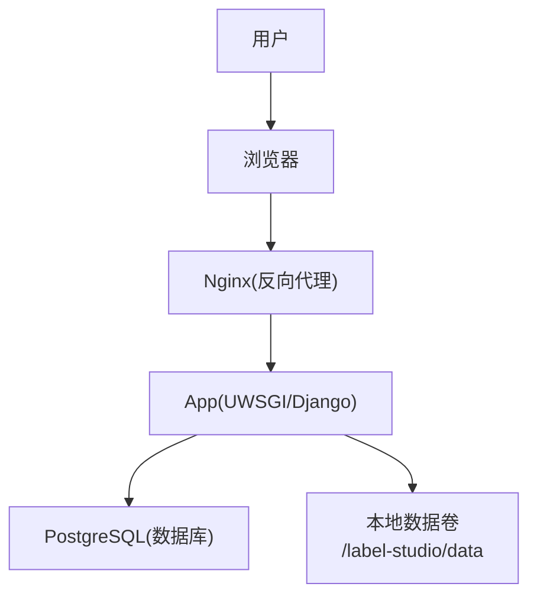
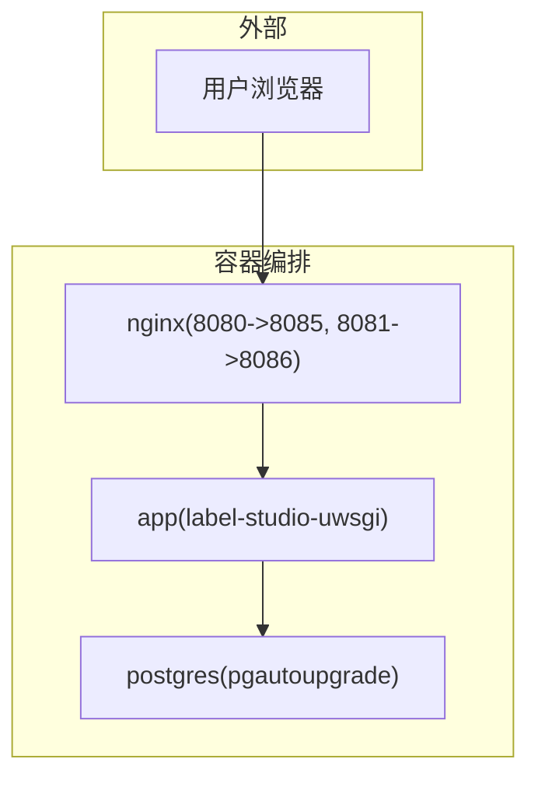
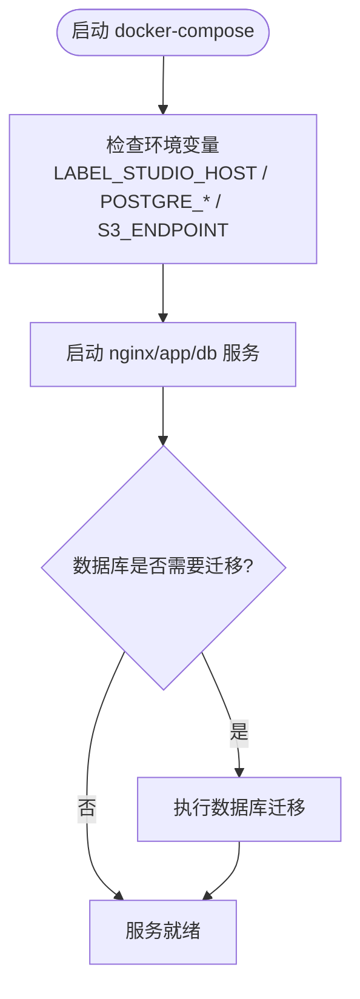
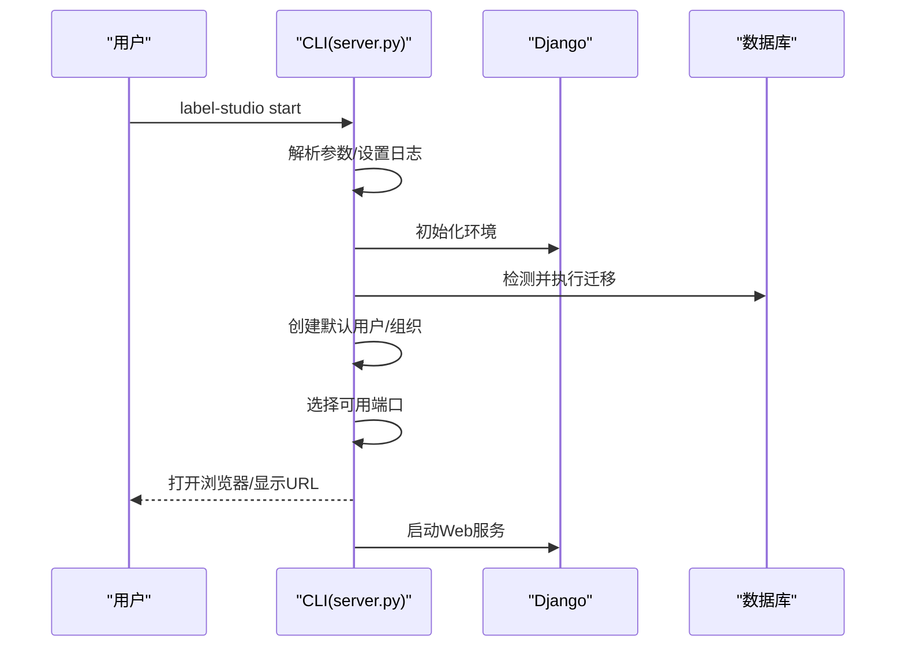
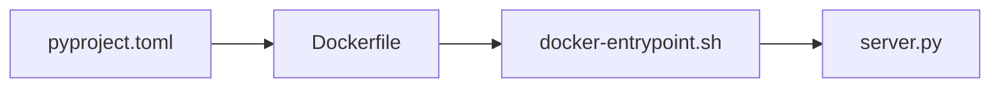

# 快速开始

<cite>
**本文引用的文件**   
- [README.md](file://README.md)
- [install.md](file://docs/source/guide/install.md)
- [quick_start.md](file://docs/source/guide/quick_start.md)
- [start.md](file://docs/source/guide/start.md)
- [docker-compose.yml](file://docker-compose.yml)
- [Dockerfile](file://Dockerfile)
- [pyproject.toml](file://pyproject.toml)
- [server.py](file://label_studio/server.py)
- [docker-entrypoint.sh](file://deploy/docker-entrypoint.sh)
</cite>

## 目录
1. [简介](#简介)
2. [项目结构](#项目结构)
3. [核心组件](#核心组件)
4. [架构总览](#架构总览)
5. [详细安装与启动指南](#详细安装与启动指南)
6. [依赖关系分析](#依赖关系分析)
7. [性能与部署建议](#性能与部署建议)
8. [故障排除指南](#故障排除指南)
9. [结论](#结论)

## 简介
本指南面向新用户，帮助你在最短时间内成功运行 Label Studio 并创建第一个标注项目。内容涵盖多种安装方式（Docker、Docker Compose、pip、Poetry、Anaconda），并提供完整的命令行示例与环境变量配置说明；同时包含初始化步骤（数据库迁移、静态资源收集）与服务启动流程，以及常见问题排查方法。

## 项目结构
Label Studio 仓库提供多套安装与运行方案：
- Docker 镜像构建与运行入口
- Docker Compose 生产环境编排（Nginx + App + PostgreSQL）
- Python 包管理与依赖定义
- CLI 启动逻辑与初始化流程
- 官方文档中的安装与启动说明

**图表来源**
- [docker-compose.yml:1-72](file://docker-compose.yml#L1-L72)
- [Dockerfile:105-159](file://Dockerfile#L105-L159)

**章节来源**
- [docker-compose.yml:1-72](file://docker-compose.yml#L1-L72)
- [Dockerfile:105-159](file://Dockerfile#L105-L159)

## 核心组件
- 容器化入口与脚本
  - Dockerfile 定义了前端构建、Python 虚拟环境准备、静态资源收集与最终运行镜像。
  - docker-entrypoint.sh 负责按命令模式执行不同的初始化与启动流程。
- 服务启动与初始化
  - server.py 实现 CLI 参数解析、数据库迁移、用户与项目初始化、端口选择与服务器启动。
- 依赖与包管理
  - pyproject.toml 声明 Python 依赖、可选 uwsgi 扩展、CLI 入口脚本等。
- 文档与示例
  - README.md 提供快速安装与使用示例。
  - docs/source/guide/install.md 与 start.md 提供详细的安装、启动与环境变量说明。

**章节来源**
- [Dockerfile:1-159](file://Dockerfile#L1-L159)
- [docker-entrypoint.sh:1-83](file://deploy/docker-entrypoint.sh#L1-L83)
- [server.py:276-443](file://label_studio/server.py#L276-L443)
- [pyproject.toml:1-88](file://pyproject.toml#L1-L88)
- [README.md:36-132](file://README.md#L36-L132)
- [install.md:31-210](file://docs/source/guide/install.md#L31-L210)
- [start.md:14-63](file://docs/source/guide/start.md#L14-L63)

## 架构总览
下图展示了基于 Docker Compose 的生产环境架构：Nginx 作为反向代理对外暴露端口，App 容器运行 Django/UWSGI 应用，PostgreSQL 提供持久化存储。

**图表来源**
- [docker-compose.yml:1-72](file://docker-compose.yml#L1-L72)

**章节来源**
- [docker-compose.yml:1-72](file://docker-compose.yml#L1-L72)

## 详细安装与启动指南

### 一、Docker 容器化部署
适用场景：快速体验或单机开发。

- 拉取镜像并运行
  - 参考命令路径：[README.md:36-45](file://README.md#L36-L45)
- 覆盖默认启动参数
  - 参考命令路径：[README.md:47-51](file://README.md#L47-L51)
- 本地构建镜像
  - 参考命令路径：[README.md:53-57](file://README.md#L53-L57)

注意事项
- 非 root 容器要求挂载目录具备 UID 1001 权限。
- 如需自定义端口，可在 docker run 时映射不同宿主机端口。

**章节来源**
- [README.md:36-57](file://README.md#L36-L57)
- [start.md:109-118](file://docs/source/guide/start.md#L109-L118)

### 二、Docker Compose 生产环境配置
适用场景：生产或准生产环境，包含 Nginx、PostgreSQL。

- 启动服务
  - 参考命令路径：[README.md:59-69](file://README.md#L59-L69)
- 附加 MinIO 对象存储（本地 S3 兼容）
  - 参考命令路径：[README.md:71-79](file://README.md#L71-L79)
- Compose 关键环境变量
  - LABEL_STUDIO_HOST：用于生成链接与静态资源加载的主机地址
  - DJANGO_DB、POSTGRE_*：数据库连接
  - JSON_LOG：日志格式
  - S3_ENDPOINT：S3 兼容端点（可选）

**图表来源**
- [docker-compose.yml:27-53](file://docker-compose.yml#L27-L53)
- [docker-entrypoint.sh:68-82](file://deploy/docker-entrypoint.sh#L68-L82)

**章节来源**
- [README.md:59-79](file://README.md#L59-L79)
- [docker-compose.yml:1-72](file://docker-compose.yml#L1-L72)
- [docker-entrypoint.sh:68-82](file://deploy/docker-entrypoint.sh#L68-L82)

### 三、pip 本地安装
适用场景：在本地 Python 环境中直接运行。

- 安装与启动
  - 参考命令路径：[README.md:82-90](file://README.md#L82-L90)
  - 参考命令路径：[install.md:35-57](file://docs/source/guide/install.md#L35-L57)

提示
- 建议使用虚拟环境以避免依赖冲突。
- 首次启动会自动进行数据库迁移。

**章节来源**
- [README.md:82-90](file://README.md#L82-L90)
- [install.md:35-57](file://docs/source/guide/install.md#L35-L57)

### 四、Poetry 环境设置
适用场景：使用 Poetry 管理依赖与开发工作流。

- 安装 Poetry 并创建项目
  - 参考命令路径：[README.md:92-108](file://README.md#L92-L108)
- 激活环境与启动服务
  - 参考命令路径：[README.md:103-108](file://README.md#L103-L108)

开发模式（源码安装）
- 安装依赖、迁移数据库、收集静态资源、启动开发服务器
  - 参考命令路径：[README.md:119-132](file://README.md#L119-L132)
  - 参考命令路径：[install.md:180-200](file://docs/source/guide/install.md#L180-L200)

**章节来源**
- [README.md:92-132](file://README.md#L92-L132)
- [install.md:180-200](file://docs/source/guide/install.md#L180-L200)

### 五、Anaconda 环境配置
适用场景：在 Conda 环境中运行，便于数据科学生态集成。

- 创建环境、安装依赖与启动
  - 参考命令路径：[README.md:110-117](file://README.md#L110-L117)
  - 参考命令路径：[install.md:203-210](file://docs/source/guide/install.md#L203-L210)

注意
- 某些版本需要额外安装 psycopg2 以支持 PostgreSQL。

**章节来源**
- [README.md:110-117](file://README.md#L110-L117)
- [install.md:203-210](file://docs/source/guide/install.md#L203-L210)

### 六、初始化与基本配置

#### 1. 数据库迁移
- 自动迁移
  - 启动服务时若检测到未同步的数据库，会自动执行迁移。
  - 参考实现路径：[server.py:50-63](file://label_studio/server.py#L50-L63)
- 手动迁移（开发模式）
  - 参考命令路径：[README.md:127-129](file://README.md#L127-L129)
  - 参考命令路径：[install.md:192-196](file://docs/source/guide/install.md#L192-L196)

#### 2. 静态文件收集
- 构建镜像时已收集静态资源
  - 参考命令路径：[Dockerfile:102-103](file://Dockerfile#L102-L103)
- 开发模式可手动收集
  - 参考命令路径：[README.md:129-130](file://README.md#L129-L130)
  - 参考命令路径：[install.md:195-196](file://docs/source/guide/install.md#L195-L196)

#### 3. 服务启动
- 基础启动命令
  - 参考命令路径：[quick_start.md:14-22](file://docs/source/guide/quick_start.md#L14-L22)
  - 参考命令路径：[start.md:14-16](file://docs/source/guide/start.md#L14-L16)
- 启动流程概览
  - 解析参数 → 设置日志级别 → 设置数据库路径/数据目录 → 初始化 Django 环境 → 执行数据库迁移 → 创建默认用户/组织 → 启动 Web 服务

**图表来源**
- [server.py:276-443](file://label_studio/server.py#L276-L443)

**章节来源**
- [server.py:50-63](file://label_studio/server.py#L50-L63)
- [server.py:276-443](file://label_studio/server.py#L276-L443)
- [Dockerfile:102-103](file://Dockerfile#L102-L103)
- [README.md:127-132](file://README.md#L127-L132)
- [install.md:192-200](file://docs/source/guide/install.md#L192-L200)
- [quick_start.md:14-22](file://docs/source/guide/quick_start.md#L14-L22)
- [start.md:14-16](file://docs/source/guide/start.md#L14-L16)

### 七、环境变量配置要点
常用环境变量（节选）
- LABEL_STUDIO_PORT：服务监听端口
- LABEL_STUDIO_HOST：外部访问主机名（含协议与子路径）
- LABEL_STUDIO_BASE_DATA_DIR：应用数据存储根目录
- DATABASE_NAME / DJANGO_DB / POSTGRE_*：数据库连接
- LABEL_STUDIO_LOCAL_FILES_SERVING_ENABLED / LABEL_STUDIO_LOCAL_FILES_DOCUMENT_ROOT：启用本地文件访问与根目录
- CSRF_TRUSTED_ORIGINS：跨站请求信任源（如 ngrok 暴露域名）

参考路径
- [start.md:40-63](file://docs/source/guide/start.md#L40-L63)
- [start.md:64-90](file://docs/source/guide/start.md#L64-L90)
- [start.md:131-136](file://docs/source/guide/start.md#L131-L136)
- [start.md:219-239](file://docs/source/guide/start.md#L219-L239)
- [docker-compose.yml:37-50](file://docker-compose.yml#L37-L50)

**章节来源**
- [start.md:40-90](file://docs/source/guide/start.md#L40-L90)
- [start.md:131-136](file://docs/source/guide/start.md#L131-L136)
- [start.md:219-239](file://docs/source/guide/start.md#L219-L239)
- [docker-compose.yml:37-50](file://docker-compose.yml#L37-L50)

### 八、创建第一个标注项目
- 通过 CLI 初始化项目（可选）
  - 参考命令路径：[start.md:31-32](file://docs/source/guide/start.md#L31-L32)
  - 参考实现路径：[server.py:185-203](file://label_studio/server.py#L185-L203)
- 通过 Web UI 创建项目
  - 参考步骤路径：[quick_start.md:24-31](file://docs/source/guide/quick_start.md#L24-L31)

**章节来源**
- [start.md:31-32](file://docs/source/guide/start.md#L31-L32)
- [server.py:185-203](file://label_studio/server.py#L185-L203)
- [quick_start.md:24-31](file://docs/source/guide/quick_start.md#L24-L31)

## 依赖关系分析
- Python 依赖与可选 uwsgi 扩展
  - 参考路径：[pyproject.toml:14-81](file://pyproject.toml#L14-L81)
- CLI 入口脚本
  - 参考路径：[pyproject.toml:86-88](file://pyproject.toml#L86-L88)
- Docker 构建阶段
  - 前端构建（Bun）、Python 虚拟环境准备、静态资源收集、最终镜像运行

**图表来源**
- [pyproject.toml:14-88](file://pyproject.toml#L14-L88)
- [Dockerfile:1-159](file://Dockerfile#L1-L159)
- [docker-entrypoint.sh:1-83](file://deploy/docker-entrypoint.sh#L1-L83)
- [server.py:276-443](file://label_studio/server.py#L276-L443)

**章节来源**
- [pyproject.toml:14-88](file://pyproject.toml#L14-L88)
- [Dockerfile:1-159](file://Dockerfile#L1-L159)
- [docker-entrypoint.sh:1-83](file://deploy/docker-entrypoint.sh#L1-L83)
- [server.py:276-443](file://label_studio/server.py#L276-L443)

## 性能与部署建议
- 使用 PostgreSQL 替代 SQLite 以获得更好的并发与稳定性。
- 在生产环境使用 Nginx 作为反向代理，统一处理静态资源与 HTTPS 终止。
- 合理配置 LABEL_STUDIO_HOST 与 CSRF_TRUSTED_ORIGINS，避免跨域与安全校验问题。
- 使用对象存储（如 S3/MinIO）承载媒体文件，提升可扩展性与容灾能力。

[本节为通用建议，不直接分析具体文件]

## 故障排除指南
常见问题与解决思路
- 端口占用
  - 现象：启动时报端口不可用或自动尝试其他端口。
  - 处理：指定 --port 或设置 LABEL_STUDIO_PORT。
  - 参考路径：[start.md:92-107](file://docs/source/guide/start.md#L92-L107)
  - 参考实现：[server.py:237-267](file://label_studio/server.py#L237-L267)
- 数据库未迁移
  - 现象：首次启动报错或功能异常。
  - 处理：确保自动迁移执行或手动执行 migrate。
  - 参考路径：[server.py:50-63](file://label_studio/server.py#L50-L63)
  - 参考命令：[README.md:127-129](file://README.md#L127-L129)
- 静态资源缺失
  - 现象：页面样式或 JS 加载失败。
  - 处理：执行 collectstatic 或在镜像构建阶段已收集。
  - 参考路径：[Dockerfile:102-103](file://Dockerfile#L102-L103)
  - 参考命令：[README.md:129-130](file://README.md#L129-L130)
- 本地文件无法访问（Docker）
  - 现象：导入本地目录失败。
  - 处理：设置 LABEL_STUDIO_LOCAL_FILES_SERVING_ENABLED=true 与 LABEL_STUDIO_LOCAL_FILES_DOCUMENT_ROOT，并挂载对应目录。
  - 参考路径：[start.md:219-239](file://docs/source/guide/start.md#L219-L239)
- 跨站请求被拒绝（ngrok 暴露）
  - 现象：CSRF 错误。
  - 处理：设置 CSRF_TRUSTED_ORIGINS 与 LABEL_STUDIO_HOST。
  - 参考路径：[start.md:167-211](file://docs/source/guide/start.md#L167-L211)

**章节来源**
- [start.md:92-107](file://docs/source/guide/start.md#L92-L107)
- [start.md:167-211](file://docs/source/guide/start.md#L167-L211)
- [start.md:219-239](file://docs/source/guide/start.md#L219-L239)
- [server.py:50-63](file://label_studio/server.py#L50-L63)
- [server.py:237-267](file://label_studio/server.py#L237-L267)
- [Dockerfile:102-103](file://Dockerfile#L102-L103)
- [README.md:127-130](file://README.md#L127-L130)

## 结论
通过以上步骤，你可以快速完成 Label Studio 的安装与启动，并根据需求选择合适的部署方式。建议在初次使用时优先采用 Docker 或 Docker Compose 方式，以便获得更稳定的运行环境与更少的依赖问题。随后可根据团队规模与业务需求逐步引入 PostgreSQL、对象存储与反向代理等生产级配置。

[本节为总结性内容，不直接分析具体文件]