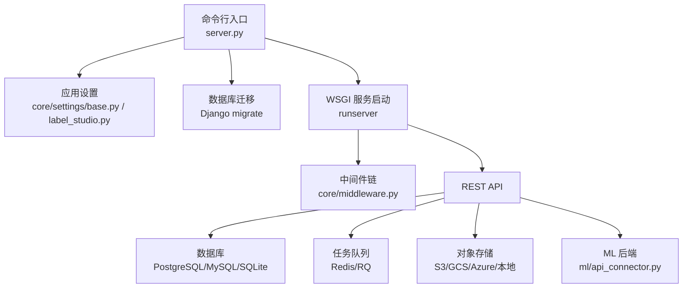
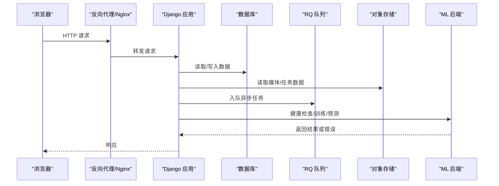
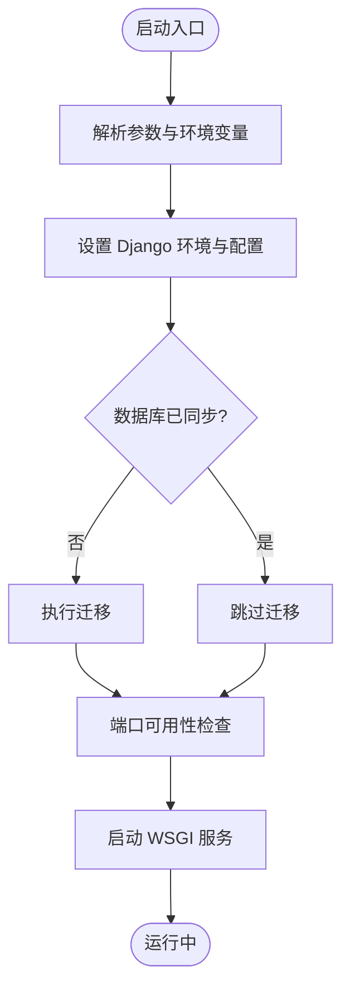
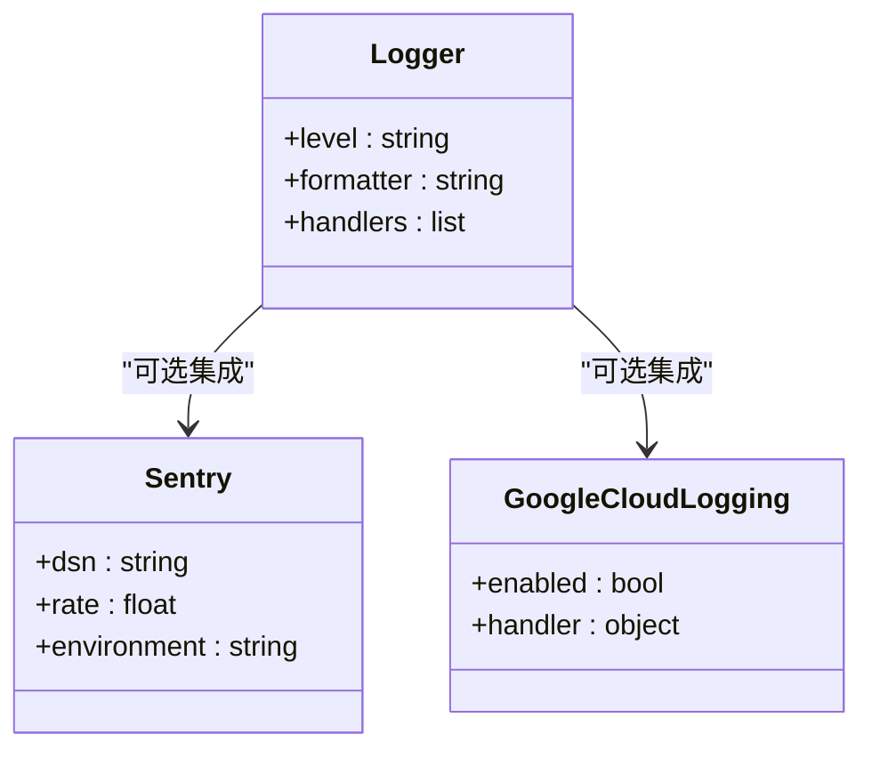
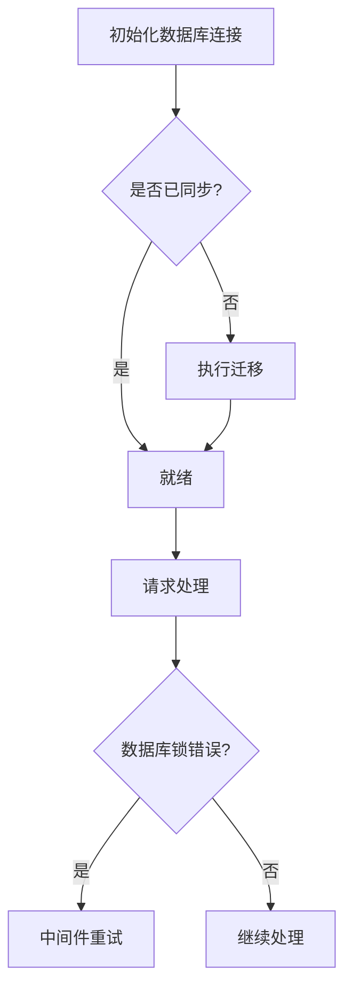
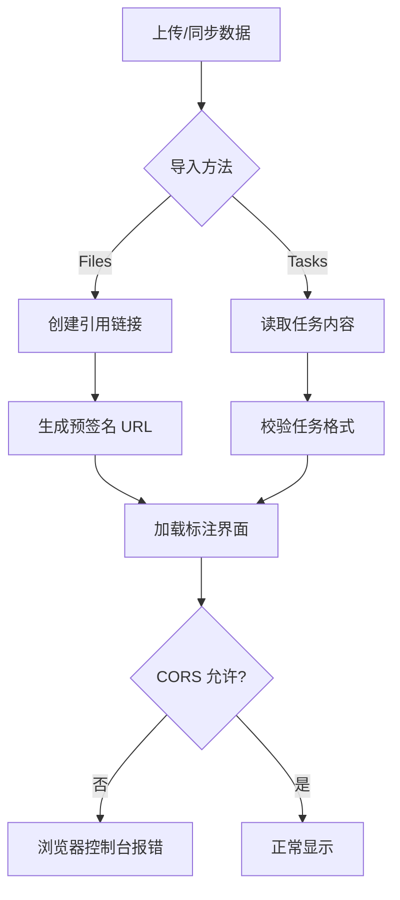
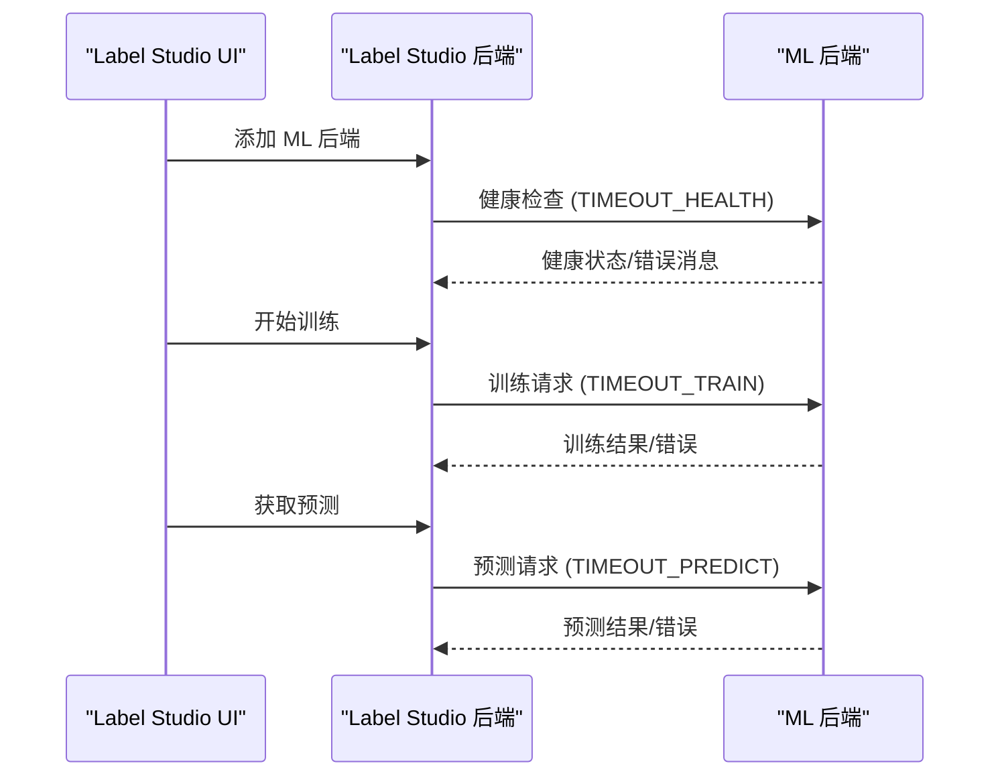
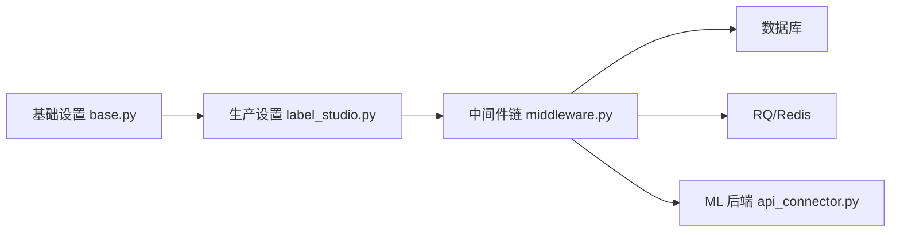

# 故障排除

<cite>
**本文引用的文件**   
- [base.py](file://label_studio/core/settings/base.py)
- [label_studio.py](file://label_studio/core/settings/label_studio.py)
- [server.py](file://label_studio/server.py)
- [troubleshooting.md](file://docs/source/guide/troubleshooting.md)
- [install_troubleshoot.md](file://docs/source/guide/install_troubleshoot.md)
- [api_connector.py](file://label_studio/ml/api_connector.py)
- [models.py](file://label_studio/ml/models.py)
- [serializers.py](file://label_studio/ml/serializers.py)
- [middleware.py](file://label_studio/core/middleware.py)
</cite>

## 目录
1. [简介](#简介)
2. [项目结构](#项目结构)
3. [核心组件](#核心组件)
4. [架构总览](#架构总览)
5. [详细组件分析](#详细组件分析)
6. [依赖关系分析](#依赖关系分析)
7. [性能与稳定性](#性能与稳定性)
8. [故障排查指南](#故障排查指南)
9. [结论](#结论)
10. [附录](#附录)

## 简介
本指南面向 Label Studio 社区版用户，聚焦安装部署、配置管理、运行时错误等常见问题，提供系统化的日志查看、错误诊断、性能分析与监控告警方案。文档覆盖数据库连接问题、存储访问异常、ML 模型集成失败等典型场景的排查步骤，并给出内存泄漏、性能瓶颈、并发冲突等高级问题的定位技巧与解决建议，帮助用户自助解决问题并获得专家级技术支持信息。

## 项目结构
Label Studio 后端基于 Django 构建，关键运行入口、配置与中间件分布如下：
- 启动入口：命令行解析、环境变量注入、数据库迁移、服务端口选择与 WSGI 启动
- 配置中心：基础设置（日志、数据库、CORS、RQ、Sentry、静态资源路径等）与生产环境覆盖
- 中间件链：CSRF、鉴权、会话、上下文日志、数据库锁重试、JWT 认证等
- ML 集成：对外部 ML 后端的超时、健康检查、训练/预测请求封装

**图示来源** 
- [server.py:276-443](file://label_studio/server.py#L276-L443)
- [base.py:268-286](file://label_studio/core/settings/base.py#L268-L286)
- [label_studio.py:14-17](file://label_studio/core/settings/label_studio.py#L14-L17)

**章节来源**
- [server.py:276-443](file://label_studio/server.py#L276-L443)
- [base.py:268-286](file://label_studio/core/settings/base.py#L268-L286)
- [label_studio.py:14-17](file://label_studio/core/settings/label_studio.py#L14-L17)

## 核心组件
- 日志与可观测性
  - 结构化日志输出（JSON/标准格式），可通过环境变量控制级别与输出目标；支持 Google Cloud Logging 接入
  - Sentry 集成用于错误上报与采样率控制
- 数据库与迁移
  - 多引擎支持（PostgreSQL/MySQL/SQLite），默认使用 SQLite；启动时自动检测并执行迁移
  - SQLite WAL 模式在特定挂载场景下启用以提升并发写入能力
- 任务队列与异步处理
  - RQ 队列定义（critical/high/default/low），默认超时与失败任务保留策略
- CORS 与安全
  - 灵活的跨域白名单与正则匹配；可选强制 HTTPS 头转发
- ML 后端集成
  - 统一超时配置与健康检查；训练/预测/删除等接口调用封装

**章节来源**
- [base.py:22-77](file://label_studio/core/settings/base.py#L22-L77)
- [base.py:174-208](file://label_studio/core/settings/base.py#L174-L208)
- [base.py:392-430](file://label_studio/core/settings/base.py#L392-L430)
- [base.py:319-335](file://label_studio/core/settings/base.py#L319-L335)
- [api_connector.py:26-34](file://label_studio/ml/api_connector.py#L26-L34)

## 架构总览
Label Studio 的请求处理流程涉及前端、反向代理、Django 应用、数据库、对象存储、RQ 与外部 ML 后端。下图展示关键交互路径与常见故障点。

**图示来源**
- [server.py:276-443](file://label_studio/server.py#L276-L443)
- [base.py:268-286](file://label_studio/core/settings/base.py#L268-L286)
- [api_connector.py:26-34](file://label_studio/ml/api_connector.py#L26-L34)

## 详细组件分析

### 启动与初始化流程
- 命令行参数与环境变量注入
- 数据库迁移与 SQLite WAL 修复
- 端口探测与 WSGI 服务启动

**图示来源**
- [server.py:276-443](file://label_studio/server.py#L276-L443)
- [server.py:43-63](file://label_studio/server.py#L43-L63)

**章节来源**
- [server.py:276-443](file://label_studio/server.py#L276-L443)
- [server.py:43-63](file://label_studio/server.py#L43-L63)

### 日志与可观测性
- 日志级别与格式化：通过 LOG_LEVEL 控制根日志级别；JSON_LOG 切换 JSON 格式
- 第三方日志：Google Cloud Logging 可按需启用
- Sentry 错误上报：后端与前端 DSN、采样率与环境名可配置

**图示来源**
- [base.py:22-77](file://label_studio/core/settings/base.py#L22-L77)
- [label_studio.py:31-37](file://label_studio/core/settings/label_studio.py#L31-L37)

**章节来源**
- [base.py:22-77](file://label_studio/core/settings/base.py#L22-L77)
- [label_studio.py:31-37](file://label_studio/core/settings/label_studio.py#L31-L37)

### 数据库连接与迁移
- 多引擎配置：PostgreSQL/MySQL/SQLite，默认 SQLite
- 迁移执行：启动时检测并执行迁移；SQLite 在 Azure 挂载场景启用 WAL
- 锁重试中间件：针对数据库锁错误进行重试

**图示来源**
- [base.py:174-208](file://label_studio/core/settings/base.py#L174-L208)
- [server.py:43-63](file://label_studio/server.py#L43-L63)
- [middleware.py:226-226](file://label_studio/core/middleware.py#L226-L226)

**章节来源**
- [base.py:174-208](file://label_studio/core/settings/base.py#L174-L208)
- [server.py:43-63](file://label_studio/server.py#L43-L63)
- [middleware.py:226-226](file://label_studio/core/middleware.py#L226-L226)

### 存储访问与 CORS
- 云存储（S3/GCS/Azure）与本地存储
- CORS 配置与常见 403/CORS 错误
- 导入方法（Files/Tasks）对任务可见性的影响

**图示来源**
- [troubleshooting.md:107-185](file://docs/source/guide/troubleshooting.md#L107-L185)

**章节来源**
- [troubleshooting.md:107-185](file://docs/source/guide/troubleshooting.md#L107-L185)

### ML 后端集成与超时
- 统一超时配置：健康检查、设置、预测、训练、重复模型、删除、训练状态查询
- 健康检查与错误消息聚合
- 训练/预测请求封装与错误处理

**图示来源**
- [api_connector.py:26-34](file://label_studio/ml/api_connector.py#L26-L34)
- [models.py:209-241](file://label_studio/ml/models.py#L209-L241)
- [serializers.py:76-76](file://label_studio/ml/serializers.py#L76-L76)

**章节来源**
- [api_connector.py:26-34](file://label_studio/ml/api_connector.py#L26-L34)
- [models.py:209-241](file://label_studio/ml/models.py#L209-L241)
- [serializers.py:76-76](file://label_studio/ml/serializers.py#L76-L76)

## 依赖关系分析
- 中间件链顺序决定请求处理阶段：CORS、安全、会话、CSRF、鉴权、上下文日志、数据库锁重试、JWT
- 外部依赖：Redis/RQ（任务队列）、Sentry（错误上报）、Google Cloud Logging（可选）
- ML 后端为独立服务，需网络可达且遵循统一的超时与错误协议

**图示来源**
- [base.py:268-286](file://label_studio/core/settings/base.py#L268-L286)
- [label_studio.py:14-17](file://label_studio/core/settings/label_studio.py#L14-L17)
- [api_connector.py:26-34](file://label_studio/ml/api_connector.py#L26-L34)

**章节来源**
- [base.py:268-286](file://label_studio/core/settings/base.py#L268-L286)
- [label_studio.py:14-17](file://label_studio/core/settings/label_studio.py#L14-L17)
- [api_connector.py:26-34](file://label_studio/ml/api_connector.py#L26-L34)

## 性能与稳定性
- 日志级别调优：生产环境建议 WARNING 或更高；调试时使用 DEBUG 但注意性能开销
- 数据库选择：高并发场景优先 PostgreSQL/MySQL；SQLite 适合小规模开发测试
- 任务队列：合理配置 RQ 队列优先级与超时；监控失败任务 TTL
- 存储优化：避免大文件直接上传到服务器；使用对象存储与预签名 URL
- ML 后端：根据模型复杂度调整超时；确保 ML 后端具备足够的 CPU/GPU 与内存资源

[本节为通用指导，不直接分析具体文件]

## 故障排查指南

### 安装部署问题
- 缺失包错误：在干净 Python 环境中重新安装；Windows 上 lxml 可能需要手动安装二进制包
- Docker 权限问题：容器以非 root 用户运行，需将数据目录组设为 root 组（GID 0）
- OpenBLAS 线程错误：升级 Docker Engine 至最新版本

**章节来源**
- [install_troubleshoot.md:21-33](file://docs/source/guide/install_troubleshoot.md#L21-L33)
- [install_troubleshoot.md:35-37](file://docs/source/guide/install_troubleshoot.md#L35-L37)
- [install_troubleshoot.md:39-77](file://docs/source/guide/install_troubleshoot.md#L39-L77)

### 运行时错误与日志诊断
- 空白页面：HOST 未包含协议导致前端资源加载失败；修正 HOST 环境变量或启动参数
- 标注缓慢：SQLite 在高并发导入时性能下降；考虑切换到 PostgreSQL/Redis 或使用外部存储
- 资源加载错误：多为 CORS 问题；检查外部主机 CORS 配置或本地 http-server 的 --cors 参数
- 音频波形不匹配：转换音频格式（如 mp3 -> wav）

**章节来源**
- [troubleshooting.md:25-31](file://docs/source/guide/troubleshooting.md#L25-L31)
- [troubleshooting.md:35-41](file://docs/source/guide/troubleshooting.md#L35-L41)
- [troubleshooting.md:43-93](file://docs/source/guide/troubleshooting.md#L43-L93)
- [troubleshooting.md:95-101](file://docs/source/guide/troubleshooting.md#L95-L101)

### 数据库连接问题
- 连接失败：检查 DATABASE_NAME、POSTGRE_USER/PASSWORD/HOST/PORT 或 MYSQL_* 环境变量
- 迁移卡住：确认数据库权限与连接可用；必要时手动执行迁移命令
- SQLite 并发写锁：启用 WAL 模式（Azure 挂载场景）

**章节来源**
- [base.py:174-208](file://label_studio/core/settings/base.py#L174-L208)
- [server.py:43-63](file://label_studio/server.py#L43-L63)

### 存储访问异常
- 403 错误：检查云存储凭证与 IAM 权限；确保 Service Account 具有必要角色
- CORS 错误：按云厂商文档配置 CORS；本地 http-server 使用 --cors
- 同步无更新：检查 File Filter Regex、Import Method 与 RQ worker 状态

**章节来源**
- [troubleshooting.md:117-185](file://docs/source/guide/troubleshooting.md#L117-L185)

### ML 模型集成失败
- 后端断开：检查 ML 后端健康端点与日志；确认 Docker 内依赖完整
- 训练报错：查看 traceback；常见原因为标注数量不足或内存不足
- 预测不可见：确认预测格式与标签配置一致；检查 from_name/to_name 映射
- 无法访问任务：确保 ML 后端能访问 Label Studio 数据（LABEL_STUDIO_URL/LABEL_STUDIO_API_KEY）

**章节来源**
- [troubleshooting.md:343-424](file://docs/source/guide/troubleshooting.md#L343-L424)
- [api_connector.py:26-34](file://label_studio/ml/api_connector.py#L26-L34)
- [models.py:209-241](file://label_studio/ml/models.py#L209-L241)
- [serializers.py:76-76](file://label_studio/ml/serializers.py#L76-L76)

### 高级问题诊断技巧
- 内存泄漏：结合 Sentry 与系统监控（进程 RSS、GC 统计）定位；降低批量大小与日志级别
- 性能瓶颈：数据库慢查询、对象存储延迟、ML 后端推理耗时；使用 APM 与数据库 EXPLAIN
- 并发冲突：数据库锁重试中间件生效情况；RQ 队列积压与失败任务清理

[本节为通用指导，不直接分析具体文件]

## 结论
通过系统化的日志与错误上报、合理的配置与基础设施选型、以及针对存储与 ML 后端的专项排查，可以高效定位并解决 Label Studio 的安装部署、配置管理与运行时问题。建议在生产环境采用 PostgreSQL/MySQL、对象存储与独立的 ML 后端，并结合 Sentry 与系统监控建立完善的可观测性与告警体系。

[本节为总结性内容，不直接分析具体文件]

## 附录

### 监控指标与健康检查
- 健康检查
  - ML 后端：GET /health
  - Label Studio：HTTP 200 与登录页可访问
- 关键指标
  - 数据库连接数与慢查询
  - RQ 队列长度与失败任务数
  - 对象存储请求延迟与错误率
  - ML 后端推理延迟与错误率
- 告警建议
  - 数据库连接池耗尽或慢查询阈值
  - RQ 失败任务超过阈值
  - ML 后端健康检查失败或推理超时

[本节为通用指导，不直接分析具体文件]