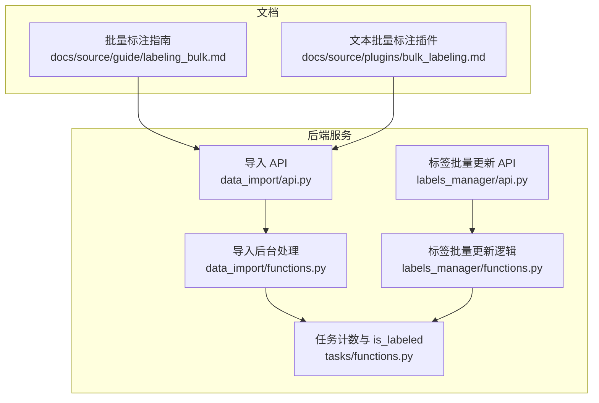
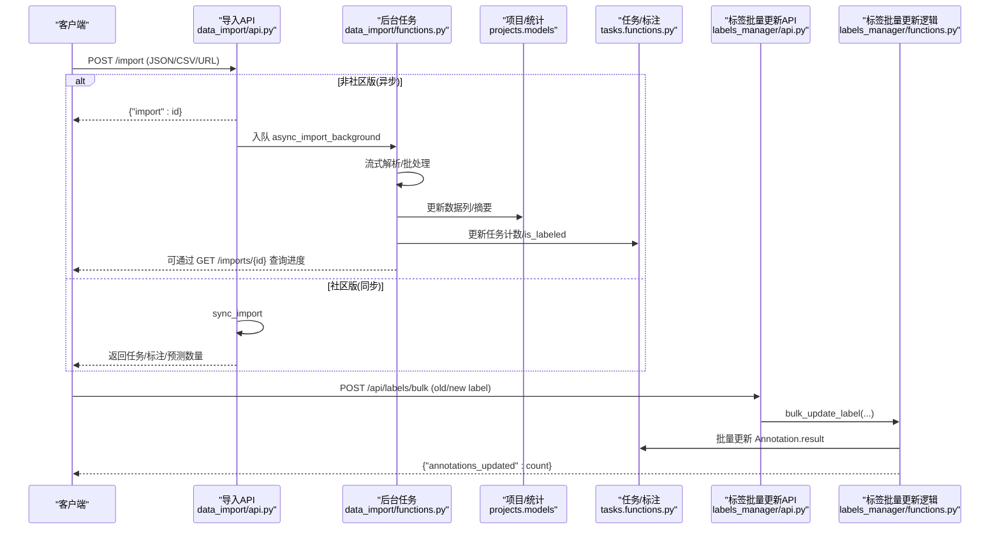
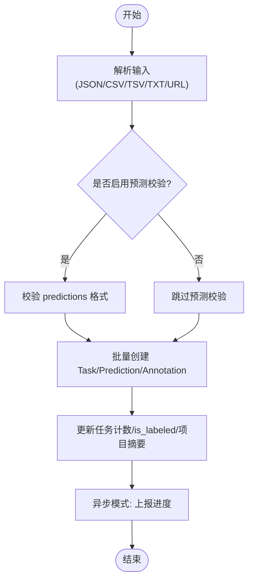
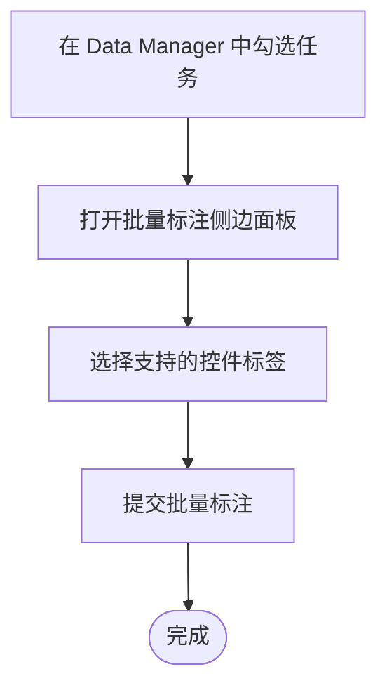
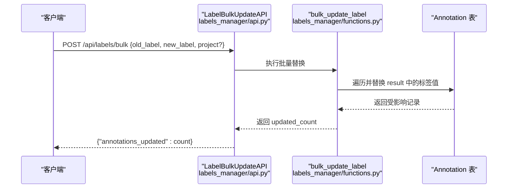
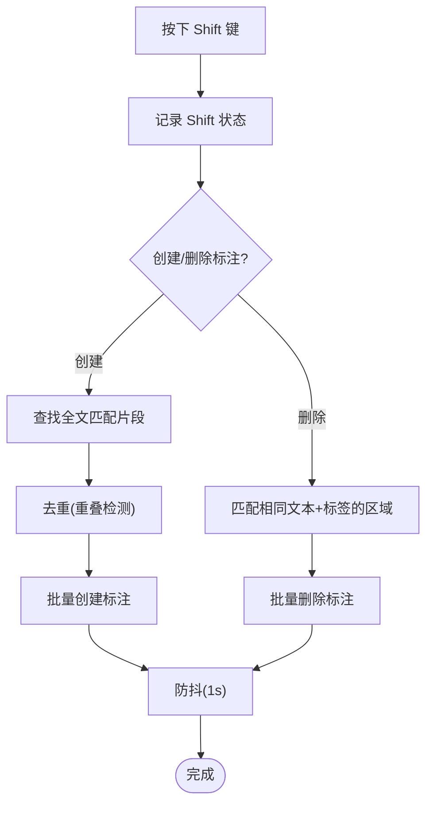
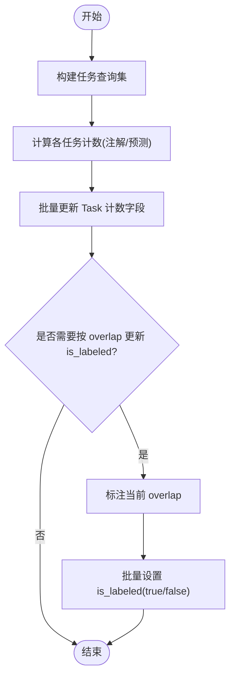
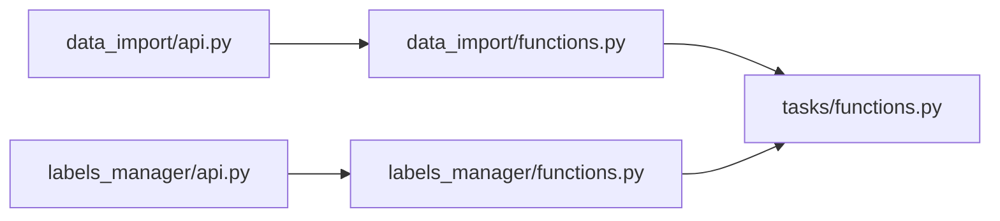

# 批量标注

<cite>
**本文引用的文件**   
- [labeling_bulk.md](file://docs/source/guide/labeling_bulk.md)
- [bulk_labeling.md](file://docs/source/plugins/bulk_labeling.md)
- [data_import/api.py](file://label_studio/data_import/api.py)
- [data_import/functions.py](file://label_studio/data_import/functions.py)
- [labels_manager/api.py](file://label_studio/labels_manager/api.py)
- [labels_manager/functions.py](file://label_studio/labels_manager/functions.py)
- [tasks/functions.py](file://label_studio/tasks/functions.py)
</cite>

## 目录
1. [简介](#简介)
2. [项目结构](#项目结构)
3. [核心组件](#核心组件)
4. [架构总览](#架构总览)
5. [详细组件分析](#详细组件分析)
6. [依赖关系分析](#依赖关系分析)
7. [性能与优化](#性能与优化)
8. [故障排查](#故障排查)
9. [结论](#结论)
10. [附录：API 速查与最佳实践](#附录api-速查与最佳实践)

## 简介
本指南聚焦 Label Studio 的“批量标注”能力，覆盖以下主题：
- 批量导入数据（任务、预测）
- 批量应用标签（分类、文本区域等）
- 批量修改标注结果（旧标签替换为新标签）
- 批量操作 API 使用方式
- 批量模板与插件（如文本批量标注插件）
- 数据处理最佳实践、性能优化策略、错误处理与进度监控
- 实际业务场景案例与效率提升建议

## 项目结构
围绕批量标注的关键代码与文档分布如下：
- 文档层
  - 企业版“批量标注”指南：说明支持的数据类型、角色权限、支持的控件标签、列表视图/网格视图操作流程等
  - 插件“文本批量标注”：通过快捷键对全文匹配文本进行批量创建/删除标注
- 后端服务层
  - 数据导入 API：批量导入任务与预测，支持同步/异步两种模式
  - 标签管理 API：批量更新已保存标注中的标签值
  - 任务函数库：批量更新计数、is_labeled 状态、统计重算等
- 前端插件层
  - 基于 LSI 事件监听 Shift 键，实现文本区域的批量创建/删除

**图示来源**
- [labeling_bulk.md:16-48](file://docs/source/guide/labeling_bulk.md#L16-L48)
- [bulk_labeling.md:20-38](file://docs/source/plugins/bulk_labeling.md#L20-L38)
- [data_import/api.py:148-261](file://label_studio/data_import/api.py#L148-L261)
- [data_import/functions.py:36-53](file://label_studio/data_import/functions.py#L36-L53)
- [labels_manager/api.py:235-274](file://label_studio/labels_manager/api.py#L235-L274)
- [labels_manager/functions.py:5-41](file://label_studio/labels_manager/functions.py#L5-L41)
- [tasks/functions.py:262-350](file://label_studio/tasks/functions.py#L262-L350)

**章节来源**
- [labeling_bulk.md:16-48](file://docs/source/guide/labeling_bulk.md#L16-L48)
- [bulk_labeling.md:20-38](file://docs/source/plugins/bulk_labeling.md#L20-L38)
- [data_import/api.py:148-261](file://label_studio/data_import/api.py#L148-L261)
- [data_import/functions.py:36-53](file://label_studio/data_import/functions.py#L36-L53)
- [labels_manager/api.py:235-274](file://label_studio/labels_manager/api.py#L235-L274)
- [labels_manager/functions.py:5-41](file://label_studio/labels_manager/functions.py#L5-L41)
- [tasks/functions.py:262-350](file://label_studio/tasks/functions.py#L262-L350)

## 核心组件
- 批量导入任务与预测
  - 提供统一入口，支持 JSON/CSV/TSV/TXT 以及 URL 拉取
  - 社区版同步处理；非社区版异步处理，返回 import_id 用于查询进度
  - 支持预标注字段映射为 predictions
- 批量应用标签（Data Manager 侧边面板）
  - 支持分类、日期时间、数字、评分、层级标签、文本域等控件
  - 仅全局分类任务可用（不支持 perItem/perRegion）
- 批量修改标注结果
  - 将历史标注中的旧标签值替换为新标签值，支持按项目或组织范围
- 文本批量标注插件
  - 按住 Shift 键时，对全文中相同文本片段批量创建或删除标注

**章节来源**
- [labeling_bulk.md:22-54](file://docs/source/guide/labeling_bulk.md#L22-L54)
- [data_import/api.py:188-254](file://label_studio/data_import/api.py#L188-L254)
- [labels_manager/api.py:235-274](file://label_studio/labels_manager/api.py#L235-L274)
- [bulk_labeling.md:20-38](file://docs/source/plugins/bulk_labeling.md#L20-L38)

## 架构总览
批量标注涉及“导入—处理—持久化—统计更新—进度反馈”的完整链路。

**图示来源**
- [data_import/api.py:148-261](file://label_studio/data_import/api.py#L148-L261)
- [data_import/functions.py:36-53](file://label_studio/data_import/functions.py#L36-L53)
- [data_import/functions.py:333-494](file://label_studio/data_import/functions.py#L333-L494)
- [labels_manager/api.py:235-274](file://label_studio/labels_manager/api.py#L235-L274)
- [labels_manager/functions.py:5-41](file://label_studio/labels_manager/functions.py#L5-L41)
- [tasks/functions.py:262-350](file://label_studio/tasks/functions.py#L262-L350)

## 详细组件分析

### 批量导入数据（任务与预测）
- 功能要点
  - 支持三种导入方式：直接提交 JSON、上传文件（JSON/CSV/TSV/TXT）、通过 URL 拉取
  - 单请求限制：最多 250K 条任务、200 MB
  - 非社区版异步处理，返回 import_id；社区版同步返回统计
  - 支持从任务字段生成预标注 predictions
- 关键流程
  - 校验与解析：根据 label_config 校验变量与预测格式
  - 批处理写入：序列化并批量创建 Task/Prediction/Annotation
  - 统计更新：更新任务计数、is_labeled、项目摘要
  - 进度上报：异步模式下通过进度接口查询

**图示来源**
- [data_import/api.py:188-254](file://label_studio/data_import/api.py#L188-L254)
- [data_import/api.py:292-381](file://label_studio/data_import/api.py#L292-L381)
- [data_import/functions.py:333-494](file://label_studio/data_import/functions.py#L333-L494)

**章节来源**
- [data_import/api.py:148-261](file://label_studio/data_import/api.py#L148-L261)
- [data_import/api.py:292-381](file://label_studio/data_import/api.py#L292-L381)
- [data_import/functions.py:333-494](file://label_studio/data_import/functions.py#L333-L494)

### 批量应用标签（Data Manager 侧边面板）
- 适用范围
  - 支持所有数据类型（图像、文本、音频、视频）
  - 仅全局分类任务可用（不支持 perItem/perRegion）
  - 支持的控件标签：Choices、DateTime、Number、Rating、Taxonomy、TextArea
- 使用方式
  - 列表视图/网格视图中勾选任务，选择“批量标注”，在侧边面板中选择控件值并提交
  - 快捷键与导航提示可参考界面帮助

**图示来源**
- [labeling_bulk.md:22-54](file://docs/source/guide/labeling_bulk.md#L22-L54)
- [labeling_bulk.md:56-86](file://docs/source/guide/labeling_bulk.md#L56-L86)

**章节来源**
- [labeling_bulk.md:22-54](file://docs/source/guide/labeling_bulk.md#L22-L54)
- [labeling_bulk.md:56-86](file://docs/source/guide/labeling_bulk.md#L56-L86)

### 批量修改标注结果（旧标签替换为新标签）
- 功能要点
  - 通过 API 将历史标注结果中的旧标签值替换为新标签值
  - 作用域：指定 project 或用户可访问的 project_ids；未指定则作用于组织内所有项目（需谨慎）
  - 内部使用事务与批量更新，保证一致性与性能
- 调用流程

**图示来源**
- [labels_manager/api.py:235-274](file://label_studio/labels_manager/api.py#L235-L274)
- [labels_manager/functions.py:5-41](file://label_studio/labels_manager/functions.py#L5-L41)

**章节来源**
- [labels_manager/api.py:235-274](file://label_studio/labels_manager/api.py#L235-L274)
- [labels_manager/functions.py:5-41](file://label_studio/labels_manager/functions.py#L5-L41)

### 文本批量标注插件（Shift 键批量创建/删除）
- 功能要点
  - 按住 Shift 键时，对当前文本中所有匹配的片段批量创建或删除标注
  - 避免重复标注（重叠检测），防止单字符误标
  - 防抖机制：1 秒超时，避免频繁触发
- 适用场景
  - NER 实体批量标注、关键词批量高亮等

**图示来源**
- [bulk_labeling.md:20-38](file://docs/source/plugins/bulk_labeling.md#L20-L38)
- [bulk_labeling.md:40-144](file://docs/source/plugins/bulk_labeling.md#L40-L144)

**章节来源**
- [bulk_labeling.md:20-38](file://docs/source/plugins/bulk_labeling.md#L20-L38)
- [bulk_labeling.md:40-144](file://docs/source/plugins/bulk_labeling.md#L40-L144)

### 任务计数与 is_labeled 批量更新
- 功能要点
  - 批量更新任务计数器（total_annotations、cancelled_annotations、total_predictions）
  - 基于 overlap 计算批量更新 is_labeled 状态
  - 与项目统计、预测统计联动更新

**图示来源**
- [tasks/functions.py:262-321](file://label_studio/tasks/functions.py#L262-L321)
- [tasks/functions.py:324-350](file://label_studio/tasks/functions.py#L324-L350)

**章节来源**
- [tasks/functions.py:262-321](file://label_studio/tasks/functions.py#L262-L321)
- [tasks/functions.py:324-350](file://label_studio/tasks/functions.py#L324-L350)

## 依赖关系分析
- 模块耦合
  - data_import/api.py 依赖 data_import/functions.py 进行异步/流式处理
  - labels_manager/api.py 依赖 labels_manager/functions.py 执行批量替换
  - tasks/functions.py 被多处引用以更新任务计数与 is_labeled
- 外部依赖
  - 项目统计与摘要（projects.models）
  - Webhook 通知（webhooks.utils）
  - Redis 队列（core.redis）

**图示来源**
- [data_import/api.py:148-261](file://label_studio/data_import/api.py#L148-L261)
- [data_import/functions.py:36-53](file://label_studio/data_import/functions.py#L36-L53)
- [labels_manager/api.py:235-274](file://label_studio/labels_manager/api.py#L235-L274)
- [labels_manager/functions.py:5-41](file://label_studio/labels_manager/functions.py#L5-L41)
- [tasks/functions.py:262-350](file://label_studio/tasks/functions.py#L262-L350)

**章节来源**
- [data_import/api.py:148-261](file://label_studio/data_import/api.py#L148-L261)
- [data_import/functions.py:36-53](file://label_studio/data_import/functions.py#L36-L53)
- [labels_manager/api.py:235-274](file://label_studio/labels_manager/api.py#L235-L274)
- [labels_manager/functions.py:5-41](file://label_studio/labels_manager/functions.py#L5-L41)
- [tasks/functions.py:262-350](file://label_studio/tasks/functions.py#L262-L350)

## 性能与优化
- 异步与流式处理
  - 非社区版默认异步导入，减少请求阻塞；后台任务分批次流式处理，降低内存占用
- 批量写入与更新
  - 使用 bulk_create/bulk_update 批量写入 Task/Prediction/Annotation，减少数据库往返
- 统计与 is_labeled 更新
  - 仅在必要时触发统计重算；is_labeled 按 batch_size 分批更新，避免长事务锁竞争
- 预测导入内存优化
  - 通过特性开关控制“内存高效”路径，按固定批次大小处理预测，显著降低峰值内存

**章节来源**
- [data_import/api.py:188-254](file://label_studio/data_import/api.py#L188-L254)
- [data_import/functions.py:333-494](file://label_studio/data_import/functions.py#L333-L494)
- [tasks/functions.py:262-321](file://label_studio/tasks/functions.py#L262-L321)
- [tasks/functions.py:324-350](file://label_studio/tasks/functions.py#L324-L350)

## 故障排查
- 导入失败与重试
  - 异步导入入队失败会标记为 FAILED，可安全重试
  - 预测校验失败在非社区版异步模式下不会导致 POST 失败，需通过进度接口查看具体错误
- 进度查询
  - 非社区版通过 GET /api/projects/{project_id}/imports/{import_id} 查询导入状态与错误信息
- 标签批量更新范围
  - 若未指定 project/project_ids，将作用于组织内所有项目；请谨慎调用
- 常见问题定位
  - 检查 label_config 变量是否与任务数据字段一致
  - 确认 predictions 结构与控件标签类型匹配
  - 关注 is_labeled 与任务计数不一致的情况，必要时触发统计重算

**章节来源**
- [data_import/api.py:188-254](file://label_studio/data_import/api.py#L188-L254)
- [data_import/functions.py:56-81](file://label_studio/data_import/functions.py#L56-L81)
- [labels_manager/functions.py:5-41](file://label_studio/labels_manager/functions.py#L5-L41)

## 结论
Label Studio 的批量标注能力通过“导入—处理—持久化—统计更新—进度反馈”的闭环，结合异步/流式处理与批量写入，满足大规模数据的标注需求。配合 Data Manager 的批量标注面板与文本批量标注插件，可在不改变 label_config 的前提下快速完成大批量标注与批量修正，显著提升标注效率与一致性。

## 附录：API 速查与最佳实践

### 批量导入任务
- 端点：POST /api/projects/{project_id}/import
- 参数
  - commit_to_project：是否立即提交到项目
  - return_task_ids：是否在响应中返回任务 ID
  - preannotated_from_fields：从任务字段生成 predictions 的字段列表
- 行为
  - 非社区版：异步处理，返回 {"import": id}
  - 社区版：同步处理，返回任务/标注/预测数量与时长

**章节来源**
- [data_import/api.py:148-261](file://label_studio/data_import/api.py#L148-L261)
- [data_import/api.py:292-381](file://label_studio/data_import/api.py#L292-L381)

### 批量导入预测
- 端点：POST /api/projects/{project_id}/predictions
- 行为
  - 支持内存高效批处理（特性开关控制）
  - 校验 task 是否存在于项目，校验 prediction 结构

**章节来源**
- [data_import/api.py:468-701](file://label_studio/data_import/api.py#L468-L701)

### 批量更新标签
- 端点：POST /api/labels/bulk
- 请求体
  - old_label：要替换的旧标签值
  - new_label：新标签值
  - project：可选，限定项目范围
- 响应
  - {"annotations_updated": count}

**章节来源**
- [labels_manager/api.py:235-274](file://label_studio/labels_manager/api.py#L235-L274)
- [labels_manager/functions.py:5-41](file://label_studio/labels_manager/functions.py#L5-L41)

### 最佳实践
- 数据准备
  - 确保任务数据包含 label_config 所需的所有变量
  - 如需预标注，使用 preannotated_from_fields 将字段映射为 predictions
- 批量导入
  - 大体积数据优先使用异步导入，并通过进度接口监控
  - 合理拆分批次，避免单次请求过大
- 批量标注
  - 在 Data Manager 中使用过滤条件精准选中任务，再批量应用标签
  - 对于文本批量标注，结合插件的 Shift 键批量创建/删除功能
- 批量修正
  - 明确作用域（project/project_ids），避免误改其他项目数据
  - 批量更新后检查 is_labeled 与任务计数是否一致