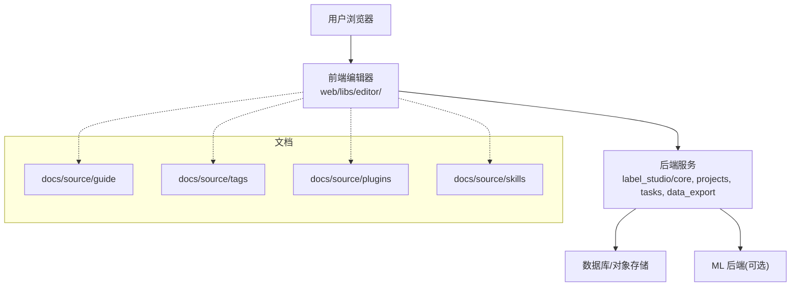
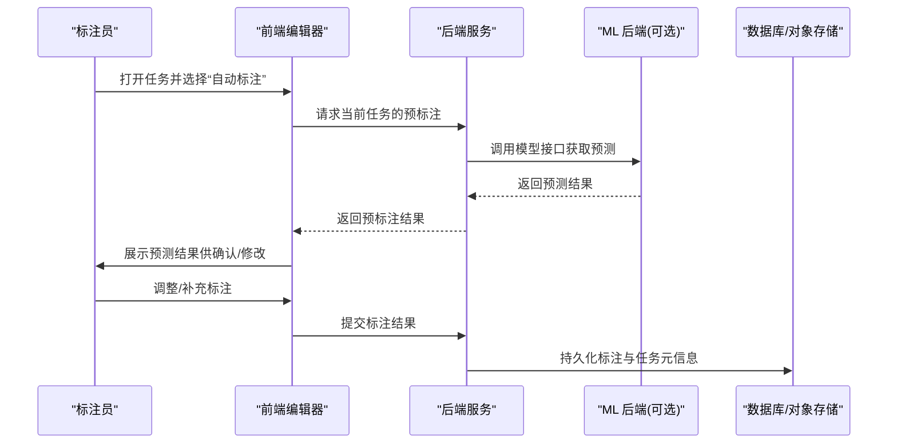
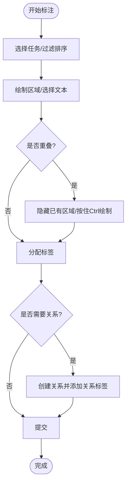
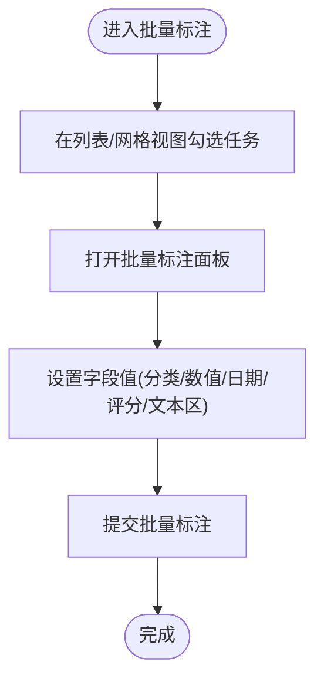
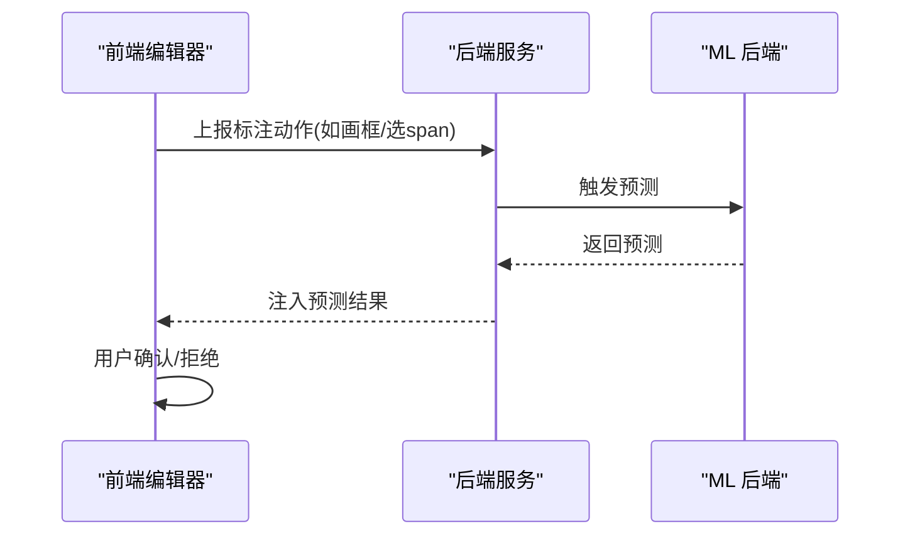
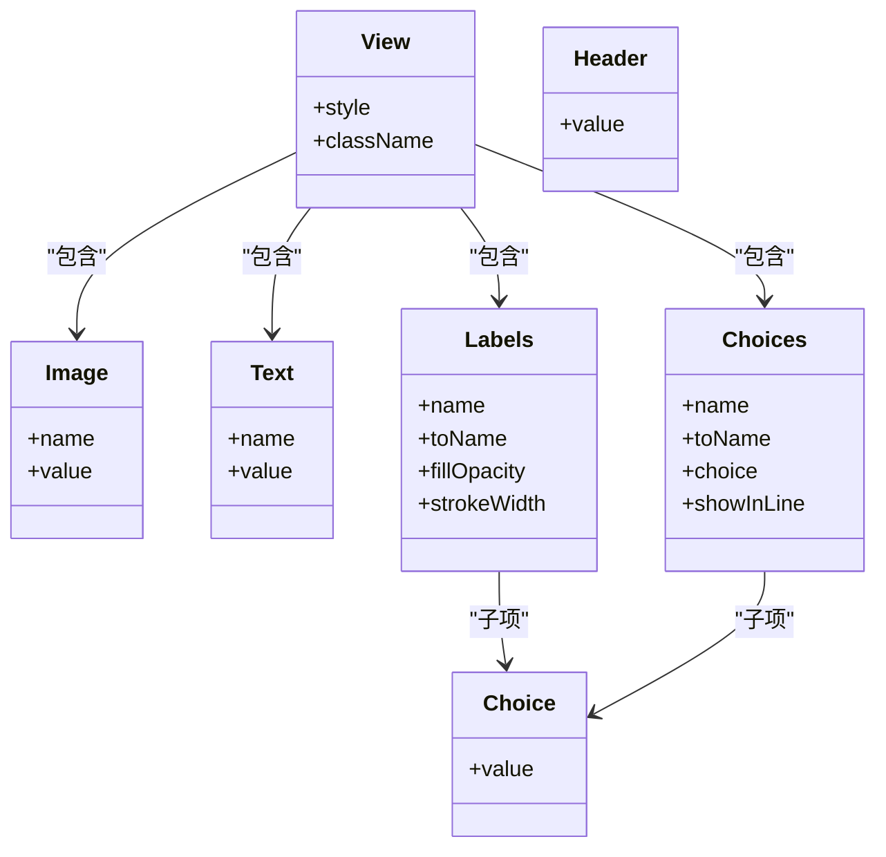
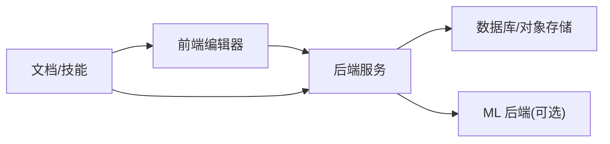
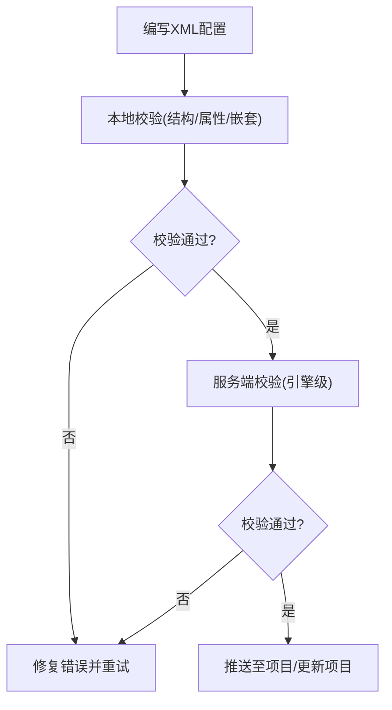

# 数据标注

<cite>
**本文引用的文件**   
- [README.md](file://README.md)
- [labeling.md](file://docs/source/guide/labeling.md)
- [labeling_bulk.md](file://docs/source/guide/labeling_bulk.md)
- [bulk_labeling.md](file://docs/source/plugins/bulk_labeling.md)
- [xml-config.md](file://docs/source/skills/xml-config.md)
- [tags_index.md](file://docs/source/tags/index.md)
</cite>

## 目录
1. [简介](#简介)
2. [项目结构](#项目结构)
3. [核心组件](#核心组件)
4. [架构总览](#架构总览)
5. [详细组件分析](#详细组件分析)
6. [依赖关系分析](#依赖关系分析)
7. [性能与效率优化](#性能与效率优化)
8. [故障排查指南](#故障排查指南)
9. [结论](#结论)
10. [附录：标签配置语法与高级用法](#附录标签配置语法与高级用法)

## 简介
本文件面向使用 Label Studio 进行数据标注的工程师、标注员与项目经理，系统梳理支持的多种数据类型（图像、文本、音频、视频、时间序列、PDF 等）的标注方法与界面配置；解释标签配置 XML 语言的语法与高级用法（条件逻辑、动态标签、嵌套结构等）；提供批量标注、模板标注、预标注等高效工作流实现指南；说明标注结果导出格式、验证规则与质量管理机制；并为不同业务场景给出标注策略建议与性能优化技巧。

Label Studio 支持多用户协作、多项目并行、可配置的标签格式、多数据类型标注、从文件或云存储导入、与机器学习模型集成以进行预标注与主动学习，并提供 REST API 以便嵌入现有工具链。

**章节来源**
- [README.md:8-22](file://README.md#L8-L22)
- [README.md:191-202](file://README.md#L191-L202)

## 项目结构
仓库中与“数据标注”直接相关的文档与代码主要分布在以下位置：
- docs/source/guide：标注流程、批量标注、ML 辅助标注、任务格式等指南
- docs/source/tags：标签配置语言（XML-like）参考
- docs/source/plugins：插件能力（如文本批量标注）
- docs/source/skills：AI 技能辅助生成与校验标签配置
- label_studio/*：后端服务、API、数据管理、导出、导入、存储等实现

**图表来源**
- [README.md:231-235](file://README.md#L231-L235)

**章节来源**
- [README.md:231-235](file://README.md#L231-L235)

## 核心组件
- 标注界面与交互
  - 支持图像、文本、音频、视频、时间序列、HTML/PDF 等多种对象的可视化标注
  - 支持重叠区域、多选、复制、删除、更改标签、创建关系等复杂操作
  - Outliner/Details 面板提升大图/长视频/大量区域的编辑体验
- 标签配置语言（XML-like）
  - Object/Control/Visual 三类标签组合构建 UI
  - 变量绑定、样式控制、条件显示、嵌套结构
- 批量标注
  - Data Manager 中按筛选结果批量赋值分类、数值、日期、评分、层级分类、文本区
  - 插件增强：按住 Shift 对文本 span 批量打标/删标
- ML 辅助与预标注
  - 连接 ML 后端，启用自动标注，接受/拒绝预测结果
  - 主动学习与在线学习闭环
- 导出与质量
  - 多种导出格式（见导出文档），结合项目状态机与审核角色保障质量

**章节来源**
- [labeling.md:24-108](file://docs/source/guide/labeling.md#L24-L108)
- [labeling.md:140-189](file://docs/source/guide/labeling.md#L140-L189)
- [labeling.md:212-318](file://docs/source/guide/labeling.md#L212-L318)
- [labeling_bulk.md:22-48](file://docs/source/guide/labeling_bulk.md#L22-L48)
- [bulk_labeling.md:20-38](file://docs/source/plugins/bulk_labeling.md#L20-L38)
- [labeling.md:132-138](file://docs/source/guide/labeling.md#L132-L138)

## 架构总览
下图展示一次典型“预标注 + 人工修正 + 提交”的端到端流程，涵盖前端编辑器、后端服务、ML 后端与数据存储。

**图表来源**
- [labeling.md:132-138](file://docs/source/guide/labeling.md#L132-L138)
- [README.md:210-222](file://README.md#L210-L222)

## 详细组件分析

### 标注界面与交互（Outliner/Details、重叠区域、关系）
- 重叠区域标注：通过隐藏已标注区域或按住 Ctrl/Cmd 绘制覆盖层，便于多层标注
- 多选与批量编辑：在侧边栏或画布上多选区域，统一改标签或删除
- 关系标注：为两个标注建立有向/无向关系，并可附加关系标签
- Outliner/Details：双面板布局，支持折叠/浮动/分组/排序，适合大图/长视频/大量区域

**图表来源**
- [labeling.md:45-103](file://docs/source/guide/labeling.md#L45-L103)
- [labeling.md:212-318](file://docs/source/guide/labeling.md#L212-L318)

**章节来源**
- [labeling.md:45-103](file://docs/source/guide/labeling.md#L45-L103)
- [labeling.md:212-318](file://docs/source/guide/labeling.md#L212-L318)

### 批量标注（Data Manager 与插件）
- Data Manager 批量标注
  - 支持分类、数值、日期、评分、层级分类、文本区输入
  - 仅全局任务（不支持 perItem/perRegion）
  - 适用于图像、文本、音频、视频等所有对象类型
- 插件批量标注（文本 span）
  - 按住 Shift 键一键批量创建/删除相同文本与标签的区域
  - 防抖与去重避免重复标注

**图表来源**
- [labeling_bulk.md:56-86](file://docs/source/guide/labeling_bulk.md#L56-L86)

**章节来源**
- [labeling_bulk.md:22-48](file://docs/source/guide/labeling_bulk.md#L22-L48)
- [labeling_bulk.md:56-86](file://docs/source/guide/labeling_bulk.md#L56-L86)
- [bulk_labeling.md:20-38](file://docs/source/plugins/bulk_labeling.md#L20-L38)

### 预标注与 ML 辅助
- 开启“自动标注”后，前端根据当前标注动作触发 ML 后端返回预测
- 图像：自动接受/拒绝预测的形状、掩码、关键点
- 文本/HTML：自动接受预测的 span
- 支持主动学习与在线训练闭环

**图表来源**
- [labeling.md:132-138](file://docs/source/guide/labeling.md#L132-L138)
- [README.md:210-222](file://README.md#L210-L222)

**章节来源**
- [labeling.md:132-138](file://docs/source/guide/labeling.md#L132-L138)
- [README.md:210-222](file://README.md#L210-L222)

### 标签配置语言（XML-like）概览
- 三类标签
  - Object：用于承载待标注的数据对象（Image/Text/Audio/Video/Timeseries/Hypertext/PDF 等）
  - Control：用于标注的对象（Labels/Choices/TextArea/Rating/Number/DateTime/Taxonomy 等）
  - Visual：用于界面布局与样式（View/Header/Style 等）
- 连接元素
  - Control 必须通过 toName 指向 Object 的 name
- 变量与样式
  - value="$field" 绑定任务数据字段
  - View/Style 控制布局与外观

**图表来源**
- [tags_index.md:9-13](file://docs/source/tags/index.md#L9-L13)
- [tags_index.md:33-49](file://docs/source/tags/index.md#L33-L49)
- [tags_index.md:51-85](file://docs/source/tags/index.md#L51-L85)

**章节来源**
- [tags_index.md:9-13](file://docs/source/tags/index.md#L9-L13)
- [tags_index.md:33-49](file://docs/source/tags/index.md#L33-L49)
- [tags_index.md:51-85](file://docs/source/tags/index.md#L51-L85)

## 依赖关系分析
- 前端编辑器依赖后端提供的任务数据、标签配置、预测结果与媒体资源
- 后端负责任务分发、标注保存、状态流转、导出/导入、权限与审计
- ML 后端作为可选依赖，通过 API 接入，支持预标注与主动学习
- 文档与技能（skills）辅助快速生成与校验标签配置

**图表来源**
- [README.md:231-235](file://README.md#L231-L235)
- [xml-config.md:97-123](file://docs/source/skills/xml-config.md#L97-L123)

**章节来源**
- [README.md:231-235](file://README.md#L231-L235)
- [xml-config.md:97-123](file://docs/source/skills/xml-config.md#L97-L123)

## 性能与效率优化
- 批量标注优先
  - 对已知类别的任务，先在 Data Manager 中批量赋值，减少逐条标注成本
- 预标注加速
  - 开启自动标注，利用模型预测减少手工绘制/选择次数
- 快捷键与 Outliner
  - 熟练使用快捷键（多选、复制、切换工具）与 Outliner 分组/排序，提升大图/长视频处理效率
- 合理设计标签配置
  - 将常用控件置于显眼位置，减少不必要的跳转与切换
  - 使用 visibleWhen 等条件逻辑按需显示控件，降低认知负荷
- 数据与存储
  - 大媒体文件建议使用对象存储（S3/MinIO/GCS/Azure），配合 CDN 加速加载

[本节为通用指导，不直接分析具体文件]

## 故障排查指南
- 标签配置无法保存或被拒绝
  - 检查 XML 结构、name/toName 对应关系、标签嵌套规则、可见性一致性
  - 使用本地与服务端双重校验脚本定位问题
- 批量标注不可用
  - 检查是否仅包含受支持的 Control 标签（Choices/DateTime/Number/Rating/Taxonomy/TextArea）
  - 确认任务为全局标注（非 perItem/perRegion）
- 预标注不生效
  - 确认 ML 后端可达且返回格式正确
  - 检查前端“自动标注”开关与自动接受策略
- 导出失败或格式异常
  - 检查导出目标格式与字段映射
  - 查看项目状态与权限是否允许导出

**章节来源**
- [xml-config.md:97-123](file://docs/source/skills/xml-config.md#L97-L123)
- [labeling_bulk.md:51-54](file://docs/source/guide/labeling_bulk.md#L51-L54)
- [labeling.md:132-138](file://docs/source/guide/labeling.md#L132-L138)

## 结论
Label Studio 提供了覆盖多数据类型、灵活可扩展的标注界面与强大的标签配置语言，结合批量标注、预标注与 Outliner 等特性，能够显著提升标注效率与一致性。通过合理的标注策略与性能优化实践，可在保证质量的前提下最大化产出。

[本节为总结性内容，不直接分析具体文件]

## 附录：标签配置语法与高级用法
- 基础语法
  - Object/Control/Visual 三类标签协同工作
  - Control 通过 toName 绑定到 Object 的 name
  - 使用 value="$field" 绑定任务数据字段
- 条件逻辑与动态标签
  - 使用 visibleWhen 控制控件显示/隐藏
  - 根据任务字段动态渲染不同控件或选项
- 嵌套结构与布局
  - 使用 View 嵌套实现多列布局与分组
  - 使用 Style 精细控制样式
- 校验与发布
  - 使用本地与服务端校验脚本确保配置正确
  - 通过 push 脚本将配置推送到项目

**图表来源**
- [xml-config.md:97-123](file://docs/source/skills/xml-config.md#L97-L123)
- [xml-config.md:125-142](file://docs/source/skills/xml-config.md#L125-L142)

**章节来源**
- [tags_index.md:9-13](file://docs/source/tags/index.md#L9-L13)
- [tags_index.md:33-49](file://docs/source/tags/index.md#L33-L49)
- [tags_index.md:51-85](file://docs/source/tags/index.md#L51-L85)
- [xml-config.md:97-123](file://docs/source/skills/xml-config.md#L97-L123)
- [xml-config.md:125-142](file://docs/source/skills/xml-config.md#L125-L142)