# 数据类型支持

<cite>
**本文引用的文件**   
- [docs/source/tags/index.md](file://docs/source/tags/index.md)
- [docs/source/tags/image.md](file://docs/source/tags/image.md)
- [docs/source/includes/tags/image.md](file://docs/source/includes/tags/image.md)
- [docs/source/tags/text.md](file://docs/source/tags/text.md)
- [docs/source/includes/tags/text.md](file://docs/source/includes/tags/text.md)
- [docs/source/tags/audio.md](file://docs/source/tags/audio.md)
- [docs/source/includes/tags/audio.md](file://docs/source/includes/tags/audio.md)
- [docs/source/tags/video.md](file://docs/source/tags/video.md)
- [docs/source/includes/tags/video.md](file://docs/source/includes/tags/video.md)
- [docs/source/tags/timeseries.md](file://docs/source/tags/timeseries.md)
- [docs/source/includes/tags/timeseries.md](file://docs/source/includes/tags/timeseries.md)
- [docs/source/tags/pdf.md](file://docs/source/tags/pdf.md)
- [docs/source/includes/tags/pdf.md](file://docs/source/includes/tags/pdf.md)
- [docs/source/tags/table.md](file://docs/source/tags/table.md)
- [docs/source/includes/tags/table.md](file://docs/source/includes/tags/table.md)
</cite>

## 目录
1. [简介](#简介)
2. [项目结构](#项目结构)
3. [核心组件](#核心组件)
4. [架构总览](#架构总览)
5. [详细组件分析](#详细组件分析)
6. [依赖关系分析](#依赖关系分析)
7. [性能考虑](#性能考虑)
8. [故障排查指南](#故障排查指南)
9. [结论](#结论)
10. [附录](#附录)

## 简介
本文件系统性梳理 Label Studio 对多种数据类型的支持，包括图像、文本、音频、视频、时间序列、PDF、表格等。内容涵盖：
- 导入与展示方式（对象标签）
- 标注方法与控制标签组合
- 特殊处理逻辑与格式要求
- 配置示例与参数说明
- 最佳实践与性能优化建议
- 数据预处理要求与常见问题解决方案

## 项目结构
Label Studio 的标签文档位于 docs/source/tags 下，每个数据类型对应一个页面；通用参数定义在 includes/tags 中。标签体系分为三类：
- 对象标签：用于显示可标注的数据元素（如 Image、Text、Audio、Video、TimeSeries、Pdf、Table 等）
- 控制标签：用于执行标注操作（如 Labels、Choices、TextArea 等）
- 视觉标签：用于调整界面呈现（如 View、Header、Style 等）

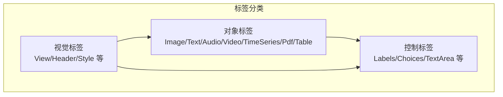

**章节来源**
- [docs/source/tags/index.md:9-13](file://docs/source/tags/index.md#L9-L13)

## 核心组件
本节按数据类型逐一说明其导入、展示、标注方法、关键参数与注意事项。

### 图像（Image）
- 用途：在标注界面显示图像，适用于计算机视觉任务
- 数据绑定：通过 value 或 valueList 指向图片 URL 或列表
- 标注结果：区域坐标以原图尺寸的百分比存储（0-100）
- 常用能力：缩放、旋转、网格、亮度/对比度调节、十字光标、对齐方式、初始缩放模式、跨域策略等
- 多图像分割：使用 valueList 绑定多个图片 URL

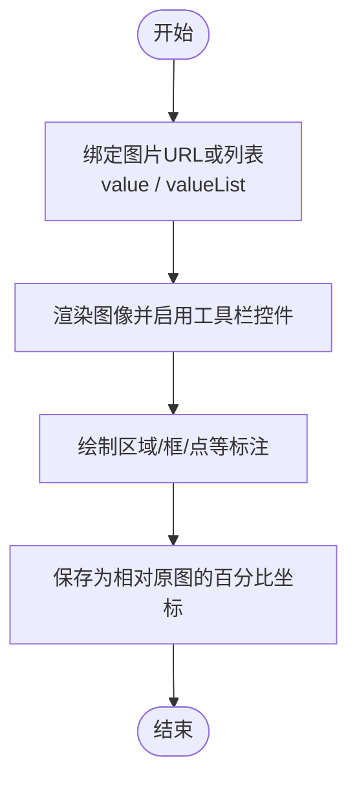

**图示来源**
- [docs/source/tags/image.md:9-15](file://docs/source/tags/image.md#L9-L15)
- [docs/source/includes/tags/image.md:1-27](file://docs/source/includes/tags/image.md#L1-L27)

**章节来源**
- [docs/source/tags/image.md:9-45](file://docs/source/tags/image.md#L9-L45)
- [docs/source/includes/tags/image.md:1-27](file://docs/source/includes/tags/image.md#L1-L27)

### 文本（Text）
- 用途：显示任意类型文本，适用于 NLP/NER 等任务
- 空格与换行：默认会修剪空格；如需保留空白，可使用样式规则；编辑器将 \r\n 视为两个字符，影响偏移计算
- 粒度控制：支持 symbol/word/sentence/paragraph 级别选择
- 结果字段：start/end 表示字符位置，可选 text 字段包含选中文本

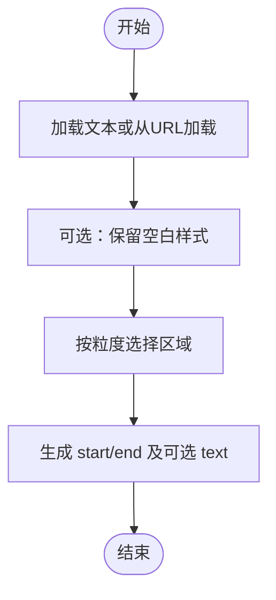

**图示来源**
- [docs/source/tags/text.md:9-21](file://docs/source/tags/text.md#L9-L21)
- [docs/source/includes/tags/text.md:1-35](file://docs/source/includes/tags/text.md#L1-L35)

**章节来源**
- [docs/source/tags/text.md:9-41](file://docs/source/tags/text.md#L9-L41)
- [docs/source/includes/tags/text.md:1-35](file://docs/source/includes/tags/text.md#L1-L35)

### 音频（Audio）
- 用途：播放音频并显示波形，支持区域标注、分类、转录、多通道、与视频/段落同步
- 关键参数：默认速度/音量/缩放、波形高度、频谱图、分通道显示、解码器与播放器类型
- 结果字段：original_length、value.start/end/channel 等

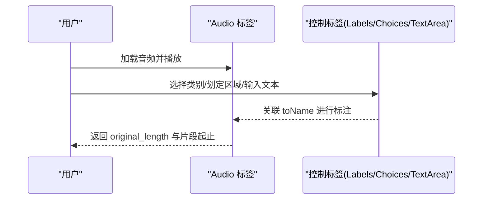

**图示来源**
- [docs/source/tags/audio.md:9-18](file://docs/source/tags/audio.md#L9-L18)
- [docs/source/includes/tags/audio.md:1-43](file://docs/source/includes/tags/audio.md#L1-L43)

**章节来源**
- [docs/source/tags/audio.md:9-103](file://docs/source/tags/audio.md#L9-L103)
- [docs/source/includes/tags/audio.md:1-43](file://docs/source/includes/tags/audio.md#L1-L43)

### 视频（Video）
- 用途：播放视频，适用于分类、转录等任务
- 格式建议：MP4 + H.264(AVC) 视频流 + AAC 音频流，恒定帧率（CFR），推荐约 30 fps；音视频时长需一致
- 关键参数：帧率、静音、高度、时间轴高度、播放速度范围、与其他对象同步
- 转换建议：使用 FFmpeg 转码以确保浏览器兼容性与时长检测准确

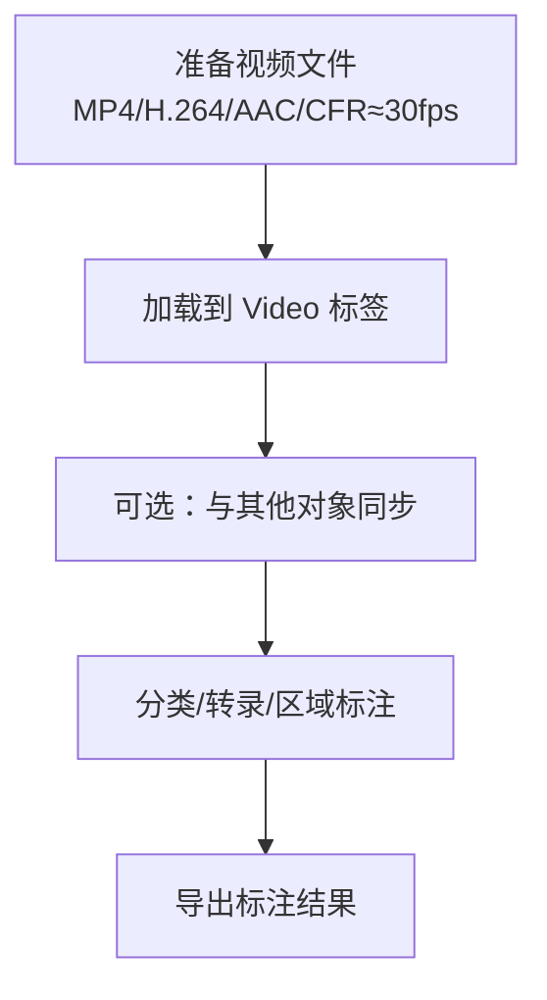

**图示来源**
- [docs/source/tags/video.md:9-43](file://docs/source/tags/video.md#L9-L43)
- [docs/source/includes/tags/video.md:1-15](file://docs/source/includes/tags/video.md#L1-L15)

**章节来源**
- [docs/source/tags/video.md:9-89](file://docs/source/tags/video.md#L9-L89)
- [docs/source/includes/tags/video.md:1-15](file://docs/source/includes/tags/video.md#L1-L15)

### 时间序列（TimeSeries）
- 用途：标注时间序列数据，支持单/多通道、概览窗口、时间列与格式化
- 重要约束：时间轴必须有序；未指定 timeColumn 时自动生成索引作为时间轴
- 关键参数：valueType(url/json)、sync、timeColumn/timeFormat/timeDisplayFormat/durationDisplayFormat、sep、overviewChannels/Width、fixedScale 等
- 通道组织：Channel 与 MultiChannel 组合展示多通道

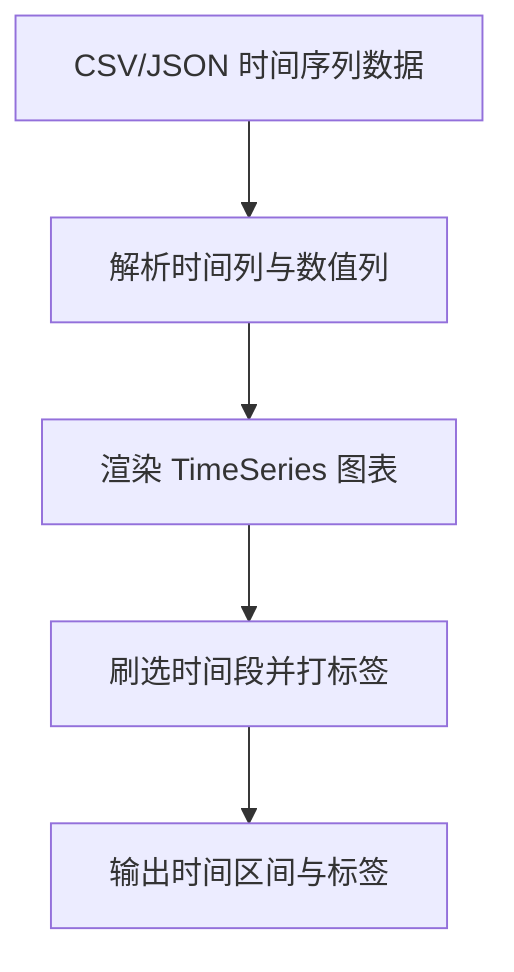

**图示来源**
- [docs/source/tags/timeseries.md:9-16](file://docs/source/tags/timeseries.md#L9-L16)
- [docs/source/includes/tags/timeseries.md:1-19](file://docs/source/includes/tags/timeseries.md#L1-L19)

**章节来源**
- [docs/source/tags/timeseries.md:9-88](file://docs/source/tags/timeseries.md#L9-L88)
- [docs/source/includes/tags/timeseries.md:1-19](file://docs/source/includes/tags/timeseries.md#L1-L19)

### PDF
- 用途：在标注界面显示 PDF，支持文档级分类、转录、摘要以及 OCR 校验（企业版）
- 能力限制：支持缩放、旋转、最多 100 页
- OCR 结果：x/y/width/height（相对页面）、rotation、pageIndex、ocrtext（可编辑）
- 适用场景：已有可选题文本层的 PDF 效果更佳；纯图像型 PDF 需先添加文本层

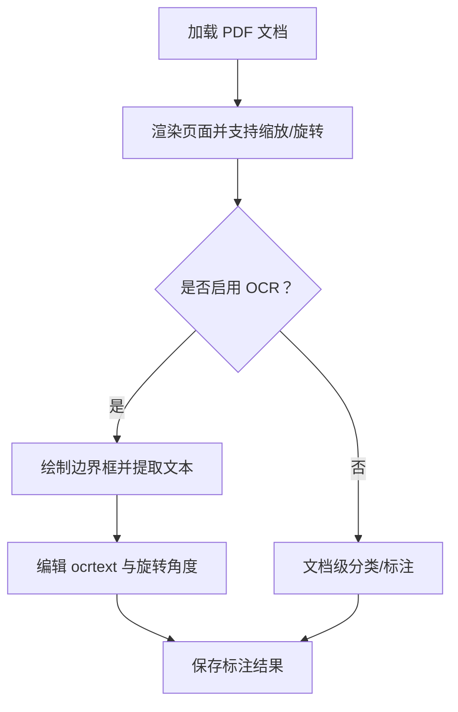

**图示来源**
- [docs/source/tags/pdf.md:9-24](file://docs/source/tags/pdf.md#L9-L24)
- [docs/source/includes/tags/pdf.md:1-7](file://docs/source/includes/tags/pdf.md#L1-L7)

**章节来源**
- [docs/source/tags/pdf.md:9-120](file://docs/source/tags/pdf.md#L9-L120)
- [docs/source/includes/tags/pdf.md:1-7](file://docs/source/includes/tags/pdf.md#L1-L7)

### 表格（Table）
- 用途：以表格形式展示键值对数据
- 数据绑定：value 指向 JSON 数据，valueType 定义数据类型

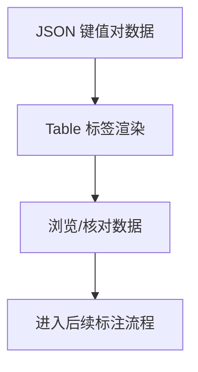

**图示来源**
- [docs/source/tags/table.md:9-11](file://docs/source/tags/table.md#L9-L11)
- [docs/source/includes/tags/table.md:1-8](file://docs/source/includes/tags/table.md#L1-L8)

**章节来源**
- [docs/source/tags/table.md:9-22](file://docs/source/tags/table.md#L9-L22)
- [docs/source/includes/tags/table.md:1-8](file://docs/source/includes/tags/table.md#L1-L8)

## 架构总览
下图展示了“对象标签—控制标签—视觉标签”的组合关系，以及不同数据类型对应的典型标注流程。

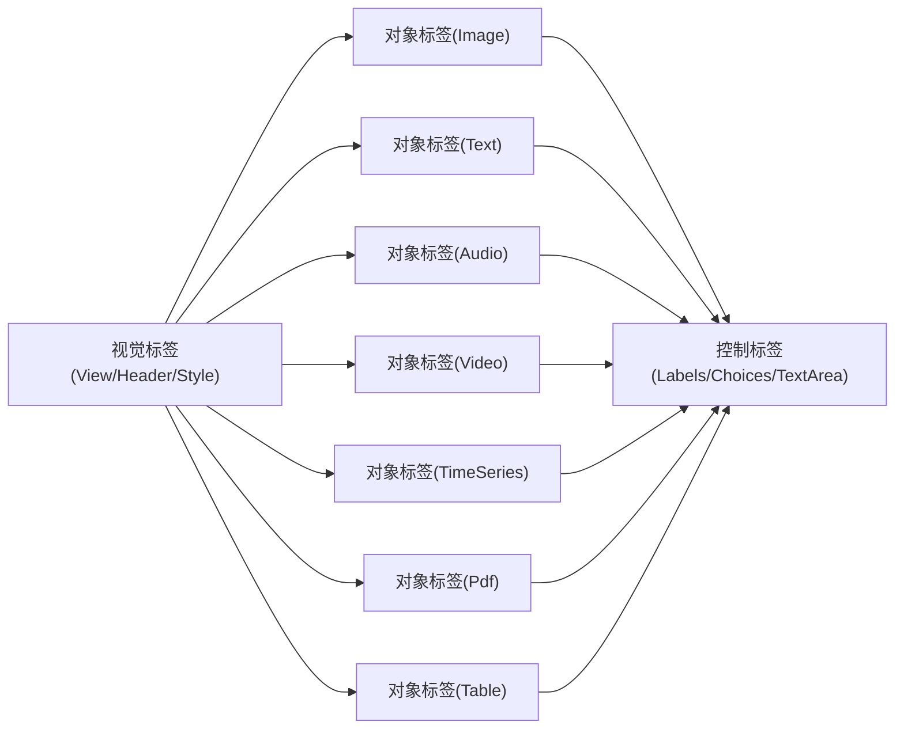

**图示来源**
- [docs/source/tags/index.md:9-13](file://docs/source/tags/index.md#L9-L13)

## 详细组件分析

### 图像标注工作流
- 数据准备：提供图片 URL 或 URL 列表
- 界面配置：启用缩放、旋转、网格、亮度/对比度等工具
- 标注过程：绘制矩形/多边形/关键点等
- 结果存储：坐标以百分比形式保存，便于分辨率无关

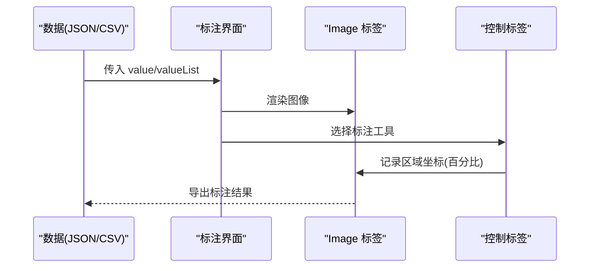

**图示来源**
- [docs/source/tags/image.md:9-45](file://docs/source/tags/image.md#L9-L45)
- [docs/source/includes/tags/image.md:1-27](file://docs/source/includes/tags/image.md#L1-L27)

**章节来源**
- [docs/source/tags/image.md:9-45](file://docs/source/tags/image.md#L9-L45)
- [docs/source/includes/tags/image.md:1-27](file://docs/source/includes/tags/image.md#L1-L27)

### 文本标注工作流
- 数据准备：直接文本或 URL 文本
- 预处理：统一换行符（\r\n→\n），避免偏移错位
- 粒度选择：词/句/段级别
- 结果：start/end 字符偏移，可选 text

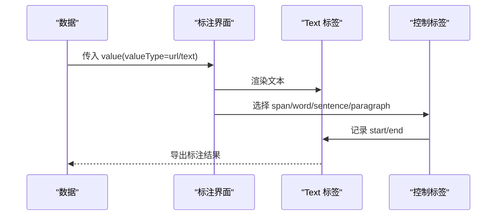

**图示来源**
- [docs/source/tags/text.md:9-21](file://docs/source/tags/text.md#L9-L21)
- [docs/source/includes/tags/text.md:1-35](file://docs/source/includes/tags/text.md#L1-L35)

**章节来源**
- [docs/source/tags/text.md:9-41](file://docs/source/tags/text.md#L9-L41)
- [docs/source/includes/tags/text.md:1-35](file://docs/source/includes/tags/text.md#L1-L35)

### 音频标注工作流
- 数据准备：音频 URL
- 播放与可视化：波形/频谱图/多通道
- 标注：区域划分、分类、转录
- 同步：可与视频或段落同步

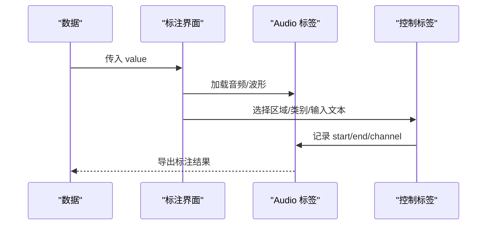

**图示来源**
- [docs/source/tags/audio.md:9-103](file://docs/source/tags/audio.md#L9-L103)
- [docs/source/includes/tags/audio.md:1-43](file://docs/source/includes/tags/audio.md#L1-L43)

**章节来源**
- [docs/source/tags/audio.md:9-103](file://docs/source/tags/audio.md#L9-L103)
- [docs/source/includes/tags/audio.md:1-43](file://docs/source/includes/tags/audio.md#L1-L43)

### 视频标注工作流
- 数据准备：符合兼容性要求的 MP4(H.264+AAC, CFR≈30fps)
- 播放控制：速度、静音、高度、时间轴
- 标注：分类、转录、区域标注
- 同步：与其他对象同步

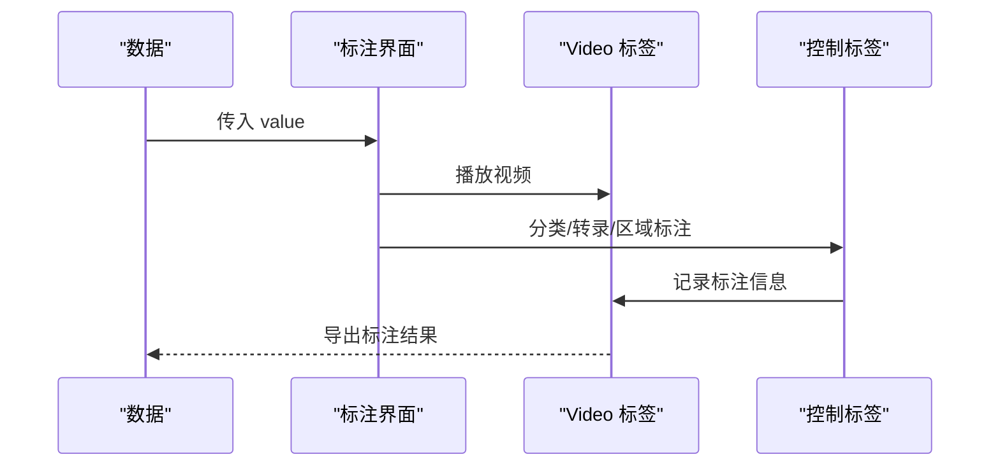

**图示来源**
- [docs/source/tags/video.md:9-89](file://docs/source/tags/video.md#L9-L89)
- [docs/source/includes/tags/video.md:1-15](file://docs/source/includes/tags/video.md#L1-L15)

**章节来源**
- [docs/source/tags/video.md:9-89](file://docs/source/tags/video.md#L9-L89)
- [docs/source/includes/tags/video.md:1-15](file://docs/source/includes/tags/video.md#L1-L15)

### 时间序列标注工作流
- 数据准备：CSV/JSON，确保时间列有序
- 可视化：单/多通道、概览窗口、时间格式化
- 标注：刷选时间段并打标签

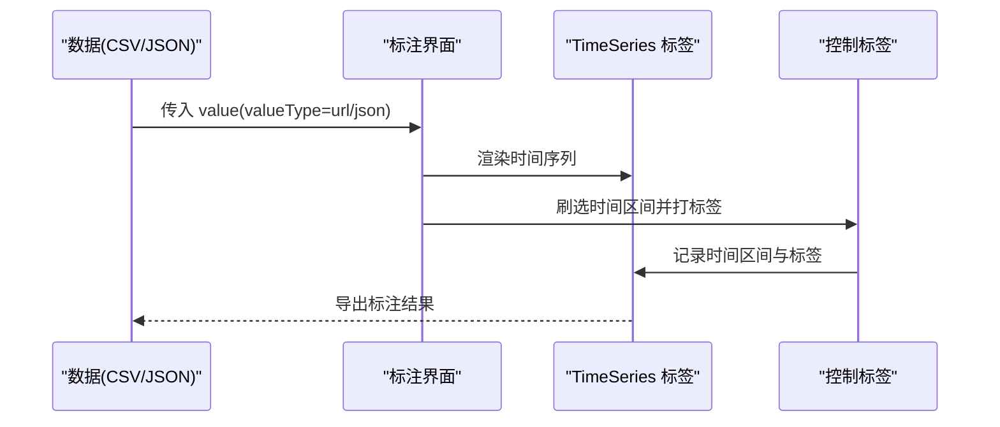

**图示来源**
- [docs/source/tags/timeseries.md:9-88](file://docs/source/tags/timeseries.md#L9-L88)
- [docs/source/includes/tags/timeseries.md:1-19](file://docs/source/includes/tags/timeseries.md#L1-L19)

**章节来源**
- [docs/source/tags/timeseries.md:9-88](file://docs/source/tags/timeseries.md#L9-L88)
- [docs/source/includes/tags/timeseries.md:1-19](file://docs/source/includes/tags/timeseries.md#L1-L19)

### PDF 标注工作流
- 数据准备：PDF URL
- 渲染：缩放/旋转/分页（≤100）
- OCR（企业版）：绘制框、提取文本、编辑文本与旋转
- 文档级标注：分类/转录/摘要

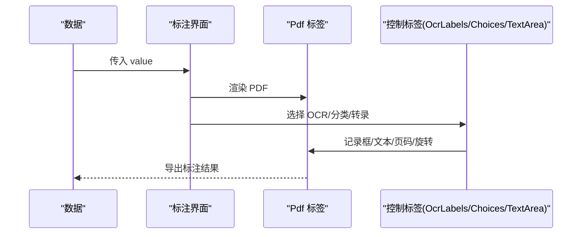

**图示来源**
- [docs/source/tags/pdf.md:9-120](file://docs/source/tags/pdf.md#L9-L120)
- [docs/source/includes/tags/pdf.md:1-7](file://docs/source/includes/tags/pdf.md#L1-L7)

**章节来源**
- [docs/source/tags/pdf.md:9-120](file://docs/source/tags/pdf.md#L9-L120)
- [docs/source/includes/tags/pdf.md:1-7](file://docs/source/includes/tags/pdf.md#L1-L7)

### 表格标注工作流
- 数据准备：JSON 键值对
- 渲染：Table 标签展示
- 后续：结合其他控制标签完成标注

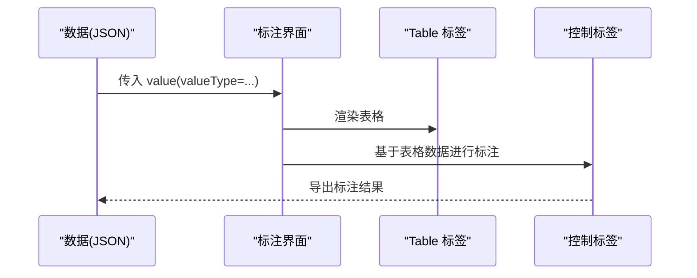

**图示来源**
- [docs/source/tags/table.md:9-22](file://docs/source/tags/table.md#L9-L22)
- [docs/source/includes/tags/table.md:1-8](file://docs/source/includes/tags/table.md#L1-L8)

**章节来源**
- [docs/source/tags/table.md:9-22](file://docs/source/tags/table.md#L9-L22)
- [docs/source/includes/tags/table.md:1-8](file://docs/source/includes/tags/table.md#L1-L8)

## 依赖关系分析
- 对象标签与控制标签通过 name/toName 建立绑定关系
- 视觉标签用于布局与样式控制，不直接参与数据绑定
- 各数据类型的关键依赖：
  - 图像：浏览器渲染与 CORS 设置
  - 文本：编码与换行处理
  - 音频：解码器与播放器类型、内存占用（多通道）
  - 视频：浏览器兼容性、帧率与时长一致性
  - 时间序列：时间列排序与解析格式
  - PDF：文本层质量与页数限制
  - 表格：JSON 结构与 valueType

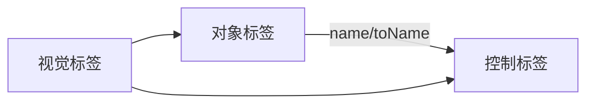

**图示来源**
- [docs/source/tags/index.md:33-49](file://docs/source/tags/index.md#L33-L49)

**章节来源**
- [docs/source/tags/index.md:33-49](file://docs/source/tags/index.md#L33-L49)

## 性能考虑
- 图像
  - 合理设置 zoomControl/brightnessControl/contrastControl/rotateControl，避免不必要的重绘
  - 大尺寸图片建议使用合适的 maxWidth 与默认缩放模式
- 文本
  - 避免过大的单条文本；必要时分段或使用 paragraphs
  - 保持换行符一致，减少偏移计算开销
- 音频
  - splitchannels=true 会增加内存占用；按需开启
  - decoder="none" 可加速大文件加载但禁用波形
- 视频
  - 使用推荐的 MP4/H.264/AAC/CFR≈30fps 以减少解码与时长检测问题
  - 控制 timelineHeight 与 height 平衡可视性与性能
- 时间序列
  - 使用 overviewChannels/overviewWidth 聚焦关键通道
  - fixedScale=false 仅缩放当前视图，提升交互流畅度
- PDF
  - 限制页数（≤100），避免超大文档
  - 优先使用含可选题文本层的 PDF，提高 OCR 效率
- 表格
  - 控制 JSON 体量，避免一次性渲染过多键值对

[本节为通用指导，无需具体文件引用]

## 故障排查指南
- 文本偏移异常
  - 现象：NER 标注偏移不正确
  - 原因：\r\n 被当作两个字符
  - 解决：预处理替换为 \n，或在 Python 中以 newline='' 打开文件
- 视频播放与时长不一致
  - 现象：总帧数错误、播放卡顿
  - 原因：非 CFR、音视频时长不一致、编解码器不兼容
  - 解决：使用 FFmpeg 转码为 MP4/H.264/AAC/CFR≈30fps，并确保音视频时长一致
- 音频多通道内存不足
  - 现象：卡顿或崩溃
  - 原因：splitchannels=true 增加内存
  - 解决：关闭分通道或降低采样/分辨率
- 时间序列时间轴错乱
  - 现象：图表无法正确渲染
  - 原因：时间列未排序或未正确解析
  - 解决：确保时间列有序，并设置正确的 timeFormat/timeDisplayFormat
- PDF OCR 文本缺失
  - 现象：OCR 无法提取文本
  - 原因：纯图像型 PDF 无文本层
  - 解决：先用外部工具添加文本层，或改用图像标注方案

**章节来源**
- [docs/source/tags/text.md:15-21](file://docs/source/tags/text.md#L15-L21)
- [docs/source/tags/video.md:13-43](file://docs/source/tags/video.md#L13-L43)
- [docs/source/includes/tags/audio.md:16-18](file://docs/source/includes/tags/audio.md#L16-L18)
- [docs/source/tags/timeseries.md:9-16](file://docs/source/tags/timeseries.md#L9-L16)
- [docs/source/tags/pdf.md:94-101](file://docs/source/tags/pdf.md#L94-L101)

## 结论
Label Studio 通过对象标签与控制标签的组合，为图像、文本、音频、视频、时间序列、PDF、表格等多种数据类型提供了统一的标注体验。遵循本文的格式规范、预处理要求与性能优化建议，可显著提升标注效率与结果质量。

[本节为总结性内容，无需具体文件引用]

## 附录
- 标签命名与连接
  - 所有对象标签与控制标签均需 name；控制标签还需 toName 与对象标签 name 匹配
- 变量使用
  - 在 value 中使用 $field 引用任务数据字段，实现动态界面
- 样式与布局
  - 使用 Style 与 View 自定义布局与样式，例如两列布局

**章节来源**
- [docs/source/tags/index.md:33-49](file://docs/source/tags/index.md#L33-L49)
- [docs/source/tags/index.md:51-85](file://docs/source/tags/index.md#L51-L85)