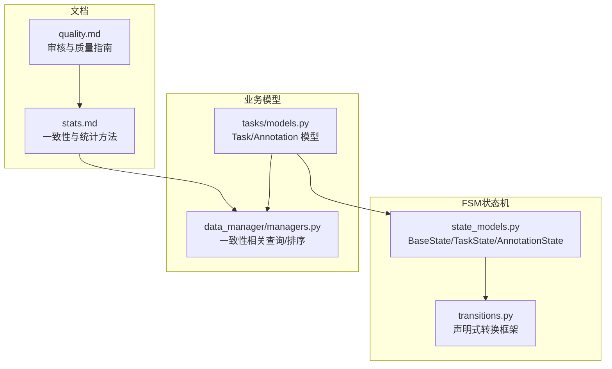
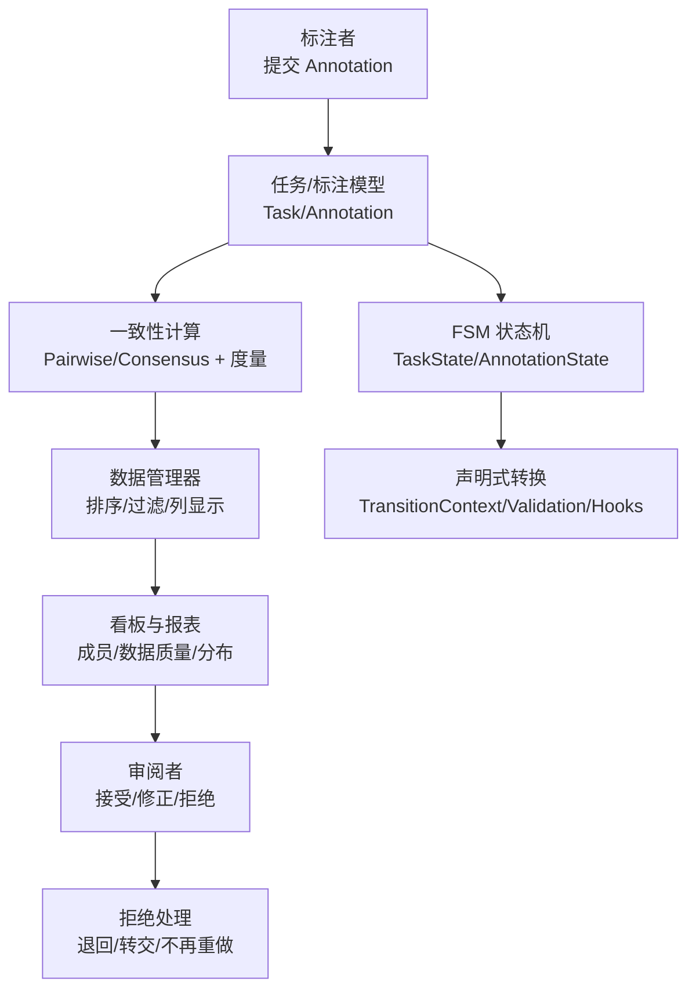
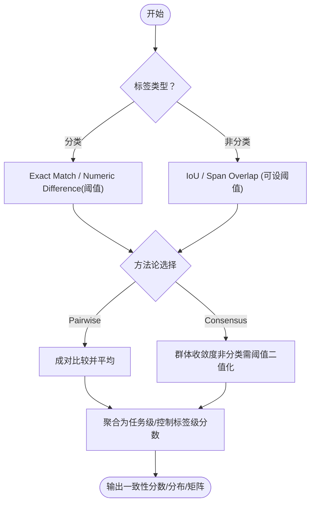
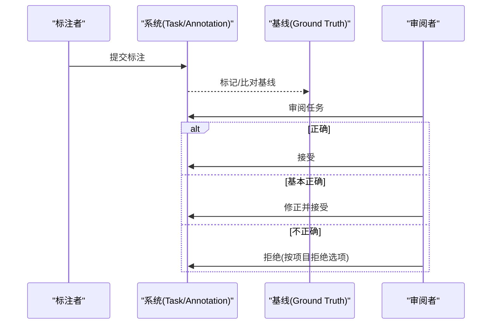
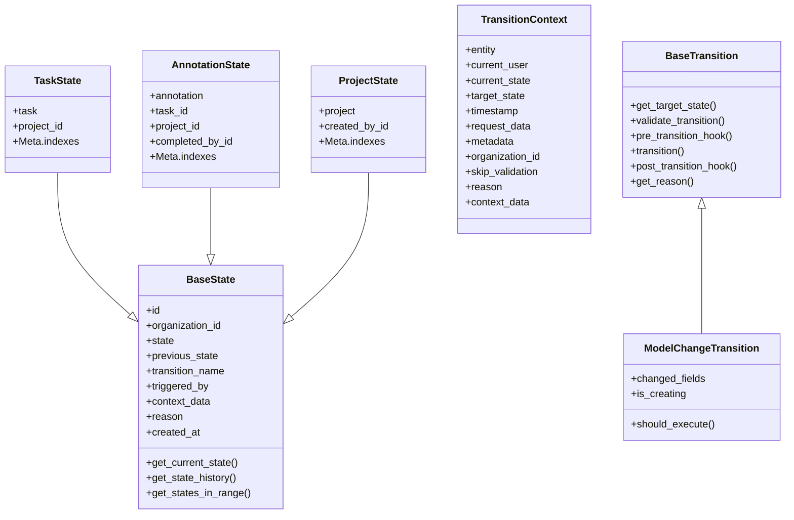
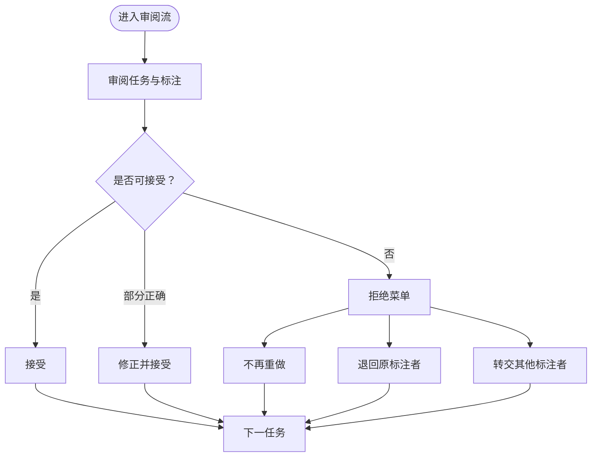
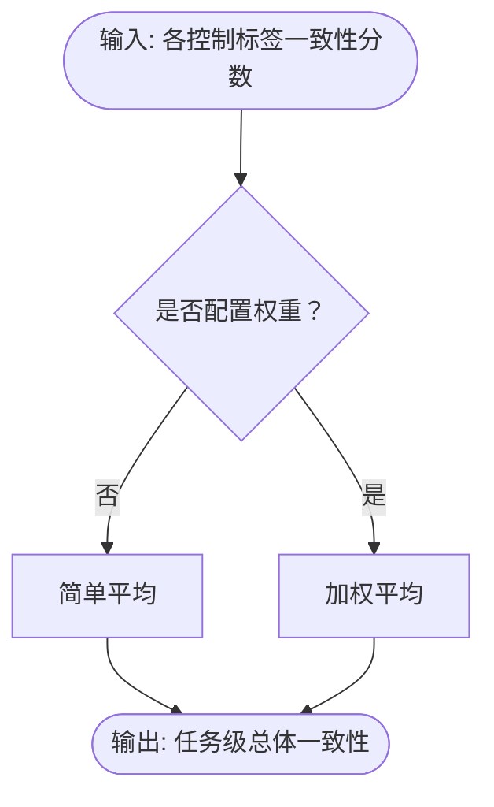
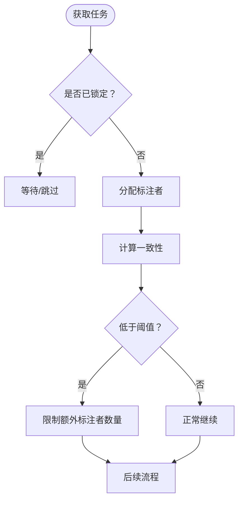
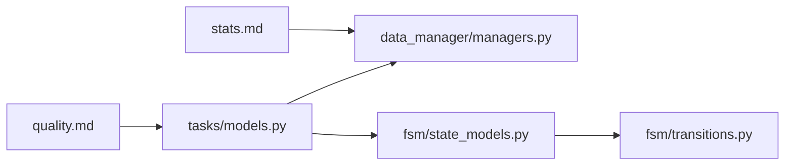

# 标注质量

<cite>
**本文引用的文件**   
- [quality.md](file://docs/source/guide/quality.md)
- [stats.md](file://docs/source/guide/stats.md)
- [state_models.py](file://label_studio/fsm/state_models.py)
- [transitions.py](file://label_studio/fsm/transitions.py)
- [models.py（任务与标注）](file://label_studio/tasks/models.py)
- [managers.py（数据管理器）](file://label_studio/data_manager/managers.py)
</cite>

## 目录
1. [简介](#简介)
2. [项目结构](#项目结构)
3. [核心组件](#核心组件)
4. [架构总览](#架构总览)
5. [详细组件分析](#详细组件分析)
6. [依赖关系分析](#依赖关系分析)
7. [性能考量](#性能考量)
8. [故障排查指南](#故障排查指南)
9. [结论](#结论)
10. [附录](#附录)

## 简介
本文件面向 Label Studio 的“标注质量管理”能力，系统性说明以下主题：
- 标注一致性检查、多人标注对比、标注结果验证与质量指标计算方法
- 标注状态机的工作流程、审核流程与争议解决机制
- 标注质量评估工具使用、质量报告生成与持续改进策略
- 团队协作中的质量保证实践与常见问题解决方案

该文档以仓库中企业版文档与 FSM（有限状态机）实现为依据，结合任务/标注模型与数据管理器的相关逻辑进行解读。

## 项目结构
围绕“标注质量”的关键代码与文档分布如下：
- 文档层
  - 审核与质量指南：docs/source/guide/quality.md
  - 一致性与统计方法：docs/source/guide/stats.md
- 后端实现层
  - FSM 状态模型与声明式转换：label_studio/fsm/state_models.py, label_studio/fsm/transitions.py
  - 任务与标注模型（含重叠、预计算一致性等字段）：label_studio/tasks/models.py
  - 数据管理器中与一致性相关的排序/过滤逻辑：label_studio/data_manager/managers.py

**图示来源**
- [quality.md:1-296](file://docs/source/guide/quality.md#L1-L296)
- [stats.md:1-543](file://docs/source/guide/stats.md#L1-L543)
- [state_models.py:30-364](file://label_studio/fsm/state_models.py#L30-L364)
- [transitions.py:27-486](file://label_studio/fsm/transitions.py#L27-L486)
- [models.py（任务与标注）:66-800](file://label_studio/tasks/models.py#L66-L800)
- [managers.py（数据管理器）:358-367](file://label_studio/data_manager/managers.py#L358-L367)

**章节来源**
- [quality.md:1-296](file://docs/source/guide/quality.md#L1-L296)
- [stats.md:1-543](file://docs/source/guide/stats.md#L1-L543)
- [state_models.py:30-364](file://label_studio/fsm/state_models.py#L30-L364)
- [transitions.py:27-486](file://label_studio/fsm/transitions.py#L27-L486)
- [models.py（任务与标注）:66-800](file://label_studio/tasks/models.py#L66-L800)
- [managers.py（数据管理器）:358-367](file://label_studio/data_manager/managers.py#L358-L367)

## 核心组件
- 审核与质量工作流（Enterprise）
  - 审阅者对已标注任务执行“接受/修正并接受/拒绝”，支持“退回原标注者/转交其他标注者”等拒绝选项
  - 审阅队列可按任务ID、随机、按标注者顺序组织；可配置抽样与覆盖比例
  - 成员看板展示同意率、接受率、时间统计、与基线/预测的一致性
- 一致性与统计方法
  - 控制标签维度与总体一致性；分类与非分类标签的差异
  - 两种方法论：Pairwise（成对平均）与 Consensus（共识）
  - 内置度量：Exact Match、IoU、Span Overlap 及其阈值变体
  - 可为不同控制标签设置权重，影响总体一致性
- FSM 状态机
  - BaseState 提供 UUID7 主键、审计上下文、时间范围查询等
  - TaskState/AnnotationState/ProjectState 分别跟踪任务/标注/项目的状态历史
  - 声明式转换框架（TransitionContext/BaseTransition/ModelChangeTransition）支持校验、钩子与原因记录
- 任务与标注模型
  - Task 包含 overlap、is_labeled、precomputed_agreement 等字段，用于多人标注与一致性评估
  - Annotation 包含 ground_truth、prediction、lead_time 等质量相关字段
  - has_lock/overlap_with_agreement_threshold 等逻辑与一致性阈值联动
- 数据管理器
  - is_agreement_related_field/_is_stale_agreement_field 等辅助函数识别一致性相关字段
  - annotated_completed_at_considering_agreement_threshold 在排序/过滤时考虑一致性阈值

**章节来源**
- [quality.md:22-296](file://docs/source/guide/quality.md#L22-L296)
- [stats.md:1-543](file://docs/source/guide/stats.md#L1-L543)
- [state_models.py:30-364](file://label_studio/fsm/state_models.py#L30-L364)
- [transitions.py:27-486](file://label_studio/fsm/transitions.py#L27-L486)
- [models.py（任务与标注）:66-800](file://label_studio/tasks/models.py#L66-L800)
- [managers.py（数据管理器）:358-367](file://label_studio/data_manager/managers.py#L358-L367)

## 架构总览
下图展示了从“标注产出”到“一致性计算”再到“审核与看板”的整体链路，以及 FSM 如何为关键实体提供可审计的状态变更。

**图示来源**
- [models.py（任务与标注）:66-800](file://label_studio/tasks/models.py#L66-L800)
- [stats.md:1-543](file://docs/source/guide/stats.md#L1-L543)
- [managers.py（数据管理器）:358-367](file://label_studio/data_manager/managers.py#L358-L367)
- [state_models.py:30-364](file://label_studio/fsm/state_models.py#L30-L364)
- [transitions.py:27-486](file://label_studio/fsm/transitions.py#L27-L486)
- [quality.md:22-296](file://docs/source/guide/quality.md#L22-L296)

## 详细组件分析

### 标注一致性检查与多人标注对比
- 一致性维度
  - 控制标签维度（如 RectangleLabels、Choices、Rating）与总体一致性
  - 分类标签（离散值）与非分类标签（空间/结构数据）采用不同度量
- 方法论
  - Pairwise：对所有标注者两两比较后取平均，保留连续相似度粒度
  - Consensus：衡量群体收敛度，非分类标签需阈值将连续分数二值化
- 内置度量
  - Exact Match、IoU、Span Overlap 及带阈值的 IoU/Span Overlap
- 可视化与筛选
  - Data Manager 显示每任务一致性及各控制标签一致性
  - 数据质量看板展示一致性分布、混淆矩阵、Top 混淆对
  - 成员看板展示成员间一致性矩阵，并可按维度/标签过滤

**图示来源**
- [stats.md:31-114](file://docs/source/guide/stats.md#L31-L114)
- [stats.md:116-254](file://docs/source/guide/stats.md#L116-L254)
- [stats.md:342-486](file://docs/source/guide/stats.md#L342-L486)

**章节来源**
- [stats.md:1-543](file://docs/source/guide/stats.md#L1-L543)

### 标注结果验证与质量指标
- 基线（Ground Truth）
  - 可将某条标注设为 Ground Truth，用于评估标注者与模型预测的准确度
  - 支持查看/移除 Ground Truth，并在 Data Manager 中过滤
- 成员绩效
  - 成员看板展示同意率、接受率、时间统计、与基线/预测的一致性
- 审阅结果
  - 审阅者可“接受/修正并接受/拒绝”，拒绝时可配置“不再重做/退回原标注者/转交其他标注者”

**图示来源**
- [quality.md:26-48](file://docs/source/guide/quality.md#L26-L48)
- [quality.md:248-296](file://docs/source/guide/quality.md#L248-L296)

**章节来源**
- [quality.md:26-48](file://docs/source/guide/quality.md#L26-L48)
- [quality.md:248-296](file://docs/source/guide/quality.md#L248-L296)

### 标注状态机工作流程（FSM）
- BaseState
  - UUID7 主键保证自然时序与全局唯一性
  - 标准状态元数据（previous_state、transition_name、triggered_by）、上下文数据、原因
  - 高效查询：当前状态、历史、时间范围
- TaskState/AnnotationState/ProjectState
  - 针对任务、标注、项目定义具体状态约束与索引优化
- 声明式转换
  - TransitionContext 封装上下文（用户、当前/目标状态、时间戳、请求数据、组织上下文等）
  - BaseTransition 提供校验、前置/后置钩子、原因生成
  - ModelChangeTransition 支持基于模型变更触发（创建/更新字段变化）

**图示来源**
- [state_models.py:30-364](file://label_studio/fsm/state_models.py#L30-L364)
- [transitions.py:27-486](file://label_studio/fsm/transitions.py#L27-L486)

**章节来源**
- [state_models.py:30-364](file://label_studio/fsm/state_models.py#L30-L364)
- [transitions.py:27-486](file://label_studio/fsm/transitions.py#L27-L486)

### 审核流程与争议解决机制
- 审阅入口
  - 项目“审阅所有任务”或管理员/项目经理直接访问
- 审阅操作
  - 接受、修正并接受、拒绝（根据项目拒绝选项）
- 拒绝选项
  - 不再重做、退回原标注者、转交其他标注者
- 审阅队列组织
  - 按任务ID、随机、按标注者顺序；可配置抽样与覆盖比例
- 暂停机制
  - 全量暂停与灵活暂停；自动暂停（标注上限/标注者评估/行为触发）
  - 灵活暂停下仅允许修订被拒标注，不能开始新标注

**图示来源**
- [quality.md:26-48](file://docs/source/guide/quality.md#L26-L48)
- [quality.md:53-64](file://docs/source/guide/quality.md#L53-L64)
- [quality.md:137-207](file://docs/source/guide/quality.md#L137-L207)

**章节来源**
- [quality.md:26-48](file://docs/source/guide/quality.md#L26-L48)
- [quality.md:53-64](file://docs/source/guide/quality.md#L53-L64)
- [quality.md:137-207](file://docs/source/guide/quality.md#L137-L207)

### 质量指标计算方法与权重配置
- 控制标签维度 vs 总体一致性
  - 总体一致性为各控制标签得分的加权平均（默认等权）
- 方法论差异
  - Pairwise：成对比较，适合关注标注者间一致性
  - Consensus：群体收敛度，适合关注任务答案稳定性
- 阈值与权重
  - 非分类标签在 Consensus 下需要阈值
  - 可在“总体一致性”中为不同控制标签设置权重

**图示来源**
- [stats.md:51-59](file://docs/source/guide/stats.md#L51-L59)
- [stats.md:501-524](file://docs/source/guide/stats.md#L501-L524)

**章节来源**
- [stats.md:51-59](file://docs/source/guide/stats.md#L51-L59)
- [stats.md:501-524](file://docs/source/guide/stats.md#L501-L524)

### 任务锁定与一致性阈值联动
- 任务锁与并发
  - set_lock/release_lock 管理并发标注
  - has_lock 判断任务是否达到完成条件（考虑 overlap 与 skip_queue）
- 一致性阈值联动
  - overlap_with_agreement_threshold 在低一致性时限制额外分配标注者数量，确保每次新增标注后重新计算一致性
- 数据管理器排序
  - annotated_completed_at_considering_agreement_threshold 在排序/过滤时考虑一致性阈值

**图示来源**
- [models.py（任务与标注）:316-384](file://label_studio/tasks/models.py#L316-L384)
- [managers.py（数据管理器）:1327-1366](file://label_studio/data_manager/managers.py#L1327-L1366)

**章节来源**
- [models.py（任务与标注）:316-384](file://label_studio/tasks/models.py#L316-L384)
- [managers.py（数据管理器）:1327-1366](file://label_studio/data_manager/managers.py#L1327-L1366)

## 依赖关系分析
- 文档与实现的映射
  - quality.md 描述审阅流程、拒绝选项、暂停机制、看板与基线
  - stats.md 描述一致性方法论、度量、权重与可视化
- 后端模块耦合
  - tasks/models.py 提供 Task/Annotation 的核心字段与并发/一致性阈值联动
  - data_manager/managers.py 提供一致性相关字段的识别与排序/过滤增强
  - fsm/state_models.py 与 fsm/transitions.py 提供可审计的状态管理与声明式转换

**图示来源**
- [quality.md:1-296](file://docs/source/guide/quality.md#L1-L296)
- [stats.md:1-543](file://docs/source/guide/stats.md#L1-L543)
- [models.py（任务与标注）:66-800](file://label_studio/tasks/models.py#L66-L800)
- [managers.py（数据管理器）:358-367](file://label_studio/data_manager/managers.py#L358-L367)
- [state_models.py:30-364](file://label_studio/fsm/state_models.py#L30-L364)
- [transitions.py:27-486](file://label_studio/fsm/transitions.py#L27-L486)

**章节来源**
- [quality.md:1-296](file://docs/source/guide/quality.md#L1-L296)
- [stats.md:1-543](file://docs/source/guide/stats.md#L1-L543)
- [models.py（任务与标注）:66-800](file://label_studio/tasks/models.py#L66-L800)
- [managers.py（数据管理器）:358-367](file://label_studio/data_manager/managers.py#L358-L367)
- [state_models.py:30-364](file://label_studio/fsm/state_models.py#L30-L364)
- [transitions.py:27-486](file://label_studio/fsm/transitions.py#L27-L486)

## 性能考量
- FSM 设计
  - 使用 UUID7 主键，天然时间序，减少索引需求，提升高并发写入与最新状态查询效率
  - 通过去重字段（如 project_id/task_id/completed_by_id）与复合索引优化常见查询
- 任务并发与一致性
  - overlap_with_agreement_threshold 在低一致性时限制额外标注者，避免并发导致一致性骤降
  - 数据管理器在排序/过滤时考虑一致性阈值，减少无效扫描
- 建议
  - 合理设置 overlap 与一致性阈值，平衡标注速度与一致性
  - 为常用过滤/排序字段建立合适索引（已在模型中定义）

[本节为通用指导，不直接分析具体文件]

## 故障排查指南
- 审阅流问题
  - 确认审阅者已被添加到项目或工作区
  - 检查项目“拒绝选项”配置是否符合预期
- 一致性分数异常
  - 核对控制标签度量与方法论（Pairwise/Consensus）
  - 非分类标签在 Consensus 下是否正确设置阈值
  - 检查总体一致性权重配置是否合理
- 任务锁定/并发
  - 检查 overlap 与 skip_queue 配置
  - 观察是否有长时间未释放的锁
- 基线（Ground Truth）
  - 确认是否已为任务设置基线，且未被误取消
- 暂停机制
  - 区分全量暂停与灵活暂停的原因与恢复方式
  - 检查自动暂停触发条件（标注上限/标注者评估/行为触发）

**章节来源**
- [quality.md:114-207](file://docs/source/guide/quality.md#L114-L207)
- [stats.md:489-534](file://docs/source/guide/stats.md#L489-L534)
- [models.py（任务与标注）:316-384](file://label_studio/tasks/models.py#L316-L384)

## 结论
Label Studio 的标注质量体系以“一致性度量 + 审阅流程 + FSM 状态机”为核心：
- 通过 Pairwise/Consensus 与多种内置度量，实现对分类与非分类标签的一致性与质量评估
- 借助审阅流程与拒绝选项，形成闭环的质量控制与争议解决
- FSM 提供可审计、高性能的状态变更记录，支撑复杂业务流程的可追溯性
- 数据管理器与看板提供可视化的质量洞察，驱动持续改进

[本节为总结性内容，不直接分析具体文件]

## 附录
- 术语
  - 控制标签：用于标注数据的 UI 控件标签（如 RectangleLabels、Choices、Rating）
  - 基线（Ground Truth）：作为参考标准的标注
  - 一致性：多人标注之间的相似程度
- 最佳实践
  - 明确控制标签度量与方法论，并为关键标签设置更高权重
  - 合理配置 overlap 与一致性阈值，兼顾效率与质量
  - 定期审视看板与一致性分布，定位困难任务与模糊指令
  - 利用审阅反馈与暂停机制，及时干预低质量标注行为

[本节为补充信息，不直接分析具体文件]