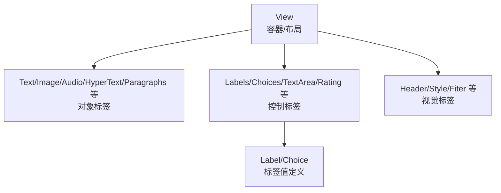
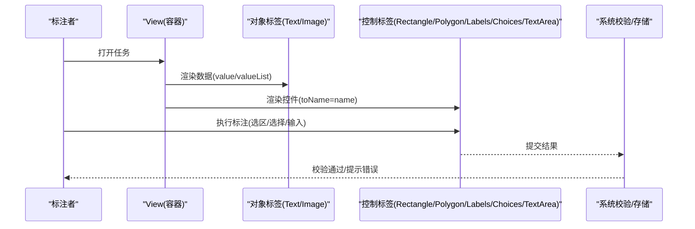
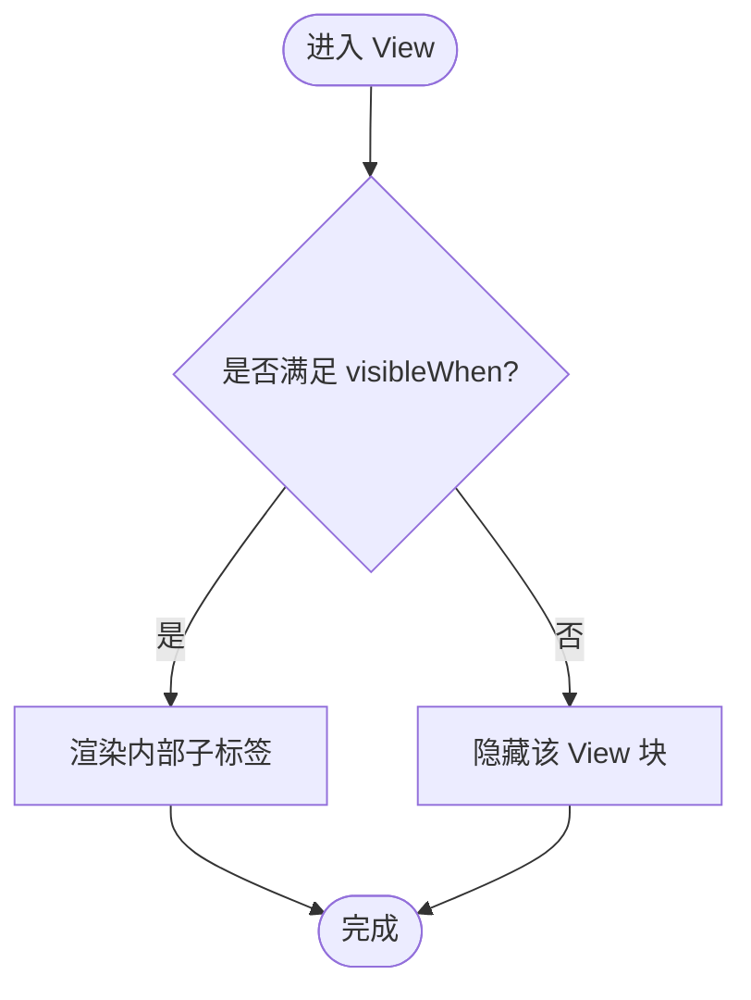
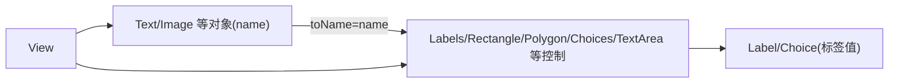

# 标签配置语言

<cite>
**本文引用的文件**   
- [docs/source/skills/xml-config.md](file://docs/source/skills/xml-config.md)
- [docs/source/tags/index.md](file://docs/source/tags/index.md)
- [docs/source/tags/view.md](file://docs/source/tags/view.md)
- [docs/source/tags/text.md](file://docs/source/tags/text.md)
- [docs/source/tags/image.md](file://docs/source/tags/image.md)
- [docs/source/tags/rectangle.md](file://docs/source/tags/rectangle.md)
- [docs/source/tags/polygon.md](file://docs/source/tags/polygon.md)
- [docs/source/tags/choices.md](file://docs/source/tags/choices.md)
- [docs/source/tags/textarea.md](file://docs/source/tags/textarea.md)
- [docs/source/tags/filter.md](file://docs/source/tags/filter.md)
- [docs/source/tags/label.md](file://docs/source/tags/label.md)
- [docs/source/tags/labels.md](file://docs/source/tags/labels.md)
</cite>

## 目录
1. [简介](#简介)
2. [项目结构](#项目结构)
3. [核心组件](#核心组件)
4. [架构总览](#架构总览)
5. [详细组件分析](#详细组件分析)
6. [依赖关系分析](#依赖关系分析)
7. [性能与可用性考虑](#性能与可用性考虑)
8. [故障排查指南](#故障排查指南)
9. [结论](#结论)
10. [附录：常用标签速查](#附录常用标签速查)

## 简介
本参考文档系统性梳理 Label Studio 的标签配置 XML 语言，覆盖语法结构、标签定义、属性设置与条件逻辑，详解图像标注（矩形框、多边形）、文本选择、下拉/单选多选等控件的配置方法与高级用法，并给出嵌套结构、动态标签、条件显示、验证规则等实践指南与最佳实践，帮助开发者快速构建自定义标注界面。

## 项目结构
Label Studio 的标签配置语言由三类标签组成：
- 对象标签（Object）：用于展示可标注的数据类型，如图像、文本、音频、HTML 等
- 控制标签（Control）：用于对对象进行标注，如 Labels、Choices、TextArea 等
- 视觉标签（Visual）：用于调整界面布局与样式，如 View、Header、Style 等

图示来源
- [docs/source/tags/index.md:9-13](file://docs/source/tags/index.md#L9-L13)
- [docs/source/tags/view.md:9-11](file://docs/source/tags/view.md#L9-L11)

章节来源
- [docs/source/tags/index.md:9-13](file://docs/source/tags/index.md#L9-L13)

## 核心组件
- 根容器与布局
  - View：作为布局容器，支持 flex 布局、条件显示 visibleWhen 等
- 数据对象
  - Text：文本对象，支持 word-level NER、空格保留策略等
  - Image：图像对象，支持旋转、缩放、多图列表 valueList
- 标注控件
  - Rectangle/Polygon：图像区域标注（无标签或配合标签使用）
  - Labels/Label：文本/图像/音频等多模态区域标注
  - Choices/Choice：分类/多选/单选
  - TextArea：自由文本输入，支持 region-list、去重、快捷键提交等
  - Filter：为大量标签/选项提供搜索过滤
- 变量与动态标签
  - 通过 $field 引用任务数据字段
  - 动态加载 Label/Choice 列表，将 options 映射到子标签属性

章节来源
- [docs/source/tags/view.md:13-63](file://docs/source/tags/view.md#L13-L63)
- [docs/source/tags/text.md:9-22](file://docs/source/tags/text.md#L9-L22)
- [docs/source/tags/image.md:9-15](file://docs/source/tags/image.md#L9-L15)
- [docs/source/tags/rectangle.md:9-14](file://docs/source/tags/rectangle.md#L9-L14)
- [docs/source/tags/polygon.md:9-13](file://docs/source/tags/polygon.md#L9-L13)
- [docs/source/tags/labels.md:9-15](file://docs/source/tags/labels.md#L9-L15)
- [docs/source/tags/choices.md:9-15](file://docs/source/tags/choices.md#L9-L15)
- [docs/source/tags/textarea.md:9-13](file://docs/source/tags/textarea.md#L9-L13)
- [docs/source/tags/filter.md:9-11](file://docs/source/tags/filter.md#L9-L11)

## 架构总览
下图展示了“对象-控制”连接关系与常见交互流程：控制标签通过 toName 绑定到对象标签 name；用户操作后生成结构化结果。

图示来源
- [docs/source/tags/index.md:33-49](file://docs/source/tags/index.md#L33-L49)
- [docs/source/tags/rectangle.md:16-25](file://docs/source/tags/rectangle.md#L16-L25)
- [docs/source/tags/polygon.md:15-24](file://docs/source/tags/polygon.md#L15-L24)
- [docs/source/tags/choices.md:17-31](file://docs/source/tags/choices.md#L17-L31)
- [docs/source/tags/textarea.md:15-23](file://docs/source/tags/textarea.md#L15-L23)

## 详细组件分析

### 容器与布局：View
- 作用：类似 HTML div，用于组织多个对象/控制/视觉标签，支持 flex 布局与条件可见性
- 关键能力
  - 布局：style="display:flex" 等
  - 条件显示：visibleWhen + whenTagName/whenChoiceValue/whenLabelValue
- 典型用法
  - 双列布局
  - 根据已选标签/类别显示附加说明或补充输入

图示来源
- [docs/source/tags/view.md:31-63](file://docs/source/tags/view.md#L31-L63)

章节来源
- [docs/source/tags/view.md:9-63](file://docs/source/tags/view.md#L9-L63)

### 文本对象：Text
- 用途：展示任意文本，常用于 NLP/NER
- 要点
  - 空格处理：可通过 Style 保留空白；offset 计算包含空格
  - 粒度：word 级别 NER 时建议设置 granularity="word"
- 示例路径
  - [docs/source/tags/text.md:24-36](file://docs/source/tags/text.md#L24-L36)

章节来源
- [docs/source/tags/text.md:9-22](file://docs/source/tags/text.md#L9-L22)
- [docs/source/tags/text.md:24-36](file://docs/source/tags/text.md#L24-L36)

### 图像对象：Image
- 用途：展示图片，支持旋转、缩放、多图列表
- 要点
  - 坐标以百分比保存（0-100）
  - 多图：valueList 接收数组
- 示例路径
  - [docs/source/tags/image.md:17-26](file://docs/source/tags/image.md#L17-L26)
  - [docs/source/tags/image.md:27-44](file://docs/source/tags/image.md#L27-L44)

章节来源
- [docs/source/tags/image.md:9-15](file://docs/source/tags/image.md#L9-L15)
- [docs/source/tags/image.md:17-44](file://docs/source/tags/image.md#L17-L44)

### 图像区域标注：Rectangle / Polygon
- Rectangle：绘制矩形框，适合目标检测
- Polygon：绘制多边形，适合分割任务
- 共同点
  - 通过 toName 绑定到 Image
  - 可与 Labels 组合实现带类别的区域标注
- 示例路径
  - [docs/source/tags/rectangle.md:16-25](file://docs/source/tags/rectangle.md#L16-L25)
  - [docs/source/tags/polygon.md:15-24](file://docs/source/tags/polygon.md#L15-L24)

章节来源
- [docs/source/tags/rectangle.md:9-14](file://docs/source/tags/rectangle.md#L9-L14)
- [docs/source/tags/rectangle.md:16-25](file://docs/source/tags/rectangle.md#L16-L25)
- [docs/source/tags/polygon.md:9-13](file://docs/source/tags/polygon.md#L9-L13)
- [docs/source/tags/polygon.md:15-24](file://docs/source/tags/polygon.md#L15-L24)

### 文本/区域标注：Labels / Label
- Labels：一组标签集合，可用于文本、图像、音频等
- Label：单个标签值，可含 alias、background、showAlias 等
- 动态标签：Labels 的 value 可指向任务中的数组，自动展开为多个 Label
- 示例路径
  - [docs/source/tags/labels.md:17-29](file://docs/source/tags/labels.md#L17-L29)
  - [docs/source/tags/labels.md:30-52](file://docs/source/tags/labels.md#L30-L52)
  - [docs/source/tags/label.md:13-25](file://docs/source/tags/label.md#L13-L25)

章节来源
- [docs/source/tags/labels.md:9-15](file://docs/source/tags/labels.md#L9-L15)
- [docs/source/tags/labels.md:17-52](file://docs/source/tags/labels.md#L17-L52)
- [docs/source/tags/label.md:9-11](file://docs/source/tags/label.md#L9-L11)
- [docs/source/tags/label.md:13-25](file://docs/source/tags/label.md#L13-L25)

### 分类控件：Choices / Choice
- 用途：单选/多选分类，支持 radio/checkbox 多种形态
- 动态选项：value 指向任务数组，每个元素映射为一个 Choice
- 示例路径
  - [docs/source/tags/choices.md:17-31](file://docs/source/tags/choices.md#L17-L31)
  - [docs/source/tags/choices.md:32-64](file://docs/source/tags/choices.md#L32-L64)

章节来源
- [docs/source/tags/choices.md:9-15](file://docs/source/tags/choices.md#L9-L15)
- [docs/source/tags/choices.md:17-64](file://docs/source/tags/choices.md#L17-L64)

### 自由文本输入：TextArea
- 用途：转录、改写、OCR 识别文本等
- 特性
  - displayMode="region-list"：在“区域”面板中列出对应字段
  - skipDuplicates：确保唯一值
  - rows=1 时回车提交；多行时 Shift+Enter 添加
- 示例路径
  - [docs/source/tags/textarea.md:15-23](file://docs/source/tags/textarea.md#L15-L23)
  - [docs/source/tags/textarea.md:25-43](file://docs/source/tags/textarea.md#L25-L43)
  - [docs/source/tags/textarea.md:44-55](file://docs/source/tags/textarea.md#L44-L55)
  - [docs/source/tags/textarea.md:57-89](file://docs/source/tags/textarea.md#L57-L89)

章节来源
- [docs/source/tags/textarea.md:9-13](file://docs/source/tags/textarea.md#L9-L13)
- [docs/source/tags/textarea.md:15-89](file://docs/source/tags/textarea.md#L15-L89)

### 标签过滤：Filter
- 用途：为大量 Labels/Choices 提供搜索过滤，提升标注效率
- 示例路径
  - [docs/source/tags/filter.md:13-28](file://docs/source/tags/filter.md#L13-L28)

章节来源
- [docs/source/tags/filter.md:9-11](file://docs/source/tags/filter.md#L9-L11)
- [docs/source/tags/filter.md:13-28](file://docs/source/tags/filter.md#L13-L28)

### 变量与动态标签
- 变量引用：value="$field" 从任务数据中取值
- 动态标签：Labels/Choices 的 value 指向数组，自动展开为多个 Label/Choice
- 示例路径
  - [docs/source/tags/index.md:51-76](file://docs/source/tags/index.md#L51-L76)
  - [docs/source/tags/labels.md:30-52](file://docs/source/tags/labels.md#L30-L52)
  - [docs/source/tags/choices.md:32-64](file://docs/source/tags/choices.md#L32-L64)

章节来源
- [docs/source/tags/index.md:51-76](file://docs/source/tags/index.md#L51-L76)
- [docs/source/tags/labels.md:30-52](file://docs/source/tags/labels.md#L30-L52)
- [docs/source/tags/choices.md:32-64](file://docs/source/tags/choices.md#L32-L64)

### 条件显示与可见性
- 通过 View 的 visibleWhen 与 whenTagName/whenChoiceValue/whenLabelValue 控制显示
- 适用场景：根据已选标签或类别显示补充信息或额外输入
- 示例路径
  - [docs/source/tags/view.md:31-63](file://docs/source/tags/view.md#L31-L63)

章节来源
- [docs/source/tags/view.md:31-63](file://docs/source/tags/view.md#L31-L63)

### 验证规则与最佳实践
- 基本规则
  - 所有控制与对象标签需有 name
  - 控制标签必须通过 toName 指向存在的对象标签 name
  - Pairwise 允许两个 toName 目标
  - style 仅允许在 View/Filter/Header；className 仅允许在 View
  - 避免使用已废弃标签
  - visibleWhen 与其包裹的控制标签保持一致性
- 推荐实践
  - 保持 name 稳定，便于更新项目而不破坏已有标注
  - 使用动态标签减少重复配置
  - 合理使用 Filter 提升大规模标签标注效率
  - 使用 TextArea 的 region-list 模式优化 OCR 工作流

章节来源
- [docs/source/skills/xml-config.md:97-123](file://docs/source/skills/xml-config.md#L97-L123)
- [docs/source/skills/xml-config.md:125-142](file://docs/source/skills/xml-config.md#L125-L142)

## 依赖关系分析
- 对象与控制标签通过 name/toName 建立强耦合
- View 作为容器聚合多个对象/控制/视觉标签
- 动态标签依赖任务数据的结构与字段名

图示来源
- [docs/source/tags/index.md:33-49](file://docs/source/tags/index.md#L33-L49)
- [docs/source/tags/rectangle.md:16-25](file://docs/source/tags/rectangle.md#L16-L25)
- [docs/source/tags/polygon.md:15-24](file://docs/source/tags/polygon.md#L15-L24)
- [docs/source/tags/choices.md:17-31](file://docs/source/tags/choices.md#L17-L31)
- [docs/source/tags/textarea.md:15-23](file://docs/source/tags/textarea.md#L15-L23)

章节来源
- [docs/source/tags/index.md:33-49](file://docs/source/tags/index.md#L33-L49)

## 性能与可用性考虑
- 文本偏移计算：保留空白字符会影响 offset 计算，注意预处理或按文档说明读取文件
- 大图/多图：合理设置 Image 的 rotateControl/zoomControl，必要时分页或懒加载
- 大量标签：优先使用 Filter 提升检索效率
- 键盘操作：利用 TextArea 的 rows=1 回车提交与自定义热键缩短交互路径

[本节为通用指导，不直接分析具体文件]

## 故障排查指南
- 无法连接实例
  - 检查 LABEL_STUDIO_URL 是否正确，确认服务健康状态
- API Key 未设置
  - 在账户页面获取令牌并写入 .env
- 服务端拒绝配置
  - 通常是 toName 不匹配、未知属性或标签组合无效，修正后重新校验
- 更新项目失败（影响已有标注）
  - 保持 name 稳定，或新建项目以承载破坏性变更

章节来源
- [docs/source/skills/xml-config.md:150-158](file://docs/source/skills/xml-config.md#L150-L158)

## 结论
通过掌握对象/控制/视觉三类标签及其连接方式，结合变量与动态标签、条件显示与过滤等高级特性，可以高效构建灵活、可扩展的标注界面。遵循命名与连接规范、保持 name 稳定、善用 Filter 与条件显示，可在保证一致性的同时显著提升标注效率与体验。

[本节为总结性内容，不直接分析具体文件]

## 附录：常用标签速查
- 对象标签：Text、Image、Audio、HyperText、Paragraphs、Video、PDF 等
- 控制标签：Labels、Rectangle、Polygon、Ellipse、KeyPoint、Choices、Rating、TextArea、Ranker、Pairwise、Relation、Relations、Table、Chat 等
- 视觉标签：View、Header、Style、Filter、Collapse、Markdown、Shortcut 等

[本节为概览性内容，不直接分析具体文件]