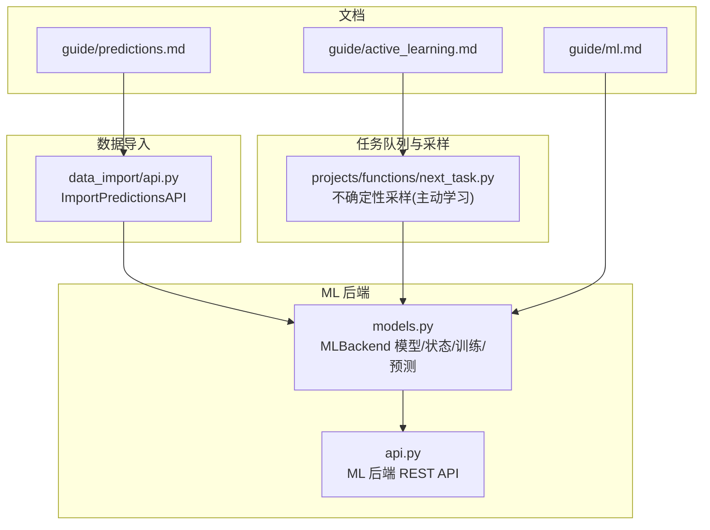
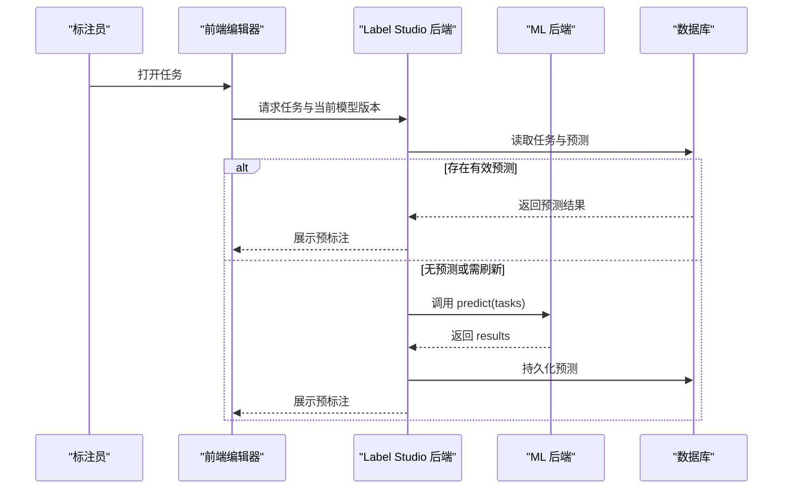
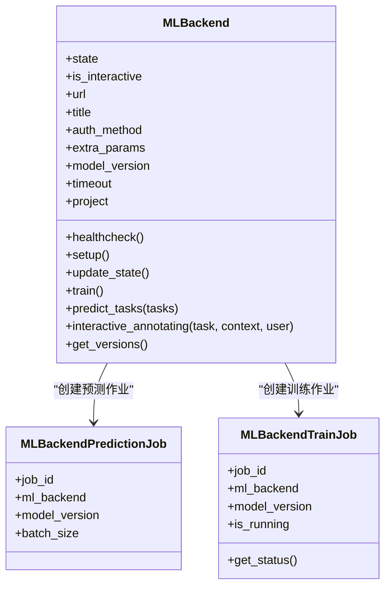
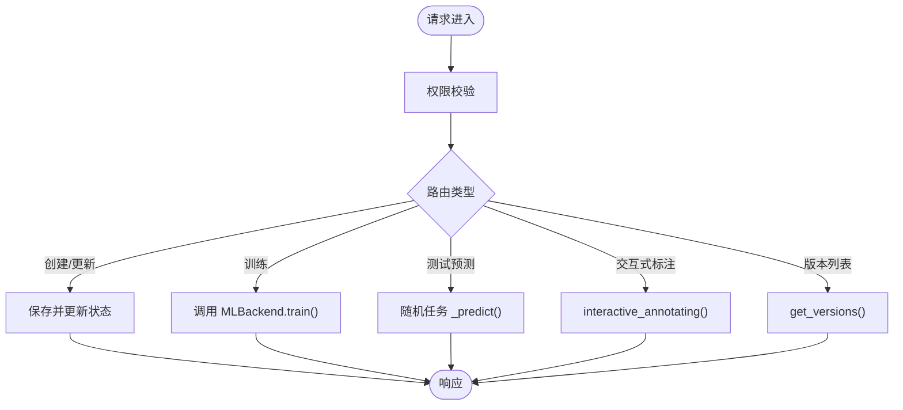
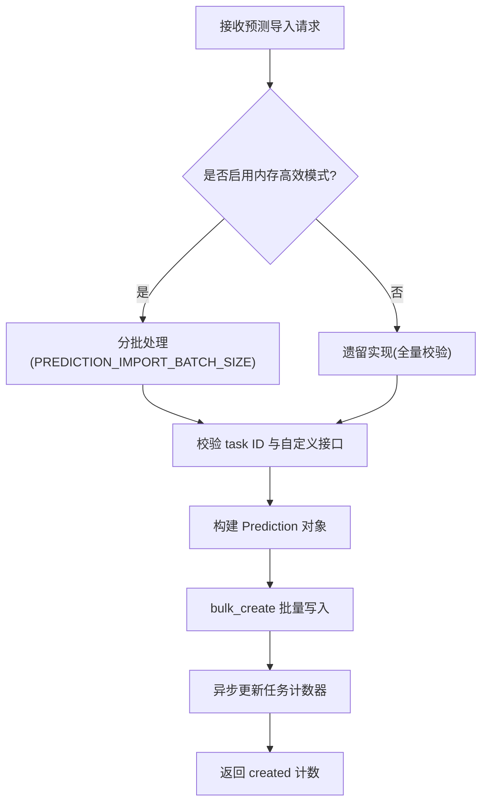
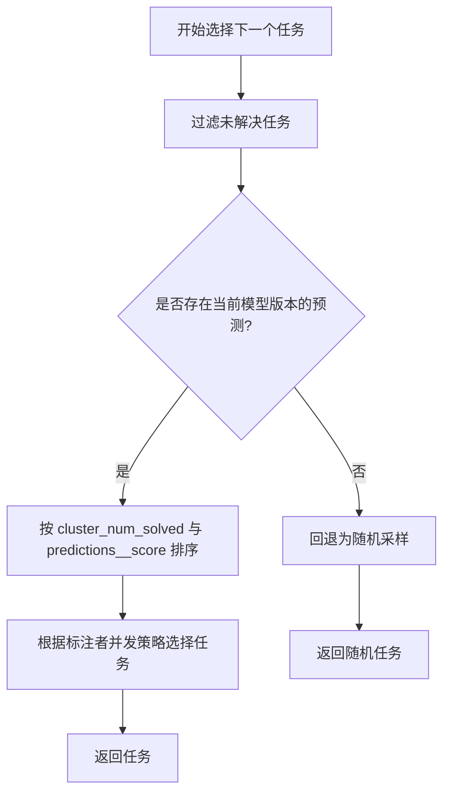
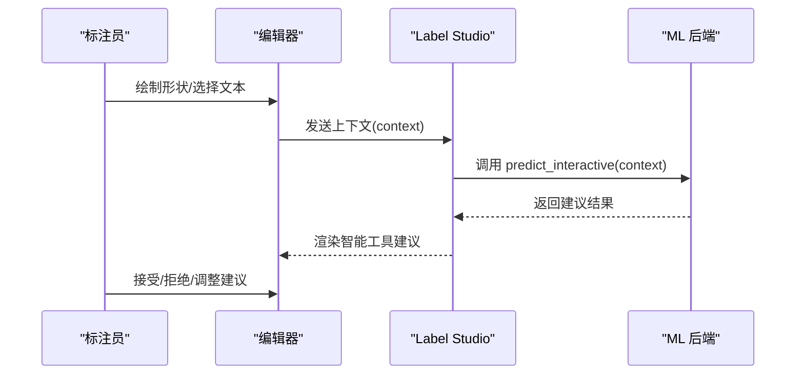
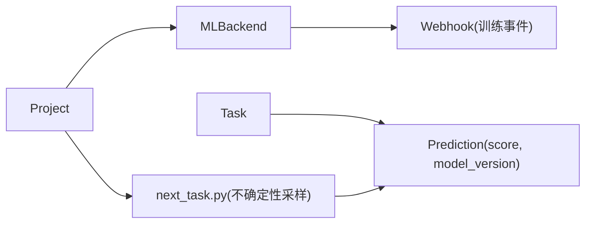

# 预标注

<cite>
**本文引用的文件**   
- [label_studio/ml/models.py](file://label_studio/ml/models.py)
- [label_studio/ml/api.py](file://label_studio/ml/api.py)
- [docs/source/guide/ml.md](file://docs/source/guide/ml.md)
- [docs/source/guide/predictions.md](file://docs/source/guide/predictions.md)
- [docs/source/guide/active_learning.md](file://docs/source/guide/active_learning.md)
- [label_studio/data_import/api.py](file://label_studio/data_import/api.py)
- [label_studio/projects/functions/next_task.py](file://label_studio/projects/functions/next_task.py)
</cite>

## 目录
1. [简介](#简介)
2. [项目结构](#项目结构)
3. [核心组件](#核心组件)
4. [架构总览](#架构总览)
5. [详细组件分析](#详细组件分析)
6. [依赖关系分析](#依赖关系分析)
7. [性能考虑](#性能考虑)
8. [故障排查指南](#故障排查指南)
9. [结论](#结论)
10. [附录](#附录)

## 简介
本文件系统性说明如何在 Label Studio 中集成机器学习模型以实现自动预标注，涵盖 ML 后端配置、预测结果导入与质量控制、预标注与人工标注协作流程、预标注结果的编辑与优化方法，以及主动学习工作流、准确率评估与模型迭代优化的最佳实践。同时提供常见 ML 模型的集成示例与性能调优建议，帮助读者从入门到进阶全面掌握预标注能力。

## 项目结构
围绕“预标注”功能，代码与文档主要分布在以下位置：
- ML 后端连接与状态管理：label_studio/ml/models.py、label_studio/ml/api.py
- 预标注导入与批量处理：label_studio/data_import/api.py
- 主动学习与任务采样：label_studio/projects/functions/next_task.py
- 用户文档与教程：docs/source/guide/ml.md、docs/source/guide/predictions.md、docs/source/guide/active_learning.md

**图示来源** 
- [label_studio/ml/models.py:38-124](file://label_studio/ml/models.py#L38-L124)
- [label_studio/ml/api.py:69-115](file://label_studio/ml/api.py#L69-L115)
- [label_studio/data_import/api.py:511-622](file://label_studio/data_import/api.py#L511-L622)
- [label_studio/projects/functions/next_task.py:143-189](file://label_studio/projects/functions/next_task.py#L143-L189)
- [docs/source/guide/ml.md:13-47](file://docs/source/guide/ml.md#L13-L47)
- [docs/source/guide/predictions.md:37-98](file://docs/source/guide/predictions.md#L37-L98)
- [docs/source/guide/active_learning.md:19-40](file://docs/source/guide/active_learning.md#L19-L40)

**章节来源**
- [docs/source/guide/ml.md:13-47](file://docs/source/guide/ml.md#L13-L47)
- [docs/source/guide/predictions.md:37-98](file://docs/source/guide/predictions.md#L37-L98)
- [docs/source/guide/active_learning.md:19-40](file://docs/source/guide/active_learning.md#L19-L40)

## 核心组件
- ML 后端模型与状态机：负责连接、健康检查、版本同步、训练与预测调用、交互式预标注等。
- ML 后端 API：提供创建/更新/删除 ML 后端、训练、测试预测、交互式标注、获取模型版本等接口。
- 预标注导入 API：支持批量导入预测结果，包含内存优化批处理与校验逻辑。
- 主动学习与任务采样：基于预测分数的不确定性采样，驱动主动学习工作流。
- 文档与教程：覆盖 ML 后端接入、预标注格式、主动学习设置与手动模拟流程。

**章节来源**
- [label_studio/ml/models.py:38-124](file://label_studio/ml/models.py#L38-L124)
- [label_studio/ml/api.py:69-115](file://label_studio/ml/api.py#L69-L115)
- [label_studio/data_import/api.py:511-622](file://label_studio/data_import/api.py#L511-L622)
- [label_studio/projects/functions/next_task.py:143-189](file://label_studio/projects/functions/next_task.py#L143-L189)

## 架构总览
Label Studio 通过 ML 后端实现预标注的三大路径：
- 在线预测：在标注界面或数据管理器中触发，调用 ML 后端 predict() 并持久化预测结果。
- 离线导入：将外部模型生成的预测以 JSON 形式批量导入，供标注员审阅与修正。
- 交互式预标注：在标注过程中实时向 ML 后端发送上下文，返回智能工具建议（如框选、多边形、关键点等）。

**图示来源**
- [label_studio/ml/models.py:341-373](file://label_studio/ml/models.py#L341-L373)
- [label_studio/ml/api.py:339-380](file://label_studio/ml/api.py#L339-L380)
- [docs/source/guide/ml.md:35-42](file://docs/source/guide/ml.md#L35-L42)

## 详细组件分析

### ML 后端模型与状态机（MLBackend）
职责要点：
- 维护后端连接状态（已连接/断开/错误/训练中/预测中），支持基础认证与额外参数。
- 健康检查与 setup 交互，自动同步 model_version。
- 训练任务管理与状态跟踪。
- 批量预测与单任务预测适配，兼容不支持批处理的 ML 后端。
- 交互式预标注接口，结合上下文返回智能标注建议。

**图示来源**
- [label_studio/ml/models.py:38-124](file://label_studio/ml/models.py#L38-L124)
- [label_studio/ml/models.py:436-484](file://label_studio/ml/models.py#L436-L484)

**章节来源**
- [label_studio/ml/models.py:38-124](file://label_studio/ml/models.py#L38-L124)
- [label_studio/ml/models.py:223-233](file://label_studio/ml/models.py#L223-L233)
- [label_studio/ml/models.py:292-339](file://label_studio/ml/models.py#L292-L339)
- [label_studio/ml/models.py:341-373](file://label_studio/ml/models.py#L341-L373)
- [label_studio/ml/models.py:375-417](file://label_studio/ml/models.py#L375-L417)
- [label_studio/ml/models.py:436-484](file://label_studio/ml/models.py#L436-L484)

### ML 后端 API（REST）
提供的关键接口：
- 列表/创建/更新/删除 ML 后端
- 启动训练
- 测试预测（随机任务）
- 交互式标注请求
- 获取模型版本列表

**图示来源**
- [label_studio/ml/api.py:69-115](file://label_studio/ml/api.py#L69-L115)
- [label_studio/ml/api.py:229-237](file://label_studio/ml/api.py#L229-L237)
- [label_studio/ml/api.py:274-307](file://label_studio/ml/api.py#L274-L307)
- [label_studio/ml/api.py:339-380](file://label_studio/ml/api.py#L339-L380)
- [label_studio/ml/api.py:415-432](file://label_studio/ml/api.py#L415-L432)

**章节来源**
- [label_studio/ml/api.py:69-115](file://label_studio/ml/api.py#L69-L115)
- [label_studio/ml/api.py:229-237](file://label_studio/ml/api.py#L229-L237)
- [label_studio/ml/api.py:274-307](file://label_studio/ml/api.py#L274-L307)
- [label_studio/ml/api.py:339-380](file://label_studio/ml/api.py#L339-L380)
- [label_studio/ml/api.py:415-432](file://label_studio/ml/api.py#L415-L432)

### 预标注导入（ImportPredictionsAPI）
- 支持两种实现路径：内存高效批处理（默认启用特性开关）与遗留实现（回退）。
- 批大小可配置，按批次校验 task ID、自定义接口校验、构建 Prediction 对象并 bulk_create。
- 完成后异步更新任务计数器。

**图示来源**
- [label_studio/data_import/api.py:511-622](file://label_studio/data_import/api.py#L511-L622)
- [label_studio/data_import/api.py:624-699](file://label_studio/data_import/api.py#L624-L699)

**章节来源**
- [label_studio/data_import/api.py:511-622](file://label_studio/data_import/api.py#L511-L622)
- [label_studio/data_import/api.py:624-699](file://label_studio/data_import/api.py#L624-L699)

### 主动学习与不确定性采样
- 当项目启用“按预测分数最小值排序”时，系统优先选择预测置信度最低的任务进行标注。
- 若存在当前模型版本的预测，则按聚类内已解决数量与预测分数排序；否则回退为随机采样。

**图示来源**
- [label_studio/projects/functions/next_task.py:143-189](file://label_studio/projects/functions/next_task.py#L143-L189)

**章节来源**
- [label_studio/projects/functions/next_task.py:143-189](file://label_studio/projects/functions/next_task.py#L143-L189)

### 交互式预标注（Smart Tools）
- 在标注界面开启“自动标注”后，智能工具会根据 ML 后端返回的建议自动生成区域（矩形、椭圆、多边形、关键点、画笔掩码等）。
- 可通过标签配置 smart="true" 或 smartOnly="true" 控制行为。
- 前端动作触发 /api/ml/{id}/predict_interactive，后端调用 interactive_annotating() 并与 ML 后端交互。

**图示来源**
- [docs/source/guide/ml.md:297-327](file://docs/source/guide/ml.md#L297-L327)
- [label_studio/ml/api.py:339-380](file://label_studio/ml/api.py#L339-L380)
- [label_studio/ml/models.py:375-417](file://label_studio/ml/models.py#L375-L417)

**章节来源**
- [docs/source/guide/ml.md:297-327](file://docs/source/guide/ml.md#L297-L327)
- [label_studio/ml/api.py:339-380](file://label_studio/ml/api.py#L339-L380)
- [label_studio/ml/models.py:375-417](file://label_studio/ml/models.py#L375-L417)

## 依赖关系分析
- ML 后端与项目绑定：每个 MLBackend 关联一个 Project，并在创建时自动尝试建立 webhook 以触发训练事件。
- 预测结果与任务关联：预测结果持久化为 Prediction，附带 score 与 model_version，用于后续排序与评估。
- 任务采样依赖预测分数：不确定性采样基于 project.model_version 对应的预测结果。

**图示来源**
- [label_studio/ml/models.py:509-525](file://label_studio/ml/models.py#L509-L525)
- [label_studio/projects/functions/next_task.py:143-189](file://label_studio/projects/functions/next_task.py#L143-L189)

**章节来源**
- [label_studio/ml/models.py:509-525](file://label_studio/ml/models.py#L509-L525)
- [label_studio/projects/functions/next_task.py:143-189](file://label_studio/projects/functions/next_task.py#L143-L189)

## 性能考虑
- 预测导入内存优化：使用特性开关切换至内存高效批处理，降低内存占用 90%-99%。
- 批大小可调：PREDICTION_IMPORT_BATCH_SIZE 控制每批处理条数，避免大请求导致 OOM。
- 任务计数器更新：导入完成后异步更新任务计数器，减少主流程阻塞。
- 预测批处理兼容性：当 ML 后端不支持批量时，自动降级为逐任务拉取，确保稳定性。

**章节来源**
- [label_studio/data_import/api.py:511-622](file://label_studio/data_import/api.py#L511-L622)
- [label_studio/ml/models.py:292-339](file://label_studio/ml/models.py#L292-L339)

## 故障排查指南
常见问题与定位要点：
- ML 后端不可达或返回错误：检查 healthcheck 与 setup 返回值，确认 URL、认证与网络可达性。
- 预测结果为空或格式不正确：验证 ML 后端返回结构必须包含 results 列表且每项含 result 字段。
- 交互式预标注失败：确认模型已标记 is_interactive=true，且前端启用了智能工具。
- 主动学习不生效：检查项目是否启用“按预测分数最小值排序”，并确保存在当前模型版本的预测。
- 导入预测报错：核对 task ID 是否在项目中存在，result 是否符合 label_config 输出 schema。

**章节来源**
- [label_studio/ml/models.py:202-221](file://label_studio/ml/models.py#L202-L221)
- [label_studio/ml/models.py:292-339](file://label_studio/ml/models.py#L292-L339)
- [label_studio/ml/api.py:339-380](file://label_studio/ml/api.py#L339-L380)
- [label_studio/projects/functions/next_task.py:143-189](file://label_studio/projects/functions/next_task.py#L143-L189)
- [label_studio/data_import/api.py:511-622](file://label_studio/data_import/api.py#L511-L622)

## 结论
通过 Label Studio 的 ML 后端与预测导入机制，团队可以高效地将机器学习模型融入标注流水线，实现自动化预标注、交互式辅助标注与主动学习闭环。配合不确定性采样与预测分数排序，标注资源被精准分配到高价值样本，显著提升模型迭代效率与标注质量。建议在大规模场景中启用内存高效的预测导入，并结合 webhook 与训练调度实现持续优化的主动学习工作流。

## 附录

### 预标注与人工标注协作流程
- 预标注作为只读参考，标注员可在编辑器中复制预测为可编辑注释，或直接修改。
- 项目设置中可选择显示哪个模型或预测集，便于对比不同模型效果。
- 数据管理器支持按预测分数排序，辅助筛选低置信度任务进行重点标注。

**章节来源**
- [docs/source/guide/predictions.md:96-115](file://docs/source/guide/predictions.md#L96-L115)
- [docs/source/guide/ml.md:339-353](file://docs/source/guide/ml.md#L339-L353)

### 预标注结果导入格式要点
- 使用标准 JSON 结构，包含 data 与 predictions 数组。
- predictions.result 中的 from_name/to_name/type 必须与 label_config 一致。
- 图像坐标使用百分比，OCR/分割等特定类型需遵循对应 tag 的示例格式。

**章节来源**
- [docs/source/guide/predictions.md:43-98](file://docs/source/guide/predictions.md#L43-L98)
- [docs/source/guide/predictions.md:118-207](file://docs/source/guide/predictions.md#L118-L207)
- [docs/source/guide/predictions.md:337-499](file://docs/source/guide/predictions.md#L337-L499)

### 常见 ML 模型集成示例
- 文本分类（BERT/sklearn）、NER（SpaCy/flair/HuggingFace）、ASR（NeMo）、目标检测（MMDetection）、LLM 推理（OpenAI/HuggingFace）等。
- 部分模型支持预标注、交互式模式与训练，具体能力参见官方示例表。

**章节来源**
- [docs/source/guide/ml.md:138-168](file://docs/source/guide/ml.md#L138-L168)

### 主动学习工作流最佳实践
- 启用“提交标注后启动训练”选项，结合 webhook 触发后端 fit()。
- 使用不确定性采样优先标注低置信度任务，提升训练效率。
- 社区版可手动模拟：定期拉取预测、按分数排序、批量标注后再训练。

**章节来源**
- [docs/source/guide/active_learning.md:25-40](file://docs/source/guide/active_learning.md#L25-L40)
- [docs/source/guide/active_learning.md:46-68](file://docs/source/guide/active_learning.md#L46-L68)
- [docs/source/guide/active_learning.md:85-92](file://docs/source/guide/active_learning.md#L85-L92)