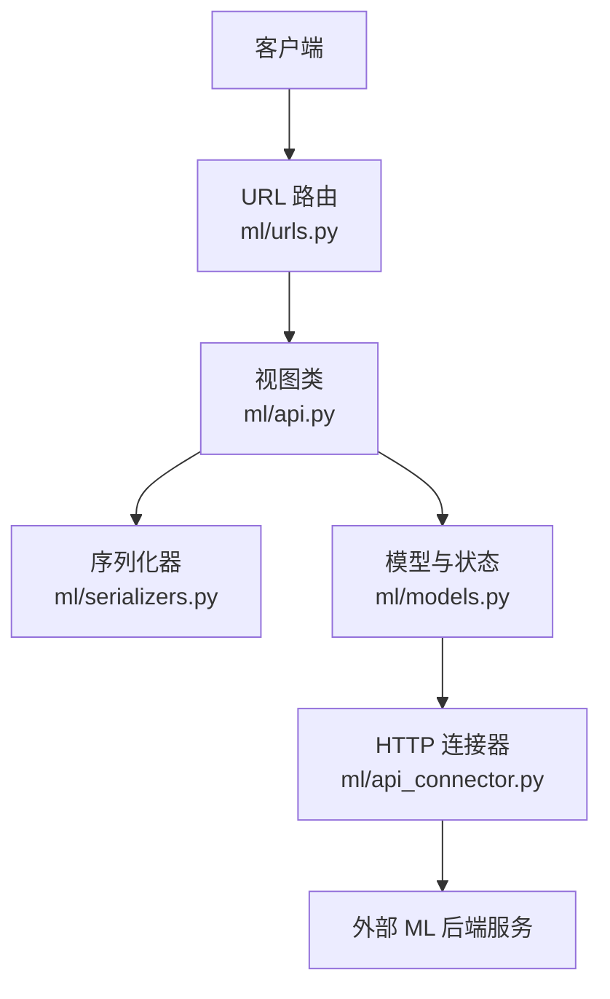
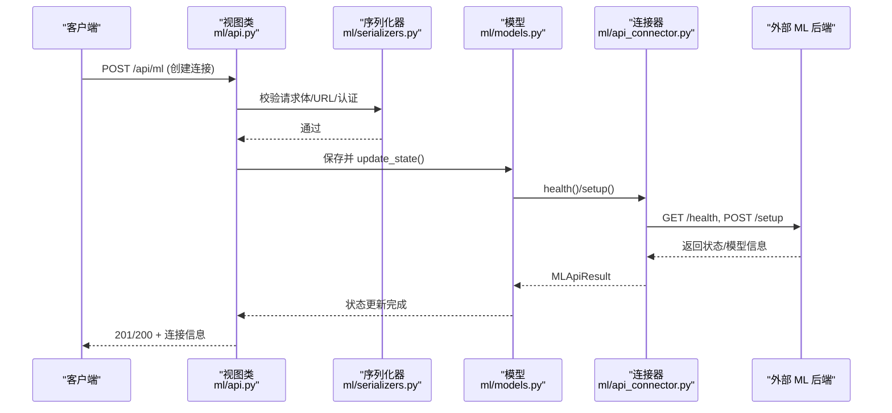
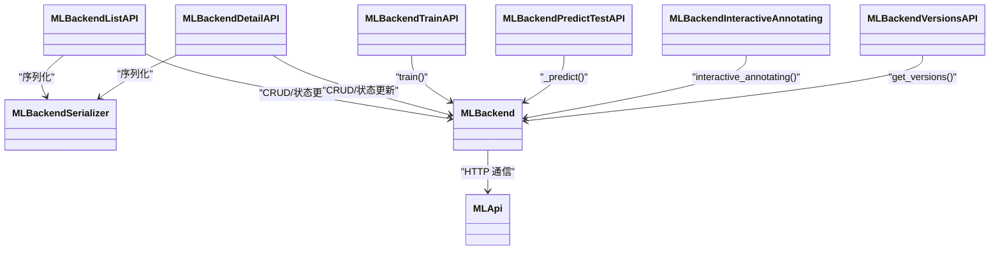

# ML API参考

<cite>
**本文引用的文件**   
- [label_studio/ml/api.py](file://label_studio/ml/api.py)
- [label_studio/ml/urls.py](file://label_studio/ml/urls.py)
- [label_studio/ml/models.py](file://label_studio/ml/models.py)
- [label_studio/ml/serializers.py](file://label_studio/ml/serializers.py)
- [label_studio/ml/api_connector.py](file://label_studio/ml/api_connector.py)
- [label_studio/core/permissions.py](file://label_studio/core/permissions.py)
- [docs/source/guide/ml.md](file://docs/source/guide/ml.md)
- [docs/source/guide/predictions.md](file://docs/source/guide/predictions.md)
</cite>

## 目录
1. [简介](#简介)
2. [项目结构](#项目结构)
3. [核心组件](#核心组件)
4. [架构总览](#架构总览)
5. [详细组件分析](#详细组件分析)
6. [依赖关系分析](#依赖关系分析)
7. [性能与稳定性](#性能与稳定性)
8. [故障排查指南](#故障排查指南)
9. [结论](#结论)
10. [附录：API参考与示例](#附录api参考与示例)

## 简介
本文件为 Label Studio 的机器学习（ML）相关 REST API 的完整参考文档，覆盖以下能力：
- ML 后端连接管理（CRUD）
- 模型训练接口
- 预测接口（批量/交互式）
- 版本查询接口
- 认证、权限控制与安全策略
- 错误处理与状态码
- 版本兼容性与迁移建议
- SDK 使用指引与集成片段

## 项目结构
Label Studio 的 ML API 由以下模块组成：
- 路由定义：将 URL 映射到视图类
- 视图层（API）：实现业务逻辑、鉴权、序列化校验
- 模型层（Model）：封装 ML 后端连接、状态机、任务/训练作业持久化
- 序列化器（Serializer）：请求/响应数据校验与字段暴露
- 连接器（Connector）：与外部 ML 后端的 HTTP 通信封装

**图示来源**
- [label_studio/ml/urls.py:9-26](file://label_studio/ml/urls.py#L9-L26)
- [label_studio/ml/api.py:28-433](file://label_studio/ml/api.py#L28-L433)
- [label_studio/ml/serializers.py:22-151](file://label_studio/ml/serializers.py#L22-L151)
- [label_studio/ml/models.py:38-433](file://label_studio/ml/models.py#L38-L433)
- [label_studio/ml/api_connector.py:137-286](file://label_studio/ml/api_connector.py#L137-L286)

**章节来源**
- [label_studio/ml/urls.py:1-27](file://label_studio/ml/urls.py#L1-L27)

## 核心组件
- MLBackendListAPI：列出或创建 ML 后端连接
- MLBackendDetailAPI：获取、更新、删除单个 ML 后端连接
- MLBackendTrainAPI：触发训练
- MLBackendPredictTestAPI：测试预测（调试用）
- MLBackendInteractiveAnnotating：交互式标注（智能工具）
- MLBackendVersionsAPI：查询模型版本列表

权限控制：
- 列表/创建：需要 projects.view / projects.change
- 详情操作：projects.change
- 训练/版本/测试预测：projects.change
- 交互式标注：tasks.view

安全与校验：
- URL 合法性校验（可阻止本地 IP）
- Basic Auth 参数校验
- 健康检查与 setup 校验

**章节来源**
- [label_studio/ml/api.py:28-433](file://label_studio/ml/api.py#L28-L433)
- [label_studio/core/permissions.py:13-85](file://label_studio/core/permissions.py#L13-L85)
- [label_studio/ml/serializers.py:22-151](file://label_studio/ml/serializers.py#L22-L151)

## 架构总览
下图展示了从客户端到外部 ML 后端的端到端调用流程。

**图示来源**
- [label_studio/ml/api.py:28-115](file://label_studio/ml/api.py#L28-L115)
- [label_studio/ml/serializers.py:48-101](file://label_studio/ml/serializers.py#L48-L101)
- [label_studio/ml/models.py:173-221](file://label_studio/ml/models.py#L173-L221)
- [label_studio/ml/api_connector.py:233-251](file://label_studio/ml/api_connector.py#L233-L251)

## 详细组件分析

### ML 后端连接管理（CRUD）
- 列表/创建：GET/POST /api/ml
  - 支持按 project 过滤
  - 创建时自动执行健康检查与 setup，成功后设置默认 model_version（若启用协作预测且未设置）
- 详情：GET/PATCH/DELETE /api/ml/{id}
  - 获取时刷新状态；更新后刷新状态

请求参数（创建/更新）：
- url：必填，外部 ML 后端地址
- auth_method：NONE | BASIC_AUTH
- basic_auth_user/basic_auth_pass：当选择 BASIC_AUTH 时必填
- extra_params：可选，传递给 ML 后端
- is_interactive：是否用于交互式预标注
- timeout：超时时间（秒）
- auto_update：是否自动同步模型版本
- description/title/project：描述/名称/所属项目

响应字段：
- id/state/readable_state/error_message/url/auth_method/basic_auth_user/description/extra_params/model_version/timeout/created_at/updated_at/auto_update/project

状态码：
- 200/201：成功
- 400：参数校验失败（如 Basic Auth 缺失、URL 非法、健康检查失败、setup 失败）
- 403：无权限
- 404：资源不存在

示例（cURL）：
- 创建连接
  - curl -X POST -H 'Content-type: application/json' {host}/api/ml -H 'Authorization: Token abc123' --data '{"url":"http://localhost:9090","project":<project_id>}'
- 列出连接
  - curl {host}/api/ml?project=<project_id> -H 'Authorization: Token abc123'
- 更新连接
  - curl -X PATCH -H 'Content-type: application/json' {host}/api/ml/<id> -H 'Authorization: Token abc123' --data '{"url":"http://localhost:9091"}'
- 删除连接
  - curl -X DELETE {host}/api/ml/<id> -H 'Authorization: Token abc123'

**章节来源**
- [label_studio/ml/api.py:28-189](file://label_studio/ml/api.py#L28-L189)
- [label_studio/ml/serializers.py:22-125](file://label_studio/ml/serializers.py#L22-L125)
- [label_studio/ml/models.py:173-221](file://label_studio/ml/models.py#L173-L221)

### 训练接口
- 触发训练：POST /api/ml/{id}/train
- 行为：
  - 根据项目配置发送训练请求至 ML 后端
  - 若返回 job 标识，则记录训练作业以便后续查询状态
  - 更新 ML 后端状态为 TRAINING 或 ERROR

请求参数：
- use_ground_truth：布尔，是否在训练中包含真实标注（可选）

响应：
- 200：训练已启动
- 500：训练错误（含错误消息）

示例（cURL）：
- curl -X POST {host}/api/ml/<id>/train -H 'Authorization: Token abc123'

**章节来源**
- [label_studio/ml/api.py:191-237](file://label_studio/ml/api.py#L191-L237)
- [label_studio/ml/models.py:223-233](file://label_studio/ml/models.py#L223-L233)
- [label_studio/ml/api_connector.py:189-212](file://label_studio/ml/api_connector.py#L189-L212)

### 预测接口（批量/交互式）
- 批量预测（内部调用）：
  - 由 MLBackend.predict_tasks 调用 MLApi.make_predictions -> 外部 /predict
  - 支持批处理与单任务回退逻辑
- 交互式标注（前端智能工具）：POST /api/ml/{id}/interactive-annotating
  - 请求体：task（任务ID）、context（上下文，可选）
  - 返回：data.results（首个结果），errors（错误列表）

请求参数（交互式）：
- task：整数，必填
- context：JSON，可选

响应：
- 200：成功（即使包含 errors 也返回 200，便于前端降级处理）
- 常见错误：
  - 模型未启用交互式模式
  - 返回结构不符合预期（缺少 results 或长度不匹配）

示例（cURL）：
- curl -X POST {host}/api/ml/<id>/interactive-annotating -H 'Content-type: application/json' -H 'Authorization: Token abc123' --data '{"task":<task_id>,"context":{}}'

**章节来源**
- [label_studio/ml/api.py:310-380](file://label_studio/ml/api.py#L310-L380)
- [label_studio/ml/models.py:375-417](file://label_studio/ml/models.py#L375-L417)
- [label_studio/ml/api_connector.py:214-231](file://label_studio/ml/api_connector.py#L214-L231)

### 测试预测接口（调试）
- 触发方式：POST /api/ml/{id}/predict/test
- 仅支持 random=true 查询参数，随机选取一个任务进行预测
- 若无任务或后端未返回预测，返回 500 错误

示例（cURL）：
- curl -X POST "{host}/api/ml/<id>/predict/test?random=true" -H 'Authorization: Token abc123'

**章节来源**
- [label_studio/ml/api.py:240-307](file://label_studio/ml/api.py#L240-L307)

### 模型版本查询接口
- 查询版本：GET /api/ml/{id}/versions
- 行为：
  - 正常返回 versions 数组
  - 若后端返回 404，提示升级后端版本，同时返回当前 model_version
  - 其他错误返回 error 字段与对应状态码

响应：
- 200：{ versions: [...], message?: string }
- 非 2xx：{ error: string }

示例（cURL）：
- curl {host}/api/ml/<id>/versions -H 'Authorization: Token abc123'

**章节来源**
- [label_studio/ml/api.py:383-433](file://label_studio/ml/api.py#L383-L433)

## 依赖关系分析
- 视图依赖序列化器进行参数校验与字段暴露
- 视图调用模型方法以执行状态更新、训练、预测等
- 模型通过连接器与外部 ML 后端通信，统一封装超时、重试、Basic Auth、SSRF 防护等

**图示来源**
- [label_studio/ml/api.py:28-433](file://label_studio/ml/api.py#L28-L433)
- [label_studio/ml/serializers.py:22-151](file://label_studio/ml/serializers.py#L22-L151)
- [label_studio/ml/models.py:38-433](file://label_studio/ml/models.py#L38-L433)
- [label_studio/ml/api_connector.py:137-286](file://label_studio/ml/api_connector.py#L137-L286)

**章节来源**
- [label_studio/ml/api.py:28-433](file://label_studio/ml/api.py#L28-L433)
- [label_studio/ml/models.py:38-433](file://label_studio/ml/models.py#L38-L433)
- [label_studio/ml/api_connector.py:137-286](file://label_studio/ml/api_connector.py#L137-L286)

## 性能与稳定性
- 超时配置（环境变量）：
  - ML_CONNECTION_TIMEOUT、ML_TIMEOUT_DEFAULT、ML_TIMEOUT_TRAIN、ML_TIMEOUT_PREDICT、ML_TIMEOUT_HEALTH、ML_TIMEOUT_SETUP、ML_TIMEOUT_DUPLICATE_MODEL、ML_TIMEOUT_DELETE、ML_TIMEOUT_TRAIN_JOB_STATUS
- 连接池与会话复用：每个进程维护一个 requests.Session，减少握手开销
- SSRF 防护：可通过 ML_BLOCK_LOCAL_IP 启用对本地/内网地址的拦截
- 重试机制：基础 HTTP 层支持最大重试次数（MAX_RETRIES=2）

优化建议：
- 合理设置 ML_TIMEOUT_PREDICT 以适配复杂模型推理耗时
- 在大规模数据集上优先使用批量预测，避免逐条调用
- 开启 auto_update 以自动同步后端模型版本，减少人工维护成本

**章节来源**
- [label_studio/ml/api_connector.py:25-34](file://label_studio/ml/api_connector.py#L25-L34)
- [label_studio/ml/api_connector.py:48-106](file://label_studio/ml/api_connector.py#L48-L106)
- [label_studio/core/settings/base.py:910](file://label_studio/core/settings/base.py#L910)

## 故障排查指南
常见问题与定位要点：
- 无法连接 ML 后端
  - 检查 URL 是否合法、防火墙/网络可达性
  - 确认 Basic Auth 用户名密码是否正确
  - 查看健康检查与 setup 的错误消息
- 预测结果为空或结构异常
  - 确认 ML 后端返回的 results 是否为数组且长度与任务一致
  - 对于交互式模型，确保启用 is_interactive 并通过交互式接口调用
- 训练失败
  - 检查训练作业状态接口返回
  - 确认项目中存在带标注的任务（旧路径）或 webhook 已正确配置（新路径）

诊断步骤：
- 使用测试预测接口验证后端连通性与输出格式
- 查看 ML 后端日志与 Label Studio 控制台日志
- 使用版本查询接口判断是否需要升级 ML 后端

**章节来源**
- [label_studio/ml/serializers.py:62-99](file://label_studio/ml/serializers.py#L62-L99)
- [label_studio/ml/models.py:292-339](file://label_studio/ml/models.py#L292-L339)
- [label_studio/ml/models.py:375-417](file://label_studio/ml/models.py#L375-L417)
- [label_studio/ml/models.py:462-479](file://label_studio/ml/models.py#L462-L479)

## 结论
Label Studio 的 ML API 提供了完整的 ML 后端生命周期管理能力，包括连接管理、训练、预测与版本查询。通过严格的序列化校验、权限控制与安全策略，确保了与外部 ML 后端交互的稳定性和安全性。结合交互式标注与批量预测能力，可有效提升标注效率与模型迭代速度。

## 附录：API参考与示例

### 端点清单
- 列表/创建 ML 后端
  - GET/POST /api/ml
  - 权限：projects.view / projects.change
- 详情（获取/更新/删除）
  - GET/PATCH/DELETE /api/ml/{id}
  - 权限：projects.change
- 训练
  - POST /api/ml/{id}/train
  - 权限：projects.change
- 测试预测（调试）
  - POST /api/ml/{id}/predict/test?random=true
  - 权限：projects.change
- 交互式标注
  - POST /api/ml/{id}/interactive-annotating
  - 权限：tasks.view
- 版本查询
  - GET /api/ml/{id}/versions
  - 权限：projects.change

### 认证与权限
- 认证：Token 认证（Authorization: Token <token>）
- 权限：
  - projects.view：读取项目相关资源
  - projects.change：修改项目相关资源
  - tasks.view：读取任务相关资源（交互式标注）

### 错误处理
- 通用错误：
  - 400：参数校验失败（URL 非法、Basic Auth 缺失、健康检查/Setup 失败）
  - 403：无权限
  - 404：资源不存在
  - 500：服务端错误（训练/预测失败、后端返回异常）
- 交互式标注：
  - 即使包含 errors 也返回 200，前端需检查 errors 字段

### 版本兼容性与迁移
- 当后端不支持 versions 接口时，会返回 404，系统提示升级后端版本并返回当前 model_version
- 建议在部署新版 ML 后端后，先调用 versions 接口确认兼容性

### SDK 使用示例
- 创建连接（Python 伪代码）
  - 调用 create(project_id, url, auth_method, basic_auth_user, basic_auth_pass, extra_params, is_interactive, timeout, auto_update, description, title)
- 列出连接
  - 调用 list(project_id)
- 更新连接
  - 调用 update(ml_backend_id, url, ...)
- 删除连接
  - 调用 delete(ml_backend_id)
- 训练
  - 调用 train(ml_backend_id, use_ground_truth=False)
- 测试预测
  - 调用 test_predict(ml_backend_id, random=True)
- 交互式标注
  - 调用 predict_interactive(ml_backend_id, task_id, context={})
- 版本查询
  - 调用 list_model_versions(ml_backend_id)

注意：以上 SDK 方法名与分组来自 OpenAPI 扩展字段（x-fern-sdk-*），实际调用请参考生成的 SDK 文档。

**章节来源**
- [label_studio/ml/api.py:28-433](file://label_studio/ml/api.py#L28-L433)
- [label_studio/ml/urls.py:9-26](file://label_studio/ml/urls.py#L9-L26)
- [docs/source/guide/ml.md:125-137](file://docs/source/guide/ml.md#L125-L137)
- [docs/source/guide/ml.md:257-268](file://docs/source/guide/ml.md#L257-L268)
- [docs/source/guide/predictions.md:270-337](file://docs/source/guide/predictions.md#L270-L337)