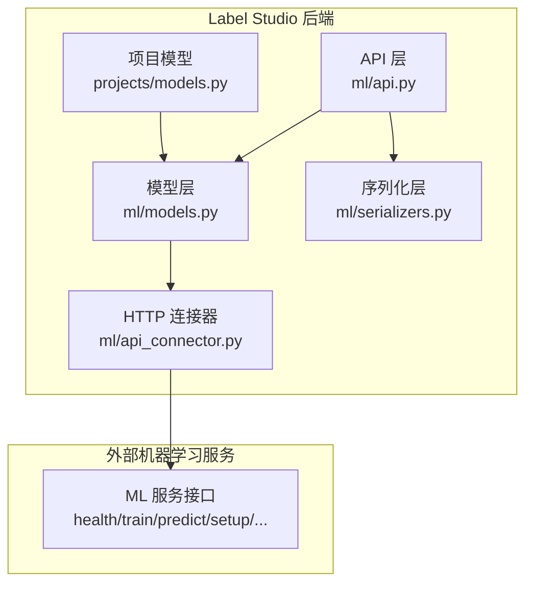
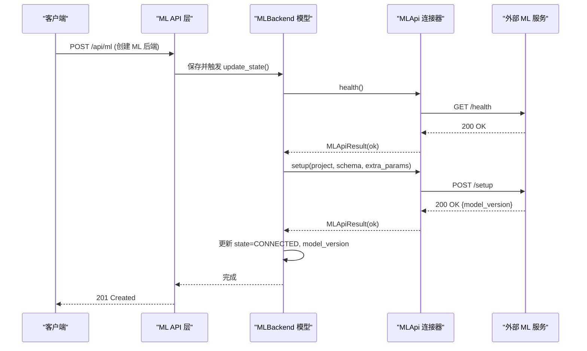
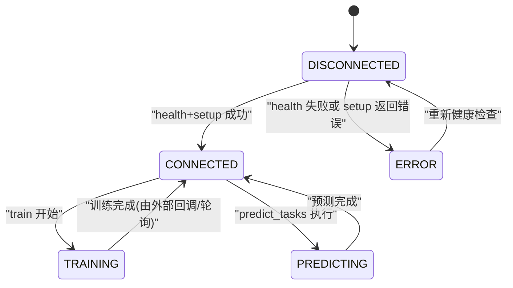
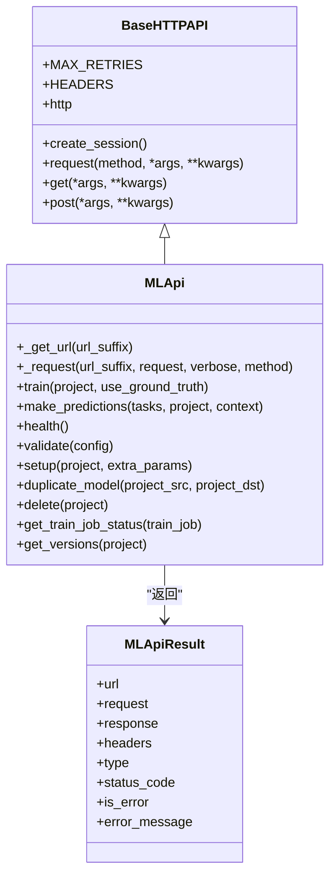
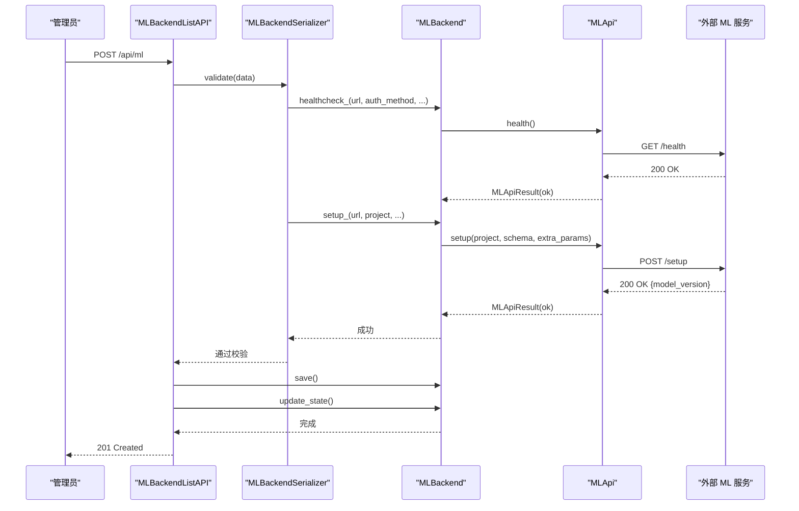
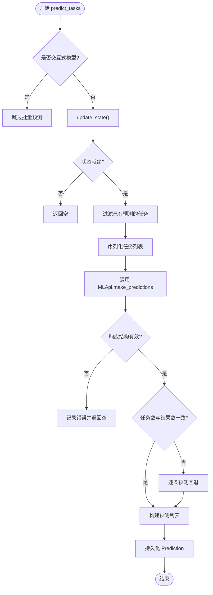
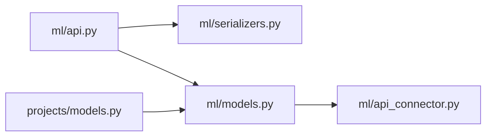

# ML后端架构

<cite>
**本文引用的文件**   
- [models.py](file://label_studio/ml/models.py)
- [api_connector.py](file://label_studio/ml/api_connector.py)
- [api.py](file://label_studio/ml/api.py)
- [serializers.py](file://label_studio/ml/serializers.py)
- [mixins.py](file://label_studio/ml/mixins.py)
- [projects/models.py](file://label_studio/projects/models.py)
</cite>

## 目录
1. [引言](#引言)
2. [项目结构](#项目结构)
3. [核心组件](#核心组件)
4. [架构总览](#架构总览)
5. [详细组件分析](#详细组件分析)
6. [依赖关系分析](#依赖关系分析)
7. [性能与配置最佳实践](#性能与配置最佳实践)
8. [故障排查指南](#故障排查指南)
9. [结论](#结论)

## 引言
本文件系统性梳理 Label Studio 的 ML 后端模块，围绕以下目标展开：
- 解释 ML 后端的整体设计模式与职责划分
- 说明 MLBackend 模型的结构、状态机与生命周期管理
- 解析 MLApi 连接器与外部机器学习服务的通信协议、认证机制、超时与错误处理
- 描述从连接建立到预测执行的完整流程
- 给出配置与性能优化建议，并明确数据格式规范

## 项目结构
ML 后端相关代码集中在 label_studio/ml 目录下，主要文件职责如下：
- models.py：定义 MLBackend 模型、状态枚举、训练/预测任务模型及业务逻辑（健康检查、设置、训练、批量预测、交互式标注等）
- api_connector.py：封装 HTTP 客户端、请求构造、超时控制、Basic Auth、SSRF 防护、统一结果对象 MLApiResult
- api.py：暴露 REST API（创建/更新/删除 ML 后端、训练、测试预测、交互式标注、获取版本列表）
- serializers.py：序列化器，负责输入校验、Basic Auth 字段校验、URL 安全校验、健康检查与 setup 校验
- mixins.py：交互式标注时注入草稿数据的序列化扩展
- projects/models.py：Project 模型中提供 update_ml_backends_state 等方法，用于批量刷新 ML 后端状态

图表来源
- [api.py:69-101](file://label_studio/ml/api.py#L69-L101)
- [models.py:38-196](file://label_studio/ml/models.py#L38-L196)
- [api_connector.py:48-183](file://label_studio/ml/api_connector.py#L48-L183)
- [projects/models.py:1162-1172](file://label_studio/projects/models.py#L1162-L1172)

章节来源
- [api.py:1-433](file://label_studio/ml/api.py#L1-L433)
- [models.py:1-525](file://label_studio/ml/models.py#L1-L525)
- [api_connector.py:1-286](file://label_studio/ml/api_connector.py#L1-L286)
- [serializers.py:1-151](file://label_studio/ml/serializers.py#L1-L151)
- [mixins.py:1-13](file://label_studio/ml/mixins.py#L1-L13)
- [projects/models.py:1162-1172](file://label_studio/projects/models.py#L1162-L1172)

## 核心组件
- MLBackend 模型
  - 存储 ML 后端连接信息（URL、认证方式、超时、自动更新模型版本等）
  - 维护状态（已连接/未连接/错误/训练中/预测中）
  - 提供 healthcheck、setup、train、predict_tasks、interactive_annotating、get_versions 等方法
- MLApi 连接器
  - 基于 requests.Session 的 HTTP 客户端，封装 GET/POST
  - 支持 Basic Auth、连接/请求双超时、重试、SSRF 防护
  - 统一返回 MLApiResult，包含 is_error、error_message、status_code 等
- API 层
  - 提供 ML 后端 CRUD、训练、测试预测、交互式标注、版本查询等 REST 接口
- 序列化器
  - 校验 URL 安全性、Basic Auth 必填项、调用 healthcheck 和 setup 进行连通性与兼容性验证
- Project 集成
  - 提供 update_ml_backends_state 批量刷新所有 ML 后端状态

章节来源
- [models.py:25-196](file://label_studio/ml/models.py#L25-L196)
- [api_connector.py:48-183](file://label_studio/ml/api_connector.py#L48-L183)
- [api.py:69-101](file://label_studio/ml/api.py#L69-L101)
- [serializers.py:22-101](file://label_studio/ml/serializers.py#L22-L101)
- [projects/models.py:1162-1172](file://label_studio/projects/models.py#L1162-L1172)

## 架构总览
ML 后端采用“模型 + 连接器 + API”的分层架构：
- 模型层（MLBackend）负责领域逻辑与状态管理
- 连接器层（MLApi/BaseHTTPAPI）负责网络通信、认证、超时、错误封装
- API 层（DRF ViewSets/APIView）负责权限校验、参数校验、调用模型方法
- 序列化器在创建/更新时执行健康检查与 setup 校验，确保外部服务可用且兼容

图表来源
- [api.py:92-115](file://label_studio/ml/api.py#L92-L115)
- [models.py:173-221](file://label_studio/ml/models.py#L173-L221)
- [api_connector.py:233-251](file://label_studio/ml/api_connector.py#L233-L251)

## 详细组件分析

### MLBackend 模型与状态机
- 状态枚举
  - CONNECTED、DISCONNECTED、ERROR、TRAINING、PREDICTING
- 关键字段
  - url、auth_method、basic_auth_user/pass、timeout、auto_update、model_version、is_interactive、extra_params
- 核心方法
  - healthcheck：调用 MLApi.health
  - setup：调用 MLApi.setup，根据响应更新 state 与 error_message
  - train：调用 MLApi.train，记录训练任务
  - predict_tasks：批量预测，过滤已有预测，持久化 Prediction
  - interactive_annotating：交互式预标注，仅对 is_interactive=true 的模型生效
  - get_versions：获取模型版本列表

图表来源
- [models.py:25-31](file://label_studio/ml/models.py#L25-L31)
- [models.py:173-233](file://label_studio/ml/models.py#L173-L233)
- [models.py:341-373](file://label_studio/ml/models.py#L341-L373)

章节来源
- [models.py:25-433](file://label_studio/ml/models.py#L25-L433)

### MLApi 连接器与通信协议
- 基础能力
  - BaseHTTPAPI：会话复用、User-Agent、SSRF 防护、Basic Auth、连接/请求双超时
  - MLApi：封装具体端点（health、setup、validate、train、predict、duplicate_model、delete、job_status、versions）
- 超时策略
  - 连接超时与请求超时分离；不同端点使用不同默认超时（可通过环境变量覆盖）
- 错误处理
  - 统一返回 MLApiResult，is_error 标记异常，error_message 携带错误详情
- 认证机制
  - 支持 Basic Auth；当 auth_method=BASIC_AUTH 时，必须提供用户名和密码
- 数据格式
  - predict：{tasks, project, label_config, params: {login, password, hostname, context}}
  - setup：{project, schema, hostname, extra_params}
  - train：{annotations, project, label_config, hostname, params}
  - versions：GET /versions，返回 {versions: [...]}

图表来源
- [api_connector.py:48-183](file://label_studio/ml/api_connector.py#L48-L183)
- [api_connector.py:137-274](file://label_studio/ml/api_connector.py#L137-L274)

章节来源
- [api_connector.py:1-286](file://label_studio/ml/api_connector.py#L1-L286)

### API 层与交互流程
- MLBackendListAPI：列出/创建 ML 后端
  - 创建时调用 serializer.validate -> healthcheck -> setup，成功后保存并触发 update_state
- MLBackendDetailAPI：获取/更新/删除 ML 后端
  - 更新后触发 update_state
- MLBackendTrainAPI：启动训练
- MLBackendPredictTestAPI：测试预测（随机任务）
- MLBackendInteractiveAnnotating：交互式标注
- MLBackendVersionsAPI：获取模型版本列表

图表来源
- [api.py:92-115](file://label_studio/ml/api.py#L92-L115)
- [serializers.py:94-101](file://label_studio/ml/serializers.py#L94-L101)
- [models.py:173-221](file://label_studio/ml/models.py#L173-L221)

章节来源
- [api.py:69-101](file://label_studio/ml/api.py#L69-L101)
- [serializers.py:22-101](file://label_studio/ml/serializers.py#L22-L101)
- [models.py:173-221](file://label_studio/ml/models.py#L173-L221)

### 预测执行流程
- 批量预测
  - 过滤已存在相同 model_version 的预测
  - 序列化任务列表，调用 MLApi.make_predictions
  - 校验返回结构（results 为列表），若长度不匹配则回退为逐条预测
  - 持久化 Prediction 实例
- 交互式标注
  - 仅对 is_interactive=true 的模型
  - 序列化任务（含草稿、预测、标注），调用 make_predictions，取第一个结果

图表来源
- [models.py:341-373](file://label_studio/ml/models.py#L341-L373)
- [models.py:292-339](file://label_studio/ml/models.py#L292-L339)

章节来源
- [models.py:341-373](file://label_studio/ml/models.py#L341-L373)
- [models.py:292-339](file://label_studio/ml/models.py#L292-L339)

### 认证机制（Basic Auth）
- 配置入口
  - MLBackend.auth_method 可选 NONE/BASIC_AUTH
  - 当选择 BASIC_AUTH 时，必须提供 basic_auth_user 与 basic_auth_pass
- 校验流程
  - 序列化器 validate_basic_auth_pass 保证密码字段完整性
  - _validate_authentication 校验用户/密码必填
  - healthcheck 与 setup 均携带 Basic Auth 头
- 传输层
  - BaseHTTPAPI._prepare_kwargs 在需要时注入 HTTPBasicAuth

章节来源
- [models.py:69-89](file://label_studio/ml/models.py#L69-L89)
- [serializers.py:38-60](file://label_studio/ml/serializers.py#L38-L60)
- [api_connector.py:92-106](file://label_studio/ml/api_connector.py#L92-L106)

### 超时处理
- 全局默认
  - CONNECTION_TIMEOUT、TIMEOUT_DEFAULT 等通过环境变量配置
- 端点级超时
  - TIMEOUT_HEALTH、TIMEOUT_SETUP、TIMEOUT_PREDICT、TIMEOUT_TRAIN_JOB_STATUS 等
- 双层超时
  - 连接超时与请求超时分离，避免长时间阻塞
- 模型级超时
  - MLBackend.timeout 可覆盖默认值

章节来源
- [api_connector.py:25-34](file://label_studio/ml/api_connector.py#L25-L34)
- [api_connector.py:92-106](file://label_studio/ml/api_connector.py#L92-L106)
- [models.py:112-117](file://label_studio/ml/models.py#L112-L117)

### 错误处理
- 网络异常
  - 捕获 RequestException 与 SsrfBlockedUrlError，返回 MLApiResult(type='error')
- JSON 解析异常
  - 捕获 ValueError，返回包含原始响应的错误结果
- 业务校验
  - 序列化器在 healthcheck/setup 失败时抛出 ValidationError，附带友好提示
- 状态同步
  - MLBackend.update_state 根据 healthcheck/setup 结果更新 state 与 error_message

章节来源
- [api_connector.py:152-183](file://label_studio/ml/api_connector.py#L152-L183)
- [serializers.py:62-92](file://label_studio/ml/serializers.py#L62-L92)
- [models.py:202-221](file://label_studio/ml/models.py#L202-L221)

### 与外部机器学习服务的通信协议和数据格式
- 端点
  - health：GET /health
  - setup：POST /setup
  - validate：POST /validate
  - train：POST /train
  - predict：POST /predict
  - duplicate_model：POST /duplicate_model
  - delete：POST /delete
  - job_status：POST /job_status
  - versions：GET /versions
- 通用请求体
  - predict：{tasks, project, label_config, params: {login, password, hostname, context}}
  - setup：{project, schema, hostname, extra_params}
  - train：{annotations, project, label_config, hostname, params}
- 通用响应体
  - MLApiResult.response 为 JSON 对象，可能包含 results、model_version、job 等字段
  - 错误时 response.error 携带错误消息

章节来源
- [api_connector.py:36-45](file://label_studio/ml/api_connector.py#L36-L45)
- [api_connector.py:189-274](file://label_studio/ml/api_connector.py#L189-L274)
- [models.py:235-259](file://label_studio/ml/models.py#L235-L259)

## 依赖关系分析
- 模块耦合
  - API 层依赖序列化器进行参数校验，再调用模型层
  - 模型层依赖连接器进行网络通信
  - 项目模型提供批量状态刷新，与模型层协作
- 外部依赖
  - requests：HTTP 客户端
  - Django REST Framework：API 框架
  - SSRF 防护适配器：SsrfSafeHTTPAdapter

图表来源
- [api.py:69-101](file://label_studio/ml/api.py#L69-L101)
- [models.py:173-221](file://label_studio/ml/models.py#L173-L221)
- [api_connector.py:48-183](file://label_studio/ml/api_connector.py#L48-L183)
- [projects/models.py:1162-1172](file://label_studio/projects/models.py#L1162-L1172)

章节来源
- [api.py:1-433](file://label_studio/ml/api.py#L1-L433)
- [models.py:1-525](file://label_studio/ml/models.py#L1-L525)
- [api_connector.py:1-286](file://label_studio/ml/api_connector.py#L1-L286)
- [projects/models.py:1162-1172](file://label_studio/projects/models.py#L1162-L1172)

## 性能与配置最佳实践
- 连接与请求超时
  - 合理设置 ML_CONNECTION_TIMEOUT、ML_TIMEOUT_DEFAULT、ML_TIMEOUT_PREDICT、ML_TIMEOUT_HEALTH、ML_TIMEOUT_SETUP
  - 针对高延迟网络环境提高连接超时，针对大任务预测提高请求超时
- 重试策略
  - 通过 BaseHTTPAPI.MAX_RETRIES 控制重试次数，避免瞬时抖动导致失败
- 批量预测
  - 优先使用批量预测；若外部服务不支持批量，系统会自动回退为逐条预测
  - 控制任务批次大小，避免单次请求过大
- 模型版本管理
  - 启用 auto_update 以自动同步最新 model_version；否则手动指定
  - 使用 get_versions 接口获取可用版本列表
- 认证与安全
  - 使用 Basic Auth 时妥善保管用户名/密码
  - 开启 ML_BLOCK_LOCAL_IP 以阻止访问本地地址，防止 SSRF
- 交互式标注
  - 仅对 is_interactive=true 的模型启用；避免将其作为批量预标注模型
- 资源隔离
  - 不同项目使用独立 ML 后端，避免共享状态导致的冲突

[本节为通用指导，不直接分析具体文件]

## 故障排查指南
- 无法连接 ML 服务
  - 检查 URL 是否正确、防火墙/代理配置
  - 查看 healthcheck 返回的错误消息
- 认证失败
  - 确认 auth_method=BASIC_AUTH 时提供了正确的用户名/密码
  - 检查 Basic Auth 头是否正确注入
- 预测结果为空
  - 确认模型是否为交互式模型（is_interactive=true）；交互式模型不支持批量预测
  - 检查外部服务返回的 results 是否为非空列表
- 状态停留在 DISCONNECTED/ERROR
  - 查看 error_message 字段，定位具体错误原因
  - 重新触发 update_state 或重新创建 ML 后端
- 训练任务无进展
  - 检查 job_status 接口返回的状态
  - 确认训练数据与标签配置正确

章节来源
- [serializers.py:62-92](file://label_studio/ml/serializers.py#L62-L92)
- [models.py:202-221](file://label_studio/ml/models.py#L202-L221)
- [models.py:341-373](file://label_studio/ml/models.py#L341-L373)

## 结论
Label Studio 的 ML 后端模块通过清晰的层次划分与严格的校验机制，实现了与外部机器学习服务的稳定对接。MLBackend 负责状态管理与业务流程，MLApi 负责网络通信与错误封装，API 层提供易用的 REST 接口。结合合理的超时、重试、认证与安全策略，以及批量预测与交互式标注的支持，该架构能够在多种部署场景下提供可靠的 ML 集成能力。