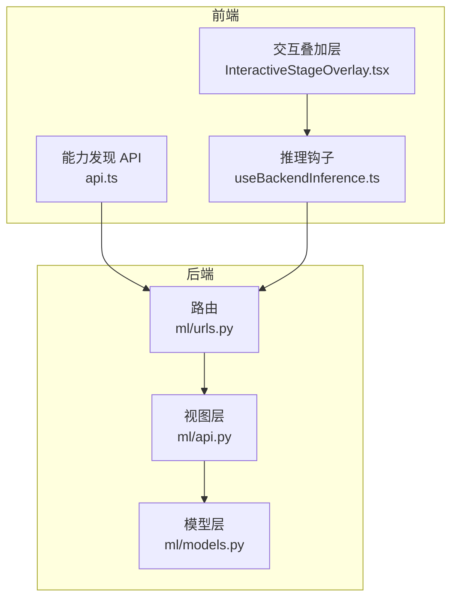
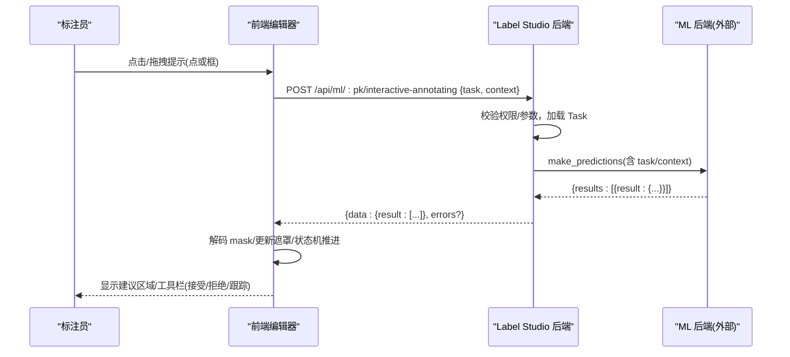
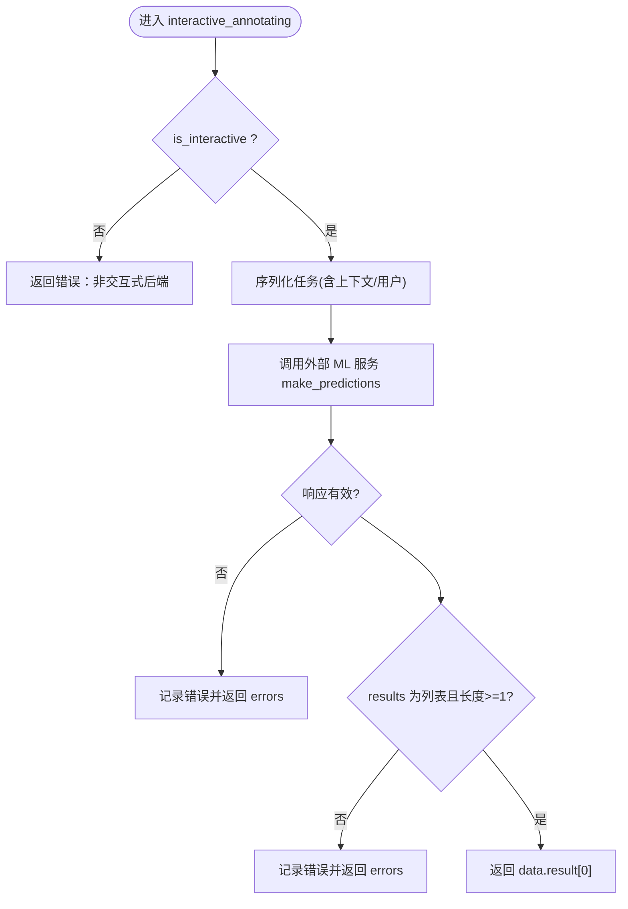
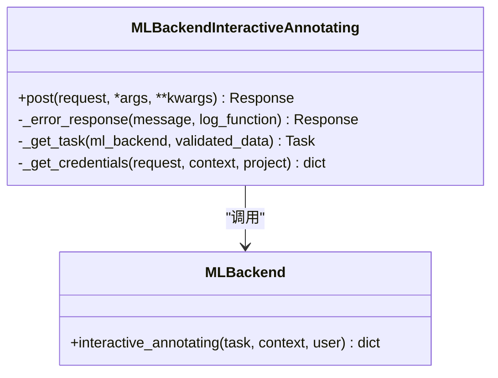
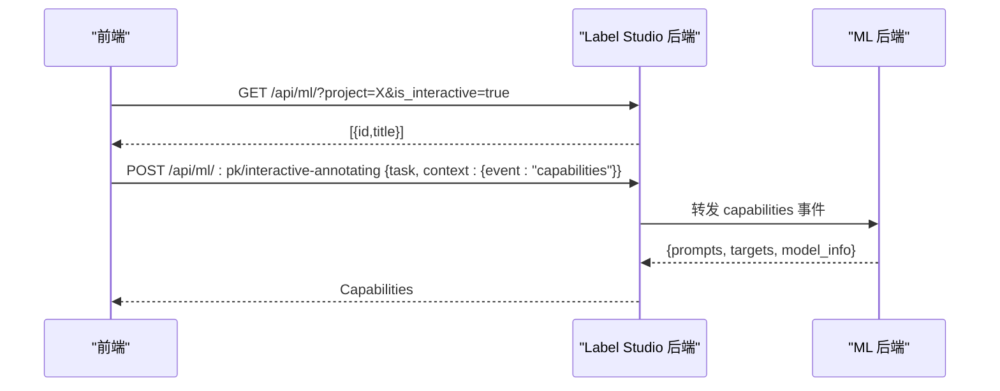
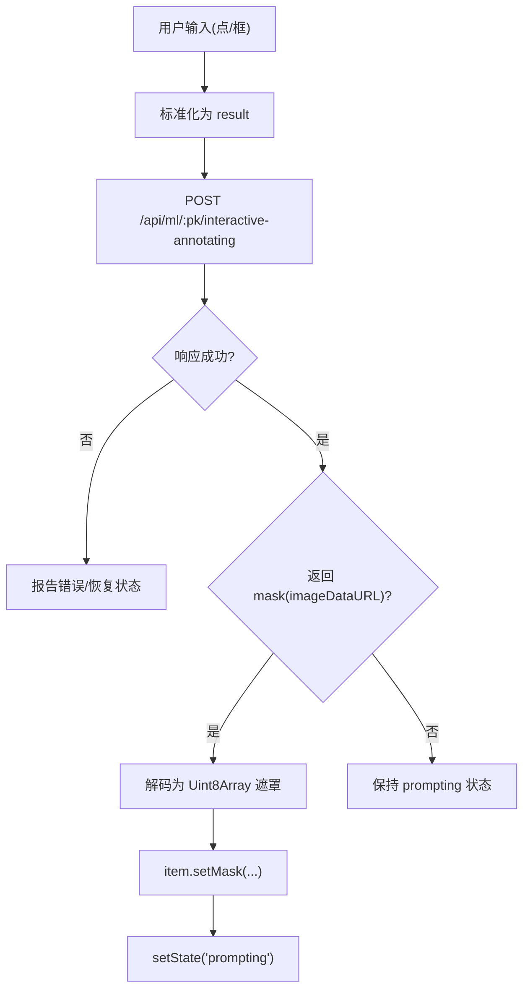
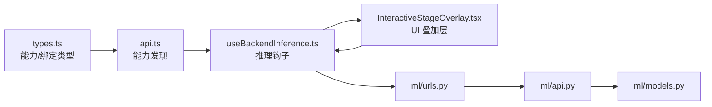

# 交互式标注

<cite>
**本文引用的文件**   
- [label_studio/ml/models.py](file://label_studio/ml/models.py)
- [label_studio/ml/api.py](file://label_studio/ml/api.py)
- [label_studio/ml/urls.py](file://label_studio/ml/urls.py)
- [web/libs/editor/src/ml-interactive/api.ts](file://web/libs/editor/src/ml-interactive/api.ts)
- [web/libs/editor/src/ml-interactive/primitives/useBackendInference.ts](file://web/libs/editor/src/ml-interactive/primitives/useBackendInference.ts)
- [web/libs/editor/src/ml-interactive/types.ts](file://web/libs/editor/src/ml-interactive/types.ts)
- [web/libs/editor/src/ml-interactive/InteractiveStageOverlay.tsx](file://web/libs/editor/src/ml-interactive/InteractiveStageOverlay.tsx)
</cite>

## 目录
1. [简介](#简介)
2. [项目结构](#项目结构)
3. [核心组件](#核心组件)
4. [架构总览](#架构总览)
5. [详细组件分析](#详细组件分析)
6. [依赖关系分析](#依赖关系分析)
7. [性能与实时性](#性能与实时性)
8. [故障排查指南](#故障排查指南)
9. [结论](#结论)
10. [附录：开发指南与集成示例](#附录开发指南与集成示例)

## 简介
本文件系统性说明 Label Studio 的“交互式标注”能力，覆盖工作机制、is_interactive 标志的作用、前后端交互流程、数据序列化/反序列化、用户界面集成、与传统预标注的区别，以及常见交互式模型的开发与集成要点。目标是帮助后端开发者快速实现可被前端驱动的交互式推理服务（如点选/框选触发分割、视频跟踪等），并让前端在编辑器中提供实时反馈与上下文感知体验。

## 项目结构
交互式标注由以下关键部分组成：
- 后端模型与 API：MLBackend 模型、交互式标注接口、URL 路由
- 前端能力发现与推理钩子：能力查询、后端选择、预测/跟踪调用
- 前端渲染层：交互叠加层、输入处理、遮罩预览与工具栏

**图表来源**
- [web/libs/editor/src/ml-interactive/api.ts:25-55](file://web/libs/editor/src/ml-interactive/api.ts#L25-L55)
- [web/libs/editor/src/ml-interactive/primitives/useBackendInference.ts:113-162](file://web/libs/editor/src/ml-interactive/primitives/useBackendInference.ts#L113-L162)
- [web/libs/editor/src/ml-interactive/InteractiveStageOverlay.tsx:42-48](file://web/libs/editor/src/ml-interactive/InteractiveStageOverlay.tsx#L42-L48)
- [label_studio/ml/urls.py:17-19](file://label_studio/ml/urls.py#L17-L19)
- [label_studio/ml/api.py:339-380](file://label_studio/ml/api.py#L339-L380)
- [label_studio/ml/models.py:375-417](file://label_studio/ml/models.py#L375-L417)

**章节来源**
- [web/libs/editor/src/ml-interactive/api.ts:25-55](file://web/libs/editor/src/ml-interactive/api.ts#L25-L55)
- [web/libs/editor/src/ml-interactive/primitives/useBackendInference.ts:113-162](file://web/libs/editor/src/ml-interactive/primitives/useBackendInference.ts#L113-L162)
- [web/libs/editor/src/ml-interactive/InteractiveStageOverlay.tsx:42-48](file://web/libs/editor/src/ml-interactive/InteractiveStageOverlay.tsx#L42-L48)
- [label_studio/ml/urls.py:17-19](file://label_studio/ml/urls.py#L17-L19)
- [label_studio/ml/api.py:339-380](file://label_studio/ml/api.py#L339-L380)
- [label_studio/ml/models.py:375-417](file://label_studio/ml/models.py#L375-L417)

## 核心组件
- MLBackend 模型
  - is_interactive 布尔标志：标记该后端是否用于交互式标注；当为真时，批量预标注会被跳过，仅通过交互式接口返回单条结果。
  - interactive_annotating：封装任务序列化、调用外部 ML 服务、校验响应并返回 data/errors。
- MLBackendInteractiveAnnotating 视图
  - 暴露 /api/ml/<pk>/interactive-annotating，负责鉴权、参数校验、获取任务与上下文、调用模型的交互式标注方法。
- 前端能力发现与推理
  - fetchInteractiveBackends：按项目查询已启用 is_interactive=true 的后端列表。
  - fetchCapabilities：通过 capabilities 事件探测后端支持的提示类型与目标控件。
  - useBackendInference：统一封装 predict/predictBox/track 调用，处理取消、错误提示、视频帧对齐、预加热与释放等生命周期。
- 交互叠加层
  - InteractiveStageOverlay：将控制标签与绑定能力结合，渲染遮罩预览、提示点/框、忙态指示器，并驱动 accept/reject/track 操作。

**章节来源**
- [label_studio/ml/models.py:46-50](file://label_studio/ml/models.py#L46-L50)
- [label_studio/ml/models.py:341-348](file://label_studio/ml/models.py#L341-L348)
- [label_studio/ml/models.py:375-417](file://label_studio/ml/models.py#L375-L417)
- [label_studio/ml/api.py:339-380](file://label_studio/ml/api.py#L339-L380)
- [web/libs/editor/src/ml-interactive/api.ts:25-55](file://web/libs/editor/src/ml-interactive/api.ts#L25-L55)
- [web/libs/editor/src/ml-interactive/primitives/useBackendInference.ts:88-162](file://web/libs/editor/src/ml-interactive/primitives/useBackendInference.ts#L88-L162)
- [web/libs/editor/src/ml-interactive/InteractiveStageOverlay.tsx:42-48](file://web/libs/editor/src/ml-interactive/InteractiveStageOverlay.tsx#L42-L48)

## 架构总览
交互式标注的整体请求流如下：

**图表来源**
- [web/libs/editor/src/ml-interactive/primitives/useBackendInference.ts:243-283](file://web/libs/editor/src/ml-interactive/primitives/useBackendInference.ts#L243-L283)
- [label_studio/ml/api.py:362-380](file://label_studio/ml/api.py#L362-L380)
- [label_studio/ml/models.py:375-417](file://label_studio/ml/models.py#L375-L417)

## 详细组件分析

### 后端：MLBackend 模型与交互式标注流程
- is_interactive 标志
  - 作用：标识该后端专用于交互式标注；当为真时，批量预标注路径会直接返回空结果，避免无意义的空白预测写入。
- interactive_annotating(task, context, user)
  - 校验 is_interactive 是否为真，否则返回错误信息。
  - 使用可配置的序列化器对任务进行扩展序列化（包含草稿、预测、标注等）。
  - 调用外部 ML 服务的 make_predictions，传入 project、context。
  - 校验返回结构：必须为 dict 且包含 results 列表，至少一项。
  - 返回 data.result[0] 给前端；若失败则返回 errors。

**图表来源**
- [label_studio/ml/models.py:375-417](file://label_studio/ml/models.py#L375-L417)

**章节来源**
- [label_studio/ml/models.py:46-50](file://label_studio/ml/models.py#L46-L50)
- [label_studio/ml/models.py:341-348](file://label_studio/ml/models.py#L341-L348)
- [label_studio/ml/models.py:375-417](file://label_studio/ml/models.py#L375-L417)

### 后端：API 视图与路由
- 路由
  - /api/ml/<int:pk>/interactive-annotating 指向 MLBackendInteractiveAnnotating。
- 视图
  - 鉴权：tasks_view 权限。
  - 参数校验：MLInteractiveAnnotatingRequest。
  - 任务解析：根据 pk 和 project 获取 Task。
  - 上下文注入：可选携带项目凭据（受特性开关控制）。
  - 调用模型：ml_backend.interactive_annotating(task, context, user)。
  - 返回：统一以 {errors?: string[], data?: any} 形式返回。

**图表来源**
- [label_studio/ml/urls.py:17-19](file://label_studio/ml/urls.py#L17-L19)
- [label_studio/ml/api.py:339-380](file://label_studio/ml/api.py#L339-L380)
- [label_studio/ml/models.py:375-417](file://label_studio/ml/models.py#L375-L417)

**章节来源**
- [label_studio/ml/urls.py:17-19](file://label_studio/ml/urls.py#L17-L19)
- [label_studio/ml/api.py:339-380](file://label_studio/ml/api.py#L339-L380)

### 前端：能力发现与后端选择
- 能力发现
  - fetchInteractiveBackends(projectId)：GET /api/ml/?project=...&is_interactive=true，返回后端 id/title 列表。
  - fetchCapabilities(backendId, taskId)：POST /api/ml/:pk/interactive-annotating，body.context.event="capabilities"，后端应返回 prompts/targets/model_info。
- 后端选择
  - useBackendInference 在控制器初始化时尝试从项目维度查询 is_interactive=true 的后端；若控制器已携带 backendId，则走快速路径。

**图表来源**
- [web/libs/editor/src/ml-interactive/api.ts:25-55](file://web/libs/editor/src/ml-interactive/api.ts#L25-L55)
- [web/libs/editor/src/ml-interactive/primitives/useBackendInference.ts:113-162](file://web/libs/editor/src/ml-interactive/primitives/useBackendInference.ts#L113-L162)

**章节来源**
- [web/libs/editor/src/ml-interactive/api.ts:25-55](file://web/libs/editor/src/ml-interactive/api.ts#L25-L55)
- [web/libs/editor/src/ml-interactive/primitives/useBackendInference.ts:113-162](file://web/libs/editor/src/ml-interactive/primitives/useBackendInference.ts#L113-L162)
- [web/libs/editor/src/ml-interactive/types.ts:12-56](file://web/libs/editor/src/ml-interactive/types.ts#L12-L56)

### 前端：推理钩子 useBackendInference
- 职责
  - 解析并缓存 backendId。
  - 提供 predict(predictFn)/predictBox(predictBoxFn)/track(TrackFn) 三个回调。
  - 管理请求取消（AbortController）、错误提示、视频帧时间对齐、预加热/释放资源。
- 关键行为
  - 启动阶段：发送 prewarm 事件（视频）；停止阶段：中止所有 in-flight 请求并发送 release。
  - 预测流程：将点/框提示标准化为 result，POST 到 /api/ml/:pk/interactive-annotating，解析 data.data.result[0].value，支持 imageDataURL 转 mask。
  - 跟踪流程：start track → 长轮询 track_progress → 逐帧回调 onFrames → 支持 cancel。

**图表来源**
- [web/libs/editor/src/ml-interactive/primitives/useBackendInference.ts:217-286](file://web/libs/editor/src/ml-interactive/primitives/useBackendInference.ts#L217-L286)
- [web/libs/editor/src/ml-interactive/primitives/useBackendInference.ts:342-445](file://web/libs/editor/src/ml-interactive/primitives/useBackendInference.ts#L342-L445)

**章节来源**
- [web/libs/editor/src/ml-interactive/primitives/useBackendInference.ts:88-162](file://web/libs/editor/src/ml-interactive/primitives/useBackendInference.ts#L88-L162)
- [web/libs/editor/src/ml-interactive/primitives/useBackendInference.ts:217-286](file://web/libs/editor/src/ml-interactive/primitives/useBackendInference.ts#L217-L286)
- [web/libs/editor/src/ml-interactive/primitives/useBackendInference.ts:342-445](file://web/libs/editor/src/ml-interactive/primitives/useBackendInference.ts#L342-L445)

### 前端：交互叠加层 InteractiveStageOverlay
- 职责
  - 将控制标签与能力绑定结合，创建稳定的 controller。
  - 监听自动标注开关，驱动 start/stop。
  - 渲染遮罩预览（图片用 Canvas+CSS 光晕，视频用 Konva 图层），绘制提示点/框。
  - 提供 Accept/Reject/Track 工具栏入口，接入 useInputHandlers。
- 关键点
  - 遮罩变化时重绘并触发 CSS 动画。
  - 视频工作区缩放/平移时仅重定位不重绘像素，保证流畅。
  - 忙态指示器在 encoding/resolving/tracking 时显示。

**章节来源**
- [web/libs/editor/src/ml-interactive/InteractiveStageOverlay.tsx:42-48](file://web/libs/editor/src/ml-interactive/InteractiveStageOverlay.tsx#L42-L48)
- [web/libs/editor/src/ml-interactive/InteractiveStageOverlay.tsx:104-151](file://web/libs/editor/src/ml-interactive/InteractiveStageOverlay.tsx#L104-L151)
- [web/libs/editor/src/ml-interactive/InteractiveStageOverlay.tsx:167-254](file://web/libs/editor/src/ml-interactive/InteractiveStageOverlay.tsx#L167-L254)
- [web/libs/editor/src/ml-interactive/InteractiveStageOverlay.tsx:312-463](file://web/libs/editor/src/ml-interactive/InteractiveStageOverlay.tsx#L312-L463)

## 依赖关系分析
- 耦合与内聚
  - 后端 MLBackend 与 MLBackendInteractiveAnnotating 视图强耦合于 MLApi 与序列化器；职责清晰，单一变更影响面可控。
  - 前端 useBackendInference 与 InteractiveStageOverlay 解耦：前者专注网络与状态，后者专注 UI 与交互。
- 外部依赖
  - 外部 ML 后端需实现 make_predictions，并在交互式模式下返回长度为 1 的 results 列表。
  - 前端通过 same-origin-fetch 访问 Django 代理，无需新增 Django 路由即可复用现有 /interactive-annotating。

**图表来源**
- [web/libs/editor/src/ml-interactive/types.ts:12-56](file://web/libs/editor/src/ml-interactive/types.ts#L12-L56)
- [web/libs/editor/src/ml-interactive/api.ts:25-55](file://web/libs/editor/src/ml-interactive/api.ts#L25-L55)
- [web/libs/editor/src/ml-interactive/primitives/useBackendInference.ts:88-162](file://web/libs/editor/src/ml-interactive/primitives/useBackendInference.ts#L88-L162)
- [web/libs/editor/src/ml-interactive/InteractiveStageOverlay.tsx:42-48](file://web/libs/editor/src/ml-interactive/InteractiveStageOverlay.tsx#L42-L48)
- [label_studio/ml/urls.py:17-19](file://label_studio/ml/urls.py#L17-L19)
- [label_studio/ml/api.py:339-380](file://label_studio/ml/api.py#L339-L380)
- [label_studio/ml/models.py:375-417](file://label_studio/ml/models.py#L375-L417)

**章节来源**
- [web/libs/editor/src/ml-interactive/types.ts:12-56](file://web/libs/editor/src/ml-interactive/types.ts#L12-L56)
- [web/libs/editor/src/ml-interactive/api.ts:25-55](file://web/libs/editor/src/ml-interactive/api.ts#L25-L55)
- [web/libs/editor/src/ml-interactive/primitives/useBackendInference.ts:88-162](file://web/libs/editor/src/ml-interactive/primitives/useBackendInference.ts#L88-L162)
- [web/libs/editor/src/ml-interactive/InteractiveStageOverlay.tsx:42-48](file://web/libs/editor/src/ml-interactive/InteractiveStageOverlay.tsx#L42-L48)
- [label_studio/ml/urls.py:17-19](file://label_studio/ml/urls.py#L17-L19)
- [label_studio/ml/api.py:339-380](file://label_studio/ml/api.py#L339-L380)
- [label_studio/ml/models.py:375-417](file://label_studio/ml/models.py#L375-L417)

## 性能与实时性
- 请求取消与防抖
  - 每次新的预测/跟踪请求都会 abort 上一次未完成的请求，避免陈旧响应覆盖当前状态。
- 视频优化
  - 预加热窗口：启动时向前预取若干帧以降低首帧延迟。
  - 遮罩渲染分离：视频路径下将像素绘制与坐标重定位拆分为两个 effect，避免缩放/平移触发全量重绘。
- 长轮询跟踪
  - 跟踪采用服务端 pacing 的长轮询模式，减少频繁请求开销，前端仅在收到新帧时回调 onFrames。
- 错误与降级
  - 网络异常或后端错误时，统一通过 toast 提示并回退到 prompting 状态，允许用户重试。

**章节来源**
- [web/libs/editor/src/ml-interactive/primitives/useBackendInference.ts:188-215](file://web/libs/editor/src/ml-interactive/primitives/useBackendInference.ts#L188-L215)
- [web/libs/editor/src/ml-interactive/primitives/useBackendInference.ts:217-286](file://web/libs/editor/src/ml-interactive/primitives/useBackendInference.ts#L217-L286)
- [web/libs/editor/src/ml-interactive/primitives/useBackendInference.ts:342-445](file://web/libs/editor/src/ml-interactive/primitives/useBackendInference.ts#L342-L445)
- [web/libs/editor/src/ml-interactive/InteractiveStageOverlay.tsx:167-254](file://web/libs/editor/src/ml-interactive/InteractiveStageOverlay.tsx#L167-L254)

## 故障排查指南
- 常见问题
  - 未连接交互式后端：前端提示“无交互式 ML 后端”，需在设置中连接一个 is_interactive=true 的后端。
  - 后端返回结构不正确：后端必须返回 dict 且 results 为长度≥1 的列表，否则返回 errors。
  - 视频跟踪无 session_id：后端应在 track 开始响应中返回 value.session_id。
  - 请求被取消：检查是否在用户移除最后一个提示后触发了 abortInflight。
- 诊断步骤
  - 确认 /api/ml/?project=X&is_interactive=true 能返回后端列表。
  - 检查 /api/ml/:pk/interactive-annotating 的请求体是否包含 task 与 context。
  - 查看后端日志中的错误消息与返回结构校验失败位置。

**章节来源**
- [web/libs/editor/src/ml-interactive/primitives/useBackendInference.ts:139-156](file://web/libs/editor/src/ml-interactive/primitives/useBackendInference.ts#L139-L156)
- [label_studio/ml/models.py:397-416](file://label_studio/ml/models.py#L397-L416)
- [web/libs/editor/src/ml-interactive/primitives/useBackendInference.ts:398-402](file://web/libs/editor/src/ml-interactive/primitives/useBackendInference.ts#L398-L402)

## 结论
交互式标注通过 is_interactive 标志将后端划分为“批处理预标注”和“交互式实时推理”两类。前端通过能力发现与统一的推理钩子，将用户的点/框输入转化为标准化的 result，并由后端返回 mask 或跟踪结果，最终在编辑器中以遮罩预览与工具栏呈现。该机制兼顾了实时性与用户体验，同时保持了前后端的低耦合与可扩展性。

## 附录：开发指南与集成示例

### is_interactive 标志与配置
- 含义
  - is_interactive=true 表示该后端专用于交互式标注；批量预标注将被跳过。
- 配置方式
  - 在后端模型中设置 is_interactive 字段为 true。
  - 前端通过 GET /api/ml/?project=X&is_interactive=true 发现可用后端。

**章节来源**
- [label_studio/ml/models.py:46-50](file://label_studio/ml/models.py#L46-L50)
- [label_studio/ml/models.py:341-348](file://label_studio/ml/models.py#L341-L348)
- [web/libs/editor/src/ml-interactive/api.ts:25-31](file://web/libs/editor/src/ml-interactive/api.ts#L25-L31)

### 交互式标注的数据序列化与反序列化
- 后端序列化
  - 使用可配置的序列化器对任务进行扩展序列化，包含 drafts/predictions/annotations 等上下文。
- 后端反序列化
  - 校验外部 ML 服务返回的 response 结构：dict 且 results 为列表，至少一项。
- 前端反序列化
  - 解析 data.data.result[0].value，支持 imageDataURL 转 mask；跟踪场景读取 session_id 与 frames。

**章节来源**
- [label_studio/ml/models.py:384-391](file://label_studio/ml/models.py#L384-L391)
- [label_studio/ml/models.py:397-416](file://label_studio/ml/models.py#L397-L416)
- [web/libs/editor/src/ml-interactive/primitives/useBackendInference.ts:259-283](file://web/libs/editor/src/ml-interactive/primitives/useBackendInference.ts#L259-L283)
- [web/libs/editor/src/ml-interactive/primitives/useBackendInference.ts:398-434](file://web/libs/editor/src/ml-interactive/primitives/useBackendInference.ts#L398-L434)

### 用户界面集成与前端交互逻辑
- 能力绑定
  - 后端通过 capabilities 事件声明支持的提示类型(point/box)与目标控件(tag/output/features)。
  - 前端根据能力生成 InteractiveBinding，供 UI 层决定展示哪些交互按钮。
- 交互流程
  - 用户在图像/视频上点击/拖拽产生提示点或框，前端标准化为 result 并调用后端。
  - 后端返回 mask 或跟踪进度，前端渲染遮罩并更新状态。
  - 支持 Accept/Reject/Track 操作，跟踪过程支持取消。

**章节来源**
- [web/libs/editor/src/ml-interactive/types.ts:12-56](file://web/libs/editor/src/ml-interactive/types.ts#L12-L56)
- [web/libs/editor/src/ml-interactive/api.ts:40-55](file://web/libs/editor/src/ml-interactive/api.ts#L40-L55)
- [web/libs/editor/src/ml-interactive/InteractiveStageOverlay.tsx:267-271](file://web/libs/editor/src/ml-interactive/InteractiveStageOverlay.tsx#L267-L271)
- [web/libs/editor/src/ml-interactive/primitives/useBackendInference.ts:342-445](file://web/libs/editor/src/ml-interactive/primitives/useBackendInference.ts#L342-L445)

### 与传统预标注的区别与适用场景
- 传统预标注
  - 批量调用后端，返回每个任务的预测结果并持久化；适合离线模型或一次性标注加速。
- 交互式标注
  - 按需触发，返回单条结果；适合需要用户即时反馈的场景（如 SAM 类分割、视频跟踪）。
- 适用场景
  - 交互式：复杂对象分割、多目标跟踪、需要人工引导的精细标注。
  - 传统预标注：大规模数据的初步筛选、分类、实体识别等。

**章节来源**
- [label_studio/ml/models.py:341-348](file://label_studio/ml/models.py#L341-L348)
- [label_studio/ml/models.py:375-417](file://label_studio/ml/models.py#L375-L417)

### 常见交互式模型开发与集成示例
- 后端要求
  - 实现 make_predictions，支持交互式上下文（event/result/frame/time_ms 等）。
  - 在交互式模式下返回 results 列表，长度至少为 1，result[0].value 包含 mask 或跟踪会话信息。
- 能力声明
  - 支持 capabilities 事件，返回 prompts/targets/model_info。
- 集成步骤
  - 在 Label Studio 中添加 ML 后端并设置 is_interactive=true。
  - 前端通过能力发现与推理钩子完成交互闭环。

**章节来源**
- [label_studio/ml/models.py:375-417](file://label_studio/ml/models.py#L375-L417)
- [web/libs/editor/src/ml-interactive/api.ts:40-55](file://web/libs/editor/src/ml-interactive/api.ts#L40-L55)
- [web/libs/editor/src/ml-interactive/primitives/useBackendInference.ts:217-286](file://web/libs/editor/src/ml-interactive/primitives/useBackendInference.ts#L217-L286)