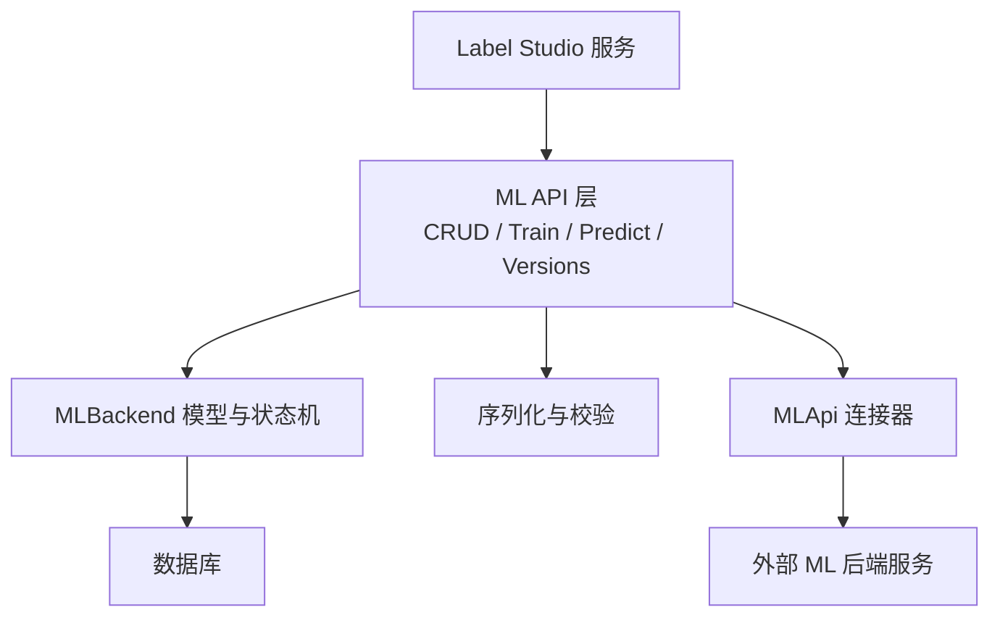
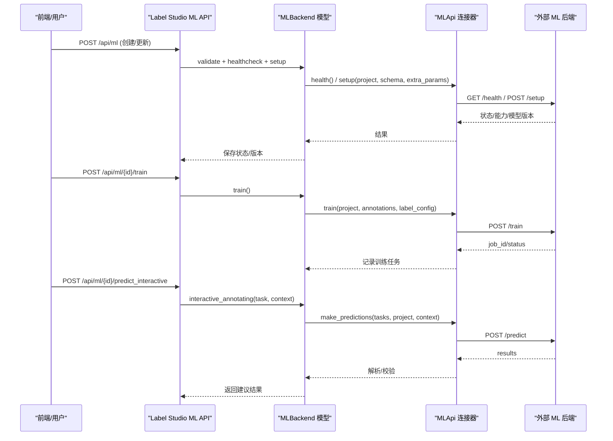
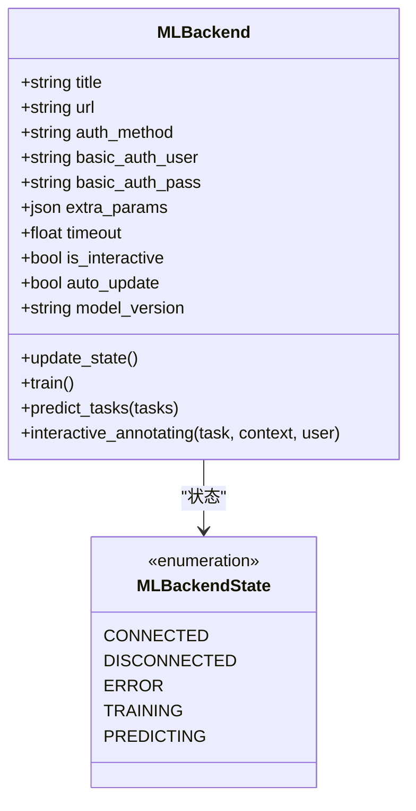
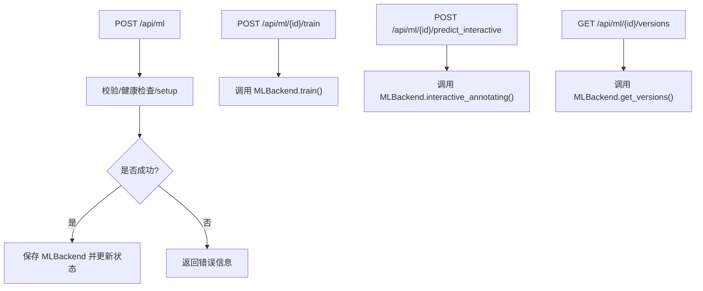
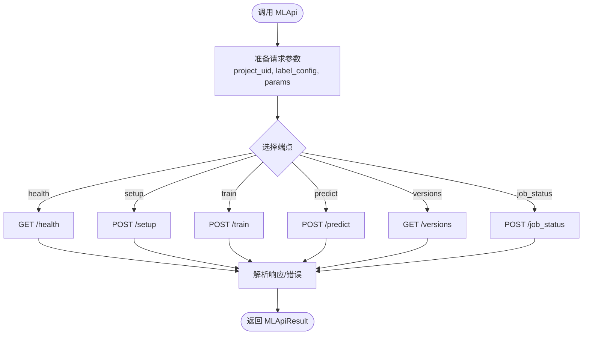
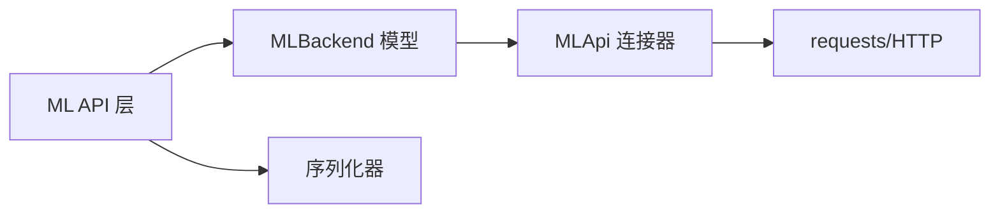

# 机器学习集成

<cite>
**本文引用的文件**   
- [label_studio/ml/models.py](file://label_studio/ml/models.py)
- [label_studio/ml/api.py](file://label_studio/ml/api.py)
- [label_studio/ml/serializers.py](file://label_studio/ml/serializers.py)
- [label_studio/ml/api_connector.py](file://label_studio/ml/api_connector.py)
- [docs/source/guide/ml.md](file://docs/source/guide/ml.md)
- [docs/source/guide/ml_create.md](file://docs/source/guide/ml_create.md)
- [docs/source/guide/active_learning.md](file://docs/source/guide/active_learning.md)
</cite>

## 目录
1. [简介](#简介)
2. [项目结构](#项目结构)
3. [核心组件](#核心组件)
4. [架构总览](#架构总览)
5. [详细组件分析](#详细组件分析)
6. [依赖关系分析](#依赖关系分析)
7. [性能与可扩展性](#性能与可扩展性)
8. [故障排查指南](#故障排查指南)
9. [结论](#结论)
10. [附录：API 规范与最佳实践](#附录api-规范与最佳实践)

## 简介
本文件面向需要在 Label Studio 中集成外部机器学习模型（预标注、主动学习、在线学习）的工程师与数据科学家。文档从系统架构、通信协议、模型注册与配置、预测与训练流程、主动学习与在线学习闭环，到常见框架集成示例与优化策略进行系统化说明。重点围绕后端 ML 模块与外部 ML 后端的交互机制展开，帮助读者快速搭建稳定、可观测、可扩展的 ML 集成方案。

## 项目结构
Label Studio 的 ML 集成由以下关键部分组成：
- ML 后端连接管理：负责 ML 后端的注册、健康检查、状态同步、版本管理与权限控制
- ML API 连接器：封装与外部 ML 后端的 HTTP 通信协议（health/setup/train/predict/versions 等）
- 序列化与校验：对请求体、认证参数、URL 合法性等进行校验
- 文档与教程：提供端到端的使用指南、主动学习工作流与自定义后端开发指引

图表来源
- [label_studio/ml/api.py:69-189](file://label_studio/ml/api.py#L69-L189)
- [label_studio/ml/models.py:38-221](file://label_studio/ml/models.py#L38-L221)
- [label_studio/ml/serializers.py:22-101](file://label_studio/ml/serializers.py#L22-L101)
- [label_studio/ml/api_connector.py:137-274](file://label_studio/ml/api_connector.py#L137-L274)

章节来源
- [docs/source/guide/ml.md:13-52](file://docs/source/guide/ml.md#L13-L52)
- [docs/source/guide/ml_create.md:14-19](file://docs/source/guide/ml_create.md#L14-L19)

## 核心组件
- MLBackend 模型与状态机
  - 维护 ML 后端连接信息、认证方式、超时、自动更新模型版本、交互式标注开关等
  - 状态包括已连接、未连接、错误、训练中、预测中
- ML API 层
  - 提供 ML 后端 CRUD、训练、测试预测、交互式标注、版本查询等接口
- MLApi 连接器
  - 统一封装与外部 ML 后端的 HTTP 调用，包含 health/setup/train/predict/versions/job_status 等端点
- 序列化器
  - 校验 URL、Basic Auth、健康检查与 setup 响应，确保接入的 ML 后端可用且兼容

章节来源
- [label_studio/ml/models.py:25-132](file://label_studio/ml/models.py#L25-L132)
- [label_studio/ml/api.py:69-189](file://label_studio/ml/api.py#L69-L189)
- [label_studio/ml/serializers.py:22-101](file://label_studio/ml/serializers.py#L22-L101)
- [label_studio/ml/api_connector.py:137-274](file://label_studio/ml/api_connector.py#L137-L274)

## 架构总览
Label Studio 通过 REST API 暴露 ML 后端管理能力，并通过 MLApi 连接器与外部 ML 后端进行标准化通信。典型交互如下：
- 创建/更新 ML 后端时，执行健康检查与 setup 验证
- 训练任务触发 train 端点，将标注数据与标签配置发送给外部后端
- 预测任务批量或单条调用 predict 端点，返回结果并持久化为 Prediction
- 交互式标注通过 interactive_annotating 接口，结合上下文实时获取建议

图表来源
- [label_studio/ml/api.py:69-189](file://label_studio/ml/api.py#L69-L189)
- [label_studio/ml/api.py:229-380](file://label_studio/ml/api.py#L229-L380)
- [label_studio/ml/models.py:173-221](file://label_studio/ml/models.py#L173-L221)
- [label_studio/ml/models.py:341-417](file://label_studio/ml/models.py#L341-L417)
- [label_studio/ml/api_connector.py:189-274](file://label_studio/ml/api_connector.py#L189-L274)

## 详细组件分析

### MLBackend 模型与状态机
- 字段与能力
  - url、auth_method、basic_auth_user/pass、extra_params、timeout、auto_update、is_interactive、model_version
- 状态流转
  - DISCONNECTED -> CONNECTED（健康检查与 setup 成功）
  - CONNECTED -> ERROR（setup 失败）
  - CONNECTED -> TRAINING（train 启动）
  - PREDICTING（预测进行中，通常用于调试或内部标记）
- 关键方法
  - update_state：执行 healthcheck 与 setup，更新 model_version 与状态
  - train：发起训练，记录训练任务
  - predict_tasks：批量预测，过滤已有同版本预测，持久化新预测
  - interactive_annotating：交互式标注，结合 context 返回单条建议

图表来源
- [label_studio/ml/models.py:25-132](file://label_studio/ml/models.py#L25-L132)
- [label_studio/ml/models.py:173-221](file://label_studio/ml/models.py#L173-L221)
- [label_studio/ml/models.py:341-417](file://label_studio/ml/models.py#L341-L417)

章节来源
- [label_studio/ml/models.py:38-221](file://label_studio/ml/models.py#L38-L221)
- [label_studio/ml/models.py:341-417](file://label_studio/ml/models.py#L341-L417)

### ML API 层
- 列表/创建/更新/删除 ML 后端
  - 支持按项目筛选、过滤交互式后端
  - 创建时自动设置默认模型版本（若启用协作预测）
- 训练接口
  - 触发后端训练，返回 200 表示开始
- 测试预测接口
  - 随机任务测试，便于调试
- 交互式标注接口
  - 接收 task 与 context，调用 MLBackend.interactive_annotating
- 版本查询接口
  - 获取后端支持的模型版本列表

图表来源
- [label_studio/ml/api.py:69-189](file://label_studio/ml/api.py#L69-L189)
- [label_studio/ml/api.py:229-380](file://label_studio/ml/api.py#L229-L380)
- [label_studio/ml/api.py:415-433](file://label_studio/ml/api.py#L415-L433)

章节来源
- [label_studio/ml/api.py:69-189](file://label_studio/ml/api.py#L69-L189)
- [label_studio/ml/api.py:229-380](file://label_studio/ml/api.py#L229-L380)
- [label_studio/ml/api.py:415-433](file://label_studio/ml/api.py#L415-L433)

### MLApi 连接器（与外部 ML 后端的通信协议）
- 端点约定
  - health：健康检查
  - setup：初始化与能力探测（传入 project、schema、hostname、extra_params）
  - train：训练（传入 annotations、project、label_config、hostname、params）
  - predict：预测（传入 tasks、project、label_config、params.context）
  - versions：模型版本列表
  - job_status：训练任务状态
  - duplicate_model/delete：模型复制与删除
- 安全与超时
  - 支持 Basic Auth
  - 连接超时与请求超时分离
  - SSRF 防护（可选）
  - 重试策略

图表来源
- [label_studio/ml/api_connector.py:137-274](file://label_studio/ml/api_connector.py#L137-L274)

章节来源
- [label_studio/ml/api_connector.py:137-274](file://label_studio/ml/api_connector.py#L137-L274)

### 序列化与校验
- URL 校验：阻止本地 IP（可配置）
- Basic Auth 校验：当选择 Basic Auth 时必须提供用户名与密码
- 健康检查与 setup 校验：在创建/更新时立即验证后端可用性
- 交互式标注请求校验：task 必填，context 可选

章节来源
- [label_studio/ml/serializers.py:22-101](file://label_studio/ml/serializers.py#L22-L101)
- [label_studio/ml/serializers.py:136-151](file://label_studio/ml/serializers.py#L136-L151)

## 依赖关系分析
- ML API 层依赖 MLBackend 模型与序列化器
- MLBackend 依赖 MLApi 连接器进行网络通信
- MLApi 连接器依赖 requests 与 SSRF 防护适配器
- 文档与教程提供使用指南与示例

图表来源
- [label_studio/ml/api.py:69-189](file://label_studio/ml/api.py#L69-L189)
- [label_studio/ml/models.py:38-221](file://label_studio/ml/models.py#L38-L221)
- [label_studio/ml/serializers.py:22-101](file://label_studio/ml/serializers.py#L22-L101)
- [label_studio/ml/api_connector.py:137-274](file://label_studio/ml/api_connector.py#L137-L274)

章节来源
- [label_studio/ml/api.py:69-189](file://label_studio/ml/api.py#L69-L189)
- [label_studio/ml/models.py:38-221](file://label_studio/ml/models.py#L38-L221)
- [label_studio/ml/serializers.py:22-101](file://label_studio/ml/serializers.py#L22-L101)
- [label_studio/ml/api_connector.py:137-274](file://label_studio/ml/api_connector.py#L137-L274)

## 性能与可扩展性
- 批处理与降级
  - 当后端不支持批量预测时，自动回退为逐任务预测
  - 对返回结果数量与任务数量不一致的情况进行日志告警与降级处理
- 超时与重试
  - 连接超时与请求超时分离，避免长时间阻塞
  - 可配置的重试次数，提升稳定性
- 交互式标注优化
  - 交互式后端跳过批量预测，避免无效空结果
- 缓存与去重
  - 预测前过滤已有同版本预测，减少重复计算
- 扩展点
  - 通过 extra_params 传递额外配置
  - 通过 webhook 触发训练事件，实现自动化流水线

章节来源
- [label_studio/ml/models.py:261-339](file://label_studio/ml/models.py#L261-L339)
- [label_studio/ml/models.py:341-373](file://label_studio/ml/models.py#L341-L373)
- [label_studio/ml/api_connector.py:48-106](file://label_studio/ml/api_connector.py#L48-L106)

## 故障排查指南
- 无法连接 ML 后端
  - 检查 URL 与防火墙配置，确认 health 端点可达
  - 若使用 Basic Auth，确认用户名与密码正确
- setup 失败
  - 检查 label_config 是否与后端期望一致
  - 查看后端日志中的 error_message
- 预测结果为空或不匹配
  - 确认后端是否支持批量预测；如不支持，系统将自动逐任务预测
  - 检查返回结构中 results 是否为非空列表，每个元素是否包含 result 字段
- 交互式标注无响应
  - 确认 ML 后端已启用 is_interactive
  - 检查 context 是否正确传递，以及后端是否支持该类型的智能工具

章节来源
- [label_studio/ml/serializers.py:62-92](file://label_studio/ml/serializers.py#L62-L92)
- [label_studio/ml/models.py:292-339](file://label_studio/ml/models.py#L292-L339)
- [label_studio/ml/models.py:375-417](file://label_studio/ml/models.py#L375-L417)

## 结论
Label Studio 的 ML 集成以清晰的 API 层、健壮的模型状态机与标准化的外部通信协议为核心，支持预标注、交互式标注与在线训练闭环。通过完善的校验、超时与重试机制，以及与 Webhook 的联动，能够构建稳定高效的主动学习与在线学习流水线。对于不同机器学习框架，只需遵循 predict/train/setup/health 等端点契约即可无缝集成。

## 附录：API 规范与最佳实践

### 预标注与交互式标注
- 预标注
  - 通过 Data Manager 批量“检索预测”，或在项目设置中启用“使用预测预标注任务”
  - 直接调用外部 ML 后端的 /predict 端点，传入 tasks 数组
- 交互式标注
  - 在项目设置中启用“交互式预标注”，并在标注界面开启“自动标注”
  - 智能工具（矩形、椭圆、多边形、关键点、画笔）可与 ML 后端交互，实时返回建议

章节来源
- [docs/source/guide/ml.md:270-327](file://docs/source/guide/ml.md#L270-L327)

### 主动学习
- 自动化主动学习
  - 连接 ML 后端后，启用“提交标注后启动模型训练”
  - 配置 Webhook 发送标注创建/更新事件，驱动后端 fit() 训练
  - 使用不确定性采样（基于预测分数）优先标注低置信度任务
- 手动主动学习（社区版）
  - 定期检索预测，按预测分数排序任务，分批标注与训练

章节来源
- [docs/source/guide/active_learning.md:19-95](file://docs/source/guide/active_learning.md#L19-L95)

### 在线学习（训练与反馈循环）
- 训练触发
  - 通过 UI 或 API 调用 /api/ml/{id}/train
  - 或通过 Webhook 自动触发，fit() 方法根据事件类型更新模型
- 反馈循环
  - 标注数据作为训练输入，模型重新训练后生成新版本
  - 前端展示最新版本的预测结果，形成持续改进闭环

章节来源
- [docs/source/guide/ml.md:239-269](file://docs/source/guide/ml.md#L239-L269)
- [docs/source/guide/ml_create.md:126-160](file://docs/source/guide/ml_create.md#L126-L160)

### 模型注册、配置与调用流程
- 注册与连接
  - 在项目中添加 ML 后端，填写 URL、认证方式、额外参数
  - 系统自动执行 healthcheck 与 setup 验证
- 配置
  - 设置超时、自动更新模型版本、交互式标注开关
- 调用
  - 训练：POST /api/ml/{id}/train
  - 预测：POST /api/ml/{id}/predict_interactive（交互式）或直接调用外部 /predict
  - 版本：GET /api/ml/{id}/versions

章节来源
- [label_studio/ml/api.py:69-189](file://label_studio/ml/api.py#L69-L189)
- [label_studio/ml/api.py:229-380](file://label_studio/ml/api.py#L229-L380)
- [label_studio/ml/api.py:415-433](file://label_studio/ml/api.py#L415-L433)

### 常见框架集成示例与要点
- TensorFlow / PyTorch
  - 实现 /predict 端点，接收 tasks，返回 predictions 数组
  - 如需访问 Label Studio 数据，设置 LABEL_STUDIO_URL 与 LABEL_STUDIO_API_KEY，并使用 get_local_path 下载资源
- Hugging Face
  - 使用 Transformers 进行文本分类、NER 等任务
  - 支持训练（fit）与预测（predict），可通过 Webhook 触发训练
- OpenAI / LLM
  - 通过 prompt 工程与 few-shot 示例增强推理效果
  - 支持交互式标注与在线训练（LLM 辅助标注与评估）

章节来源
- [docs/source/guide/ml.md:138-168](file://docs/source/guide/ml.md#L138-L168)
- [docs/source/guide/ml.md:169-237](file://docs/source/guide/ml.md#L169-L237)
- [docs/source/guide/ml_create.md:82-123](file://docs/source/guide/ml_create.md#L82-L123)

### 预测结果处理、评估与反馈
- 结果格式
  - 每个 prediction 需包含 result 字段，可选 score 与 model_version
- 评估
  - 通过 ModelRun 与 PredictionStats 统计准确率、召回率等指标
- 反馈循环
  - 标注数据进入训练集，模型迭代更新，前端展示最新版本预测

章节来源
- [label_studio/ml/models.py:318-339](file://label_studio/ml/models.py#L318-L339)
- [label_studio/ml_models/models.py:137-287](file://label_studio/ml_models/models.py#L137-L287)

### 主动学习算法选择策略与性能优化
- 算法选择
  - 不确定性采样：选择模型置信度最低的任务
  - 多样性采样：覆盖数据分布的不同区域
- 性能优化
  - 批量预测与逐任务降级的平衡
  - 合理设置超时与重试，避免长尾任务阻塞
  - 利用缓存与去重，减少重复计算

章节来源
- [docs/source/guide/active_learning.md:66-95](file://docs/source/guide/active_learning.md#L66-L95)
- [label_studio/ml/models.py:261-339](file://label_studio/ml/models.py#L261-L339)
- [label_studio/ml/api_connector.py:48-106](file://label_studio/ml/api_connector.py#L48-L106)