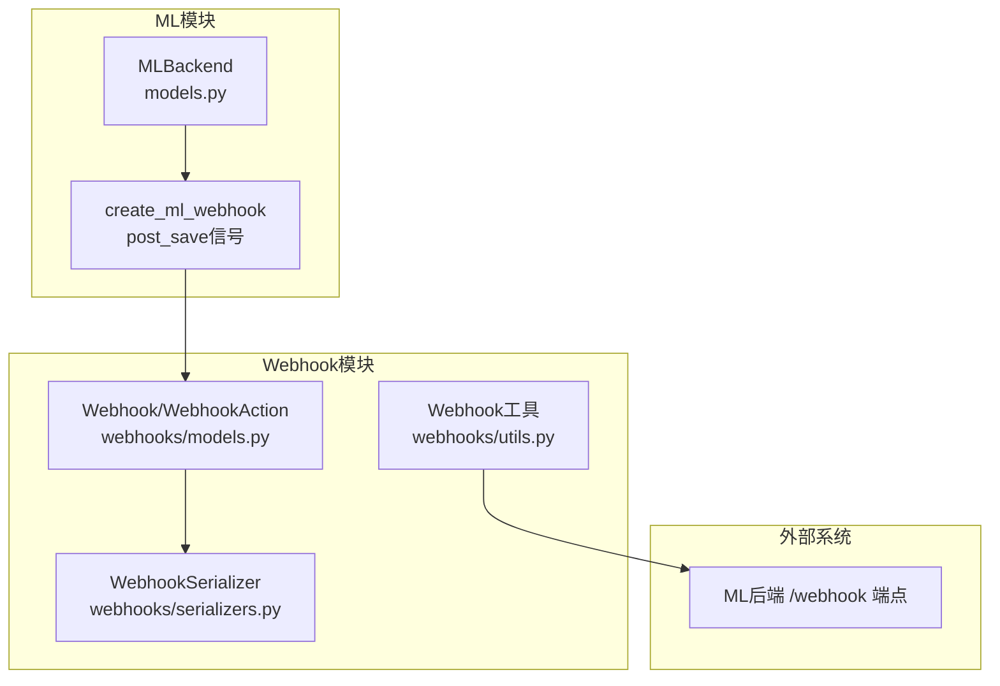
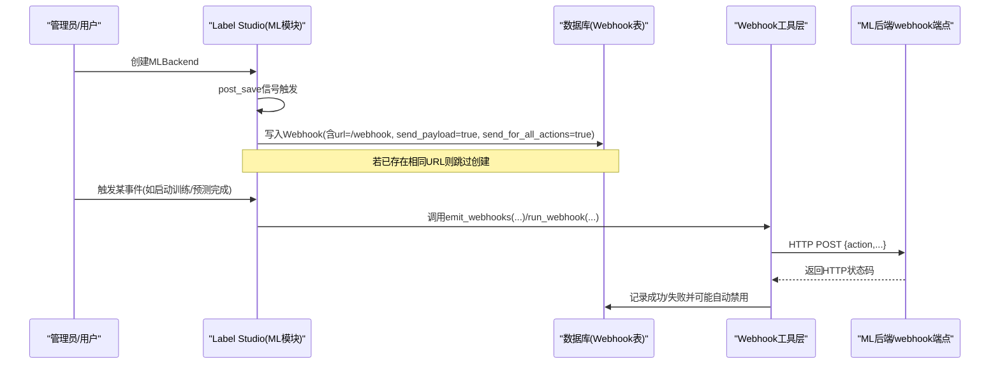
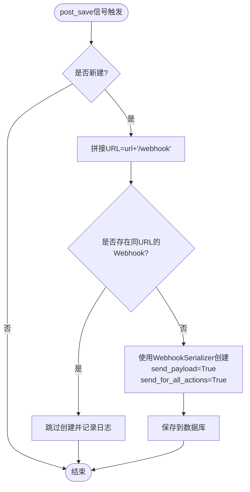
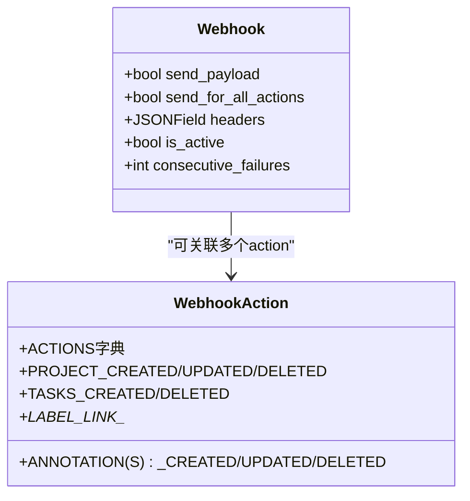
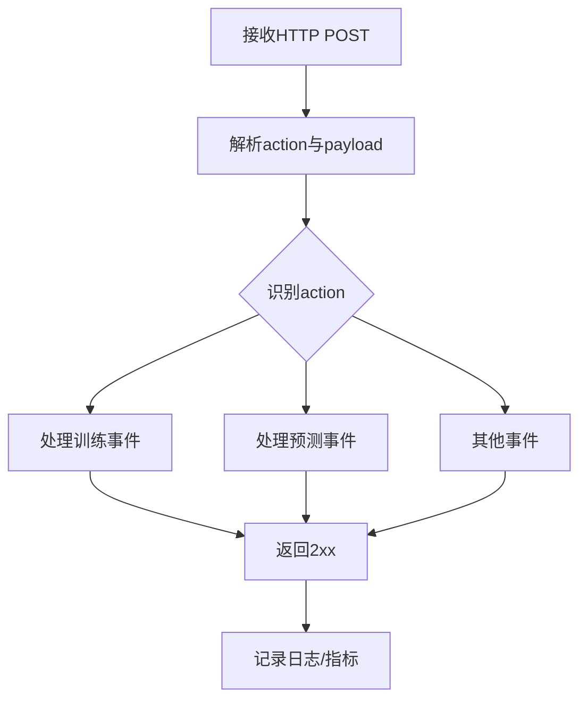
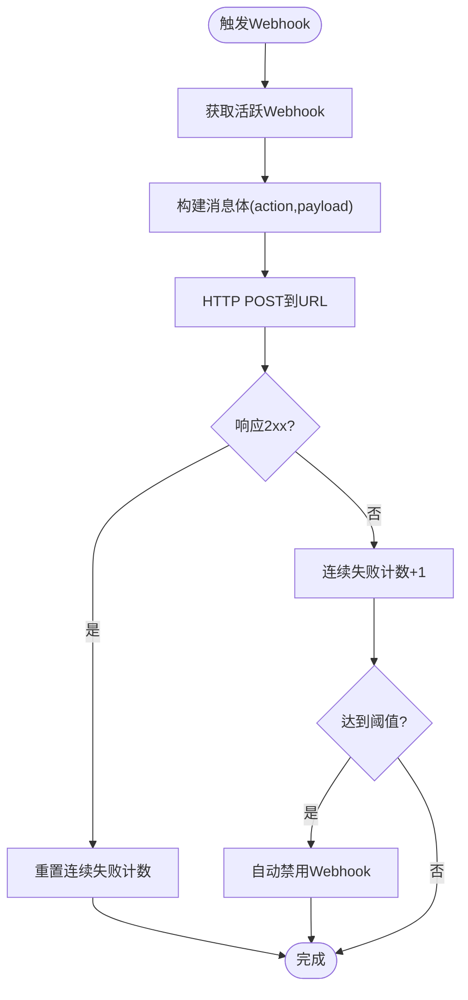
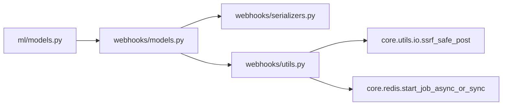

# Webhook集成

<cite>
**本文引用的文件**   
- [label_studio/ml/models.py](file://label_studio/ml/models.py)
- [label_studio/webhooks/models.py](file://label_studio/webhooks/models.py)
- [label_studio/webhooks/utils.py](file://label_studio/webhooks/utils.py)
- [label_studio/webhooks/serializers.py](file://label_studio/webhooks/serializers.py)
- [docs/source/guide/webhooks.md](file://docs/source/guide/webhooks.md)
- [docs/source/guide/webhook_reference.md](file://docs/source/guide/webhook_reference.md)
</cite>

## 目录
1. [简介](#简介)
2. [项目结构](#项目结构)
3. [核心组件](#核心组件)
4. [架构总览](#架构总览)
5. [详细组件分析](#详细组件分析)
6. [依赖关系分析](#依赖关系分析)
7. [性能考量](#性能考量)
8. [故障排查指南](#故障排查指南)
9. [结论](#结论)
10. [附录](#附录)

## 简介
本文面向Label Studio的ML模型Webhook集成，重点解释以下能力：
- create_ml_webhook信号处理器如何自动为ML后端创建Webhook
- Webhook配置参数send_payload与send_for_all_action的作用与行为差异
- Webhook事件类型与消息格式说明
- Webhook在模型事件通知中的作用（训练状态变更、预测完成等）
- Webhook接收端点实现示例与错误处理策略
- Webhook调试与日志记录实践

## 项目结构
围绕ML Webhook自动创建与投递，涉及以下模块：
- ML后端模型与信号：负责监听MLBackend创建并自动创建Webhook
- Webhook模型与动作：定义Webhook字段、动作枚举与组织/项目级作用域
- Webhook工具层：负责查询活跃Webhook、构造payload、发送HTTP请求、失败计数与自动禁用
- Webhook序列化器：校验URL、管理actions集合、暴露consecutive_failures等只读字段
- 文档：Webhook使用指南与事件参考

图表来源
- [label_studio/ml/models.py:509-525](file://label_studio/ml/models.py#L509-L525)
- [label_studio/webhooks/models.py:26-74](file://label_studio/webhooks/models.py#L26-L74)
- [label_studio/webhooks/serializers.py:8-33](file://label_studio/webhooks/serializers.py#L8-L33)
- [label_studio/webhooks/utils.py:18-68](file://label_studio/webhooks/utils.py#L18-L68)

章节来源
- [label_studio/ml/models.py:509-525](file://label_studio/ml/models.py#L509-L525)
- [label_studio/webhooks/models.py:26-74](file://label_studio/webhooks/models.py#L26-L74)
- [label_studio/webhooks/serializers.py:8-33](file://label_studio/webhooks/serializers.py#L8-L33)
- [label_studio/webhooks/utils.py:18-68](file://label_studio/webhooks/utils.py#L18-L68)

## 核心组件
- ML后端模型与信号处理器
  - MLBackend：表示一个ML后端实例，包含连接状态、认证、超时、版本等信息
  - create_ml_webhook：在MLBackend首次创建时，自动为其生成一个指向ML后端/webhook的Webhook
- Webhook模型与动作
  - Webhook：保存目标URL、是否携带payload、是否对所有动作生效、额外headers、是否启用、连续失败计数等
  - WebhookAction：定义所有支持的事件动作（如任务创建/删除、标注创建/更新/删除、项目创建/更新/删除等）
- Webhook工具层
  - get_active_webhooks：按组织/项目与作用域筛选活跃的Webhook
  - run_webhook_sync：向目标URL发起POST，附带action与可选payload
  - _record_webhook_delivery_result：统计连续失败次数，达到阈值自动禁用
  - emit_webhooks系列函数：批量或单条触发Webhook，支持异步RQ执行
- Webhook序列化器
  - WebhookSerializer：提供API层面的字段校验、actions集合管理与只读字段暴露

章节来源
- [label_studio/ml/models.py:38-124](file://label_studio/ml/models.py#L38-L124)
- [label_studio/ml/models.py:509-525](file://label_studio/ml/models.py#L509-L525)
- [label_studio/webhooks/models.py:26-74](file://label_studio/webhooks/models.py#L26-L74)
- [label_studio/webhooks/models.py:110-279](file://label_studio/webhooks/models.py#L110-L279)
- [label_studio/webhooks/utils.py:18-68](file://label_studio/webhooks/utils.py#L18-L68)
- [label_studio/webhooks/utils.py:71-98](file://label_studio/webhooks/utils.py#L71-L98)
- [label_studio/webhooks/utils.py:100-228](file://label_studio/webhooks/utils.py#L100-L228)
- [label_studio/webhooks/serializers.py:8-33](file://label_studio/webhooks/serializers.py#L8-L33)

## 架构总览
下图展示从“创建ML后端”到“自动创建Webhook”，再到“事件触发与投递”的整体流程。

图表来源
- [label_studio/ml/models.py:509-525](file://label_studio/ml/models.py#L509-L525)
- [label_studio/webhooks/utils.py:100-228](file://label_studio/webhooks/utils.py#L100-L228)
- [label_studio/webhooks/utils.py:44-68](file://label_studio/webhooks/utils.py#L44-L68)

## 详细组件分析

### create_ml_webhook信号处理器
- 触发时机：当MLBackend对象被首次创建（created=True）时
- 行为要点：
  - 计算Webhook URL = MLBackend.url + '/webhook'
  - 去重检查：若该项目下已存在相同URL的Webhook，则跳过创建
  - 默认配置：send_payload=True，send_for_all_actions=True
  - 通过WebhookSerializer创建并保存到对应organization

图表来源
- [label_studio/ml/models.py:509-525](file://label_studio/ml/models.py#L509-L525)

章节来源
- [label_studio/ml/models.py:509-525](file://label_studio/ml/models.py#L509-L525)

### Webhook配置参数详解
- send_payload
  - 含义：是否在Webhook消息体中附带payload
  - 影响范围：run_webhook_sync仅在send_payload=True且存在payload时合并payload到消息体
- send_for_all_actions
  - 含义：是否对所有支持的WebhookAction都生效
  - 影响范围：get_active_webqueries会优先选择send_for_all_actions=True的Webhook；否则仅匹配显式配置的action

图表来源
- [label_studio/webhooks/models.py:26-74](file://label_studio/webhooks/models.py#L26-L74)
- [label_studio/webhooks/models.py:110-279](file://label_studio/webhooks/models.py#L110-L279)

章节来源
- [label_studio/webhooks/models.py:26-74](file://label_studio/webhooks/models.py#L26-L74)
- [label_studio/webhooks/utils.py:18-41](file://label_studio/webhooks/utils.py#L18-L41)
- [label_studio/webhooks/utils.py:44-68](file://label_studio/webhooks/utils.py#L44-L68)

### Webhook事件类型与消息格式
- 事件类型（部分列举）
  - 项目级：PROJECT_CREATED/UPDATED/DELETED
  - 任务级：TASKS_CREATED/TASKS_DELETED
  - 标注级：ANNOTATION_CREATED/ANNOTATIONS_CREATED/ANNOTATION_UPDATED/ANNOTATIONS_DELETED
  - 标签链接级：LABEL_LINK_CREATED/UPDATED/DELETED
- 消息体通用键
  - action：事件名称
  - project：项目信息（任务/标注相关事件通常包含）
  - 其他键随事件不同而不同（如tasks、annotation、id等）
- 官方文档提供了各事件的字段说明与示例

章节来源
- [label_studio/webhooks/models.py:110-279](file://label_studio/webhooks/models.py#L110-L279)
- [docs/source/guide/webhook_reference.md:18-35](file://docs/source/guide/webhook_reference.md#L18-L35)
- [docs/source/guide/webhook_reference.md:37-729](file://docs/source/guide/webhook_reference.md#L37-L729)

### Webhook在模型事件通知中的作用
- 训练状态变更
  - 当用户在项目中点击“开始训练”时，Label Studio会向ML后端发送START_TRAINING事件（见文档），该事件由ML后端在其fit(event,...)中捕获处理
  - 同时，Label Studio内部可通过Webhook机制将训练相关事件通知给外部系统（例如用于审计、告警或流水线编排）
- 预测完成
  - 当ML后端完成预测后，可通过其/webhook端点回调Label Studio，以同步结果或状态；或者由Label Studio主动调用ML后端进行预测，并在完成后通过Webhook通知下游系统
- 注意：Webhook本身是通用的事件总线，具体事件由业务侧决定；对于ML场景，常见的是训练启动、训练完成、预测完成等自定义事件

章节来源
- [docs/source/guide/webhook_reference.md:708-729](file://docs/source/guide/webhook_reference.md#L708-L729)

### Webhook接收端点实现示例与错误处理策略
- 接收端点职责
  - 解析HTTP POST请求体中的action与payload
  - 根据action路由到相应处理逻辑（如启动训练、记录预测结果、触发下游任务）
  - 返回2xx状态码表示成功；非2xx将被视为失败
- 错误处理建议
  - 幂等性：对同一action+id的请求做幂等处理，避免重复执行
  - 重试与退避：服务端应容忍短暂失败，必要时实现指数退避重试
  - 限流与降级：对高频事件进行限流，保护下游服务
  - 日志与追踪：记录action、payload摘要、耗时、异常堆栈，便于排障
  - 安全校验：校验签名/鉴权头，防止未授权访问

[本图为概念流程图，不直接映射具体源码]

### Webhook投递与失败处理流程
- 投递流程
  - 获取活跃Webhook列表（考虑send_for_all_actions与actions白名单）
  - 构造消息体（根据send_payload决定是否附加payload）
  - 发起HTTP POST，设置超时
  - 记录投递结果（成功/失败）
- 失败处理
  - 连续失败计数递增；达到阈值自动禁用Webhook
  - 成功响应重置连续失败计数

图表来源
- [label_studio/webhooks/utils.py:18-68](file://label_studio/webhooks/utils.py#L18-L68)
- [label_studio/webhooks/utils.py:71-98](file://label_studio/webhooks/utils.py#L71-L98)

章节来源
- [label_studio/webhooks/utils.py:18-68](file://label_studio/webhooks/utils.py#L18-L68)
- [label_studio/webhooks/utils.py:71-98](file://label_studio/webhooks/utils.py#L71-L98)

## 依赖关系分析
- ML模块依赖Webhook模块
  - MLBackend创建时通过post_save信号触发create_ml_webhook，进而创建Webhook记录
- Webhook模块内部依赖
  - models.py定义数据模型与动作枚举
  - serializers.py提供API序列化与校验
  - utils.py提供查询、投递、失败统计与异步调度
- 外部依赖
  - ssrf_safe_post：安全的HTTP POST封装
  - RQ队列：可选地将Webhook投递放入后台任务队列

图表来源
- [label_studio/ml/models.py:509-525](file://label_studio/ml/models.py#L509-L525)
- [label_studio/webhooks/models.py:26-74](file://label_studio/webhooks/models.py#L26-L74)
- [label_studio/webhooks/serializers.py:8-33](file://label_studio/webhooks/serializers.py#L8-L33)
- [label_studio/webhooks/utils.py:18-68](file://label_studio/webhooks/utils.py#L18-L68)

章节来源
- [label_studio/ml/models.py:509-525](file://label_studio/ml/models.py#L509-L525)
- [label_studio/webhooks/models.py:26-74](file://label_studio/webhooks/models.py#L26-L74)
- [label_studio/webhooks/serializers.py:8-33](file://label_studio/webhooks/serializers.py#L8-L33)
- [label_studio/webhooks/utils.py:18-68](file://label_studio/webhooks/utils.py#L18-L68)

## 性能考量
- 批量与分片
  - emit_webhooks_for_instance支持对大量实例分批处理，降低单次负载
- 异步执行
  - 通过RQ将Webhook投递放入后台队列，避免阻塞主流程
- 超时与限流
  - 使用WEBHOOK_TIMEOUT控制网络超时；结合SSRF防护限制不安全URL
- 失败自愈
  - 连续失败阈值自动禁用，避免持续无效请求；重新激活或修改端点后重置失败计数

章节来源
- [label_studio/webhooks/utils.py:100-228](file://label_studio/webhooks/utils.py#L100-L228)
- [label_studio/webhooks/utils.py:71-98](file://label_studio/webhooks/utils.py#L71-L98)

## 故障排查指南
- 常见问题
  - Webhook未被创建：确认MLBackend是否首次创建，以及是否已有相同URL的Webhook
  - 未收到事件：检查send_for_all_actions与actions白名单；确认Webhook处于is_active=True
  - 频繁失败被禁用：查看consecutive_failures是否达到阈值；检查目标端点可用性、鉴权与超时
- 日志定位
  - 开启DEBUG模式可查看Webhook投递详情
  - 关注连续失败计数与自动禁用日志
- 配置调整
  - 调整WEBHOOK_TIMEOUT以适应慢速端点
  - 在Webhook中增加必要Headers（如Authorization）

章节来源
- [docs/source/guide/webhooks.md:130-143](file://docs/source/guide/webhooks.md#L130-L143)
- [label_studio/webhooks/utils.py:71-98](file://label_studio/webhooks/utils.py#L71-L98)

## 结论
- create_ml_webhook信号处理器简化了ML后端与Label Studio的集成：自动为目标ML后端创建Webhook，默认携带payload并对所有动作生效
- Webhook的配置参数send_payload与send_for_all_actions决定了消息内容与事件范围，灵活适配不同场景
- Webhook工具层提供健壮的事件投递机制，包括批量处理、异步执行、失败计数与自动禁用
- 结合文档中的事件参考，可在训练、预测等关键节点实现可靠的通知与编排

## 附录
- Webhook使用指南与事件参考
  - 事件类型、载荷结构与示例详见官方文档
- 最佳实践
  - 明确区分组织级与项目级Webhook
  - 针对高吞吐事件采用批量与异步策略
  - 在生产环境启用SSRF防护与鉴权头校验

章节来源
- [docs/source/guide/webhooks.md:1-148](file://docs/source/guide/webhooks.md#L1-L148)
- [docs/source/guide/webhook_reference.md:1-729](file://docs/source/guide/webhook_reference.md#L1-L729)