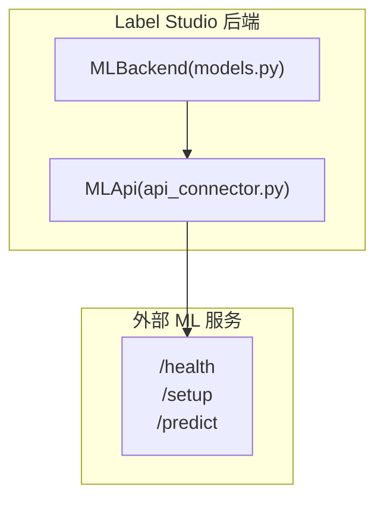
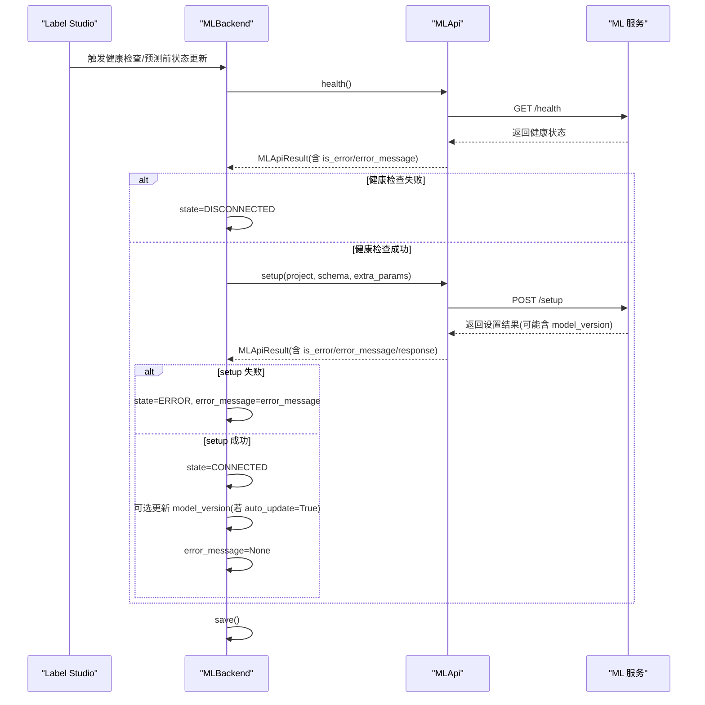
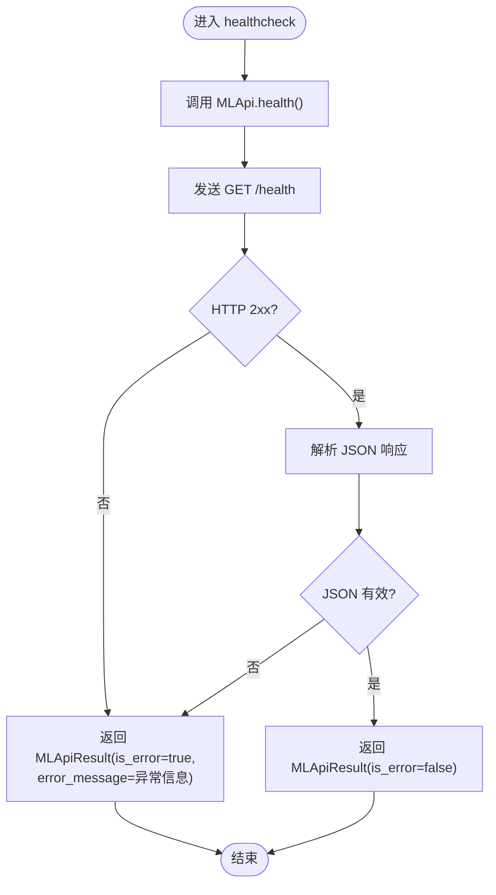
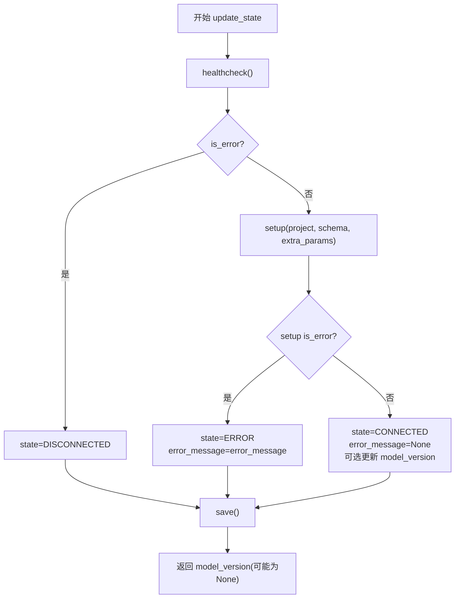
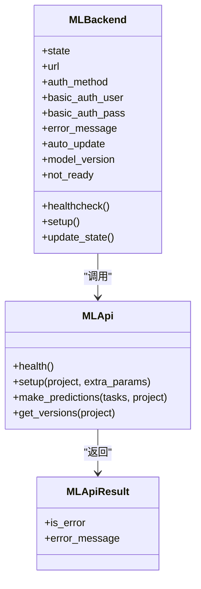

# 模型健康监控

<cite>
**本文引用的文件**   
- [label_studio/ml/models.py](file://label_studio/ml/models.py)
- [label_studio/ml/api_connector.py](file://label_studio/ml/api_connector.py)
</cite>

## 目录
1. [简介](#简介)
2. [项目结构](#项目结构)
3. [核心组件](#核心组件)
4. [架构总览](#架构总览)
5. [详细组件分析](#详细组件分析)
6. [依赖关系分析](#依赖关系分析)
7. [性能与超时配置](#性能与超时配置)
8. [定时任务与告警示例](#定时任务与告警示例)
9. [故障恢复与重试机制](#故障恢复与重试机制)
10. [疑难排查指南](#疑难排查指南)
11. [结论](#结论)

## 简介
本文件面向 Label Studio 的 ML Backend 健康监控能力，聚焦以下目标：
- 解释 MLBackendState 状态枚举的设计与状态转换逻辑
- 详细说明 healthcheck 方法的实现、连接测试与错误处理
- 说明 update_state 的状态更新流程（从 DISCONNECTED 到 CONNECTED）
- 解释 not_ready 属性的判断条件与业务含义
- 说明 error_message 字段的记录与管理机制
- 提供健康检查的定时任务与告警配置示例
- 阐述故障恢复与重试机制的实现细节

## 项目结构
与模型健康监控直接相关的代码位于 ml 模块中：
- models.py：定义 MLBackend 模型、MLBackendState 状态枚举、健康检查与状态更新逻辑
- api_connector.py：封装对远端 ML 服务的 HTTP 调用、超时、重试、SSRF 防护与结果封装

**图表来源**
- [label_studio/ml/models.py:38-221](file://label_studio/ml/models.py#L38-L221)
- [label_studio/ml/api_connector.py:137-274](file://label_studio/ml/api_connector.py#L137-L274)

**章节来源**
- [label_studio/ml/models.py:25-221](file://label_studio/ml/models.py#L25-L221)
- [label_studio/ml/api_connector.py:48-183](file://label_studio/ml/api_connector.py#L48-L183)

## 核心组件
- MLBackendState：描述 ML 后端的运行状态（已连接、未连接、错误、训练中、预测中）
- MLBackend：模型后端实例，包含 URL、认证方式、状态、错误消息、版本等字段，并提供 healthcheck、update_state、predict_tasks 等方法
- MLApi：对远端 ML 服务的统一 HTTP 客户端，封装请求、响应、错误、超时、重试等

**章节来源**
- [label_studio/ml/models.py:25-132](file://label_studio/ml/models.py#L25-L132)
- [label_studio/ml/api_connector.py:115-183](file://label_studio/ml/api_connector.py#L115-L183)

## 架构总览
下图展示了健康检查与状态更新的端到端流程：

**图表来源**
- [label_studio/ml/models.py:173-221](file://label_studio/ml/models.py#L173-L221)
- [label_studio/ml/api_connector.py:233-251](file://label_studio/ml/api_connector.py#L233-L251)

## 详细组件分析

### MLBackendState 状态枚举设计
- CONNECTED：后端可用且已完成 setup
- DISCONNECTED：无法通过健康检查或连接失败
- ERROR：已通过健康检查但 setup 失败，并记录了错误信息
- TRAINING：训练任务已启动
- PREDICTING：预测任务进行中

该枚举用于在数据库中持久化后端当前状态，便于 UI 展示与调度策略。

**章节来源**
- [label_studio/ml/models.py:25-31](file://label_studio/ml/models.py#L25-L31)

### healthcheck 方法与连接测试
- MLBackend.healthcheck 委托给 MLBackend.healthcheck_，后者构造 MLApi 并调用 health()
- MLApi.health 发起 GET /health 请求，使用较短的连接与读取超时
- 所有网络异常、SSRF 拦截、HTTP 非 2xx、JSON 解析失败均被捕获为 MLApiResult.is_error=true，并通过 error_message 暴露错误详情

**图表来源**
- [label_studio/ml/models.py:157-176](file://label_studio/ml/models.py#L157-L176)
- [label_studio/ml/api_connector.py:152-183](file://label_studio/ml/api_connector.py#L152-L183)
- [label_studio/ml/api_connector.py:233-234](file://label_studio/ml/api_connector.py#L233-L234)

**章节来源**
- [label_studio/ml/models.py:157-176](file://label_studio/ml/models.py#L157-L176)
- [label_studio/ml/api_connector.py:152-183](file://label_studio/ml/api_connector.py#L152-L183)

### update_state 状态更新逻辑（从 DISCONNECTED 到 CONNECTED）
- 先执行 healthcheck：若失败，state 置为 DISCONNECTED
- 若健康检查通过，则调用 setup：
  - setup 失败：state 置为 ERROR，并记录 error_message
  - setup 成功：state 置为 CONNECTED；若 auto_update 开启，则用返回的 model_version 更新本地版本；同时清空 error_message
- 最终保存实例

**图表来源**
- [label_studio/ml/models.py:202-221](file://label_studio/ml/models.py#L202-L221)
- [label_studio/ml/api_connector.py:239-251](file://label_studio/ml/api_connector.py#L239-L251)

**章节来源**
- [label_studio/ml/models.py:202-221](file://label_studio/ml/models.py#L202-L221)

### not_ready 属性判断与业务含义
- not_ready 为真当且仅当 state ∈ {DISCONNECTED, ERROR}
- 业务上用于阻止对不可用后端的预测请求，避免无意义调用与脏数据写入

**章节来源**
- [label_studio/ml/models.py:198-200](file://label_studio/ml/models.py#L198-L200)

### error_message 字段记录与管理
- 当 setup 失败时，将远端返回的错误信息写入 error_message
- 当状态转为 CONNECTED 时，清空 error_message
- 其他路径（如 train/predict）也可能根据返回结果设置 error_message，以反映最近一次关键操作的状态

**章节来源**
- [label_studio/ml/models.py:55-60](file://label_studio/ml/models.py#L55-L60)
- [label_studio/ml/models.py:208-219](file://label_studio/ml/models.py#L208-L219)

### predict_tasks 中的健康检查与状态守卫
- 每次预测前会调用 update_state 刷新状态
- 若 not_ready 为真，直接跳过预测，避免对不可用后端进行调用

**章节来源**
- [label_studio/ml/models.py:341-373](file://label_studio/ml/models.py#L341-L373)

## 依赖关系分析
- MLBackend 依赖 MLApi 完成与远端 ML 服务的通信
- MLApi 基于 requests.Session，挂载自定义适配器以支持 SSRF 防护与重试
- MLApiResult 统一封装请求结果，对外暴露 is_error 与 error_message

**图表来源**
- [label_studio/ml/models.py:38-221](file://label_studio/ml/models.py#L38-L221)
- [label_studio/ml/api_connector.py:115-183](file://label_studio/ml/api_connector.py#L115-L183)
- [label_studio/ml/api_connector.py:233-274](file://label_studio/ml/api_connector.py#L233-L274)

**章节来源**
- [label_studio/ml/models.py:38-221](file://label_studio/ml/models.py#L38-L221)
- [label_studio/ml/api_connector.py:115-183](file://label_studio/ml/api_connector.py#L115-L183)

## 性能与超时配置
- 连接与读取超时由环境变量控制，默认值如下：
  - ML_CONNECTION_TIMEOUT：连接超时（秒）
  - ML_TIMEOUT_DEFAULT：默认请求超时（秒）
  - ML_TIMEOUT_HEALTH：健康检查超时（秒）
  - ML_TIMEOUT_SETUP：setup 超时（秒）
  - ML_TIMEOUT_PREDICT：预测超时（秒）
- MLApi 内部为每个进程维护一个 Session，减少握手开销
- 底层 HTTPAdapter 支持最大重试次数（MAX_RETRIES），可结合 SSRF 安全策略使用

建议：
- 在生产环境适当提高 ML_TIMEOUT_HEALTH 与 ML_TIMEOUT_SETUP，以容忍远端冷启动或慢启动
- 在高并发场景下，合理调整 MAX_RETRIES 与连接池大小，避免雪崩

**章节来源**
- [label_studio/ml/api_connector.py:25-34](file://label_studio/ml/api_connector.py#L25-L34)
- [label_studio/ml/api_connector.py:48-77](file://label_studio/ml/api_connector.py#L48-L77)

## 定时任务与告警示例
以下为概念性示例，用于指导如何在 Label Studio 外部编排健康检查与告警：

- 定时任务（Cron/系统任务）
  - 每 1 分钟执行一次：查询所有 MLBackend 的 state 与 error_message
  - 若 state=DISCONNECTED 或 ERROR，持续 N 次（例如 5 次）则触发告警
  - 若连续 M 次（例如 10 次）恢复为 CONNECTED，则关闭告警

- 告警渠道
  - 邮件/企业微信/钉钉/Slack 等
  - 告警内容应包含：project_id、ml_backend_id、url、state、error_message、持续时间

- 自动化修复（可选）
  - 触发自动重试：调用 MLBackend.update_state() 重新探测
  - 若仍失败，降级策略：暂停使用该后端参与预测，切换至备用后端（需额外实现）

注意：以上为运维侧实践建议，并非仓库内置功能。

[本节为概念性说明，不直接分析具体文件]

## 故障恢复与重试机制
- 重试机制
  - MLApi 的 HTTPAdapter 支持最大重试次数（MAX_RETRIES），适用于连接失败等瞬时错误
  - 建议在容器化部署中配合 DNS 缓存与网络策略，降低瞬断影响

- 故障恢复
  - 每次预测前都会调用 update_state，自动尝试恢复状态
  - 若 healthcheck 失败，state 回退为 DISCONNECTED；若 setup 失败，state 为 ERROR 并记录 error_message
  - 当远端恢复后，下一次 update_state 会将 state 推进为 CONNECTED，并清理 error_message

- 建议增强
  - 增加指数退避的重试策略（针对频繁失败的 backend）
  - 引入熔断器（Circuit Breaker），在连续失败一定次数后快速失败，避免放大负载
  - 对 error_message 做去重与采样，避免日志风暴

**章节来源**
- [label_studio/ml/api_connector.py:48-77](file://label_studio/ml/api_connector.py#L48-L77)
- [label_studio/ml/models.py:202-221](file://label_studio/ml/models.py#L202-L221)

## 疑难排查指南
常见问题与定位要点：
- 健康检查失败
  - 检查 ML 服务是否可达、端口与域名是否正确
  - 查看 error_message 的具体内容，确认是否为网络/SSRF/鉴权问题
  - 验证 ML_TIMEOUT_HEALTH 是否过短导致误判

- setup 失败
  - 检查 label_config/schema 是否与远端兼容
  - 核对 basic_auth 凭据是否正确
  - 关注 error_message 中关于 schema 校验或权限拒绝的信息

- 状态卡在 DISCONNECTED/ERROR
  - 观察定时探测频率与阈值，确认是否因短暂抖动导致
  - 检查是否有并发预测导致频繁状态切换

- 预测结果为空或被跳过
  - 确认 not_ready 是否为真（即 state 是否为 DISCONNECTED/ERROR）
  - 检查 predict_tasks 是否因模型版本重复而跳过预测

**章节来源**
- [label_studio/ml/models.py:198-221](file://label_studio/ml/models.py#L198-L221)
- [label_studio/ml/api_connector.py:152-183](file://label_studio/ml/api_connector.py#L152-L183)

## 结论
Label Studio 的 ML 后端健康监控通过 MLBackendState 状态机与 MLApi 的统一接口，实现了健壮的连通性检测、状态同步与错误上报。update_state 在每次预测前自动刷新状态，not_ready 作为前置守卫避免对不可用后端的调用，error_message 提供可观测的错误上下文。结合外部定时任务与告警系统，可实现生产环境的稳定运行与快速排障。建议在现有基础上引入更细粒度的重试、熔断与降级策略，进一步提升系统的弹性与可观测性。