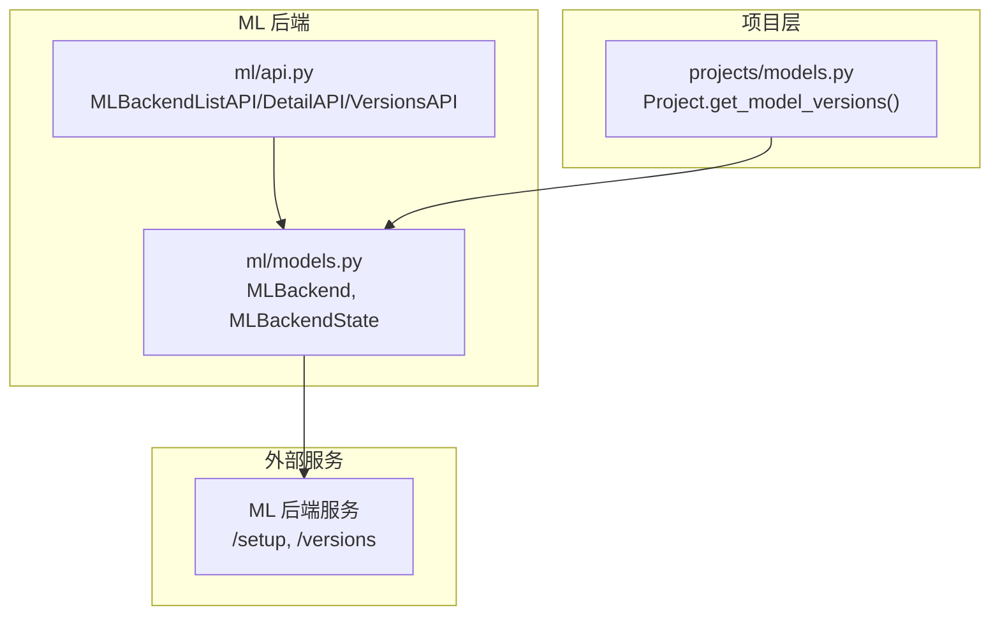
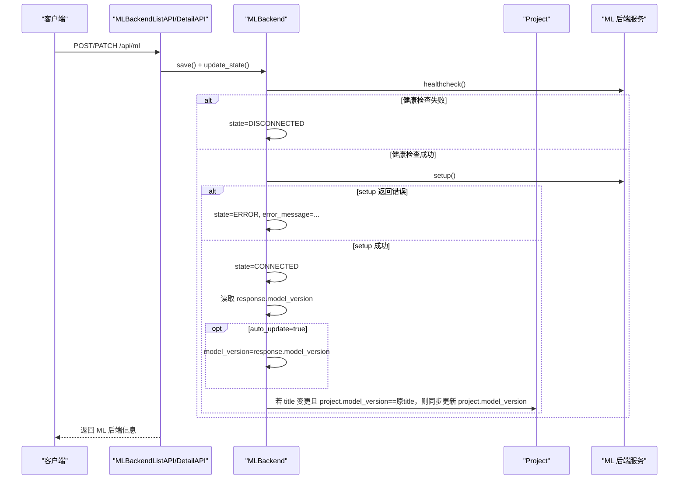
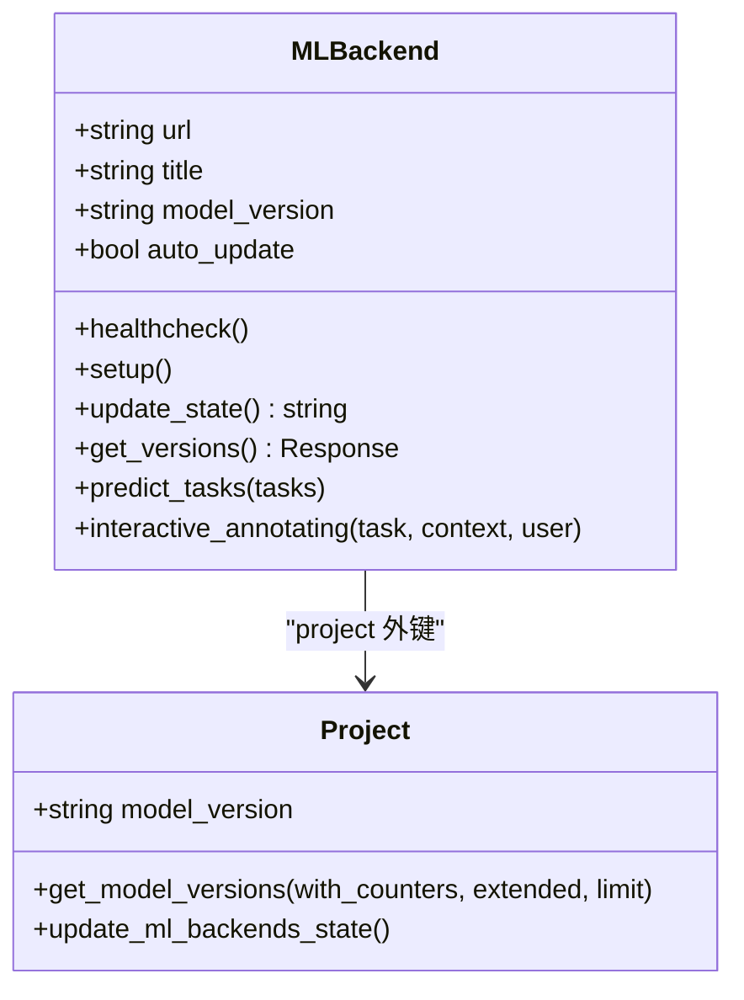
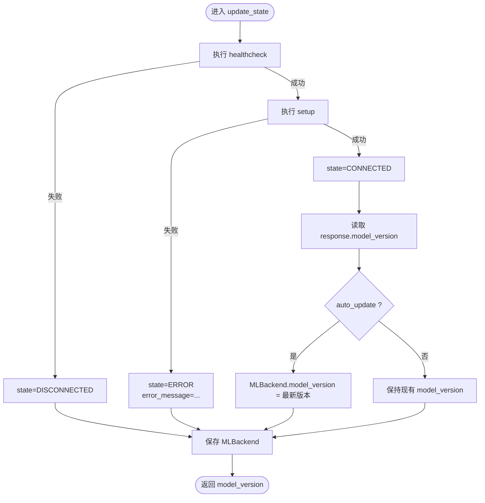
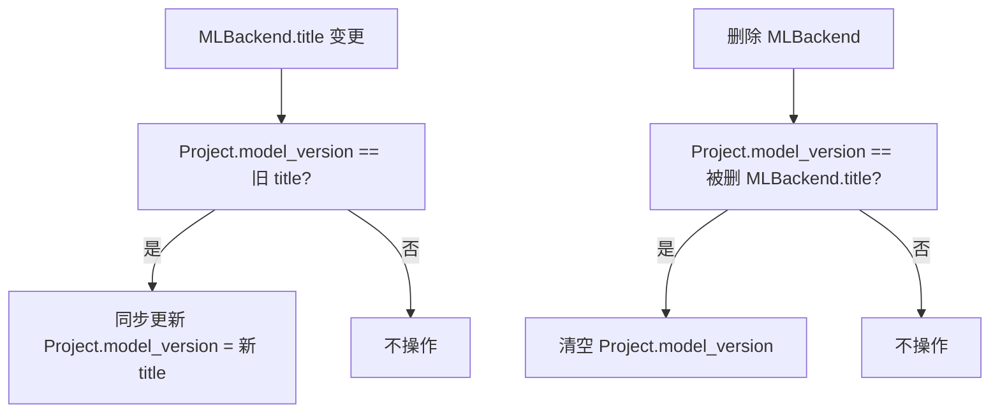
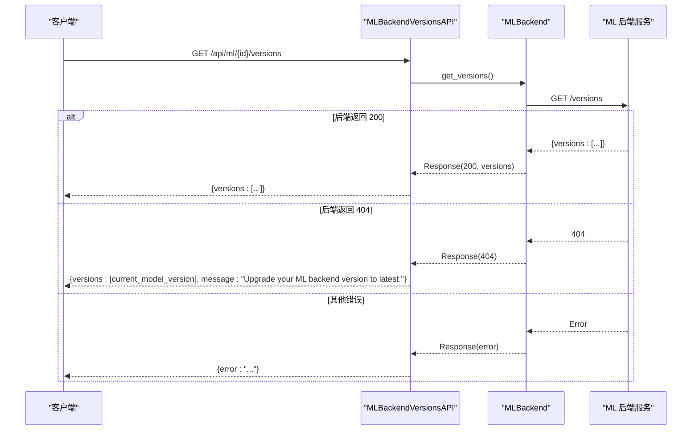
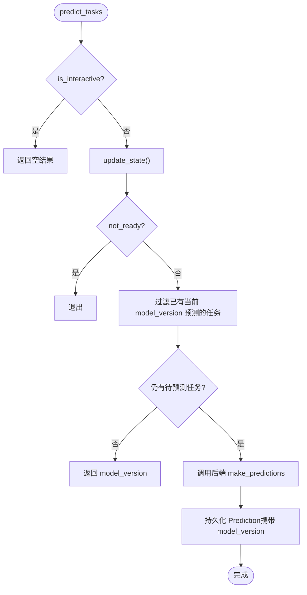
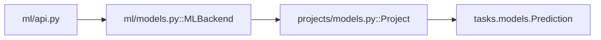

# 模型版本管理

<cite>
**本文引用的文件**   
- [label_studio/ml/models.py](file://label_studio/ml/models.py)
- [label_studio/projects/models.py](file://label_studio/projects/models.py)
- [label_studio/ml/api.py](file://label_studio/ml/api.py)
</cite>

## 目录
1. [引言](#引言)
2. [项目结构](#项目结构)
3. [核心组件](#核心组件)
4. [架构总览](#架构总览)
5. [详细组件分析](#详细组件分析)
6. [依赖关系分析](#依赖关系分析)
7. [性能与一致性](#性能与一致性)
8. [故障排查指南](#故障排查指南)
9. [结论](#结论)
10. [附录：API 调用示例与最佳实践](#附录api-调用示例与最佳实践)

## 引言
本文聚焦 Label Studio 中 MLBackend 的模型版本管理机制，重点解释以下方面：
- MLBackend.model_version 字段如何与 Project.model_version 联动更新
- update_state 方法如何从 ML 后端获取最新版本并同步到项目
- get_versions 方法的实现原理与使用场景
- auto_update 配置项的作用与最佳实践
- 模型版本切换的 API 调用方式、错误处理策略
- 版本兼容性检查与回滚机制的实现细节

## 项目结构
围绕模型版本管理的代码主要分布在三个模块：
- ML 后端模型与状态管理：label_studio/ml/models.py
- 项目模型与版本聚合查询：label_studio/projects/models.py
- ML 后端 REST API：label_studio/ml/api.py

图表来源
- [label_studio/ml/models.py:38-433](file://label_studio/ml/models.py#L38-L433)
- [label_studio/projects/models.py:1114-1172](file://label_studio/projects/models.py#L1114-L1172)
- [label_studio/ml/api.py:69-188](file://label_studio/ml/api.py#L69-L188)

章节来源
- [label_studio/ml/models.py:38-433](file://label_studio/ml/models.py#L38-L433)
- [label_studio/projects/models.py:1114-1172](file://label_studio/projects/models.py#L1114-L1172)
- [label_studio/ml/api.py:69-188](file://label_studio/ml/api.py#L69-L188)

## 核心组件
- MLBackend
  - 维护 ML 后端连接、认证、超时、标题(title)、当前模型版本(model_version)、自动更新(auto_update)等
  - 提供 update_state、get_versions、predict_tasks、interactive_annotating 等方法
- Project
  - 维护项目级 model_version（既可以是 MLBackend.title，也可以是预测结果中的 model_version）
  - 提供 get_model_versions 聚合查询所有预测的版本及其计数
- ML API
  - 暴露 ML 后端的增删改查、训练、测试预测、获取模型版本等接口

章节来源
- [label_studio/ml/models.py:38-433](file://label_studio/ml/models.py#L38-L433)
- [label_studio/projects/models.py:282-291](file://label_studio/projects/models.py#L282-L291)
- [label_studio/projects/models.py:1114-1172](file://label_studio/projects/models.py#L1114-L1172)
- [label_studio/ml/api.py:69-188](file://label_studio/ml/api.py#L69-L188)

## 架构总览
下图展示“添加/更新 ML 后端”和“获取模型版本”的关键流程。

图表来源
- [label_studio/ml/api.py:92-114](file://label_studio/ml/api.py#L92-L114)
- [label_studio/ml/api.py:181-188](file://label_studio/ml/api.py#L181-L188)
- [label_studio/ml/models.py:138-155](file://label_studio/ml/models.py#L138-L155)
- [label_studio/ml/models.py:202-221](file://label_studio/ml/models.py#L202-L221)

## 详细组件分析

### MLBackend 模型与版本管理
- 关键字段
  - model_version：当前关联的模型版本（字符串），可来自 ML 后端响应或用户手动设置
  - auto_update：是否自动将 model_version 设置为后端返回的最新版本
  - title：ML 后端名称；当 title 变化且 Project.model_version 仍指向旧 title 时，会同步更新 Project.model_version
- 关键方法
  - update_state：健康检查 → setup → 根据 auto_update 决定是否更新 model_version → 保存状态
  - get_versions：通过 MLApi 获取后端提供的可用版本列表
  - predict_tasks：在批量预测前调用 update_state，确保使用最新 model_version，并对已存在相同版本预测的任务去重

图表来源
- [label_studio/ml/models.py:38-129](file://label_studio/ml/models.py#L38-L129)
- [label_studio/projects/models.py:282-291](file://label_studio/projects/models.py#L282-L291)
- [label_studio/projects/models.py:1114-1172](file://label_studio/projects/models.py#L1114-L1172)

#### update_state 的工作流程
- 先执行 healthcheck，失败则置为 DISCONNECTED
- 再执行 setup，失败则置为 ERROR 并记录 error_message
- 成功后置为 CONNECTED，并从 setup 响应中取 model_version
- 如果 auto_update 为真，则将 MLBackend.model_version 更新为后端返回的最新版本
- 最后保存 MLBackend，并在 save 钩子中可能同步更新 Project.model_version

图表来源
- [label_studio/ml/models.py:202-221](file://label_studio/ml/models.py#L202-L221)
- [label_studio/ml/models.py:138-155](file://label_studio/ml/models.py#L138-L155)

章节来源
- [label_studio/ml/models.py:138-155](file://label_studio/ml/models.py#L138-L155)
- [label_studio/ml/models.py:202-221](file://label_studio/ml/models.py#L202-L221)
- [label_studio/ml/models.py:341-373](file://label_studio/ml/models.py#L341-L373)

### Project.model_version 的语义与联动
- Project.model_version 有两种含义：
  - 指向某个 MLBackend.title（即“使用哪个 ML 后端进行预标注”）
  - 指向某次预测结果中的 model_version（用于区分不同版本的预测数据）
- 当 MLBackend.title 被修改且 Project.model_version 仍等于旧 title 时，save 钩子会将 Project.model_version 同步为新 title
- 删除 MLBackend 时，若 Project.model_version 正好等于该 MLBackend.title，会被清空

图表来源
- [label_studio/ml/models.py:138-155](file://label_studio/ml/models.py#L138-L155)
- [label_studio/ml/models.py:500-506](file://label_studio/ml/models.py#L500-L506)

章节来源
- [label_studio/projects/models.py:282-291](file://label_studio/projects/models.py#L282-L291)
- [label_studio/ml/models.py:138-155](file://label_studio/ml/models.py#L138-L155)
- [label_studio/ml/models.py:500-506](file://label_studio/ml/models.py#L500-L506)

### get_versions 方法与版本列表 API
- MLBackend.get_versions：封装对 ML 后端的 /versions 请求，返回后端声明的可用版本列表
- MLBackendVersionsAPI：REST 接口 GET /api/ml/{id}/versions，内部调用 ml_backend.get_versions()
  - 若后端返回 200，返回 versions 数组
  - 若后端返回 404，说明后端未实现该接口，降级返回当前 model_version 并提示升级后端
  - 其他错误返回错误消息与状态码

图表来源
- [label_studio/ml/models.py:419-433](file://label_studio/ml/models.py#L419-L433)
- [label_studio/ml/api.py:383-432](file://label_studio/ml/api.py#L383-L432)

章节来源
- [label_studio/ml/models.py:419-433](file://label_studio/ml/models.py#L419-L433)
- [label_studio/ml/api.py:383-432](file://label_studio/ml/api.py#L383-L432)

### auto_update 配置项与最佳实践
- 作用
  - auto_update=true：每次 update_state 时，将 MLBackend.model_version 自动设置为后端返回的最新版本
  - auto_update=false：由用户手动控制 model_version，适合灰度发布、A/B 测试或需要稳定版本的场景
- 建议
  - 生产环境默认开启 auto_update，保证预测始终基于最新版本
  - 灰度/回归阶段临时关闭 auto_update，锁定特定版本，避免影响线上任务
  - 结合 get_model_versions 与 get_versions 做版本对比，确认后端返回的最新版本是否符合预期

章节来源
- [label_studio/ml/models.py:125-129](file://label_studio/ml/models.py#L125-L129)
- [label_studio/ml/models.py:202-221](file://label_studio/ml/models.py#L202-L221)

### 预测流程中的版本一致性
- predict_tasks 会在发起预测前调用 update_state，确保使用的 model_version 是最新的
- 同时过滤掉已经包含当前 model_version 预测的任务，避免重复预测

图表来源
- [label_studio/ml/models.py:341-373](file://label_studio/ml/models.py#L341-L373)

章节来源
- [label_studio/ml/models.py:341-373](file://label_studio/ml/models.py#L341-L373)

## 依赖关系分析
- MLBackend 依赖 Project（外键），并在 save 钩子中可能更新 Project.model_version
- ML API 在创建/更新 ML 后端时触发 update_state，从而驱动版本同步
- Project.get_model_versions 聚合 Prediction 表中的 model_version，用于前端展示与筛选

图表来源
- [label_studio/ml/api.py:92-114](file://label_studio/ml/api.py#L92-L114)
- [label_studio/ml/models.py:138-155](file://label_studio/ml/models.py#L138-L155)
- [label_studio/projects/models.py:1114-1144](file://label_studio/projects/models.py#L1114-L1144)

章节来源
- [label_studio/ml/api.py:92-114](file://label_studio/ml/api.py#L92-L114)
- [label_studio/ml/models.py:138-155](file://label_studio/ml/models.py#L138-L155)
- [label_studio/projects/models.py:1114-1144](file://label_studio/projects/models.py#L1114-L1144)

## 性能与一致性
- 批量预测前调用 update_state 会增加一次网络往返，但能确保版本一致性与去重逻辑正确
- Project.get_model_versions 使用数据库聚合查询，支持限制数量与扩展字段，适合前端下拉选择
- 建议在高频调用场景中缓存 ML 后端版本列表，减少频繁请求后端 /versions

[本节为通用指导，无需具体文件引用]

## 故障排查指南
- 现象：ML 后端显示“断开连接”或“错误”
  - 检查 healthcheck 与 setup 返回值，查看 error_message
  - 确认 URL、认证参数是否正确
- 现象：model_version 未按预期更新
  - 检查 auto_update 是否为 true
  - 确认 ML 后端 setup 响应中包含 model_version
- 现象：GET /api/ml/{id}/versions 返回 404
  - 表示后端未实现 /versions 接口，系统会降级返回当前 model_version 并提示升级后端
- 现象：删除 ML 后端后 Project.model_version 未清空
  - 仅当 Project.model_version 等于被删除 MLBackend.title 时才会清空

章节来源
- [label_studio/ml/models.py:202-221](file://label_studio/ml/models.py#L202-L221)
- [label_studio/ml/api.py:419-432](file://label_studio/ml/api.py#L419-L432)
- [label_studio/ml/models.py:500-506](file://label_studio/ml/models.py#L500-L506)

## 结论
Label Studio 的模型版本管理通过 MLBackend 与 Project 的双向联动，实现了：
- 自动或手动的模型版本切换
- 预测前的版本同步与去重
- 版本列表的统一查询与兼容处理
- 删除 ML 后端时的版本清理

在生产环境中，建议结合 auto_update 与 get_versions 进行版本治理，并通过 API 的错误处理策略保障稳定性。

[本节为总结性内容，无需具体文件引用]

## 附录：API 调用示例与最佳实践

- 添加 ML 后端（POST /api/ml）
  - 作用：注册 ML 后端，触发 update_state，必要时自动设为项目默认模型
  - 参考路径：[label_studio/ml/api.py:92-114](file://label_studio/ml/api.py#L92-L114)

- 更新 ML 后端（PATCH /api/ml/{id}）
  - 作用：更新连接参数，触发 update_state
  - 参考路径：[label_studio/ml/api.py:181-188](file://label_studio/ml/api.py#L181-L188)

- 获取模型版本列表（GET /api/ml/{id}/versions）
  - 作用：获取后端支持的版本列表；若后端不支持，返回当前 model_version 并提示升级
  - 参考路径：[label_studio/ml/api.py:383-432](file://label_studio/ml/api.py#L383-L432)

- 获取项目内所有预测版本（Project.get_model_versions）
  - 作用：统计各 model_version 的预测数量，便于前端展示与筛选
  - 参考路径：[label_studio/projects/models.py:1114-1144](file://label_studio/projects/models.py#L1114-L1144)

- 最佳实践
  - 灰度发布：临时关闭 auto_update，锁定特定 model_version，观察效果后再放开
  - 回滚机制：若新版本异常，可通过 API 将 Project.model_version 切换至历史稳定版本（例如 MLBackend.title 或历史 model_version）
  - 兼容性检查：优先调用 /versions，若返回 404，按提示升级后端或使用当前 model_version

[本节为实践指导，无需具体文件引用]