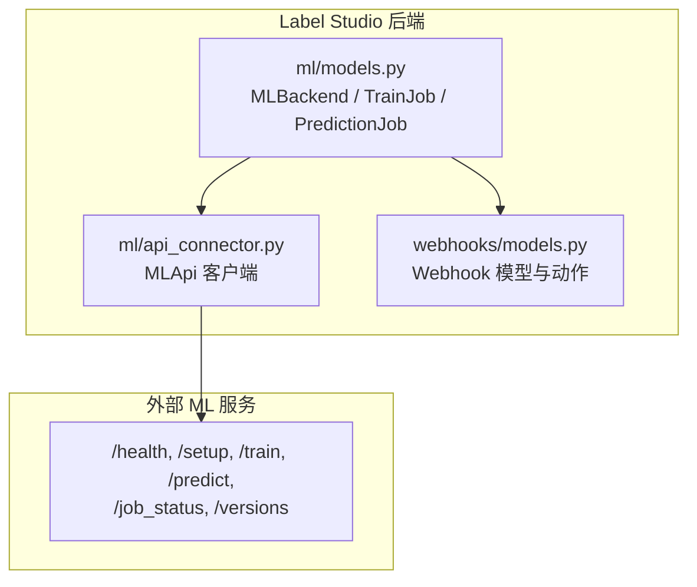
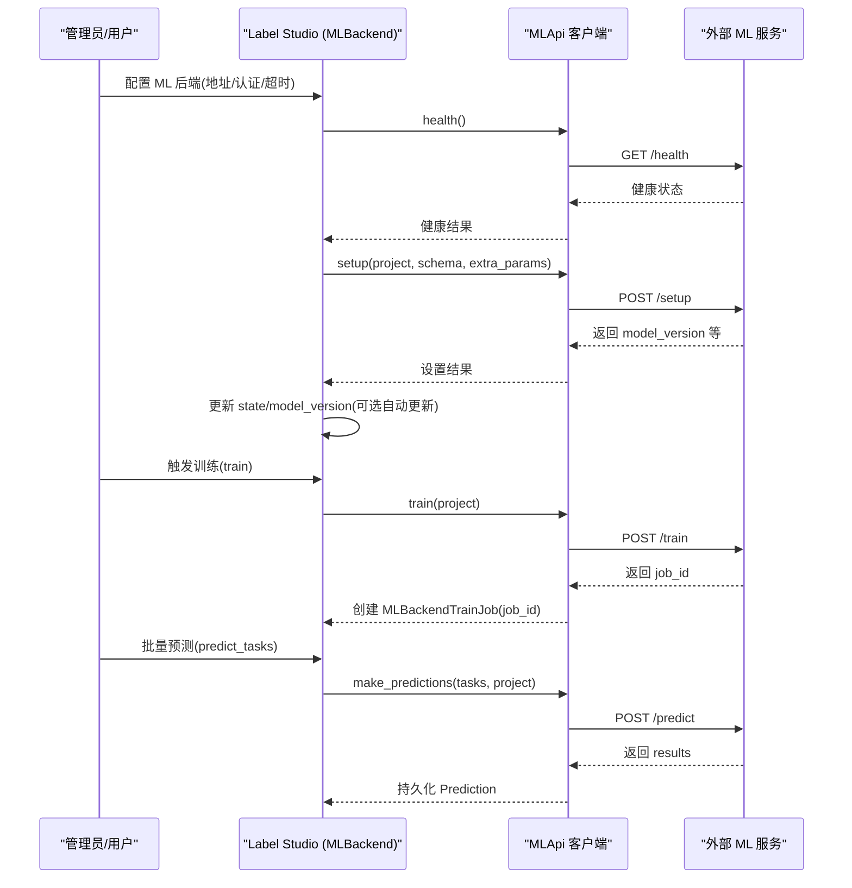
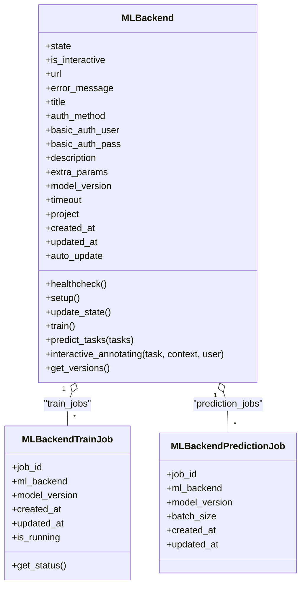
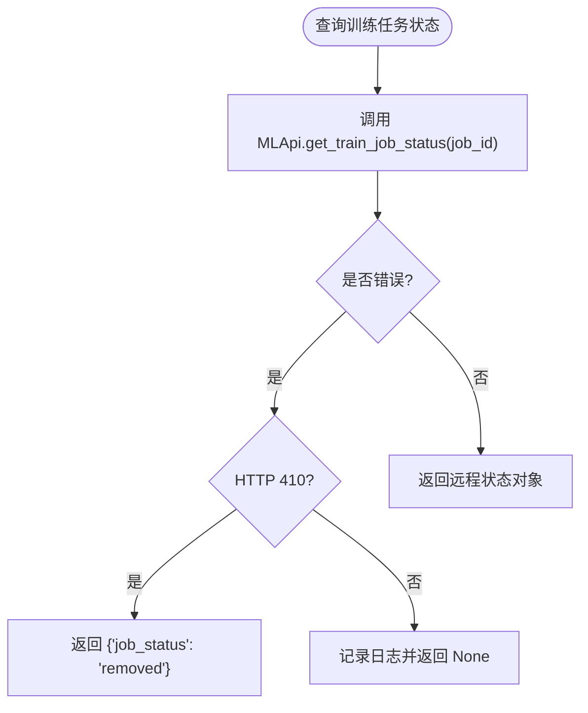
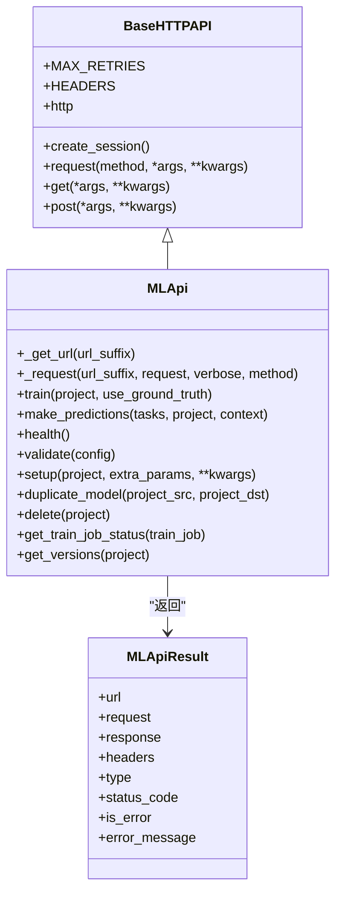
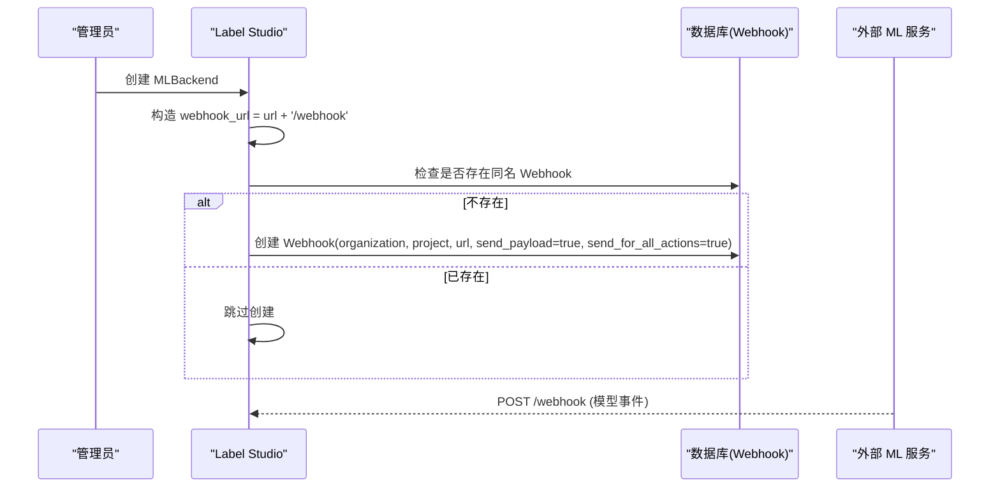
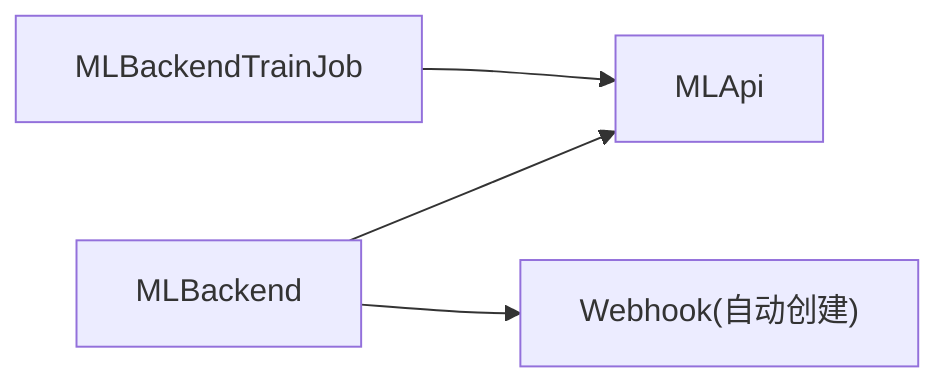

# 模型管理

<cite>
**本文引用的文件**   
- [label_studio/ml/models.py](file://label_studio/ml/models.py)
- [label_studio/ml/api_connector.py](file://label_studio/ml/api_connector.py)
- [label_studio/webhooks/models.py](file://label_studio/webhooks/models.py)
</cite>

## 目录
1. [简介](#简介)
2. [项目结构](#项目结构)
3. [核心组件](#核心组件)
4. [架构总览](#架构总览)
5. [详细组件分析](#详细组件分析)
6. [依赖关系分析](#依赖关系分析)
7. [性能与可观测性](#性能与可观测性)
8. [故障排查指南](#故障排查指南)
9. [最佳实践与运维指南](#最佳实践与运维指南)
10. [结论](#结论)

## 简介
本文面向 Label Studio 的模型管理子系统，聚焦以下目标：
- 解释模型版本管理、模型切换与模型监控的实现机制
- 详细说明 MLBackendTrainJob 与 MLBackendPredictionJob 的任务管理能力
- 覆盖模型训练任务的创建、状态跟踪与结果处理
- 提供模型健康检查、错误恢复与性能监控的方法
- 解释 Webhook 在模型事件通知中的作用与配置方式
- 给出模型管理的最佳实践与运维建议

## 项目结构
围绕模型管理的关键代码集中在以下模块：
- label_studio/ml/models.py：定义 MLBackend、MLBackendTrainJob、MLBackendPredictionJob 等模型与业务逻辑
- label_studio/ml/api_connector.py：封装与外部 ML 后端的 HTTP API 调用（健康检查、训练、预测、版本查询、任务状态查询）
- label_studio/webhooks/models.py：Webhook 模型与动作枚举，用于事件通知

图表来源
- [label_studio/ml/models.py:38-460](file://label_studio/ml/models.py#L38-L460)
- [label_studio/ml/api_connector.py:137-274](file://label_studio/ml/api_connector.py#L137-L274)
- [label_studio/webhooks/models.py:26-104](file://label_studio/webhooks/models.py#L26-L104)

章节来源
- [label_studio/ml/models.py:38-460](file://label_studio/ml/models.py#L38-L460)
- [label_studio/ml/api_connector.py:137-274](file://label_studio/ml/api_connector.py#L137-L274)
- [label_studio/webhooks/models.py:26-104](file://label_studio/webhooks/models.py#L26-L104)

## 核心组件
- MLBackend：代表一个已配置的 ML 后端连接，包含状态、认证、超时、自动更新策略、当前模型版本等。负责健康检查、设置、训练、批量预测、交互式标注、版本获取等能力。
- MLBackendTrainJob：记录一次训练任务及其 job_id，并提供状态查询与运行中判断。
- MLBackendPredictionJob：记录一次预测任务及其 job_id、批次大小、关联模型版本等。
- MLApi：对 ML 后端 REST API 的统一封装，包括请求重试、超时控制、Basic Auth、SSRF 防护等。
- Webhook：系统级事件通知通道，当创建 MLBackend 时会自动为对应项目生成指向 ML 后端的 Webhook，以接收模型事件回调。

章节来源
- [label_studio/ml/models.py:25-130](file://label_studio/ml/models.py#L25-L130)
- [label_studio/ml/models.py:157-233](file://label_studio/ml/models.py#L157-L233)
- [label_studio/ml/models.py:235-373](file://label_studio/ml/models.py#L235-L373)
- [label_studio/ml/models.py:436-484](file://label_studio/ml/models.py#L436-L484)
- [label_studio/ml/api_connector.py:137-274](file://label_studio/ml/api_connector.py#L137-L274)
- [label_studio/webhooks/models.py:26-104](file://label_studio/webhooks/models.py#L26-L104)

## 架构总览
下图展示了从 Label Studio 到外部 ML 服务的端到端交互流程，涵盖健康检查、模型设置、训练任务、预测任务与版本管理。

图表来源
- [label_studio/ml/models.py:173-233](file://label_studio/ml/models.py#L173-L233)
- [label_studio/ml/models.py:341-373](file://label_studio/ml/models.py#L341-L373)
- [label_studio/ml/api_connector.py:189-231](file://label_studio/ml/api_connector.py#L189-L231)

## 详细组件分析

### MLBackend：模型生命周期与版本管理
- 状态机
  - CONNECTED：后端可用且设置成功
  - DISCONNECTED：不可达或健康检查失败
  - ERROR：设置失败或返回错误
  - TRAINING：训练进行中
  - PREDICTING：预测进行中
- 版本管理
  - model_version：当前绑定的模型版本
  - auto_update：是否自动拉取最新模型版本并更新
  - update_state：先健康检查，再执行 setup；若启用自动更新则同步 model_version
  - save 重写：当 title 变化且项目当前使用的 model_version 等于旧 title 时，同步更新项目的 model_version
  - get_versions：从 ML 后端获取可用版本列表
- 健康检查与错误恢复
  - healthcheck：通过 MLApi.health 探测后端可用性
  - not_ready：DISCONNECTED 或 ERROR 视为未就绪
  - error_message：保存错误信息便于诊断
- 训练与预测
  - train：发起训练，成功后将状态置为 TRAINING，并创建 MLBackendTrainJob
  - predict_tasks：过滤已有同版本预测的任务，批量调用 /predict，校验响应结构，持久化 Prediction
  - interactive_annotating：交互式预标注专用路径，跳过批量预测

图表来源
- [label_studio/ml/models.py:38-130](file://label_studio/ml/models.py#L38-L130)
- [label_studio/ml/models.py:436-484](file://label_studio/ml/models.py#L436-L484)

章节来源
- [label_studio/ml/models.py:25-130](file://label_studio/ml/models.py#L25-L130)
- [label_studio/ml/models.py:157-233](file://label_studio/ml/models.py#L157-L233)
- [label_studio/ml/models.py:341-373](file://label_studio/ml/models.py#L341-L373)
- [label_studio/ml/models.py:419-433](file://label_studio/ml/models.py#L419-L433)

### MLBackendTrainJob：训练任务管理与状态跟踪
- 字段
  - job_id：外部训练任务标识
  - ml_backend：所属 ML 后端
  - model_version：与该训练任务关联的模型版本
  - created_at/updated_at：时间戳
- 方法
  - get_status：通过 MLApi.get_train_job_status 查询任务状态；若返回 410 表示任务已移除；其他错误记录日志并返回 None
  - is_running：根据状态判断是否在队列或已开始

图表来源
- [label_studio/ml/models.py:462-484](file://label_studio/ml/models.py#L462-L484)
- [label_studio/ml/api_connector.py:268-269](file://label_studio/ml/api_connector.py#L268-L269)

章节来源
- [label_studio/ml/models.py:450-484](file://label_studio/ml/models.py#L450-L484)
- [label_studio/ml/api_connector.py:268-269](file://label_studio/ml/api_connector.py#L268-L269)

### MLBackendPredictionJob：预测任务元数据
- 字段
  - job_id：外部预测任务标识
  - ml_backend：所属 ML 后端
  - model_version：该预测任务对应的模型版本
  - batch_size：每批处理的任务数量
  - created_at/updated_at：时间戳
- 说明
  - 当前代码中主要用于记录预测任务元数据，具体调度与执行由 MLBackend.predict_tasks 驱动

章节来源
- [label_studio/ml/models.py:436-448](file://label_studio/ml/models.py#L436-L448)

### MLApi：与 ML 后端的通信层
- 功能
  - health：健康检查
  - setup：初始化后端，返回 model_version 等
  - train：发起训练，返回 job_id
  - make_predictions：批量预测，返回 results
  - get_train_job_status：查询训练任务状态
  - get_versions：获取可用模型版本
- 特性
  - 统一超时控制（连接超时与请求超时分离）
  - Basic Auth 支持
  - SSRF 防护（可通过配置禁用）
  - 会话复用与重试次数控制

图表来源
- [label_studio/ml/api_connector.py:48-112](file://label_studio/ml/api_connector.py#L48-L112)
- [label_studio/ml/api_connector.py:115-183](file://label_studio/ml/api_connector.py#L115-L183)
- [label_studio/ml/api_connector.py:137-274](file://label_studio/ml/api_connector.py#L137-L274)

章节来源
- [label_studio/ml/api_connector.py:48-112](file://label_studio/ml/api_connector.py#L48-L112)
- [label_studio/ml/api_connector.py:115-183](file://label_studio/ml/api_connector.py#L115-L183)
- [label_studio/ml/api_connector.py:189-274](file://label_studio/ml/api_connector.py#L189-L274)

### Webhook：模型事件通知
- 自动创建
  - 当新建 MLBackend 时，系统会尝试在项目下创建一个指向 ML 后端 URL + '/webhook' 的 Webhook，用于接收来自 ML 后端的事件回调
  - 若已存在相同 URL 的 Webhook，则跳过创建
- Webhook 模型要点
  - organization/project：作用域
  - url：回调地址
  - send_payload/send_for_all_actions：是否携带负载、是否对所有动作生效
  - headers：自定义请求头
  - is_active/consecutive_failures：启停与失败计数（达到阈值可自动禁用）

图表来源
- [label_studio/ml/models.py:509-525](file://label_studio/ml/models.py#L509-L525)
- [label_studio/webhooks/models.py:26-104](file://label_studio/webhooks/models.py#L26-L104)

章节来源
- [label_studio/ml/models.py:509-525](file://label_studio/ml/models.py#L509-L525)
- [label_studio/webhooks/models.py:26-104](file://label_studio/webhooks/models.py#L26-L104)

## 依赖关系分析
- MLBackend 依赖 MLApi 进行所有网络交互
- MLBackendTrainJob 通过 MLApi.get_train_job_status 查询训练任务状态
- MLBackend 在保存/删除时与 Project.model_version 保持联动
- Webhook 在 MLBackend 创建时自动生成，作为 ML 后端事件回传通道

图表来源
- [label_studio/ml/models.py:173-233](file://label_studio/ml/models.py#L173-L233)
- [label_studio/ml/models.py:462-484](file://label_studio/ml/models.py#L462-L484)
- [label_studio/ml/models.py:509-525](file://label_studio/ml/models.py#L509-L525)
- [label_studio/ml/api_connector.py:137-274](file://label_studio/ml/api_connector.py#L137-L274)

章节来源
- [label_studio/ml/models.py:173-233](file://label_studio/ml/models.py#L173-L233)
- [label_studio/ml/models.py:462-484](file://label_studio/ml/models.py#L462-L484)
- [label_studio/ml/models.py:509-525](file://label_studio/ml/models.py#L509-L525)
- [label_studio/ml/api_connector.py:137-274](file://label_studio/ml/api_connector.py#L137-L274)

## 性能与可观测性
- 超时与重试
  - 连接超时与请求超时分离，避免长尾请求阻塞
  - 可配置的重试次数，提升弱网环境下的稳定性
- 批量预测优化
  - 优先批量调用 /predict，减少往返开销
  - 当后端不支持批量时，自动降级为逐条预测并记录告警
- 幂等与去重
  - predict_tasks 会过滤已有同版本预测的任务，避免重复计算
- 可观测性
  - 关键路径均有日志输出（错误、警告、调试），便于定位问题
  - Webhook 连续失败计数可用于自动化告警与自愈

章节来源
- [label_studio/ml/api_connector.py:25-34](file://label_studio/ml/api_connector.py#L25-L34)
- [label_studio/ml/api_connector.py:69-112](file://label_studio/ml/api_connector.py#L69-L112)
- [label_studio/ml/models.py:261-339](file://label_studio/ml/models.py#L261-L339)
- [label_studio/webhooks/models.py:65-71](file://label_studio/webhooks/models.py#L65-L71)

## 故障排查指南
- 模型不可用或连接失败
  - 检查 MLBackend.state 是否为 DISCONNECTED/ERROR
  - 查看 error_message 中的错误信息
  - 确认 ML 后端 /health 可达且返回正常
- 训练任务异常
  - 使用 MLBackendTrainJob.get_status 查询状态
  - 若返回 410，表示任务已被移除，需重新训练
  - 关注日志中关于 ML API 错误的记录
- 预测结果为空或不匹配
  - 检查 ML 后端是否支持批量预测；如不支持，系统会降级为逐条预测并记录告警
  - 验证 ML 后端返回的 results 结构与字段是否符合预期
- Webhook 未收到事件
  - 确认 MLBackend 创建时是否成功创建了 Webhook
  - 检查 Webhook 的 is_active 与 consecutive_failures
  - 核对 webhook URL 是否正确（应为 ML 后端 URL + '/webhook'）

章节来源
- [label_studio/ml/models.py:173-233](file://label_studio/ml/models.py#L173-L233)
- [label_studio/ml/models.py:261-339](file://label_studio/ml/models.py#L261-L339)
- [label_studio/ml/models.py:462-484](file://label_studio/ml/models.py#L462-L484)
- [label_studio/ml/models.py:509-525](file://label_studio/ml/models.py#L509-L525)
- [label_studio/webhooks/models.py:65-71](file://label_studio/webhooks/models.py#L65-L71)

## 最佳实践与运维指南
- 模型版本管理
  - 建议开启 auto_update，确保始终使用最新稳定版本
  - 如需灰度发布，可关闭 auto_update，手动指定 model_version 并在测试通过后切换
  - 定期通过 get_versions 获取可用版本列表，建立版本基线
- 模型切换
  - 修改 MLBackend.title 时，若项目当前 model_version 与之相同，会自动同步更新项目级别版本
  - 删除 MLBackend 时，若其 title 仍被项目引用，会自动清空项目的 model_version，避免脏引用
- 健康检查与错误恢复
  - 周期性调用 healthcheck，结合监控系统实现自动告警
  - 对频繁失败的 ML 后端，考虑增加重试与熔断策略
- 训练与预测
  - 训练任务完成后，通过 MLBackendTrainJob.is_running 与 get_status 轮询状态
  - 预测前确保 MLBackend.state 为 CONNECTED，避免无效请求
  - 对于交互式模型（is_interactive=true），应使用 interactive_annotating 而非批量预测
- Webhook 配置
  - 确保 ML 后端正确监听 /webhook 并处理事件
  - 合理配置 send_payload 与 send_for_all_actions，平衡带宽与可观测性
  - 监控 Webhook 的 consecutive_failures，超过阈值自动禁用以避免雪崩

章节来源
- [label_studio/ml/models.py:138-155](file://label_studio/ml/models.py#L138-L155)
- [label_studio/ml/models.py:202-221](file://label_studio/ml/models.py#L202-L221)
- [label_studio/ml/models.py:419-433](file://label_studio/ml/models.py#L419-L433)
- [label_studio/ml/models.py:500-507](file://label_studio/ml/models.py#L500-L507)
- [label_studio/ml/models.py:509-525](file://label_studio/ml/models.py#L509-L525)

## 结论
Label Studio 的模型管理通过 MLBackend 统一管理模型生命周期，借助 MLApi 与外部 ML 服务解耦交互，并通过 MLBackendTrainJob/MLBackendPredictionJob 对训练与预测任务进行追踪。结合 Webhook 机制，可实现模型事件的可靠通知。在生产环境中，建议启用自动版本更新、完善健康检查与监控告警、规范 Webhook 配置，并结合批量预测与降级策略提升整体稳定性与性能。