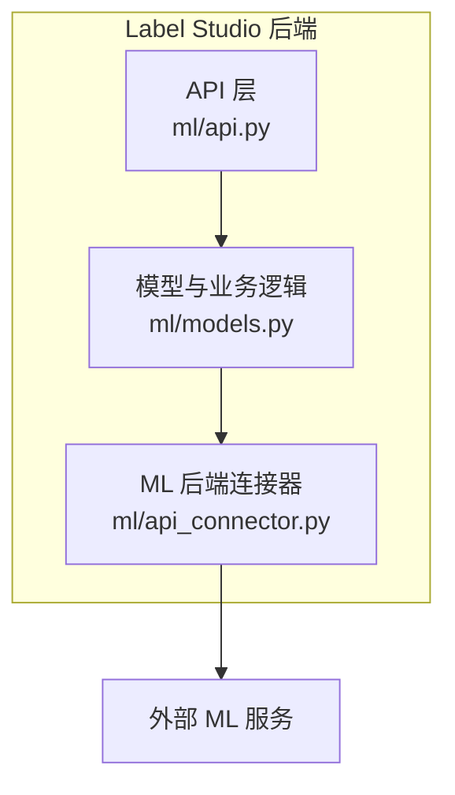
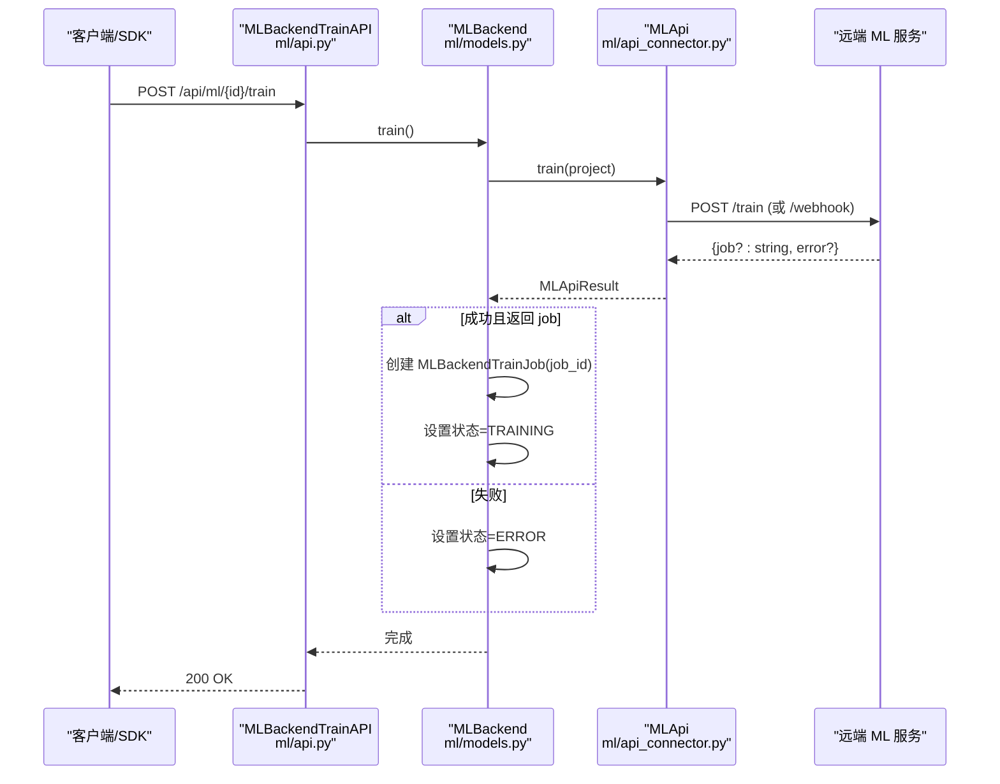
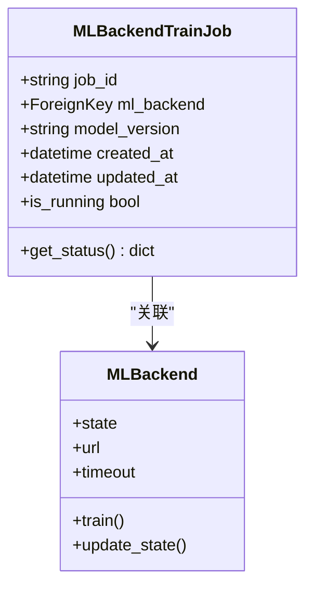
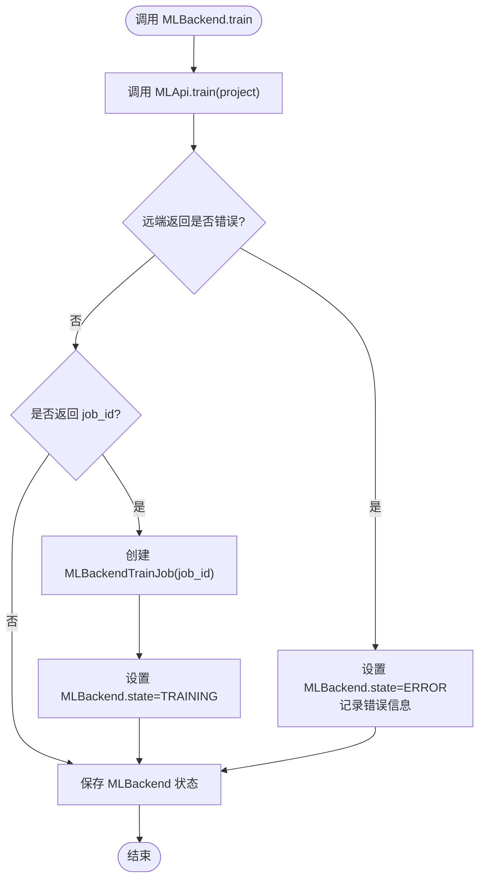
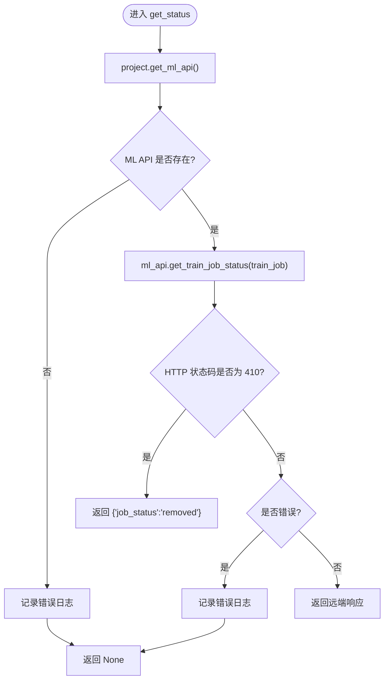
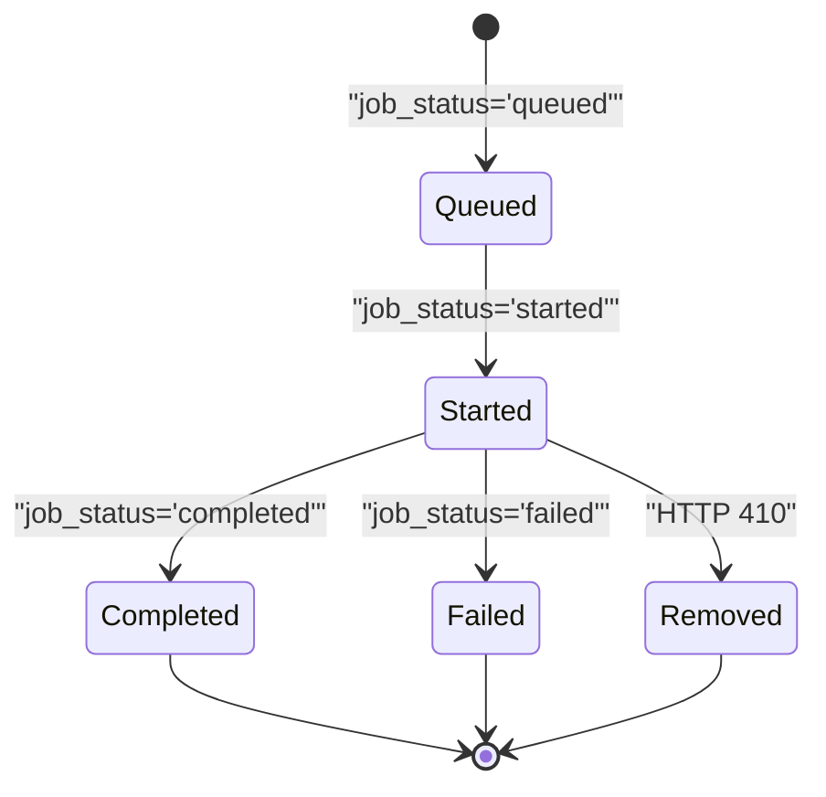
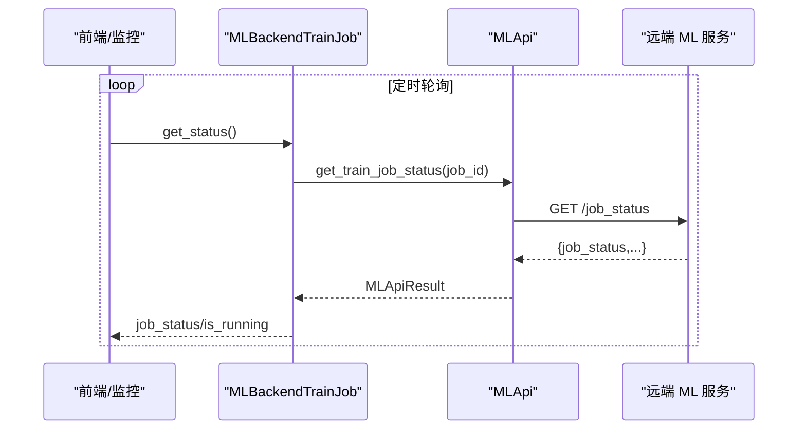
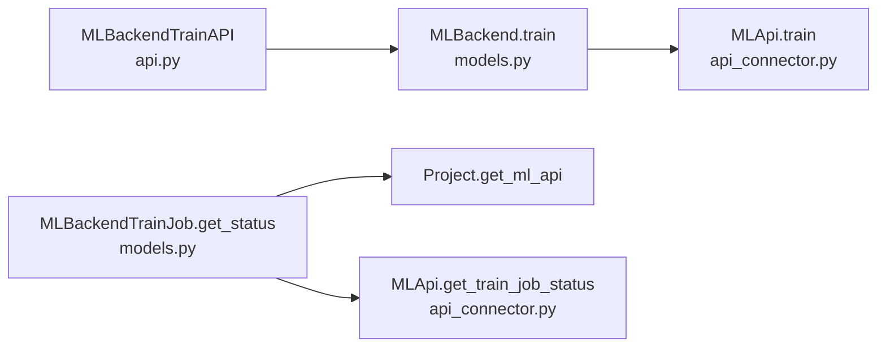

# 训练任务管理

<cite>
**本文引用的文件**   
- [label_studio/ml/models.py](file://label_studio/ml/models.py)
- [label_studio/ml/api.py](file://label_studio/ml/api.py)
- [label_studio/ml/api_connector.py](file://label_studio/ml/api_connector.py)
</cite>

## 目录
1. [简介](#简介)
2. [项目结构](#项目结构)
3. [核心组件](#核心组件)
4. [架构总览](#架构总览)
5. [详细组件分析](#详细组件分析)
6. [依赖关系分析](#依赖关系分析)
7. [性能与并发特性](#性能与并发特性)
8. [故障排查指南](#故障排查指南)
9. [结论](#结论)

## 简介
本文聚焦 Label Studio 的 ML 训练任务管理，围绕 MLBackendTrainJob 模型的设计与作用、train 方法从触发到创建任务的完整流程、get_status 状态查询与 is_running 判断逻辑、以及训练任务生命周期（队列/启动/完成）进行系统化说明。同时给出监控与错误恢复的最佳实践，并解释异步任务处理与进度跟踪的技术实现要点。

## 项目结构
与训练任务管理直接相关的代码分布在以下模块：
- models.py：定义 MLBackend、MLBackendTrainJob 等模型及业务方法（如 train、get_status、is_running）。
- api.py：暴露 REST API，包括触发训练的接口。
- api_connector.py：封装对远端 ML 后端的 HTTP 调用，包含 train、get_train_job_status 等方法。

图表来源
- [label_studio/ml/api.py:229-237](file://label_studio/ml/api.py#L229-L237)
- [label_studio/ml/models.py:223-233](file://label_studio/ml/models.py#L223-L233)
- [label_studio/ml/api_connector.py:189-212](file://label_studio/ml/api_connector.py#L189-L212)

章节来源
- [label_studio/ml/api.py:229-237](file://label_studio/ml/api.py#L229-L237)
- [label_studio/ml/models.py:223-233](file://label_studio/ml/models.py#L223-L233)
- [label_studio/ml/api_connector.py:189-212](file://label_studio/ml/api_connector.py#L189-L212)

## 核心组件
- MLBackend：代表一个已配置的 ML 后端连接，负责健康检查、版本同步、发起训练与预测等。
- MLBackendTrainJob：记录一次训练任务的 job_id 及其关联的 ML 后端，提供 get_status 与 is_running 能力。
- MLApi：封装对远端 ML 服务的 HTTP 请求，提供 train、get_train_job_status 等接口。

章节来源
- [label_studio/ml/models.py:38-233](file://label_studio/ml/models.py#L38-L233)
- [label_studio/ml/models.py:450-484](file://label_studio/ml/models.py#L450-L484)
- [label_studio/ml/api_connector.py:137-285](file://label_studio/ml/api_connector.py#L137-L285)

## 架构总览
下图展示“触发训练”端到端流程：前端或 SDK 调用 /api/ml/{id}/train，后端路由到 MLBackendTrainAPI，再调用 MLBackend.train，后者通过 MLApi.train 向远端 ML 服务发起训练请求；若返回 job 标识，则持久化 MLBackendTrainJob 并更新 MLBackend 状态为 TRAINING。

图表来源
- [label_studio/ml/api.py:229-237](file://label_studio/ml/api.py#L229-L237)
- [label_studio/ml/models.py:223-233](file://label_studio/ml/models.py#L223-L233)
- [label_studio/ml/api_connector.py:189-212](file://label_studio/ml/api_connector.py#L189-L212)

## 详细组件分析

### MLBackendTrainJob 模型设计与作用
- 字段
  - job_id：远端 ML 服务返回的训练任务 ID。
  - ml_backend：外键关联 MLBackend，用于定位所属后端。
  - model_version：可选，关联模型版本。
  - created_at/updated_at：时间戳。
- 关键方法
  - get_status：通过项目获取 MLApi，调用 get_train_job_status(job_id)，根据返回结果解析状态；当远端返回 410 时，返回 {'job_status': 'removed'}。
  - is_running：属性，基于 get_status 的结果判断是否为 'queued' 或 'started'。

图表来源
- [label_studio/ml/models.py:450-484](file://label_studio/ml/models.py#L450-L484)

章节来源
- [label_studio/ml/models.py:450-484](file://label_studio/ml/models.py#L450-L484)

### train 方法实现流程（从触发到创建任务）
- 入口：MLBackendTrainAPI.post 接收请求，校验权限后调用 MLBackend.train。
- MLBackend.train：
  - 调用 MLApi.train(project) 向远端发起训练。
  - 若返回错误：将 MLBackend 状态置为 ERROR，并记录错误信息。
  - 若成功且返回 job：创建 MLBackendTrainJob 记录 job_id，并将 MLBackend 状态置为 TRAINING。
  - 保存 MLBackend。

图表来源
- [label_studio/ml/models.py:223-233](file://label_studio/ml/models.py#L223-L233)
- [label_studio/ml/api_connector.py:189-212](file://label_studio/ml/api_connector.py#L189-L212)

章节来源
- [label_studio/ml/api.py:229-237](file://label_studio/ml/api.py#L229-L237)
- [label_studio/ml/models.py:223-233](file://label_studio/ml/models.py#L223-L233)
- [label_studio/ml/api_connector.py:189-212](file://label_studio/ml/api_connector.py#L189-L212)

### get_status 与 is_running 的状态查询逻辑
- get_status：
  - 通过 project.get_ml_api() 获取 MLApi 实例。
  - 调用 ml_api.get_train_job_status(self) 查询远端任务状态。
  - 若返回 410：返回 {'job_status': 'removed'}。
  - 其他错误：记录日志并返回 None。
  - 成功：返回远端响应体。
- is_running：
  - 读取 get_status() 返回的 job_status。
  - 若为 'queued' 或 'started'，返回 True，否则 False。

图表来源
- [label_studio/ml/models.py:462-479](file://label_studio/ml/models.py#L462-L479)
- [label_studio/ml/api_connector.py:268-269](file://label_studio/ml/api_connector.py#L268-L269)

章节来源
- [label_studio/ml/models.py:462-484](file://label_studio/ml/models.py#L462-L484)
- [label_studio/ml/api_connector.py:268-269](file://label_studio/ml/api_connector.py#L268-L269)

### 训练任务生命周期管理
- 队列状态（queued）：is_running 为 True，表示任务在队列中等待执行。
- 启动状态（started）：is_running 为 True，表示任务已开始执行。
- 完成状态（completed/failed 等）：is_running 为 False，表示任务已结束（成功或失败）。
- 删除状态（removed）：当远端返回 410 时，get_status 返回 {'job_status': 'removed'}，前端可据此提示任务已被移除。

图表来源
- [label_studio/ml/models.py:481-484](file://label_studio/ml/models.py#L481-L484)
- [label_studio/ml/models.py:470-478](file://label_studio/ml/models.py#L470-L478)

章节来源
- [label_studio/ml/models.py:462-484](file://label_studio/ml/models.py#L462-L484)

### 异步任务处理与进度跟踪
- 异步性：MLBackend.train 仅发起远端训练请求并持久化 job 记录，不阻塞等待训练完成。实际训练由远端 ML 服务异步执行。
- 进度跟踪：通过周期性轮询 MLBackendTrainJob.get_status 获取 job_status，结合 is_running 判断是否在运行。
- 超时控制：MLApi 使用环境变量配置各类超时（如 ML_TIMEOUT_TRAIN_JOB_STATUS），避免长时间阻塞。

图表来源
- [label_studio/ml/models.py:462-484](file://label_studio/ml/models.py#L462-L484)
- [label_studio/ml/api_connector.py:268-269](file://label_studio/ml/api_connector.py#L268-L269)

章节来源
- [label_studio/ml/models.py:462-484](file://label_studio/ml/models.py#L462-L484)
- [label_studio/ml/api_connector.py:268-269](file://label_studio/ml/api_connector.py#L268-L269)

## 依赖关系分析
- MLBackendTrainAPI 依赖 MLBackend.train。
- MLBackend.train 依赖 MLApi.train。
- MLBackendTrainJob.get_status 依赖 Project.get_ml_api 与 MLApi.get_train_job_status。
- MLApi 统一封装对远端 ML 服务的 HTTP 调用，并提供超时、重试、基础认证等通用能力。

图表来源
- [label_studio/ml/api.py:229-237](file://label_studio/ml/api.py#L229-L237)
- [label_studio/ml/models.py:223-233](file://label_studio/ml/models.py#L223-L233)
- [label_studio/ml/models.py:462-479](file://label_studio/ml/models.py#L462-L479)
- [label_studio/ml/api_connector.py:189-212](file://label_studio/ml/api_connector.py#L189-L212)
- [label_studio/ml/api_connector.py:268-269](file://label_studio/ml/api_connector.py#L268-L269)

章节来源
- [label_studio/ml/api.py:229-237](file://label_studio/ml/api.py#L229-L237)
- [label_studio/ml/models.py:223-233](file://label_studio/ml/models.py#L223-L233)
- [label_studio/ml/models.py:462-479](file://label_studio/ml/models.py#L462-L479)
- [label_studio/ml/api_connector.py:189-212](file://label_studio/ml/api_connector.py#L189-L212)
- [label_studio/ml/api_connector.py:268-269](file://label_studio/ml/api_connector.py#L268-L269)

## 性能与并发特性
- 非阻塞训练：train 方法不等待远端完成，适合高并发场景。
- 连接复用：MLApi 使用 requests.Session 并按进程键缓存会话，减少握手开销。
- 超时与重试：
  - 连接超时与请求超时分离，可通过环境变量调整。
  - 训练任务状态查询使用独立超时参数，避免长轮询阻塞。
- 批量数据准备：训练前序列化标注数据，减少网络往返次数。

章节来源
- [label_studio/ml/api_connector.py:69-90](file://label_studio/ml/api_connector.py#L69-L90)
- [label_studio/ml/api_connector.py:25-34](file://label_studio/ml/api_connector.py#L25-L34)
- [label_studio/ml/api_connector.py:189-212](file://label_studio/ml/api_connector.py#L189-L212)

## 故障排查指南
- 无法建立 ML 后端连接
  - 现象：MLBackend.state 为 DISCONNECTED 或 ERROR。
  - 排查：检查 URL、Basic Auth、网络连通性与防火墙策略。
- 训练失败
  - 现象：MLBackend.state 被置为 ERROR，error_message 有内容。
  - 排查：查看远端 ML 服务日志，确认输入数据与 label_config 是否正确。
- 训练任务状态查询失败
  - 现象：get_status 返回 None。
  - 排查：检查 Project.get_ml_api 是否能正确构造 MLApi；确认远端 /job_status 接口可用。
- 任务被移除
  - 现象：get_status 返回 {'job_status': 'removed'}（HTTP 410）。
  - 处理：清理本地 MLBackendTrainJob 记录，提示用户任务已不存在。
- 轮询超时或卡顿
  - 现象：长时间无响应。
  - 排查：调整 ML_TIMEOUT_TRAIN_JOB_STATUS 等超时参数；检查远端服务负载。

章节来源
- [label_studio/ml/models.py:223-233](file://label_studio/ml/models.py#L223-L233)
- [label_studio/ml/models.py:462-479](file://label_studio/ml/models.py#L462-L479)
- [label_studio/ml/api_connector.py:268-269](file://label_studio/ml/api_connector.py#L268-L269)

## 结论
Label Studio 的训练任务管理以 MLBackendTrainJob 为核心，配合 MLBackend 与 MLApi 实现对远端 ML 服务的异步训练调度与状态追踪。train 方法快速创建任务并更新状态，get_status 与 is_running 提供稳定的状态查询与运行态判断。通过合理的超时配置与轮询机制，可在高并发环境下可靠地监控训练任务的生命周期。建议在生产环境中完善错误恢复策略（如自动重试、告警通知）与资源清理（如移除已完成/被删除的任务记录），以提升系统稳定性与可观测性。