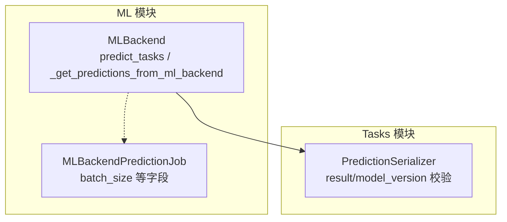
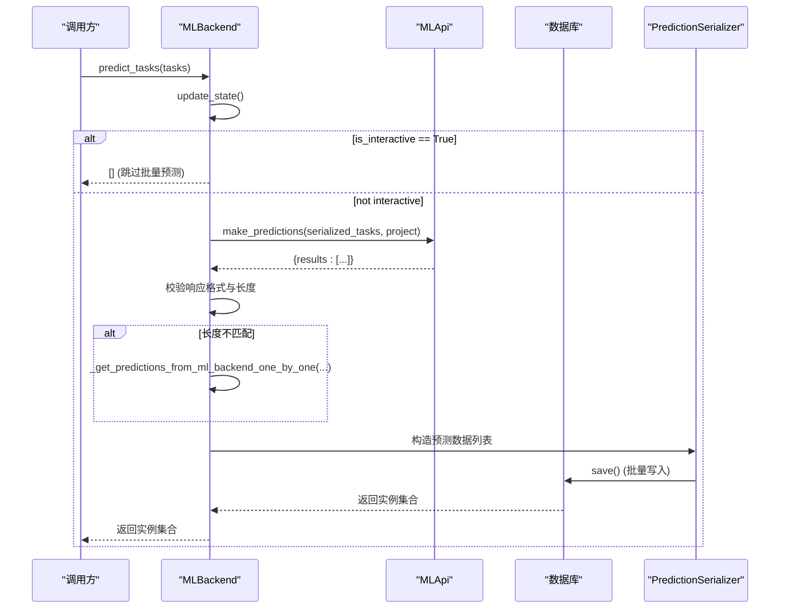
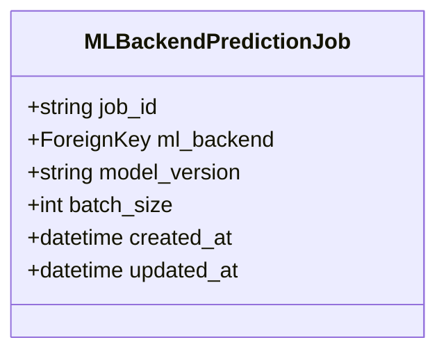
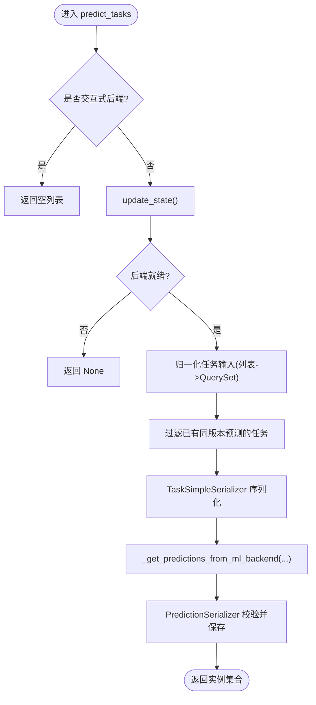
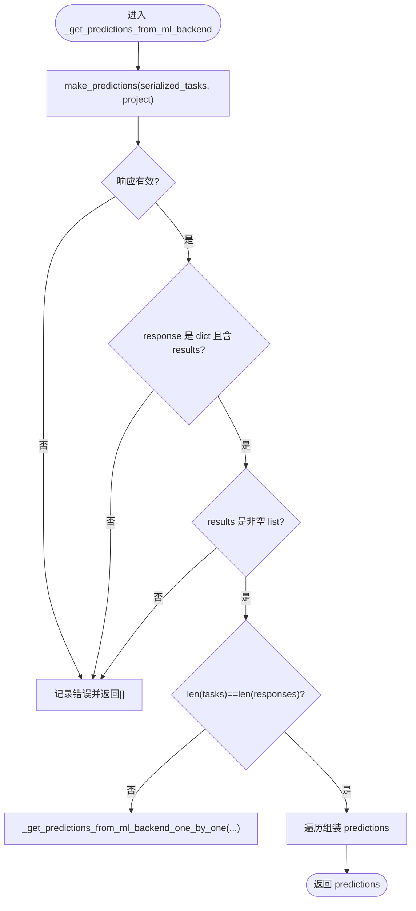
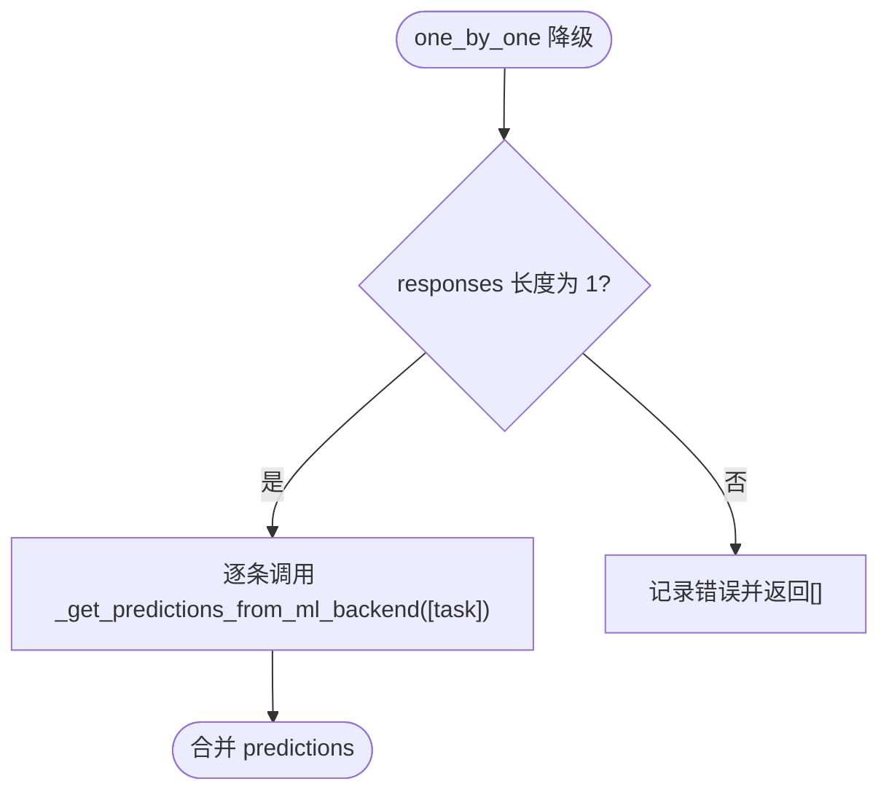
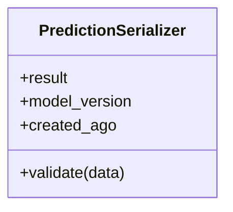
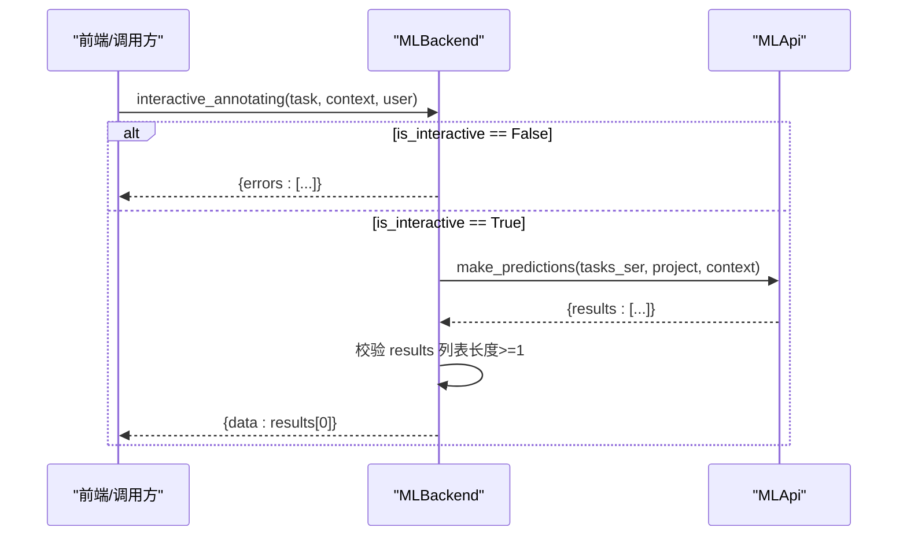
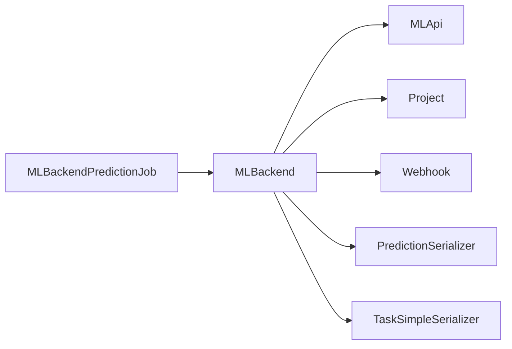
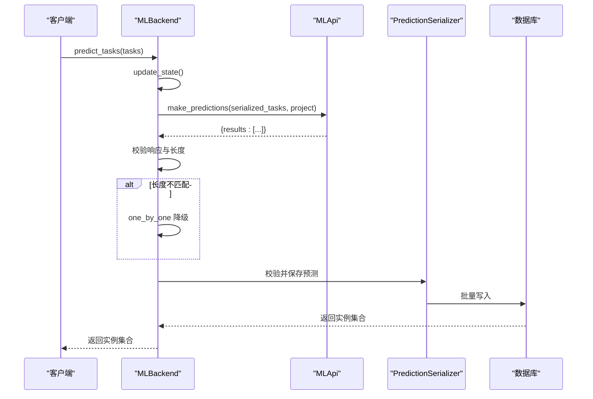

# 预测任务管理

<cite>
**本文引用的文件**   
- [models.py](file://label_studio/ml/models.py)
- [serializers.py](file://label_studio/tasks/serializers.py)
</cite>

## 目录
1. [简介](#简介)
2. [项目结构](#项目结构)
3. [核心组件](#核心组件)
4. [架构总览](#架构总览)
5. [详细组件分析](#详细组件分析)
6. [依赖关系分析](#依赖关系分析)
7. [性能与批量处理](#性能与批量处理)
8. [错误处理与故障排查](#错误处理与故障排查)
9. [结论](#结论)
10. [附录：关键流程时序图](#附录关键流程时序图)

## 简介
本文聚焦 Label Studio 的 ML 后端预测任务管理，围绕以下目标展开：
- 解释 MLBackendPredictionJob 模型的结构与作用，特别是 batch_size 配置对批量处理能力的影响。
- 详细说明 predict_tasks 方法的完整实现逻辑：任务过滤、序列化、批量预测、结果保存。
- 解析 _get_predictions_from_ml_backend 方法对不同响应格式的兼容处理，以及 one_by_one 模式的降级机制。
- 说明预测结果的验证与序列化过程，包括 PredictionSerializer 的作用。
- 提供预测性能优化与错误处理的实践指南。
- 补充交互式标注功能的特殊处理逻辑（is_interactive）。

## 项目结构
本主题涉及的核心代码位于两个模块：
- label_studio/ml/models.py：定义 ML 后端模型、预测任务调度与执行逻辑。
- label_studio/tasks/serializers.py：定义预测数据的序列化与校验逻辑（PredictionSerializer）。

图表来源
- [models.py:235-373](file://label_studio/ml/models.py#L235-L373)
- [models.py:436-447](file://label_studio/ml/models.py#L436-L447)
- [serializers.py:107-163](file://label_studio/tasks/serializers.py#L107-L163)

章节来源
- [models.py:235-373](file://label_studio/ml/models.py#L235-L373)
- [models.py:436-447](file://label_studio/ml/models.py#L436-L447)
- [serializers.py:107-163](file://label_studio/tasks/serializers.py#L107-L163)

## 核心组件
- MLBackendPredictionJob：用于记录一次预测任务的元信息，包含 job_id、关联的 MLBackend、model_version、batch_size 等字段。其中 batch_size 表示每批处理的任务数量，默认值为 100，直接影响批量预测的吞吐与内存占用。
- MLBackend.predict_tasks：入口方法，负责任务过滤、序列化、调用 ML 后端进行批量预测、结果校验与持久化。
- MLBackend._get_predictions_from_ml_backend：封装与 ML 后端的交互，统一处理不同响应格式，并在必要时回退到 one-by-one 模式。
- PredictionSerializer：对预测数据进行结构化校验，确保 result 字段符合项目的标签配置，并支持 model_version 等字段的规范化。

章节来源
- [models.py:436-447](file://label_studio/ml/models.py#L436-L447)
- [models.py:341-373](file://label_studio/ml/models.py#L341-L373)
- [models.py:292-339](file://label_studio/ml/models.py#L292-L339)
- [serializers.py:107-163](file://label_studio/tasks/serializers.py#L107-L163)

## 架构总览
下图展示了预测任务从触发到落库的关键路径，以及与 ML 后端的交互方式。

图表来源
- [models.py:341-373](file://label_studio/ml/models.py#L341-L373)
- [models.py:292-339](file://label_studio/ml/models.py#L292-L339)
- [models.py:261-290](file://label_studio/ml/models.py#L261-L290)
- [serializers.py:107-163](file://label_studio/tasks/serializers.py#L107-L163)

## 详细组件分析

### MLBackendPredictionJob 模型
- 作用：记录一次预测任务的标识、关联的 ML 后端、模型版本与批次大小。
- 关键字段：
  - job_id：外部系统或内部生成的任务 ID。
  - ml_backend：外键关联 MLBackend。
  - model_version：与该预测任务绑定的模型版本。
  - batch_size：每批处理的任务数，默认 100，影响并发与资源占用。
  - created_at / updated_at：时间戳。

图表来源
- [models.py:436-447](file://label_studio/ml/models.py#L436-L447)

章节来源
- [models.py:436-447](file://label_studio/ml/models.py#L436-L447)

### predict_tasks 方法
职责与流程：
- 交互式后端短路：当 is_interactive 为真时，直接返回空列表，避免将交互式模型用于批量预标注。
- 状态更新与就绪检查：调用 update_state() 同步后端状态；若未就绪则提前返回。
- 任务输入归一化：若传入的是对象列表，转换为基于 ID 的查询集。
- 任务过滤：排除已存在当前 model_version 预测的任务，避免重复计算。
- 任务序列化：使用 TaskSimpleSerializer 将任务序列化为字典列表。
- 批量预测：调用 _get_predictions_from_ml_backend 获取预测结果。
- 结果校验与持久化：通过 PredictionSerializer 校验并批量保存。

图表来源
- [models.py:341-373](file://label_studio/ml/models.py#L341-L373)

章节来源
- [models.py:341-373](file://label_studio/ml/models.py#L341-L373)

### _get_predictions_from_ml_backend 方法
职责与流程：
- 调用 MLApi.make_predictions 发起批量预测请求。
- 响应校验：
  - 是否为错误响应。
  - 响应体是否为 dict 且包含 results 字段。
  - results 是否为非空 list。
- 长度匹配判断：
  - 若 responses 长度与 serialized_tasks 不一致，则进入 one_by_one 降级分支。
- 结果组装：
  - 支持单条或多条预测 per task（dict 或 list）。
  - 要求每条预测包含 result 字段，否则记录错误并跳过。
  - 组装最终数据结构：task id、result、score、model_version、project。

图表来源
- [models.py:292-339](file://label_studio/ml/models.py#L292-L339)

章节来源
- [models.py:292-339](file://label_studio/ml/models.py#L292-L339)

### one_by_one 降级机制
触发条件：
- ML 后端返回的 results 数量与输入 tasks 数量不一致。

处理策略：
- 若仅返回一条结果（len(current_responses) == 1），则逐条调用 _get_predictions_from_ml_backend([serialized_task]) 以兼容不支持批处理的后端。
- 若返回多条但与输入数量不等，视为严重不匹配，记录错误并返回空列表。

图表来源
- [models.py:261-290](file://label_studio/ml/models.py#L261-L290)

章节来源
- [models.py:261-290](file://label_studio/ml/models.py#L261-L290)

### 预测结果验证与序列化（PredictionSerializer）
- 字段：
  - result：预测结果 JSON 字段，需符合项目标签配置。
  - model_version：模型版本字符串，用于筛选与展示预标注。
  - created_ago：只读字段，表示创建时间差。
- 校验逻辑：
  - 若 feature flag 开启且项目为非默认标签配置，则通过 LabelInterface.validate_prediction 对 result 进行严格校验。
  - 支持自定义校验器（CUSTOM_INTERFACE_PREDICTION_VALIDATOR），可注入业务规则。
  - 若校验失败，抛出 ValidationError。

图表来源
- [serializers.py:107-163](file://label_studio/tasks/serializers.py#L107-L163)

章节来源
- [serializers.py:107-163](file://label_studio/tasks/serializers.py#L107-L163)

### 交互式标注的特殊处理
- 在 predict_tasks 中，若 MLBackend.is_interactive 为真，直接返回空列表，避免将交互式模型用于批量预标注。
- 交互式标注专用接口 interactive_annotating：
  - 仅允许 is_interactive 为真的后端使用。
  - 使用 InteractiveAnnotatingDataSerializer 序列化任务上下文（包含草稿、预测、标注等）。
  - 调用 MLApi.make_predictions 并期望返回包含 results 列表的响应，取第一条作为交互式结果。
  - 对响应格式进行严格校验，异常时返回 errors。

图表来源
- [models.py:375-417](file://label_studio/ml/models.py#L375-L417)

章节来源
- [models.py:375-417](file://label_studio/ml/models.py#L375-L417)

## 依赖关系分析
- MLBackend 依赖：
  - MLApi：与 ML 后端通信，发起健康检查、训练、预测、版本查询等。
  - Project：关联项目，用于权限、模型版本管理等。
  - Webhook：自动创建 webhook 以接收 ML 后端事件。
  - PredictionSerializer：对预测结果进行校验与持久化。
  - TaskSimpleSerializer：将任务序列化为 ML 后端可接受的格式。
- MLBackendPredictionJob：
  - 外键关联 MLBackend，记录预测任务元信息。
  - batch_size 字段用于控制批量处理规模。

图表来源
- [models.py:1-22](file://label_studio/ml/models.py#L1-L22)
- [models.py:38-196](file://label_studio/ml/models.py#L38-L196)
- [models.py:436-447](file://label_studio/ml/models.py#L436-L447)
- [serializers.py:107-163](file://label_studio/tasks/serializers.py#L107-L163)

章节来源
- [models.py:1-22](file://label_studio/ml/models.py#L1-L22)
- [models.py:38-196](file://label_studio/ml/models.py#L38-L196)
- [models.py:436-447](file://label_studio/ml/models.py#L436-L447)
- [serializers.py:107-163](file://label_studio/tasks/serializers.py#L107-L163)

## 性能与批量处理
- batch_size 配置：
  - MLBackendPredictionJob.batch_size 默认 100，建议根据 ML 后端能力与服务器资源调优。
  - 较大的 batch_size 提升吞吐但增加内存与网络负载；较小的 batch_size 更稳健但降低效率。
- 批量预测优化：
  - 优先使用批量接口，减少往返次数。
  - 利用 conditional_atomic 与非 SQLite 数据库的事务特性，提高写入性能与一致性。
- 任务过滤：
  - 通过 annotate(predictions_count) 与 exclude 条件，避免重复预测同一模型版本的任务。
- 降级策略：
  - 当后端不支持批量时，自动切换 one_by_one 模式，保证兼容性。

章节来源
- [models.py:436-447](file://label_studio/ml/models.py#L436-L447)
- [models.py:341-373](file://label_studio/ml/models.py#L341-L373)
- [models.py:261-290](file://label_studio/ml/models.py#L261-L290)

## 错误处理与故障排查
常见问题与定位要点：
- 后端不可用或未就绪：
  - 现象：predict_tasks 返回 None 或空列表。
  - 排查：检查 update_state 后的状态与 error_message。
- 响应格式不正确：
  - 现象：日志记录“incorrect response”，返回空列表。
  - 排查：确认 ML 后端返回的 response 是 dict 且包含非空 results 列表。
- 任务与结果数量不匹配：
  - 现象：触发 one_by_one 降级或返回空列表。
  - 排查：确认后端是否支持批量；如不支持，应适配批量接口或调整 batch_size。
- 预测结果缺少 result 字段：
  - 现象：记录错误并跳过该条预测。
  - 排查：确保每条预测包含 result 字段，必要时添加 score 与 model_version。
- 预测校验失败：
  - 现象：PredictionSerializer 抛出 ValidationError。
  - 排查：检查 result 是否符合项目标签配置；如需自定义校验，配置 CUSTOM_INTERFACE_PREDICTION_VALIDATOR。

章节来源
- [models.py:292-339](file://label_studio/ml/models.py#L292-L339)
- [models.py:261-290](file://label_studio/ml/models.py#L261-L290)
- [serializers.py:107-163](file://label_studio/tasks/serializers.py#L107-L163)

## 结论
Label Studio 的预测任务管理通过 MLBackend 与 MLBackendPredictionJob 协同工作，实现了从任务过滤、序列化、批量预测到结果校验与持久化的完整链路。_get_predictions_from_ml_backend 提供了对多种响应格式的兼容处理，并在必要时回退到 one_by_one 模式以保证稳定性。PredictionSerializer 确保了预测结果的结构与语义正确性。结合合理的 batch_size 配置与错误处理策略，可在保证质量的前提下最大化预测吞吐。

## 附录：关键流程时序图

### 批量预测主流程

图表来源
- [models.py:341-373](file://label_studio/ml/models.py#L341-L373)
- [models.py:292-339](file://label_studio/ml/models.py#L292-L339)
- [models.py:261-290](file://label_studio/ml/models.py#L261-L290)
- [serializers.py:107-163](file://label_studio/tasks/serializers.py#L107-L163)