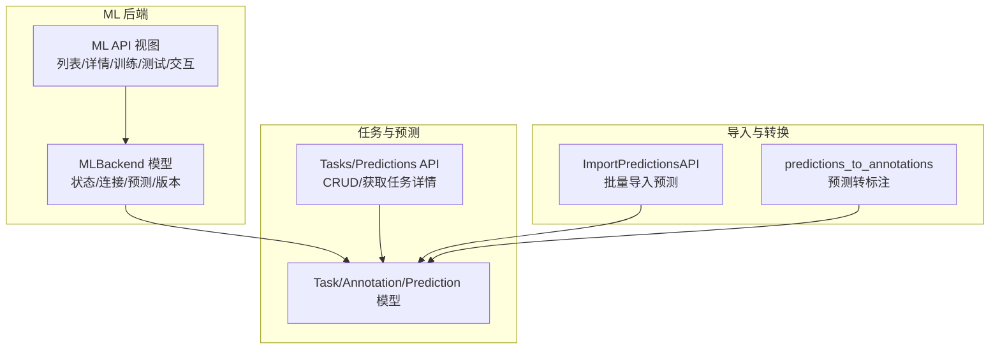
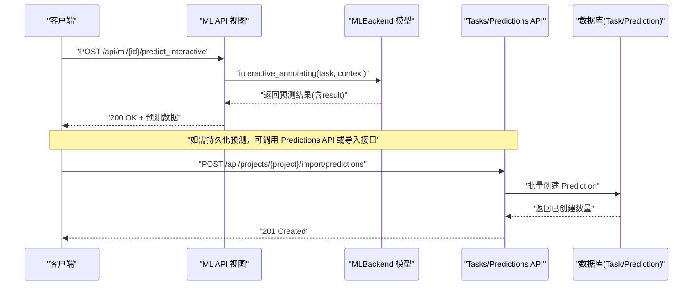
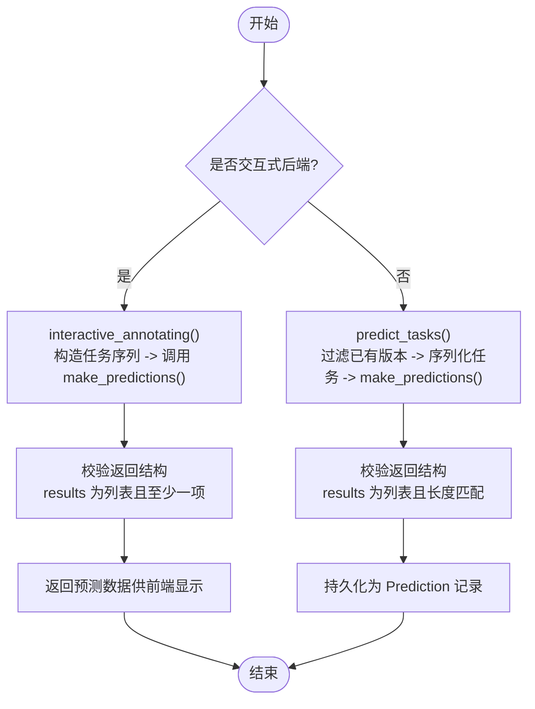
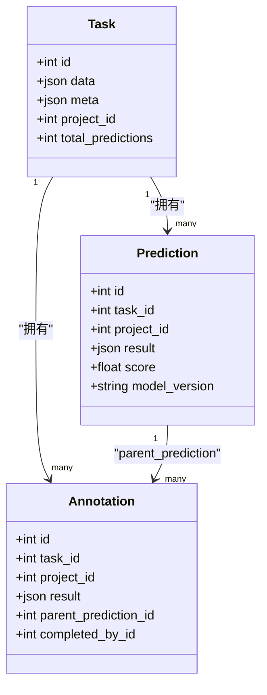
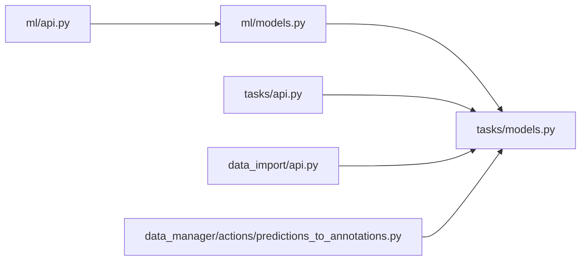

# 单任务预标注

<cite>
**本文引用的文件**   
- [label_studio/ml/api.py](file://label_studio/ml/api.py)
- [label_studio/ml/models.py](file://label_studio/ml/models.py)
- [label_studio/tasks/api.py](file://label_studio/tasks/api.py)
- [label_studio/tasks/models.py](file://label_studio/tasks/models.py)
- [label_studio/data_import/api.py](file://label_studio/data_import/api.py)
- [label_studio/data_manager/actions/predictions_to_annotations.py](file://label_studio/data_manager/actions/predictions_to_annotations.py)
</cite>

## 目录
1. [简介](#简介)
2. [项目结构](#项目结构)
3. [核心组件](#核心组件)
4. [架构总览](#架构总览)
5. [详细组件分析](#详细组件分析)
6. [依赖关系分析](#依赖关系分析)
7. [性能考虑](#性能考虑)
8. [故障排查指南](#故障排查指南)
9. [结论](#结论)

## 简介
本文件面向“单任务预标注”能力，系统性说明其工作流程、API 端点、请求与响应结构、结果验证机制、与现有标注的关系（覆盖策略、版本管理、冲突解决），并提供使用示例与集成模式。该能力围绕以下关键点展开：
- 通过 ML 后端为单个任务生成预测结果（批量或交互式）。
- 将预测结果持久化为 Prediction 记录，并与 Task/Annotation 建立关联。
- 提供导入离线预测的 API，支持数据格式校验与业务规则校验。
- 在标注界面中，可将预测结果转换为标注，并处理覆盖策略与冲突。

## 项目结构
与单任务预标注相关的代码主要分布在以下模块：
- ML 后端管理与调用：ml/api.py、ml/models.py
- 任务与预测模型及 API：tasks/models.py、tasks/api.py
- 离线预测导入：data_import/api.py
- 预测转标注操作：data_manager/actions/predictions_to_annotations.py

图表来源
- [label_studio/ml/api.py:69-101](file://label_studio/ml/api.py#L69-L101)
- [label_studio/ml/models.py:38-124](file://label_studio/ml/models.py#L38-L124)
- [label_studio/tasks/api.py:1431-1454](file://label_studio/tasks/api.py#L1431-L1454)
- [label_studio/tasks/models.py:66-160](file://label_studio/tasks/models.py#L66-L160)
- [label_studio/data_import/api.py:511-622](file://label_studio/data_import/api.py#L511-L622)
- [label_studio/data_manager/actions/predictions_to_annotations.py:15-47](file://label_studio/data_manager/actions/predictions_to_annotations.py#L15-L47)

章节来源
- [label_studio/ml/api.py:69-101](file://label_studio/ml/api.py#L69-L101)
- [label_studio/ml/models.py:38-124](file://label_studio/ml/models.py#L38-L124)
- [label_studio/tasks/api.py:1431-1454](file://label_studio/tasks/api.py#L1431-L1454)
- [label_studio/tasks/models.py:66-160](file://label_studio/tasks/models.py#L66-L160)
- [label_studio/data_import/api.py:511-622](file://label_studio/data_import/api.py#L511-L622)
- [label_studio/data_manager/actions/predictions_to_annotations.py:15-47](file://label_studio/data_manager/actions/predictions_to_annotations.py#L15-L47)

## 核心组件
- ML 后端（MLBackend）：负责与外部 ML 服务建立连接、健康检查、训练、预测、版本管理以及交互式预标注。
- 任务与预测（Task/Prediction/Annotation）：承载数据、预测结果和人工标注；Prediction 作为 ML 产出的中间态，Annotation 作为最终标注。
- 预测导入（ImportPredictionsAPI）：支持批量导入离线预测，包含数据格式与业务规则校验。
- 预测转标注（predictions_to_annotations）：将符合条件的预测批量转为标注，便于后续审核与编辑。

章节来源
- [label_studio/ml/models.py:38-124](file://label_studio/ml/models.py#L38-L124)
- [label_studio/tasks/models.py:66-160](file://label_studio/tasks/models.py#L66-L160)
- [label_studio/data_import/api.py:511-622](file://label_studio/data_import/api.py#L511-L622)
- [label_studio/data_manager/actions/predictions_to_annotations.py:15-47](file://label_studio/data_manager/actions/predictions_to_annotations.py#L15-L47)

## 架构总览
下图展示单任务预标注的关键流程：从 ML 后端发起预测，到系统接收并持久化 Prediction，再到可选地将预测转换为 Annotation。

图表来源
- [label_studio/ml/api.py:310-380](file://label_studio/ml/api.py#L310-L380)
- [label_studio/ml/models.py:375-417](file://label_studio/ml/models.py#L375-L417)
- [label_studio/data_import/api.py:511-622](file://label_studio/data_import/api.py#L511-L622)
- [label_studio/tasks/api.py:1431-1454](file://label_studio/tasks/api.py#L1431-L1454)

## 详细组件分析

### ML 后端与单任务预测
- MLBackend.predict_tasks：对非交互式后端执行批量预测，过滤已有同版本预测，序列化任务后调用 ML 服务，校验返回结构，持久化为 Prediction。
- MLBackend.interactive_annotating：针对交互式后端，按 prompt 返回单条预测结果，用于实时预标注。
- MLBackend.update_state/get_versions：维护后端状态与模型版本，支持自动更新。

图表来源
- [label_studio/ml/models.py:341-373](file://label_studio/ml/models.py#L341-L373)
- [label_studio/ml/models.py:375-417](file://label_studio/ml/models.py#L375-L417)

章节来源
- [label_studio/ml/models.py:341-373](file://label_studio/ml/models.py#L341-L373)
- [label_studio/ml/models.py:375-417](file://label_studio/ml/models.py#L375-L417)

### 单任务预标注 API 端点
- 交互式预标注
  - 路径：POST /api/ml/{id}/predict_interactive
  - 权限：tasks_view
  - 请求体：包含 task、context 等字段（由 MLInteractiveAnnotatingRequest 校验）
  - 响应：200 OK，包含 data.errors 或 data.data（预测结果）
- 预测测试（调试用）
  - 路径：POST /api/ml/{id}/test_predict?random=true
  - 权限：projects_change
  - 行为：随机取一个任务进行预测，返回请求/响应细节
- 模型版本查询
  - 路径：GET /api/ml/{id}/versions
  - 权限：projects_change
  - 响应：versions 列表或升级提示

章节来源
- [label_studio/ml/api.py:310-380](file://label_studio/ml/api.py#L310-L380)
- [label_studio/ml/api.py:240-307](file://label_studio/ml/api.py#L240-L307)
- [label_studio/ml/api.py:383-432](file://label_studio/ml/api.py#L383-L432)

### 预测导入 API（离线预标注）
- 路径：POST /api/projects/{project_id}/import/predictions
- 权限：projects_change
- 请求体：PredictionSerializer(many=True)，每条包含 task、result、score、model_version 等
- 校验流程：
  - 任务 ID 存在性校验
  - 自定义接口预测校验（CUSTOM_INTERFACE_PREDICTION_VALIDATOR）
  - Label Interface 预测结构校验（当 label_config 非默认时）
- 响应：201 Created，返回 created 计数

章节来源
- [label_studio/data_import/api.py:511-622](file://label_studio/data_import/api.py#L511-L622)

### 预测转标注（覆盖策略与冲突解决）
- 入口：data_manager/actions/predictions_to_annotations.py
- 逻辑要点：
  - 筛选未子标注化的预测（child_annotations__isnull=True）
  - 批量构建 Annotation 对象，设置 parent_prediction 指向原 Prediction
  - 以当前用户为 owner，避免所有权冲突
- 覆盖策略：
  - 仅对尚未被转化为标注的预测生效，避免重复覆盖
  - 若同一任务存在多条预测，需结合 model_version 与业务规则选择目标预测

章节来源
- [label_studio/data_manager/actions/predictions_to_annotations.py:15-47](file://label_studio/data_manager/actions/predictions_to_annotations.py#L15-L47)

### 任务与预测的数据模型关系
- Task：承载任务数据与元信息，统计 total_predictions 等指标
- Prediction：存储 ML 输出 result、score、model_version，并关联 task/project
- Annotation：人工标注，可基于 Prediction 创建（parent_prediction）

图表来源
- [label_studio/tasks/models.py:66-160](file://label_studio/tasks/models.py#L66-L160)
- [label_studio/tasks/models.py:685-766](file://label_studio/tasks/models.py#L685-L766)

章节来源
- [label_studio/tasks/models.py:66-160](file://label_studio/tasks/models.py#L66-L160)
- [label_studio/tasks/models.py:685-766](file://label_studio/tasks/models.py#L685-L766)

## 依赖关系分析
- ML API 视图依赖 MLBackend 模型进行状态管理与预测调用。
- MLBackend 通过 MLApi 与外部 ML 服务通信，返回标准化结果。
- Tasks/Predictions API 提供 Prediction 的 CRUD 与任务详情查询。
- ImportPredictionsAPI 依赖 PredictionSerializer 与 Task 模型进行校验与批量写入。
- predictions_to_annotations 动作依赖 Prediction 与 Annotation 模型完成转换。

图表来源
- [label_studio/ml/api.py:69-101](file://label_studio/ml/api.py#L69-L101)
- [label_studio/ml/models.py:38-124](file://label_studio/ml/models.py#L38-L124)
- [label_studio/tasks/api.py:1431-1454](file://label_studio/tasks/api.py#L1431-L1454)
- [label_studio/tasks/models.py:66-160](file://label_studio/tasks/models.py#L66-L160)
- [label_studio/data_import/api.py:511-622](file://label_studio/data_import/api.py#L511-L622)
- [label_studio/data_manager/actions/predictions_to_annotations.py:15-47](file://label_studio/data_manager/actions/predictions_to_annotations.py#L15-L47)

章节来源
- [label_studio/ml/api.py:69-101](file://label_studio/ml/api.py#L69-L101)
- [label_studio/ml/models.py:38-124](file://label_studio/ml/models.py#L38-L124)
- [label_studio/tasks/api.py:1431-1454](file://label_studio/tasks/api.py#L1431-L1454)
- [label_studio/tasks/models.py:66-160](file://label_studio/tasks/models.py#L66-L160)
- [label_studio/data_import/api.py:511-622](file://label_studio/data_import/api.py#L511-L622)
- [label_studio/data_manager/actions/predictions_to_annotations.py:15-47](file://label_studio/data_manager/actions/predictions_to_annotations.py#L15-L47)

## 性能考虑
- 批量预测去重：predict_tasks 会过滤已存在同 model_version 的预测，避免重复计算。
- 内存优化导入：ImportPredictionsAPI 支持分批处理（PREDICTION_IMPORT_BATCH_SIZE），显著降低内存占用。
- 任务计数器异步更新：导入完成后异步更新任务统计，减少主流程开销。

章节来源
- [label_studio/ml/models.py:341-373](file://label_studio/ml/models.py#L341-L373)
- [label_studio/data_import/api.py:546-622](file://label_studio/data_import/api.py#L546-L622)

## 故障排查指南
- ML 后端不可达或返回错误：
  - 检查 MLBackend.state 是否为 DISCONNECTED/ERROR，查看 error_message。
  - 确认 healthcheck/setup 成功，必要时重启或重新配置后端。
- 预测结果为空或结构不正确：
  - 检查 ML 服务返回的 results 是否为列表且每项包含 result 字段。
  - 对于交互式后端，确保 is_interactive 标志正确设置。
- 导入预测失败：
  - 校验 task ID 是否存在于项目内。
  - 检查 CUSTOM_INTERFACE_PREDICTION_VALIDATOR 与 Label Interface 校验错误。
- 预测转标注无效果：
  - 确认预测未被其他标注引用（child_annotations__isnull=True）。
  - 检查 model_version 是否与预期一致。

章节来源
- [label_studio/ml/models.py:202-221](file://label_studio/ml/models.py#L202-L221)
- [label_studio/ml/models.py:292-339](file://label_studio/ml/models.py#L292-L339)
- [label_studio/data_import/api.py:537-622](file://label_studio/data_import/api.py#L537-L622)
- [label_studio/data_manager/actions/predictions_to_annotations.py:15-47](file://label_studio/data_manager/actions/predictions_to_annotations.py#L15-L47)

## 结论
单任务预标注通过 ML 后端与系统内部的任务/预测/标注模型紧密协作，实现了从在线预测到离线导入、从预测到标注的完整闭环。系统在数据校验、版本管理、覆盖策略与性能优化方面提供了完善的支持，便于在不同业务场景下灵活集成与扩展。