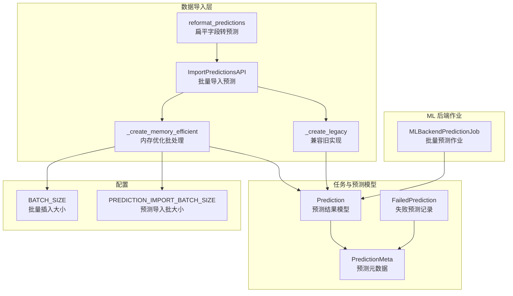
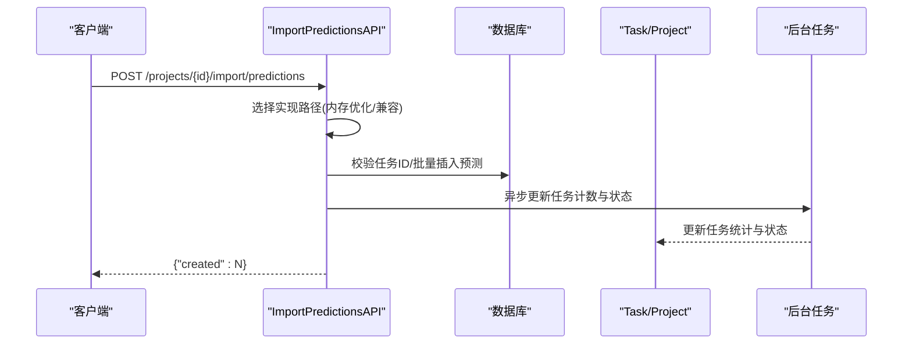
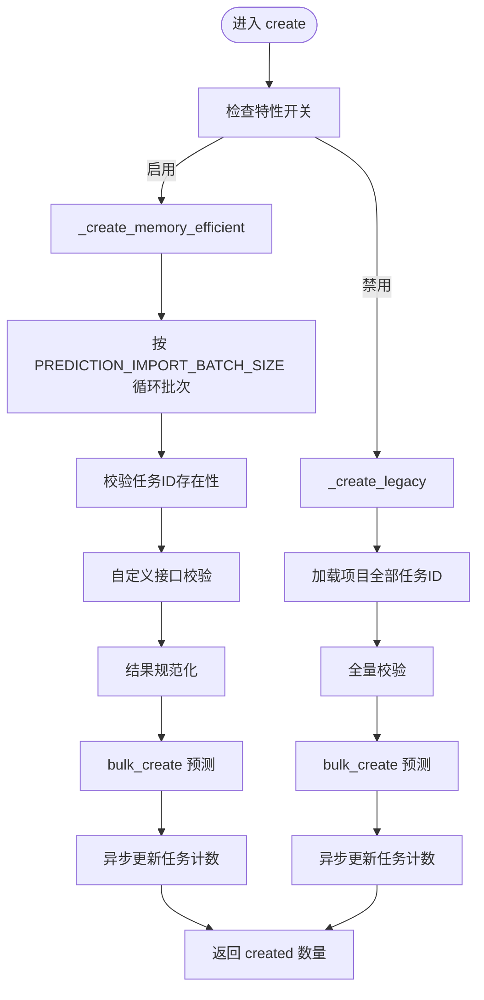
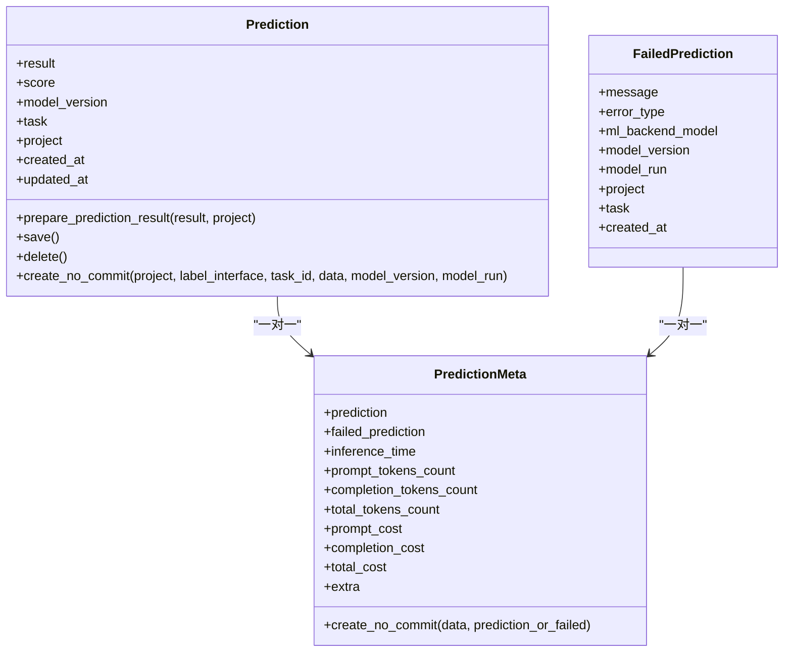
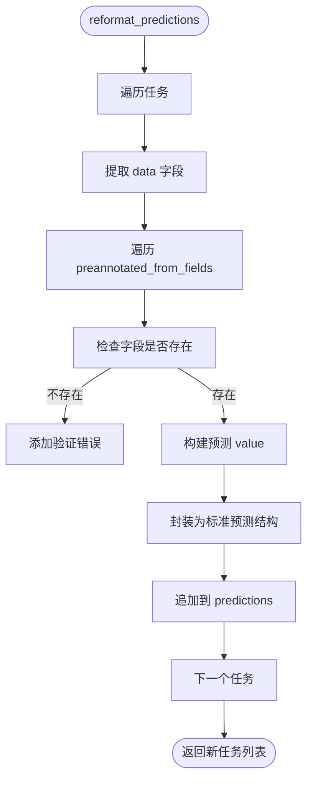
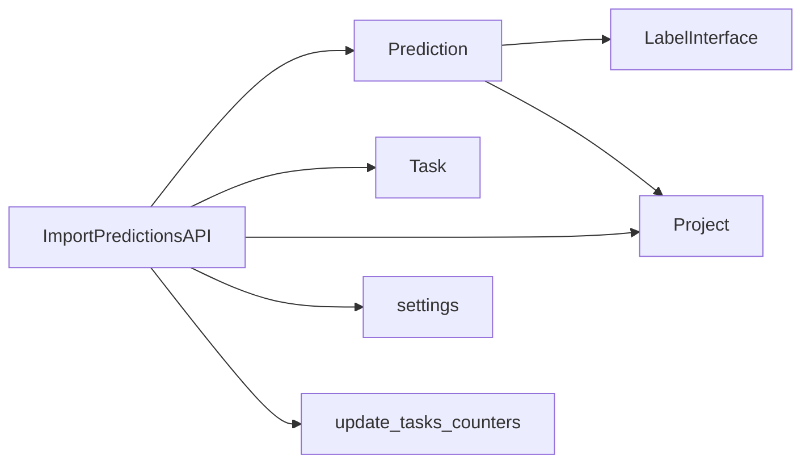

# 批量预标注

<cite>
**本文引用的文件**   
- [data_import/api.py](file://label_studio/data_import/api.py)
- [data_import/functions.py](file://label_studio/data_import/functions.py)
- [tasks/models.py](file://label_studio/tasks/models.py)
- [ml/models.py](file://label_studio/ml/models.py)
- [core/settings/base.py](file://label_studio/core/settings/base.py)
</cite>

## 目录
1. [简介](#简介)
2. [项目结构](#项目结构)
3. [核心组件](#核心组件)
4. [架构总览](#架构总览)
5. [详细组件分析](#详细组件分析)
6. [依赖关系分析](#依赖关系分析)
7. [性能与优化](#性能与优化)
8. [配置项说明](#配置项说明)
9. [API 接口规范](#api-接口规范)
10. [最佳实践](#最佳实践)
11. [故障排除](#故障排除)
12. [结论](#结论)

## 简介
本文件面向“批量预标注”能力，解释 Label Studio 如何通过批量导入预测结果的方式，对多个任务同时生成初始标注。重点包括：
- 工作原理：如何将外部 ML 模型输出的预测结果批量写入系统，并转换为可编辑的预标注结果。
- API 接口：批量导入预测结果的请求参数、响应格式与错误处理。
- 性能优化：批大小控制、内存优化、并发与异步处理、进度监控。
- 配置选项：批大小限制、超时设置、资源管理。
- 与单任务预标注的差异与适用场景。
- 最佳实践与常见问题排查。

## 项目结构
围绕批量预标注的关键代码主要分布在以下模块：
- 数据导入层：负责接收批量预测数据、校验、分批入库、更新统计与任务状态。
- 任务与预测模型：定义 Prediction、FailedPrediction、PredictionMeta 等数据结构及结果规范化逻辑。
- ML 后端作业模型：记录批量预测任务的元信息（如批次大小）。
- 全局配置：定义各类批大小、超时等运行参数。

图表来源
- [data_import/api.py:469-701](file://label_studio/data_import/api.py#L469-L701)
- [data_import/functions.py:84-181](file://label_studio/data_import/functions.py#L84-L181)
- [tasks/models.py:1071-1393](file://label_studio/tasks/models.py#L1071-L1393)
- [ml/models.py:436-447](file://label_studio/ml/models.py#L436-L447)
- [core/settings/base.py:737-752](file://label_studio/core/settings/base.py#L737-L752)

章节来源
- [data_import/api.py:469-701](file://label_studio/data_import/api.py#L469-L701)
- [data_import/functions.py:84-181](file://label_studio/data_import/functions.py#L84-L181)
- [tasks/models.py:1071-1393](file://label_studio/tasks/models.py#L1071-L1393)
- [ml/models.py:436-447](file://label_studio/ml/models.py#L436-L447)
- [core/settings/base.py:737-752](file://label_studio/core/settings/base.py#L737-L752)

## 核心组件
- ImportPredictionsAPI：提供批量导入预测的 REST 接口，支持两种实现路径：
  - 内存优化批处理：按较小批次循环处理，降低内存占用。
  - 兼容旧实现：一次性加载全部任务 ID 进行校验和创建。
- Prediction 模型：承载预测结果，包含结果规范化、任务关联、版本与分数等信息。
- FailedPrediction 与 PredictionMeta：记录失败原因与预测元数据（推理耗时、Token 用量、成本等）。
- MLBackendPredictionJob：记录 ML 后端批量预测作业的批次大小等元信息。
- 配置常量：BATCH_SIZE、PREDICTION_IMPORT_BATCH_SIZE 等用于控制批处理行为。

章节来源
- [data_import/api.py:469-701](file://label_studio/data_import/api.py#L469-L701)
- [tasks/models.py:1071-1393](file://label_studio/tasks/models.py#L1071-L1393)
- [ml/models.py:436-447](file://label_studio/ml/models.py#L436-L447)
- [core/settings/base.py:737-752](file://label_studio/core/settings/base.py#L737-L752)

## 架构总览
批量预标注的整体流程如下：
- 客户端调用批量导入预测接口，提交一个或多个预测对象数组。
- 服务端根据特性开关选择内存优化或兼容实现。
- 在内存优化路径中，按 PREDICTION_IMPORT_BATCH_SIZE 切分批次，逐批校验 task 存在性、自定义接口校验、结果规范化后 bulk_create。
- 完成后异步更新受影响任务的计数器与状态。
- 若使用 reformat_predictions，可将扁平字段（例如从任务数据中提取的标签）转换为标准预测结构。

图表来源
- [data_import/api.py:469-701](file://label_studio/data_import/api.py#L469-L701)
- [data_import/functions.py:333-504](file://label_studio/data_import/functions.py#L333-L504)

## 详细组件分析

### 批量导入预测接口（ImportPredictionsAPI）
- 功能：接收批量预测数据，按项目维度写入 Prediction。
- 权限：需要项目变更权限。
- 解析器：支持 JSON、表单、多部分上传。
- 两条实现路径：
  - _create_memory_efficient：按 PREDICTION_IMPORT_BATCH_SIZE 分批处理，逐批校验任务存在性与自定义接口校验，bulk_create 后累计 created 数量。
  - _create_legacy：一次性加载项目所有任务 ID，先校验再批量创建。
- 返回：{"created": 成功创建的预测数量}。

图表来源
- [data_import/api.py:469-701](file://label_studio/data_import/api.py#L469-L701)

章节来源
- [data_import/api.py:469-701](file://label_studio/data_import/api.py#L469-L701)

### 预测结果规范化与存储（Prediction 模型）
- result 规范化：
  - 列表：直接使用，要求每项为字典。
  - 字典：包装为单个 region，from_name/to_name/type/value 由 label_config 推导。
  - 字符串/整型：匹配单值控件类型（如 Choices、Rating），构造对应 value。
- 保存时自动补全 project_id，并触发任务 updated_at 更新。
- 提供 create_no_commit：将外部数据转换为 LS 标准区域结构，便于后续持久化。

图表来源
- [tasks/models.py:1071-1393](file://label_studio/tasks/models.py#L1071-L1393)

章节来源
- [tasks/models.py:1071-1393](file://label_studio/tasks/models.py#L1071-L1393)

### 扁平字段转预测（reformat_predictions）
- 作用：将任务数据中的扁平字段（例如直接从任务 JSON 提取的标签）转换为标准预测结构。
- 输入：任务列表、预标注字段名列表、可选项目实例。
- 输出：带 predictions 字段的标准任务结构。
- 校验：当开启严格模式时，会收集验证错误并抛出异常；否则仅记录日志。

图表来源
- [data_import/functions.py:84-181](file://label_studio/data_import/functions.py#L84-L181)

章节来源
- [data_import/functions.py:84-181](file://label_studio/data_import/functions.py#L84-L181)

### ML 后端批量预测作业（MLBackendPredictionJob）
- 字段：job_id、ml_backend、model_version、batch_size、时间戳。
- 用途：记录 ML 后端批量预测任务的批次大小等元信息，便于追踪与审计。

章节来源
- [ml/models.py:436-447](file://label_studio/ml/models.py#L436-L447)

## 依赖关系分析
- ImportPredictionsAPI 依赖：
  - tasks.models.Prediction：用于创建预测记录。
  - tasks.models.Task：用于校验任务存在性。
  - projects.models.Project：用于权限与上下文。
  - core.settings：读取批大小与超时等配置。
- Prediction 依赖：
  - label_interface：用于将外部数据转换为 LS 标准区域结构。
  - projects.models.Project：用于解析 label_config。
- 后台任务：
  - update_tasks_counters：异步更新任务统计与状态。

图表来源
- [data_import/api.py:469-701](file://label_studio/data_import/api.py#L469-L701)
- [tasks/models.py:1071-1393](file://label_studio/tasks/models.py#L1071-L1393)

章节来源
- [data_import/api.py:469-701](file://label_studio/data_import/api.py#L469-L701)
- [tasks/models.py:1071-1393](file://label_studio/tasks/models.py#L1071-L1393)

## 性能与优化
- 批大小控制：
  - PREDICTION_IMPORT_BATCH_SIZE：控制预测导入的分批大小，默认 500。
  - BATCH_SIZE：控制 bulk_create 的每批插入大小，默认 1000。
- 内存优化：
  - 内存优化路径避免一次性加载项目全部任务 ID，改为逐批查询与校验。
  - 通过较小的 PROCESSING_BATCH_SIZE 减少内存峰值。
- 并发与异步：
  - 非社区版导入任务采用异步队列处理，支持长任务超时设置。
  - 预测导入完成后异步更新任务计数与状态，避免阻塞主流程。
- 进度监控：
  - 导入任务支持进度更新与完成标记，便于前端轮询查看状态。
- 重试机制：
  - 后台任务失败时记录错误与堆栈，支持安全重试策略（例如重新入队）。

章节来源
- [data_import/api.py:469-701](file://label_studio/data_import/api.py#L469-L701)
- [data_import/functions.py:333-504](file://label_studio/data_import/functions.py#L333-L504)
- [core/settings/base.py:737-752](file://label_studio/core/settings/base.py#L737-L752)

## 配置项说明
- BATCH_SIZE：批量插入数据库的大小，默认 1000。
- PREDICTION_IMPORT_BATCH_SIZE：预测导入的分批大小，默认 500。
- IMPORT_BATCH_SIZE：任务导入的流式批大小，默认 500。
- REIMPORT_BATCH_SIZE：重导入的批大小，默认 1000。
- RQ_LONG_JOB_TIMEOUT：长任务超时时间，用于异步导入/重导入。

建议：
- 对于大规模预测导入，适当增大 PREDICTION_IMPORT_BATCH_SIZE 以提升吞吐，但需结合内存与数据库压力调整。
- 在高并发环境下，合理设置 RQ_LONG_JOB_TIMEOUT，避免任务过早超时。

章节来源
- [core/settings/base.py:737-752](file://label_studio/core/settings/base.py#L737-L752)

## API 接口规范

### 批量导入预测
- 端点：POST /api/projects/{id}/import/predictions
- 权限：需要项目变更权限。
- 请求体：预测对象数组，每个对象包含：
  - task：任务 ID（必填）。
  - result：预测结果（支持列表、字典、字符串/整型，将被规范化）。
  - score：预测分数（可选）。
  - model_version：模型版本（可选，默认 'undefined'）。
- 响应：
  - 201：{"created": N}，N 为成功创建的预测数量。
  - 400：请求参数错误或数据校验失败。

注意：
- 在内存优化路径中，若任务 ID 不存在于项目中，将抛出验证错误。
- 自定义接口校验可通过 CUSTOM_INTERFACE_PREDICTION_VALIDATOR 配置扩展。

章节来源
- [data_import/api.py:469-701](file://label_studio/data_import/api.py#L469-L701)

## 最佳实践
- 数据准备：
  - 确保每个预测对象的 task 字段指向项目内存在的任务。
  - result 尽量遵循 Label Studio 标准结构，或使用扁平字段并通过 reformat_predictions 转换。
- 批大小调优：
  - 根据服务器内存与数据库负载调整 PREDICTION_IMPORT_BATCH_SIZE 与 BATCH_SIZE。
- 错误处理：
  - 捕获 400 响应并记录具体错误信息，必要时重试失败批次。
- 进度监控：
  - 对于长任务，使用异步导入的状态查询接口轮询进度。
- 资源管理：
  - 避免同时发起过多批量导入任务，防止资源争用。

## 故障排除
- 常见错误：
  - 任务 ID 不存在：检查 task 字段是否正确，并确保任务属于目标项目。
  - 预测结果格式错误：检查 result 是否符合预期结构，必要时使用 prepare_prediction_result 规范化。
  - 自定义接口校验失败：检查 CUSTOM_INTERFACE_PREDICTION_VALIDATOR 的实现逻辑。
- 调试建议：
  - 查看后台任务日志，确认是否发生入队失败或处理异常。
  - 使用特性开关切换内存优化与兼容实现，定位问题范围。

章节来源
- [data_import/api.py:469-701](file://label_studio/data_import/api.py#L469-L701)
- [tasks/models.py:1071-1393](file://label_studio/tasks/models.py#L1071-L1393)

## 结论
批量预标注通过 ImportPredictionsAPI 提供了高效、可扩展的预测结果导入能力。借助内存优化批处理、异步任务与进度监控，系统能够在大规模数据场景下稳定运行。合理配置批大小与超时参数，并结合最佳实践与故障排除指南，可以显著提升标注效率与系统可靠性。