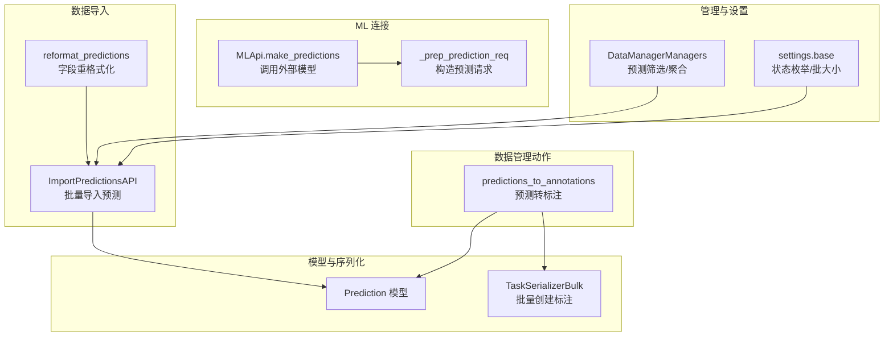
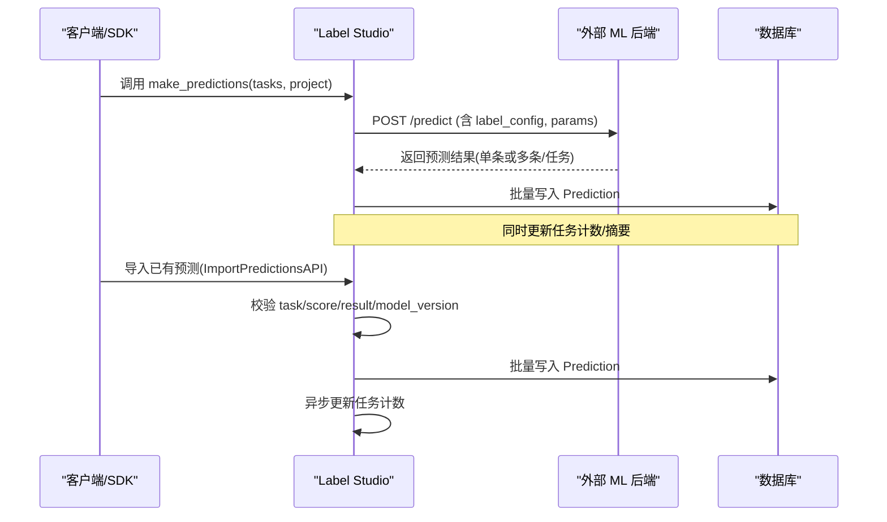
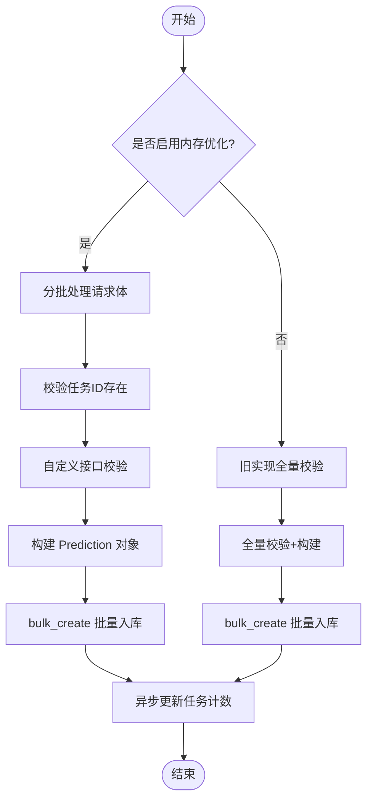
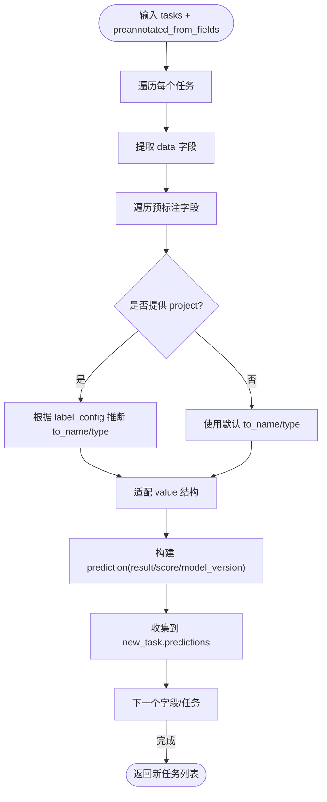
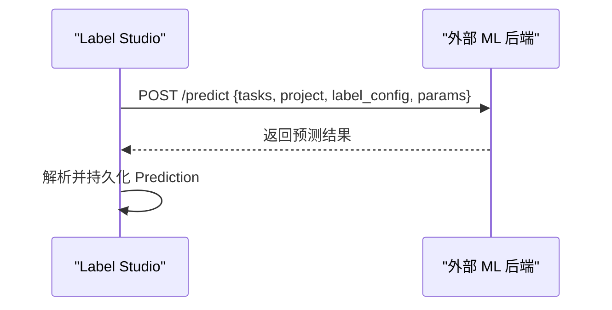
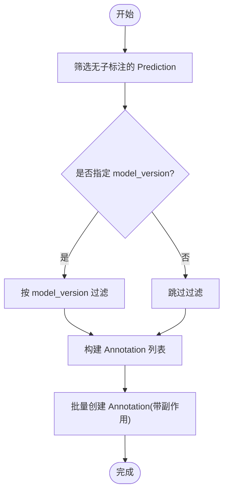
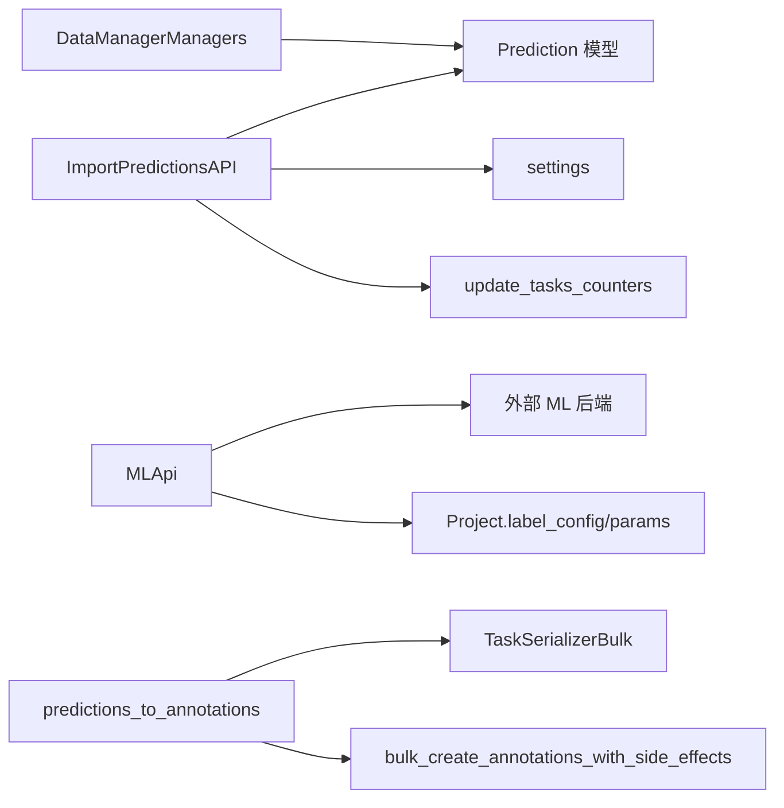

# 预标注功能

<cite>
**本文引用的文件**   
- [predictions_to_annotations.py](file://label_studio/data_manager/actions/predictions_to_annotations.py)
- [api.py](file://label_studio/data_import/api.py)
- [functions.py](file://label_studio/data_import/functions.py)
- [api_connector.py](file://label_studio/ml/api_connector.py)
- [models.py](file://label_studio/ml/models.py)
- [serializers.py](file://label_studio/tasks/serializers.py)
- [managers.py](file://label_studio/data_manager/managers.py)
- [base.py](file://label_studio/core/settings/base.py)
</cite>

## 目录
1. [简介](#简介)
2. [项目结构](#项目结构)
3. [核心组件](#核心组件)
4. [架构总览](#架构总览)
5. [详细组件分析](#详细组件分析)
6. [依赖关系分析](#依赖关系分析)
7. [性能考量](#性能考量)
8. [故障排除指南](#故障排除指南)
9. [结论](#结论)
10. [附录](#附录)

## 简介
本文件系统性说明 Label Studio 的预标注（Predictions）能力，包括：
- 预标注工作原理与 ML 模型自动调用流程
- 批量预标注与单任务预标注的实现差异
- 预标注结果的验证、过滤与合并策略
- 预标注工作流配置方法与最佳实践
- 预标注与人工标注协作模式（覆盖、版本管理、冲突解决）
- 常见场景示例与故障排除

## 项目结构
围绕“预标注”的关键代码分布在以下模块：
- 数据导入层：负责接收外部预测结果并入库
- ML 连接器：负责向外部 ML 后端发起训练/预测请求
- 数据管理动作：提供将预测结果转为正式标注的能力
- 序列化与模型：承载预测数据的结构与批量创建逻辑
- 管理器与设置：提供筛选、统计与批处理参数等支撑

图表来源
- [api.py:511-709](file://label_studio/data_import/api.py#L511-L709)
- [functions.py:84-181](file://label_studio/data_import/functions.py#L84-L181)
- [api_connector.py:214-231](file://label_studio/ml/api_connector.py#L214-L231)
- [predictions_to_annotations.py:15-58](file://label_studio/data_manager/actions/predictions_to_annotations.py#L15-L58)
- [serializers.py:853-853](file://label_studio/tasks/serializers.py#L853-L853)
- [managers.py:1398-1457](file://label_studio/data_manager/managers.py#L1398-L1457)
- [base.py:460-460](file://label_studio/core/settings/base.py#L460-L460)

章节来源
- [api.py:511-709](file://label_studio/data_import/api.py#L511-L709)
- [functions.py:84-181](file://label_studio/data_import/functions.py#L84-L181)
- [api_connector.py:214-231](file://label_studio/ml/api_connector.py#L214-L231)
- [predictions_to_annotations.py:15-58](file://label_studio/data_manager/actions/predictions_to_annotations.py#L15-L58)
- [serializers.py:853-853](file://label_studio/tasks/serializers.py#L853-L853)
- [managers.py:1398-1457](file://label_studio/data_manager/managers.py#L1398-L1457)
- [base.py:460-460](file://label_studio/core/settings/base.py#L460-L460)

## 核心组件
- ImportPredictionsAPI：提供批量导入预测的 API，支持内存优化批处理与旧实现回退；包含任务 ID 校验、自定义接口校验、标签配置校验（可选）、批量入库与任务计数更新。
- reformat_predictions：将扁平任务数据中的预标注字段转换为标准 predictions 结构，便于后续导入或同步。
- MLApi.make_predictions/_prep_prediction_req：封装与外部 ML 后端的通信，构造预测请求并返回预测结果。
- predictions_to_annotations：将已存在的 Prediction 记录批量转换为 Annotation，建立 parent_prediction_id 关联，并触发侧效应（如 Webhook）。
- TaskSerializerBulk：在批量创建标注时注入用户、动作类型等上下文信息。
- DataManagerManagers：提供对预测结果的筛选与聚合能力（如按 model_version 过滤、统计结果与分数）。
- settings.base：定义“Created from prediction”等状态枚举，以及批处理相关常量。

章节来源
- [api.py:511-709](file://label_studio/data_import/api.py#L511-L709)
- [functions.py:84-181](file://label_studio/data_import/functions.py#L84-L181)
- [api_connector.py:214-231](file://label_studio/ml/api_connector.py#L214-L231)
- [predictions_to_annotations.py:15-58](file://label_studio/data_manager/actions/predictions_to_annotations.py#L15-L58)
- [serializers.py:853-853](file://label_studio/tasks/serializers.py#L853-L853)
- [managers.py:1398-1457](file://label_studio/data_manager/managers.py#L1398-L1457)
- [base.py:460-460](file://label_studio/core/settings/base.py#L460-L460)

## 架构总览
预标注的整体流程分为两条主线：
- 从外部 ML 模型获取预测：Label Studio 通过 MLApi 向外部后端发送预测请求，并将返回结果持久化为 Prediction。
- 从外部数据导入预测：通过 ImportPredictionsAPI 批量导入已有预测结果，并进行校验与入库。

图表来源
- [api_connector.py:214-231](file://label_studio/ml/api_connector.py#L214-L231)
- [api.py:511-709](file://label_studio/data_import/api.py#L511-L709)

## 详细组件分析

### 批量导入预测（ImportPredictionsAPI）
- 功能要点
  - 支持两种实现路径：内存优化批处理（默认启用）与旧实现（用于安全回退）。
  - 内存优化路径按批次读取请求体，逐批校验任务 ID、执行自定义接口校验、构建 Prediction 对象并 bulk_create。
  - 旧实现路径先全量加载项目任务 ID，再逐项校验与构建，最后批量入库。
  - 无论哪种路径，最终都会异步更新受影响任务的计数。
- 关键行为
  - 任务 ID 校验：确保 task 属于当前项目。
  - 自定义接口校验：允许通过配置函数对 result 进行额外校验。
  - 标签配置校验：当项目使用非默认 label_config 时，会基于 LabelInterface 校验 result 结构。
  - 批量入库：使用 settings.BATCH_SIZE 控制数据库批量插入大小。
  - 任务计数更新：通过 update_tasks_counters 异步刷新任务统计。

图表来源
- [api.py:511-709](file://label_studio/data_import/api.py#L511-L709)

章节来源
- [api.py:511-709](file://label_studio/data_import/api.py#L511-L709)

### 预标注字段重格式化（reformat_predictions）
- 功能要点
  - 将任务数据中的指定字段（preannotated_from_fields）转换为标准 predictions 结构。
  - 若提供 project，则尝试根据 label_config 推断 to_name 与 type，提升兼容性。
  - 对不同数据类型（标量、列表、字典）进行适配，生成符合 Label Interface 的 result 结构。
  - 可抛出校验错误，便于上层统一处理。
- 典型用途
  - 从外部系统导入的扁平数据，需要转换为 Label Studio 可识别的 predictions 格式。

图表来源
- [functions.py:84-181](file://label_studio/data_import/functions.py#L84-L181)

章节来源
- [functions.py:84-181](file://label_studio/data_import/functions.py#L84-L181)

### 调用 ML 模型生成预测（MLApi）
- 功能要点
  - _prep_prediction_req：构造预测请求，包含 tasks、project uid、label_config、params（含登录信息、hostname、context）。
  - make_predictions：调用外部 ML 后端的预测接口，返回预测结果。
- 结果形态
  - 外部 ML 后端可能返回每条任务一条预测，也可能返回多条预测（由后端决定），Label Studio 会在相应位置做兼容处理。

图表来源
- [api_connector.py:214-231](file://label_studio/ml/api_connector.py#L214-L231)
- [models.py:320-320](file://label_studio/ml/models.py#L320-L320)

章节来源
- [api_connector.py:214-231](file://label_studio/ml/api_connector.py#L214-L231)
- [models.py:320-320](file://label_studio/ml/models.py#L320-L320)

### 将预测转为标注（predictions_to_annotations）
- 功能要点
  - 从已存在的 Prediction 中筛选（可按 model_version 过滤），为每个 Prediction 创建对应的 Annotation。
  - 设置 completed_by_id 为当前用户，parent_prediction_id 指向原 Prediction，action 标记为 'prediction'。
  - 使用 TaskSerializerBulk.add_annotation_fields 注入必要上下文，并通过 bulk_create_annotations_with_side_effects 批量创建，触发 Webhook 等副作用。
- 交互界面
  - 提供表单选择 model_version，便于用户在数据管理中批量转换。

图表来源
- [predictions_to_annotations.py:15-58](file://label_studio/data_manager/actions/predictions_to_annotations.py#L15-L58)
- [predictions_to_annotations.py:61-87](file://label_studio/data_manager/actions/predictions_to_annotations.py#L61-L87)

章节来源
- [predictions_to_annotations.py:15-58](file://label_studio/data_manager/actions/predictions_to_annotations.py#L15-L58)
- [predictions_to_annotations.py:61-87](file://label_studio/data_manager/actions/predictions_to_annotations.py#L61-L87)

### 批量创建标注（TaskSerializerBulk）
- 功能要点
  - 在批量创建 Annotation 时，内部会批量创建 Prediction（用于某些流程），并使用 settings.BATCH_SIZE 控制数据库批量插入大小。
  - 该组件与 predictions_to_annotations 配合，确保标注创建的原子性与效率。

章节来源
- [serializers.py:853-853](file://label_studio/tasks/serializers.py#L853-L853)

### 预测筛选与聚合（DataManagerManagers）
- 功能要点
  - 提供 annotate_predictions_results、annotate_predictions_score、annotate_predictions_model_versions 等方法，用于在数据管理视图中展示预测结果、分数与模型版本。
  - 支持按 model_version 进行包含/不包含/为空等过滤条件。

章节来源
- [managers.py:1398-1457](file://label_studio/data_manager/managers.py#L1398-L1457)

## 依赖关系分析
- ImportPredictionsAPI 依赖 Prediction 模型进行入库，依赖 settings 控制批大小与特性开关，依赖 update_tasks_counters 更新任务计数。
- MLApi 依赖外部 ML 后端 URL 与超时配置，依赖 project.label_config 与 params 构造请求。
- predictions_to_annotations 依赖 TaskSerializerBulk 与 bulk_create_annotations_with_side_effects 完成标注创建与副作用。
- managers 提供对 Prediction 的查询增强，供数据管理视图使用。

图表来源
- [api.py:511-709](file://label_studio/data_import/api.py#L511-L709)
- [api_connector.py:214-231](file://label_studio/ml/api_connector.py#L214-L231)
- [predictions_to_annotations.py:15-58](file://label_studio/data_manager/actions/predictions_to_annotations.py#L15-L58)
- [managers.py:1398-1457](file://label_studio/data_manager/managers.py#L1398-L1457)

章节来源
- [api.py:511-709](file://label_studio/data_import/api.py#L511-L709)
- [api_connector.py:214-231](file://label_studio/ml/api_connector.py#L214-L231)
- [predictions_to_annotations.py:15-58](file://label_studio/data_manager/actions/predictions_to_annotations.py#L15-L58)
- [managers.py:1398-1457](file://label_studio/data_manager/managers.py#L1398-L1457)

## 性能考量
- 批量导入预测采用内存优化批处理：按固定批次大小（PREDICTION_IMPORT_BATCH_SIZE）分片处理请求体，显著降低内存占用。
- 数据库批量写入：使用 settings.BATCH_SIZE 控制 bulk_create 的批大小，减少事务开销。
- 任务计数更新：通过异步任务更新，避免阻塞主流程。
- 建议
  - 合理设置 PREDICTION_IMPORT_BATCH_SIZE 与 BATCH_SIZE，结合服务器内存与数据库负载调优。
  - 大体积数据集导入时优先启用内存优化路径，并监控日志输出以评估吞吐。

章节来源
- [api.py:511-709](file://label_studio/data_import/api.py#L511-L709)

## 故障排除指南
- 任务 ID 无效
  - 现象：导入预测时报错提示 task ID 不存在于项目中。
  - 排查：确认 task 是否属于目标项目；检查外部数据源的任务映射是否正确。
  - 参考：[api.py:572-587](file://label_studio/data_import/api.py#L572-L587)
- 自定义接口校验失败
  - 现象：result 被自定义校验函数拒绝。
  - 排查：检查 CUSTOM_INTERFACE_PREDICTION_VALIDATOR 配置与 result 结构是否符合预期。
  - 参考：[api.py:538-544](file://label_studio/data_import/api.py#L538-L544)
- 标签配置校验失败
  - 现象：当项目使用非默认 label_config 时，result 结构不匹配导致校验失败。
  - 排查：核对 label_config 与 result 的 from_name/to_name/type/value 一致性。
  - 参考：[api.py:657-670](file://label_studio/data_import/api.py#L657-L670)
- 预测转标注失败
  - 现象：无法将 Prediction 转为 Annotation。
  - 排查：确认 Prediction 是否存在且无子标注；检查 model_version 过滤条件；确认用户权限。
  - 参考：[predictions_to_annotations.py:15-58](file://label_studio/data_manager/actions/predictions_to_annotations.py#L15-L58)
- 外部 ML 后端不可用
  - 现象：make_predictions 调用失败或超时。
  - 排查：检查后端 URL、超时配置、网络连通性；查看日志中的请求与响应。
  - 参考：[api_connector.py:214-231](file://label_studio/ml/api_connector.py#L214-L231)

章节来源
- [api.py:538-544](file://label_studio/data_import/api.py#L538-L544)
- [api.py:572-587](file://label_studio/data_import/api.py#L572-L587)
- [api.py:657-670](file://label_studio/data_import/api.py#L657-L670)
- [predictions_to_annotations.py:15-58](file://label_studio/data_manager/actions/predictions_to_annotations.py#L15-L58)
- [api_connector.py:214-231](file://label_studio/ml/api_connector.py#L214-L231)

## 结论
Label Studio 的预标注能力通过“外部 ML 模型调用”和“外部预测数据导入”两条路径，将初始标注结果以 Prediction 形式持久化，并可一键转换为 Annotation 进入人工标注流程。系统在导入阶段提供了严格的校验与内存优化批处理，在转换阶段建立了清晰的 parent_prediction_id 关联，便于版本管理与冲突追溯。结合数据管理器的筛选与聚合能力，团队可在大规模数据上高效开展“机器预标注 + 人工复核”的协作闭环。

## 附录

### 预标注工作流配置与最佳实践
- 配置外部 ML 后端
  - 在项目中配置 ML 后端 URL 与超时，确保 Label Studio 能成功调用 /predict。
  - 参考：[api_connector.py:214-231](file://label_studio/ml/api_connector.py#L214-L231)
- 导入已有预测
  - 使用 ImportPredictionsAPI 批量导入，确保 task、score、model_version、result 字段完整。
  - 如需自定义校验，配置 CUSTOM_INTERFACE_PREDICTION_VALIDATOR。
  - 参考：[api.py:511-709](file://label_studio/data_import/api.py#L511-L709)
- 将预测转为标注
  - 在数据管理中执行“从预测创建标注”，可选择 model_version 过滤。
  - 参考：[predictions_to_annotations.py:15-58](file://label_studio/data_manager/actions/predictions_to_annotations.py#L15-L58)
- 最佳实践
  - 使用 model_version 区分不同模型迭代，便于回溯与对比。
  - 对关键任务开启人工复核，保留 parent_prediction_id 以便审计。
  - 调整 PREDICTION_IMPORT_BATCH_SIZE 与 BATCH_SIZE 平衡吞吐与资源占用。

### 预标注与人工标注协作模式
- 结果覆盖
  - 人工标注会创建新的 Annotation，并与原始 Prediction 通过 parent_prediction_id 关联，便于追踪来源。
  - 参考：[predictions_to_annotations.py:34-44](file://label_studio/data_manager/actions/predictions_to_annotations.py#L34-L44)
- 版本管理
  - 使用 model_version 标识不同模型版本，支持在数据管理中按版本筛选与统计。
  - 参考：[managers.py:1398-1457](file://label_studio/data_manager/managers.py#L1398-L1457)
- 冲突解决
  - 当同一任务存在多个 Prediction 时，可通过 model_version 选择最合适的版本进行标注转换。
  - 参考：[predictions_to_annotations.py:23-27](file://label_studio/data_manager/actions/predictions_to_annotations.py#L23-L27)

### 常见预标注场景示例
- 图像分类：外部模型返回类别与置信度，作为 score 与 result 的一部分导入。
- 文本实体识别：外部模型返回 span 边界与实体类型，需与 label_config 的 from_name/to_name/type 对齐。
- 语音转写：外部模型返回时间戳与文本片段，需适配 textarea 类型的值结构。
- 多模型对比：为不同模型设置不同 model_version，便于在数据管理中对比效果。