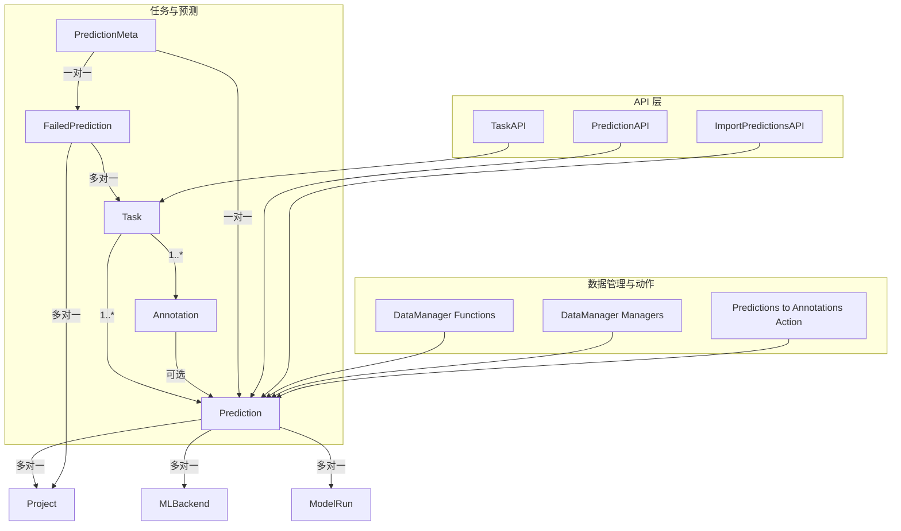
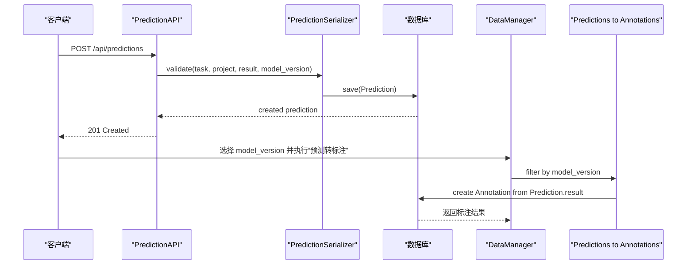
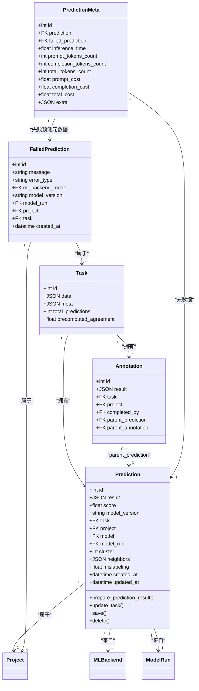
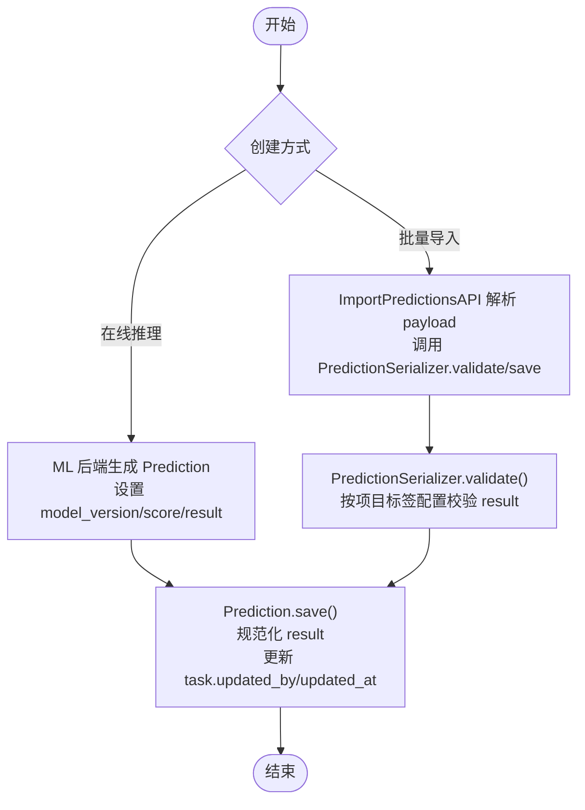
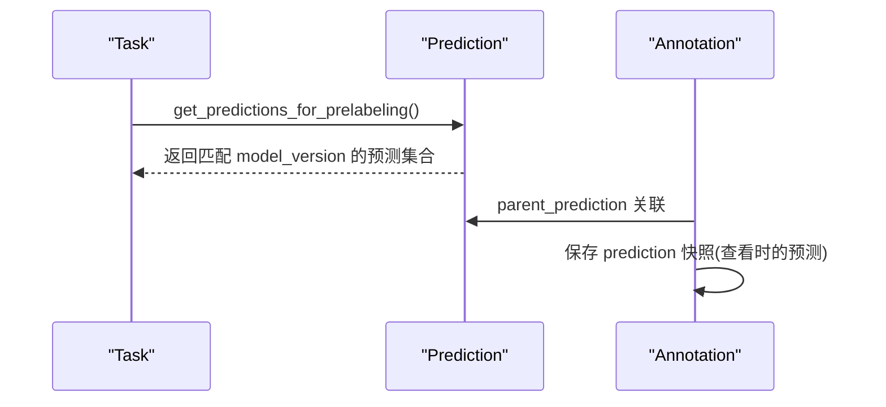
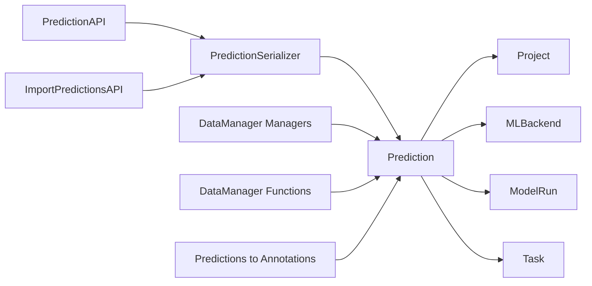
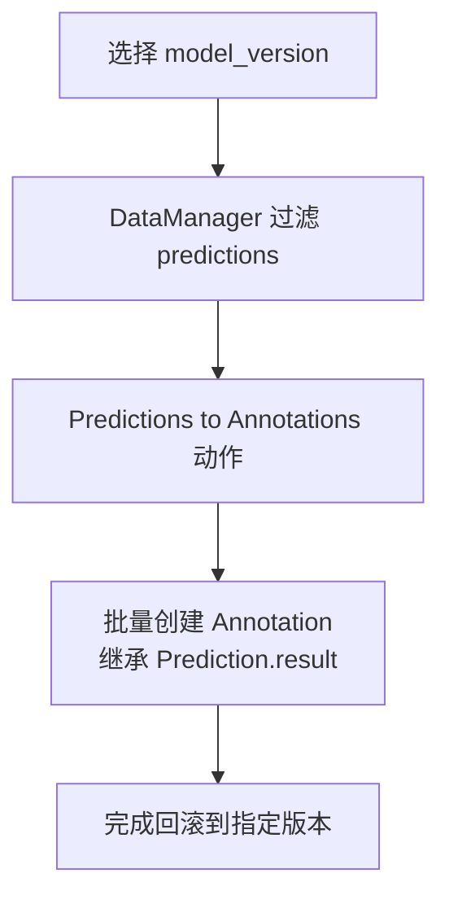
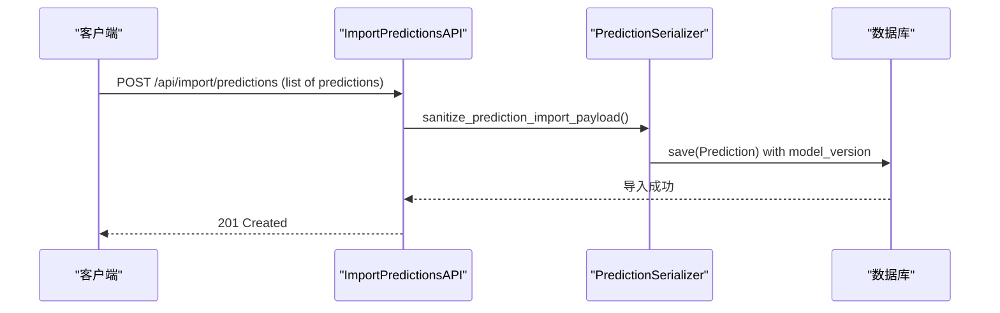
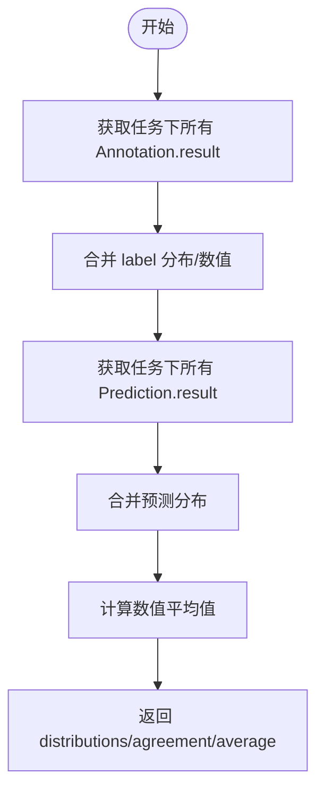

# 预测结果管理

<cite>
**本文引用的文件**   
- [tasks/models.py](file://label_studio/tasks/models.py)
- [tasks/api.py](file://label_studio/tasks/api.py)
- [tasks/serializers.py](file://label_studio/tasks/serializers.py)
- [data_import/api.py](file://label_studio/data_import/api.py)
- [data_manager/functions.py](file://label_studio/data_manager/functions.py)
- [data_manager/managers.py](file://label_studio/data_manager/managers.py)
- [data_manager/actions/predictions_to_annotations.py](file://label_studio/data_manager/actions/predictions_to_annotations.py)
- [projects/models.py](file://label_studio/projects/models.py)
</cite>

## 目录
1. [简介](#简介)
2. [项目结构](#项目结构)
3. [核心组件](#核心组件)
4. [架构总览](#架构总览)
5. [详细组件分析](#详细组件分析)
6. [依赖关系分析](#依赖关系分析)
7. [性能与存储策略](#性能与存储策略)
8. [版本控制机制](#版本控制机制)
9. [导出与导入](#导出与导入)
10. [质量评估与统计](#质量评估与统计)
11. [故障排查指南](#故障排查指南)
12. [结论](#结论)

## 简介
本文面向 Label Studio 中的“预测结果”（Prediction）子系统，系统性说明其数据模型、生命周期、与任务和标注的关系、存储与索引策略、版本控制、导入导出流程，以及质量评估与统计能力。目标是帮助开发者与使用者理解如何创建、更新、删除、查询预测结果，并基于模型版本进行筛选、回滚和统计分析。

## 项目结构
预测结果相关代码主要分布在以下模块：
- 数据模型：`label_studio/tasks/models.py`
- API 接口：`label_studio/tasks/api.py`
- 序列化与校验：`label_studio/tasks/serializers.py`
- 批量导入：`label_studio/data_import/api.py`
- 数据管理器过滤与视图：`label_studio/data_manager/functions.py`、`label_studio/data_manager/managers.py`
- 预测转标注动作：`label_studio/data_manager/actions/predictions_to_annotations.py`
- 项目配置与模型版本：`label_studio/projects/models.py`

**图表来源**
- [tasks/models.py:1071-1250](file://label_studio/tasks/models.py#L1071-L1250)
- [tasks/api.py:1431-1455](file://label_studio/tasks/api.py#L1431-L1455)
- [data_import/api.py:511-524](file://label_studio/data_import/api.py#L511-L524)
- [data_manager/functions.py:214-219](file://label_studio/data_manager/functions.py#L214-L219)
- [data_manager/managers.py:1056-1070](file://label_studio/data_manager/managers.py#L1056-L1070)
- [data_manager/actions/predictions_to_annotations.py:18-34](file://label_studio/data_manager/actions/predictions_to_annotations.py#L18-L34)

**章节来源**
- [tasks/models.py:1071-1250](file://label_studio/tasks/models.py#L1071-L1250)
- [tasks/api.py:1431-1455](file://label_studio/tasks/api.py#L1431-L1455)
- [data_import/api.py:511-524](file://label_studio/data_import/api.py#L511-L524)

## 核心组件
- Prediction：预测结果主实体，包含结构化结果、分数、模型版本、关联的 ML 后端与运行记录、所属任务与项目、时间戳等。
- FailedPrediction：记录失败的预测及其错误类型、消息、模型版本与运行信息。
- PredictionMeta：预测元数据，包括推理耗时、token 用量、成本等。
- PredictionSerializer：预测结果的序列化与校验，支持按项目标签配置验证结果格式。
- PredictionAPI：RESTful 接口，提供预测结果的增删改查与组织级权限控制。
- ImportPredictionsAPI：批量导入预测结果，支持 model_version 字段。
- DataManager 集成：在数据管理器中支持按 model_version 过滤、展示与操作。

**章节来源**
- [tasks/models.py:1071-1250](file://label_studio/tasks/models.py#L1071-L1250)
- [tasks/models.py:1253-1350](file://label_studio/tasks/models.py#L1253-L1350)
- [tasks/serializers.py:107-163](file://label_studio/tasks/serializers.py#L107-L163)
- [tasks/api.py:1431-1455](file://label_studio/tasks/api.py#L1431-L1455)
- [data_import/api.py:511-524](file://label_studio/data_import/api.py#L511-L524)

## 架构总览
预测结果的生命周期贯穿 ML 后端推理、离线导入、在线编辑与标注转化等环节。关键路径如下：
- 在线推理：通过 ML 后端生成预测，写入 Prediction，并携带 model_version 与 score。
- 离线导入：通过 ImportPredictionsAPI 批量导入预测结果，支持 model_version。
- 标注转化：将选定 model_version 的预测转换为 Annotation，供人工标注与审核。
- 查询与过滤：通过 PredictionAPI 与 DataManager 支持按 task/project/model_version 过滤。
- 统计与评估：聚合 label 分布、同意率、平均分数等指标。

**图表来源**
- [tasks/api.py:1431-1455](file://label_studio/tasks/api.py#L1431-L1455)
- [tasks/serializers.py:107-163](file://label_studio/tasks/serializers.py#L107-L163)
- [data_manager/actions/predictions_to_annotations.py:18-34](file://label_studio/data_manager/actions/predictions_to_annotations.py#L18-L34)

## 详细组件分析

### 数据模型与关系
- Prediction
  - 关键字段：result(JSON)、score(Float)、model_version(Text)、task(FK)、project(FK)、model(FK)、model_run(FK)、cluster(Int)、neighbors(JSON)、mislabeling(Float)、created_at/updated_at。
  - 行为：保存时规范化 result；自动更新 task.updated_by；删除时同步 task 更新时间。
- FailedPrediction
  - 关键字段：message、error_type、ml_backend_model(FK)、model_version、model_run(FK)、project(FK)、task(FK)、created_at。
- PredictionMeta
  - 关键字段：inference_time、prompt/completion/total_tokens_count、prompt/completion/total_cost、extra(JSON)，一对一关联 Prediction 或 FailedPrediction。
- 与 Task/Annotation 的关系
  - Task 1..* Prediction；Annotation 可选 parent_prediction 指向 Prediction，表示该标注由某条预测衍生而来。

**图表来源**
- [tasks/models.py:1071-1250](file://label_studio/tasks/models.py#L1071-L1250)
- [tasks/models.py:1253-1350](file://label_studio/tasks/models.py#L1253-L1350)

**章节来源**
- [tasks/models.py:1071-1250](file://label_studio/tasks/models.py#L1071-L1250)
- [tasks/models.py:1253-1350](file://label_studio/tasks/models.py#L1253-L1350)

### 生命周期与 CRUD 流程
- 创建
  - 在线推理：ML 后端调用内部逻辑创建 Prediction，设置 model_version、score、result。
  - 批量导入：ImportPredictionsAPI 接收预测列表，解析 model_version，调用 PredictionSerializer 校验并入库。
- 更新
  - PredictionSerializer 支持更新 result，并在更新时保持 task.updated_by 与 updated_at。
- 删除
  - 删除 Prediction 会触发 update_task() 以刷新任务时间戳。
- 查询
  - PredictionAPI 支持按 task、task__project、project 过滤，且仅返回当前用户所在组织的预测。

**图表来源**
- [tasks/models.py:1183-1197](file://label_studio/tasks/models.py#L1183-L1197)
- [tasks/serializers.py:107-163](file://label_studio/tasks/serializers.py#L107-L163)
- [data_import/api.py:511-524](file://label_studio/data_import/api.py#L511-L524)

**章节来源**
- [tasks/models.py:1183-1197](file://label_studio/tasks/models.py#L1183-L1197)
- [tasks/serializers.py:107-163](file://label_studio/tasks/serializers.py#L107-L163)
- [data_import/api.py:511-524](file://label_studio/data_import/api.py#L511-L524)

### 与任务和标注的关系
- 任务维度
  - Task.total_predictions 统计任务上的预测数量。
  - Task.get_predictions_for_prelabeling() 根据项目配置与 model_version 返回预标注预测。
- 标注维度
  - Annotation.parent_prediction 指向创建该标注所依据的预测。
  - 标注结果可保留当时查看的预测快照（prediction JSON 字段），便于审计与回溯。

**图表来源**
- [tasks/models.py:239-278](file://label_studio/tasks/models.py#L239-L278)
- [tasks/models.py:744-758](file://label_studio/tasks/models.py#L744-L758)

**章节来源**
- [tasks/models.py:239-278](file://label_studio/tasks/models.py#L239-L278)
- [tasks/models.py:744-758](file://label_studio/tasks/models.py#L744-L758)

## 依赖关系分析
- Prediction 依赖
  - Project：用于权限校验与组织隔离。
  - MLBackend/ModelRun：追踪预测来源与运行上下文。
  - Task：业务主体，预测归属于具体任务。
- API 依赖
  - PredictionAPI 使用 PredictionSerializer 进行校验与序列化。
  - ImportPredictionsAPI 复用 PredictionSerializer 处理批量导入。
- 数据管理器依赖
  - DataManager 支持 predictions_model_versions 列，允许按 model_version 过滤与排序。
  - Predictions to Annotations 动作支持按 model_version 筛选预测并批量转为标注。

**图表来源**
- [tasks/api.py:1431-1455](file://label_studio/tasks/api.py#L1431-L1455)
- [tasks/serializers.py:107-163](file://label_studio/tasks/serializers.py#L107-L163)
- [data_manager/managers.py:1056-1070](file://label_studio/data_manager/managers.py#L1056-L1070)
- [data_manager/functions.py:214-219](file://label_studio/data_manager/functions.py#L214-L219)
- [data_manager/actions/predictions_to_annotations.py:18-34](file://label_studio/data_manager/actions/predictions_to_annotations.py#L18-L34)

**章节来源**
- [tasks/api.py:1431-1455](file://label_studio/tasks/api.py#L1431-L1455)
- [tasks/serializers.py:107-163](file://label_studio/tasks/serializers.py#L107-L163)
- [data_manager/managers.py:1056-1070](file://label_studio/data_manager/managers.py#L1056-L1070)
- [data_manager/functions.py:214-219](file://label_studio/data_manager/functions.py#L214-L219)
- [data_manager/actions/predictions_to_annotations.py:18-34](file://label_studio/data_manager/actions/predictions_to_annotations.py#L18-L34)

## 性能与存储策略
- 存储设计
  - Prediction.result 使用 JSON 字段存储结构化预测结果，支持复杂区域与值对象。
  - FailedPrediction.message/error_type 使用文本与短字符串，便于快速检索失败原因。
  - PredictionMeta 使用独立表存储推理耗时、token 与成本等元数据，避免污染主表。
- 索引优化
  - Task 表对 project、is_labeled、inner_id、id+project、overlap 等建立索引，提升任务查询效率。
  - Annotation.import_id 建立索引，加速导入去重与溯源。
  - Prediction 未显式定义索引，但可通过 Django ORM 的 filter(task/project/model_version) 结合数据库外键索引获得良好性能。
- 查询性能
  - TaskAPI.prefetch 预取 annotations、predictions、drafts 等子对象，减少 N+1 查询。
  - TaskAgreementAPI/TaskSummaryAPI 在数据库层面聚合 label 分布，避免全量加载 annotation 结果。

**章节来源**
- [tasks/models.py:196-205](file://label_studio/tasks/models.py#L196-L205)
- [tasks/models.py:767-773](file://label_studio/tasks/models.py#L767-L773)
- [tasks/api.py:329-374](file://label_studio/tasks/api.py#L329-L374)
- [tasks/api.py:557-681](file://label_studio/tasks/api.py#L557-L681)

## 版本控制机制
- model_version 字段
  - Prediction.model_version 为字符串，用于标识产生预测的模型版本，支持在线模型与离线导入场景。
  - 项目侧可维护 model_version 列表，并在数据管理器中暴露 predictions_model_versions 列，支持按版本过滤。
- 历史版本管理
  - 每条 Prediction 独立保存 result 与 model_version，天然形成历史版本快照。
  - 通过 DataManager 的过滤条件（contains/not contains/empty）可按版本筛选预测。
- 变更追踪
  - Prediction.updated_at 与 task.updated_by 在保存/删除时自动更新，便于审计。
  - PredictionMeta.inference_time/cost/tokens 记录每次推理的性能与成本，辅助版本对比。
- 回滚功能
  - 通过选择特定 model_version 的预测集，执行“预测转标注”，可将历史版本的预测重新作为标注基础，实现回滚到指定版本的效果。

**图表来源**
- [data_manager/managers.py:1056-1070](file://label_studio/data_manager/managers.py#L1056-L1070)
- [data_manager/actions/predictions_to_annotations.py:18-34](file://label_studio/data_manager/actions/predictions_to_annotations.py#L18-L34)

**章节来源**
- [tasks/models.py:1076-1082](file://label_studio/tasks/models.py#L1076-L1082)
- [data_manager/functions.py:214-219](file://label_studio/data_manager/functions.py#L214-L219)
- [data_manager/managers.py:1056-1070](file://label_studio/data_manager/managers.py#L1056-L1070)
- [data_manager/actions/predictions_to_annotations.py:18-34](file://label_studio/data_manager/actions/predictions_to_annotations.py#L18-L34)

## 导出与导入
- 导入
  - ImportPredictionsAPI 支持批量导入预测结果，payload 中包含 model_version 字段，默认值为 'undefined'。
  - 导入过程中调用 PredictionSerializer.validate/save，确保 result 符合项目标签配置。
- 导出
  - 系统未在本仓库中直接暴露专门的预测导出 API；通常通过任务/标注导出间接包含预测快照（annotation.prediction）。
  - 若需导出预测结果，建议基于 Prediction.objects.filter(project=..., model_version=...) 自行构建导出流程。

**图表来源**
- [data_import/api.py:511-524](file://label_studio/data_import/api.py#L511-L524)
- [tasks/serializers.py:48-53](file://label_studio/tasks/serializers.py#L48-L53)

**章节来源**
- [data_import/api.py:511-524](file://label_studio/data_import/api.py#L511-L524)
- [tasks/serializers.py:48-53](file://label_studio/tasks/serializers.py#L48-L53)

## 质量评估与统计
- 标签分布与同意率
  - TaskAgreementAPI 与 TaskSummaryAPI 在数据库层面聚合 annotation 与 prediction 的结果，计算 label 分布、数值平均值与同意率。
  - 预测结果参与分布统计，保证前端展示的一致性。
- 预测分数
  - Prediction.score 可用于评估预测置信度；TaskAPI.refresh_predictions 会计算任务上预测的平均分数。
- 元数据统计
  - PredictionMeta 提供推理耗时、token 用量与成本，便于按模型版本进行性能与成本分析。

**图表来源**
- [tasks/api.py:557-681](file://label_studio/tasks/api.py#L557-L681)
- [tasks/api.py:420-436](file://label_studio/tasks/api.py#L420-L436)

**章节来源**
- [tasks/api.py:557-681](file://label_studio/tasks/api.py#L557-L681)
- [tasks/api.py:420-436](file://label_studio/tasks/api.py#L420-L436)

## 故障排查指南
- 预测结果校验失败
  - 现象：创建或导入预测时报错，提示结果不符合项目标签配置。
  - 排查：检查 PredictionSerializer.validate 是否启用特征开关，确认 project.label_config_is_not_default 与 CUSTOM_INTERFACE_PREDICTION_VALIDATOR 配置。
- 预测无法显示或过滤
  - 现象：DataManager 中无法按 model_version 过滤或显示 predictions_model_versions。
  - 排查：确认 DataManager 过滤器表达式是否正确映射到 predictions__model_version，检查 managers.py 中的过滤逻辑。
- 预测转标注失败
  - 现象：执行“预测转标注”后无标注生成。
  - 排查：确认所选 model_version 是否存在对应预测；检查 actions/predictions_to_annotations.py 中过滤与创建逻辑。

**章节来源**
- [tasks/serializers.py:119-158](file://label_studio/tasks/serializers.py#L119-L158)
- [data_manager/managers.py:1056-1070](file://label_studio/data_manager/managers.py#L1056-L1070)
- [data_manager/actions/predictions_to_annotations.py:18-34](file://label_studio/data_manager/actions/predictions_to_annotations.py#L18-L34)

## 结论
Label Studio 的预测结果管理以 Prediction 为核心，围绕 model_version 实现版本化与历史追溯，并通过 Annotation.parent_prediction 与任务、标注紧密耦合。系统在 API、序列化、数据管理器与动作层提供了完整的 CRUD、导入导出、过滤与统计能力。结合 PredictionMeta 的元数据，可对预测的性能与成本进行量化分析。对于大规模数据，建议充分利用 Task 与 Annotation 的索引设计与预取策略，并结合 DataManager 的过滤能力进行高效查询与分析。