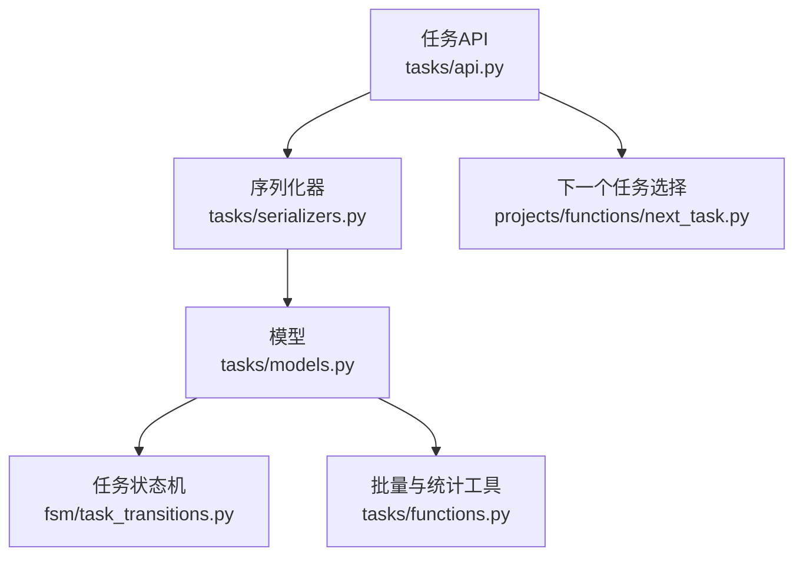
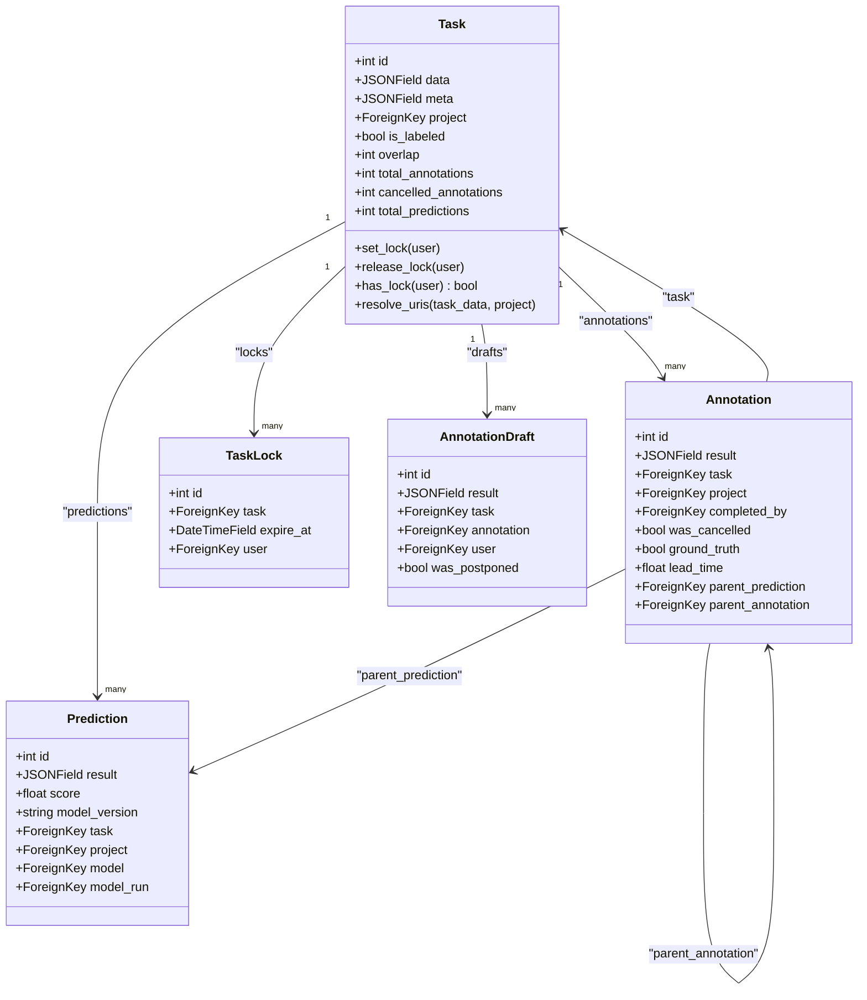
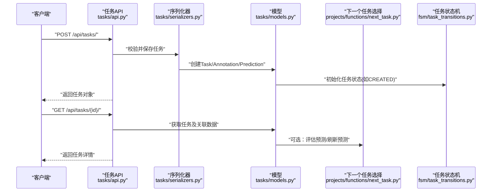
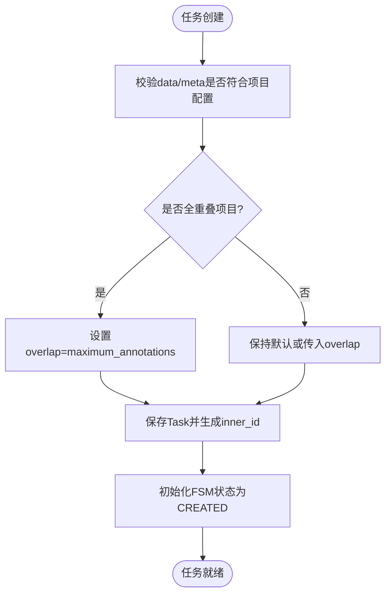
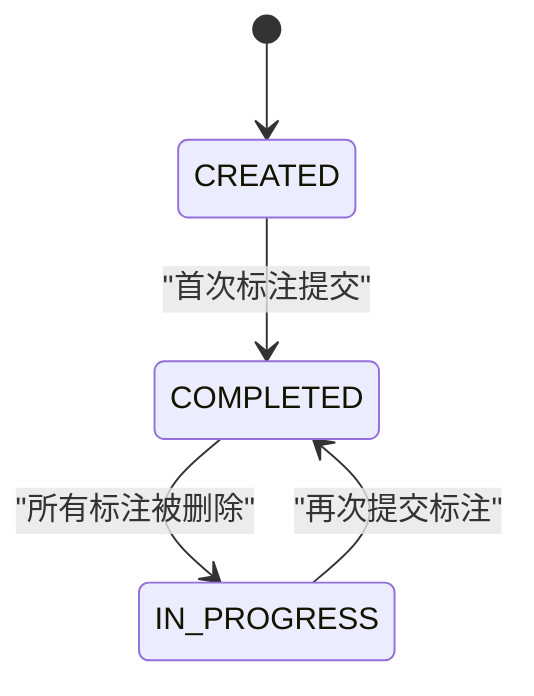
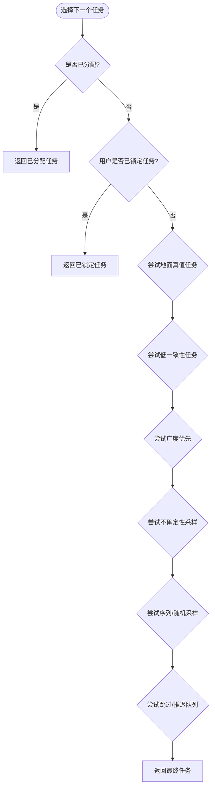
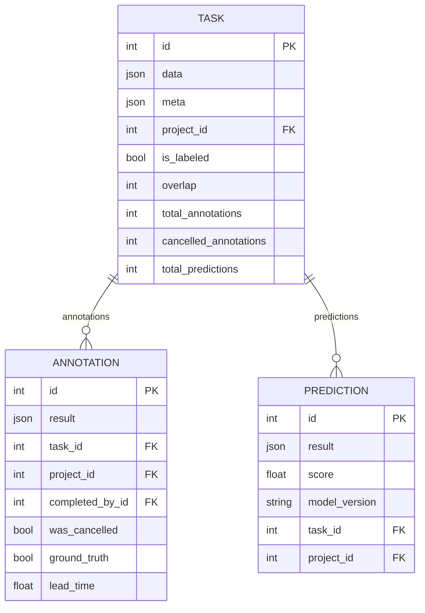
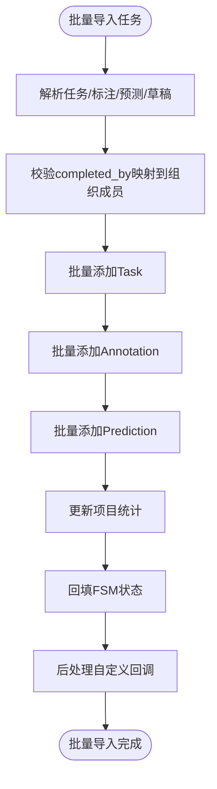
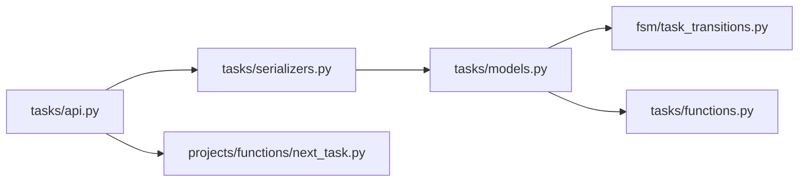

# 任务系统

<cite>
**本文引用的文件**   
- [label_studio/tasks/models.py](file://label_studio/tasks/models.py)
- [label_studio/tasks/api.py](file://label_studio/tasks/api.py)
- [label_studio/tasks/serializers.py](file://label_studio/tasks/serializers.py)
- [label_studio/tasks/functions.py](file://label_studio/tasks/functions.py)
- [label_studio/fsm/task_transitions.py](file://label_studio/fsm/task_transitions.py)
- [label_studio/projects/functions/next_task.py](file://label_studio/projects/functions/next_task.py)
</cite>

## 目录
1. [引言](#引言)
2. [项目结构](#项目结构)
3. [核心组件](#核心组件)
4. [架构总览](#架构总览)
5. [详细组件分析](#详细组件分析)
6. [依赖关系分析](#依赖关系分析)
7. [性能与优化](#性能与优化)
8. [故障排查指南](#故障排查指南)
9. [结论](#结论)

## 引言
本文面向 Label Studio 的任务系统，系统性说明任务的定义、数据结构、生命周期、状态转换、优先级与队列策略、批量处理机制，以及与项目和标注结果的关系。文档同时给出关键流程的可视化图示和代码级定位，帮助开发者快速理解并扩展任务相关能力。

## 项目结构
任务系统主要位于 `label_studio/tasks` 模块，并与 FSM（有限状态机）、项目管理、数据管理、存储解析等模块协作：
- 模型层：Task、Annotation、Prediction、TaskLock、AnnotationDraft 等实体定义在 `tasks/models.py`。
- API 层：任务列表、详情、统计摘要、标签分布等接口在 `tasks/api.py`。
- 序列化层：任务、标注、预测、批量导入等的校验与序列化逻辑在 `tasks/serializers.py`。
- 工具函数：批量创建标注、统计更新、导出等在 `tasks/functions.py`。
- 状态机：任务状态转换规则在 `fsm/task_transitions.py`。
- 任务选择与队列：下一个任务选择、跳过/推迟队列、重叠控制、不确定性采样等在 `projects/functions/next_task.py`。

**图表来源**
- [label_studio/tasks/api.py:197-235](file://label_studio/tasks/api.py#L197-L235)
- [label_studio/tasks/serializers.py:364-453](file://label_studio/tasks/serializers.py#L364-L453)
- [label_studio/tasks/models.py:66-205](file://label_studio/tasks/models.py#L66-L205)
- [label_studio/fsm/task_transitions.py:18-58](file://label_studio/fsm/task_transitions.py#L18-L58)
- [label_studio/projects/functions/next_task.py:453-555](file://label_studio/projects/functions/next_task.py#L453-L555)
- [label_studio/tasks/functions.py:27-107](file://label_studio/tasks/functions.py#L27-L107)

**章节来源**
- [label_studio/tasks/models.py:66-205](file://label_studio/tasks/models.py#L66-L205)
- [label_studio/tasks/api.py:197-235](file://label_studio/tasks/api.py#L197-L235)
- [label_studio/tasks/serializers.py:364-453](file://label_studio/tasks/serializers.py#L364-L453)
- [label_studio/tasks/functions.py:27-107](file://label_studio/tasks/functions.py#L27-L107)
- [label_studio/fsm/task_transitions.py:18-58](file://label_studio/fsm/task_transitions.py#L18-L58)
- [label_studio/projects/functions/next_task.py:453-555](file://label_studio/projects/functions/next_task.py#L453-L555)

## 核心组件
本节聚焦任务系统的核心实体与职责：
- Task：业务任务，包含 data、meta、project、overlap、is_labeled、total_annotations、cancelled_annotations、total_predictions 等字段，以及锁、权限、存储 URI 解析、计数器等能力。
- Annotation：标注结果，关联 Task 与 Project，记录 result、completed_by、was_cancelled、ground_truth、lead_time、prediction 等。
- Prediction：ML 后端或 Prompts 产生的预测，关联 Task 与 Project，支持 score、model_version、cluster、neighbors 等。
- TaskLock：任务并发锁，防止多人重复标注同一任务。
- AnnotationDraft：草稿，支持用户暂存未完成标注。
- FSM 状态：任务通过 FSM 维护 CREATED、IN_PROGRESS、COMPLETED 等状态，由注解变更触发。

**图表来源**
- [label_studio/tasks/models.py:66-205](file://label_studio/tasks/models.py#L66-L205)
- [label_studio/tasks/models.py:685-812](file://label_studio/tasks/models.py#L685-L812)
- [label_studio/tasks/models.py:1071-1250](file://label_studio/tasks/models.py#L1071-L1250)
- [label_studio/tasks/models.py:944-964](file://label_studio/tasks/models.py#L944-L964)
- [label_studio/tasks/models.py:988-1069](file://label_studio/tasks/models.py#L988-L1069)

**章节来源**
- [label_studio/tasks/models.py:66-205](file://label_studio/tasks/models.py#L66-L205)
- [label_studio/tasks/models.py:685-812](file://label_studio/tasks/models.py#L685-L812)
- [label_studio/tasks/models.py:1071-1250](file://label_studio/tasks/models.py#L1071-L1250)
- [label_studio/tasks/models.py:944-964](file://label_studio/tasks/models.py#L944-L964)
- [label_studio/tasks/models.py:988-1069](file://label_studio/tasks/models.py#L988-L1069)

## 架构总览
任务系统的关键交互包括：
- API 接收任务创建、查询、更新、删除请求，使用序列化器进行校验与转换。
- 模型层负责持久化、锁机制、存储 URI 解析、计数器更新、FSM 状态同步。
- 下一个任务选择逻辑根据项目配置和用户上下文决定任务优先级与队列。
- 批量工具函数提供高效创建标注、更新统计、导出等功能。

**图表来源**
- [label_studio/tasks/api.py:76-98](file://label_studio/tasks/api.py#L76-L98)
- [label_studio/tasks/api.py:438-450](file://label_studio/tasks/api.py#L438-L450)
- [label_studio/tasks/serializers.py:364-453](file://label_studio/tasks/serializers.py#L364-L453)
- [label_studio/tasks/models.py:66-205](file://label_studio/tasks/models.py#L66-L205)
- [label_studio/projects/functions/next_task.py:453-555](file://label_studio/projects/functions/next_task.py#L453-L555)
- [label_studio/fsm/task_transitions.py:18-58](file://label_studio/fsm/task_transitions.py#L18-L58)

## 详细组件分析

### 任务定义与数据结构
- Task 是项目的业务任务，data 字段按项目标签配置承载原始数据，meta 用于 ML 后端输入。
- overlap 表示允许的不同标注者数量；is_labeled 表示是否达到最大完成数。
- total_annotations、cancelled_annotations、total_predictions 为预计算计数器，提升查询性能。
- file_upload 指向导入源文件；inner_id 为项目内顺序 ID。
- 索引覆盖 project+is_labeled、project+inner_id、id+project、id+overlap、overlap 等常用查询路径。

**图表来源**
- [label_studio/tasks/serializers.py:427-435](file://label_studio/tasks/serializers.py#L427-L435)
- [label_studio/tasks/models.py:582-594](file://label_studio/tasks/models.py#L582-L594)
- [label_studio/fsm/task_transitions.py:18-58](file://label_studio/fsm/task_transitions.py#L18-L58)

**章节来源**
- [label_studio/tasks/models.py:66-205](file://label_studio/tasks/models.py#L66-L205)
- [label_studio/tasks/serializers.py:427-435](file://label_studio/tasks/serializers.py#L427-L435)
- [label_studio/fsm/task_transitions.py:18-58](file://label_studio/fsm/task_transitions.py#L18-L58)

### 任务生命周期与状态转换
- 任务初始状态为 CREATED，当首个标注提交时进入 COMPLETED；若所有标注被删除则回到 IN_PROGRESS。
- 状态转换由注解变更触发，而非直接修改 Task 字段。
- FSM 记录状态历史，便于审计与回溯。

**图表来源**
- [label_studio/fsm/task_transitions.py:18-58](file://label_studio/fsm/task_transitions.py#L18-L58)
- [label_studio/fsm/task_transitions.py:61-111](file://label_studio/fsm/task_transitions.py#L61-L111)

**章节来源**
- [label_studio/fsm/task_transitions.py:18-58](file://label_studio/fsm/task_transitions.py#L18-L58)
- [label_studio/fsm/task_transitions.py:61-111](file://label_studio/fsm/task_transitions.py#L61-L111)

### 任务优先级管理与队列策略
- 下一个任务选择逻辑综合考虑：
  - 已分配任务优先。
  - 用户已锁定任务优先。
  - 入门阶段的地面真值任务优先。
  - 低一致性任务优先（企业版）。
  - 广度优先：优先标注进行中任务。
  - 不确定性采样：基于模型版本与分数排序。
  - 序列/均匀随机采样。
  - 跳过队列与推迟队列。
- 重叠控制：严格模式下排除已达到重叠上限的任务。

**图表来源**
- [label_studio/projects/functions/next_task.py:309-357](file://label_studio/projects/functions/next_task.py#L309-L357)
- [label_studio/projects/functions/next_task.py:373-420](file://label_studio/projects/functions/next_task.py#L373-L420)
- [label_studio/projects/functions/next_task.py:423-450](file://label_studio/projects/functions/next_task.py#L423-L450)
- [label_studio/projects/functions/next_task.py:453-555](file://label_studio/projects/functions/next_task.py#L453-L555)

**章节来源**
- [label_studio/projects/functions/next_task.py:309-357](file://label_studio/projects/functions/next_task.py#L309-L357)
- [label_studio/projects/functions/next_task.py:373-420](file://label_studio/projects/functions/next_task.py#L373-L420)
- [label_studio/projects/functions/next_task.py:423-450](file://label_studio/projects/functions/next_task.py#L423-L450)
- [label_studio/projects/functions/next_task.py:453-555](file://label_studio/projects/functions/next_task.py#L453-L555)

### 任务与项目、标注结果的关系
- Task 属于 Project，Annotation 和 Prediction 也冗余关联 Project 以提升查询性能。
- Annotation.result 是标注结果 JSON，Prediction.result 是预测结果 JSON。
- Annotation.parent_prediction 和 parent_annotation 支持层级标注与预测衍生。
- 项目统计（ProjectSummary）通过信号与工具函数同步更新，避免 N+1 查询。

**图表来源**
- [label_studio/tasks/models.py:66-205](file://label_studio/tasks/models.py#L66-L205)
- [label_studio/tasks/models.py:685-812](file://label_studio/tasks/models.py#L685-L812)
- [label_studio/tasks/models.py:1071-1250](file://label_studio/tasks/models.py#L1071-L1250)

**章节来源**
- [label_studio/tasks/models.py:66-205](file://label_studio/tasks/models.py#L66-L205)
- [label_studio/tasks/models.py:685-812](file://label_studio/tasks/models.py#L685-L812)
- [label_studio/tasks/models.py:1071-1250](file://label_studio/tasks/models.py#L1071-L1250)

### 批量任务处理机制
- BaseTaskSerializerBulk 支持批量导入任务及其标注、预测、草稿、评审。
- bulk_create_annotations_with_side_effects 提供批量创建标注并触发副作用（项目统计、FSM、Webhook、任务时间戳、计数器、统计重算）。
- update_tasks_counters 和 bulk_update_is_labeled_by_overlap 批量更新任务计数器与完成状态。

**图表来源**
- [label_studio/tasks/serializers.py:525-776](file://label_studio/tasks/serializers.py#L525-L776)
- [label_studio/tasks/functions.py:27-107](file://label_studio/tasks/functions.py#L27-L107)
- [label_studio/tasks/functions.py:262-351](file://label_studio/tasks/functions.py#L262-L351)

**章节来源**
- [label_studio/tasks/serializers.py:525-776](file://label_studio/tasks/serializers.py#L525-L776)
- [label_studio/tasks/functions.py:27-107](file://label_studio/tasks/functions.py#L27-L107)
- [label_studio/tasks/functions.py:262-351](file://label_studio/tasks/functions.py#L262-L351)

## 依赖关系分析
- API 依赖序列化器进行数据校验与转换，序列化器依赖模型与项目配置。
- 模型依赖 FSM 进行状态管理，依赖项目统计与 Webhook。
- 下一个任务选择逻辑依赖项目配置、用户上下文与任务集合。
- 批量工具函数依赖 Django ORM 与 Redis 异步任务。

**图表来源**
- [label_studio/tasks/api.py:197-235](file://label_studio/tasks/api.py#L197-L235)
- [label_studio/tasks/serializers.py:364-453](file://label_studio/tasks/serializers.py#L364-L453)
- [label_studio/tasks/models.py:66-205](file://label_studio/tasks/models.py#L66-L205)
- [label_studio/fsm/task_transitions.py:18-58](file://label_studio/fsm/task_transitions.py#L18-L58)
- [label_studio/tasks/functions.py:27-107](file://label_studio/tasks/functions.py#L27-L107)
- [label_studio/projects/functions/next_task.py:453-555](file://label_studio/projects/functions/next_task.py#L453-L555)

**章节来源**
- [label_studio/tasks/api.py:197-235](file://label_studio/tasks/api.py#L197-L235)
- [label_studio/tasks/serializers.py:364-453](file://label_studio/tasks/serializers.py#L364-L453)
- [label_studio/tasks/models.py:66-205](file://label_studio/tasks/models.py#L66-L205)
- [label_studio/fsm/task_transitions.py:18-58](file://label_studio/fsm/task_transitions.py#L18-L58)
- [label_studio/tasks/functions.py:27-107](file://label_studio/tasks/functions.py#L27-L107)
- [label_studio/projects/functions/next_task.py:453-555](file://label_studio/projects/functions/next_task.py#L453-L555)

## 性能与优化
- 预取与投影：API 使用 prefetch_related 与 only/select_related 减少 N+1 查询。
- 计数器预计算：Task.total_annotations、cancelled_annotations、total_predictions 提升列表与统计查询性能。
- 批量操作：bulk_create_annotations_with_side_effects 与 batched_iterator 降低内存占用与数据库压力。
- 存储 URI 解析：resolve_uris 支持多存储后端与代理 URL，避免敏感信息泄露。
- 任务锁：TaskLock 与 has_lock/set_lock/release_lock 防止并发标注冲突。
- 统计同步：信号与工具函数确保项目统计与任务状态一致。

建议：
- 对大任务集使用分页与 stub 模式加载标注列表。
- 启用 resolve_uri=False 调试原始存储路径。
- 合理设置 overlap 与 maximum_annotations 以平衡并行度与一致性。
- 使用批量导入接口上传任务与标注，避免逐条插入。

[本节为通用性能指导，不直接分析具体文件]

## 故障排查指南
常见问题与定位：
- 任务无法分配：检查 overlap 与 is_labeled 状态，确认未达重叠上限。
- 标注重复：Annotation.unique_id 唯一约束冲突，检查去重逻辑。
- 统计不一致：检查 post_save/post_delete 信号与 bulk_update_is_labeled_by_overlap 调用。
- 存储链接无效：确认 resolve_uris 与存储对象配置。
- 下一个任务为空：检查队列策略、跳过/推迟队列、不确定性采样配置。

参考定位：
- 任务锁与重叠检查：[label_studio/tasks/models.py:316-387](file://label_studio/tasks/models.py#L316-L387)
- 标注去重与唯一 ID：[label_studio/tasks/serializers.py:202-229](file://label_studio/tasks/serializers.py#L202-L229)
- 统计更新信号：[label_studio/tasks/models.py:1455-1535](file://label_studio/tasks/models.py#L1455-L1535)
- 下一个任务选择日志：[label_studio/projects/functions/next_task.py:506-554](file://label_studio/projects/functions/next_task.py#L506-L554)

**章节来源**
- [label_studio/tasks/models.py:316-387](file://label_studio/tasks/models.py#L316-L387)
- [label_studio/tasks/serializers.py:202-229](file://label_studio/tasks/serializers.py#L202-L229)
- [label_studio/tasks/models.py:1455-1535](file://label_studio/tasks/models.py#L1455-L1535)
- [label_studio/projects/functions/next_task.py:506-554](file://label_studio/projects/functions/next_task.py#L506-L554)

## 结论
Label Studio 的任务系统以 Task 为核心，结合 Annotation、Prediction、TaskLock、AnnotationDraft 等实体，构建了完整的标注工作流。FSM 保证状态一致性，下一个任务选择逻辑支持多种队列与采样策略，批量工具函数提升吞吐与稳定性。通过预计算计数器、预取优化与存储 URI 解析，系统在大规模场景下仍保持良好性能。开发者可基于本文档的定位与图示，快速扩展任务优先级、队列策略与批量处理能力。

[本节为总结性内容，不直接分析具体文件]