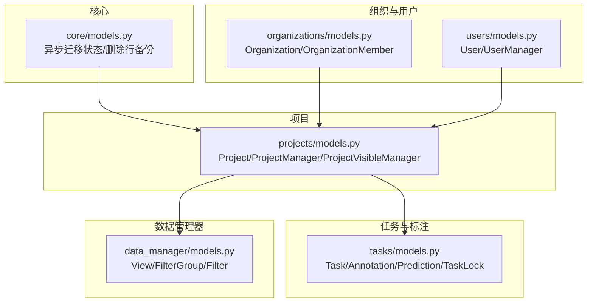
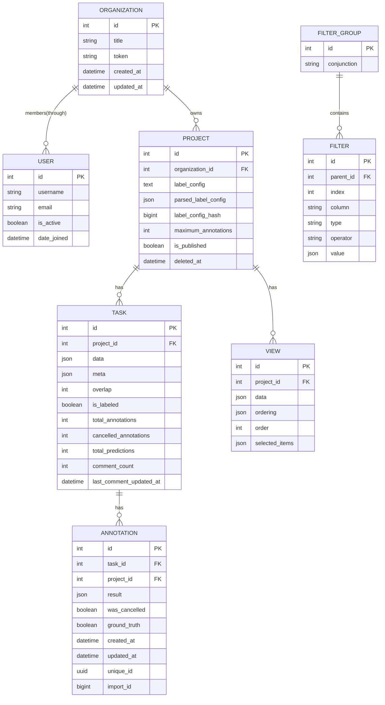
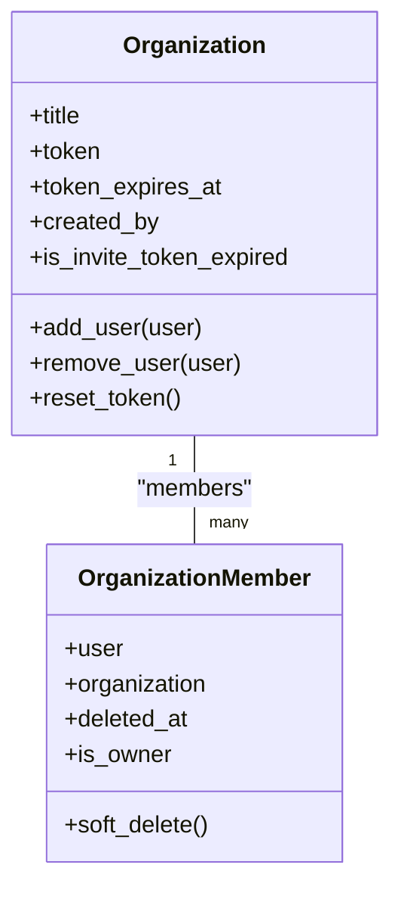
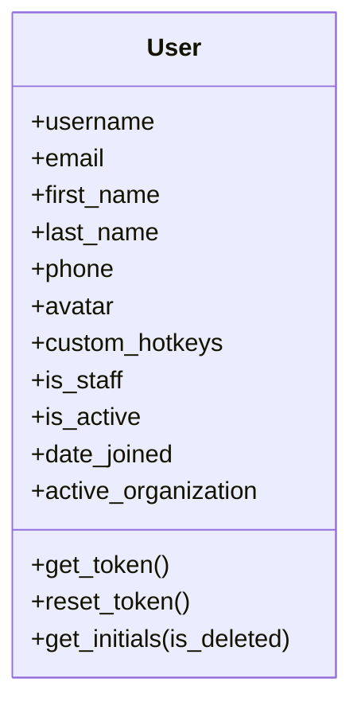
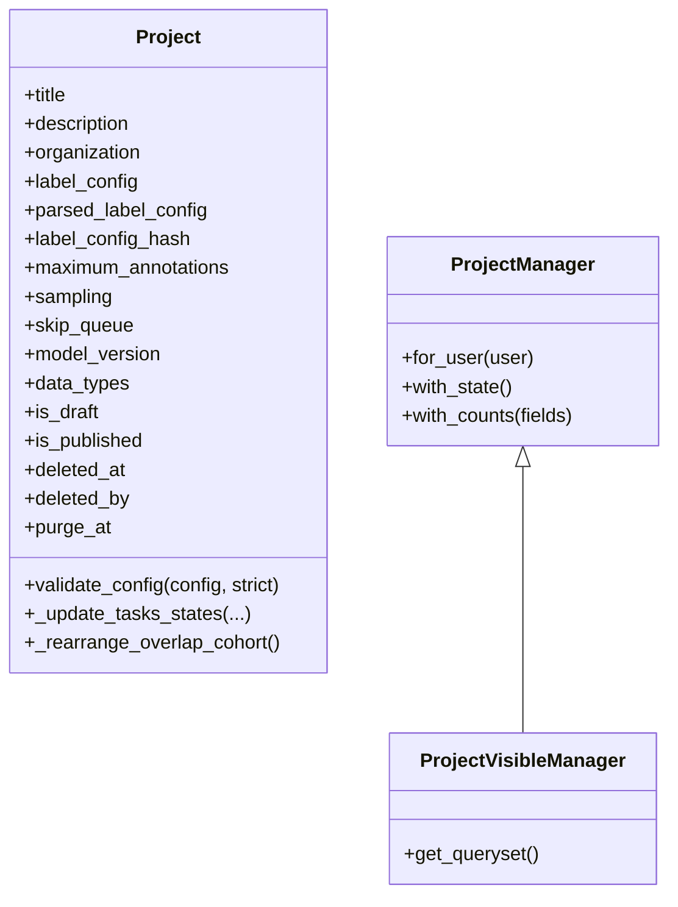
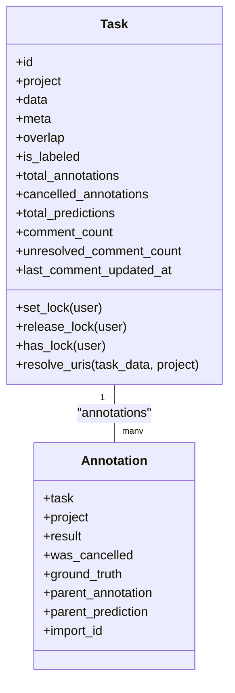
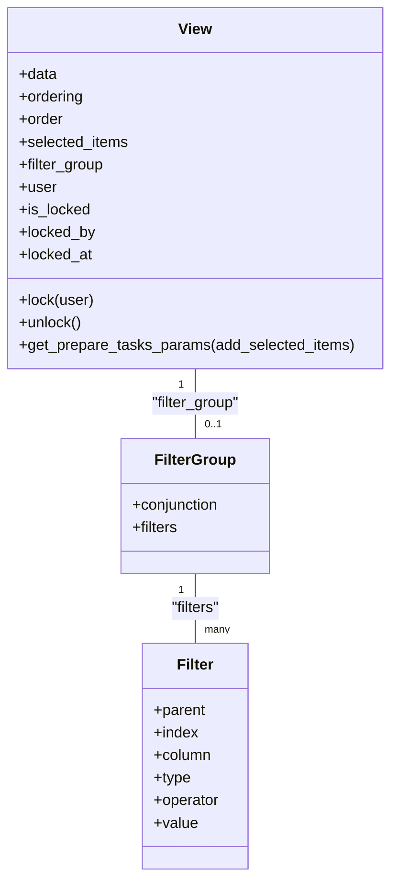
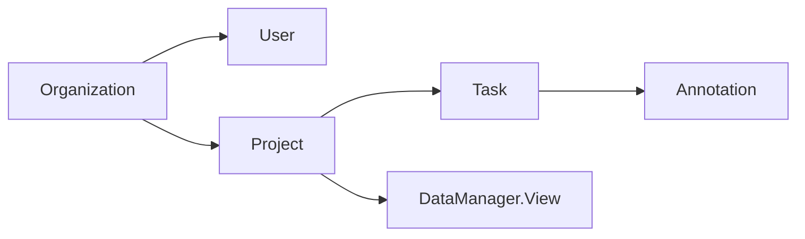
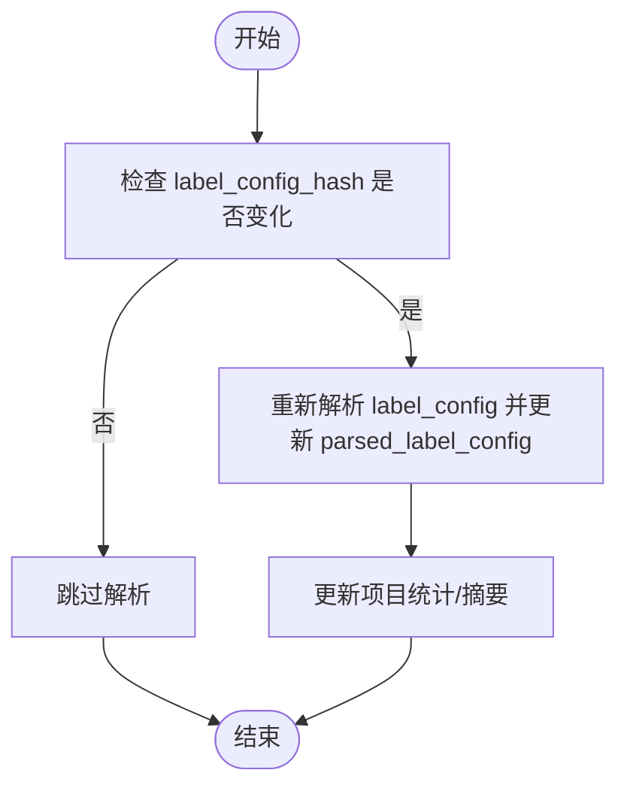

# 数据模型

<cite>
**本文引用的文件**   
- [label_studio/core/models.py](file://label_studio/core/models.py)
- [label_studio/projects/models.py](file://label_studio/projects/models.py)
- [label_studio/tasks/models.py](file://label_studio/tasks/models.py)
- [label_studio/users/models.py](file://label_studio/users/models.py)
- [label_studio/organizations/models.py](file://label_studio/organizations/models.py)
- [label_studio/data_manager/models.py](file://label_studio/data_manager/models.py)
</cite>

## 目录
1. [简介](#简介)
2. [项目结构](#项目结构)
3. [核心组件](#核心组件)
4. [架构总览](#架构总览)
5. [详细组件分析](#详细组件分析)
6. [依赖关系分析](#依赖关系分析)
7. [性能与索引优化](#性能与索引优化)
8. [迁移与版本管理](#迁移与版本管理)
9. [故障排查指南](#故障排查指南)
10. [结论](#结论)
11. [附录：ORM 使用模式与示例路径](#附录orm-使用模式与示例路径)

## 简介
本文件聚焦 Label Studio 后端的核心数据模型，系统性梳理主要实体类（组织、用户、项目、任务、标注、视图与过滤等）的设计、字段定义、关系映射、数据库表结构与索引设计，并结合源码给出查询优化建议、数据迁移策略与兼容性处理思路。文档同时提供 ORM 操作的数据访问模式说明，帮助读者在理解业务语义的同时高效进行开发与排障。

## 项目结构
Label Studio 的领域模型按功能域拆分为多个 Django app：
- core：通用基础模型（异步迁移状态、删除行备份等）
- organizations：组织与成员
- users：用户与权限
- projects：项目及其统计、配置、软删除等
- tasks：任务、标注、预测、锁等
- data_manager：数据管理器中的视图、过滤器与排序等

图表来源
- [label_studio/core/models.py:12-84](file://label_studio/core/models.py#L12-L84)
- [label_studio/organizations/models.py:34-262](file://label_studio/organizations/models.py#L34-L262)
- [label_studio/users/models.py:30-243](file://label_studio/users/models.py#L30-L243)
- [label_studio/projects/models.py:68-164](file://label_studio/projects/models.py#L68-L164)
- [label_studio/tasks/models.py:66-205](file://label_studio/tasks/models.py#L66-L205)
- [label_studio/data_manager/models.py:10-139](file://label_studio/data_manager/models.py#L10-L139)

章节来源
- [label_studio/core/models.py:12-84](file://label_studio/core/models.py#L12-L84)
- [label_studio/organizations/models.py:34-262](file://label_studio/organizations/models.py#L34-L262)
- [label_studio/users/models.py:30-243](file://label_studio/users/models.py#L30-L243)
- [label_studio/projects/models.py:68-164](file://label_studio/projects/models.py#L68-L164)
- [label_studio/tasks/models.py:66-205](file://label_studio/tasks/models.py#L66-L205)
- [label_studio/data_manager/models.py:10-139](file://label_studio/data_manager/models.py#L10-L139)

## 核心组件
- 组织与成员
  - Organization：组织基本信息、邀请令牌、创建者、SSL 校验开关等
  - OrganizationMember：用户与组织的关联，支持软删除与所有者判断
- 用户
  - User：继承 Django 认证基类，扩展头像、热键、活动信息等；默认表名为 htx_user
- 项目
  - Project：标签配置、采样策略、最大标注数、协作预测、软删除、FSM 状态等
  - ProjectManager/ProjectVisibleManager：提供计数注解、FSM 状态注解、可见性过滤
- 任务与标注
  - Task：任务数据、元信息、重叠标注人数、统计字段、锁机制、存储 URI 解析等
  - Annotation：标注结果 JSON、完成人、草稿时间、父标注/预测、导入 ID 等
  - Prediction：与项目/任务关联的模型预测（由 tasks.models 引入）
  - TaskLock：任务并发锁（由 tasks.models 引入）
- 数据管理器
  - View/FilterGroup/Filter：保存数据管理器的视图配置、过滤器分组与条件

章节来源
- [label_studio/organizations/models.py:34-262](file://label_studio/organizations/models.py#L34-L262)
- [label_studio/users/models.py:30-243](file://label_studio/users/models.py#L30-L243)
- [label_studio/projects/models.py:68-164](file://label_studio/projects/models.py#L68-L164)
- [label_studio/tasks/models.py:66-205](file://label_studio/tasks/models.py#L66-L205)
- [label_studio/data_manager/models.py:10-139](file://label_studio/data_manager/models.py#L10-L139)

## 架构总览
下图展示核心实体之间的关系与关键外键约束，体现“组织-用户-项目-任务-标注”的主链路以及数据管理器的视图/过滤器对项目的引用。

图表来源
- [label_studio/organizations/models.py:107-262](file://label_studio/organizations/models.py#L107-L262)
- [label_studio/users/models.py:103-164](file://label_studio/users/models.py#L103-L164)
- [label_studio/projects/models.py:164-363](file://label_studio/projects/models.py#L164-L363)
- [label_studio/tasks/models.py:66-205](file://label_studio/tasks/models.py#L66-L205)
- [label_studio/tasks/models.py:685-800](file://label_studio/tasks/models.py#L685-L800)
- [label_studio/data_manager/models.py:85-139](file://label_studio/data_manager/models.py#L85-L139)

## 详细组件分析

### 组织与成员（Organization / OrganizationMember）
- 设计要点
  - 通过 ManyToMany + 中间表 OrganizationMember 实现多对多关系
  - 支持成员软删除（deleted_at），并在软删除时清理任务锁与活跃组织
  - 邀请令牌带过期时间，支持重置
- 关键行为
  - add_user/remove_user：原子事务内维护成员关系与用户活跃组织
  - has_permission/is_invite_token_expired：权限与邀请链接有效性校验

图表来源
- [label_studio/organizations/models.py:34-95](file://label_studio/organizations/models.py#L34-L95)
- [label_studio/organizations/models.py:107-262](file://label_studio/organizations/models.py#L107-L262)

章节来源
- [label_studio/organizations/models.py:34-95](file://label_studio/organizations/models.py#L34-L95)
- [label_studio/organizations/models.py:107-262](file://label_studio/organizations/models.py#L107-L262)

### 用户（User）
- 设计要点
  - 继承 AbstractBaseUser + PermissionsMixin，自定义 UserManager
  - 表名固定为 htx_user，包含常用索引（用户名、邮箱、姓名、注册时间）
  - 集成最近活动时间缓存（Redis 优先，回退到数据库）
- 关键行为
  - get_token/reset_token：生成/重置 Token
  - get_initials：根据姓名或邮箱计算首字母

图表来源
- [label_studio/users/models.py:30-243](file://label_studio/users/models.py#L30-L243)

章节来源
- [label_studio/users/models.py:30-243](file://label_studio/users/models.py#L30-L243)

### 项目（Project）
- 设计要点
  - 标签配置以文本与解析后的 JSON 双存，并维护哈希用于变更检测
  - 支持多种采样策略、跳过队列策略、协作预测显示、重叠批次百分比等
  - 软删除生命周期（OSS/LSE 逻辑）：deleted_at/deleted_by/purge_at
  - 与 FSM 集成，支持项目状态机
- Manager 能力
  - ProjectVisibleManager：默认隐藏已软删除的项目
  - ProjectManager：提供 with_state()/with_counts() 等注解方法，批量统计任务/标注/预测数量

图表来源
- [label_studio/projects/models.py:68-164](file://label_studio/projects/models.py#L68-L164)
- [label_studio/projects/models.py:164-363](file://label_studio/projects/models.py#L164-L363)

章节来源
- [label_studio/projects/models.py:68-164](file://label_studio/projects/models.py#L68-L164)
- [label_studio/projects/models.py:164-363](file://label_studio/projects/models.py#L164-L363)

### 任务（Task）
- 设计要点
  - 任务数据与元信息分别以 JSON 存储，便于灵活扩展
  - 重叠标注人数 overlap 控制并发标注上限，结合 TaskLock 实现并发控制
  - 统计字段（total_annotations/cancelled_annotations/total_predictions/comment_count 等）提升查询性能
  - 提供存储 URI 解析与代理签名 URL 生成，保障受保护数据的安全访问
- 索引设计
  - 复合索引 (project, is_labeled)、(project, inner_id)、(id, project)、(id, overlap)、(overlap) 等

图表来源
- [label_studio/tasks/models.py:66-205](file://label_studio/tasks/models.py#L66-L205)
- [label_studio/tasks/models.py:685-800](file://label_studio/tasks/models.py#L685-L800)

章节来源
- [label_studio/tasks/models.py:66-205](file://label_studio/tasks/models.py#L66-L205)
- [label_studio/tasks/models.py:685-800](file://label_studio/tasks/models.py#L685-L800)

### 标注（Annotation）
- 设计要点
  - 结果以 JSON 存储，支持草稿时间、父标注/预测、导入 ID 等
  - 与 Task/Project 均建立外键，便于跨实体快速检索
  - 支持批量创建信号钩子（pre_bulk_create/post_bulk_create）

章节来源
- [label_studio/tasks/models.py:685-800](file://label_studio/tasks/models.py#L685-L800)

### 数据管理器（View / FilterGroup / Filter）
- 设计要点
  - View 保存数据管理器的视图配置（数据、排序、选中项）、锁定状态与锁定人
  - FilterGroup 与 Filter 支持一层嵌套（parent 指向自身），用于构建复杂过滤条件
  - View 提供 get_prepare_tasks_params 将配置转换为 PrepareParams 结构供查询层使用

图表来源
- [label_studio/data_manager/models.py:10-139](file://label_studio/data_manager/models.py#L10-L139)

章节来源
- [label_studio/data_manager/models.py:10-139](file://label_studio/data_manager/models.py#L10-L139)

### 通用基础模型（AsyncMigrationStatus / DeletedRow）
- AsyncMigrationStatus：记录异步迁移的状态与元信息，关联项目
- DeletedRow：记录被删除行的序列化数据，支持批量恢复

章节来源
- [label_studio/core/models.py:12-84](file://label_studio/core/models.py#L12-L84)

## 依赖关系分析
- 组织-用户-项目-任务-标注为主链路，数据管理器视图/过滤器依附于项目
- 项目与任务/标注存在强耦合：任务归属项目，标注归属任务与项目（冗余 project 外键用于性能）
- 任务与标注广泛使用 JSONField 存储结构化数据，降低 schema 变更成本但需配合应用层校验

图表来源
- [label_studio/organizations/models.py:107-262](file://label_studio/organizations/models.py#L107-L262)
- [label_studio/users/models.py:103-164](file://label_studio/users/models.py#L103-L164)
- [label_studio/projects/models.py:164-363](file://label_studio/projects/models.py#L164-L363)
- [label_studio/tasks/models.py:66-205](file://label_studio/tasks/models.py#L66-L205)
- [label_studio/data_manager/models.py:85-139](file://label_studio/data_manager/models.py#L85-L139)

章节来源
- [label_studio/organizations/models.py:107-262](file://label_studio/organizations/models.py#L107-L262)
- [label_studio/users/models.py:103-164](file://label_studio/users/models.py#L103-L164)
- [label_studio/projects/models.py:164-363](file://label_studio/projects/models.py#L164-L363)
- [label_studio/tasks/models.py:66-205](file://label_studio/tasks/models.py#L66-L205)
- [label_studio/data_manager/models.py:85-139](file://label_studio/data_manager/models.py#L85-L139)

## 性能与索引优化
- 任务表索引
  - 复合索引 (project, is_labeled)：加速按项目筛选已完成任务
  - 复合索引 (project, inner_id)：加速项目内顺序遍历
  - 索引 (id, project)、(id, overlap)、(overlap)：加速按任务 ID 与重叠人数的查询
- 项目统计注解
  - ProjectManager.with_counts 提供批量注解函数，避免 N+1 查询
- 任务并发控制
  - 基于 overlap 与 TaskLock 的并发限制，减少重复标注冲突
- JSON 字段
  - 大量使用 JSONField 存储动态数据，减少频繁 DDL；建议在应用层做严格校验与类型检查

章节来源
- [label_studio/tasks/models.py:196-205](file://label_studio/tasks/models.py#L196-L205)
- [label_studio/projects/models.py:76-143](file://label_studio/projects/models.py#L76-L143)
- [label_studio/tasks/models.py:403-443](file://label_studio/tasks/models.py#L403-L443)

## 迁移与版本管理
- 异步迁移状态
  - AsyncMigrationStatus 记录迁移名称、状态与元信息，支持按项目维度追踪
- 项目配置版本化
  - label_config_hash 用于检测标签配置变更，触发重新解析或统计更新
- 软删除与清理
  - Project.deleted_at/deleted_by/purge_at 支持软删除与定时清理流程
- 兼容性处理
  - Project.__init__ 中延迟字段检查与 data_types 自动提取，兼容历史数据
  - ProjectVisibleManager.get_queryset 中使用 has_column_cached 避免早期迁移阶段列不存在导致的错误

图表来源
- [label_studio/core/models.py:12-48](file://label_studio/core/models.py#L12-L48)
- [label_studio/projects/models.py:197-211](file://label_studio/projects/models.py#L197-L211)
- [label_studio/projects/models.py:365-387](file://label_studio/projects/models.py#L365-L387)
- [label_studio/projects/models.py:146-154](file://label_studio/projects/models.py#L146-L154)

章节来源
- [label_studio/core/models.py:12-48](file://label_studio/core/models.py#L12-L48)
- [label_studio/projects/models.py:197-211](file://label_studio/projects/models.py#L197-L211)
- [label_studio/projects/models.py:365-387](file://label_studio/projects/models.py#L365-L387)
- [label_studio/projects/models.py:146-154](file://label_studio/projects/models.py#L146-L154)

## 故障排查指南
- 任务并发与锁定
  - 若出现 is_labeled 不一致，Task.has_lock 会尝试修复并持久化
  - 检查 TaskLock 过期时间与 overlap 阈值，确认是否存在并发超限
- 项目配置校验失败
  - Project.validate_config 会对比已有标注/标签与当前标签配置，不匹配时抛出异常
  - 关注 VideoRectangle/VideoVector 的特殊标签合并逻辑
- 软删除与级联删除
  - 删除任务时会设置 CurrentContext 标志以避免 FSM 处理器写入瞬态 AnnotationState
  - 批量删除使用 batch_delete 分批执行，降低内存占用

章节来源
- [label_studio/tasks/models.py:316-357](file://label_studio/tasks/models.py#L316-L357)
- [label_studio/tasks/models.py:596-637](file://label_studio/tasks/models.py#L596-L637)
- [label_studio/projects/models.py:644-800](file://label_studio/projects/models.py#L644-L800)

## 结论
Label Studio 的数据模型围绕“组织-用户-项目-任务-标注”展开，采用 Django ORM 建模，广泛使用 JSONField 与索引优化支撑高并发标注场景。通过 ProjectManager 的统计注解、Task 的并发锁与 overlap 控制、以及 AsyncMigrationStatus 的迁移状态追踪，系统在可扩展性与可维护性之间取得平衡。建议在新增字段时优先考虑 JSONField 与校验逻辑，谨慎使用 DDL 变更，并通过索引与注解优化查询性能。

## 附录：ORM 使用模式与示例路径
- 获取项目列表（含 FSM 状态与统计）
  - 参考路径：[label_studio/projects/models.py:115-143](file://label_studio/projects/models.py#L115-L143)
- 按项目查询任务（利用索引）
  - 参考路径：[label_studio/tasks/models.py:196-205](file://label_studio/tasks/models.py#L196-L205)
- 任务加锁/解锁
  - 参考路径：[label_studio/tasks/models.py:403-443](file://label_studio/tasks/models.py#L403-L443)
- 项目配置校验与一致性检查
  - 参考路径：[label_studio/projects/models.py:644-800](file://label_studio/projects/models.py#L644-L800)
- 数据管理器视图参数转换
  - 参考路径：[label_studio/data_manager/models.py:85-106](file://label_studio/data_manager/models.py#L85-L106)