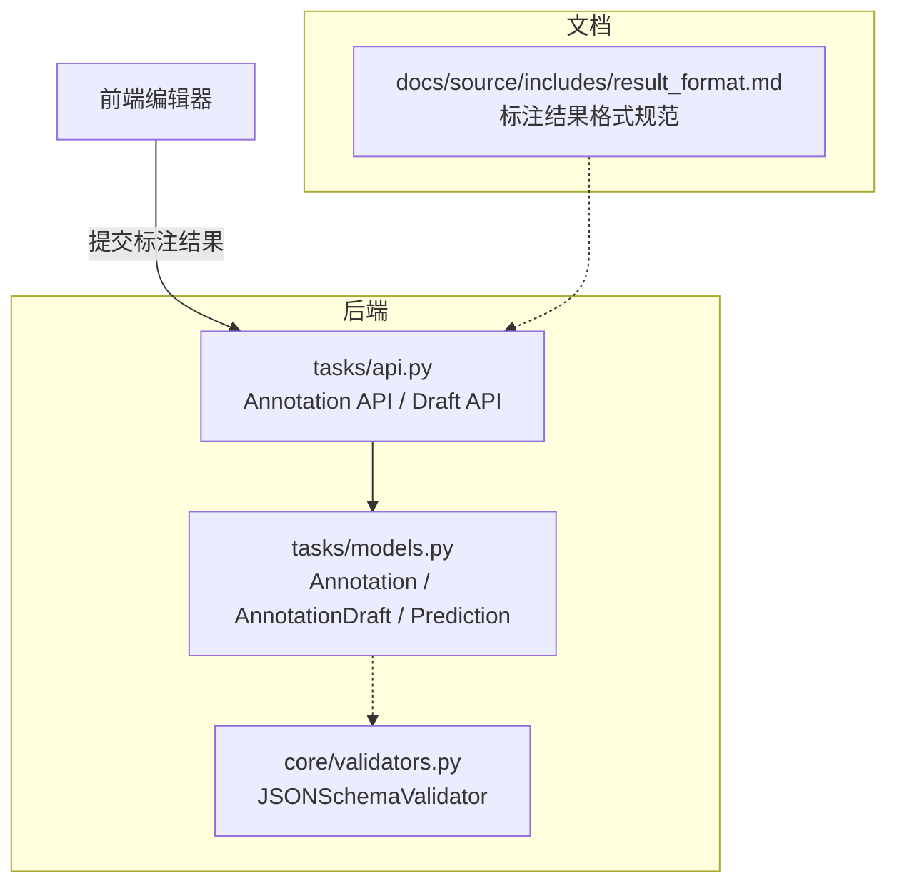
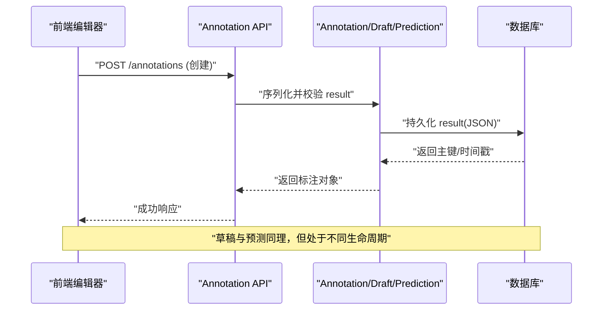
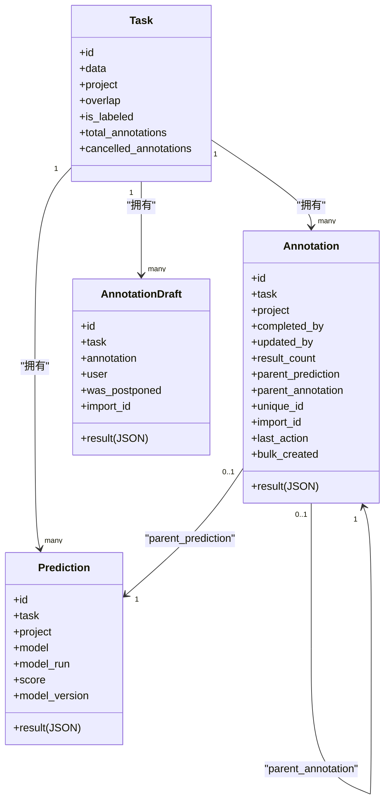
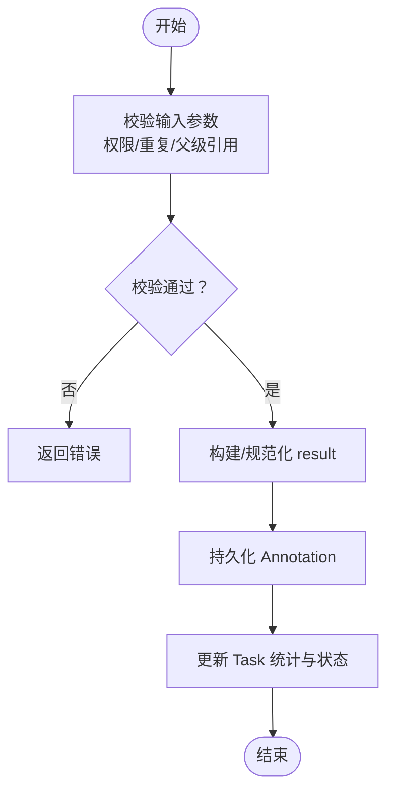
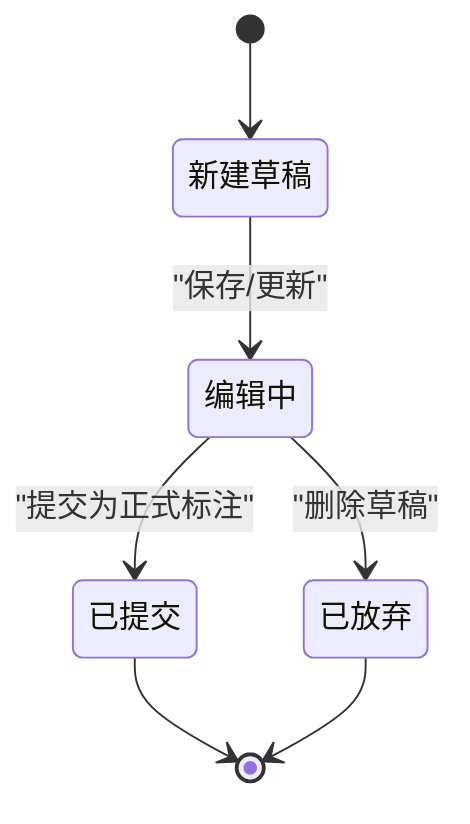
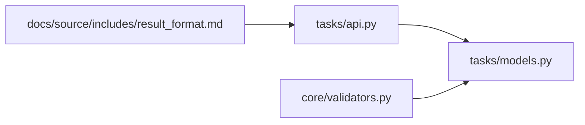

# 标注机制

<cite>
**本文引用的文件**   
- [label_studio/tasks/models.py](file://label_studio/tasks/models.py)
- [label_studio/tasks/api.py](file://label_studio/tasks/api.py)
- [label_studio/core/validators.py](file://label_studio/core/validators.py)
- [docs/source/includes/result_format.md](file://docs/source/includes/result_format.md)
</cite>

## 目录
1. [简介](#简介)
2. [项目结构](#项目结构)
3. [核心组件](#核心组件)
4. [架构总览](#架构总览)
5. [详细组件分析](#详细组件分析)
6. [依赖关系分析](#依赖关系分析)
7. [性能考量](#性能考量)
8. [故障排查指南](#故障排查指南)
9. [结论](#结论)
10. [附录](#附录)

## 简介
本文件系统性阐述 Label Studio 的标注机制，覆盖以下关键主题：
- 标注的概念、结构与验证规则
- 标注结果（annotation.result）的格式规范、数据类型与约束
- 创建、更新与验证标注结果的流程与最佳实践
- 标注版本控制、草稿机制与协作标注
- 标注质量保证与审核流程建议

## 项目结构
围绕“标注”的核心代码主要分布在后端任务模型、API 接口、通用校验器以及文档化的结果格式说明中。前端编辑器负责生成符合规范的标注结果，后端负责持久化、校验与状态管理。

图示来源
- [label_studio/tasks/models.py:685-1070](file://label_studio/tasks/models.py#L685-L1070)
- [label_studio/tasks/api.py:993-1266](file://label_studio/tasks/api.py#L993-L1266)
- [label_studio/core/validators.py:6-12](file://label_studio/core/validators.py#L6-L12)
- [docs/source/includes/result_format.md:1-188](file://docs/source/includes/result_format.md#L1-L188)

章节来源
- [label_studio/tasks/models.py:685-1070](file://label_studio/tasks/models.py#L685-L1070)
- [label_studio/tasks/api.py:993-1266](file://label_studio/tasks/api.py#L993-L1266)
- [label_studio/core/validators.py:6-12](file://label_studio/core/validators.py#L6-L12)
- [docs/source/includes/result_format.md:1-188](file://docs/source/includes/result_format.md#L1-L188)

## 核心组件
- Annotation：标注实体，承载最终标注结果 result（JSON），并与 Task、Project、用户等关联，支持 FSM 状态历史。
- AnnotationDraft：标注草稿，保存未提交的中间结果，支持延迟提交与撤销。
- Prediction：模型预测结果，可被转换为标注区域，便于人机对比与回写。
- JSONSchemaValidator：基于 JSON Schema 的通用校验器，用于对结构化数据进行强类型校验。

章节来源
- [label_studio/tasks/models.py:685-1070](file://label_studio/tasks/models.py#L685-L1070)
- [label_studio/core/validators.py:6-12](file://label_studio/core/validators.py#L6-L12)

## 架构总览
标注数据流从前端到后端的典型路径如下：

图示来源
- [label_studio/tasks/api.py:993-1266](file://label_studio/tasks/api.py#L993-L1266)
- [label_studio/tasks/models.py:685-1070](file://label_studio/tasks/models.py#L685-L1070)

## 详细组件分析

### 标注结果格式与语义
- 存储位置：annotation.result 为 JSON 数组，每个元素为一个“区域（region）”。
- 区域标识：每个 region 包含 id 字段，同一区域的多个控件结果共享相同 id，用于建立跨控件关联（如 relation）。
- 推断原则：
  - 至少存在一个 object 标签；
  - object 标签定义数据类型（image、html、video 等）；
  - 至少一个 control 标签绑定到 object 以产生区域；
  - 每个 control 标签对应一个结果；
  - 分类类操作会生成特殊的空分类区域；
  - 使用预测生成标注时，result ID 保持不变，便于追踪与对比。
- value 结构：由具体控制标签决定，详见各控制标签文档。

章节来源
- [docs/source/includes/result_format.md:1-188](file://docs/source/includes/result_format.md#L1-L188)

### 数据模型与关系

图示来源
- [label_studio/tasks/models.py:685-1070](file://label_studio/tasks/models.py#L685-L1070)
- [label_studio/tasks/models.py:1071-1242](file://label_studio/tasks/models.py#L1071-L1242)

章节来源
- [label_studio/tasks/models.py:685-1070](file://label_studio/tasks/models.py#L685-L1070)
- [label_studio/tasks/models.py:1071-1242](file://label_studio/tasks/models.py#L1071-L1242)

### 标注创建与更新流程
- 创建标注：
  - 前端提交 annotation.result；
  - API 层进行参数校验与权限检查；
  - 模型层计算 result_count，写入数据库；
  - 触发信号更新 Task 统计与项目摘要。
- 更新标注：
  - 仅更新必要字段；
  - 重新计算 result_count；
  - 同步 Task 的 updated_by 与 is_labeled 状态。

图示来源
- [label_studio/tasks/api.py:993-1266](file://label_studio/tasks/api.py#L993-L1266)
- [label_studio/tasks/models.py:856-871](file://label_studio/tasks/models.py#L856-L871)

章节来源
- [label_studio/tasks/api.py:993-1266](file://label_studio/tasks/api.py#L993-L1266)
- [label_studio/tasks/models.py:856-871](file://label_studio/tasks/models.py#L856-L871)

### 标注结果校验与约束
- 基础约束：
  - result 必须为 JSON 数组；
  - 每个 region 需具备唯一且合法的 id；
  - 同区域多控件结果共享 id；
  - 禁止重复 id 导致的数据不一致。
- 类型校验：
  - 可使用 JSONSchemaValidator 对 result 子结构进行强类型校验；
  - 针对特定控制标签（如 choices、textarea、rectangle 等）定义 schema，确保 value 字段合法。
- 去重与一致性：
  - 在保存前对 result 中的 id 集合去重；
  - 若检测到重复 id，应拒绝或合并，避免破坏区域关联。

章节来源
- [label_studio/core/validators.py:6-12](file://label_studio/core/validators.py#L6-L12)
- [docs/source/includes/result_format.md:1-188](file://docs/source/includes/result_format.md#L1-L188)

### 标注版本控制与回溯
- 版本溯源：
  - parent_prediction 指向生成该标注的预测；
  - parent_annotation 支持基于已有标注的迭代修改；
  - import_id 保留导入时的原始 ID，便于迁移与审计。
- 变更历史：
  - 继承 FSM 历史模型，记录状态变迁；
  - last_action 与 last_created_by 记录最近一次动作与操作者。

章节来源
- [label_studio/tasks/models.py:685-797](file://label_studio/tasks/models.py#L685-L797)

### 草稿机制
- 草稿模型：
  - AnnotationDraft.result 保存未完成标注；
  - 支持 was_postponed 标记“跳过继续”的场景；
  - 与 task/annotation/user 关联，便于归属与权限控制。
- 生命周期：
  - 保存标注后自动清理已提交的草稿；
  - 删除草稿时同步更新项目摘要计数。

图示来源
- [label_studio/tasks/models.py:988-1070](file://label_studio/tasks/models.py#L988-L1070)

章节来源
- [label_studio/tasks/models.py:988-1070](file://label_studio/tasks/models.py#L988-L1070)

### 协作标注与并发控制
- 重叠标注（overlap）：
  - Task.overlap 控制同一任务允许的最大标注数量；
  - Task.has_lock 与 TaskLock 实现任务级锁，防止多人同时编辑冲突。
- 取消与跳过队列：
  - was_cancelled 标记用户跳过任务；
  - 根据项目 skip_queue 策略决定是否计入完成数。
- 统计一致性：
  - total_annotations/cancelled_annotations 实时更新；
  - is_labeled 依据 overlap 阈值与已完成标注数动态计算。

章节来源
- [label_studio/tasks/models.py:109-164](file://label_studio/tasks/models.py#L109-L164)
- [label_studio/tasks/models.py:316-443](file://label_studio/tasks/models.py#L316-L443)
- [label_studio/tasks/models.py:1455-1535](file://label_studio/tasks/models.py#L1455-L1535)

### 预测与预标注
- 预测结果标准化：
  - Prediction.prepare_prediction_result 将多种输入形式统一为标准 result 数组；
  - 支持 list/dict/标量等多种输入，按 label_config 映射为 region。
- 从预测到标注：
  - 可将 Prediction.result 直接作为 Annotation.result 的基础，保持 id 一致以便对比。

章节来源
- [label_studio/tasks/models.py:1125-1170](file://label_studio/tasks/models.py#L1125-L1170)
- [label_studio/tasks/models.py:1205-1242](file://label_studio/tasks/models.py#L1205-L1242)

## 依赖关系分析
- 模块耦合：
  - tasks/api.py 依赖 tasks/models.py 的 Annotation/Draft/Prediction；
  - core/validators.py 提供通用 JSON Schema 校验能力；
  - docs/source/includes/result_format.md 作为规范参考，指导前后端对齐。
- 外部依赖：
  - Django ORM 与 FSM 框架用于状态管理与历史追踪；
  - JSONField 用于存储复杂标注结果。

图示来源
- [label_studio/tasks/api.py:993-1266](file://label_studio/tasks/api.py#L993-L1266)
- [label_studio/tasks/models.py:685-1070](file://label_studio/tasks/models.py#L685-L1070)
- [label_studio/core/validators.py:6-12](file://label_studio/core/validators.py#L6-L12)
- [docs/source/includes/result_format.md:1-188](file://docs/source/includes/result_format.md#L1-L188)

章节来源
- [label_studio/tasks/api.py:993-1266](file://label_studio/tasks/api.py#L993-L1266)
- [label_studio/tasks/models.py:685-1070](file://label_studio/tasks/models.py#L685-L1070)
- [label_studio/core/validators.py:6-12](file://label_studio/core/validators.py#L6-L12)
- [docs/source/includes/result_format.md:1-188](file://docs/source/includes/result_format.md#L1-L188)

## 性能考量
- 批量操作：
  - 使用 bulk_create/bulk_update 减少数据库往返；
  - 批量删除时禁用信号以避免重复计数与死锁。
- 索引优化：
  - Annotation 与 Task 上针对常用查询字段建立索引（created_at、ground_truth、task/id 等）。
- 计数器维护：
  - 通过信号与显式更新保证 total_annotations/cancelled_annotations/is_labeled 的一致性；
  - 避免频繁全表扫描，优先使用聚合查询与增量更新。

章节来源
- [label_studio/tasks/models.py:800-812](file://label_studio/tasks/models.py#L800-L812)
- [label_studio/tasks/models.py:1455-1535](file://label_studio/tasks/models.py#L1455-L1535)

## 故障排查指南
- 常见错误与定位：
  - result 非 JSON 数组或包含非法字符：检查前端序列化与后端 sanitize_null_bytes；
  - 重复 region id：在保存前对 result.id 去重并抛出明确错误；
  - 父级引用无效：校验 parent_prediction/parent_annotation 是否存在且属于同一任务；
  - 权限不足：确认 completed_by 与当前用户权限匹配。
- 调试建议：
  - 打印 result 的结构与长度，核对是否符合 result_format 规范；
  - 使用 JSONSchemaValidator 对 value 子结构进行强类型校验；
  - 查看 Task 的 is_labeled 与 total_annotations 是否同步更新。

章节来源
- [label_studio/tasks/models.py:856-871](file://label_studio/tasks/models.py#L856-L871)
- [label_studio/tasks/models.py:1044-1049](file://label_studio/tasks/models.py#L1044-L1049)
- [label_studio/core/validators.py:6-12](file://label_studio/core/validators.py#L6-L12)

## 结论
Label Studio 的标注机制以 Annotation 为核心，结合 AnnotationDraft 与 Prediction 形成完整的标注生命周期。通过严格的 result 格式规范、JSON Schema 校验与 FSM 状态管理，系统在保证数据一致性的同时，支持协作标注、版本回溯与质量审核。建议在工程实践中：
- 在前端严格遵循 result_format 规范生成标注；
- 在后端引入 JSON Schema 校验与 id 去重逻辑；
- 利用 parent_prediction/parent_annotation 实现可追溯的版本链；
- 通过 overlap 与 TaskLock 保障并发安全；
- 借助项目摘要与统计字段持续监控标注质量与进度。

## 附录
- 快速参考：
  - 标注结果结构：见 [docs/source/includes/result_format.md:1-188](file://docs/source/includes/result_format.md#L1-L188)
  - 模型字段与关系：见 [label_studio/tasks/models.py:685-1070](file://label_studio/tasks/models.py#L685-L1070)
  - API 入口：见 [label_studio/tasks/api.py:993-1266](file://label_studio/tasks/api.py#L993-L1266)
  - 通用校验器：见 [label_studio/core/validators.py:6-12](file://label_studio/core/validators.py#L6-L12)