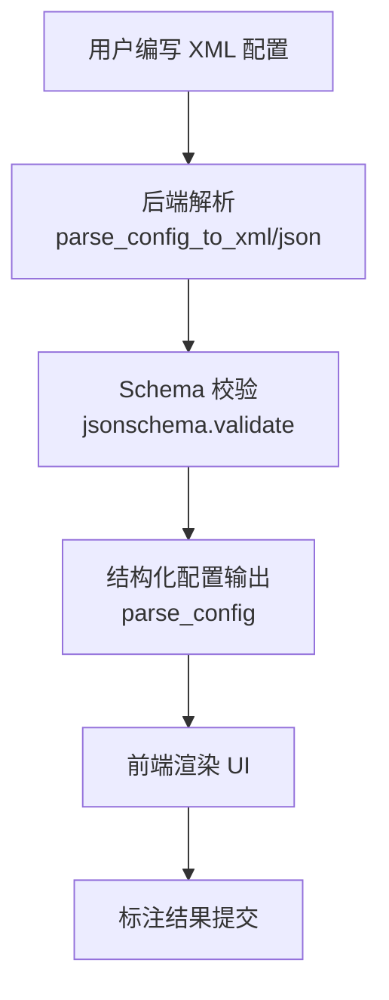
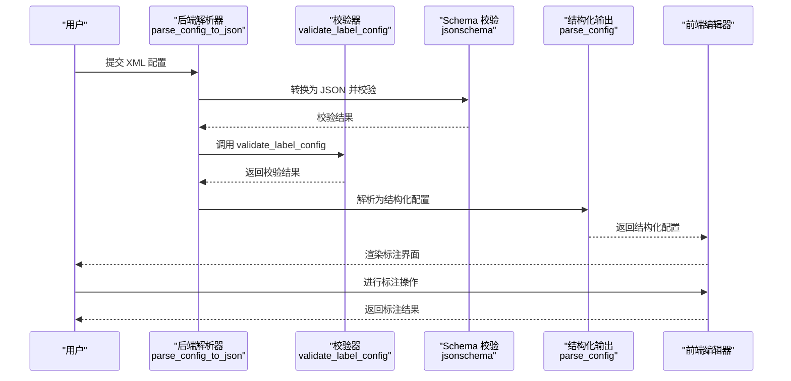
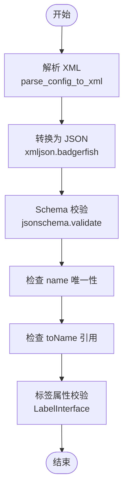
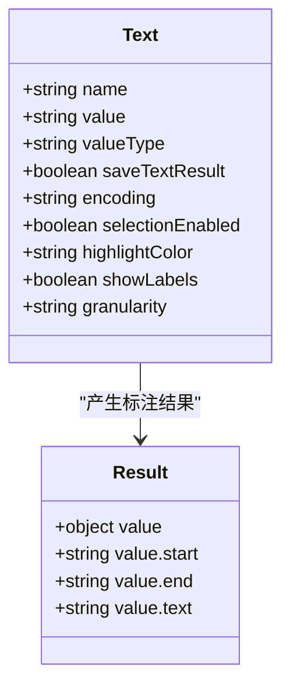
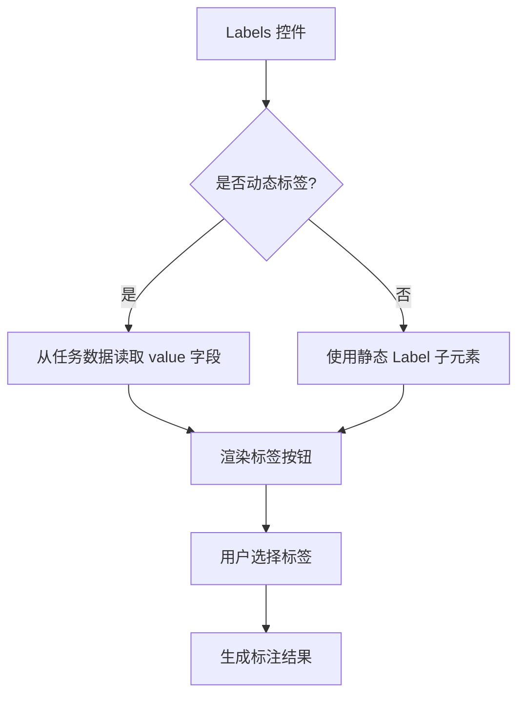
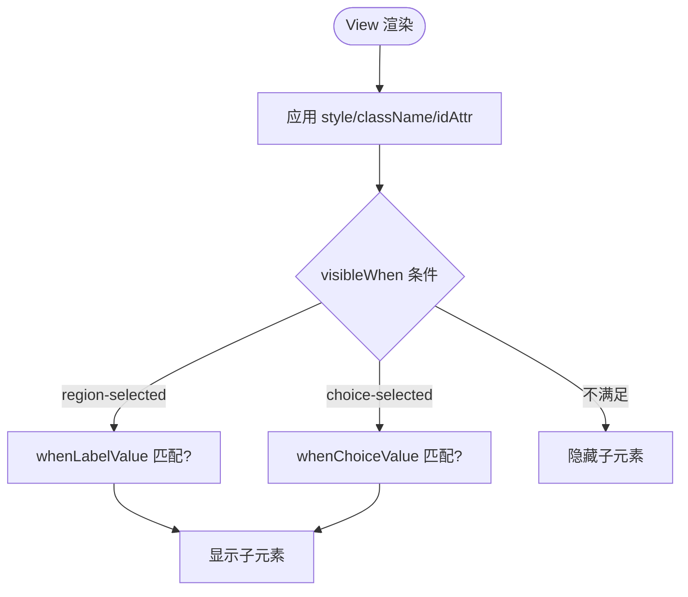
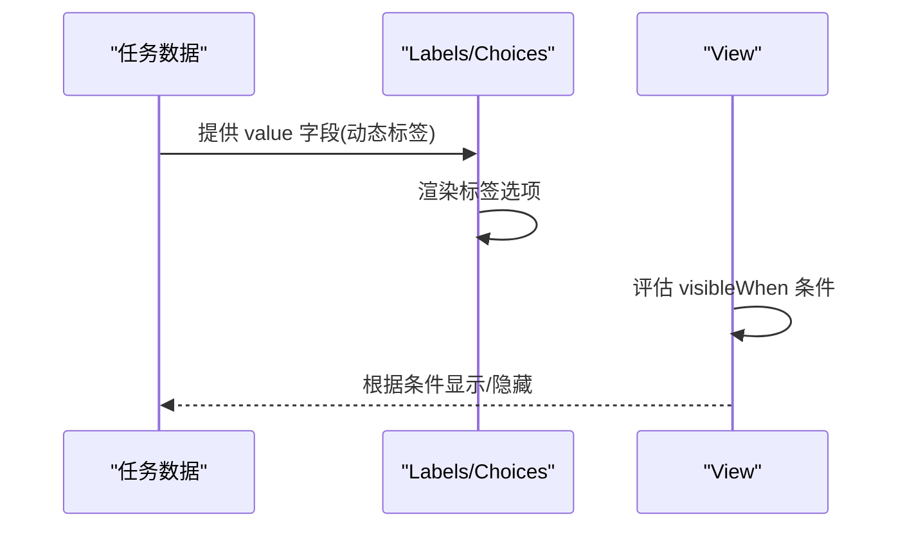
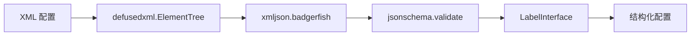
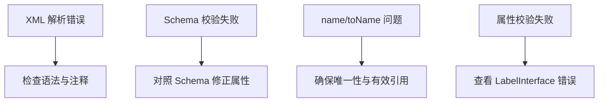

# 标签配置语言

<cite>
**本文引用的文件**   
- [label_config.py](file://label_studio/core/label_config.py)
- [label_config_schema.json](file://label_studio/core/utils/schema/label_config_schema.json)
- [index.md](file://docs/source/tags/index.md)
- [text.md](file://docs/source/tags/text.md)
- [labels.md](file://docs/source/tags/labels.md)
- [view.md](file://docs/source/tags/view.md)
- [includes_text.md](file://docs/source/includes/tags/text.md)
- [includes_labels.md](file://docs/source/includes/tags/labels.md)
- [includes_view.md](file://docs/source/includes/tags/view.md)
</cite>

## 目录
1. [简介](#简介)
2. [项目结构](#项目结构)
3. [核心组件](#核心组件)
4. [架构总览](#架构总览)
5. [详细组件分析](#详细组件分析)
6. [依赖关系分析](#依赖关系分析)
7. [性能考虑](#性能考虑)
8. [故障排查指南](#故障排查指南)
9. [结论](#结论)
10. [附录](#附录)

## 简介
本文件系统性阐述 Label Studio 的标签配置语言，覆盖 XML 配置语法、对象/控件/视觉三类标签、参数与属性定义、动态标签与条件显示、以及调试与性能优化建议。文档面向不同技术背景的读者，提供从概念到实现的渐进式说明，并给出可视化图示帮助理解。

## 项目结构
Label Studio 的标签配置语言由两部分组成：
- 前端文档与示例：位于 docs/source/tags 与 includes/tags，描述标签语义、参数、结果格式与示例。
- 后端解析与校验：位于 label_studio/core/label_config.py 与 schema JSON，负责将 XML 配置解析为结构化数据、进行 Schema 校验、提取数据类型、生成示例任务等。

**图表来源** 
- [label_config.py:80-104](file://label_studio/core/label_config.py#L80-L104)
- [label_config.py:107-143](file://label_studio/core/label_config.py#L107-L143)

**章节来源**
- [index.md:9-13](file://docs/source/tags/index.md#L9-L13)
- [label_config.py:80-104](file://label_studio/core/label_config.py#L80-L104)

## 核心组件
- 对象(Object)标签：用于展示可标注的数据对象，如 Text、Image、HyperText、Paragraphs、Video、Audio、TimeSeries 等。
- 控件(Control)标签：用于对对象进行标注，如 Labels、Choices、TextArea、Number、Rating 等。
- 视觉(Visual)标签：用于控制界面布局与样式，如 View、Header、Style 等。

关键要点：
- 所有控件与对象标签通过 name 与 toName 建立连接。
- 支持变量(value="$field")在参数中引用任务数据字段。
- 支持条件显示(visibleWhen, whenTagName, whenLabelValue, whenChoiceValue)。
- 支持动态标签(value="$dynamicLabels")从任务数据加载标签选项。

**章节来源**
- [index.md:33-53](file://docs/source/tags/index.md#L33-L53)
- [view.md:40-63](file://docs/source/tags/view.md#L40-L63)
- [labels.md:11-13](file://docs/source/tags/labels.md#L11-L13)

## 架构总览
下图展示了从 XML 配置到前端 UI 渲染与结果提交的完整流程，包括后端解析、校验、结构化输出与前端交互。

**图表来源** 
- [label_config.py:80-104](file://label_studio/core/label_config.py#L80-L104)
- [label_config.py:107-143](file://label_studio/core/label_config.py#L107-L143)

## 详细组件分析

### XML 配置语法与 Schema
- XML 解析：使用安全解析器解析 XML，移除注释，转换为 BadgerFish JSON。
- Schema 校验：基于 JSON Schema 验证配置结构，确保必填属性存在且类型正确。
- 名称唯一性校验：检查 name 的唯一性与 toName 引用有效性。
- 标签属性校验：通过 SDK 的 LabelInterface 执行更细粒度的属性校验。

**图表来源** 
- [label_config.py:80-104](file://label_studio/core/label_config.py#L80-L104)
- [label_config.py:107-143](file://label_studio/core/label_config.py#L107-L143)

**章节来源**
- [label_config.py:80-104](file://label_studio/core/label_config.py#L80-L104)
- [label_config.py:107-143](file://label_studio/core/label_config.py#L107-L143)
- [label_config_schema.json:1-257](file://label_studio/core/utils/schema/label_config_schema.json#L1-L257)

### 对象标签：Text
- 用途：展示文本内容，支持按字符/词/句/段落粒度选择区域。
- 关键参数：name、value、valueType、saveTextResult、encoding、selectionEnabled、highlightColor、showLabels、granularity。
- 结果格式：包含 start、end、可选 text 与 labels。

**图表来源** 
- [includes_text.md:1-35](file://docs/source/includes/tags/text.md#L1-L35)

**章节来源**
- [text.md:9-21](file://docs/source/tags/text.md#L9-L21)
- [includes_text.md:1-35](file://docs/source/includes/tags/text.md#L1-L35)

### 控件标签：Labels
- 用途：为对象区域提供标签集合，支持单选/多选、最大使用次数、内联显示、颜色与透明度等。
- 动态标签：通过 value="$dynamicLabels" 从任务数据加载标签列表，每个选项可携带额外参数（如 background、alias、showAlias）。
- 结果：与 Labels 关联的对象区域被赋予所选标签值。

**图表来源** 
- [labels.md:11-13](file://docs/source/tags/labels.md#L11-L13)
- [includes_labels.md:1-16](file://docs/source/includes/tags/labels.md#L1-L16)

**章节来源**
- [labels.md:11-13](file://docs/source/tags/labels.md#L11-L13)
- [includes_labels.md:1-16](file://docs/source/includes/tags/labels.md#L1-L16)

### 视觉标签：View
- 用途：控制区块显示方式，类似 HTML div，支持 CSS 样式、类名、ID 属性。
- 条件显示：visibleWhen 支持 region-selected、choice-selected、no-region-selected、choice-unselected；配合 whenTagName、whenLabelValue、whenChoiceValue 精确控制可见性。
- 典型用法：两列布局、根据选择状态显示附加输入框或标题。

**图表来源** 
- [includes_view.md:1-14](file://docs/source/includes/tags/view.md#L1-L14)
- [view.md:40-63](file://docs/source/tags/view.md#L40-L63)

**章节来源**
- [view.md:9-11](file://docs/source/tags/view.md#L9-L11)
- [includes_view.md:1-14](file://docs/source/includes/tags/view.md#L1-L14)

### 动态标签与条件显示
- 动态标签：在 Labels 或 Choices 中使用 value="$field"，任务数据需提供对应数组，每项可含 value、background、alias、showAlias 等。
- 条件显示：在 View 中使用 visibleWhen 与 when* 参数组合，实现基于区域选择或选项选择的动态 UI。

**图表来源** 
- [labels.md:30-52](file://docs/source/tags/labels.md#L30-L52)
- [view.md:40-63](file://docs/source/tags/view.md#L40-L63)

**章节来源**
- [labels.md:30-52](file://docs/source/tags/labels.md#L30-L52)
- [view.md:40-63](file://docs/source/tags/view.md#L40-L63)

### 自定义控件开发方法
- 插件机制：企业版支持通过插件扩展界面与工作流程，可使用 JavaScript 定制行为。
- 前端集成：通过插件注册自定义控件，并在 XML 配置中以标签形式引用。
- 事件处理：在插件中监听标注事件，更新 UI 或触发外部逻辑。

注：具体插件 API 与生命周期请参考官方插件文档。

[本节为概念性说明，未直接分析具体源码文件]

## 依赖关系分析
- 后端模块依赖：
  - defusedxml.ElementTree：安全解析 XML。
  - jsonschema：校验配置结构。
  - xmljson：将 XML 转为 JSON。
  - label_studio_sdk.label_interface.LabelInterface：执行标签属性校验。
- 文档与示例依赖：
  - docs/source/tags/*：标签文档与示例。
  - docs/source/includes/tags/*：参数与结果格式规范。

**图表来源** 
- [label_config.py:80-104](file://label_studio/core/label_config.py#L80-L104)
- [label_config.py:107-143](file://label_studio/core/label_config.py#L107-L143)

**章节来源**
- [label_config.py:80-104](file://label_studio/core/label_config.py#L80-L104)
- [label_config.py:107-143](file://label_studio/core/label_config.py#L107-L143)

## 性能考虑
- 避免不必要的重渲染：合理使用 View 的条件显示，减少 DOM 节点数量。
- 控制动态标签规模：动态标签数组过大可能影响渲染性能，建议分页或懒加载。
- 文本处理优化：对于大段文本，合理设置 granularity 与 saveTextResult，避免冗余计算。
- 资源加载：使用 valueType="url" 时注意网络延迟与缓存策略。

[本节为通用指导，未直接分析具体源码文件]

## 故障排查指南
常见问题与定位步骤：
- XML 解析错误：检查 XML 语法与注释格式，确认未启用 DTD。
- Schema 校验失败：对照 label_config_schema.json 检查必填属性与类型。
- name 重复或 toName 引用无效：确保 name 唯一且 toName 指向已定义的 name。
- 标签属性校验失败：参考 LabelInterface 的错误信息，修正属性值。

**章节来源**
- [label_config.py:80-104](file://label_studio/core/label_config.py#L80-L104)
- [label_config.py:107-143](file://label_studio/core/label_config.py#L107-L143)

## 结论
Label Studio 的标签配置语言以 XML 为基础，结合 Schema 校验与结构化解析，提供了强大的对象/控件/视觉标签体系。通过动态标签与条件显示，可实现灵活的标注界面；借助插件机制，可扩展自定义控件与工作流。遵循本文档的语法与最佳实践，可高效构建高质量标注任务。

[本节为总结性内容，未直接分析具体源码文件]

## 附录
- 常用标签速查：
  - 对象标签：Text、Image、HyperText、Paragraphs、Video、Audio、TimeSeries。
  - 控件标签：Labels、Choices、TextArea、Number、Rating。
  - 视觉标签：View、Header、Style。
- 结果格式参考：
  - Text 结果包含 start、end、可选 text 与 labels。
  - Labels 结果为与对象区域关联的标签值集合。

[本节为参考资料，未直接分析具体源码文件]