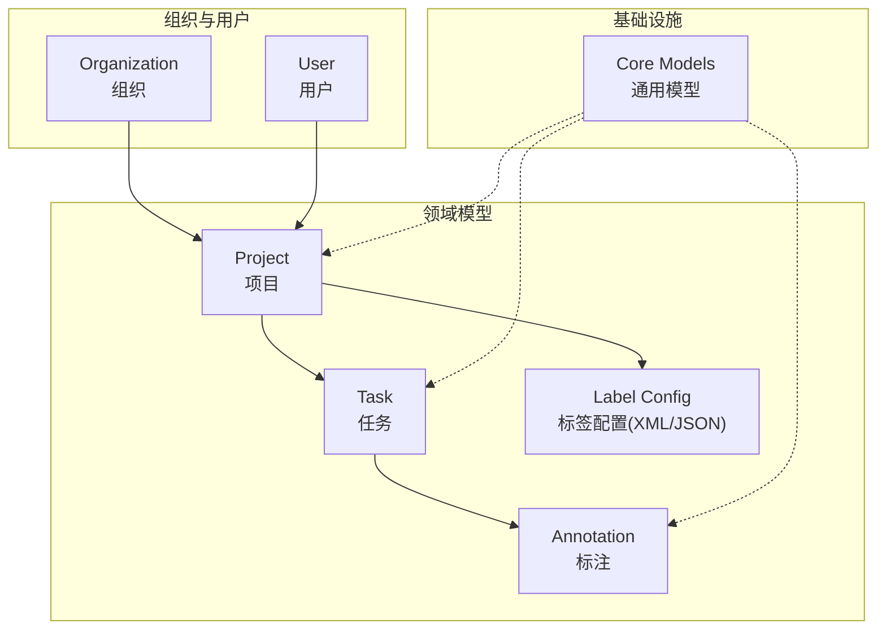
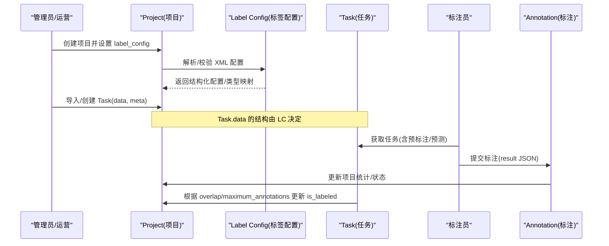
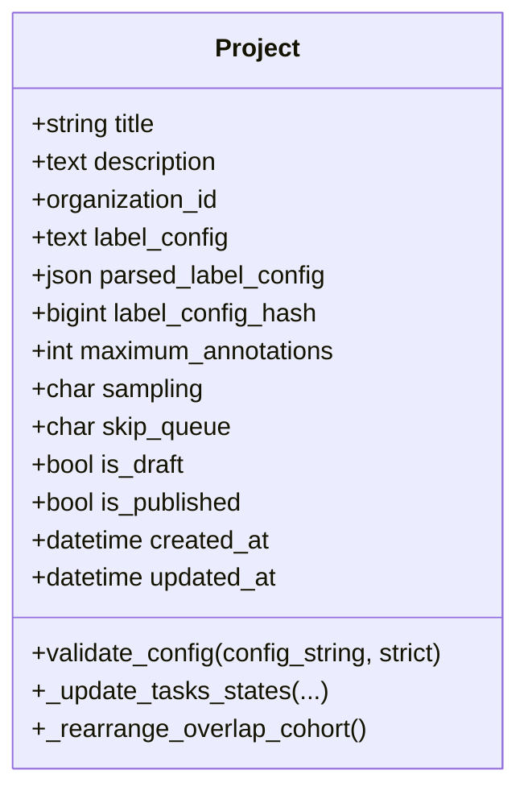
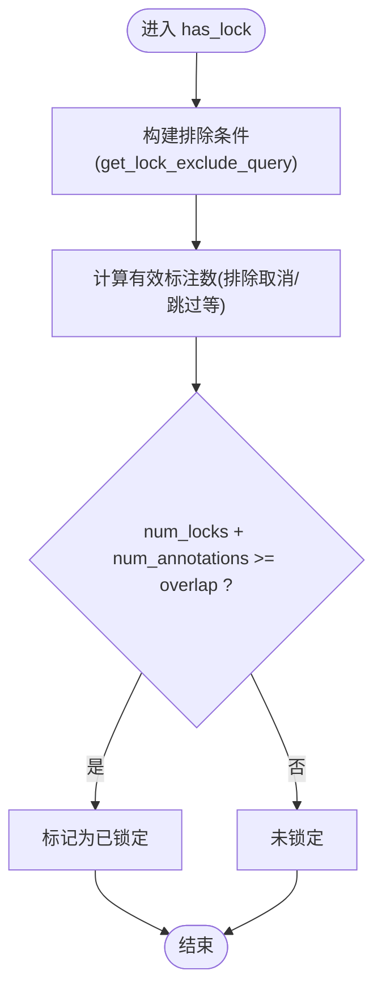
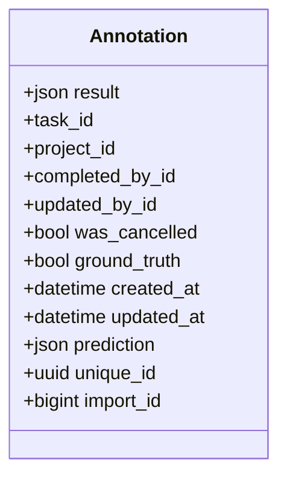
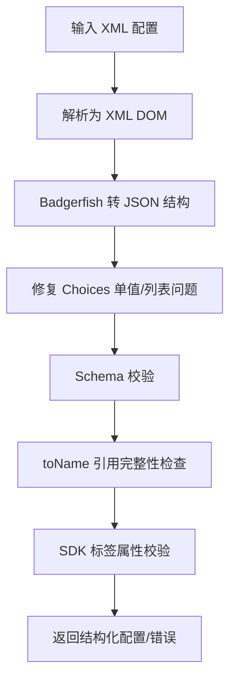
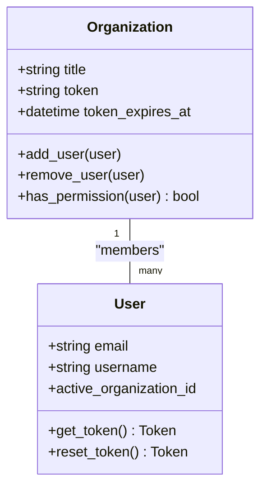
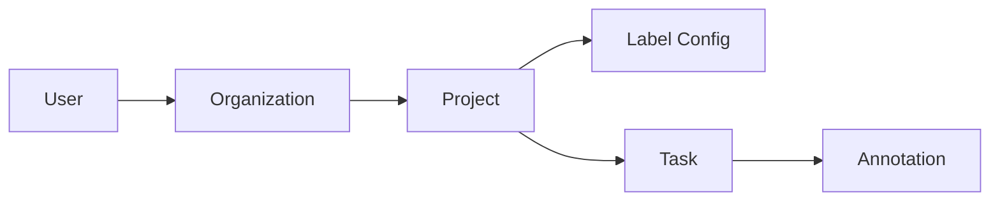

# 核心概念

<cite>
**本文引用的文件**   
- [README.md](file://README.md)
- [core/models.py](file://label_studio/core/models.py)
- [projects/models.py](file://label_studio/projects/models.py)
- [tasks/models.py](file://label_studio/tasks/models.py)
- [core/label_config.py](file://label_studio/core/label_config.py)
- [organizations/models.py](file://label_studio/organizations/models.py)
- [users/models.py](file://label_studio/users/models.py)
</cite>

## 目录
1. [简介](#简介)
2. [项目结构](#项目结构)
3. [核心组件](#核心组件)
4. [架构总览](#架构总览)
5. [详细组件分析](#详细组件分析)
6. [依赖关系分析](#依赖关系分析)
7. [性能考虑](#性能考虑)
8. [故障排查指南](#故障排查指南)
9. [结论](#结论)
10. [附录](#附录)

## 简介
本文件聚焦 Label Studio 的核心概念与数据模型，系统阐述以下主题：
- 项目（Project）、任务（Task）、标注（Annotation）、标签配置（Label Config）之间的关系与数据流
- 项目生命周期管理、任务状态机、标注结果格式与标签配置 XML 语法
- 多组织、多用户协作模式下的权限控制与数据隔离机制
- 实际使用场景与最佳实践建议，帮助开发者理解整体架构与数据流转

Label Studio 是一个开源的数据标注工具，支持图像、音频、文本、视频、时间序列等多种数据类型，提供灵活的标签配置与导出能力，并可与机器学习模型集成。

**章节来源**
- [README.md:8-22](file://README.md#L8-L22)

## 项目结构
从后端代码视角，核心领域模型分布在以下模块：
- 项目域：label_studio/projects/models.py
- 任务与标注域：label_studio/tasks/models.py
- 标签配置解析与校验：label_studio/core/label_config.py
- 组织与成员：label_studio/organizations/models.py
- 用户模型：label_studio/users/models.py
- 通用基础设施（异步迁移状态、删除行备份等）：label_studio/core/models.py

**图表来源**
- [projects/models.py:164-363](file://label_studio/projects/models.py#L164-L363)
- [tasks/models.py:66-195](file://label_studio/tasks/models.py#L66-L195)
- [tasks/models.py:685-800](file://label_studio/tasks/models.py#L685-L800)
- [core/label_config.py:107-143](file://label_studio/core/label_config.py#L107-L143)
- [organizations/models.py:107-185](file://label_studio/organizations/models.py#L107-L185)
- [users/models.py:103-164](file://label_studio/users/models.py#L103-L164)
- [core/models.py:12-85](file://label_studio/core/models.py#L12-L85)

**章节来源**
- [projects/models.py:164-363](file://label_studio/projects/models.py#L164-L363)
- [tasks/models.py:66-195](file://label_studio/tasks/models.py#L66-L195)
- [tasks/models.py:685-800](file://label_studio/tasks/models.py#L685-L800)
- [core/label_config.py:107-143](file://label_studio/core/label_config.py#L107-L143)
- [organizations/models.py:107-185](file://label_studio/organizations/models.py#L107-L185)
- [users/models.py:103-164](file://label_studio/users/models.py#L103-L164)
- [core/models.py:12-85](file://label_studio/core/models.py#L12-L85)

## 核心组件
本节对关键实体进行概览式说明，并在后续章节深入展开。

- 项目（Project）
  - 承载标签配置、采样策略、最大标注数、是否发布等元信息
  - 关联组织与创建者，维护统计计数与 FSM 状态
- 任务（Task）
  - 表示一条待标注的数据记录，包含 data、meta、overlap、is_labeled 等字段
  - 负责锁机制、预测预标注、存储 URI 解析等
- 标注（Annotation）
  - 保存标注结果 result（JSON），关联任务、项目、完成者
  - 支持草稿、历史、父/子标注、Ground Truth 等
- 标签配置（Label Config）
  - 以 XML 描述 UI 控件与输入对象，经解析为结构化 JSON 供前端渲染
  - 提供校验、示例生成、类型提取等功能

**章节来源**
- [projects/models.py:164-363](file://label_studio/projects/models.py#L164-L363)
- [tasks/models.py:66-195](file://label_studio/tasks/models.py#L66-L195)
- [tasks/models.py:685-800](file://label_studio/tasks/models.py#L685-L800)
- [core/label_config.py:107-143](file://label_studio/core/label_config.py#L107-L143)

## 架构总览
下图展示“项目—任务—标注”的主数据流，以及标签配置如何驱动任务数据的结构与标注结果的语义。

**图表来源**
- [projects/models.py:194-210](file://label_studio/projects/models.py#L194-L210)
- [core/label_config.py:107-143](file://label_studio/core/label_config.py#L107-L143)
- [tasks/models.py:76-98](file://label_studio/tasks/models.py#L76-L98)
- [tasks/models.py:690-750](file://label_studio/tasks/models.py#L690-L750)

## 详细组件分析

### 项目（Project）
- 关键字段
  - organization：所属组织，实现数据隔离
  - label_config/parsed_label_config/label_config_hash：XML 配置及其解析结果与哈希
  - maximum_annotations：单任务最大标注数，影响任务完成判定
  - sampling/skip_queue：采样策略与跳过队列行为
  - is_draft/is_published：项目草稿与发布状态
- 生命周期与状态
  - 继承 FSM 基类，具备状态机能力；在任务变更时触发项目状态重算
  - 软删除字段 deleted_at/deleted_by/purge_at 用于 LSE 扩展的生命周期管理
- 统计与聚合
  - 通过 Manager 的 with_counts 注解多种统计字段（任务数、标注数、预测数等）
- 配置一致性校验
  - validate_config 会对比已有标注/草稿与新的标签配置，确保向后兼容

**图表来源**
- [projects/models.py:164-363](file://label_studio/projects/models.py#L164-L363)
- [projects/models.py:497-609](file://label_studio/projects/models.py#L497-L609)
- [projects/models.py:644-800](file://label_studio/projects/models.py#L644-L800)

**章节来源**
- [projects/models.py:164-363](file://label_studio/projects/models.py#L164-L363)
- [projects/models.py:497-609](file://label_studio/projects/models.py#L497-L609)
- [projects/models.py:644-800](file://label_studio/projects/models.py#L644-L800)

### 任务（Task）
- 关键字段
  - project：所属项目
  - data/meta：任务数据与元数据，结构受项目标签配置约束
  - overlap：重叠标注人数阈值
  - is_labeled：是否已完成（达到 maximum_annotations）
  - file_upload：数据来源文件引用
- 并发与锁定
  - set_lock/release_lock/has_lock：基于过期时间的任务锁，防止重复标注
  - get_lock_exclude_query：根据 skip_queue 策略排除某些标注参与锁定判断
- 预测与预标注
  - get_predictions_for_prelabeling：按项目配置拉取或过滤预测结果
- 存储 URI 解析
  - resolve_uris/resolve_storage_uri：将云存储 URL 转换为可访问链接，支持代理与签名

**图表来源**
- [tasks/models.py:316-357](file://label_studio/tasks/models.py#L316-L357)
- [tasks/models.py:280-314](file://label_studio/tasks/models.py#L280-L314)

**章节来源**
- [tasks/models.py:66-195](file://label_studio/tasks/models.py#L66-L195)
- [tasks/models.py:239-278](file://label_studio/tasks/models.py#L239-L278)
- [tasks/models.py:280-357](file://label_studio/tasks/models.py#L280-L357)
- [tasks/models.py:461-540](file://label_studio/tasks/models.py#L461-L540)

### 标注（Annotation）
- 关键字段
  - task/project：关联任务与项目（冗余外键便于查询）
  - result：标注结果（JSON），由标签配置定义的结构化输出
  - completed_by/updated_by：创建者与最后更新者
  - was_cancelled/ground_truth：是否跳过/是否为 Ground Truth
  - parent_prediction/parent_annotation：溯源父预测/父标注
  - import_id/unique_id：导入 ID 与唯一标识
- 批量创建与信号
  - AnnotationManager.bulk_create 发送 pre_bulk_create/post_bulk_create 信号，便于外部监听

**图表来源**
- [tasks/models.py:685-800](file://label_studio/tasks/models.py#L685-L800)

**章节来源**
- [tasks/models.py:685-800](file://label_studio/tasks/models.py#L685-L800)

### 标签配置（Label Config）
- XML 语法与解析
  - parse_config_to_xml/parse_config_to_json：将 XML 转为结构化字典，去除注释并规范化 Choices
  - validate_label_config：基于 schema 校验、toName 引用检查、SDK 属性校验
- 类型与字段提取
  - extract_data_types：从 value/valueList 推导数据字段类型映射
  - get_all_labels/get_all_control_tag_tuples：提取标签集合与控制标签元组
- 示例生成
  - generate_sample_task_without_check/get_sample_task：根据配置生成预览/上传示例数据
- 正则匹配辅助
  - check_control_in_config_by_regex/check_toname_in_config_by_regex/get_original_fromname_by_regex：支持动态标签名与 to_name 的正则匹配

**图表来源**
- [core/label_config.py:80-104](file://label_studio/core/label_config.py#L80-L104)
- [core/label_config.py:107-143](file://label_studio/core/label_config.py#L107-L143)

**章节来源**
- [core/label_config.py:80-104](file://label_studio/core/label_config.py#L80-L104)
- [core/label_config.py:107-143](file://label_studio/core/label_config.py#L107-L143)
- [core/label_config.py:146-178](file://label_studio/core/label_config.py#L146-L178)
- [core/label_config.py:181-208](file://label_studio/core/label_config.py#L181-L208)
- [core/label_config.py:224-248](file://label_studio/core/label_config.py#L224-L248)
- [core/label_config.py:268-380](file://label_studio/core/label_config.py#L268-L380)
- [core/label_config.py:479-548](file://label_studio/core/label_config.py#L479-L548)

### 组织与用户（多组织、多用户协作）
- 组织（Organization）
  - 通过 members 与 users 建立多对多关系，支持邀请令牌与过期策略
  - has_permission/has_user 等方法用于权限判断
- 用户（User）
  - 抽象用户模型，包含邮箱、头像、活动信息等
  - active_organization 指向当前活跃组织，用于数据范围限定
- 数据隔离
  - Project.objects.for_user(user) 默认按 user.active_organization 过滤
  - Annotation.objects.for_user(user) 同样按组织范围过滤

**图表来源**
- [organizations/models.py:107-185](file://label_studio/organizations/models.py#L107-L185)
- [users/models.py:103-164](file://label_studio/users/models.py#L103-L164)

**章节来源**
- [organizations/models.py:107-185](file://label_studio/organizations/models.py#L107-L185)
- [users/models.py:103-164](file://label_studio/users/models.py#L103-L164)
- [projects/models.py:112-124](file://label_studio/projects/models.py#L112-L124)
- [tasks/models.py:668-673](file://label_studio/tasks/models.py#L668-L673)

## 依赖关系分析
- 项目依赖标签配置解析与校验，任务数据结构与标注结果均受其约束
- 任务与标注通过外键与项目关联，同时通过组织维度进行数据隔离
- 用户通过组织成员关系获得项目访问权限

**图表来源**
- [projects/models.py:194-210](file://label_studio/projects/models.py#L194-L210)
- [tasks/models.py:92-98](file://label_studio/tasks/models.py#L92-L98)
- [tasks/models.py:697-711](file://label_studio/tasks/models.py#L697-L711)
- [organizations/models.py:122-123](file://label_studio/organizations/models.py#L122-L123)

**章节来源**
- [projects/models.py:194-210](file://label_studio/projects/models.py#L194-L210)
- [tasks/models.py:92-98](file://label_studio/tasks/models.py#L92-L98)
- [tasks/models.py:697-711](file://label_studio/tasks/models.py#L697-L711)
- [organizations/models.py:122-123](file://label_studio/organizations/models.py#L122-L123)

## 性能考虑
- 项目统计注解
  - ProjectManager.with_counts 通过函数式注解避免 N+1 查询，提升列表页性能
- 任务批量操作
  - Task.delete_tasks_without_signals 使用 batch_delete 降低内存占用
- 任务锁与并发
  - 基于过期时间的锁机制减少数据库竞争；custom_task_lock_ttl 允许按项目调整 TTL
- 存储 URI 解析
  - resolve_uris 遍历项目所有存储对象，按需解析，避免不必要的 I/O

**章节来源**
- [projects/models.py:126-143](file://label_studio/projects/models.py#L126-L143)
- [tasks/models.py:596-617](file://label_studio/tasks/models.py#L596-L617)
- [tasks/models.py:403-443](file://label_studio/tasks/models.py#L403-L443)
- [tasks/models.py:475-540](file://label_studio/tasks/models.py#L475-L540)

## 故障排查指南
- 标签配置校验失败
  - 常见原因：XML 不合法、schema 不匹配、toName 引用缺失、SDK 属性校验失败
  - 定位方法：查看 validate_label_config 抛出的 ValidationError 详情
- 任务被意外锁定
  - 检查 overlap 与 skip_queue 配置，确认 get_lock_exclude_query 的排除逻辑是否符合预期
- 项目状态不一致
  - 当任务数量变化或 overlap 配置改变时，调用 _update_tasks_states/_rearrange_overlap_cohort 重新计算 is_labeled
- 组织/用户权限异常
  - 确认用户属于目标组织且未被软删除；检查 Project.objects.for_user 的组织过滤

**章节来源**
- [core/label_config.py:107-143](file://label_studio/core/label_config.py#L107-L143)
- [tasks/models.py:280-357](file://label_studio/tasks/models.py#L280-L357)
- [projects/models.py:497-609](file://label_studio/projects/models.py#L497-L609)
- [organizations/models.py:175-185](file://label_studio/organizations/models.py#L175-L185)

## 结论
Label Studio 的核心围绕“项目—任务—标注—标签配置”这一主线展开：
- 项目定义标注规则与流程策略
- 任务承载具体数据与并发控制
- 标注产出结构化结果并与项目/任务关联
- 标签配置作为契约，贯穿数据导入、界面渲染与结果校验
在多组织、多用户协作场景中，组织与用户模型提供权限与数据隔离基础，配合项目的可见性管理与任务的锁机制，保障协作效率与数据一致性。

## 附录

### 使用场景与最佳实践
- 场景一：图像分类
  - 在项目中配置 Image + Labels，导入图片数据后批量标注，利用 maximum_annotations 控制多人标注质量
- 场景二：命名实体识别
  - 使用 Text + Labels，结合正则 toName 支持动态字段；通过 validate_config 保证新旧配置兼容
- 场景三：视频时序标注
  - 使用 VideoRectangle/VideoVector 与 Labels 组合，注意标签值来源于兄弟 Labels 标签
- 最佳实践
  - 先设计稳定的标签配置，再导入数据，避免频繁变更导致的不兼容
  - 合理设置 overlap 与 skip_queue，平衡标注质量与效率
  - 使用组织与成员管理实现团队级数据隔离与权限控制

[无直接文件分析，无需列出章节来源]